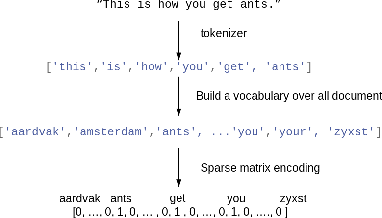
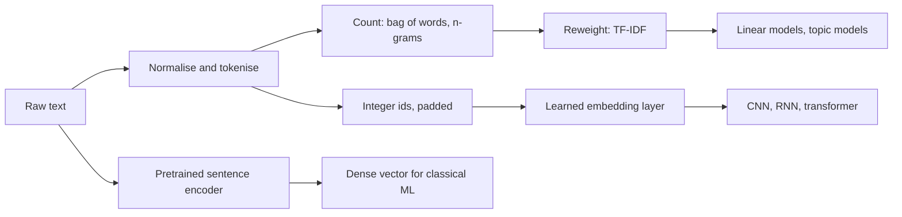

# Text representation

A model cannot read. Before any classifier, topic model or neural network sees a film review, somebody has decided how that text becomes numbers, and those decisions quietly set what the model is able to learn. Remove "not" as a stop word and a sentiment model can no longer tell "good" from "not good". Fit the vocabulary on the test set and your accuracy is a small lie. Truncate at the wrong length and half of each document never reaches the network.

**In plain words.** A computer can only do sums, so before it can sort emails or search reviews, someone has to turn the words into numbers. The simplest way is a tally of how often each word appears in each document, like a till receipt that lists what you bought but not the order you picked it up in. The choices made here decide what any later model can see, since a tally that throws away "not" can no longer tell a good review from a bad one. This chapter makes those choices on film descriptions and shows what each one costs.

There are two classical routes. One cleans and normalises the text, splits it into tokens, then counts them (bag of words, n-grams) and reweights the counts (TF-IDF) into a sparse document-term matrix. The other maps tokens to integer ids, pads them to a fixed length, and lets an embedding layer learn the vectors. Both begin with the same preprocessing decisions, and this chapter makes those decisions on a real corpus: the 4,803 film descriptions of the TMDB 5000 dataset, which ships with the repo and runs through the whole pillar.

## Where text sits among data types

Müller and Guido (*Introduction to Machine Learning with Python*, ch. 7, M&G from here on) sort string columns into four kinds before doing anything:

| Kind | Example | Treat as |
|---|---|---|
| Categorical | Favourite colour from a dropdown | One-hot ([feature engineering](../../01-classical-ml/notes/03-feature-engineering-and-pipelines.md#categorical-variables)) |
| Free strings that map to categories | "midnight blue", "blu" typed by hand | Clean into categories |
| Structured strings | Addresses, dates, phone numbers | Parse into fields |
| Text | Reviews, tweets, documents | This chapter |

The vocabulary of the field is small. A **document** is one text item, the **corpus** is the collection, a **token** is a unit after splitting, and the **vocabulary** is the set of distinct tokens.

```python
from pathlib import Path
import json
import pandas as pd

DATA = Path("../practice/text-analytics-with-python/Ch07 - Text Similarity and Clustering/tmdb_5000_movies.csv.gz")
movies = pd.read_csv(DATA)
movies["description"] = movies["tagline"].fillna("") + " " + movies["overview"].fillna("")
movies["genre_list"] = movies["genres"].map(lambda g: [x["name"] for x in json.loads(g)])
print(movies.shape)
print(movies.loc[movies.title == "Minions", "description"].iloc[0][:200])
print("median words per description:", int(movies.description.str.split().str.len().median()))
```

```text
(4803, 22)
Before Gru, they had a history of bad bosses Minions Stuart, Kevin and Bob are recruited by Scarlet Overkill, a super-villain who, alongside her inventor husband Herb, hatches a plot to take over the
median words per description: 55
```

## The preprocessing pipeline

Sarkar's chapter 3 (*Text Analytics with Python*, 2nd ed.) and the condensed NLP course notebooks build the same chain. Not every step helps every task. For sentiment, removing "not" destroys the signal, and for neural models less preprocessing is usually better, because the model can learn what a step would have thrown away.

| Step | Tool | Example | Skip when |
|---|---|---|---|
| Strip HTML / markup | `BeautifulSoup(text, "html.parser").get_text()` | `<br />` in IMDb reviews | Clean input |
| Remove accents | `unicodedata.normalize("NFKD", t).encode("ascii", "ignore").decode()` | café → cafe | Non-English text |
| Expand contractions | Sarkar's `contractions.py` `CONTRACTION_MAP` + regex | can't → cannot | Subword tokenisers |
| Lower-case | `t.lower()` | | Case carries meaning (NER) |
| Remove special characters / digits | `re.sub(r"[^a-zA-Z0-9\s]", "", t)` | | Numbers or emoji matter |
| Sentence tokenise | `nltk.sent_tokenize` (Punkt) | | |
| Word tokenise | `nltk.word_tokenize` (Treebank), `RegexpTokenizer`, `ToktokTokenizer`, spaCy | "Don't" → "Do", "n't" | |
| Remove stop words | `nltk.corpus.stopwords.words("english")`, sklearn `stop_words="english"` | the, is, and | Sentiment (keep negations), neural models |
| Correct spelling / repeats | Norvig's corrector on `big.txt`; regex for "finallllly" | | Rarely worth it |
| Stem | `PorterStemmer`, `LancasterStemmer` (aggressive), `SnowballStemmer("german")` | jumping, jumps → jump | Need real words |
| Lemmatise | `WordNetLemmatizer().lemmatize("cars", "n")`, spaCy `token.lemma_` | better → good (adj) | Speed matters |

Here is that chain as one function, with spaCy for lemmas. It keeps "no" and "not", for the reason above, and it expands negative contractions first. Without that step the regex would turn "weren't" into "weren t", and the negation would vanish even though "not" is safe in the stop-word list. The order of these steps matters as much as the steps.

```python
import re, unicodedata
import nltk, spacy

nltk.download("stopwords", quiet=True)
nlp = spacy.load("en_core_web_sm", disable=["ner", "parser"])   # spaCy 3 name; the notebooks use 'en' or 'en_core'
stop = set(nltk.corpus.stopwords.words("english")) - {"no", "not"}

def normalize(doc, lemmatize=True, expand=True):
    if expand:
        doc = re.sub(r"can't", "can not", doc, flags=re.I)      # Sarkar's contractions.py has the full map
        doc = re.sub(r"won't", "will not", doc, flags=re.I)
        doc = re.sub(r"n't\b", " not", doc, flags=re.I)
    doc = unicodedata.normalize("NFKD", doc).encode("ascii", "ignore").decode("utf-8")
    doc = re.sub(r"[^a-zA-Z\s]", " ", doc.lower())
    tokens = [t.lemma_ if lemmatize else t.text for t in nlp(doc)]
    return " ".join(t for t in tokens if t.strip() and t not in stop)

sentence = "The brown foxes weren't jumping over the lazy dogs!"
print("no expansion:  ", normalize(sentence, expand=False))
print("with expansion:", normalize(sentence))
print(normalize(movies.description[0]))
```

```text
no expansion:   brown fox jump lazy dog
with expansion: brown fox not jump lazy dog
enter world pandora nd century paraplegic marine dispatch moon pandora unique mission become tear follow order protect alien civilization
```

**Stemming and lemmatisation.** A stemmer chops suffixes by rule. It is fast and may produce non-words. A lemmatiser looks up the dictionary form using the part of speech, which is slower and produces real words. The output below shows the difference, and also why part of speech matters: alone, "better" is read as an adverb and maps to "well", whereas as an adjective it would map to "good". M&G compare both on IMDb and find that lemmatisation gives a slightly better and smaller vocabulary, but the gain over plain tokens is small, and larger when training data is scarce.

```python
from nltk.stem import PorterStemmer, LancasterStemmer

porter, lancaster = PorterStemmer(), LancasterStemmer()
print(f"{'word':12} {'porter':10} {'lancaster':10} spacy lemma")
for word in ["jumping", "strange", "lying", "studies", "organization", "better"]:
    print(f"{word:12} {porter.stem(word):10} {lancaster.stem(word):10} {nlp(word)[0].lemma_}")
```

```text
word         porter     lancaster  spacy lemma
jumping      jump       jump       jump
strange      strang     strange    strange
lying        lie        lying      lie
studies      studi      study      study
organization organ      org        organization
better       better     bet        well
```

### Linguistic structure (Sarkar ch. 1, 3b)

Beyond tokens, Sarkar's chapter 3b covers the syntax layer that later chapters use:

| Analysis | Output | Tool |
|---|---|---|
| POS tagging | `("fox", "NN")`, `("jumps", "VBZ")`; Penn Treebank tags | `nltk.pos_tag`, spaCy `token.tag_` / `token.pos_` |
| Shallow parsing (chunking) | Noun phrases `[The brown fox]` | `nltk.RegexpParser` grammar, n-gram taggers trained on conll2000 |
| Dependency parsing | Head → dependent arcs (`nsubj`, `dobj`) | spaCy `token.dep_`, `token.head` |
| Constituency parsing | Phrase-structure tree | Stanford CoreNLP (Ch03c, needs a Java server) |

```python
parser = spacy.load("en_core_web_sm")
parsed = parser("The brown fox is quick and he is jumping over the lazy dog")
print([(t.text, t.tag_) for t in parsed][:5])
print([(t.text, t.dep_, t.head.text) for t in parsed if t.dep_ in {"nsubj", "acomp", "pobj"}])
print([chunk.text for chunk in parsed.noun_chunks])
```

```text
[('The', 'DT'), ('brown', 'JJ'), ('fox', 'NN'), ('is', 'VBZ'), ('quick', 'JJ')]
[('fox', 'nsubj', 'is'), ('quick', 'acomp', 'is'), ('he', 'nsubj', 'jumping'), ('dog', 'pobj', 'over')]
['The brown fox', 'he', 'the lazy dog']
```

These features power the rule-based extraction in [semantic analysis and NER](05-semantic-analysis-and-ner.md) and the keyphrase chunking in [topic models](03-topic-models-and-summarization.md).

## Bag of words

Ignore order, and represent each document by how often each vocabulary word appears. This sounds too crude to work, and on many tasks it is close to the best you can do with a few thousand labels. The reason is that which words a document uses says a lot about what it is about, and much of the rest needs far more data to learn.


*Image source: Müller & Guido, Introduction to Machine Learning with Python, companion repo `images/bag_of_words.png`*

```python
from sklearn.feature_extraction.text import CountVectorizer

corpus = ["The sky is blue and beautiful.",
          "Love this blue and beautiful sky!",
          "The quick brown fox jumps over the lazy dog."]
cv = CountVectorizer()
X = cv.fit_transform(corpus)          # scipy.sparse CSR matrix: (n_docs, n_vocab)
print(X.shape, list(cv.get_feature_names_out()))
print(X.toarray()[0])                 # counts for document 0
```

```text
(3, 15) ['and', 'beautiful', 'blue', 'brown', 'dog', 'fox', 'is', 'jumps', 'lazy', 'love', 'over', 'quick', 'sky', 'the', 'this']
[1 1 1 0 0 0 1 0 0 0 0 0 1 1 0]
```

The matrix is **sparse**. M&G's IMDb vocabulary of 25,000 reviews has 74,849 words and each review uses a few hundred. Keep it as `scipy.sparse`, because `.toarray()` on real data runs out of memory.

### Controlling the vocabulary

| Parameter | Effect | M&G on IMDb |
|---|---|---|
| `min_df=5` | Drop tokens in fewer than 5 documents (typos, rare names) | 74,849 → 27,271 features, same accuracy |
| `max_df=0.9` | Drop tokens in more than 90% of documents (corpus-specific stop words) | |
| `stop_words="english"` | Drop sklearn's 318-word list | Slightly worse; more useful for small data |
| `max_features=10_000` | Keep the most frequent | |
| `token_pattern` | Default `r"\b\w\w+\b"` drops one-letter tokens | |
| `tokenizer=`, `preprocessor=` | Plug in spaCy/NLTK | Lemmatisation experiment |

The effect on our corpus is just as strong.

```python
texts = movies.description
for label, params in [("default", {}),
                      ("min_df=5", {"min_df": 5}),
                      ("min_df=5, max_df=0.5", {"min_df": 5, "max_df": 0.5}),
                      ("stop_words + min_df=5", {"min_df": 5, "stop_words": "english"}),
                      ("(1,2)-grams", {"ngram_range": (1, 2)}),
                      ("(1,3)-grams", {"ngram_range": (1, 3)}),
                      ("(1,3)-grams, min_df=5", {"ngram_range": (1, 3), "min_df": 5})]:
    M = CountVectorizer(**params).fit_transform(texts)
    print(f"{label:24} {M.shape[1]:>8,} features  {M.nnz / M.shape[0] / M.shape[1]:.3%} non-zero")
```

```text
default                    21,809 features  0.209% non-zero
min_df=5                    5,435 features  0.738% non-zero
min_df=5, max_df=0.5        5,429 features  0.660% non-zero
stop_words + min_df=5       5,175 features  0.451% non-zero
(1,2)-grams               168,646 features  0.059% non-zero
(1,3)-grams               398,412 features  0.039% non-zero
(1,3)-grams, min_df=5      13,657 features  0.460% non-zero
```

`min_df=5` removes three quarters of the vocabulary. Trigrams take it from about 22,000 to about 400,000 features, and `min_df=5` brings that back to under 14,000. `max_df=0.5` removes only six words here, because very few words occur in half of these short descriptions, and that tells you to look at your own data before copying a setting.

### n-grams

Single words lose "not good" and "Supreme Court". Adding pairs and triples recovers some local order, at the price of many more features. On IMDb, M&G's `(1, 3)` range with TF-IDF and logistic regression goes from 0.89 to 0.91. Pair n-grams with `min_df`, since most long n-grams occur once and teach nothing.

```python
cv12 = CountVectorizer(ngram_range=(1, 2), min_df=5)
cv12.fit(texts)
names = cv12.get_feature_names_out()
print([n for n in names if n.startswith(("not ", "new york", "world war"))][:12])
```

```text
['new york', 'new yorker', 'new yorkers', 'not all', 'not alone', 'not as', 'not be', 'not every', 'not everyone', 'not going', 'not in', 'not just']
```

## TF-IDF

Raw counts over-weight words that are common everywhere. Term frequency–inverse document frequency weights a term by how often it appears in *this* document and how rare it is across the corpus:

$$\text{tfidf}(t, d) = \text{tf}(t, d) \cdot \left(\ln \frac{1 + N}{1 + \text{df}(t)} + 1\right)$$

with each row L2-normalised. That is scikit-learn's default (`smooth_idf=True`, `norm="l2"`). Sarkar's chapter 4a computes it from scratch and then checks that the result matches `TfidfVectorizer` exactly. Doing the same is the quickest way to know there is no magic in it.

```python
import numpy as np
from collections import Counter
from sklearn.feature_extraction.text import TfidfVectorizer

norm_corpus = [" ".join(re.findall(r"\b\w\w+\b", d.lower())) for d in corpus]
docs = [d.split() for d in norm_corpus]
vocab = sorted({w for d in docs for w in d})
tf = np.array([[Counter(d)[w] for w in vocab] for d in docs], dtype=float)
df = (tf > 0).sum(axis=0)
idf = 1 + np.log((1 + len(docs)) / (1 + df))
tfidf = tf * idf
tfidf /= np.linalg.norm(tfidf, axis=1, keepdims=True)

print("matches sklearn:", np.allclose(tfidf, TfidfVectorizer().fit_transform(norm_corpus).toarray()))
print({w: round(float(x), 2) for w, x in zip(vocab, tfidf[0]) if x > 0})
```

```text
matches sklearn: True
{'and': 0.39, 'beautiful': 0.39, 'blue': 0.39, 'is': 0.51, 'sky': 0.39, 'the': 0.39}
```

**TF-IDF is a fitted transform.** The IDF comes from the training corpus, so it belongs inside the pipeline, for the same reason as any scaler ([why pipelines exist](../../01-classical-ml/notes/03-feature-engineering-and-pipelines.md#leakage-and-why-pipelines-exist)). M&G show that the words with the lowest IDF on IMDb are "the", "and", "movie", "film": corpus-specific stop words that TF-IDF finds by itself. Our corpus has its own.

```python
tv = TfidfVectorizer(min_df=5, ngram_range=(1, 2), sublinear_tf=True)   # sublinear: 1 + log(tf)
tv_matrix = tv.fit_transform(texts)
order = np.argsort(tv.idf_)
print("lowest idf: ", list(tv.get_feature_names_out()[order[:15]]))
print("highest idf:", list(tv.get_feature_names_out()[order[-6:]]))
```

```text
lowest idf:  ['the', 'to', 'and', 'of', 'in', 'is', 'his', 'with', 'for', 'on', 'an', 'he', 'that', 'who', 'when']
highest idf: ['overprotective', 'overrun by', 'go in', 'go from', 'god and', 'movements']
```

## Document similarity from the vectors

Once documents are vectors, **cosine similarity** compares them independent of length. Sarkar's chapter 4a clusters an 8-document toy corpus (weather, animals, food) with Ward linkage on that similarity matrix and recovers the three topics, and it does the same with LDA topic features. On real descriptions the results show both what this buys and where it stops.

```python
from sklearn.metrics.pairwise import linear_kernel    # TF-IDF rows are unit length, so a dot product is cosine

def nearest(title, k=4):
    i = movies.index[movies.title == title][0]
    sims = linear_kernel(tv_matrix[i], tv_matrix).ravel()
    return list(movies.title.iloc[np.argsort(-sims)[1:k + 1]])

for title in ["Toy Story", "Alien", "The Godfather"]:
    print(title, "->", nearest(title))
```

```text
Toy Story -> ['Toy Story 2', 'Toy Story 3', 'Free Birds', 'Stepmom']
Alien -> ["The Hitchhiker's Guide to the Galaxy", 'Aliens', 'I Think I Love My Wife', 'Star Trek: Insurrection']
The Godfather -> ['Three Men and a Baby', 'Blood Ties', 'Mickey Blue Eyes', 'Made']
```

Toy Story finds its sequels, and Alien finds Aliens, among films that merely use the word. The Godfather lands on *Three Men and a Baby*, presumably through shared family vocabulary, because TF-IDF knows which words match and nothing about what they mean. That gap is why dense vectors exist. [Embeddings and similarity](04-embeddings-and-similarity.md) builds a recommender on this idea, and [topic models](03-topic-models-and-summarization.md) goes further with the same matrix.

## Sequences for neural models

Neural text models (the condensed NLP course, Sarkar's chapters 4b and 10) do not count. They encode each document as a sequence of integer token ids, pad to a common length, and feed an embedding layer. Order survives, which is the point.

```python
from tensorflow.keras.preprocessing.text import Tokenizer
from tensorflow.keras.preprocessing.sequence import pad_sequences

sentences = ["I love my dog", "I love my cat", "Do you think my dog is amazing?"]
tok = Tokenizer(num_words=1000, oov_token="<OOV>")   # ids for the 1000 most frequent; others -> <OOV>
tok.fit_on_texts(sentences)
print(tok.word_index)                                # 0 is reserved for padding
seqs = tok.texts_to_sequences(["my dog loves my manatee"])
print(seqs)
print(pad_sequences(seqs, maxlen=10, padding="post", truncating="post"))
```

```text
{'<OOV>': 1, 'my': 2, 'i': 3, 'love': 4, 'dog': 5, 'cat': 6, 'do': 7, 'you': 8, 'think': 9, 'is': 10, 'amazing': 11}
[[2, 5, 1, 2, 1]]
[[2 5 1 2 1 0 0 0 0 0]]
```

`Tokenizer` and `pad_sequences` are legacy Keras utilities. In current TensorFlow you would use the `TextVectorization` layer, which puts the vocabulary inside the model so that training and serving share one code path.

```python
import tensorflow as tf

vec = tf.keras.layers.TextVectorization(max_tokens=10_000, output_sequence_length=120)
vec.adapt(texts.tolist())                  # learns the vocabulary
print([str(w) for w in vec.get_vocabulary()[:8]])
print(vec(["A young wizard goes to school"]).numpy()[0][:8])
lengths = texts.str.split().str.len()
print("length percentiles (50, 90, 95, 99):", np.percentile(lengths, [50, 90, 95, 99]).astype(int))
```

```text
['', '[UNK]', 'the', 'a', 'to', 'and', 'of', 'in']
[   3   41 2022  192    4   90    0    0]
length percentiles (50, 90, 95, 99): [ 55  93 113 152]
```

| Decision | Options | Note |
|---|---|---|
| Vocabulary size | 5k–50k words | Rare words → OOV |
| OOV token | Always set one | Otherwise unseen words silently vanish |
| Sequence length | Cover ~90–95% of documents | Plot the length distribution |
| Padding / truncating | `"pre"` (default) or `"post"` | For RNNs, `pre`-padding keeps the real tokens near the final state |

Word-level vocabularies cannot handle new words or misspellings. Transformer models use **subword** tokenisation (BPE, WordPiece) instead. The [Hugging Face pipelines](../../02-deep-learning/notes/06-neural-text-models.md#transformers-pipelines) use one, and [nanoGPT](../../../generative-ai/09-llms-from-scratch/notes/03-nanogpt.md) and the [LLM fundamentals pillar](../../../generative-ai/01-llm-fundamentals/README.md) build BPE.

## Choosing a representation

The figure shows how the two routes relate, and the table says what each gives you.



| Representation | Dimensions | Order kept? | Semantics? | Use with |
|---|---|---|---|---|
| Bag of words (counts / binary) | Vocabulary size, sparse | No | No | Naive Bayes, linear models |
| n-gram TF-IDF | Larger, sparse | Locally | No | Linear models: the strong classical baseline ([text classification](02-text-classification.md)) |
| Topic proportions (LDA, NMF) | 10–200, dense | No | Coarse | Exploration, features ([topic models](03-topic-models-and-summarization.md)) |
| Averaged word vectors | 100–300, dense | No | Yes | Small data ([embeddings](04-embeddings-and-similarity.md)) |
| Token-id sequences + learned embedding | Sequence × embed dim | Yes | Learned | CNN / RNN / transformer ([neural text models](../../02-deep-learning/notes/06-neural-text-models.md)) |
| Sentence embeddings | 384–1024, dense | Encoded | Yes | Retrieval, few-shot classification ([LLM embeddings as features](07-llm-embeddings-as-features.md)) |

## Reading and notebooks

- *Natural Language Processing with Python* (Bird, Klein & Loper) in [`sources/`](../../sources/bird-klein-loper-nlp-with-python.pdf): chapters 1–3 (corpora, raw text, regex, normalisation) and 5 (tagging) are the NLTK reference for this chapter.
- Sarkar's *Text Analytics with Python*: the 2nd edition's chapters 3–4 match the notebooks below. The [PDF in `sources/`](../../sources/sarkar-text-analytics-with-python-2e.pdf) has the text of the 1st edition despite its file name (2016, seven chapters), where this material is in chapters 3–4 too, in shorter form.
- M&G chapter 7 in [`sources/`](../../sources/mueller-guido-introduction-to-ml-with-python.pdf).

| Notebook | Covers | Runs |
|---|---|---|
| [`Ch01 - Natural Language Processing Basics`](../practice/text-analytics-with-python/Ch01%20-%20Natural%20Language%20Processing%20Basics) | Corpora, POS-tagged sentences | Needs `nltk` data downloads; spaCy 2 model shortcut `'en'` → use `en_core_web_sm` |
| [`Ch02 - Python for NLP`](../practice/text-analytics-with-python/Ch02%20-%20Python%20for%20Natural%20Language%20Processing) | Strings, regex | Runs offline |
| [`Ch03a - Text Wrangling`](../practice/text-analytics-with-python/Ch03%20-%20Processing%20and%20Understanding%20Text/Ch03a%20-%20Text%20Wrangling.ipynb), `Ch03b` | Tokenisation, normalisation, stemming, POS, chunking, parsing | Needs `nltk` data, spaCy model (`'en_core'` → `en_core_web_sm`), local `contractions.py` and `big.txt` |
| `Ch03c - BONUS - Stanford CoreNLP` | Constituency/dependency parsing via CoreNLP | Needs service: a running CoreNLP Java server |
| [`Ch04a - Traditional Strategies`](../practice/text-analytics-with-python/Ch04%20-%20Feature%20Engineering%20for%20Text%20Representation/Ch04a%20-%20Feature%20Engineering%20Text%20Data%20-%20Traditional%20Strategies.ipynb) | BoW, n-grams, TF-IDF from scratch, similarity, clustering | Runs offline; `scikit-learn>=1.2` (fixed to `get_feature_names_out`) |
| [`07-working-with-text-data.ipynb`](../../01-classical-ml/practice/intro-to-ml-in-python/07-working-with-text-data.ipynb) | BoW, TF-IDF, n-grams, lemmatisation, LDA on IMDb | Needs the IMDb `aclImdb` download (~80 MB) into `data/`; `spacy`, `nltk` |

## Pitfalls

- **Default stop-word lists contain negations.** Both NLTK's and scikit-learn's lists include "not". Removing them turns "not good" into "good", so check the list against your task.
- **Fitting the vectoriser on all the data.** The vocabulary and IDF then contain the test set. Put the vectoriser in the pipeline.
- **Calling `.toarray()`.** A matrix with a few hundred thousand features and a few percent of a percent non-zero will not fit in memory as a dense array.
- **`max_features` before `min_df` thinking.** Keeping the most frequent features keeps the corpus-specific stop words and throws away the rare, informative ones.
- **Different preprocessing at inference.** A model trained on lemmas and served on raw text degrades with no error. One function, or a layer inside the model.
- **Normalising text for a neural model as if it were a linear one.** Pretrained transformers expect the text their tokeniser was built for, with case and punctuation.

## Try it

1. **Find what stop-word removal costs.** Take the phrase "not a good film, not at all". Run it through `normalize`, then through a version that uses NLTK's full stop-word list. What survives in each?

<details><summary>Answer</summary>

```python
full_stop = set(nltk.corpus.stopwords.words("english"))
phrase = "not a good film, not at all"
print("keeps negations:", normalize(phrase))
print("full list:      ", " ".join(t for t in normalize(phrase).split() if t not in full_stop))
```

```text
keeps negations: not good film not
full list:       good film
```

Keeping negations leaves "not good film not". The full list leaves "good film", the opposite claim. Notice too that the keep-negations version still drops "at all", and that neither is a perfect summary of the phrase, only a set of features.

</details>

2. **Measure Zipf.** What share of all tokens in the TMDB descriptions do the top 100 words account for, and how many vocabulary words occur only once?

<details><summary>Answer</summary>

```python
counts = np.asarray(CountVectorizer().fit_transform(texts).sum(axis=0)).ravel()
ordered = np.sort(counts)[::-1]
print(f"top 100 words: {ordered[:100].sum() / counts.sum():.1%} of tokens")
print(f"words seen once: {(counts == 1).sum():,} of {len(counts):,}")
```

```text
top 100 words: 44.2% of tokens
words seen once: 9,561 of 21,809
```

The top 100 words are 44.2% of all tokens, and 9,561 of the 21,809 vocabulary words, about 44%, occur once. This long tail is why `min_df` removes so much at so little cost.

</details>

3. **Pick a sequence length.** Using the percentiles printed above, what `output_sequence_length` covers 95% of descriptions, and what would truncating at 20 tokens, as a careless default, cut?

<details><summary>Answer</summary>

```python
p95 = int(np.percentile(lengths, 95))
print("95th percentile:", p95, "tokens")
print(f"descriptions longer than 20 tokens: {(lengths > 20).mean():.1%}")
```

```text
95th percentile: 113 tokens
descriptions longer than 20 tokens: 97.1%
```

A length of 113 covers 95% of descriptions. Truncating at 20 tokens would cut 97.1% of them, and with `truncating="post"` it would keep little more than the tagline.

</details>

## Interview checklist

| Question | Short answer |
|---|---|
| What is bag of words and what does it lose? | A vector of token counts per document. It loses order, so "dog bites man" equals "man bites dog". |
| Why is the matrix sparse and why does that matter? | Each document uses few of the vocabulary's words. Sparse storage and linear models make it tractable; dense arrays run out of memory. |
| What does IDF do? | Downweights terms that occur in many documents, using $\ln\frac{1+N}{1+\text{df}} + 1$ in scikit-learn. |
| Why must TF-IDF sit inside the pipeline? | IDF and vocabulary are fitted on data, so fitting them on the test set leaks. |
| Stemming or lemmatisation? | Stemming is rule-based, fast and may give non-words. Lemmatisation uses a dictionary and part of speech and gives real words. |
| When should you not remove stop words? | Sentiment and any task where negation matters, and for neural models. |
| What does `min_df` buy? | Removes typos and rare names, often shrinking the vocabulary by more than half with no accuracy loss. |
| Why cosine for text? | It ignores document length, so a long review and a short one on the same subject can match. |
| Why pad, and on which side? | Batches need equal lengths. For RNNs pre-padding keeps real tokens near the final state. |
| Why do transformers use subwords? | New words and misspellings still map to known pieces, so there is no OOV. |

## Next

[Text classification](02-text-classification.md) puts a classifier on these features, and shows the Kaggle recipe that wins with them.
