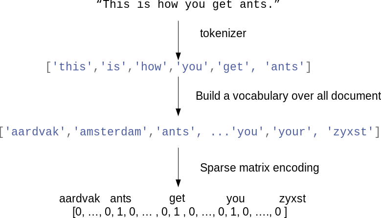

# 8 — Text Representation

> Models need numbers. The classical route: clean and normalise the text, tokenise it, then count (bag of words, n-grams) and reweight (TF-IDF) into a sparse document-term matrix. The deep-learning route: map tokens to integer ids, pad to a fixed length, and let an embedding layer learn the vectors. Both start with the same preprocessing decisions.

---

## Where text sits among data types

M&G ch. 7 sorts string columns into four kinds before doing anything:

| Kind | Example | Treat as |
|---|---|---|
| Categorical | Favourite colour from a dropdown | One-hot ([03](../../01-classical-ml/notes/03-feature-engineering-and-pipelines.md#categorical-variables)) |
| Free strings that map to categories | "midnight blue", "blu" typed by hand | Clean into categories |
| Structured strings | Addresses, dates, phone numbers | Parse into fields |
| Text | Reviews, tweets, documents | This note |

Vocabulary: a **document** is one text item, the **corpus** is the collection, a **token** is a unit after splitting, the **vocabulary** is the set of distinct tokens.

---

## The preprocessing pipeline

Sarkar's ch. 3 and the condensed NLP course notebooks both build the same chain. Not every step helps every task: for sentiment, removing "not" as a stop word destroys the signal; for neural models, less preprocessing is usually better.

| Step | Tool | Example | Skip when |
|---|---|---|---|
| Strip HTML / markup | `BeautifulSoup(text, "html.parser").get_text()` | `<br />` in IMDb reviews | Clean input |
| Remove accents | `unicodedata.normalize("NFKD", t).encode("ascii", "ignore").decode()` | café → cafe | Non-English text |
| Expand contractions | Sarkar's `contractions.py` `CONTRACTION_MAP` + regex | can't → cannot | Subword tokenisers |
| Lower-case | `t.lower()` | | Case carries meaning (NER) |
| Remove special characters / digits | `re.sub(r"[^a-zA-Z0-9\s]", "", t)` | | Numbers or emoji matter |
| Sentence tokenise | `nltk.sent_tokenize` (Punkt) | | |
| Word tokenise | `nltk.word_tokenize` (Treebank), `RegexpTokenizer`, `ToktokTokenizer`, spaCy | "Don't" → "Do", "n't" | |
| Remove stop words | `nltk.corpus.stopwords.words("english")`, sklearn `stop_words="english"` | the, is, and | Sentiment (keep negations), neural models |
| Correct spelling / repeats | Norvig's corrector on `big.txt`; regex for "finallllly" | | Rarely worth it |
| Stem | `PorterStemmer`, `LancasterStemmer` (aggressive), `SnowballStemmer("german")` | jumping, jumps → jump | Need real words |
| Lemmatise | `WordNetLemmatizer().lemmatize("cars", "n")`, spaCy `token.lemma_` | better → good (adj) | Speed matters |

```python
import re, unicodedata, nltk, spacy
nlp = spacy.load("en_core_web_sm", disable=["ner", "parser"])   # spaCy 3 name; the notebooks use 'en'/'en_core'
stop = set(nltk.corpus.stopwords.words("english")) - {"no", "not"}

def normalize(doc, lemmatize=True):
    doc = unicodedata.normalize("NFKD", doc).encode("ascii", "ignore").decode("utf-8")
    doc = re.sub(r"[^a-zA-Z\s]", " ", doc.lower())
    tokens = [t.lemma_ if lemmatize else t.text for t in nlp(doc)]
    return " ".join(t for t in tokens if t.strip() and t not in stop)

normalize("The brown foxes weren't jumping over the lazy dogs!")
# 'brown fox be not jump lazy dog'
```

**Stemming vs lemmatisation.** A stemmer chops suffixes with rules (Porter: "lying" → "lie", "strange" → "strang"); fast, may produce non-words. A lemmatiser looks up the dictionary form using the part of speech; slower, produces real words. M&G compare both on IMDb: lemmatisation gives a slightly better and smaller vocabulary, but the gain over plain tokens is small.

### Linguistic structure (Sarkar ch. 1, 3b)

Beyond tokens, Sarkar's ch. 3b covers the syntax layer that later notes use:

| Analysis | Output | Tool |
|---|---|---|
| POS tagging | `("fox", "NN")`, `("jumps", "VBZ")`; Penn Treebank tags | `nltk.pos_tag`, spaCy `token.tag_` / `token.pos_` |
| Shallow parsing (chunking) | Noun phrases `[The brown fox]` | `nltk.RegexpParser` grammar, n-gram taggers trained on conll2000 |
| Dependency parsing | Head → dependent arcs (`nsubj`, `dobj`) | spaCy `token.dep_`, `token.head` |
| Constituency parsing | Phrase-structure tree | Stanford CoreNLP (Ch03c, needs a Java server) |

These features power the rule-based extraction in [12](05-semantic-analysis-and-ner.md) and keyphrase chunking in [10](03-topic-models-and-summarization.md).

---

## Bag of words

Ignore order; represent each document by how often each vocabulary word appears.


*Image source: Müller & Guido, Introduction to Machine Learning with Python, companion repo `images/bag_of_words.png`*

```python
from sklearn.feature_extraction.text import CountVectorizer

corpus = ["The sky is blue and beautiful.",
          "Love this blue and beautiful sky!",
          "The quick brown fox jumps over the lazy dog."]
cv = CountVectorizer()
X = cv.fit_transform(corpus)          # scipy.sparse CSR matrix: (n_docs, n_vocab)
cv.get_feature_names_out()            # ['and' 'beautiful' 'blue' 'brown' 'dog' ...]
X.toarray()[0]                        # counts for document 0
```

The matrix is **sparse**: on IMDb (25,000 reviews), the vocabulary is 74,849 words and each review uses a few hundred. Keep it as `scipy.sparse`; `.toarray()` on real data runs out of memory.

### Controlling the vocabulary

| Parameter | Effect | M&G on IMDb |
|---|---|---|
| `min_df=5` | Drop tokens in fewer than 5 documents (typos, rare names) | 74,849 → 27,271 features, same accuracy |
| `max_df=0.9` | Drop tokens in more than 90% of documents (corpus-specific stop words) | |
| `stop_words="english"` | Drop sklearn's 318-word list | Slightly worse; more useful for small data |
| `max_features=10_000` | Keep the most frequent | |
| `token_pattern` | Default `r"\b\w\w+\b"` drops one-letter tokens | |
| `tokenizer=`, `preprocessor=` | Plug in spaCy/NLTK | Lemmatisation experiment |

### n-grams

Single words lose "not good" and "Supreme Court". Add pairs and triples:

```python
cv = CountVectorizer(ngram_range=(1, 2), min_df=5)   # unigrams + bigrams
```

On IMDb, `(1, 3)` with TF-IDF and logistic regression goes from 0.89 to 0.91. The feature count explodes (trigrams on IMDb: millions before `min_df`), so pair n-grams with `min_df`.

---

## TF-IDF

Raw counts over-weight words common everywhere. Term frequency–inverse document frequency weights a term by how often it appears in *this* document and how rare it is across the corpus:

$$\text{tfidf}(t, d) = \text{tf}(t, d) \cdot \left(\ln \frac{1 + N}{1 + \text{df}(t)} + 1\right)$$

with each row L2-normalised. That is scikit-learn's default (`smooth_idf=True`, `norm="l2"`). Sarkar's ch. 4a computes it from scratch, then checks the result matches `TfidfVectorizer` exactly:

```python
import numpy as np
from collections import Counter

docs = [d.split() for d in norm_corpus]
vocab = sorted({w for d in docs for w in d})
tf = np.array([[Counter(d)[w] for w in vocab] for d in docs], dtype=float)
df = (tf > 0).sum(axis=0)
idf = 1 + np.log((1 + len(docs)) / (1 + df))
tfidf = tf * idf
tfidf /= np.linalg.norm(tfidf, axis=1, keepdims=True)   # == TfidfVectorizer().fit_transform(norm_corpus)
```

```python
from sklearn.feature_extraction.text import TfidfVectorizer
tv = TfidfVectorizer(min_df=5, ngram_range=(1, 2), sublinear_tf=True)   # sublinear: 1 + log(tf)
```

**TF-IDF is a fitted transform.** The IDF comes from the training corpus, so it belongs inside the pipeline ([03](../../01-classical-ml/notes/03-feature-engineering-and-pipelines.md#leakage-and-why-pipelines-exist)). M&G show the words with the lowest IDF on IMDb are "the", "and", "movie", "film": corpus-specific stop words TF-IDF finds by itself.

---

## Document similarity from the vectors

Once documents are vectors, **cosine similarity** compares them independent of length:

```python
from sklearn.metrics.pairwise import cosine_similarity
sim = cosine_similarity(tv_matrix)        # (n_docs, n_docs); TF-IDF rows are unit length, so this is a dot product
```

Sarkar's ch. 4a clusters the 8-document toy corpus (weather, animals, food) with Ward linkage on that similarity matrix and recovers the three topics; with LDA topic features it does the same. [11](04-embeddings-and-similarity.md) builds a movie recommender on this idea and [10](03-topic-models-and-summarization.md) does the topic models properly.

---

## Sequences for neural models

Neural text models (the condensed NLP course, Sarkar ch. 4b and 10) don't count; they encode each document as a sequence of integer token ids, pad to a common length, and feed an embedding layer.

```python
from tensorflow.keras.preprocessing.text import Tokenizer
from tensorflow.keras.preprocessing.sequence import pad_sequences

sentences = ["I love my dog", "I love my cat", "Do you think my dog is amazing?"]
tok = Tokenizer(num_words=1000, oov_token="<OOV>")   # ids for the 1000 most frequent; others -> <OOV>
tok.fit_on_texts(sentences)
tok.word_index            # {'<OOV>': 1, 'my': 2, 'love': 3, 'dog': 4, 'i': 5, ...}  0 is reserved for padding
seqs = tok.texts_to_sequences(["my dog loves my manatee"])   # [[2, 4, 1, 2, 1]]
padded = pad_sequences(seqs, maxlen=10, padding="post", truncating="post")
```

`Tokenizer` and `pad_sequences` are legacy Keras utilities; in current TensorFlow use the `TextVectorization` layer, which puts the vocabulary inside the model:

```python
import tensorflow as tf
vec = tf.keras.layers.TextVectorization(max_tokens=10_000, output_sequence_length=120)
vec.adapt(train_texts)                  # learns the vocabulary
model = tf.keras.Sequential([vec, tf.keras.layers.Embedding(10_000, 16), ...])
```

| Decision | Options | Note |
|---|---|---|
| Vocabulary size | 5k–50k words | Rare words → OOV |
| OOV token | Always set one | Otherwise unseen words silently vanish |
| Sequence length | Cover ~90–95% of documents | Plot the length distribution |
| Padding / truncating | `"pre"` (default) or `"post"` | For RNNs, `pre`-padding keeps the real tokens near the final state |

Word-level vocabularies can't handle new words or misspellings. Transformer models use **subword** tokenisation (BPE, WordPiece) instead; [14](../../02-deep-learning/notes/02-neural-text-models.md#transformers-pipelines) uses one, and [17 — nanoGPT](../../04-llms-from-scratch/notes/03-nanogpt.md) and `../../generative-ai/01-llm-fundamentals/README.md` build BPE.

---

## Choosing a representation

| Representation | Dimensions | Order kept? | Semantics? | Use with |
|---|---|---|---|---|
| Bag of words (counts / binary) | Vocabulary size, sparse | No | No | Naive Bayes, linear models |
| n-gram TF-IDF | Larger, sparse | Locally | No | Linear models: the strong classical baseline ([09](02-text-classification.md)) |
| Topic proportions (LDA, NMF) | 10–200, dense | No | Coarse | Exploration, features ([10](03-topic-models-and-summarization.md)) |
| Averaged word vectors | 100–300, dense | No | Yes | Small data ([11](04-embeddings-and-similarity.md)) |
| Token-id sequences + learned embedding | Sequence × embed dim | Yes | Learned | CNN / RNN / transformer ([14](../../02-deep-learning/notes/02-neural-text-models.md)) |
| Sentence embeddings | 384–1024, dense | Encoded | Yes | Retrieval, few-shot classification ([11](04-embeddings-and-similarity.md), [14](../../02-deep-learning/notes/02-neural-text-models.md)) |

---

## Reading

- *Natural Language Processing with Python* (Bird, Klein & Loper) in [`../sources/bird-klein-loper-nlp-with-python.pdf`](../../sources/bird-klein-loper-nlp-with-python.pdf): ch. 1–3 (corpora, raw text, regex, normalisation) and 5 (tagging) are the NLTK reference for this note.
- Sarkar ch. 3–4 in [`../sources/sarkar-text-analytics-with-python-2e.pdf`](../../sources/sarkar-text-analytics-with-python-2e.pdf).
- M&G ch. 7 in [`../sources/mueller-guido-introduction-to-ml-with-python.pdf`](../../sources/mueller-guido-introduction-to-ml-with-python.pdf).

---

## Practice

| Notebook | Covers | Runs |
|---|---|---|
| [`Ch01 - Natural Language Processing Basics`](../practice/text-analytics-with-python/Ch01%20-%20Natural%20Language%20Processing%20Basics) | Corpora, POS-tagged sentences | Needs `nltk` data downloads; spaCy 2 model shortcut `'en'` → use `en_core_web_sm` |
| [`Ch02 - Python for NLP`](../practice/text-analytics-with-python/Ch02%20-%20Python%20for%20Natural%20Language%20Processing) | Strings, regex | Runs offline |
| [`Ch03a - Text Wrangling`](../practice/text-analytics-with-python/Ch03%20-%20Processing%20and%20Understanding%20Text/Ch03a%20-%20Text%20Wrangling.ipynb), `Ch03b` | Tokenisation, normalisation, stemming, POS, chunking, parsing | Needs `nltk` data, spaCy model (`'en_core'` → `en_core_web_sm`), local `contractions.py` and `big.txt` |
| `Ch03c - BONUS - Stanford CoreNLP` | Constituency/dependency parsing via CoreNLP | Needs service: a running CoreNLP Java server |
| [`Ch04a - Traditional Strategies`](../practice/text-analytics-with-python/Ch04%20-%20Feature%20Engineering%20for%20Text%20Representation/Ch04a%20-%20Feature%20Engineering%20Text%20Data%20-%20Traditional%20Strategies.ipynb) | BoW, n-grams, TF-IDF from scratch, similarity, clustering | Runs offline; `scikit-learn>=1.2` (fixed to `get_feature_names_out`) |
| [`07-working-with-text-data.ipynb`](../../01-classical-ml/practice/intro-to-ml-in-python/07-working-with-text-data.ipynb) | BoW, TF-IDF, n-grams, lemmatisation, LDA on IMDb | Needs the IMDb `aclImdb` download (~80 MB) into `data/`; `spacy`, `nltk` |

---

→ Next: [09-text-classification.md](02-text-classification.md) — put a classifier on those features, and the Kaggle recipe that wins with them.
