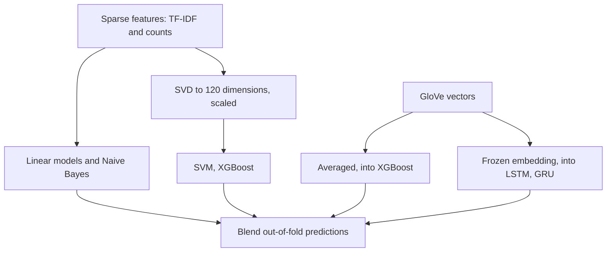

# Text classification

You have thousands of documents and a label you care about, and someone suggests a transformer. Before you agree, fit a sparse TF-IDF matrix and a linear model. That takes seconds, it is hard to beat on small and medium data, and you can read its coefficients. If you skip it you will not know whether a model that costs a hundred times more is any better, and you will miss the top feature that reveals your labels leak.

**In plain words.** Text classification means sorting documents into labelled piles: spam or not, praise or complaint, which team should answer a customer's email. The plain method works like an experienced clerk who has learned that certain words tend to mean certain piles, and you can read the list of words it relies on, which often exposes a mistake before it reaches customers. This chapter builds that method, measures anything fancier against it, and shows how to tell when a model is only doing well on the biggest piles.

This chapter builds that baseline on the film descriptions from [text representation](01-text-representation.md), tuned inside a pipeline, then compares it with the alternatives. Naive Bayes is faster and nearly as good, trees are worse on sparse text, and averaged word vectors rarely win without fine-tuning. It ends with Abhishek Thakur's Kaggle ladder, a recipe worth having in your hands.

## The task

Assign one label (multi-class) or several (multi-label) to a document: spam or ham, sentiment, topic, author, intent, toxicity. Everything in [supervised learning](../../01-classical-ml/notes/02-supervised-learning.md) and [model evaluation](../../01-classical-ml/notes/04-model-evaluation.md) applies. What changes is that the features are very many, very sparse, and mostly irrelevant individually.

| Datasets used in the practice notebooks | Classes | Size |
|---|---|---|
| IMDb reviews (M&G ch. 7) | pos / neg | 25k train, 25k test |
| 20 Newsgroups (Sarkar ch. 5) | 20 topics | ~18k posts |
| Spooky Author Identification (Kaggle notebook) | EAP / HPL / MWS | ~20k sentences |
| Jigsaw toxic comments (Kaggle) | 6 labels, multi-label | ~160k |

Our task here is harder than those benchmarks look: given a film's description, predict its first listed genre, keeping the six most common so each class has enough data.

```python
from pathlib import Path
import json, time
import numpy as np, pandas as pd
from sklearn.model_selection import train_test_split

DATA = Path("../practice/text-analytics-with-python/Ch07 - Text Similarity and Clustering/tmdb_5000_movies.csv.gz")
movies = pd.read_csv(DATA)
movies["description"] = movies["tagline"].fillna("") + " " + movies["overview"].fillna("")
movies["genre_list"] = movies["genres"].map(lambda g: [x["name"] for x in json.loads(g)])
movies = movies[movies.genre_list.str.len() > 0].copy()
movies["genre"] = movies.genre_list.str[0]
top = movies.genre.value_counts().head(6).index
data = movies[movies.genre.isin(top)]
text_train, text_test, y_train, y_test = train_test_split(
    data.description, data.genre, test_size=0.25, random_state=0, stratify=data.genre)
print(len(text_train), "train,", len(text_test), "test")
print(data.genre.value_counts(normalize=True).round(3).to_dict())
```

```text
2877 train, 960 test
{'Drama': 0.315, 'Comedy': 0.272, 'Action': 0.197, 'Adventure': 0.088, 'Horror': 0.078, 'Crime': 0.051}
```

## The baseline: TF-IDF and a linear model

The vectoriser goes inside the pipeline, so the vocabulary and IDF are refit on each training fold ([why pipelines exist](../../01-classical-ml/notes/03-feature-engineering-and-pipelines.md#leakage-and-why-pipelines-exist)). Grid-search the regularisation and the n-gram range together, because more features usually want more regularisation.

```python
from sklearn.pipeline import make_pipeline
from sklearn.feature_extraction.text import TfidfVectorizer
from sklearn.linear_model import LogisticRegression
from sklearn.model_selection import GridSearchCV
from sklearn.metrics import accuracy_score, f1_score

pipe = make_pipeline(TfidfVectorizer(min_df=2, sublinear_tf=True), LogisticRegression(max_iter=2000))
param_grid = {"logisticregression__C": [0.1, 1, 10, 100],
              "tfidfvectorizer__ngram_range": [(1, 1), (1, 2), (1, 3)]}
grid = GridSearchCV(pipe, param_grid, cv=5, n_jobs=-1, scoring="f1_macro").fit(text_train, y_train)
print(grid.best_params_, "CV macro-F1", round(grid.best_score_, 3))
pred = grid.predict(text_test)
print("test accuracy", round(accuracy_score(y_test, pred), 3), "macro-F1", round(f1_score(y_test, pred, average="macro"), 3))
print("always guess the majority:", round((y_test == y_train.mode()[0]).mean(), 3))
```

```text
{'logisticregression__C': 100, 'tfidfvectorizer__ngram_range': (1, 1)} CV macro-F1 0.424
test accuracy 0.532 macro-F1 0.423
always guess the majority: 0.315
```

Macro-F1 of 0.42 and accuracy of 0.53 sound poor until you set them against the task. Guessing the majority class gets 0.315, and a film's first listed genre is partly arbitrary, so no model could get close to 1 here. The grid chose unigrams and a weak penalty (`C=100`). On these short descriptions, with about 2,900 training documents, bigrams added sparsity rather than signal, and that is the result of a measurement, not a law. The value lies in a number you got in 8 seconds.

M&G's IMDb progression shows what each step is worth on an easier binary task:

| Setup | CV accuracy |
|---|---|
| `CountVectorizer` + `LogisticRegression` | 0.88 |
| + `min_df=5` (27k features instead of 75k) | 0.88 |
| + `stop_words="english"` | 0.88 (slightly lower) |
| `TfidfVectorizer` | 0.89 |
| + `ngram_range=(1, 3)`, tuned `C` | 0.91 |
| spaCy lemmatisation, small training sample | Small gain; matters more with less data |

### Reading the model

A linear model's coefficients are per-token weights. With one set per class, you can ask what makes a description look like a horror film.

```python
vect = grid.best_estimator_.named_steps["tfidfvectorizer"]
clf = grid.best_estimator_.named_steps["logisticregression"]
names = vect.get_feature_names_out()
for genre in ["Horror", "Comedy", "Action"]:
    coef = clf.coef_[list(clf.classes_).index(genre)]
    print(f"{genre:7}", ", ".join(names[coef.argsort()[-9:][::-1]]))
```

```text
Horror  terrifying, jigsaw, spirit, terror, house, seems, zombies, hell, dark
Comedy  comedy, office, fun, guy, put, students, met, shop, perfect
Action  cop, kill, criminals, fought, action, target, operative, dangerous, russian
```

Terrifying, zombies and hell point to horror, and cop, criminals and target to action. *Jigsaw* is the name of the Saw franchise's villain, and here it counts as a horror word only because of a few films, which is the kind of thing coefficient reading catches. On IMDb with trigrams, M&G find "not worth", "definitely worth" and "well worth" among the strongest features, so n-grams capture negation that unigrams miss. Inspecting coefficients is also how you catch leakage: a top feature like a reviewer's signature means the model learned the wrong thing.

## Comparing classifiers on text (Sarkar ch. 5b)

Sarkar fits six classifiers on 20 Newsgroups, with both bag-of-words and TF-IDF features, and reports 5-fold CV and test accuracy.

| Model | Result on sparse text | Why |
|---|---|---|
| `MultinomialNB(alpha=1)` | Strong; best for its training time | Counts fit the multinomial assumption; one pass |
| `LogisticRegression` | Among the best | Linear, regularised, handles many features |
| `LinearSVC` | Among the best; usually top on TF-IDF | Same, hinge loss |
| `SGDClassifier(loss="hinge")` | Close to `LinearSVC` | Online; scales to data that doesn't fit in memory |
| `RandomForestClassifier(n_estimators=10)` | Clearly worse | Each split sees one sparse feature; few trees |
| `GradientBoostingClassifier(n_estimators=10)` | Worst and slowest | Same, plus sequential |

Then he grid-searches `MultinomialNB(alpha)`, `LogisticRegression(C)` and `LinearSVC(C)` with TF-IDF n-grams in a pipeline. The tuned linear SVM wins, with mid-70s percent accuracy on 20 classes, and the confusion matrix shows the errors fall between related groups (`comp.*`, `talk.religion.misc` versus `alt.atheism` and `soc.religion.christian`). Errors between neighbouring classes are often label ambiguity, and no model will fix them.

Here is the same comparison on our data, including the time it costs.

```python
from sklearn.feature_extraction.text import CountVectorizer
from sklearn.naive_bayes import MultinomialNB
from sklearn.svm import LinearSVC
from sklearn.linear_model import SGDClassifier
from sklearn.ensemble import RandomForestClassifier, GradientBoostingClassifier
from sklearn.model_selection import cross_val_score

models = [("MultinomialNB", MultinomialNB()),
          ("LogisticRegression", LogisticRegression(C=10, max_iter=2000)),
          ("LinearSVC", LinearSVC()),
          ("SGD hinge", SGDClassifier(loss="hinge", random_state=0)),
          ("RandomForest 100", RandomForestClassifier(100, random_state=0, n_jobs=-1)),
          ("GradientBoosting 50", GradientBoostingClassifier(n_estimators=50, random_state=0))]
print(f"{'model':22}{'counts':>8}{'tf-idf':>8}{'seconds':>9}")
for name, model in models:
    row, t0 = [], time.time()
    for vectoriser in (CountVectorizer(min_df=2), TfidfVectorizer(min_df=2, sublinear_tf=True)):
        row.append(cross_val_score(make_pipeline(vectoriser, model), text_train, y_train, cv=3, scoring="f1_macro").mean())
    print(f"{name:22}{row[0]:8.3f}{row[1]:8.3f}{time.time() - t0:9.1f}")
```

```text
model                   counts  tf-idf  seconds
MultinomialNB            0.362   0.230      0.3
LogisticRegression       0.384   0.391      1.6
LinearSVC                0.363   0.404      0.5
SGD hinge                0.392   0.397      0.3
RandomForest 100         0.265   0.247      0.9
GradientBoosting 50      0.334   0.321     10.8
```

The shape matches Sarkar's on this harder task with fewer documents. Linear models on TF-IDF lead at about 0.40, and they take under two seconds. Random forests fall to 0.25, and gradient boosting takes twenty times longer than a linear model to reach 0.32. One thing does not transfer: Naive Bayes on counts is respectable at 0.36, yet on TF-IDF it collapses to 0.23, as its priors swamp the small fractional weights and it predicts mostly the big classes. Use counts with it.

### Dense features (Sarkar ch. 5c)

| Features | Model | Outcome in Sarkar |
|---|---|---|
| Averaged word2vec (trained on the corpus, `gensim`) | `SGDClassifier` | Below TF-IDF |
| Averaged GloVe (spaCy `en_core_web_md` vectors) | `SGDClassifier` | Below TF-IDF |
| Averaged FastText | `SGDClassifier` | Below TF-IDF |
| Averaged GloVe | `MLPClassifier` | Better than linear on the same vectors, still not above tuned TF-IDF |

Averaging throws away word order and dilutes the informative words with common ones. Dense vectors win when training data is small, the vocabulary at test time differs, or the vectors are contextual and fine-tuned ([neural text models](../../02-deep-learning/notes/06-neural-text-models.md), [LLM embeddings as features](07-llm-embeddings-as-features.md)). [Embeddings and similarity](04-embeddings-and-similarity.md) explains the vectors themselves. We can check the first row directly.

```python
from gensim.models import Word2Vec
from sklearn.feature_extraction.text import CountVectorizer

tokenize = CountVectorizer().build_analyzer()
train_tokens = [tokenize(d) for d in text_train]
w2v = Word2Vec(train_tokens, vector_size=100, window=5, min_count=3, sg=1, epochs=10, seed=0, workers=1)

def average(tokens):
    vectors = [w2v.wv[w] for w in tokens if w in w2v.wv]
    return np.mean(vectors, axis=0) if vectors else np.zeros(100)

X_train_avg = np.vstack([average(t) for t in train_tokens])
X_test_avg = np.vstack([average(tokenize(d)) for d in text_test])
avg_clf = LogisticRegression(C=10, max_iter=2000).fit(X_train_avg, y_train)
print("averaged word2vec, macro-F1", round(f1_score(y_test, avg_clf.predict(X_test_avg), average="macro"), 3))
print("tuned TF-IDF,      macro-F1", round(f1_score(y_test, pred, average="macro"), 3))
```

```text
averaged word2vec, macro-F1 0.35
tuned TF-IDF,      macro-F1 0.423
```

Word2vec trained on this small corpus reaches 0.35, below TF-IDF's 0.42, as in Sarkar. About 2,900 short documents is not enough to train good vectors, and pretrained ones would do better. The sentence encoders in [LLM embeddings as features](07-llm-embeddings-as-features.md) are the fair comparison, and that chapter measures it.

## Metrics for text classification

Sarkar's chapter 5a re-derives the [evaluation metrics](../../01-classical-ml/notes/04-model-evaluation.md) on breast cancer before applying them to text. The additional points for text:

| Situation | Metric |
|---|---|
| Balanced topics | Accuracy, macro-F1 |
| Rare positive (spam, toxicity, fraud) | Precision/recall at an operating point, PR-AUC |
| Calibrated probabilities matter (Kaggle, downstream ranking) | Multiclass log-loss |
| Multi-label | Per-label ROC-AUC averaged (Jigsaw), micro/macro F1 |

Log-loss punishes confident mistakes without limit, so clip predictions. The confusion table is the other thing to read, because it says which pairs of classes the model cannot separate.

```python
from sklearn.metrics import confusion_matrix, log_loss
from sklearn.preprocessing import LabelEncoder

def multiclass_logloss(actual, predicted, eps=1e-15):
    """Kaggle's metric: actual is (n,) int labels, predicted is (n, k) probabilities."""
    p = np.clip(predicted, eps, 1 - eps)
    p /= p.sum(axis=1, keepdims=True)
    return -np.log(p[np.arange(len(actual)), actual]).mean()

encoder = LabelEncoder().fit(y_train)
proba = grid.predict_proba(text_test)
print("log-loss", round(multiclass_logloss(encoder.transform(y_test), proba), 3),
      "sklearn", round(log_loss(y_test, proba), 3))
labels = list(encoder.classes_)
print(pd.DataFrame(confusion_matrix(y_test, pred, labels=labels), index=labels, columns=[l[:4] for l in labels]))
```

```text
log-loss 1.438 sklearn 1.438
           Acti  Adve  Come  Crim  Dram  Horr
Action      105    11    36     2    34     0
Adventure    30    15    19     0    21     0
Comedy       24     0   169     1    61     6
Crime        17     1    10     2    18     1
Drama        27     1    74     5   189     6
Horror       11     4    11     1    17    31
```

The hand-written metric agrees with scikit-learn. The confusion table is more useful. Most Crime films are predicted as Action, Drama or Comedy, and just 2 of 49 are found, while Adventure leaks into Action. This is what macro-F1 was warning about: accuracy looks fine because the large classes carry it, and two small classes are barely predicted. [Imbalance, errors and drift](../../01-classical-ml/notes/10-imbalance-errors-and-drift.md#accuracy-lies-errors-cost) follows the same trap through to what each error costs. [Reading the errors](../../01-classical-ml/notes/12-reading-the-errors.md#step-3-read-rows) goes from the table to the rows: read the missed Crime films before deciding what to change.

## Worked example: the Kaggle recipe

Your copy of Abhishek Thakur's *Approaching (Almost) Any NLP Problem on Kaggle* works on Spooky Author Identification: predict which of Poe, Lovecraft or Shelley wrote a sentence, scored on log-loss. It is a ladder of models, each a few lines, scored on a stratified 90/10 split. The figure shows its shape, and the table gives each rung.



| Step | Features | Model | Idea |
|---|---|---|---|
| 1 | TF-IDF word 1–3-grams, `sublinear_tf`, `min_df=3` | `LogisticRegression` | First baseline: log-loss 0.626 |
| 2 | Counts, word 1–3-grams | `LogisticRegression` | Counts beat TF-IDF here |
| 3 | TF-IDF / counts | `MultinomialNB` | NB on counts is the best of the basic models |
| 4 | TF-IDF → `TruncatedSVD(120)` → `StandardScaler` | `SVC(probability=True)` | SVMs need dense, scaled, low-dim input, which [SVD](../../01-classical-ml/notes/05-unsupervised-learning.md#principal-component-analysis) provides; slow |
| 5 | TF-IDF, counts, SVD | XGBoost | Trees on sparse text are mediocre ([ensembles](../../01-classical-ml/notes/06-ensembles.md)) |
| 6 | Pipeline SVD + scaler + LR; NB alone | `GridSearchCV` with a log-loss scorer | Tuned NB alpha: 8% better than default |
| 7 | GloVe 840B averaged sentence vectors | XGBoost | Dense vectors help trees |
| 8 | GloVe embedding layer (frozen) | LSTM, Bi-LSTM, GRU (Keras), early stopping | Sequence models on embeddings ([neural text models](../../02-deep-learning/notes/06-neural-text-models.md)) |
| 9 | All of the above | Ensembling | Blend out-of-fold predictions ([stacking and voting](../../01-classical-ml/notes/06-ensembles.md)) |

Step 6 is worth running, because it is the shape of every grid search with a custom metric. We run it on our genres, and we keep the vectoriser inside the pipeline.

```python
from sklearn import metrics, pipeline
from sklearn.multiclass import OneVsRestClassifier
from sklearn.decomposition import TruncatedSVD
from sklearn.preprocessing import StandardScaler

def mll(y, proba):
    return multiclass_logloss(LabelEncoder().fit_transform(y), proba)

mll_scorer = metrics.make_scorer(mll, greater_is_better=False,
                                 response_method="predict_proba")   # notebook: needs_proba=True (removed in 1.6)
clf_svd = pipeline.Pipeline([("tfidf", TfidfVectorizer(min_df=3, sublinear_tf=True, ngram_range=(1, 2))),
                             ("svd", TruncatedSVD(random_state=0)), ("scl", StandardScaler()),
                             ("lr", OneVsRestClassifier(LogisticRegression(solver="liblinear")))])  # liblinear is binary only now
svd_grid = {"svd__n_components": [120, 300], "lr__estimator__C": [0.1, 1.0], "lr__estimator__penalty": ["l1", "l2"]}
model = GridSearchCV(clf_svd, svd_grid, scoring=mll_scorer, cv=2, n_jobs=-1).fit(text_train, y_train)
print(model.best_params_, "CV log-loss", round(-model.best_score_, 3))

nb = make_pipeline(CountVectorizer(min_df=2, ngram_range=(1, 2)), MultinomialNB())
nb_grid = GridSearchCV(nb, {"multinomialnb__alpha": [0.01, 0.1, 0.3, 1.0]}, scoring=mll_scorer, cv=3).fit(text_train, y_train)
for alpha, score in zip(nb_grid.cv_results_["param_multinomialnb__alpha"], nb_grid.cv_results_["mean_test_score"]):
    print(f"NB alpha {alpha}: log-loss {-score:.3f}")
```

```text
{'lr__estimator__C': 0.1, 'lr__estimator__penalty': 'l1', 'svd__n_components': 300} CV log-loss 1.325
NB alpha 0.01: log-loss 9.303
NB alpha 0.1: log-loss 6.025
NB alpha 0.3: log-loss 5.010
NB alpha 1.0: log-loss 5.485
```

Log-loss on the SVD pipeline is 1.33, and NB's depends heavily on `alpha`. Its log-loss of about 5 is far worse than logistic regression's even though NB's accuracy is respectable, because NB is badly overconfident and log-loss punishes that. Thakur's result of tuning `alpha` for an 8% improvement is the same effect, in milder form, on his far better-suited data. The lesson is that ranking models by accuracy and by log-loss can give different winners, so tune on the metric you will be judged by.

Two things in the notebook not to copy into production:

- **The vectoriser is fit on train and validation text** ("semi-supervised"). That is legitimate on Kaggle, where the test text is given, and leakage anywhere you must score unseen data.
- **The grid search is outside a pipeline that contains the vectoriser**, so CV folds share a vocabulary. The effect is small here, and [the pipeline chapter](../../01-classical-ml/notes/03-feature-engineering-and-pipelines.md#leakage-and-why-pipelines-exist) shows when it is not.

## Practical notes

| Topic | Advice |
|---|---|
| Imbalance | `class_weight="balanced"`; evaluate with PR curves; don't trust accuracy |
| Many classes, little data | Hierarchical labels; few-shot with sentence embeddings or an LLM |
| Multi-label | `OneVsRestClassifier(LogisticRegression())`, one sigmoid per label in neural models |
| Very large data | `HashingVectorizer` + `SGDClassifier.partial_fit` (no vocabulary to hold) |
| Character n-grams | `TfidfVectorizer(analyzer="char_wb", ngram_range=(2, 5))`: robust to typos, good for author style and short text |
| When to go neural | Order and context matter, lots of labelled data, or a pretrained transformer can be fine-tuned |
| When to use an LLM | No labelled data, label set changes often: zero/few-shot classification; compare against this baseline |

Films really do have several genres, so the honest framing of our task is multi-label. The change is small.

```python
from sklearn.multiclass import OneVsRestClassifier
from sklearn.preprocessing import MultiLabelBinarizer

mlb = MultiLabelBinarizer()
Y = mlb.fit_transform(movies.genre_list)
keep = Y.sum(axis=0) >= 100
Y = Y[:, keep]
kept = mlb.classes_[keep]
tr, te = train_test_split(np.arange(len(movies)), test_size=0.25, random_state=0)
ovr = make_pipeline(TfidfVectorizer(min_df=2, sublinear_tf=True, ngram_range=(1, 2)),
                    OneVsRestClassifier(LogisticRegression(C=10, max_iter=2000), n_jobs=-1))
ovr.fit(movies.description.iloc[tr], Y[tr])
Y_pred = ovr.predict(movies.description.iloc[te])
print(Y.shape[1], "genres; micro-F1", round(f1_score(Y[te], Y_pred, average="micro"), 3),
      "macro-F1", round(f1_score(Y[te], Y_pred, average="macro"), 3))
per_label = f1_score(Y[te], Y_pred, average=None)
print({str(k): round(float(v), 2) for k, v in sorted(zip(kept, per_label), key=lambda x: -x[1])[:4]})
print({str(k): round(float(v), 2) for k, v in sorted(zip(kept, per_label), key=lambda x: x[1])[:4]})
```

```text
17 genres; micro-F1 0.484 macro-F1 0.274
{'Drama': 0.68, 'Comedy': 0.62, 'Action': 0.54, 'Thriller': 0.46}
{'Documentary': 0.0, 'Music': 0.0, 'Mystery': 0.02, 'Animation': 0.03}
```

Micro-F1 is 0.48, carried by frequent genres like Drama at 0.68. Macro-F1 of 0.27 shows the other side, as rare genres such as Documentary and Music score zero at the default 0.5 threshold. Per-label thresholds, or `class_weight="balanced"`, are the first fix to try here.

## Notebooks

| Notebook | Covers | Runs |
|---|---|---|
| [`Ch05a`](../practice/text-analytics-with-python/Ch05%20-%20Text%20Classification), `Ch05b`, `Ch05c` | Metrics; six classifiers on 20 Newsgroups; word2vec/GloVe/FastText features | Needs internet once (`fetch_20newsgroups`); `Ch05c` needs spaCy `en_core_web_md` and `gensim` (the `size=` argument is `vector_size=` in gensim 4) |
| [`07-working-with-text-data.ipynb`](../../01-classical-ml/practice/intro-to-ml-in-python/07-working-with-text-data.ipynb) | IMDb sentiment with BoW/TF-IDF/n-grams, coefficients | Needs the `aclImdb` download into `data/` |
| [`approaching-almost-any-nlp-problem-on-kaggle.ipynb`](../practice/approaching-almost-any-nlp-problem-on-kaggle.ipynb) (own) | The full Kaggle ladder | Needs the Kaggle `spooky` data and `glove.840B.300d.txt` (5.6 GB) at `../input/`; `xgboost`, standalone `keras` 2.x (`keras.layers.recurrent`); `make_scorer(needs_proba=True)` removed in scikit-learn 1.6 |

## Pitfalls

- **Vectorising before the split.** The IDF and vocabulary see the test set. Pipeline.
- **Trusting accuracy with skewed classes.** Compare against the majority class and read macro-F1.
- **Picking a tree ensemble by habit.** Each split can use only one sparse feature, so trees need many rounds to do what a linear model does in one.
- **Reading a high score without reading the coefficients.** A signature, a source name or a date in the top features means leakage.
- **Word2vec averages on long documents.** Averaging dilutes the few informative words, so compare with TF-IDF before you assume dense is better.
- **Copying Kaggle's fit on train and test text.** It is only legal when the test text is known in advance.
- **Blaming the model for label noise.** Read the confusion table. Errors between Drama and Comedy may be errors in the labelling of mixed-genre films.

## Try it

1. **How much data does the baseline need?** Train the best pipeline on 10%, 25%, 50% and 100% of the training set. What does macro-F1 do?

<details><summary>Answer</summary>

```python
from sklearn.base import clone

for share in [0.1, 0.25, 0.5, 1.0]:
    n = int(share * len(text_train))
    fitted = clone(grid.best_estimator_).fit(text_train.iloc[:n], y_train.iloc[:n])
    print(f"{n:>5} documents, macro-F1 {f1_score(y_test, fitted.predict(text_test), average='macro'):.3f}")
```

```text
  287 documents, macro-F1 0.244
  719 documents, macro-F1 0.270
 1438 documents, macro-F1 0.349
 2877 documents, macro-F1 0.423
```

Macro-F1 climbs from 0.24 at 287 documents to 0.42 at 2,877, and it is still rising, so more data would help. A curve that is still climbing also tells you a neural model needing more data is unlikely to do better on these same documents without pretrained help.

</details>

2. **Words or characters?** Replace the word vectoriser with `analyzer="char_wb", ngram_range=(2, 5)`. Does it help here, and what would make it help more?

<details><summary>Answer</summary>

```python
char = make_pipeline(TfidfVectorizer(analyzer="char_wb", ngram_range=(2, 5), min_df=2, sublinear_tf=True),
                     LogisticRegression(C=10, max_iter=2000)).fit(text_train, y_train)
print("char n-grams macro-F1", round(f1_score(y_test, char.predict(text_test), average="macro"), 3))
```

```text
char n-grams macro-F1 0.437
```

Character n-grams edge ahead at 0.437 against 0.423 here, at the cost of more features and time. They would help more on noisy text with typos, and on authorship, where style lives in character patterns.

</details>

3. **Out of core.** Fit the classifier with `HashingVectorizer` and `SGDClassifier.partial_fit` in batches of 500 documents, holding no vocabulary. How much do you lose?

<details><summary>Answer</summary>

```python
from sklearn.feature_extraction.text import HashingVectorizer

hasher = HashingVectorizer(n_features=2**18, ngram_range=(1, 2), alternate_sign=False)
online = SGDClassifier(loss="log_loss", alpha=1e-5, random_state=0)
classes = np.unique(y_train)
for epoch in range(5):
    for start in range(0, len(text_train), 500):
        batch = text_train.iloc[start:start + 500]
        online.partial_fit(hasher.transform(batch), y_train.iloc[start:start + 500], classes=classes)
print("hashed, online macro-F1", round(f1_score(y_test, online.predict(hasher.transform(text_test)), average="macro"), 3))
```

```text
hashed, online macro-F1 0.415
```

It reaches 0.415 against the tuned 0.423, with no vocabulary held in memory. That is a very small price if your data will not fit, though you lose the ability to read features back since hashing is one-way.

</details>

## Interview checklist

| Question | Short answer |
|---|---|
| What is the baseline for text classification? | TF-IDF unigrams and bigrams with logistic regression or a linear SVM, in a pipeline. |
| Why do linear models work so well on text? | There are many informative, nearly independent features, so a high-dimensional hyperplane separates well and regularisation handles the rest. |
| Why do trees do badly on sparse text? | Each split sees one rare feature, so most leaves see few documents and the model needs very many rounds. |
| Why Naive Bayes? | One pass over counts, surprisingly good on small data, an easy first check. |
| How do you handle many labels per document? | One-vs-rest, one sigmoid per label; report micro and macro F1 or per-label AUC. |
| When is averaging word vectors a good idea? | Little training data, or test vocabulary that differs from train. |
| How can coefficients expose leakage? | A token that should not predict the label, such as a source or an id, appears at the top. |
| What is the hashing trick? | Hash tokens into a fixed number of columns, with no vocabulary to store, for streams and huge data. |
| Log-loss or accuracy? | Log-loss when probabilities feed a later decision, since it punishes confident errors. |
| When do you try an LLM? | Few labels or changing label sets. Compare it against this baseline on cost and accuracy. |

## Next

[Topic models and summarisation](03-topic-models-and-summarization.md) turns to text without labels: keyphrases, topic models and extractive summaries.
