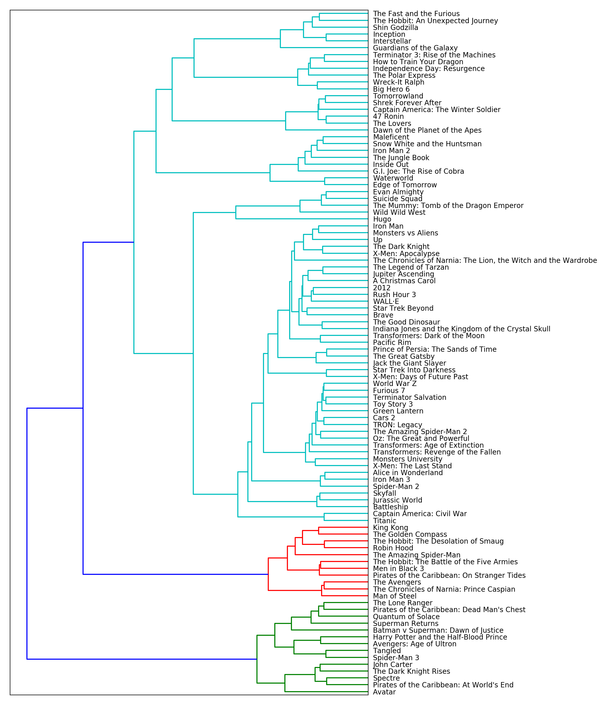

# 10 — Topic Models, Keyphrases and Summarization

> Unsupervised text analysis: find the phrases that matter (collocations, chunked noun phrases), the themes running through a corpus (LSI, LDA, NMF), the groups of similar documents (clustering), and the sentences that best represent a document (LSA and TextRank summaries). All of it is matrix factorisation or graph ranking over the representations of [08](01-text-representation.md).

---

## Keyphrase extraction (Sarkar ch. 6a)

### Collocations

Word pairs that occur together more than chance: "New York", "machine learning". Rank bigrams by **pointwise mutual information**:

$$\text{PMI}(x, y) = \log \frac{p(x, y)}{p(x)\,p(y)}$$

```python
from nltk.collocations import BigramCollocationFinder, BigramAssocMeasures
finder = BigramCollocationFinder.from_documents([doc.split() for doc in norm_corpus])
finder.apply_freq_filter(3)                       # PMI overrates rare pairs: require a minimum count
finder.nbest(BigramAssocMeasures.pmi, 10)
finder.nbest(BigramAssocMeasures.raw_freq, 10)    # frequency alone returns "of the", "in the"
```

`gensim.models.Phrases` does the same at corpus scale and rewrites the text so that `machine_learning` becomes one token before topic modelling (Ch06b uses `min_count=20, threshold=20`).

### Weighted tag-based phrases

Chunk noun phrases with a POS grammar ([08](01-text-representation.md#linguistic-structure-sarkar-ch-1-3b)), then weight each phrase by TF-IDF across the corpus. This finds "artificial neural network" rather than "neural" + "network" separately.

```python
grammar = r"NP: {<DT>? <JJ>* <NN.*>+}"
chunker = nltk.RegexpParser(grammar)
```

---

## Topic models

A topic is a distribution over words; a document is a mixture of topics. All three methods factor the document-term matrix $X \approx W H$: $W$ is documents × topics, $H$ is topics × words.

| Method | Factorisation | Input | Output weights | Library |
|---|---|---|---|---|
| LSI / LSA | Truncated SVD | TF-IDF or counts | Signed: hard to read | `TruncatedSVD`, `gensim.LsiModel` |
| LDA | Bayesian generative model with Dirichlet priors, fit by variational Bayes or Gibbs sampling | **Counts** (not TF-IDF) | Probabilities | `LatentDirichletAllocation`, `gensim.LdaModel`, MALLET |
| NMF | Non-negative factorisation ([05](../../01-classical-ml/notes/05-unsupervised-learning.md#non-negative-matrix-factorisation)) | TF-IDF | Non-negative: readable parts | `sklearn.decomposition.NMF` |

### LSI from scratch

Sarkar's Ch06b implements LSI with a sparse SVD on the term-document matrix to show there's no magic:

```python
from scipy.sparse.linalg import svds
u, s, vt = svds(td_matrix, k=20, maxiter=10000)   # td_matrix: terms x documents
term_topic = u                                      # (n_terms, 20): each column a topic over terms
doc_topic = vt.T                                    # (n_docs, 20)
for t in range(20):
    top = np.argsort(-np.abs(term_topic[:, t]))[:10]
    print(t, [(vocab[i], round(term_topic[i, t], 3)) for i in top])   # signs mix: the readability problem
```

### LDA's generative story

1. For each topic $k$, draw a word distribution $\phi_k \sim \text{Dirichlet}(\beta)$.
2. For each document $d$, draw topic proportions $\theta_d \sim \text{Dirichlet}(\alpha)$.
3. For each word position, draw a topic $z \sim \text{Categorical}(\theta_d)$, then a word $w \sim \text{Categorical}(\phi_z)$.

Fitting inverts this to find $\theta$ and $\phi$. Small $\alpha$ means each document uses few topics. LDA is Bayesian inference with conjugate priors; for the Bayesian background see `../../data-analytics/notes/`.

```python
# scikit-learn (Ch06c): NIPS papers 1987-1999, 20 topics
from sklearn.feature_extraction.text import CountVectorizer, TfidfVectorizer
from sklearn.decomposition import LatentDirichletAllocation, NMF

cv = CountVectorizer(min_df=20, max_df=0.6, ngram_range=(1, 2), token_pattern=None,
                     tokenizer=str.split)
X_counts = cv.fit_transform(norm_papers)
lda = LatentDirichletAllocation(n_components=20, max_iter=500, learning_method="online",
                                random_state=42, n_jobs=-1).fit(X_counts)

X_tfidf = TfidfVectorizer(min_df=20, max_df=0.6, ngram_range=(1, 2)).fit_transform(norm_papers)
nmf = NMF(n_components=20, init="nndsvd", max_iter=500, random_state=42).fit(X_tfidf)

vocab = cv.get_feature_names_out()
for k, comp in enumerate(lda.components_):
    print(k, ", ".join(vocab[comp.argsort()[-10:][::-1]]))
```

M&G run LDA with 10 and 100 topics on IMDb: topics come out as genres and aspects ("horror", "comedy", "music", "acting/performance"), plus topics that are just "words common in negative reviews". With 100 topics some are very specific (a topic for "Star Trek"). They then show that a topic's top documents are the best way to see what it means.

### Choosing the number of topics

```python
# gensim (Ch06b): coherence across a range of k
from gensim.models import LdaModel, CoherenceModel
for k in range(5, 35, 5):
    lda = LdaModel(corpus=bow_corpus, id2word=dictionary, num_topics=k, passes=20, random_state=42)
    cv = CoherenceModel(model=lda, texts=norm_papers, dictionary=dictionary, coherence="c_v").get_coherence()
    print(k, round(cv, 3))
```

| Measure | Higher is better? | Notes |
|---|---|---|
| Coherence `c_v` | Yes | Correlates best with human judgement |
| Coherence `u_mass` | Yes (less negative) | Fast; corpus-only |
| Perplexity | Lower | Often disagrees with humans; don't select on it alone |

Sarkar picks the knee of the coherence curve (around 20 topics on NIPS) and finds MALLET's Gibbs-sampled LDA more coherent than gensim's variational LDA. He then labels each paper with its **dominant topic**, lists the most representative papers per topic, and predicts topics for unseen NIPS 2016 papers with `lda.transform`.

### Visualising

`pyLDAvis` (Ch06d) plots topics as circles in a 2-D projection of inter-topic distance, sized by prevalence, with a relevance slider ($\lambda$) that trades a word's topic-specific probability against its overall frequency. The notebook uses `pyLDAvis.sklearn`, renamed `pyLDAvis.lda_model` in pyLDAvis 3.4.

---

## Document clustering (Sarkar ch. 7c)

Cluster the TMDB 5000 movie descriptions:

```python
from sklearn.cluster import KMeans
from sklearn.metrics.pairwise import cosine_similarity
from scipy.cluster.hierarchy import ward, dendrogram

cv = CountVectorizer(ngram_range=(1, 2), min_df=10, max_df=0.8, stop_words=stop_words)
cv_matrix = cv.fit_transform(movies["description"])          # tagline + overview, normalised

km = KMeans(n_clusters=6, n_init=50, max_iter=10000, random_state=42).fit(cv_matrix)
# inspect: top terms per centroid, and which movies landed together

cosine_distance = 1 - cosine_similarity(tfidf_matrix)
linkage_matrix = ward(cosine_distance)                       # hierarchical on the top 100 movies
dendrogram(linkage_matrix, orientation="left", labels=titles)
```


*Image source: Sarkar, Text Analytics with Python (2nd ed.), companion repo `Ch07/movie_hierachical_clusters.png`*

He also tries **affinity propagation**, which picks the number of clusters itself from similarity "messages" (and finds many small ones). The lessons match [05](../../01-classical-ml/notes/05-unsupervised-learning.md#comparing-and-evaluating): k-means clusters are only as good as the features, and you validate by reading the members of each cluster.

---

## Extractive summarisation

Pick the most representative sentences of a document, in their original order. (Abstractive summarisation, writing new sentences, is now an LLM task: see `../../generative-ai/01-llm-fundamentals/README.md`.)

### LSA summary (Sarkar ch. 6e)

Factor the sentence-term TF-IDF matrix with SVD; score each sentence by its weight across the top singular vectors:

```python
from scipy.sparse.linalg import svds
td_matrix = tv.fit_transform(norm_sentences).T                    # terms x sentences
u, s, vt = svds(td_matrix, k=3)
s[s < s.max() * 0.5] = 0                                          # keep strong concepts only
salience = np.sqrt(np.square(s) @ np.square(vt))                  # one score per sentence
top = np.sort(salience.argsort()[-8:])                            # 8 best, in document order
print("\n".join(sentences[i] for i in top))
```

### TextRank

Build a graph whose nodes are sentences and whose edge weights are similarities; run PageRank; the sentences most "recommended" by similar sentences win.

```python
import networkx as nx
sim = cosine_similarity(sentence_vectors)          # Sarkar: TF-IDF rows; NLP course: averaged GloVe-100d
np.fill_diagonal(sim, 0)
scores = nx.pagerank(nx.from_numpy_array(sim))
ranked = sorted(((scores[i], s) for i, s in enumerate(sentences)), reverse=True)
summary = [s for _, s in ranked[:10]]
```

Sarkar runs both on the Wikipedia text of *The Elder Scrolls V: Skyrim*; the condensed NLP course notebook ran TextRank with GloVe sentence vectors on a sample of the Manually Annotated Sub-Corpus. The two methods agree on most chosen sentences.

| Method | Signal | Strength | Weakness |
|---|---|---|---|
| LSA | Sentences loading on dominant concepts | No external resources | Sensitive to `k` and the threshold |
| TextRank (TF-IDF) | Centrality in a similarity graph | Simple, robust | Lexical overlap only |
| TextRank (embeddings) | Same with semantic similarity | Paraphrases count | Needs vectors; averaged word vectors are crude |
| LLM | Generates | Fluent, abstractive | Can hallucinate; evaluation is hard |

---

## Rules

| Rule | Why |
|---|---|
| LDA on counts, NMF and LSI on TF-IDF | LDA's model is a count model |
| Merge phrases (`Phrases`) and prune vocabulary (`min_df`, `max_df`) before topic modelling | Otherwise topics are stop words and fragments |
| Choose the number of topics by coherence and by reading topics | Perplexity often disagrees with humans |
| Read top documents, not just top words | A topic's words can mislead |
| Topic proportions make good low-dim features for a classifier | Dense, interpretable |

---

## Practice

| Notebook | Covers | Runs |
|---|---|---|
| [`Ch06a`](../practice/text-analytics-with-python/Ch06%20-%20Text%20Summarization%20and%20Topic%20Models) | Collocations, PMI, tag-based keyphrases | Needs `nltk` data (Gutenberg corpus); `elephants.txt` included |
| `Ch06b`, `Ch06c`, `Ch06d` | LSI from scratch, LDA (gensim, MALLET, sklearn), NMF, coherence tuning, pyLDAvis | Needs internet: NIPS papers (`nips12raw_str602.tgz`, not in the repo); MALLET needs a Java install; `pyLDAvis.sklearn` → `pyLDAvis.lda_model`; `test_data/` included |
| `Ch06e` | LSA and TextRank summaries | Runs offline; `networkx`, `nltk` |
| [`Ch07c - Document Clustering`](../practice/text-analytics-with-python/Ch07%20-%20Text%20Similarity%20and%20Clustering/Ch07c%20-%20Document%20Clustering.ipynb) | k-means, affinity propagation, Ward dendrogram on TMDB movies | Runs offline; `tmdb_5000_movies.csv.gz` included |
| [`07-working-with-text-data.ipynb`](../../01-classical-ml/practice/intro-to-ml-in-python/07-working-with-text-data.ipynb), last section | LDA on IMDb | Needs the `aclImdb` download |

---

→ Next: [11-embeddings-and-similarity.md](04-embeddings-and-similarity.md) — dense word and document vectors, and what similarity on them buys.
