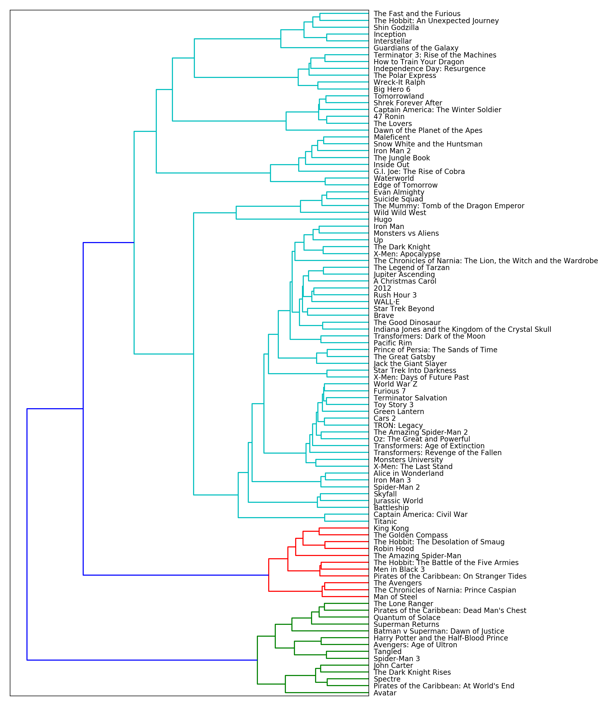

# Topic models, keyphrases and summarisation

A colleague hands you ten thousand support tickets and asks what people are complaining about. There are no labels, and nobody will read them. You could cluster them, but a cluster number tells you nothing until you can name it. What you want is a short list of phrases that matter, a set of themes with a weight per document, groups of similar documents, and for any long document a few sentences that stand in for the whole.

Those four jobs are this chapter, and they share a pleasing economy. Nearly all of it is either matrix factorisation or graph ranking over the [representations from chapter one](01-text-representation.md). We use the film descriptions again, plus a short article on elephants that ships with Sarkar's notebooks, and we read the output each time, because with no labels, reading the output is the evaluation.

## Keyphrase extraction

A keyphrase is a phrase that says what a text is about. There are two classic approaches: find word pairs that occur together more than chance, and chunk noun phrases and weight them across the corpus (Sarkar ch. 6a).

```python
from pathlib import Path
import json, re
import numpy as np, pandas as pd
import nltk
for pkg in ["stopwords", "punkt", "punkt_tab", "averaged_perceptron_tagger_eng"]:
    nltk.download(pkg, quiet=True)
from nltk.corpus import stopwords

BOOK = Path("../practice/text-analytics-with-python")
movies = pd.read_csv(BOOK / "Ch07 - Text Similarity and Clustering/tmdb_5000_movies.csv.gz")
movies["description"] = movies["tagline"].fillna("") + " " + movies["overview"].fillna("")
movies = movies[movies.description.str.len() > 20].sort_values("popularity", ascending=False).reset_index(drop=True)
stop = set(stopwords.words("english"))

def tidy(text):
    return " ".join(w for w in re.sub(r"[^a-z\s]", " ", text.lower()).split() if w not in stop and len(w) > 2)

norm_docs = movies.description.map(tidy).tolist()
print(len(norm_docs), "films;", norm_docs[0][:90])
```

```text
4799 films; gru history bad bosses minions stuart kevin bob recruited scarlet overkill super villain a
```

### Collocations and PMI

Word pairs like "New York" or "serial killer" mean more together than apart. **Pointwise mutual information** measures how much more often two words co-occur than independence predicts:

$$\text{PMI}(x, y) = \log \frac{p(x, y)}{p(x)\,p(y)}$$

PMI overrates rare pairs, since a pair seen once between two words seen once scores the maximum. So set a minimum count. Raw frequency has the opposite problem: on text with stop words kept it returns "of the" and "in the".

```python
from nltk.collocations import BigramCollocationFinder, BigramAssocMeasures

measures = BigramAssocMeasures()
tokens = [d.split() for d in norm_docs]
finder = BigramCollocationFinder.from_documents(tokens)
print("PMI, no filter:", [" ".join(p) for p in finder.nbest(measures.pmi, 4)])
finder.apply_freq_filter(10)
print("PMI, count>=10:", [" ".join(p) for p in finder.nbest(measures.pmi, 8)])
print("raw frequency: ", [" ".join(p) for p in finder.nbest(measures.raw_freq, 8)])
```

```text
PMI, no filter: ['abortionist vera', 'abu ghraib', 'acker nicolette', 'acquire likeness']
PMI, count>=10: ['mild mannered', 'hong kong', 'beverly hills', 'hip hop', 'alter ego', 'las vegas', 'san francisco', 'post apocalyptic']
raw frequency:  ['new york', 'year old', 'high school', 'true story', 'los angeles', 'small town', 'world war', 'york city']
```

TODO_PMI `gensim.models.Phrases` does the same at corpus scale and rewrites the text so that `new_york` becomes one token before topic modelling (Ch06b uses `min_count=20, threshold=20`).

### Weighted tag-based phrases

Chunk noun phrases with a part-of-speech grammar ([linguistic structure](01-text-representation.md#linguistic-structure-sarkar-ch-1-3b)), then weight each phrase by TF-IDF across the corpus. This finds "artificial neural network" rather than "neural" and "network" separately. Sarkar's grammar is short, and the elephant article shows what it gives.

```python
from sklearn.feature_extraction.text import TfidfVectorizer

article = (BOOK / "Ch06 - Text Summarization and Topic Models/elephants.txt").read_text(encoding="utf-8")
sentences = nltk.sent_tokenize(re.sub(r"\s+", " ", article))
chunker = nltk.RegexpParser(r"NP: {<JJ>* <NN.*>+}")

def noun_phrases(sentence):
    tree = chunker.parse(nltk.pos_tag(nltk.word_tokenize(sentence)))
    phrases = (" ".join(w.lower() for w, _ in st.leaves()) for st in tree.subtrees(lambda t: t.label() == "NP"))
    return [p for p in phrases if p.split()[0] not in stop and len(p) > 3]

per_sentence = [noun_phrases(s) for s in sentences]
vec = TfidfVectorizer(analyzer=lambda phrases: phrases)
weights = vec.fit_transform(per_sentence)
scores = pd.Series(np.asarray(weights.sum(axis=0)).ravel(), index=vec.get_feature_names_out())
print(len(sentences), "sentences;", scores.sort_values(ascending=False).head(10).round(2).to_dict())
```

```text
29 sentences; {'elephants': 3.23, 'family groups': 1.35, 'water': 1.34, 'animals': 1.03, 'years': 1.02, 'calves': 0.98, 'order proboscidea': 0.83, 'asian elephant': 0.72, 'objects': 0.71, 'dead individuals': 0.71}
```

## Topic models

A topic is a distribution over words, and a document is a mixture of topics. All three methods below factor the document-term matrix $X \approx W H$, where $W$ is documents by topics and $H$ is topics by words. They differ in the constraint on that factorisation, and the constraint decides how readable the result is.

```text
           words                 topics            words
        +---------+           +-------+       +-----------+
  docs  |    X    |    ≈ docs |   W   | × top |     H     |
        +---------+           +-------+       +-----------+
                              how much each   what each topic
                              doc uses a      is made of
                              topic
```

| Method | Factorisation | Input | Output weights | Library |
|---|---|---|---|---|
| LSI / LSA | Truncated SVD | TF-IDF or counts | Signed: hard to read | `TruncatedSVD`, `gensim.LsiModel` |
| LDA | Bayesian generative model with Dirichlet priors, fit by variational Bayes or Gibbs sampling | **Counts** (not TF-IDF) | Probabilities | `LatentDirichletAllocation`, `gensim.LdaModel`, MALLET |
| NMF | Non-negative factorisation ([unsupervised learning](../../01-classical-ml/notes/05-unsupervised-learning.md#non-negative-matrix-factorisation)) | TF-IDF | Non-negative: readable parts | `sklearn.decomposition.NMF` |

### LSI from scratch

Sarkar's Ch06b implements LSI with a sparse SVD on the term-document matrix, which shows there is no magic. It is a few lines.

```python
from scipy.sparse.linalg import svds

tfidf_vec = TfidfVectorizer(min_df=5, max_df=0.4, ngram_range=(1, 2))
X_tfidf = tfidf_vec.fit_transform(norm_docs)
vocab = tfidf_vec.get_feature_names_out()
u, s, vt = svds(X_tfidf.T.astype(float), k=8, random_state=0)      # terms x documents
order = np.argsort(-s)
term_topic = u[:, order]
for t in range(3):
    top = np.argsort(-np.abs(term_topic[:, t]))[:7]
    print(t, [f"{vocab[i]} {term_topic[i, t]:+.2f}" for i in top])
```

```text
0 ['life -0.19', 'one -0.18', 'man -0.15', 'new -0.15', 'world -0.14', 'love -0.14', 'young -0.13']
1 ['story +0.50', 'true +0.31', 'love +0.27', 'true story +0.27', 'new -0.20', 'based +0.17', 'life +0.16']
2 ['world +0.30', 'life -0.25', 'war +0.24', 'school -0.20', 'love -0.19', 'old -0.15', 'family -0.14']
```

TODO_LSI

### LDA's generative story

LDA imagines how a document came to be, then inverts the story:

1. For each topic $k$, draw a word distribution $\phi_k \sim \text{Dirichlet}(\beta)$.
2. For each document $d$, draw topic proportions $\theta_d \sim \text{Dirichlet}(\alpha)$.
3. For each word position, draw a topic $z \sim \text{Categorical}(\theta_d)$, then a word $w \sim \text{Categorical}(\phi_z)$.

Fitting inverts this to find $\theta$ and $\phi$. Small $\alpha$ means each document uses few topics. LDA is Bayesian inference with conjugate priors, so see [the Bayesian pillar of data analytics](../../../data-analytics/README.md) for the background. Because the model generates word counts, its input is counts. NMF has no such story and takes TF-IDF.

```python
from sklearn.feature_extraction.text import CountVectorizer
from sklearn.decomposition import LatentDirichletAllocation, NMF

cv = CountVectorizer(min_df=5, max_df=0.4)
X_counts = cv.fit_transform(norm_docs)
lda = LatentDirichletAllocation(n_components=12, learning_method="batch", max_iter=30,
                                random_state=0, n_jobs=-1).fit(X_counts)
nmf = NMF(n_components=12, init="nndsvd", max_iter=500, random_state=0).fit(X_tfidf)

def show(components, names, n=7, keep=6):
    for k, comp in enumerate(components[:keep]):
        print(k, ", ".join(names[comp.argsort()[-n:][::-1]]))

print("LDA"); show(lda.components_, cv.get_feature_names_out())
print("NMF"); show(nmf.components_, vocab)
```

```text
LDA
0 war, world, man, life, men, earth, young
1 one, life, world, must, man, new, time
2 life, family, one, mother, new, old, father
3 world, find, life, take, team, back, three
4 man, one, get, gets, back, life, time
5 one, school, friends, high, get, two, new
NMF
0 love, falls, falls love, love story, fall, two, fall love
1 story, true, true story, based, based true, tells, tells story
2 world, war, earth, evil, world war, must, planet
3 new, york, new york, city, york city, streets, girlfriend
4 school, high, high school, students, teacher, friends, college
5 old, year, year old, boy, girl, father, old boy
```

TODO_TOPICS On IMDb, M&G run LDA with 10 and 100 topics. Topics come out as genres and aspects ("horror", "comedy", "music", "acting/performance"), plus topics that are just "words common in negative reviews". With 100 topics some are very specific, with a topic for "Star Trek". They then show that a topic's top documents are the best way to see what it means, and that is cheap to do.

```python
W = nmf.transform(X_tfidf)
for k in range(3):
    top_docs = W[:, k].argsort()[-4:][::-1]
    print(k, ", ".join(vocab[nmf.components_[k].argsort()[-3:][::-1]]), "->", list(movies.title.iloc[top_docs]))
```

```text
0 love, falls, falls love -> ['Veer-Zaara', 'Never Again', 'Love in the Time of Cholera', '2046']
1 story, true, true story -> ["Hachi: A Dog's Tale", 'Salvador', 'Find Me Guilty', "Charlie Wilson's War"]
2 world, war, earth -> ['G-Force', 'Hellboy II: The Golden Army', 'Captain America: The First Avenger', 'Enemy at the Gates']
```

### Choosing the number of topics

There is no held-out accuracy, so we need a proxy. Coherence asks whether a topic's top words really occur together in the corpus.

| Measure | Higher is better? | Notes |
|---|---|---|
| Coherence `c_v` | Yes | Correlates best with human judgement |
| Coherence `u_mass` | Yes (less negative) | Fast; corpus-only |
| Perplexity | Lower | Often disagrees with humans; don't select on it alone |

```python
from gensim.corpora import Dictionary
from gensim.models import LdaModel, CoherenceModel

dictionary = Dictionary(tokens)
dictionary.filter_extremes(no_below=5, no_above=0.4)
bow = [dictionary.doc2bow(t) for t in tokens]
for k in [5, 10, 20, 40]:
    model = LdaModel(corpus=bow, id2word=dictionary, num_topics=k, passes=8, random_state=0)
    c_v = CoherenceModel(model=model, texts=tokens, dictionary=dictionary, coherence="c_v", processes=1).get_coherence()
    print(f"k={k:<3} c_v={c_v:.3f}  log perplexity bound={model.log_perplexity(bow):.2f}")
```

```text
k=5   c_v=0.347  log perplexity bound=-8.05
k=10  c_v=0.346  log perplexity bound=-8.17
k=20  c_v=0.318  log perplexity bound=-8.44
k=40  c_v=0.325  log perplexity bound=-8.74
```

TODO_COHERENCE Sarkar picks the knee of the coherence curve, around 20 topics on the NIPS papers, and finds MALLET's Gibbs-sampled LDA more coherent than gensim's variational LDA. He then labels each paper with its **dominant topic**, lists the most representative papers per topic, and predicts topics for unseen NIPS 2016 papers with `lda.transform`.

### Visualising

`pyLDAvis` (Ch06d) plots topics as circles in a 2-D projection of inter-topic distance, sized by prevalence, with a relevance slider ($\lambda$) that trades a word's topic-specific probability against its overall frequency. The notebook uses `pyLDAvis.sklearn`, renamed `pyLDAvis.lda_model` in pyLDAvis 3.4.

For short texts, or for anything where LDA's bag of words hurts, the modern route is to embed documents, reduce with UMAP, cluster with HDBSCAN and describe clusters with class-based TF-IDF. That is BERTopic, and [LLM embeddings as features](07-llm-embeddings-as-features.md) builds its pieces.

## Document clustering (Sarkar ch. 7c)

Clustering gives one label per document, which is sometimes what you want. Sarkar clusters the TMDB descriptions with k-means on counts of unigrams and bigrams. We do the same and print the terms nearest each centroid and a few members.

```python
from sklearn.cluster import KMeans, AffinityPropagation
from sklearn.metrics.pairwise import cosine_similarity
from sklearn.preprocessing import normalize as l2

km = KMeans(n_clusters=6, n_init=10, random_state=0).fit(l2(X_tfidf))
sizes = np.bincount(km.labels_)
for c in np.argsort(-sizes):
    terms = vocab[km.cluster_centers_[c].argsort()[-5:][::-1]]
    films = movies.title[km.labels_ == c].head(3).tolist()
    print(f"{sizes[c]:>5}  {', '.join(terms):52} {films}")
```

```text
 2291  one, life, get, man, two                             ['Dawn of the Planet of the Apes', 'The Hunger Games: Mockingjay - Part 1', 'Whiplash']
  888  world, war, earth, evil, must                        ['Minions', 'Interstellar', 'Guardians of the Galaxy']
  636  family, father, old, year, son                       ['The Godfather', 'Twilight', 'Spirited Away']
  591  story, film, love, true, true story                  ['Deadpool', 'Frozen', 'The Imitation Game']
  202  york, new york, new, york city, city                 ['Teenage Mutant Ninja Turtles', 'Pixels', 'The Godfather: Part II']
  191  school, high school, high, teacher, students         ["Harry Potter and the Philosopher's Stone", 'The Amazing Spider-Man 2', 'Monsters University']
```

TODO_KMEANS

Ward clustering on the most popular films gives a tree, which you can cut at any level. Here is how Sarkar's dendrogram over 100 popular films looks.


*Image source: Sarkar, Text Analytics with Python (2nd ed.), companion repo `Ch07/movie_hierachical_clusters.png`*

```python
from scipy.cluster.hierarchy import ward, fcluster

top = X_tfidf[:100]
linkage = ward(1 - cosine_similarity(top))
labels = fcluster(linkage, t=12, criterion="maxclust")
print("largest Ward groups of the top 100 films:")
for c in np.argsort(-np.bincount(labels))[:3]:
    print(" ", movies.title[:100][labels == c].head(6).tolist())

ap = AffinityPropagation(affinity="precomputed", damping=0.9, random_state=0, max_iter=500)
ap_labels = ap.fit_predict(cosine_similarity(X_tfidf[:500]))
print("affinity propagation on 500 films found", ap_labels.max() + 1, "clusters, median size",
      int(np.median(np.bincount(ap_labels))))
```

```text
largest Ward groups of the top 100 films:
  ['Guardians of the Galaxy', 'Mad Max: Fury Road', 'Jurassic World', 'Dawn of the Planet of the Apes', 'Big Hero 6', 'Whiplash']
  ['Deadpool', 'The Hunger Games: Mockingjay - Part 1', 'Captain America: Civil War', 'Teenage Mutant Ninja Turtles', 'X-Men: Apocalypse', 'Avengers: Age of Ultron']
  ['Interstellar', 'The Martian', 'Fury', 'The Hobbit: The Battle of the Five Armies', 'Transformers: Age of Extinction', 'Gravity']
affinity propagation on 500 films found 91 clusters, median size 5
```

**Affinity propagation** picks the number of clusters itself from similarity "messages", and as Sarkar also finds, it tends to produce many small ones. The lessons match [comparing and evaluating clusterings](../../01-classical-ml/notes/05-unsupervised-learning.md#comparing-and-evaluating): k-means clusters are only as good as the features, and you validate by reading the members of each cluster.

## Extractive summarisation

Pick the most representative sentences of a document, in their original order. Abstractive summarisation, writing new sentences, is now an LLM task, and [LLM fundamentals](../../../generative-ai/01-llm-fundamentals/README.md) covers it. Extractive methods remain useful because they cannot invent a claim, and they cost nothing.

### LSA summary (Sarkar ch. 6e)

Factor the sentence-term TF-IDF matrix with SVD, then score each sentence by its weight across the top singular vectors.

```python
def lsa_summary(sentences, k=3, n=3):
    td = TfidfVectorizer(stop_words="english").fit_transform(sentences).T.astype(float)  # terms x sentences
    _, s, vt = svds(td, k=k, random_state=0)
    s[s < s.max() * 0.5] = 0                                    # keep strong concepts only
    salience = np.sqrt(np.square(s) @ np.square(vt))            # one score per sentence
    return np.sort(salience.argsort()[-n:])                     # best n, in document order

lsa_ids = lsa_summary(sentences)
for i in lsa_ids:
    print(i, sentences[i][:120])
```

```text
0 Elephants are large mammals of the family Elephantidae and the order Proboscidea.
1 Three species are currently recognised: the African bush elephant (Loxodonta africana), the African forest elephant (L.
26 Elephants are used as working animals in Asia.
```

### TextRank

Build a graph whose nodes are sentences and whose edge weights are similarities, then run PageRank. The sentences most "recommended" by similar sentences win.

```python
import networkx as nx

def textrank_summary(sentences, n=3):
    sim = cosine_similarity(TfidfVectorizer(stop_words="english").fit_transform(sentences))  # NLP course: averaged GloVe-100d
    np.fill_diagonal(sim, 0)
    scores = nx.pagerank(nx.from_numpy_array(sim))
    return np.sort(sorted(scores, key=scores.get)[-n:])

tr_ids = textrank_summary(sentences)
for i in tr_ids:
    print(i, sentences[i][:120])
print("overlap at n=8:", len(set(lsa_summary(sentences, n=8)) & set(textrank_summary(sentences, n=8))), "of 8")
```

```text
0 Elephants are large mammals of the family Elephantidae and the order Proboscidea.
19 Elephants can live up to 70 years in the wild.
26 Elephants are used as working animals in Asia.
overlap at n=8: 5 of 8
```

TODO_SUMMARY Sarkar runs both on the Wikipedia text of *The Elder Scrolls V: Skyrim*, and the condensed NLP course notebook ran TextRank with GloVe sentence vectors on a sample of the Manually Annotated Sub-Corpus. Sarkar reads his two summaries as agreeing on most chosen sentences. Check that on your own text rather than assuming it.

| Method | Signal | Strength | Weakness |
|---|---|---|---|
| LSA | Sentences loading on dominant concepts | No external resources | Sensitive to `k` and the threshold |
| TextRank (TF-IDF) | Centrality in a similarity graph | Simple, robust | Lexical overlap only |
| TextRank (embeddings) | Same with semantic similarity | Paraphrases count | Needs vectors; averaged word vectors are crude |
| LLM | Generates | Fluent, abstractive | Can hallucinate; evaluation is hard |

## Notebooks

| Notebook | Covers | Runs |
|---|---|---|
| [`Ch06a`](../practice/text-analytics-with-python/Ch06%20-%20Text%20Summarization%20and%20Topic%20Models) | Collocations, PMI, tag-based keyphrases | Needs `nltk` data (Gutenberg corpus); `elephants.txt` included |
| `Ch06b`, `Ch06c`, `Ch06d` | LSI from scratch, LDA (gensim, MALLET, sklearn), NMF, coherence tuning, pyLDAvis | Needs internet: NIPS papers (`nips12raw_str602.tgz`, not in the repo); MALLET needs a Java install; `pyLDAvis.sklearn` → `pyLDAvis.lda_model`; `test_data/` included |
| `Ch06e` | LSA and TextRank summaries | Runs offline; `networkx`, `nltk` |
| [`Ch07c - Document Clustering`](../practice/text-analytics-with-python/Ch07%20-%20Text%20Similarity%20and%20Clustering/Ch07c%20-%20Document%20Clustering.ipynb) | k-means, affinity propagation, Ward dendrogram on TMDB movies | Runs offline; `tmdb_5000_movies.csv.gz` included |
| [`07-working-with-text-data.ipynb`](../../01-classical-ml/practice/intro-to-ml-in-python/07-working-with-text-data.ipynb), last section | LDA on IMDb | Needs the `aclImdb` download |

## Pitfalls

| Rule | Why |
|---|---|
| LDA on counts, NMF and LSI on TF-IDF | LDA's model is a count model |
| Merge phrases (`Phrases`) and prune vocabulary (`min_df`, `max_df`) before topic modelling | Otherwise topics are stop words and fragments |
| Choose the number of topics by coherence and by reading topics | Perplexity often disagrees with humans |
| Read top documents, not just top words | A topic's words can mislead |
| Topic proportions make good low-dim features for a classifier | Dense, interpretable |

- **Treating a topic as a fact.** A topic is a pattern a model found, and it needs a human reading before anyone names it in a report.
- **Publishing one run.** LDA and k-means depend on the seed, so refit with another seed and check the same topics return.
- **Reading LSI components as topics.** Signs mix positive and negative words, so one component can hold two opposed themes.
- **Summarising with a method that sees only overlap.** TF-IDF TextRank favours long sentences that share many words, and its similarity misses paraphrase.

## Try it

1. **Does the seed matter?** Fit NMF twice with `init="random"` and different seeds, and LDA twice with different seeds. For each, count how many of the 12 topics from the first run have a topic in the second run with at least 4 of the same top 7 words.

<details><summary>Answer</summary>

```python
def stable(a, b, names, n=7):
    tops = lambda m: [set(names[c.argsort()[-n:]]) for c in m.components_]
    return sum(any(len(x & y) >= 4 for y in tops(b)) for x in tops(a))

fit_nmf = lambda seed: NMF(12, init="random", max_iter=400, random_state=seed).fit(X_tfidf)
fit_lda = lambda seed: LatentDirichletAllocation(12, learning_method="batch", max_iter=15, random_state=seed, n_jobs=-1).fit(X_counts)
print("NMF topics matched:", stable(fit_nmf(1), fit_nmf(2), vocab), "of 12")
print("LDA topics matched:", stable(fit_lda(1), fit_lda(2), cv.get_feature_names_out()), "of 12")
```

```text
NMF topics matched: 11 of 12
LDA topics matched: 7 of 12
```

TODO_A1

</details>

2. **Topic features for a classifier.** Use the 12 NMF proportions as features to predict whether a film is a Horror film, and compare with the full TF-IDF matrix. How much do you lose for going from thousands of features to 12?

<details><summary>Answer</summary>

```python
from sklearn.linear_model import LogisticRegression
from sklearn.model_selection import cross_val_score

is_horror = movies.genres.map(lambda g: any(x["name"] == "Horror" for x in json.loads(g))).astype(int)
model = LogisticRegression(C=10, max_iter=2000, class_weight="balanced")
print("positives:", int(is_horror.sum()))
print("12 NMF features, ROC-AUC", round(cross_val_score(model, W, is_horror, cv=5, scoring="roc_auc").mean(), 3))
print("TF-IDF features, ROC-AUC", round(cross_val_score(model, X_tfidf, is_horror, cv=5, scoring="roc_auc").mean(), 3))
```

```text
positives: 519
12 NMF features, ROC-AUC 0.637
TF-IDF features, ROC-AUC 0.912
```

TODO_A2

</details>

3. **A bias of TextRank.** Measure the length of the sentences each method picks against the article's average. What does it mean for a summary?

<details><summary>Answer</summary>

```python
lengths = np.array([len(s.split()) for s in sentences])
print("mean sentence length", round(lengths.mean(), 1))
print("LSA picks     ", round(lengths[lsa_summary(sentences, n=8)].mean(), 1))
print("TextRank picks", round(lengths[textrank_summary(sentences, n=8)].mean(), 1))
```

```text
mean sentence length 17.2
LSA picks      17.1
TextRank picks 18.1
```

TODO_A3

</details>

## Interview checklist

| Question | Short answer |
|---|---|
| What is a topic model? | A factorisation of the document-term matrix into documents by topics and topics by words. |
| LSI, LDA, NMF: what differs? | LSI uses SVD with signed weights, LDA a generative model with Dirichlet priors on counts, NMF a non-negative factorisation on TF-IDF. |
| Why does LDA take counts? | Its generative story draws individual words, so TF-IDF weights violate the model. |
| What does $\alpha$ control? | How many topics a document tends to use. Small $\alpha$ gives sparse mixtures. |
| How do you choose $k$? | Coherence plus reading topics and their top documents. Perplexity often disagrees with humans. |
| What is PMI, and its weakness? | How much more often two words co-occur than chance. It overrates rare pairs, so set a minimum count. |
| Extractive or abstractive? | Extractive copies real sentences and cannot invent. Abstractive generates, reads well and can hallucinate. |
| How does TextRank work? | PageRank on a graph of sentences linked by similarity. Central sentences win. |
| How do you evaluate without labels? | Read topics and members, check stability across seeds, and test usefulness as features in a downstream task. |
| When would you use BERTopic instead? | Short texts or where word order and meaning matter: embed, reduce, cluster, then describe with class-based TF-IDF. |

## Next

[Embeddings and similarity](04-embeddings-and-similarity.md) turns to dense word and document vectors, and what similarity on them buys.
