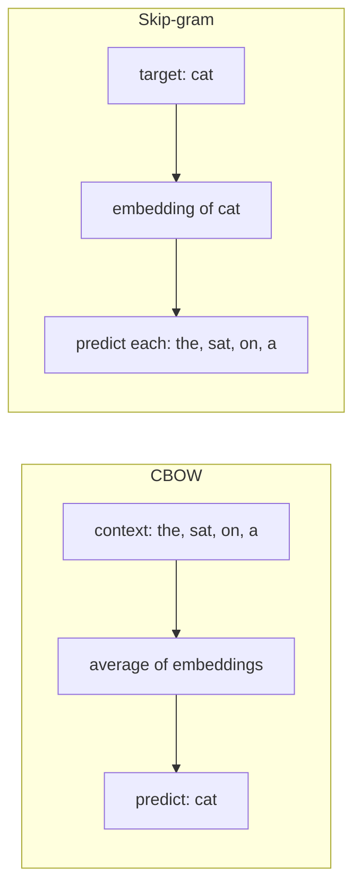

# Embeddings and similarity

To a TF-IDF model, "hotel" and "motel" are exactly as far apart as "hotel" and "banana", because each word is its own axis. So a search for "cheap motel" misses a page about "budget hotels", and a classifier that has seen one never learns anything about the other. Someone has to tell the model that these words are related, and nobody has the time to write that list.

**In plain words.** An embedding gives each word a position on a map, and places two words close together when they turn up in the same kinds of sentences, much as you might guess two strangers share a trade from the company they keep. That is how a search for "cheap motel" can learn to find a page about "budget hotels", the problem at the heart of search and of "more like this" suggestions at work. The map also picks up the habits of the text it learned from, prejudices included, so this chapter tests it as well as builds it.

"You shall know a word by the company it keeps." Train a shallow network to predict a word from its context, or the reverse, and the hidden weights become dense vectors where similar words are close. No one labels anything. This chapter trains those vectors on a real corpus, tests them on analogies and bias, then uses distances between strings, documents and vectors to build a content-based recommender, which draws the line from word2vec to the sentence embeddings that power retrieval.

## From sparse to dense

A one-hot or TF-IDF vector ([text representation](01-text-representation.md)) has one dimension per vocabulary word, so "hotel" and "motel" are orthogonal. An **embedding** maps each word to a dense vector of 50–300 numbers, learned so that words used in similar contexts get similar vectors.

| | One-hot / TF-IDF | Embedding |
|---|---|---|
| Dimensions | Vocabulary size (10k–1M) | 50–1024 |
| Sparsity | Sparse | Dense |
| Similar words | Orthogonal | Close |
| Learned from | Counting | Prediction (or factorising co-occurrence) |
| Out-of-vocabulary | Dropped | Dropped (word2vec, GloVe); subwords (FastText) |

## word2vec

Mikolov et al. (2013) proposed two shallow architectures. Sarkar's Ch04b builds both in Keras on the King James Bible before using gensim.



| Architecture | Predicts | Training pairs | Better for |
|---|---|---|---|
| CBOW | Target word from the average of its context words | `([w-2, w-1, w+1, w+2], w)` | Frequent words; faster |
| Skip-gram | Each context word from the target | `(w, w-2)`, `(w, w-1)`, ... | Rare words; small corpora |

The original paper ([arXiv:1301.3781](https://arxiv.org/abs/1301.3781)) measured the two on its analogy test set (8,869 semantic and 10,675 syntactic questions). With 300-d vectors trained on 783M words, **skip-gram scored 50.0% on semantic questions against CBOW's 15.5%**, and 55.9% against 53.1% on syntactic ones. CBOW trained in about a day and skip-gram in about three. The "rare words, small corpora" rule of thumb in the table comes from the later word2vec documentation, not from this paper. The paper also shows that more data and wider vectors both help, and that each must grow with the other.

The 2013 paper made the output layer cheap with a hierarchical softmax over a Huffman tree. **Negative sampling** came in the follow-up paper ([arXiv:1310.4546](https://arxiv.org/abs/1310.4546) (Mikolov et al., NIPS 2013)). It turns the expensive softmax over the vocabulary into binary classification: is this (word, context) pair real, or one of *k* random pairs? The noise words are drawn from the unigram distribution raised to the 3/4 power, and the paper suggests k = 5–20 for small corpora and 2–5 for large ones. The same paper also discards each frequent word with probability 1 − √(t/f), with t ≈ 10⁻⁵. On about 1B words of Google News (300-d skip-gram, same analogy test), negative sampling with 5 noise words scored 59% in 38 minutes, against 47% in 41 minutes for the hierarchical softmax. With subsampling added, it scored 60% in 14 minutes. The vectors also add: the nearest tokens to *Russian* + *river* are *Moscow* and *Volga River*. Phrase vectors (frequent word pairs merged into single tokens) reached 72% on a phrase-analogy set, but only with 33B training words. These are single runs on Google-internal data, with no error bars.

Skip-gram with negative sampling is small enough to write in Keras, as Sarkar's Ch04b does. Two embedding tables, a dot product, a sigmoid. We train it on the first part of `big.txt`, a concatenation of public-domain books that ships with his chapter 3.

```python
from pathlib import Path
import json, os, re, time
os.environ.setdefault("TF_CPP_MIN_LOG_LEVEL", "3")
import numpy as np, pandas as pd
import tensorflow as tf
from tensorflow.keras.preprocessing.sequence import skipgrams

BOOK = Path("../practice/text-analytics-with-python")
raw = (BOOK / "Ch03 - Processing and Understanding Text/big.txt").read_text(encoding="utf-8", errors="ignore")
sentences = [s.split() for s in re.sub(r"[^a-z.\s]", " ", raw.lower()).split(".") if len(s.split()) > 2]
print(len(sentences), "sentences,", sum(map(len, sentences)), "tokens")

counts = pd.Series([w for s in sentences[:30000] for w in s]).value_counts()
vocab = counts.index[:3000].tolist()
ids = {w: i + 1 for i, w in enumerate(vocab)}          # 0 is reserved: skipgrams treats it as padding
pairs, labels = [], []
rng = np.random.default_rng(0)
for s in sentences[:30000]:
    seq = [ids[w] for w in s if w in ids and rng.random() < min(1, (1e-3 * counts.sum() / counts[w]) ** 0.5)]
    p, l = skipgrams(seq, vocabulary_size=len(vocab) + 1, window_size=4, negative_samples=2.0, seed=0)
    pairs += p; labels += l
words, contexts = np.array(pairs).T
y = np.array(labels)

tf.keras.utils.set_random_seed(0)
w_in, c_in = tf.keras.Input((1,)), tf.keras.Input((1,))
target_table = tf.keras.layers.Embedding(len(vocab) + 1, 64, name="vectors")      # these weights ARE the word vectors
context_table = tf.keras.layers.Embedding(len(vocab) + 1, 64)
dot = tf.keras.layers.Dot(axes=2)([target_table(w_in), context_table(c_in)])
out = tf.keras.layers.Dense(1, activation="sigmoid")(tf.keras.layers.Flatten()(dot))
model = tf.keras.Model([w_in, c_in], out)
model.compile(loss="binary_crossentropy", optimizer="adam")
start = time.time()
history = model.fit([words, contexts], y, batch_size=2048, epochs=3, verbose=0)
print(f"{len(y):,} pairs, losses", np.round(history.history["loss"], 3), f"{time.time() - start:.0f}s")

vectors = target_table.get_weights()[0]
unit = vectors / np.maximum(np.linalg.norm(vectors, axis=1, keepdims=True), 1e-9)
for word in ["king", "war", "father"]:
    near = np.argsort(-(unit @ unit[ids[word]]))[1:7]
    print(word, [vocab[i - 1] for i in near if i > 0])
```

```text
50382 sentences, 1101150 tokens
6,561,204 pairs, losses [0.289 0.245 0.234] 12s
king ['george', 'france', 'washington', 'triumph', 'james', 'franklin']
war ['world', 'civil', 'treaty', 'paris', 'nations', 'spanish']
father ['frank', 'wife', 'brother', 'countess', 'wished', 'remember']
```

Twelve seconds of training on a few history-heavy books already gives real structure: "war" sits near "civil" and "treaty". The corpus decides what the words mean, so "king" sits near "george" and "france" rather than "queen". The learned table is the only thing you keep.

In practice, use gensim, which is orders of magnitude faster on a CPU. The argument names changed in gensim 4, and the notebooks use the old ones.

```python
from gensim.models import Word2Vec, FastText

start = time.time()
w2v = Word2Vec(sentences=sentences,     # list of token lists
               vector_size=100,         # notebooks: size= (gensim 3); renamed in gensim 4
               window=5, min_count=5, sg=1,   # sg=1 skip-gram, 0 CBOW
               epochs=5, workers=4, seed=0)   # notebooks: iter= (gensim 3)
print(f"{len(w2v.wv):,} words in {time.time() - start:.0f}s")
for word in ["king", "war", "father"]:
    print(word, [w for w, _ in w2v.wv.most_similar(word, topn=6)])
```

```text
12,390 words in 3s
king ['prussia', 'hamilton', 'vice', 'madison', 'george', 'mckinley']
war ['revolution', 'civil', 'campaign', 'conflict', 'diplomacy', 'independence']
father ['brother', 'sister', 'husband', 'wife', 'mother', 'son']
```

That is three seconds for 1.1M tokens and a vocabulary four times larger, and "father" now finds only family words. Skip-gram finds what those books talk about, and no more. The condensed NLP course notebooks trained the same model on NLTK's Project Gutenberg books (`most_similar("father")`) and on a news corpus (`most_similar("president")`), then plotted the vectors with t-SNE ([manifold learning](../../01-classical-ml/notes/05-unsupervised-learning.md#manifold-learning-t-sne)). On a corpus of a few books the neighbours are already sensible: family words cluster, character names cluster.

### GloVe and FastText

| Model | Idea | Get it |
|---|---|---|
| GloVe (Pennington et al., 2014) | Factorise the log word co-occurrence matrix: $w_i \cdot \tilde w_j + b_i + \tilde b_j \approx \log X_{ij}$ | Pretrained 50–300d on Wikipedia, Common Crawl (840B tokens); spaCy `en_core_web_md`/`lg` ship them |
| FastText (Bojanowski et al., 2017) | word2vec over character n-grams: a word's vector is the sum of its n-gram vectors | `gensim.models.FastText`; handles misspellings and unseen words |

The subword gain shows up where words are rare or heavily inflected. FastText sums character 3- to 6-grams, hashed into 2M buckets. On the English Rare Words similarity set it scored 47 (Spearman ×100) against 43 for skip-gram and CBOW, and trained on just 1% of Wikipedia it scored 45, still beating CBOW trained on all of it. Czech syntactic analogies rose from 52.8% to 77.8%. Semantic analogies did not improve (German fell from 66.5% to 62.3%), and English WS353 stayed flat at 71 vs 72 ([doi:10.1162/tacl_a_00051](https://doi.org/10.1162/tacl_a_00051) (Bojanowski et al., TACL 2017)). You can see the out-of-vocabulary behaviour directly.

```python
ft = FastText(sentences=sentences[:30000], vector_size=100, window=5, min_count=5, sg=1, epochs=3, workers=4, seed=0)
for word in ["kingly", "kingliest", "fatherr"]:
    known = word in ft.wv.key_to_index
    print(f"{word:10} in vocabulary: {known!s:6} word2vec has it: {word in w2v.wv!s:6}", [w for w, _ in ft.wv.most_similar(word, topn=4)])
```

```text
kingly     in vocabulary: False  word2vec has it: False  ['abruptly', 'strictly', 'violently', 'singly']
kingliest  in vocabulary: False  word2vec has it: False  ['kingdom', 'modest', 'quadriceps', 'livingston']
fatherr    in vocabulary: False  word2vec has it: False  ['father', 'stepfather', 'fair', 'wostov']
```

None of these three is in the vocabulary, and word2vec could not even return a vector for them. FastText still answers, and the answers show how it works: the misspelt "fatherr" finds "father", and "kingly" finds "singly" and "abruptly". It matched the "-ly" spelling rather than kingship, so subwords carry form first. That is a real gain for typos and inflections, not a magic source of meaning.

### Embedding geometry: analogies and bias

Your *Operations on word vectors* notebook (DL Sequence Models, week 2) uses 50-d GloVe. The same vectors are small enough to download once, so we can run its analogy solver at full vocabulary. Comparing `b - a` with `w - c` by cosine is the notebook's formula, and the one `gensim` uses by default is a close cousin.

```python
import gzip, urllib.request
from gensim.models import KeyedVectors

CACHE = Path.home() / ".cache/learn-ai-engineering"
CACHE.mkdir(parents=True, exist_ok=True)
path = CACHE / "glove-wiki-gigaword-50.gz"
if not path.exists():                  # 66 MB, once. Pennington et al., via the gensim-data release
    urllib.request.urlretrieve("https://github.com/RaRe-Technologies/gensim-data/releases/download/"
                               "glove-wiki-gigaword-50/glove-wiki-gigaword-50.gz", path)
glove = KeyedVectors.load_word2vec_format(path, binary=False, limit=100_000)   # top 100k words
E = glove.vectors
print(E.shape)

def cosine_similarity(u, v):
    return u @ v / (np.linalg.norm(u) * np.linalg.norm(v))

def complete_analogy(a, b, c):
    """a is to b as c is to ?   man : woman :: king : queen"""
    ea, eb, ec = glove[a], glove[b], glove[c]
    target = (eb - ea) / np.linalg.norm(eb - ea)
    diffs = E - ec
    scores = diffs @ target / np.maximum(np.linalg.norm(diffs, axis=1), 1e-9)
    ranked = [glove.index_to_key[i] for i in np.argsort(-scores)[:5]]
    return [w for w in ranked if w not in {a, b, c}][0]

for a, b, c in [("man", "woman", "king"), ("paris", "france", "tokyo"), ("big", "bigger", "small"), ("good", "best", "bad")]:
    print(f"{a}:{b} :: {c}:", complete_analogy(a, b, c), "| gensim:", glove.most_similar(positive=[b, c], negative=[a], topn=1)[0][0])
```

```text
(100000, 50)
man:woman :: king: princess | gensim: queen
paris:france :: tokyo: japan | gensim: japan
big:bigger :: small: larger | gensim: larger
good:best :: bad: films | gensim: ever
```

The headline example is less tidy than the folklore. On 50-d vectors, the notebook's formula answers "princess" while gensim's answers "queen". "Tokyo" works, comparatives give "larger" rather than "smaller", and "bad" fails entirely. The solver also has to exclude the input words, or it would often return them. These are useful demonstrations but not a dependable reasoning system. The same notebook shows the vectors encode social bias, since projecting occupations onto the `woman - man` direction separates "receptionist" from "engineer". It removes the bias component from gender-neutral words (**neutralise**) and makes gendered pairs equidistant from the neutral axis (**equalise**), after Bolukbasi et al. ([arXiv:1607.06520](https://arxiv.org/abs/1607.06520), NIPS 2016).

```python
g = glove["woman"] - glove["man"]
g /= np.linalg.norm(g)
for word in ["receptionist", "nurse", "teacher", "doctor", "scientist", "engineer", "warrior"]:
    print(f"{word:13}{glove[word] @ g / np.linalg.norm(glove[word]):+.3f}")

def neutralize(e):
    return e - (e @ g) * g

print("receptionist after neutralising:", round(float(cosine_similarity(neutralize(glove["receptionist"]), g)), 6))
print("good/bad", round(float(glove.similarity("good", "bad")), 3), " good/excellent", round(float(glove.similarity("good", "excellent")), 3))
```

```text
receptionist +0.331
nurse        +0.380
teacher      +0.179
doctor       +0.119
scientist    -0.052
engineer     -0.080
warrior      -0.209
receptionist after neutralising: 0.0
good/bad 0.796  good/excellent 0.806
```

Occupation words line up along the direction: receptionist and nurse towards "woman", engineer and warrior towards "man". After neutralising, the projection is zero by construction. "Good" and "bad" have a cosine of 0.80, about the same as "good" and "excellent" at 0.81, which is the antonym problem described below. Embeddings learned from text inherit the text's associations, and any similarity system built on them does too.

Two more properties follow from "similar means shares contexts" (*Building AI Agents with LLMs, RAG, and Knowledge Graphs*, ch. 1). First, **antonyms land close together**: "good" and "bad" fill the same slots, so a word2vec neighbour list mixes synonyms and antonyms. The context window decides which kind of similarity you get. Windows of about 2 group words by part of speech. Wider windows group them by topic. Second, **one vector holds every sense of a word**. Arora et al. ([TACL 2018](https://aclanthology.org/Q18-1034/)) show that a polysemous word's vector is approximately a linear superposition of its sense vectors, weighted by how often each sense occurs. "Apple" is mostly fruit or mostly company depending on the corpus. Sparse coding over the embeddings can pull the senses apart. Contextual models ([what attention fixed](../../02-deep-learning/notes/06-neural-text-models.md#what-attention-fixed)) remove the problem by giving each occurrence of a word its own vector.

## Embeddings inside a model

An `Embedding` layer is a lookup table trained with the rest of the network. The condensed NLP course trained one on IMDb sentiment and exported it for the TensorFlow Projector, and its *embeddings learning curve* notebook trains on the sarcasm headlines and plots loss per epoch. We do the same on the film genres.

```python
from sklearn.model_selection import train_test_split
from tensorflow.keras.preprocessing.text import Tokenizer
from tensorflow.keras.preprocessing.sequence import pad_sequences

movies = pd.read_csv(BOOK / "Ch07 - Text Similarity and Clustering/tmdb_5000_movies.csv.gz")
movies["description"] = movies["tagline"].fillna("") + " " + movies["overview"].fillna("")
movies["genre"] = movies.genres.map(lambda g: (json.loads(g) or [{"name": None}])[0]["name"])
data = movies[movies.genre.isin(movies.genre.value_counts().head(6).index)]
classes = sorted(data.genre.unique())
y_all = data.genre.map(classes.index).to_numpy()
tr_text, te_text, y_tr, y_te = train_test_split(data.description, y_all, test_size=0.25, random_state=0, stratify=y_all)

tok = Tokenizer(num_words=8000, oov_token="<oov>")
tok.fit_on_texts(tr_text)
X_tr = pad_sequences(tok.texts_to_sequences(tr_text), maxlen=113, truncating="post")
X_te = pad_sequences(tok.texts_to_sequences(te_text), maxlen=113, truncating="post")

tf.keras.utils.set_random_seed(0)
net = tf.keras.Sequential([
    tf.keras.layers.Embedding(8000, 16),         # (batch, seq) -> (batch, seq, 16)
    tf.keras.layers.GlobalAveragePooling1D(),    # average over tokens
    tf.keras.layers.Dense(16, activation="relu"),
    tf.keras.layers.Dense(len(classes), activation="softmax")])
net.compile(loss="sparse_categorical_crossentropy", optimizer="adam", metrics=["accuracy"])
hist = net.fit(X_tr, y_tr, validation_data=(X_te, y_te), epochs=32, batch_size=32, verbose=0).history
for e in range(3, 32, 4):
    print(f"epoch {e + 1:>2}  train loss {hist['loss'][e]:.3f}  val loss {hist['val_loss'][e]:.3f}  val acc {hist['val_accuracy'][e]:.3f}")
weights = net.layers[0].get_weights()[0]             # (8000, 16). Write vecs.tsv and meta.tsv for projector.tensorflow.org
print(weights.shape)
```

```text
epoch  4  train loss 1.590  val loss 1.592  val acc 0.315
epoch  8  train loss 1.497  val loss 1.530  val acc 0.438
epoch 12  train loss 1.217  val loss 1.371  val acc 0.512
epoch 16  train loss 0.919  val loss 1.283  val acc 0.524
epoch 20  train loss 0.690  val loss 1.265  val acc 0.531
epoch 24  train loss 0.517  val loss 1.291  val acc 0.532
epoch 28  train loss 0.390  val loss 1.348  val acc 0.534
epoch 32  train loss 0.298  val loss 1.429  val acc 0.519
(8000, 16)
```

Validation loss bottoms out around epoch 20 while training loss keeps falling, and accuracy stays flat near 0.53, the overfitting signature. It also ends about where the sparse baseline in [text classification](02-text-classification.md) started, after far more training. The course notebook sees the same thing on sarcasm, and in [learning curves](../../01-classical-ml/notes/04-model-evaluation.md#learning-curves-and-bias-variance-diagnosis) you met the signature. [Training and tuning](../../01-classical-ml/notes/09-training-and-tuning.md#early-stopping-is-regularisation-too) explains why stopping at that minimum acts as regularisation. Smaller vocabulary, shorter sequences, smaller embedding dimension or dropout flatten it.

Trained for one task, the vectors organise by that task. In the projector the IMDb embedding splits into a "positive" and a "negative" pole rather than by topic. Pretrained vectors (GloVe, word2vec) carry general meaning, and task-trained ones carry what the label needed. You can initialise with pretrained vectors and freeze or fine-tune them, as the Kaggle notebook's LSTM does in [the Kaggle recipe](02-text-classification.md#worked-example-the-kaggle-recipe), and as *Emojify* does in the course.

## Document vectors

| Method | How | Quality |
|---|---|---|
| Average of word vectors | `np.mean([wv[w] for w in doc if w in wv], axis=0)` | Baseline; loses order; Sarkar's Ch04b clusters the toy corpus correctly with it |
| TF-IDF-weighted average | Weight each word vector by its TF-IDF | Often better: downweights common words |
| Doc2Vec | Learn a paragraph vector alongside word vectors | Better than averaging; needs training |
| Topic proportions | LDA/NMF ([topic models](03-topic-models-and-summarization.md)) | Interpretable, coarse |
| Sentence encoders | Universal Sentence Encoder ([neural text models](../../02-deep-learning/notes/06-neural-text-models.md)), Sentence-BERT, modern embedding APIs | Current practice |

We can compare the first two with pretrained GloVe on the same genre task.

```python
from sklearn.feature_extraction.text import TfidfVectorizer
from sklearn.linear_model import LogisticRegression
from sklearn.metrics import f1_score

vectoriser = TfidfVectorizer(min_df=2, sublinear_tf=True).fit(tr_text)
names = vectoriser.get_feature_names_out()
in_glove = np.array([n in glove.key_to_index for n in names])
word_matrix = np.vstack([glove[n] if ok else np.zeros(50) for n, ok in zip(names, in_glove)])

def mean_vectors(texts, weighted):
    X = vectoriser.transform(texts)
    if not weighted:
        X = (X > 0).astype(float)
    return np.asarray(X @ word_matrix) / np.maximum(np.asarray(X[:, in_glove].sum(axis=1)), 1e-9)

for label, weighted in [("plain average", False), ("TF-IDF weighted", True)]:
    clf = LogisticRegression(C=10, max_iter=3000).fit(mean_vectors(tr_text, weighted), y_tr)
    print(f"{label:16} macro-F1 {f1_score(y_te, clf.predict(mean_vectors(te_text, weighted)), average='macro'):.3f}")
```

```text
plain average    macro-F1 0.428
TF-IDF weighted  macro-F1 0.431
```

Weighted is barely ahead of plain, 0.431 against 0.428 macro-F1, and pretrained 50-d GloVe matches tuned TF-IDF's 0.42 on this task, ahead of the 0.35 we got from word2vec trained on the small corpus. Pretrained vectors bring outside knowledge, the point the next chapters build on. The small gain from weighting is a useful warning about the table's "often better".

## Similarity and distance

Sarkar's Ch07a compares terms with several metrics, implemented by hand:

| Measure | Definition | Use for |
|---|---|---|
| Hamming | Count of positions that differ (equal-length strings) | Codes, fixed-length IDs |
| Manhattan | $\sum \lvert u_i - v_i\rvert$ | Character vectors |
| Euclidean | $\sqrt{\sum (u_i - v_i)^2}$ | Dense vectors of similar magnitude |
| Levenshtein (edit) | Minimum insertions, deletions, substitutions | Typos, fuzzy matching: "belief" vs "believe" |
| Cosine | $1 - \frac{u \cdot v}{\lVert u\rVert\lVert v\rVert}$ | Text vectors: ignores length |
| Jaccard | $\lvert A \cap B\rvert / \lvert A \cup B\rvert$ on token sets | Near-duplicate detection (MinHash) |

```python
def levenshtein(u, v):
    D = np.zeros((len(u) + 1, len(v) + 1), dtype=int)
    D[:, 0] = range(len(u) + 1); D[0, :] = range(len(v) + 1)
    for i in range(1, len(u) + 1):
        for j in range(1, len(v) + 1):
            D[i, j] = min(D[i-1, j] + 1, D[i, j-1] + 1, D[i-1, j-1] + (u[i-1] != v[j-1]))
    return int(D[-1, -1])

print("belief/believe", levenshtein("belief", "believe"), " kitten/sitting", levenshtein("kitten", "sitting"))

norms = np.linalg.norm(E, axis=1)
unit_e = E / norms[:, None]
q = glove.key_to_index["king"]
top = lambda scores: [glove.index_to_key[i] for i in np.argsort(-scores)[:6]]
print("median norm", round(float(np.median(norms)), 2), "| norm of 'the'", round(float(norms[glove.key_to_index["the"]]), 2))
print("by raw dot:", top(E @ E[q]), "mean norm", round(float(norms[np.argsort(-(E @ E[q]))[:6]].mean()), 2))
print("by cosine: ", top(unit_e @ unit_e[q]), "mean norm", round(float(norms[np.argsort(-(unit_e @ unit_e[q]))[:6]].mean()), 2))
print("on unit vectors, -L2 gives the same order as dot:", top(-np.linalg.norm(unit_e - unit_e[q], axis=1)) == top(unit_e @ unit_e[q]))
```

```text
belief/believe 2  kitten/sitting 3
median norm 4.75 | norm of 'the' 4.97
by raw dot: ['king', 'emperor', 'throne', 'son', 'lord', 'prince'] mean norm 5.68
by cosine:  ['king', 'prince', 'queen', 'ii', 'emperor', 'son'] mean norm 5.51
on unit vectors, -L2 gives the same order as dot: True
```

The raw dot product is unbounded and grows with vector length, so it favours long vectors. On GloVe the effect is modest, because norms vary little: its neighbours have slightly longer vectors and "queen" drops out of the top six. In count-based vectors the long ones are frequent, uninformative words, and it is much worse. Cosine divides the length out. **Normalise before cosine or dot product.** With L2-normalised vectors, cosine similarity is the dot product and Euclidean distance is a monotone function of it, so all three rank neighbours identically, as the last line confirms. Vector databases rely on this.

## A content-based recommender (Sarkar ch. 7b)

Recommend TMDB films similar to one you liked, from descriptions alone.

```python
from sklearn.metrics.pairwise import linear_kernel

catalogue = movies[movies.description.str.len() > 20].reset_index(drop=True)
tv = TfidfVectorizer(ngram_range=(1, 2), min_df=2, stop_words="english", sublinear_tf=True)
tfidf = tv.fit_transform(catalogue.description)      # rows are unit length, so a dot product is cosine

def recommend(title, k=5):
    i = catalogue.index[catalogue.title == title][0]
    scores = linear_kernel(tfidf[i], tfidf).ravel()
    best = np.argsort(-scores)[1:k + 1]              # skip itself
    return catalogue.title.iloc[best].tolist()

for title in ["Minions", "Interstellar"]:
    print(title, "->", recommend(title))
```

```text
Minions -> ['Despicable Me 2', 'Despicable Me', 'Stuart Little 2', 'Time Bandits', 'The Jimmy Show']
Interstellar -> ['Gattaca', 'Space Pirate Captain Harlock', 'Space Cowboys', 'Final Destination 2', 'Prometheus']
```

He then swaps cosine for **BM25**, the probabilistic ranking function behind classic search engines:

$$\text{BM25}(q, d) = \sum_{t \in q} \text{idf}(t) \cdot \frac{f(t, d)\,(k_1 + 1)}{f(t, d) + k_1\left(1 - b + b \frac{|d|}{\text{avgdl}}\right)}$$

$k_1 \approx 1.2$–2 saturates term frequency, and $b \approx 0.75$ normalises for document length. BM25 is still the lexical half of hybrid retrieval, and it fits in a few lines, so here it is as a search engine over the catalogue.

```python
from sklearn.feature_extraction.text import CountVectorizer

class BM25:
    def __init__(self, docs, k1=1.5, b=0.75):
        self.k1, self.b = k1, b
        self.counter = CountVectorizer(stop_words="english")
        self.tf = self.counter.fit_transform(docs).tocsc().astype(float)
        self.lengths = np.asarray(self.tf.sum(axis=1)).ravel()
        self.avgdl = self.lengths.mean()
        df = np.bincount(self.tf.indices, minlength=self.tf.shape[1])
        self.idf = np.log(1 + (len(self.lengths) - df + 0.5) / (df + 0.5))

    def score(self, query):
        scores = np.zeros(self.tf.shape[0])
        norm = self.k1 * (1 - self.b + self.b * self.lengths / self.avgdl)
        for term in self.counter.build_analyzer()(query):
            j = self.counter.vocabulary_.get(term)
            if j is None:
                continue
            col = self.tf[:, j]
            f = col.data
            scores[col.indices] += self.idf[j] * f * (self.k1 + 1) / (f + norm[col.indices])
        return scores

bm25 = BM25(catalogue.description)
for query in ["space station crew stranded", "haunted house teenagers"]:
    best = np.argsort(-bm25.score(query))[:5]
    print(query, "->", catalogue.title.iloc[best].tolist())
hits = bm25.score("motel") > 0
print("documents matching 'motel':", int(hits.sum()), "| of those mentioning 'hotel':",
      int(catalogue.description[hits].str.contains(r"\bhotel\b", case=False).sum()),
      "| 'hotel' documents overall:", int(catalogue.description.str.contains(r"\bhotel\b", case=False).sum()))
```

```text
space station crew stranded -> ['Cargo', 'Space Pirate Captain Harlock', 'Solaris', 'Star Trek Beyond', 'Deep Impact']
haunted house teenagers -> ['House on Haunted Hill', 'The Others', 'Scary Movie 2', 'Insidious', 'Scary Movie 4']
documents matching 'motel': 7 | of those mentioning 'hotel': 0 | 'hotel' documents overall: 36
```

BM25 finds films for a keyword query in a few milliseconds, and the recommender finds sequels. Both are lexical. Seven documents match "motel" and none of the 36 that say "hotel" are among them, so a searcher never finds those. That is this chapter's opening problem, and it is what a dense encoder fixes.

| Recommender type | Uses | Cold start |
|---|---|---|
| Content-based (this section) | Item features (text) | Works for new items, not new users |
| Collaborative filtering ([matrix factorisation](../../05-time-series-and-recommenders/notes/02-collaborative-filtering-and-matrix-factorisation.md), [Ng's exercise](../../01-classical-ml/notes/05-unsupervised-learning.md#recommender-systems-ng-ex8-part-2)) | User–item ratings | Fails for new items and users |
| Hybrid | Both | |

## The bridge to retrieval

Everything in RAG is here in small: documents become vectors (TF-IDF, BM25 or a neural encoder), a query becomes a vector, cosine similarity ranks candidates, and hybrid systems fuse lexical (BM25) and dense scores. The jump is in the encoder: contextual sentence embeddings trained contrastively, like the triplet-loss face embeddings in [convolutional networks](../../02-deep-learning/notes/04-convolutional-networks.md#embeddings-face-verification), instead of averaged word vectors. Continue in [RAG and retrieval](../../../generative-ai/02-rag-retrieval/README.md).

## Notebooks

| Notebook | Covers | Runs |
|---|---|---|
| [`Ch04b - Advanced Deep Learning Strategies`](../practice/text-analytics-with-python/Ch04%20-%20Feature%20Engineering%20for%20Text%20Representation/Ch04b%20-%20Feature%20Engineering%20Text%20Data%20-%20Advanced%20Deep%20Learning%20Strategies.ipynb) | CBOW and skip-gram in Keras, gensim word2vec, document vectors, GloVe via spaCy, FastText | Needs `nltk` Gutenberg data, spaCy `en_vecs` (→ `en_core_web_md`); standalone `keras` 2.x; gensim 3 argument names (`size`, `iter`) |
| [`Ch07a`](../practice/text-analytics-with-python/Ch07%20-%20Text%20Similarity%20and%20Clustering), `Ch07b` | Distance metrics, TF-IDF movie recommender, BM25 | Runs offline; `tmdb_5000_movies.csv.gz` included |
| [`Operations on word vectors - v2`](../../02-deep-learning/practice/ng-deep-learning/Sequence%20Models/Week2/Word%20Vector%20Representation/Operations%20on%20word%20vectors%20-%20v2.ipynb), [`Emojify - v2`](../../02-deep-learning/practice/ng-deep-learning/Sequence%20Models/Week2/Emojify/Emojify%20-%20v2.ipynb) (own) | Cosine, analogies, debiasing; GloVe-based classifier | Legacy: needs the course's `w2v_utils`/`emo_utils` and `glove.6B.50d.txt` (not in the repo) |

## Pitfalls

- **Treating cosine neighbours as synonyms.** Words with shared contexts include antonyms. "Good" and "bad" are close, so do not rely on nearest neighbours to preserve polarity.
- **Forgetting to normalise.** A raw dot product rewards long vectors. Normalise, or be deliberate about why you did not.
- **Trusting analogies as a test of everything.** They are selective: the solver excludes the input words, and a small set of relations does well.
- **Shipping vectors without checking bias.** Project sensitive directions onto your embeddings before they drive a decision. Neutralising reduces, but does not remove, the association, since related words stay clustered.
- **Mixing vector spaces.** Embeddings from different models or versions are not comparable, so re-embed when you change the model.
- **Using dense when lexical is the need.** Product codes, names and rare terms are BM25's job. Fuse the two rather than replacing it.

## Try it

1. **The window decides the kind of similarity.** Train word2vec on `sentences` with `window=2` and `window=15`. Compare neighbours of a few words. Which gives you syntactic relatives, and which topical ones?

<details><summary>Answer</summary>

```python
narrow = Word2Vec(sentences, vector_size=100, window=2, min_count=5, sg=1, epochs=3, workers=4, seed=0)
wide = Word2Vec(sentences, vector_size=100, window=15, min_count=5, sg=1, epochs=3, workers=4, seed=0)
for word in ["walked", "doctor", "river"]:
    print(word, "\n  window 2 :", [w for w, _ in narrow.wv.most_similar(word, topn=6)],
          "\n  window 15:", [w for w, _ in wide.wv.most_similar(word, topn=6)])
```

```text
walked
  window 2 : ['rushed', 'stepped', 'paced', 'moved', 'drove', 'sprang']
  window 15: ['footmen', 'glasses', 'rushed', 'stepped', 'stairs', 'hurried']
doctor
  window 2 : ['vicomte', 'colonel', 'bilibin', 'uncle', 'maid', 'boy']
  window 15: ['anatole', 'tikhon', 'shinshin', 'dessalles', 'kuragin', 'drubetskaya']
river
  window 2 : ['valley', 'mississippi', 'snow', 'edge', 'forest', 'wood']
  window 15: ['highroad', 'forest', 'kolocha', 'valley', 'heights', 'forests']
```

Window 2 finds words that can fill the same slot: "walked" gets "rushed", "stepped" and "paced", all past-tense motion verbs. Window 15 mixes in the surroundings of walking, such as "footmen" and "stairs", and for "doctor" it lists the characters of *War and Peace*, one of the books in the file. It is the same corpus and the same model, so this one choice decides what "similar" means. Neighbours vary a little between runs, because multi-worker training is not deterministic.

</details>

2. **What do $k_1$ and $b$ do?** Build `BM25` with `b=0` and `b=1` for "space station crew stranded". What changes, and how long are the results?

<details><summary>Answer</summary>

```python
for b in [0.0, 0.75, 1.0]:
    engine = BM25(catalogue.description, b=b)
    best = np.argsort(-engine.score("space station crew stranded"))[:5]
    print(f"b={b}", round(float(engine.lengths[best].mean()), 1), "words", catalogue.title.iloc[best].tolist()[:3])
print("corpus mean", round(float(engine.avgdl), 1))
```

```text
b=0.0 33.8 words ['Solaris', 'Cargo', 'Space Pirate Captain Harlock']
b=0.75 25.2 words ['Cargo', 'Space Pirate Captain Harlock', 'Solaris']
b=1.0 25.2 words ['Cargo', 'Space Pirate Captain Harlock', 'Solaris']
corpus mean 31.2
```

With `b=0` there is no length penalty, so results run longer (mean 33.8 words here). With `b=0.75` and `b=1` they are shorter (25.2 words), against a corpus mean of 31.2. Long documents contain the terms by chance more often, and `b` discounts that. The top results barely change on these short documents, and the setting matters more where length varies widely.

</details>

3. **Equalise.** Neutralising fixes a neutral word against the gender axis. Is "doctor" now equally similar to "man" and "woman"? How about a word that was not neutralised, and what does that show?

<details><summary>Answer</summary>

```python
for word in ["doctor", "receptionist"]:
    raw, fixed = glove[word], neutralize(glove[word])
    print(word, "raw man/woman", round(float(cosine_similarity(raw, glove["man"])), 3), round(float(cosine_similarity(raw, glove["woman"])), 3),
          "| neutralised", round(float(cosine_similarity(fixed, glove["man"])), 3), round(float(cosine_similarity(fixed, glove["woman"])), 3))
```

```text
doctor raw man/woman 0.712 0.725 | neutralised 0.731 0.688
receptionist raw man/woman 0.31 0.446 | neutralised 0.37 0.348
```

Neutralising made "receptionist" nearly equally similar to "man" and "woman" (0.37 and 0.35, from 0.31 and 0.45), but not exactly, and "doctor" moved from 0.71 and 0.73 to 0.73 and 0.69. "Man" and "woman" are not symmetric around the axis, because they differ in other ways, and that is what the **equalise** step in the notebook corrects. Gender is also just one direction, and removing it does not remove what related words imply.

</details>

## Interview checklist

| Question | Short answer |
|---|---|
| Why do embeddings work at all? | Words in similar contexts get similar vectors because they must predict the same neighbours. |
| CBOW or skip-gram? | Skip-gram predicts context from a word, and CBOW the reverse. In the word2vec paper skip-gram won on semantics at 3x the training time. |
| What does negative sampling replace? | The softmax over the vocabulary, by a binary real-or-noise classifier for each pair with $k$ noise words. |
| What does FastText add? | Character n-grams, so it can embed unseen words and helps on rare or inflected words. |
| How do you turn words into a document vector? | Average, TF-IDF-weighted average, or use a sentence encoder directly, which is current practice. |
| Why cosine rather than dot? | Dot grows with length. After L2 normalisation, cosine, dot and Euclidean all give the same ranking. |
| Why do antonyms sit close? | They occur in the same contexts, and a window-based model cannot tell them apart. |
| What is the polysemy problem? | One vector for all senses, roughly a frequency-weighted sum of them. Contextual models solve it. |
| How do you remove bias from embeddings? | Neutralise gender-neutral words and equalise pairs, then test, since related words often retain the association. |
| What is BM25? | TF-IDF with saturating term frequency and length normalisation, the lexical half of hybrid retrieval. |

## Next

[Semantic analysis and NER](05-semantic-analysis-and-ner.md) looks at meaning beyond vectors: WordNet, named entities, taggers and semantic representations.
