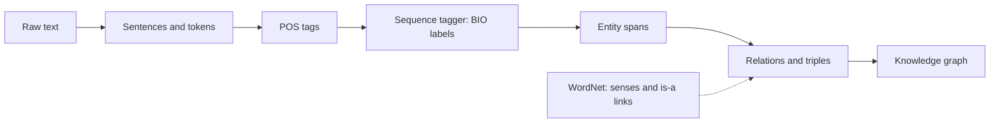
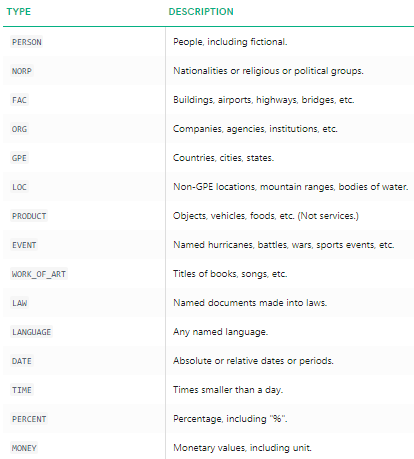

# Semantic analysis and named entity recognition

Vectors tell you that two documents are alike, but not who did what, where, or to whom. If a compliance team asks which companies appear in ten thousand contracts, or a product team wants every drug name in a set of case notes, a similarity score is no help. They need spans of text with types attached, and sometimes knowledge a corpus never states, such as that a lion is a kind of cat.

**In plain words.** Named entity recognition is a highlighter pen for text: it marks the people, places, companies and dates in a document so they can go into a spreadsheet. Think of a paralegal going through a stack of contracts and listing every company named. This chapter trains a model to do that, shows when a plain list of names beats any model, and insists on fair marking, where a name highlighted only halfway does not count. It also looks at dictionaries of meaning, which can tell a model that a lion is a kind of cat.

This chapter is about meaning from structure rather than from distance: a lexical database of senses and relations (WordNet), sequence labelling that finds people, places and organisations (NER, with spaCy or your own CRF), and the formal logic that early systems used to represent what a sentence asserts. NER and relation extraction remain the front end of every knowledge graph, and the discipline for evaluating them outlasts the models.



## WordNet (Sarkar ch. 8a)

WordNet groups English words into **synsets** (sets of synonyms sharing one sense) and links synsets by semantic relations. A single spelling can have many.

```python
from pathlib import Path
import random
import nltk
for pkg in ["wordnet", "omw-1.4", "punkt", "punkt_tab", "averaged_perceptron_tagger_eng"]:
    nltk.download(pkg, quiet=True)
from nltk.corpus import wordnet as wn
from nltk import word_tokenize

print("bank:", len(wn.synsets("bank")), "synsets,", len(wn.synsets("bank", "n")), "noun,", len(wn.synsets("bank", "v")), "verb")
for s in wn.synsets("fruit"):
    print(f"{s.name():12} {s.pos()}  {s.definition()}")
```

```text
bank: 18 synsets, 10 noun, 8 verb
fruit.n.01   n  the ripened reproductive body of a seed plant
yield.n.03   n  an amount of a product
fruit.n.03   n  the consequence of some effort or action
fruit.v.01   v  cause to bear fruit
fruit.v.02   v  bear fruit
```

| Relation | Meaning | Example | Method |
|---|---|---|---|
| Synonym / antonym | Same / opposite sense | large ↔ big; large ↔ small | `lemma.antonyms()` |
| Hypernym / hyponym | Is-a (more general / more specific) | tree → woody plant; tree → oak | `hypernyms()`, `hyponyms()`, `hypernym_paths()` |
| Holonym / meronym | Part-of / has-part (member, part, substance) | forest has-member tree; tree has-part trunk; tree has-substance heartwood | `member_holonyms()`, `part_meronyms()`, `substance_meronyms()` |
| Entailment | Verb A implies verb B | walk entails step; eat entails chew | `entailments()` |
| Homonyms / homographs | Same spelling, different sense | bank (river) / bank (money) | multiple synsets |

```python
tree = wn.synset("tree.n.01")
print("hypernym:", [s.name() for s in tree.hypernyms()], "| some hyponyms:", [s.name() for s in tree.hyponyms()[:3]])
print("has-part:", [s.name() for s in tree.part_meronyms()][:4], "| has-substance:", [s.name() for s in tree.substance_meronyms()])
print("walk entails:", [s.name() for s in wn.synset("walk.v.01").entailments()], "| eat entails:", [s.name() for s in wn.synset("eat.v.01").entailments()])
print("large antonym:", [a.name() for a in wn.synset("large.a.01").lemmas()[0].antonyms()])
```

```text
hypernym: ['woody_plant.n.01'] | some hyponyms: ['zebrawood.n.02', 'tipu.n.01', 'gymnospermous_tree.n.01']
has-part: ['stump.n.01', 'crown.n.07', 'burl.n.02', 'trunk.n.01'] | has-substance: ['heartwood.n.01', 'sapwood.n.01']
walk entails: ['step.v.01'] | eat entails: ['swallow.v.01', 'chew.v.01']
large antonym: ['small']
```

### Similarity and disambiguation

Because synsets form a tree of is-a links, you can measure how far apart two senses are, and find what they have in common. Sizes and scale: WordNet 3.0 holds 117,659 synsets (the count `len(list(wn.all_synsets()))` returns today, and the figure the NLTK book's text gives; its Table 2-2 says "145k", which the book does not reconcile), and "car" alone has 5 of them. Depth shows how deep the is-a chain runs: baleen whale sits at minimum depth 14 below the root `entity`. The book's path-similarity examples against right whale give 0.25 for the minke whale, 0.17 for the orca, 0.08 for a tortoise and 0.04 for a novel (all reproduce in current NLTK), and its authors add that "the numbers won't mean much" beyond the ranking (*NLP with Python*, ch. 2). The 0.25 means a shortest path of three edges (1 / (1 + 3)), through their lowest common hypernym, the baleen whale. Dated: in the book's NLTK 2 code `synset.definition`, `lemma_names` and `lemma.name` are attributes, and in NLTK 3 they are methods, as the snippets here use.

```python
from nltk.wsd import lesk

lion, tiger, cat, dog = (wn.synset(x) for x in ["lion.n.01", "tiger.n.02", "cat.n.01", "dog.n.01"])
print("lion and tiger share", [s.name() for s in lion.lowest_common_hypernyms(tiger)])
print("path_similarity  lion/tiger", round(lion.path_similarity(tiger), 2), " lion/tree", round(lion.path_similarity(tree), 2),
      " cat/dog", round(cat.path_similarity(dog), 2))   # 1 / (1 + shortest is-a path); also wup_, lch_similarity

for sentence in ["Lead is a very soft, malleable metal", "John is the actor who plays the lead", "The bank raised its interest rates", "They fished from the bank of the river"]:
    word = "lead" if "ead" in sentence else "bank"
    sense = lesk(word_tokenize(sentence), word, "n")
    print(f"{sentence:42} {sense.name():14} {sense.definition()[:60]}")
```

```text
lion and tiger share ['big_cat.n.01']
path_similarity  lion/tiger 0.33  lion/tree 0.07  cat/dog 0.2
Lead is a very soft, malleable metal       lead.n.02      a soft heavy toxic malleable metallic element; bluish white
John is the actor who plays the lead       star.n.04      an actor who plays a principal role
The bank raised its interest rates         bank.n.10      a flight maneuver; aircraft tips laterally about its longitu
They fished from the bank of the river     bank.n.01      sloping land (especially the slope beside a body of water)
```

Lesk is right on both "lead" sentences and on the river bank, then decides that a bank raising interest rates is a flight manoeuvre. That is how it fails: with no overlap in the definition, it has nothing to go on. **Lesk** picks the sense whose dictionary definition overlaps most with the context words. It is a weak baseline, and contextual embeddings ([neural text models](../../02-deep-learning/notes/06-neural-text-models.md)) disambiguate implicitly and much better. WordNet's lasting uses are lemmatisation ([text representation](01-text-representation.md)), query expansion with synonyms and hypernyms, and as a hand-built taxonomy, an early knowledge graph.

## Named entity recognition (Sarkar ch. 8b)

Label spans of text with entity types: PERSON, ORG, GPE (geo-political entity), LOC, DATE, MONEY and so on. It is **sequence labelling**: one tag per token, usually in the **BIO** scheme, so that adjacent entities stay distinct.

| Token | Barack | Obama | visited | New | York | in | May |
|---|---|---|---|---|---|---|---|
| Tag | B-per | I-per | O | B-geo | I-geo | O | B-tim |

### spaCy

The film descriptions make a good test because they are full of invented characters as well as real places.

```python
from collections import Counter
import pandas as pd
import spacy

BOOK = Path("../practice/text-analytics-with-python")
nlp = spacy.load("en_core_web_sm")           # notebook: spacy.load('en') (spaCy 2 shortcut)
movies = pd.read_csv(BOOK / "Ch07 - Text Similarity and Clustering/tmdb_5000_movies.csv.gz")
overviews = movies.sort_values("popularity", ascending=False).overview.fillna("").tolist()

print([(ent.text, ent.label_) for ent in nlp(overviews[3]).ents])
labels, by_type = Counter(), {}
for doc in nlp.pipe(overviews[:1000], disable=["lemmatizer"]):
    for ent in doc.ents:
        labels[ent.label_] += 1
        by_type.setdefault(ent.label_, Counter())[ent.text] += 1
print(labels.most_common(8))
for label in ["GPE", "PERSON", "ORG"]:
    print(label, [w for w, _ in by_type[label].most_common(8)])
```

```text
[('years', 'DATE'), ('Earth', 'LOC'), ('26 years', 'DATE'), ('Peter Quill', 'PERSON'), ('Ronan the Accuser', 'PERSON')]
[('PERSON', 1684), ('ORG', 615), ('GPE', 518), ('DATE', 342), ('CARDINAL', 307), ('NORP', 236), ('LOC', 116), ('WORK_OF_ART', 68)]
GPE ['New York', 'Los Angeles', 'U.S.', 'London', 'America', 'New York City', 'Las Vegas', 'Paris']
PERSON ['Peter', 'Harry', 'Andy', 'John', 'Jack', 'Max', 'Snow White', 'Jim']
ORG ['CIA', 'FBI', 'Bond', 'IMF', 'Batman', 'Sophie', 'Lincoln', 'Riley']
```


*Image source: Sarkar, Text Analytics with Python (2nd ed.), companion repo `Ch08/spacy_ner.png`*

The first line above is one film's description, and spaCy tags its entities sensibly. Run across a thousand film descriptions, the output is usable and also instructive. PERSON dominates, GPE finds real cities, but the ORG list mixes CIA and FBI with "Bond", "Batman" and "Sophie". A news-trained model has never seen fictional characters doing what these do. Counting `ent.label_` over a corpus gives a quick profile of what a collection is about.

### Stanford NER and CoreNLP

The same text can go through Stanford's CRF-based tagger (`nltk.tag.StanfordNERTagger`, 3-class: PERSON, ORGANIZATION, LOCATION) and through the CoreNLP server (more types, plus SUTime for dates). Both need Java and downloaded model files, and the notebook's hard-coded `E:/stanford/...` paths will not exist on your machine. Today, `stanza` (Stanford's Python library) replaces both.

| Tool | Model | Types | Notes |
|---|---|---|---|
| spaCy `en_core_web_sm/md/lg/trf` | CNN or transformer | 18 (OntoNotes) | Fast, Python-native; `trf` most accurate |
| Stanford NER / CoreNLP | CRF | 3, 4, 7 or 12 | Java service |
| stanza | BiLSTM-CRF | 18 | Python; many languages |
| Hugging Face token classification | Fine-tuned BERT-style | Any | `pipeline("ner")` ([transformers pipelines](../../02-deep-learning/notes/06-neural-text-models.md#transformers-pipelines)) |
| LLM extraction | Prompted | Any, defined in the prompt | Flexible schema; check precision |

## Building your own NER tagger (Sarkar ch. 8c)

Part-of-speech tags are the input to this tagger (feature `postag` below), and the NLTK book's ladder shows how far a tagger gets before any sequence model: on Brown news with the full tagset, tagging everything as a noun scores about 0.13, a unigram tagger 0.81 on a held-out 10%, and a bigram-to-unigram-to-noun backoff chain 0.845, with ambiguity capping n-gram taggers at about 1 context in 20 having more than one tag (*NLP with Python*, ch. 5). Code that reproduces the ladder is in [text classification](02-text-classification.md#held-out-discipline-from-the-nltk-book). The book notes that tagging is "an early example of a sequence classification task" and the CRF below is its modern form. Its Brill rules (for example, change NN to VB after "to") are readable but the chapter reports no accuracy for them.

When the entity types are your own (product codes, drug names, contract clauses), train a tagger. Sarkar uses the Kaggle GMB corpus (`ner_dataset.csv.gz`, about 48k sentences, 17 BIO tags: geo, org, per, gpe, tim, art, eve, nat) and a **conditional random field**.

A CRF is a linear model over the whole tag sequence. It scores features of each token *and* transitions between adjacent tags, so it can learn that I-per cannot follow B-geo. Features are hand-crafted per token, and this is where you can put what you know about the domain.

```python
df = pd.read_csv(BOOK / "Ch08 - Semantic Analysis/ner_dataset.csv.gz", encoding="ISO-8859-1").ffill()
sents = [list(zip(g.Word, g.POS, g.Tag)) for _, g in df.groupby("Sentence #", sort=False)]
print(len(sents), "sentences,", len(df), "tokens,", df.Tag.nunique(), "tags")
print(df.Tag.value_counts(normalize=True).round(3).head(4).to_dict())

def word2features(sent, i):
    word, pos = sent[i][0], sent[i][1]
    f = {"bias": 1.0, "word.lower()": word.lower(),
         "word[-3:]": word[-3:], "word[-2:]": word[-2:],           # suffixes: -ton, -ist, -ing
         "word.isupper()": word.isupper(), "word.istitle()": word.istitle(),
         "word.isdigit()": word.isdigit(), "postag": pos, "postag[:2]": pos[:2]}
    if i > 0:
        w1, p1 = sent[i-1][0], sent[i-1][1]
        f.update({"-1:word.lower()": w1.lower(), "-1:word.istitle()": w1.istitle(), "-1:postag": p1})
    else:
        f["BOS"] = True
    if i < len(sent) - 1:
        w1, p1 = sent[i+1][0], sent[i+1][1]
        f.update({"+1:word.lower()": w1.lower(), "+1:word.istitle()": w1.istitle(), "+1:postag": p1})
    else:
        f["EOS"] = True
    return f

def featurise(sentences):
    return [[word2features(s, i) for i in range(len(s))] for s in sentences]

random.Random(0).shuffle(sents)
train, test = sents[:12000], sents[-4000:]              # a third of the corpus keeps this under a minute
X_train, y_train = featurise(train), [[t for *_, t in s] for s in train]
X_test, y_test = featurise(test), [[t for *_, t in s] for s in test]
```

```text
47959 sentences, 1048575 tokens, 17 tags
{'O': 0.847, 'B-geo': 0.036, 'B-tim': 0.019, 'B-org': 0.019}
```

```python
import time
import sklearn_crfsuite
from seqeval.metrics import classification_report, f1_score as entity_f1

start = time.time()
crf = sklearn_crfsuite.CRF(algorithm="lbfgs", c1=0.1, c2=0.1,      # L1 and L2 penalties
                           max_iterations=60, all_possible_transitions=True)
crf.fit(X_train, y_train)                                          # X: list of lists of feature dicts
y_pred = crf.predict(X_test)
print(f"trained in {time.time() - start:.0f}s; entity-level F1 {entity_f1(y_test, y_pred):.3f}")
print(classification_report(y_test, y_pred, digits=2))
```

```text
trained in 12s; entity-level F1 0.826
              precision    recall  f1-score   support

         art       0.50      0.21      0.29        34
         eve       0.60      0.23      0.33        26
         geo       0.84      0.90      0.87      3150
         gpe       0.96      0.93      0.95      1289
         nat       0.50      0.31      0.38        16
         org       0.73      0.66      0.69      1642
         per       0.77      0.71      0.74      1428
         tim       0.89      0.83      0.86      1694

   micro avg       0.84      0.82      0.83      9279
   macro avg       0.72      0.60      0.64      9279
weighted avg       0.83      0.82      0.82      9279
```

Entity-level F1 is 0.83 on 12,000 sentences in about 13 seconds. Frequent types score well (gpe 0.95, geo 0.87, tim 0.86), and rare ones poorly (art 0.29, eve 0.33, nat 0.38), with support of a few dozen. The classification report is more useful than the single number.

### Reading what the CRF learned

Inspecting `crf.transition_features_` shows the learned grammar. `state_features_` show what it thinks a person looks like. Nobody typed either of these rules in.

```python
trans = pd.Series(crf.transition_features_).sort_values()
print("most encouraged:", [f"{a}->{b} {v:+.1f}" for (a, b), v in trans.tail(4).iloc[::-1].items()])
print("most forbidden: ", [f"{a}->{b} {v:+.1f}" for (a, b), v in trans.head(4).items()])
state = pd.Series(crf.state_features_).sort_values(ascending=False)
print("features for B-per:", [f"{f} {v:+.1f}" for (f, t), v in state.items() if t == "B-per"][:6])
```

```text
most encouraged: ['I-tim->I-tim +5.4', 'I-org->I-org +5.3', 'B-art->I-art +5.3', 'B-eve->I-eve +5.3']
most forbidden:  ['B-per->B-per -6.5', 'O->I-geo -5.7', 'O->I-org -5.0', 'B-gpe->B-gpe -4.9']
features for B-per: ['word.lower():president +5.3', 'word.lower():prime +4.8', 'word.lower():clinton +4.3', 'word.lower():senator +4.0', 'word.lower():cobain +4.0', 'word.lower():greenspan +4.0']
```

The transitions read like a grammar: continue a span once it is open, and never open I-geo from O. The state features show titles such as "president" and "senator" counting as B-per, which fits how GMB labels them, and that is worth knowing before you trust this tagger on your own text. Surnames like Clinton and Greenspan appear too, a memorised vocabulary from the news of its time. A tagger like that goes stale as the news moves on, which is the kind of decay [drift monitoring](../../../data-engineering/06-ml-platform/notes/04-drift.md) exists to catch.

The notebook ends with an end-to-end pipeline: sentence-tokenise a new document, POS-tag it, build features, predict tags, and merge B/I runs into entity spans, compared with spaCy's output on the same text. Here is that pipeline, in a dozen lines.

```python
def extract_entities(text):
    out = []
    for sentence in nltk.sent_tokenize(text):
        tagged = nltk.pos_tag(word_tokenize(sentence))
        tags = crf.predict_single([word2features(tagged, i) for i in range(len(tagged))])
        current = None
        for (word, _), tag in zip(tagged, tags):
            if tag.startswith("B-"):
                current = [tag[2:], [word]]; out.append(current)
            elif tag.startswith("I-") and current and current[0] == tag[2:]:
                current[1].append(word)
            else:
                current = None
    return [(" ".join(words), kind) for kind, words in out]

news = ("Mark Zuckerberg of Facebook declined to testify before parliament in London on Tuesday. "
        "Officials from the United Kingdom and Canada said they would meet in Ottawa next month.")
print("CRF  ", extract_entities(news))
print("spaCy", [(e.text, e.label_) for e in nlp(news).ents])
```

```text
CRF   [('Mark Zuckerberg', 'per'), ('Facebook', 'org'), ('London', 'geo'), ('Tuesday', 'tim'), ('United Kingdom and Canada', 'org'), ('Ottawa', 'geo')]
spaCy [('Mark Zuckerberg', 'PERSON'), ('London', 'GPE'), ('Tuesday', 'DATE'), ('the United Kingdom', 'GPE'), ('Canada', 'GPE'), ('Ottawa', 'GPE'), ('next month', 'DATE')]
```

The CRF gets the entities in the first sentence and is confused by "United Kingdom and Canada", which it merges into one organisation. It has only one sequence and no idea that these are countries. spaCy splits them and labels both GPE but misses Facebook. Neither is uniformly better, so test on your text.

| Approach | Data needed | Strength |
|---|---|---|
| Rules / gazetteers (spaCy `EntityRuler`, regex) | None | Precise on closed lists (product codes) |
| CRF on hand features | Thousands of labelled sentences | Interpretable, fast, small |
| BiLSTM-CRF | More | Learns features |
| Fine-tuned transformer | Hundreds to thousands | Best accuracy |
| LLM prompting | Zero to few examples | New types instantly; slower, costlier |

The first row deserves a demonstration, because it is the option people forget. If your list is closed, a rule beats any model.

```python
ruler_nlp = spacy.load("en_core_web_sm")
ruler = ruler_nlp.add_pipe("entity_ruler", before="ner")
ruler.add_patterns([{"label": "DRUG", "pattern": [{"LOWER": "ibuprofen"}]},
                    {"label": "SKU", "pattern": [{"TEXT": {"REGEX": r"^[A-Z]{2}-\d{4}$"}}]}])
text = "Order AB-1234 included ibuprofen, shipped to Denver by FedEx."
print([(e.text, e.label_) for e in ruler_nlp(text).ents])
print([(e.text, e.label_) for e in nlp(text).ents])
```

```text
[('AB-1234', 'SKU'), ('ibuprofen', 'DRUG'), ('Denver', 'GPE'), ('FedEx', 'GPE')]
[('Denver', 'GPE'), ('FedEx', 'GPE')]
```

The rules add both new types without any training, and neither touches what the statistical model does: it still calls FedEx a GPE, so rules fix closed lists, not the model's errors elsewhere.

**Evaluate NER at the entity level** (exact span and type match, as `seqeval` does), not at token level, since token accuracy is dominated by `O`. It is the same trap as a rare-event model that looks accurate by never firing ([accuracy lies; errors cost](../../01-classical-ml/notes/10-imbalance-errors-and-drift.md#accuracy-lies-errors-cost)).

## Semantic representations (Sarkar ch. 8d)

Before statistical NLP, meaning was represented in logic. NLTK can evaluate and prove statements, and it has a built-in resolution prover (Prover9 is an external binary).

```python
read_expr = nltk.sem.Expression.fromstring
prover = nltk.ResolutionProver()
rule = read_expr("all x. all y. (jumps_over(x, y) -> -jumps_over(y, x))")
event = read_expr("jumps_over(fox, dog)")
print("does the dog jump over the fox?", prover.prove(read_expr("jumps_over(dog, fox)"), [rule, event]))
print("does the dog not jump over the fox?", prover.prove(read_expr("-jumps_over(dog, fox)"), [rule, event]))

domain = {"alice", "bob"}
valuation = nltk.sem.Valuation.fromstring("""
    alice => alice
    bob => bob
    studies => {(alice)}
""")
model = nltk.sem.Model(domain, valuation)
g = nltk.sem.Assignment(domain)
print("someone studies:", model.evaluate("exists x. studies(x)", g), "| everyone studies:", model.evaluate("all x. studies(x)", g))
```

```text
does the dog jump over the fox? False
does the dog not jump over the fox? True
someone studies: True | everyone studies: False
```

The prover cannot show the first goal, and it can show the second, which the rule and event require. Sarkar also builds a small first-order model of this kind, a domain of entities and a valuation of predicates, and evaluates quantified expressions against it. The practical descendants are triples (subject, predicate, object), knowledge graphs and constrained output schemas. LLMs now do the extraction step, and the graph and query languages took over the representation.

## From entities to knowledge graphs

NER and relation extraction populate knowledge graphs, and WordNet-style taxonomies become ontologies. Building knowledge graphs from text with LLMs, including entity resolution, is in [building knowledge graphs with LLMs](../../../ai-engineering/05-graph-engineering/notes/10-building-kgs-with-llms.md).

## Notebooks

| Notebook | Covers | Runs |
|---|---|---|
| [`Ch08a - Exploring WordNet`](../practice/text-analytics-with-python/Ch08%20-%20Semantic%20Analysis/Ch08a%20-%20Exploring%20WordNet.ipynb) | Synsets, relations, similarity, Lesk | Runs offline after `nltk.download("wordnet")` |
| `Ch08b - Named Entity Recognition` | spaCy, Stanford NER, CoreNLP | spaCy part: needs `en_core_web_sm` (notebook uses the spaCy 2 `'en'` shortcut). Stanford parts: needs service (Java, Stanford NER jars, CoreNLP server; hard-coded Windows paths) |
| `Ch08c - Building NER Taggers` | CRF tagger on GMB, end-to-end pipeline | Runs offline; `sklearn-crfsuite`; `ner_dataset.csv.gz` included; `sklearn.externals.joblib` fixed to `joblib` |
| `Ch08d - Analyzing Semantic Representations` | Propositional and first-order logic in NLTK | Runs offline (resolution prover); Prover9 cells need the external binary |

## Pitfalls

- **Reporting token accuracy.** `O` is most of the tokens, so a model that predicts `O` everywhere looks excellent. Report entity-level F1.
- **Splitting by token instead of sentence or document.** Tokens from one sentence in both sets leak context, and sentences from one document can do the same.
- **Mismatched tag schemes.** GMB's `geo` and spaCy's `GPE` and `LOC` are different label sets. Align them before comparing models.
- **Trusting a pretrained model on a new domain.** A news-trained tagger reads character names and invented places in film summaries as best it can, so measure on your text.
- **Training on rare types with few examples.** Rare classes have low F1 whatever the model. Get more examples or merge the classes.
- **Reaching for a model before a list.** A closed vocabulary is a gazetteer problem.

## Try it

1. **Why not report token accuracy?** Compute token accuracy for the CRF, including `O`, and for a tagger that always predicts `O`. Then compute the entity-level F1 of the second.

<details><summary>Answer</summary>

```python
flat_true = [t for s in y_test for t in s]
flat_pred = [t for s in y_pred for t in s]
all_o = [["O"] * len(s) for s in y_test]
print("CRF token accuracy   ", round(sum(a == b for a, b in zip(flat_true, flat_pred)) / len(flat_true), 3))
print("always-O token acc   ", round(sum(a == "O" for a in flat_true) / len(flat_true), 3))
print("always-O entity F1   ", round(entity_f1(y_test, all_o), 3))
```

```text
CRF token accuracy    0.969
always-O token acc    0.849
always-O entity F1    0.0
```

The CRF has token accuracy of 0.969 and a tagger predicting all `O` has 0.849, while finding no entity at all (F1 0.0). The real gap between them is hidden by that metric.

</details>

2. **How much data does a rare type need?** Retrain on 1,000 and 4,000 sentences and print F1 for `per`, `geo`, `art` and `eve`.

<details><summary>Answer</summary>

```python
from seqeval.metrics import classification_report as seqeval_report

for n in [1000, 4000, 12000]:
    small = sklearn_crfsuite.CRF(algorithm="lbfgs", c1=0.1, c2=0.1, max_iterations=40).fit(X_train[:n], y_train[:n])
    report = seqeval_report(y_test, small.predict(X_test), output_dict=True, zero_division=0)
    print(n, {k: round(float(report[k]["f1-score"]), 2) for k in ["per", "geo", "art", "eve"]})
```

```text
1000 {'per': 0.67, 'geo': 0.83, 'art': 0.06, 'eve': 0.07}
4000 {'per': 0.72, 'geo': 0.86, 'art': 0.15, 'eve': 0.32}
12000 {'per': 0.73, 'geo': 0.87, 'art': 0.22, 'eve': 0.21}
```

`geo` barely moves with more data (0.83 to 0.87), and rare types go from near nothing at 1,000 sentences (`art` 0.06, `eve` 0.07) to modest. They are still noisy, as `eve` falls from 0.32 to 0.21 between 4,000 and 12,000, with test support of only 26 entities. Rare types need more data than a random sample delivers.

</details>

3. **Query expansion.** Use WordNet to expand "car" with its synonyms and hypernyms, then count how many film descriptions match the original word and how many match the expansion. Is that better?

<details><summary>Answer</summary>

```python
import re

sense = wn.synset("car.n.01")
synonyms = {l.replace("_", " ") for l in sense.lemma_names()}
hypernyms = {l.replace("_", " ") for h in sense.hypernyms() for l in h.lemma_names()}
print("synonyms", sorted(synonyms)); print("hypernyms", sorted(hypernyms))
text = pd.Series(overviews).str.lower()
hits = lambda terms: text.str.contains(r"\b(?:" + "|".join(map(re.escape, terms)) + r")\b").sum()
print("car only", hits({"car"}), "| + synonyms", hits(synonyms), "| + hypernyms", hits(synonyms | hypernyms))
```

```text
synonyms ['auto', 'automobile', 'car', 'machine', 'motorcar']
hypernyms ['automotive vehicle', 'motor vehicle']
car only 75 | + synonyms 113 | + hypernyms 113
```

Synonyms raise matches from 75 to 113 descriptions, but the hypernyms here add nothing since "motor vehicle" never occurs. Precision is the catch: "machine" can match descriptions that have nothing to do with cars, so expansion always needs a check on the results.

</details>

## Interview checklist

| Question | Short answer |
|---|---|
| What is a synset? | A set of synonyms sharing one sense, linked to others by is-a, part-of and related relations. |
| What does the Lesk algorithm do? | Picks the sense whose definition overlaps most with the context. It is a weak baseline. |
| What is BIO tagging? | B begins an entity, I continues it, O is outside. It keeps adjacent entities separate. |
| What does a CRF add to a per-token classifier? | It scores tag transitions over the whole sequence, so it can rule out invalid sequences. |
| Why is NER evaluated at the entity level? | Token accuracy is dominated by `O`, and a partly correct span is not a usable entity. |
| When do you train your own tagger? | When your entity types are specific and labelled examples exist. Otherwise use a pretrained model or rules. |
| Rules or a model? | Rules for closed lists like SKUs, a model for open classes where context matters. |
| What are the typical modern options? | Fine-tuned transformers for accuracy, LLM prompting for new types with few examples. |
| How do semantic representations survive today? | As triples, knowledge graphs and constrained schemas, with LLMs doing the extraction. |

## Next

[Sentiment analysis](06-sentiment-analysis.md) applies lexicons, supervised models and deep models to opinion, and asks what drives it.
