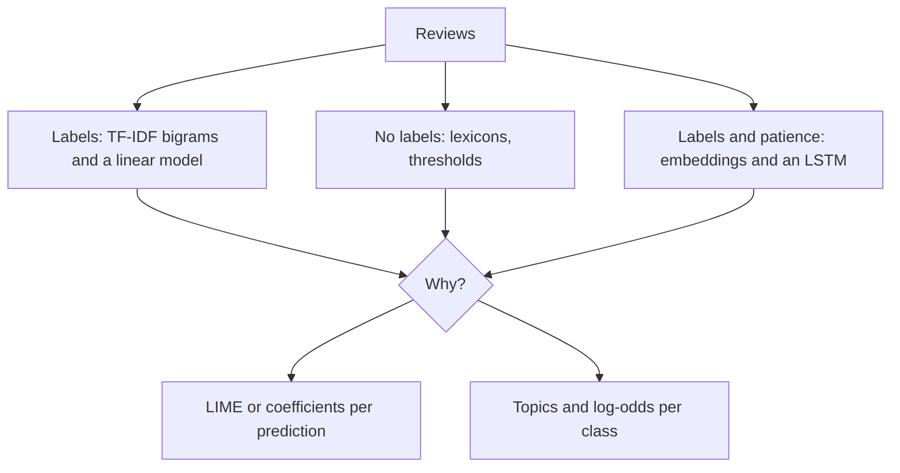

# Sentiment analysis

Your product has fifty thousand reviews, and a manager asks two questions: are people happy, and why not? The first is classification, and you could answer it three ways: with a dictionary and no labels, with a linear model and many labels, or with a neural network that reads in order. The surprise is how those three rank, and the second question is the one that matters, because a score of 72% positive tells nobody what to fix.

**In plain words.** Sentiment analysis reads customer comments and says whether each one is happy or unhappy, the job you might give a temp with a pile of feedback cards. You could hand the temp a list of good and bad words, or show them a great many cards already marked, and this chapter measures how much each approach gets right. A count of unhappy customers only tells you there is a problem, so the chapter ends by pulling out what they are complaining about.

This chapter works through three generations of answer on the same IMDb reviews: hand-built lexicons, supervised classifiers on sparse or dense features, and sequence models. Then it answers the more useful question, what drives the sentiment, with model interpretation and topic models split by class.



## The task and the data

Sentiment is binary or graded polarity (positive, negative, sometimes neutral or a 1–5 score). Finer forms are **aspect-based** (the battery is great, the screen is poor) and emotion detection. All of Sarkar's chapter 9 uses the 50,000-review IMDb dataset (`movie_reviews.csv`, balanced, 35k train and 15k test), normalised with the chapter's `text_normalizer.py` (HTML strip, accent removal, contraction expansion, lemmatisation, stop words; see [text representation](01-text-representation.md)). His CSV is not in this snapshot, so we use the standard 25k/25k split of the same reviews ([Maas et al., ACL 2011](https://aclanthology.org/P11-1015/)), downloaded once and cached.

```python
from pathlib import Path
import os, re, time, urllib.request
os.environ.setdefault("TF_CPP_MIN_LOG_LEVEL", "3")
import numpy as np, pandas as pd

CACHE = Path.home() / ".cache/learn-ai-engineering"
CACHE.mkdir(parents=True, exist_ok=True)
BASE = "https://huggingface.co/datasets/stanfordnlp/imdb/resolve/main/plain_text/"

def load(split):
    path = CACHE / f"imdb-{split}.parquet"
    if not path.exists():
        urllib.request.urlretrieve(f"{BASE}{split}-00000-of-00001.parquet", path)
    df = pd.read_parquet(path)
    df["text"] = df.text.str.replace("<br />", " ", regex=False)
    return df

train_df, test_df = load("train"), load("test")
print(len(train_df), len(test_df), "positive share", train_df.label.mean())
sample = test_df.sample(5000, random_state=0)      # lexicons and interpretation use a sample, for speed
print(sample.text.iloc[0][:150])
```

```text
25000 25000 positive share 0.5
I sort of liked this Columbo movie its atmosphere, which was real thriller like and its approach even at times reminded me of film-noir, in the movie
```

**Normalisation warning for sentiment:** default stop-word lists contain *not*, *no*, *nor* and *very*. Removing them turns "not good" into "good". Sarkar's normaliser keeps negations out of the stop-word list, and you should check yours.

## 1. Unsupervised lexicons (ch. 9a)

A lexicon maps words to polarity scores, and a document's score is an aggregate. No labels are needed, which makes lexicons the baseline when you have none.

| Lexicon | Scores | How it aggregates | Notes |
|---|---|---|---|
| TextBlob (Pattern) | Polarity −1..1, subjectivity 0..1 per adjective | Averages, handles some modifiers ("very") and negation | Quick, adjective-centred |
| AFINN | Integer −5..+5 per word (~3,300 words, plus emoticons) | Sum | Long documents get extreme scores; threshold on the sum |
| SentiWordNet | Pos / neg / objectivity per WordNet synset ([WordNet](05-semantic-analysis-and-ner.md)) | POS-tag, take first synset, sum pos − neg, normalise by token count | Sense choice is naive (always first synset) |
| VADER | Valence per word, tuned on social media | Rules for negation, intensifiers ("extremely"), "but", caps, punctuation, emoji; `compound` −1..1 | Best of the lexicons on short informal text |

```python
import nltk
for pkg in ["vader_lexicon", "sentiwordnet", "wordnet", "punkt", "punkt_tab", "averaged_perceptron_tagger_eng"]:
    nltk.download(pkg, quiet=True)
from afinn import Afinn
from nltk.sentiment.vader import SentimentIntensityAnalyzer
from nltk.corpus import sentiwordnet as swn
from textblob import TextBlob
from sklearn.metrics import accuracy_score

afn, vader = Afinn(emoticons=True), SentimentIntensityAnalyzer()

def swn_score(text):
    pos = neg = n = 0
    for word, tag in nltk.pos_tag(nltk.word_tokenize(text[:1500])):      # POS tagging is the slow step
        wn_pos = {"NN": "n", "VB": "v", "JJ": "a", "RB": "r"}.get(tag[:2])
        synsets = list(swn.senti_synsets(word, wn_pos)) if wn_pos else []
        if synsets:
            pos += synsets[0].pos_score(); neg += synsets[0].neg_score(); n += 1
    return (pos - neg) / max(n, 1)

scorers = {"AFINN": (afn.score, 1.0), "VADER": (lambda t: vader.polarity_scores(t)["compound"], 0.1),
           "TextBlob": (lambda t: TextBlob(t).sentiment.polarity, 0.1), "SentiWordNet": (swn_score, 0.0)}
tune = train_df.sample(1500, random_state=1)
lexicon_scores = {}
for name, (score, threshold) in scorers.items():
    start = time.time()
    s = sample.text.iloc[:1500].map(score)
    t = tune.text.map(score)
    grid = np.quantile(t, np.linspace(0.1, 0.9, 33))
    best = grid[np.argmax([((t >= g) == tune.label).mean() for g in grid])]
    lexicon_scores[name] = s
    y = sample.label.iloc[:1500]
    print(f"{name:13} book threshold {threshold:4}: {accuracy_score(y, s >= threshold):.3f}   tuned on train ({best:6.2f}): "
          f"{accuracy_score(y, s >= best):.3f}   {time.time() - start:5.1f}s")
```

```text
AFINN         book threshold  1.0: 0.710   tuned on train (  6.00): 0.735     9.2s
VADER         book threshold  0.1: 0.697   tuned on train (  0.77): 0.714     1.8s
TextBlob      book threshold  0.1: 0.761   tuned on train (  0.10): 0.759     1.0s
SentiWordNet  book threshold  0.0: 0.613   tuned on train (  0.02): 0.658    14.2s
```

A dictionary with no labels gets about 70% right, against 50% for a coin. Sarkar's [Ch09a notebook](https://github.com/dipanjanS/text-analytics-with-python/tree/master/New-Second-Edition/Ch09%20-%20Sentiment%20Analysis) reports close to the same on his 15,000-review test set: TextBlob 0.767, AFINN 0.712, VADER 0.711, SentiWordNet 0.630. Our order matches his, and our book-threshold figures are within two points of his on all four. Tuning a threshold adds up to four points on three of them, and TextBlob is the one that gains nothing. Lexicons fail on domain vocabulary ("unpredictable" is good for a thriller, bad for a car), sarcasm, and reviews that describe a sad plot positively. Each lexicon needs a threshold, and the threshold is a parameter you are tuning on the test set if you pick it by looking at test accuracy, which is why we tuned on train above.

## 2. Supervised models (ch. 9b)

With labels, the text classification recipe from [text classification](02-text-classification.md) applies directly. Bigrams matter here: "not good", "waste of", "must see".

```python
from sklearn.feature_extraction.text import CountVectorizer, TfidfVectorizer
from sklearn.linear_model import LogisticRegression, SGDClassifier
from sklearn.pipeline import make_pipeline

y_train, y_test = train_df.label.to_numpy(), test_df.label.to_numpy()
tfidf_lr = make_pipeline(TfidfVectorizer(ngram_range=(1, 2), min_df=2, sublinear_tf=True),
                         LogisticRegression(C=10, max_iter=1000))
tv = TfidfVectorizer(ngram_range=(1, 2), min_df=2, sublinear_tf=True)
for name, pipe in [("TF-IDF 1-2 grams + LR", tfidf_lr),
                   ("Counts 1-2 grams + LR", make_pipeline(CountVectorizer(ngram_range=(1, 2), min_df=2), LogisticRegression(C=0.1, max_iter=1000))),
                   ("TF-IDF 1-2 grams + SVM (SGD)", make_pipeline(TfidfVectorizer(ngram_range=(1, 2), min_df=2, sublinear_tf=True), SGDClassifier(loss="hinge", alpha=1e-5, random_state=0)))]:
    start = time.time()
    pipe.fit(train_df.text, y_train)
    print(f"{name:30} test accuracy {accuracy_score(y_test, pipe.predict(test_df.text)):.3f}  {time.time() - start:.0f}s")
```

```text
TF-IDF 1-2 grams + LR          test accuracy 0.906  9s
Counts 1-2 grams + LR          test accuracy 0.898  13s
TF-IDF 1-2 grams + SVM (SGD)   test accuracy 0.902  8s
```

Thirty points above the lexicons, for nine seconds of training. That gap is what 25,000 labels buy. Sarkar's Ch09b notebook then tries dense features in a small Keras network, and these are the results saved in his notebooks, on his 35,000/15,000 split:

| Features | Model | Accuracy (Sarkar's notebooks) |
|---|---|---|
| Lexicon (AFINN, VADER) | none | 0.71 |
| BoW / TF-IDF 1–2 grams | LogisticRegression, linear SVM | 0.894 to 0.905 |
| Averaged word2vec (512-d, trained on the reviews) | 3-layer dense net with dropout | 0.882 |
| spaCy GloVe document vector (300-d) | same dense net | 0.860 |
| Learned embedding + LSTM (ch. 9c) | sequence model | 0.88 |

Here is the dense row on our split, in modern Keras (the notebook uses standalone `keras` and `keras.layers.normalization`). We use 200 dimensions rather than 512 to keep the run short.

```python
import tensorflow as tf
from tensorflow import keras
from gensim.models import Word2Vec

tokenize = CountVectorizer().build_analyzer()
train_tokens = [tokenize(t) for t in train_df.text]
w2v = Word2Vec(train_tokens, vector_size=200, window=5, min_count=5, sg=1, epochs=3, workers=4, seed=0)

def average(tokens):
    vs = [w2v.wv[w] for w in tokens if w in w2v.wv]
    return np.mean(vs, axis=0) if vs else np.zeros(200)

avg_train = np.vstack([average(t) for t in train_tokens])
avg_test = np.vstack([average(tokenize(t)) for t in test_df.text])
keras.utils.set_random_seed(0)
dense = keras.Sequential([keras.Input(shape=(200,)),
    keras.layers.Dense(256, activation="relu"), keras.layers.Dropout(0.2),
    keras.layers.Dense(256, activation="relu"), keras.layers.Dropout(0.2),
    keras.layers.Dense(1, activation="sigmoid")])
dense.compile(loss="binary_crossentropy", optimizer="adam", metrics=["accuracy"])
dense.fit(avg_train, y_train, epochs=5, batch_size=100, validation_split=0.1, verbose=0)
print("averaged word2vec + dense net:", round(dense.evaluate(avg_test, y_test, verbose=0)[1], 3))
```

```text
averaged word2vec + dense net: 0.831
```

Averaging word vectors throws away word order and negation scope, which is why it loses to bigrams. The averaging function is in [embeddings and similarity](04-embeddings-and-similarity.md).

## 3. Sequence models (ch. 9c, intro-to-nlp)

Feed token ids, not a bag. The model learns embeddings and reads in order. The intro-to-nlp notebooks compared four architectures on the same IMDb split (first 25k reviews train, last 25k test; `Tokenizer(num_words=10000, oov_token="<oov>")`, `max_length=120`, `truncating="post"`):

| Architecture | Layers after `Embedding(10000, 64)` | Behaviour |
|---|---|---|
| Pooled embeddings | `GlobalAveragePooling1D → Dense(6) → Dense(1, sigmoid)` | Fast, a learned BoW; overfits after 2–3 epochs |
| CNN | `Conv1D(128, 3) → GlobalMaxPooling1D → Dense(16) → Dense(1)`, Adam 1e-4 | Learns n-gram detectors ("not worth", "highly recommend") |
| SimpleRNN | `SimpleRNN(64) → Dense(1)` | Vanishing gradients on 120-token reviews |
| LSTM | `LSTM(64) → Dense(1)` (or `Bidirectional(LSTM(64))`) | Handles negation scope; slower |

We run all four below on a 6,000-review subset, so that the sequence models finish on a CPU. They get a fifth of the data the linear model got, so compare them with each other and not with the table above.

```python
from tensorflow.keras.preprocessing.text import Tokenizer
from tensorflow.keras.preprocessing.sequence import pad_sequences

sub = train_df.sample(6000, random_state=0)
tok = Tokenizer(num_words=10000, oov_token="<oov>")
tok.fit_on_texts(sub.text)
MAXLEN = 120
def to_ids(texts, maxlen=MAXLEN):
    return pad_sequences(tok.texts_to_sequences(texts), maxlen=maxlen, truncating="post")
X_sub, X_val = to_ids(sub.text), to_ids(sample.text.iloc[:2500])
y_sub, y_val = sub.label.to_numpy(), sample.label.iloc[:2500].to_numpy()

L = keras.layers
heads = {"Pooled": [L.GlobalAveragePooling1D(), L.Dense(6, activation="relu")],
         "CNN": [L.Conv1D(128, 3, activation="relu"), L.GlobalMaxPooling1D(), L.Dense(16, activation="relu")],
         "SimpleRNN": [L.SimpleRNN(64)],
         "LSTM": [L.LSTM(64)]}
fitted = {}
for name, head in heads.items():
    keras.utils.set_random_seed(0)
    model = keras.Sequential([L.Embedding(10000, 64), *head, L.Dense(1, activation="sigmoid")])
    model.compile(loss="binary_crossentropy", optimizer=keras.optimizers.Adam(1e-3), metrics=["accuracy"])
    start = time.time()
    h = model.fit(X_sub, y_sub, validation_data=(X_val, y_val), epochs=4, batch_size=64, verbose=0).history
    fitted[name] = model
    print(f"{name:10} val acc per epoch {np.round(h['val_accuracy'], 3)}  val loss {np.round(h['val_loss'], 2)}  train acc {h['accuracy'][-1]:.3f}  {time.time() - start:.0f}s")
```

```text
Pooled     val acc per epoch [0.659 0.742 0.79  0.8  ]  val loss [0.67 0.61 0.52 0.46]  train acc 0.851  1s
CNN        val acc per epoch [0.749 0.773 0.796 0.794]  val loss [0.59 0.46 0.45 0.5 ]  train acc 0.965  3s
SimpleRNN  val acc per epoch [0.505 0.496 0.511 0.592]  val loss [0.69 0.75 0.87 0.8 ]  train acc 0.951  5s
LSTM       val acc per epoch [0.72  0.768 0.782 0.782]  val loss [0.59 0.5  0.53 0.62]  train acc 0.941  10s
```

Read the last column before the accuracies. Every sequence model has memorised its training set (0.94 to 0.97) while validation sits near 0.80, and the CNN and LSTM validation losses have already turned upward. The plain pooled model, a learned bag of words, ties or beats them all with the least overfitting. SimpleRNN is the casualty, barely above chance at 0.59 after four epochs, which fits the vanishing-gradient behaviour in the table. These models are starved here, since six thousand reviews is not much for tens of thousands of embedding weights. Sarkar's LSTM on 35,000 reviews reaches 0.88, and his TF-IDF model on the same reviews still beats it. Use early stopping on `val_loss` ([neural network fundamentals](../../02-deep-learning/notes/01-neural-networks-fundamentals.md)). [Training and tuning](../../01-classical-ml/notes/09-training-and-tuning.md#reading-performance-during-training) shows how to read a gap like this one. `predict_classes()` from the older notebooks was removed in TF 2.6, so threshold `predict` yourself.

### A bug worth remembering

The LSTM notebook's "experiment" cells pad two hand-written reviews to `maxlen=20`, but the model was trained on length 120. Keras runs it anyway, since an LSTM accepts any length, and nothing errors. The predictions change. Let us see by how much.

```python
lstm = fitted["LSTM"]
hand = ["I loved this movie, it was wonderful and the acting was great",
        "A dull, boring waste of time. I hated every minute of it",
        "It was not bad at all, in fact quite enjoyable",
        "I expected this to be great, but it was a terrible disappointment"]
print("trained length 120:", lstm.predict(to_ids(hand), verbose=0).ravel().round(3))
print("bug: length 20:    ", lstm.predict(to_ids(hand, 20), verbose=0).ravel().round(3))
reviews = sample.text.iloc[:2500]
acc = lambda maxlen: accuracy_score(y_val, lstm.predict(to_ids(reviews, maxlen), verbose=0).ravel() > 0.5)
print("accuracy on held-out reviews: length 120", round(acc(120), 3), " length 20", round(acc(20), 3))
```

```text
trained length 120: [0.989 0.22  0.987 0.736]
bug: length 20:     [0.992 0.145 0.988 0.767]
accuracy on held-out reviews: length 120 0.782  length 20 0.672
```

The hand-written reviews barely move, because they fit inside twenty tokens anyway, so a quick spot check would have passed. Real reviews lose eleven points, from 0.782 to 0.672, because the model now sees only the opening of each one. No error, and no sign of it unless you measure accuracy through the serving path. [Monitoring error when labels arrive](../../../data-engineering/06-ml-platform/notes/04-drift.md#monitoring-error-when-labels-arrive) is how that measurement becomes routine. Preprocess inference inputs with exactly the training settings, ideally by putting `TextVectorization` inside the model so there is one code path.

The CNN and RNN mechanics belong to [neural text models](../../02-deep-learning/notes/06-neural-text-models.md). The contextual models that replaced them are in [transformers pipelines](../../02-deep-learning/notes/06-neural-text-models.md#transformers-pipelines), which you can try off the shelf with `pipeline("sentiment-analysis")` and no training.

## 4. What drives sentiment (ch. 9d, 9e)

Accuracy says the model works, but the business wants to know *why* customers are unhappy.

### Explaining individual predictions with LIME

LIME perturbs the document (drops words at random), watches how `predict_proba` changes, and fits a local linear model whose weights say which words pushed this prediction. For this you need a model with `predict_proba`. The notebook imports LIME via `skater`, which is dead, so we import it directly.

```python
from lime.lime_text import LimeTextExplainer

explainer = LimeTextExplainer(class_names=["negative", "positive"], random_state=0)
target = sample.text[sample.text.str.len().between(250, 500)].iloc[3]
print(target[:240], "...")
print("P(positive) =", round(tfidf_lr.predict_proba([target])[0, 1], 3))
exp = explainer.explain_instance(target, tfidf_lr.predict_proba, num_features=8, num_samples=1000)
print([(w, round(v, 3)) for w, v in exp.as_list()])      # in a notebook: exp.show_in_notebook()
```

```text
Fantastic, Madonna at her finest, the film is funny and her acting is brilliant. It may have been made in the 80's but it has all the qualities of a modern Hollywood Block-buster. I love this film and i think its totally unique and will che ...
P(positive) = 0.993
[(np.str_('brilliant'), 0.065), (np.str_('Fantastic'), 0.064), (np.str_('and'), 0.05), (np.str_('love'), 0.043), (np.str_('unique'), 0.041), (np.str_('finest'), 0.04), (np.str_('acting'), -0.031), (np.str_('minutes'), -0.025)]
```

For a linear pipeline, the global coefficients already explain the model ([text classification](02-text-classification.md)), and LIME earns its cost on nonlinear models. SHAP's text explainer is the more principled alternative: [model interpretability](../../01-classical-ml/notes/08-model-interpretability.md) covers SHAP values and the explanation papers, including LIME's, Ribeiro et al. ([arXiv:1602.04938](https://arxiv.org/abs/1602.04938), KDD 2016).

### Topic models per class

Split the corpus by label and run NMF on each half ([topic models](03-topic-models-and-summarization.md)). The topics of the negative reviews are the complaint themes.

```python
from sklearn.decomposition import NMF

for label, name in [(1, "positive"), (0, "negative")]:
    docs = train_df.text[train_df.label == label].sample(5000, random_state=0)
    ptv = TfidfVectorizer(min_df=0.02, max_df=0.5, stop_words="english", sublinear_tf=True)
    nmf = NMF(n_components=6, init="nndsvd", max_iter=500, random_state=0, alpha_W=0.0001, l1_ratio=0.85)
    nmf.fit(ptv.fit_transform(docs))     # notebook: alpha=0.1, renamed alpha_W in sklearn 1.0
    vocab = ptv.get_feature_names_out()
    print(name)
    for comp in nmf.components_:
        print("  ", ", ".join(vocab[comp.argsort()[-7:][::-1]]))
```

```text
positive
   like, good, just, story, time, really, people
   funny, comedy, laugh, hilarious, game, fun, friends
   great, younger, follows, fun, friends, friend, french
   love, game, funny, fun, friends, friend, french
   seen, ve, best, movies, haven, younger, follows
   series, episode, episodes, season, tv, original, characters
negative
   like, just, good, really, story, don, people
   bad, acting, good, zombie, fun, george, genre
   effects, special, friend, genre, generally, general, gave
   book, read, novel, version, zombie, genre, generally
   seen, worst, ve, movies, horrible, acting, follow
   waste, time, money, don, watching, free, general
```

The negative side reads as a list of complaints: bad acting, cheap special effects, disappointing adaptations of books, "worst" and "horrible", and a waste of time and money. The positive side is comedy, TV series and generic praise. Look at the tails too. "Effects, special, friend, genre, generally" has only two real words, because the L1 penalty zeroed the rest of that topic's weights and the sort then returns ties in an arbitrary order, so check for zeros before reading a list to the end. On product reviews you would look here for delivery, quality and support themes.

## Word clouds and quick text EDA

The intro-to-nlp PetFinder notebook (Kaggle adoption-speed data) used word clouds to explore free-text fields: top cat and dog names, breed names, and description text by adoption speed. Findings were EDA-grade: many "names" are descriptions ("Kitten", "Puppies", "No Name"), which is itself a feature. Word clouds are fine for a first look, but they encode frequency as font size, which is hard to compare. For anything you will act on, use a sorted bar chart of counts or of class-conditional log-odds, which words are most over-represented in one class. Both fit on a page, here on the reviews.

```python
from wordcloud import WordCloud

neg_text = " ".join(train_df.text[train_df.label == 0].sample(2000, random_state=0))
wc = WordCloud(background_color="white", width=1200, height=1000, collocations=False, stopwords=set()).generate(neg_text)
print("what a word cloud draws largest:", list(wc.words_)[:8])            # plt.imshow(wc); plt.axis("off")

counter = CountVectorizer(min_df=20, binary=True)
X_bin = counter.fit_transform(train_df.text)
words = counter.get_feature_names_out()
pos = np.asarray(X_bin[y_train == 1].sum(axis=0)).ravel() + 1
neg = np.asarray(X_bin[y_train == 0].sum(axis=0)).ravel() + 1
log_odds = np.log(pos / (y_train == 1).sum()) - np.log(neg / (y_train == 0).sum())
order = log_odds.argsort()
print("most negative:", words[order[:10]].tolist())
print("most positive:", words[order[-10:][::-1]].tolist())
```

```text
what a word cloud draws largest: ['the', 'a', 'i', 'and', 'of', 'to', 'it', 'in']
most negative: ['boll', 'uwe', 'manos', 'slater', 'savini', 'hobgoblins', 'kareena', 'btk', 'rosanna', 'leaden']
most positive: ['edie', 'din', 'mcintire', 'antwone', 'tsui', 'gunga', 'sabu', 'goldsworthy', 'visconti', 'joss']
```

Both outputs fail in instructive ways. The cloud draws "the", "a" and "i" largest, because we turned its stop list off to show what it really encodes, which is raw frequency. The log-odds lists have the opposite problem: "boll" and "uwe" (the director Uwe Boll, a byword for bad films) and other names that occur in few reviews, all of them about one film. Log-odds of a rare word has high variance, and a rare word that appears only in reviews of one film is a fact about that film. Raise `min_df`, or shrink rare words toward zero with an informative prior, as in "Fightin' Words" ([Monroe, Colaresi and Quinn, *Political Analysis* 2008](https://doi.org/10.1093/pan/mpn018)). Either way you get a ranked list you can read and compare, which the cloud never gives you.

## Practice notebooks

| Notebook | Covers | Runs |
|---|---|---|
| [`Ch09a - Unsupervised Lexical`](../practice/text-analytics-with-python/Ch09%20-%20Sentiment%20Analysis/Ch09a%20-%20Sentiment%20Analysis%20-%20Unsupervised%20Lexical.ipynb) | TextBlob, AFINN, SentiWordNet, VADER | Needs data: `movie_reviews.csv.bz2` (not in this snapshot; IMDb 50k from the book repo). `afinn`, `textblob`, spaCy `en_core_web_sm` |
| `Ch09b - Supervised` | BoW/TF-IDF + LR/SVM; word2vec and GloVe + dense net | Needs data as above; standalone `keras`, `keras.layers.normalization` (TF 1.x era), gensim 3 `size=` / `index2word`, spaCy vectors model |
| `Ch09c - Advanced Deep Learning` | Embedding + LSTM | Needs data; standalone `keras`; `predict_classes` removed in TF 2.6 |
| `Ch09d - Model Interpretation` | LIME explanations | Needs data; legacy: `skater` is unmaintained, swap in `lime` |
| `Ch09e - Topic Models` | NMF per sentiment class, pyLDAvis | Needs data; NMF `alpha` → `alpha_W`; pyLDAvis `.sklearn` → `.lda_model` |

The intro-to-nlp CNN and RNN sentiment notebooks are in [`practice/intro-to-nlp/tensorFlow/neural-network/`](../practice/intro-to-nlp/tensorFlow/neural-network) and the PetFinder word clouds in [`practice/intro-to-nlp/word-cloud/`](../practice/intro-to-nlp/word-cloud). Their data is in `practice/intro-to-nlp/data/` (CSVs gitignored, local only), and the [pillar README](../README.md#practice) says how to get it.

## Pitfalls

| Rule | Why |
|---|---|
| Start with TF-IDF 1–2 grams + logistic regression | Seconds to train, explainable, and it wins this chapter's comparison |
| Keep negations out of the stop-word list | "not good" must survive preprocessing |
| Use VADER when you have no labels and short informal text | Rules for negation, intensifiers, emoji |
| Use the same preprocessing at inference as in training | The maxlen=20 bug fails silently |
| Pair a sentiment model with per-class topics | The score says how many are unhappy; topics say about what |
| For new work, try a pre-trained transformer before training anything | Off the shelf it needs no training, so measure it against the linear model before you build anything |

- **Picking a lexicon threshold on the test set.** A threshold is a parameter, so it is tuned on train like any other.
- **Reading LIME as ground truth.** It is a local approximation with random perturbations, so re-run it with another seed before quoting a word's weight.
- **Treating a sad plot as a bad review.** Lexicons score the words of a plot summary, whatever the reviewer thinks of it.
- **Comparing models on different amounts of data.** A model given a fifth of the data can lose for that reason alone.

## Try it

1. **Do bigrams earn their cost?** Fit TF-IDF plus logistic regression with unigrams and with bigrams, and print the size of the vocabulary for each.

<details><summary>Answer</summary>

```python
for ngrams in [(1, 1), (1, 2)]:
    p = make_pipeline(TfidfVectorizer(ngram_range=ngrams, min_df=2, sublinear_tf=True), LogisticRegression(C=10, max_iter=1000)).fit(train_df.text, y_train)
    print(ngrams, len(p[0].vocabulary_), "features, accuracy", round(accuracy_score(y_test, p.predict(test_df.text)), 3))
```

```text
(1, 1) 44797 features, accuracy 0.883
(1, 2) 436597 features, accuracy 0.906
```

Ten times the features for 2.3 more points. Sparse linear models handle that size easily, so here bigrams earn their cost. On a dataset with far fewer documents, check it again, since many bigrams would then occur too rarely to learn from.

</details>

2. **The negation warning.** Fit the same bigram pipeline with `stop_words="english"`, which removes "not" before bigrams are formed. How much does it cost? What happens to "not good"?

<details><summary>Answer</summary>

```python
sw = make_pipeline(TfidfVectorizer(ngram_range=(1, 2), min_df=2, sublinear_tf=True, stop_words="english"), LogisticRegression(C=10, max_iter=1000)).fit(train_df.text, y_train)
print("stop words removed, accuracy", round(accuracy_score(y_test, sw.predict(test_df.text)), 3))
print("'not good' in vocabulary:", "not good" in sw[0].vocabulary_, "| kept when stop words stay:", "not good" in tfidf_lr[0].vocabulary_)
tests = ["not good", "this film is not good", "not a good film"]
print("with stop words kept:", tfidf_lr.predict_proba(tests)[:, 1].round(2), " removed:", sw.predict_proba(tests)[:, 1].round(2))
```

```text
stop words removed, accuracy 0.89
'not good' in vocabulary: False | kept when stop words stay: True
with stop words kept: [0.02 0.02 0.26]  removed: [0.99 0.8  0.99]
```

Removing stop words costs 1.6 points overall, but the examples show the real damage. "not good" is gone from the vocabulary, the model sees only "good", and the phrase flips from 0.02 to 0.99 probability of positive.

</details>

3. **Where lexicons break.** Score a few tricky sentences with AFINN, VADER and the linear model. Which fail, and on which sentences?

<details><summary>Answer</summary>

```python
tricky = ["Unpredictable twists kept me guessing, a great thriller.",
          "The film is about the horrible death of a terrible tyrant, and I adored it.",
          "Oh great, another two hours of my life gone.",
          "Not the worst film ever, but not good either."]
for text in tricky:
    print(f"{afn.score(text):+5.0f} {vader.polarity_scores(text)['compound']:+.2f} {tfidf_lr.predict_proba([text])[0, 1]:.2f}  {text}")
```

```text
   +3 +0.67 0.98  Unpredictable twists kept me guessing, a great thriller.
   -5 -0.83 0.14  The film is about the horrible death of a terrible tyrant, and I adored it.
   +3 +0.62 0.53  Oh great, another two hours of my life gone.
   -5 -0.24 0.00  Not the worst film ever, but not good either.
```

The first sentence is easy, because "great" carries it and none of the three needs "unpredictable". The second defeats all three: the plot's words outweigh "adored". The sarcasm in the third fools both lexicons, and the linear model is merely undecided at 0.53. The fourth comes out negative everywhere, though with hedged wording that VADER scores only mildly. All of these are single sentences, so treat them as a way to probe a model and not as a measure of it.

</details>

## Interview checklist

| Question | Short answer |
|---|---|
| When would you use a lexicon? | No labels, or a quick baseline, especially VADER on short informal text. |
| Why might a linear model beat an LSTM on reviews? | Few of the signals need long-range order, bigrams catch much negation, and linear models use data efficiently. |
| Why keep negations out of stop words? | Otherwise "not good" turns into "good". |
| What does an LSTM add to a bag of bigrams? | Order and scope beyond two words, at far higher training cost. |
| Why does averaged word2vec lose? | Averaging discards word order and negation scope. |
| What does LIME do? | Perturbs one document, watches `predict_proba`, and fits a local linear model. |
| How do you answer "why are people unhappy"? | Per-class topic models and log-odds, then read examples. |
| What is the silent inference bug here? | Padding inputs to a different `maxlen` than training. It does not error. |
| What is aspect-based sentiment? | Polarity per attribute: "battery great, screen poor". |
| What should you try first in new work? | A linear baseline and a pretrained transformer, then compare cost and accuracy. |

## Next

[LLM embeddings as features](07-llm-embeddings-as-features.md) takes pretrained sentence encoders and uses them as inputs to classification, clustering and anomaly detection.
