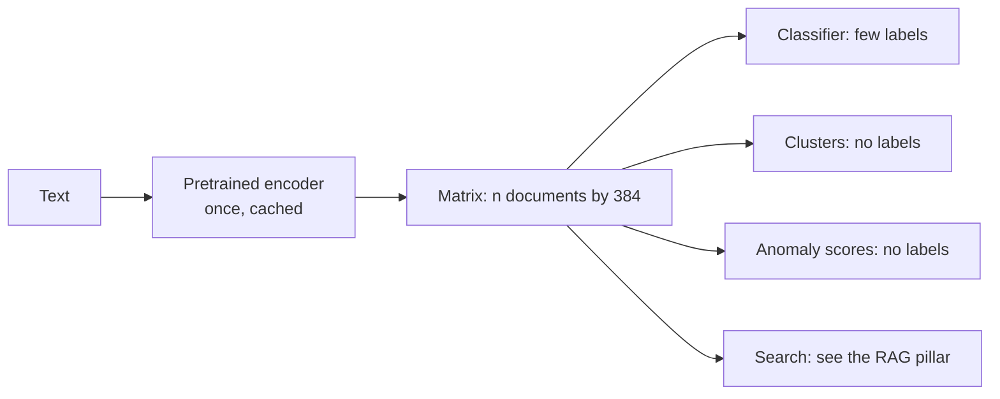

# LLM embeddings as features

A pretrained sentence encoder turns any text into a few hundred numbers, and once text is numbers, everything from classical ML applies again. That sounds like the end of TF-IDF. So does it win, by how much, and at what cost? In [the classification chapter](02-text-classification.md), on film descriptions, tuned TF-IDF reached a macro-F1 of 0.423, and we promised a fair comparison on the same task.

This chapter keeps that promise, then uses the same vectors for the two other jobs a data scientist gets handed: finding groups without labels and finding the lines that do not belong. There is no new model to train in most of it. You call an encoder once, cache the matrix, and hand it to scikit-learn. The questions that are left are ordinary ML questions, which is the point. Chapters 4 and 5 of Alammar and Grootendorst's [*Hands-On Large Language Models*](https://github.com/HandsOnLLM/Hands-On-Large-Language-Models) walk the same route on other data, and are the best companion reading.



## What a sentence embedding is

An encoder such as `all-MiniLM-L6-v2` is a small transformer. It splits the text into word pieces, runs six layers of attention so that each piece's vector reflects its context, averages those vectors into one, and normalises the result to unit length. Sentence-BERT ([arXiv:1908.10084](https://arxiv.org/abs/1908.10084), Reimers and Gurevych, EMNLP 2019) set the pattern: train the pooled vector so that related sentences land close together. [This model's card](https://huggingface.co/sentence-transformers/all-MiniLM-L6-v2) describes a contrastive objective over one billion sentence pairs: given one sentence of a pair, pick its partner out of a set of random others. It maps to 384 dimensions and cuts input off at 256 word pieces.

"LLM embeddings" is loose usage. MiniLM is no chat model, and the vectors do not come from one. They come from a language model's architecture, trained for this job, and the idea carries across to the larger embedding models behind APIs. The mechanics of attention are in the [transformer block chapter](../../../generative-ai/01-llm-fundamentals/README.md).

We reload note 02's task, exactly: first listed genre, six commonest genres, same split.

```python
from pathlib import Path
import json, time
import numpy as np, pandas as pd
from sklearn.model_selection import train_test_split
from sentence_transformers import SentenceTransformer

DATA = Path("../practice/text-analytics-with-python/Ch07 - Text Similarity and Clustering/tmdb_5000_movies.csv.gz")
movies = pd.read_csv(DATA)
movies["description"] = (movies["tagline"].fillna("") + " " + movies["overview"].fillna("")).str.strip()
movies["genre_list"] = movies["genres"].map(lambda g: [x["name"] for x in json.loads(g)])
movies = movies[movies.genre_list.str.len() > 0].reset_index(drop=True)
movies["genre"] = movies.genre_list.str[0]

encoder = SentenceTransformer("sentence-transformers/all-MiniLM-L6-v2", device="cpu")
CACHE = Path.home() / ".cache/learn-ai-engineering"
CACHE.mkdir(parents=True, exist_ok=True)

def embed(texts, name, model=encoder):
    """Encode once and keep the matrix. Encoding is the only slow step in this chapter."""
    path = CACHE / f"{name}.npy"
    if path.exists():
        return np.load(path)
    vectors = model.encode(list(texts), batch_size=64, normalize_embeddings=True, show_progress_bar=False)
    np.save(path, vectors)
    return vectors

X_all = embed(movies.description, "tmdb-minilm")
print("matrix:", X_all.shape, X_all.dtype, " first row norm:", round(float(np.linalg.norm(X_all[0])), 3))
lengths = np.array([len(encoder.tokenizer.tokenize(t)) for t in movies.description])
print("max_seq_length:", encoder.max_seq_length, " median pieces:", int(np.median(lengths)),
      " share truncated:", round(float((lengths > 254).mean()), 4))
```

```text
matrix: (4775, 384) float32  first row norm: 1.0
max_seq_length: 256  median pieces: 69  share truncated: 0.0
```

What does that give over TF-IDF? Ask both for the films nearest the same description and read the difference.

```python
from sklearn.feature_extraction.text import TfidfVectorizer

vec = TfidfVectorizer(min_df=2, sublinear_tf=True, stop_words="english")
T_all = vec.fit_transform(movies.description)
query = "An old hitman comes out of retirement to punish the gangsters who murdered his wife"
tfidf_sim = (T_all @ vec.transform([query]).T).toarray().ravel()
minilm_sim = X_all @ embed([query], "query-hitman")[0]
for name, sim in [("TF-IDF", tfidf_sim), ("MiniLM", minilm_sim)]:
    print(name)
    for i in sim.argsort()[-4:][::-1]:
        print(f"  {sim[i]:.2f}  {movies.title[i]:30.30}  {movies.genre[i]}")
```

```text
TF-IDF
  0.20  The Crew                        Action
  0.20  Chicago Overcoat                Action
  0.19  Bullet to the Head              Action
  0.17  The Equalizer                   Thriller
MiniLM
  0.53  Kill List                       Horror
  0.52  Bullet to the Head              Action
  0.51  Exiled                          Action
  0.51  Light Sleeper                   Drama
```

Neither list is embarrassing, and the difference is in how each got there. TF-IDF's hits lean on the rare words: "hitman" for Chicago Overcoat and Bullet to the Head, the shared root of "retired" and "retirement" for The Crew, whose four mobsters are planning a heist, not revenge. MiniLM finds Exiled, which says "ex-gangster" and "hitmen", and Kill List, whose description never mentions retirement but does describe a hitman's new job. It also returns Light Sleeper, a drug dealer's story, on a loose sense of a good man in a deadly business and a lost wife. So the encoder matches on meaning, including the wrong meaning, and its similarity scores are not comparable with TF-IDF's: 0.53 and 0.20 are on different scales, and no threshold carries across.

## Classification: the fair comparison

A comparison on one training size hides the thing we most want to know. Sparse features have to see a word in training to use it, and a pretrained encoder has already seen the language. So the gap should depend on how many labels you have. We draw training sets of increasing size, repeat with different draws, and tune each model's regularisation by inner cross-validation so that neither gets a default that favours it. The test set stays fixed.

```python
from sklearn.pipeline import make_pipeline
from sklearn.linear_model import LogisticRegression
from sklearn.model_selection import GridSearchCV, StratifiedKFold
from sklearn.metrics import f1_score, accuracy_score

top = movies.genre.value_counts().head(6).index
idx = movies.index[movies.genre.isin(top)].to_numpy()
idx_train, idx_test = train_test_split(idx, test_size=0.25, random_state=0, stratify=movies.genre[idx])
y = movies.genre.to_numpy()
text = movies.description.to_numpy()
Cs = {"C": [0.1, 1, 10, 100]}

def fit_minilm(rows):
    grid = GridSearchCV(LogisticRegression(max_iter=3000), Cs, cv=StratifiedKFold(3, shuffle=True, random_state=0), scoring="f1_macro")
    return grid.fit(X_all[rows], y[rows])

def fit_tfidf(rows):
    pipe = make_pipeline(TfidfVectorizer(sublinear_tf=True, ngram_range=(1, 2)), LogisticRegression(max_iter=3000))
    grid = GridSearchCV(pipe, {"logisticregression__C": Cs["C"]}, cv=StratifiedKFold(3, shuffle=True, random_state=0), scoring="f1_macro")
    return grid.fit(text[rows], y[rows])

rng = np.random.RandomState(0)
print(" train   TF-IDF macro-F1   MiniLM macro-F1")
curve = {}
for n in [60, 150, 300, 600, 1200, len(idx_train)]:
    scores = {"t": [], "m": []}
    for repeat in range(5 if n < len(idx_train) else 1):
        if n < len(idx_train):
            rows, _ = train_test_split(idx_train, train_size=n, random_state=rng, stratify=y[idx_train])
        else:
            rows = idx_train
        scores["t"].append(f1_score(y[idx_test], fit_tfidf(rows).predict(text[idx_test]), average="macro"))
        scores["m"].append(f1_score(y[idx_test], fit_minilm(rows).predict(X_all[idx_test]), average="macro"))
    curve[n] = (np.mean(scores["t"]), np.mean(scores["m"]))
    print(f"{n:6}   {np.mean(scores['t']):.3f} +- {np.std(scores['t']):.3f}    {np.mean(scores['m']):.3f} +- {np.std(scores['m']):.3f}")
majority = pd.Series(y[idx_train]).value_counts().index[0]
print("majority class accuracy:", round(float((y[idx_test] == majority).mean()), 3))
```

```text
 train   TF-IDF macro-F1   MiniLM macro-F1
    60   0.144 +- 0.028    0.261 +- 0.009
   150   0.199 +- 0.010    0.346 +- 0.019
   300   0.224 +- 0.004    0.383 +- 0.008
   600   0.271 +- 0.014    0.419 +- 0.023
  1200   0.335 +- 0.013    0.439 +- 0.010
  2877   0.404 +- 0.000    0.484 +- 0.000
majority class accuracy: 0.315
```

MiniLM wins at every size, and the size of the win changes with the labels. At 60 labels, ten per genre, its score is almost twice TF-IDF's (0.261 against 0.144). The gap in points peaks at 0.15 to 0.16 between 150 and 600 labels, then falls to 0.08 on the full training set as TF-IDF collects enough words to use. TF-IDF's curve is still climbing faster at the right edge, so more data would probably narrow the gap further, though this dataset has no more to give. Neither reaches anything like high accuracy, because a film's first listed genre is partly arbitrary.

One number needs a straight account. TF-IDF scores 0.404 here against 0.423 in [the classification chapter](02-text-classification.md), on the same split. That chapter also searched unigrams and trigrams, with five folds, and picked a better pipeline for its full training set. A fixed bigram range is simpler to run across this many draws. Giving TF-IDF the better 0.423 leaves it 0.06 behind MiniLM's 0.484, so the comparison's direction does not hang on that choice.

### Which head, and what else to feed it

The vector is a set of features, so the same habits apply. Does a nonlinear model find more in it? Does adding TF-IDF help? Can it sit beside ordinary columns, here the film's runtime and budget?

```python
from scipy.sparse import hstack, csr_matrix
from sklearn.svm import SVC
from sklearn.ensemble import HistGradientBoostingClassifier
from sklearn.preprocessing import StandardScaler

def report(name, model, A, B):
    start = time.time()
    model.fit(A, y[idx_train])
    pred = model.predict(B)
    print(f"{name:34} macro-F1 {f1_score(y[idx_test], pred, average='macro'):.3f}  accuracy {accuracy_score(y[idx_test], pred):.3f}  {time.time() - start:5.1f}s")

A, B = X_all[idx_train], X_all[idx_test]
lr = LogisticRegression(max_iter=3000, C=10)
report("MiniLM + logistic regression", lr, A, B)
report("MiniLM + RBF SVM", SVC(C=3), A, B)
report("MiniLM + gradient boosting", HistGradientBoostingClassifier(random_state=0, max_iter=150), A, B)

word = TfidfVectorizer(sublinear_tf=True, ngram_range=(1, 2), min_df=2).fit(text[idx_train])
Wa, Wb = word.transform(text[idx_train]), word.transform(text[idx_test])
report("TF-IDF + logistic regression", LogisticRegression(max_iter=3000, C=10), Wa, Wb)
report("TF-IDF and MiniLM together", LogisticRegression(max_iter=3000, C=10),
       hstack([Wa, csr_matrix(A)]).tocsr(), hstack([Wb, csr_matrix(B)]).tocsr())

tab = np.column_stack([movies.runtime.fillna(movies.runtime.median()), np.log1p(movies.budget), np.log1p(movies.revenue)])
sc = StandardScaler().fit(tab[idx_train])
report("MiniLM plus runtime, budget, revenue", LogisticRegression(max_iter=3000, C=10),
       np.hstack([A, sc.transform(tab[idx_train])]), np.hstack([B, sc.transform(tab[idx_test])]))

def gap(name, p, q, draws=1000):
    """Macro-F1 of p minus q, resampling the test films. Same fitted models throughout, so this is test-set noise only."""
    rs, truth, d = np.random.RandomState(0), y[idx_test], []
    for _ in range(draws):
        i = rs.randint(0, len(truth), len(truth))
        d.append(f1_score(truth[i], p[i], average="macro") - f1_score(truth[i], q[i], average="macro"))
    lo, hi = np.percentile(d, [2.5, 97.5])
    print(f"{name:26} difference {np.mean(d):+.3f}, 95% interval {lo:+.3f} to {hi:+.3f}")

pred_lr = lr.predict(B)
pred_tf = LogisticRegression(max_iter=3000, C=10).fit(Wa, y[idx_train]).predict(Wb)
pred_svm = SVC(C=3).fit(A, y[idx_train]).predict(B)
gap("MiniLM vs TF-IDF", pred_lr, pred_tf)
gap("RBF SVM vs logistic", pred_svm, pred_lr)
```

```text
MiniLM + logistic regression       macro-F1 0.484  accuracy 0.555    0.1s
MiniLM + RBF SVM                   macro-F1 0.496  accuracy 0.578    1.3s
MiniLM + gradient boosting         macro-F1 0.407  accuracy 0.549   27.9s
TF-IDF + logistic regression       macro-F1 0.407  accuracy 0.549    0.7s
TF-IDF and MiniLM together         macro-F1 0.484  accuracy 0.583    1.5s
MiniLM plus runtime, budget, revenue macro-F1 0.487  accuracy 0.559    0.1s
MiniLM vs TF-IDF           difference +0.076, 95% interval +0.034 to +0.120
RBF SVM vs logistic        difference +0.013, 95% interval -0.022 to +0.047
```

Three things to read off this. The nonlinear heads do not repay their cost: the RBF SVM's extra 0.01 sits well inside the test-set noise, and gradient boosting, which suits a few meaningful columns, does worse on 384 anonymous ones and takes far longer. (Its 0.407 matching TF-IDF's is a coincidence; the two differ in the fourth decimal.) Adding TF-IDF to the vectors raises accuracy a little but not macro-F1. And the tabular columns add almost nothing here, although nothing stopped us putting them in, which is the real point: an embedding is just more columns next to the ones you already have.

The bootstrap shows why single-digit differences on 960 test films should not be reported as wins. MiniLM's lead over TF-IDF has an interval clear of zero. The SVM's lead over logistic regression does not.

How many of the 384 numbers do you need? Storage and search cost scale with the dimension, so it is worth a check. PCA fitted on training vectors alone shows how much each extra dimension buys on this task.

```python
from sklearn.decomposition import PCA

for d in [8, 16, 32, 64, 128, 384]:
    pca = PCA(n_components=d, random_state=0).fit(A)
    pred = LogisticRegression(max_iter=3000, C=10).fit(pca.transform(A), y[idx_train]).predict(pca.transform(B))
    print(f"{d:4} dims  explained variance {pca.explained_variance_ratio_.sum():.2f}  macro-F1 {f1_score(y[idx_test], pred, average='macro'):.3f}")
```

```text
   8 dims  explained variance 0.18  macro-F1 0.424
  16 dims  explained variance 0.28  macro-F1 0.477
  32 dims  explained variance 0.41  macro-F1 0.462
  64 dims  explained variance 0.59  macro-F1 0.469
 128 dims  explained variance 0.81  macro-F1 0.464
 384 dims  explained variance 1.00  macro-F1 0.482
```

Sixteen components keep 28% of the variance and nearly all of the macro-F1, and beyond that the scores wobble within the noise we just measured. That does not mean the other dimensions are empty. Genre is a coarse target, and a finer task such as search might use them. For this task the vector could be stored at a twentieth of its size, and the PCA has to be fitted, saved and applied to every new document, so weigh that against simply storing 384 numbers.

### Few-shot: SetFit

The curve above freezes the encoder and fits only the head. SetFit ([arXiv:2209.11055](https://arxiv.org/abs/2209.11055), Tunstall et al., 2022, preprint) goes one step further and fine-tunes the encoder on your few labels first. It builds pairs from them, same class as positive and different class as negative, runs contrastive training on those pairs, and then fits a logistic regression on the tuned vectors. That turns eight labels per class into many pairs. The paper reports that with eight labels per class its MPNet version beats standard fine-tuning by an average of 19.3 points over its six test datasets, narrowing to 5.6 points at 64 per class, and that it needs no prompts and only a sentence encoder.

Here is the same idea on our task, eight labels per class, against a frozen encoder and TF-IDF given the same labels, over three draws of those labels. We use the MiniLM encoder and SetFit's default 20 iterations.

```python
from datasets import Dataset
from setfit import SetFitModel, Trainer, TrainingArguments

import contextlib, io

print("draw   TF-IDF   frozen encoder   SetFit")
for draw in range(3):
    few = pd.Series(idx_train).groupby(y[idx_train]).apply(lambda s: s.sample(8, random_state=draw)).to_numpy()
    tf = f1_score(y[idx_test], fit_tfidf(few).predict(text[idx_test]), average="macro")
    fr = f1_score(y[idx_test], fit_minilm(few).predict(X_all[idx_test]), average="macro")
    model = SetFitModel.from_pretrained("sentence-transformers/all-MiniLM-L6-v2", device="cpu")
    args = TrainingArguments(batch_size=16, num_iterations=20, num_epochs=1, report_to="none", logging_strategy="no", save_strategy="no", seed=draw)
    trainer = Trainer(model=model, train_dataset=Dataset.from_dict({"text": text[few].tolist(), "label": y[few].tolist()}), args=args)
    start = time.time()
    with contextlib.redirect_stdout(io.StringIO()):         # trainer logs would drown the table
        trainer.train()
    pred = np.asarray(model.predict(text[idx_test].tolist(), show_progress_bar=False))
    print(f"{draw:4}    {tf:.3f}      {fr:.3f}          {f1_score(y[idx_test], pred, average='macro'):.3f}   {time.time() - start:.0f}s on CPU")
```

```text
draw   TF-IDF   frozen encoder   SetFit
   0    0.201      0.272          0.309   14s on CPU
   1    0.244      0.371          0.430   15s on CPU
   2    0.240      0.341          0.373   16s on CPU
```

SetFit beats the frozen encoder in all three draws, by 0.03 to 0.06, and both beat TF-IDF comfortably. That is a real but modest gain, and well short of the paper's 19.3 points, because the paper was measuring against fine-tuning a whole transformer on few labels, which overfits. A frozen encoder with a logistic head already does most of what SetFit does. Note too that the choice of which 48 films got labelled moved the score by 0.1, more than the method did. With few labels, what you label matters as much as how you train.

## Clustering

No labels now. In [the topic chapter](03-topic-models-and-summarization.md) we clustered the same films on TF-IDF. Embeddings are just another matrix to give k-means, and because the vectors have unit length, Euclidean k-means behaves much like cosine. Genre gives us an outside check, though clusters have no duty to match it, and we use normalised mutual information (NMI) for that.

```python
from sklearn.cluster import KMeans
from sklearn.decomposition import TruncatedSVD
from sklearn.metrics import normalized_mutual_info_score as nmi, silhouette_score
from sklearn.preprocessing import normalize

SVD = normalize(TruncatedSVD(100, random_state=0).fit_transform(T_all))
for name, M in [("TF-IDF", T_all), ("TF-IDF, SVD 100", SVD), ("MiniLM", X_all)]:
    for k in [6, 20]:
        labels = KMeans(k, n_init=5, random_state=0).fit_predict(M)
        print(f"{name:16} k={k:2}  NMI with genre {nmi(movies.genre, labels):.3f}  largest cluster {np.bincount(labels).max() / len(labels):.0%}")
```

```text
TF-IDF           k= 6  NMI with genre 0.041  largest cluster 40%
TF-IDF           k=20  NMI with genre 0.066  largest cluster 16%
TF-IDF, SVD 100  k= 6  NMI with genre 0.046  largest cluster 43%
TF-IDF, SVD 100  k=20  NMI with genre 0.065  largest cluster 13%
MiniLM           k= 6  NMI with genre 0.141  largest cluster 22%
MiniLM           k=20  NMI with genre 0.143  largest cluster 9%
```

MiniLM's clusters share far more with genre than TF-IDF's, at about 0.14 against 0.04 to 0.07, and they are more even: TF-IDF at k=6 throws 40% of the films into one catch-all cluster, the usual symptom of documents that share no vocabulary being equidistant. Reducing TF-IDF with SVD first did not rescue it. Raising k from 6 to 20 gives MiniLM no more agreement with genre, as the additional clusters split by subject, which genre does not record.

The route BERTopic ([arXiv:2203.05794](https://arxiv.org/abs/2203.05794), Grootendorst, 2022, preprint) takes has three steps, and each answers a problem with the last. Distances lose contrast in high dimensions, so reduce with UMAP ([arXiv:1802.03426](https://arxiv.org/abs/1802.03426), McInnes et al., 2018, preprint). K-means forces every film into a cluster, including those that belong nowhere, so cluster with HDBSCAN ([Campello et al., PAKDD 2013](https://doi.org/10.1007/978-3-642-37456-2_14)), which finds clusters of varying density and leaves the rest as noise. A cluster of vectors means nothing to a reader, so describe each one with class-based TF-IDF, treating all of a cluster's text as one document and asking which words distinguish it from the other clusters.

```python
import umap, hdbscan

reduced = umap.UMAP(n_neighbors=15, n_components=5, min_dist=0.0, metric="cosine", random_state=42).fit_transform(X_all)
clusters = hdbscan.HDBSCAN(min_cluster_size=15, metric="euclidean").fit_predict(reduced)
keep = clusters >= 0
print("clusters:", clusters.max() + 1, " noise share:", round(float((~keep).mean()), 3), " NMI on clustered films:", round(nmi(movies.genre[keep], clusters[keep]), 3))

def c_tf_idf(texts, labels, top_n=6):
    """Each cluster is one long document. Weight words by how much they say about that cluster."""
    joined = pd.Series(texts).groupby(labels).agg(" ".join)
    from sklearn.feature_extraction.text import CountVectorizer
    cv = CountVectorizer(stop_words="english", min_df=2)
    counts = cv.fit_transform(joined).toarray().astype(float)
    tf = counts / counts.sum(axis=1, keepdims=True)
    avg = counts.sum() / len(joined)
    weight = tf * np.log(1 + avg / counts.sum(axis=0))
    words = cv.get_feature_names_out()
    return {c: [words[i] for i in row.argsort()[-top_n:][::-1]] for c, row in zip(joined.index, weight)}

topics = c_tf_idf(movies.description[keep].tolist(), clusters[keep])
sizes = pd.Series(clusters[keep]).value_counts()
for c in sizes.index[:8]:
    print(f"{c:3}  {sizes[c]:4} films  {', '.join(topics[c])}")
```

```text
clusters: 35  noise share: 0.54  NMI on clustered films: 0.223
 17   600 films  agent, cop, police, crime, drug, man
  9   122 films  dog, adventure, animal, animals, park, dinosaurs
 12   120 films  earth, planet, alien, space, crew, aliens
 15   110 films  team, coach, basketball, football, league, player
  1    98 films  king, dragon, queen, god, warrior, princess
 32    95 films  love, story, woman, man, life, tale
 33    95 films  love, best, married, marriage, friends, tom
  8    79 films  powers, new, hero, heroes, world, city
```

The top terms read as real subjects without anybody naming them: crime, animals, space, team sports, fantasy kingdoms, love stories, superheroes. That is what the method is for. The cost is the 54% of films labelled noise. That is a lot, and it depends on `min_cluster_size` and the UMAP settings, so report it next to the clusters. It is also why the NMI of 0.223 cannot be compared with k-means' 0.14: it is scored only on the films that HDBSCAN agreed to cluster, which are the easy ones. In a real project you would either accept the noise as "uncategorised" or assign those points to the nearest cluster, which BERTopic offers as an outlier-reduction step. For a report, keep the matrix, try several settings and read the clusters; the code to do so is above and runs in seconds. [The topic chapter](03-topic-models-and-summarization.md) has the classical alternatives.

## Anomaly detection

Someone asks you to flag descriptions that do not belong: spam, a wrong field pasted in, or text from another catalogue. You have no labels for these, and you cannot list in advance what wrong looks like. What you do have is a lot of normal text. So keep a clean reference set, and score new lines by how far they sit from it.

To measure this we hide two kinds of intruder among real films. Neither is random noise, and both are English of about the right length: 40 chunks of [Irish song lyrics](../practice/intro-to-nlp/data/irish-lyrics.txt) and 40 chunks of [`big.txt`](../practice/text-analytics-with-python/Ch03%20-%20Processing%20and%20Understanding%20Text/big.txt), a concatenation of public-domain prose. Fiction about people's lives is the harder intruder, because a film description is also that.

```python
import random, re

rnd = random.Random(0)
lyrics = [l.strip() for l in open("../practice/intro-to-nlp/data/irish-lyrics.txt", encoding="utf-8", errors="ignore") if l.strip()]
big = open("../practice/text-analytics-with-python/Ch03 - Processing and Understanding Text/big.txt", encoding="utf-8", errors="ignore").read()
words = re.sub(r"\s+", " ", big).split(" ")
lyric_chunks = [" ".join(lyrics[i:i + 6]) for i in rnd.sample(range(len(lyrics) - 6), 40)]
prose_chunks = [" ".join(words[i:i + 55]) for i in rnd.sample(range(1000, len(words) - 60), 40)]
print("median film words:", int(movies.description.str.split().str.len().median()),
      "| lyric chunk:", len(lyric_chunks[0].split()), "| prose chunk:", len(prose_chunks[0].split()))
print("lyric:", lyric_chunks[0][:110]); print("prose:", prose_chunks[0][:110])

order = np.random.RandomState(0).permutation(len(movies))
ref, new = order[:3800], order[3800:]
intruders = lyric_chunks + prose_chunks
X_ref = X_all[ref]
X_new = np.vstack([X_all[new], embed(intruders, "intruders-minilm")])
is_bad = np.r_[np.zeros(len(new), bool), np.ones(len(intruders), bool)]
is_lyric = np.r_[np.zeros(len(new), bool), np.ones(40, bool), np.zeros(40, bool)]
print("reference:", len(ref), " to score:", len(is_bad), " intruders:", is_bad.sum())
```

```text
median film words: 55 | lyric chunk: 31 | prose chunk: 55
lyric: Bright her eyes as any star, Fairest o them all by far Is our darlin Mairi. Plenty herring, plenty meal Plenty
prose: improvement followed ligation of the left common carotid in aneurysm of the transverse part of the aortic arch
reference: 3800  to score: 1055  intruders: 80
```

Three detectors look at this in different ways. **k-nearest-neighbour distance** is the simplest: an outlier is far from its nearest neighbours in the reference. **Local outlier factor** ([Breunig et al., SIGMOD 2000](https://doi.org/10.1145/335191.335388)) divides that by how dense the neighbours' own surroundings are, so a point in a sparse-but-normal region is not penalised. **Isolation forest** ([Liu et al., ICDM 2008](https://doi.org/10.1109/ICDM.2008.17)) needs no distances: it splits on random features at random thresholds, and points that get isolated after few splits are anomalies. Each gets the same test, on both representations.

```python
from sklearn.ensemble import IsolationForest
from sklearn.neighbors import LocalOutlierFactor, NearestNeighbors
from sklearn.metrics import roc_auc_score

def knn_scores(R, Q, k=5):
    return NearestNeighbors(n_neighbors=k, metric="cosine").fit(R).kneighbors(Q)[0].mean(axis=1)

def evaluate(name, score):
    top = np.argsort(score)[-80:]
    print(f"{name:26} AUROC {roc_auc_score(is_bad, score):.3f}  (lyrics {roc_auc_score(is_bad[~is_bad | is_lyric], score[~is_bad | is_lyric]):.3f}, "
          f"prose {roc_auc_score(is_bad[~is_lyric], score[~is_lyric]):.3f})  precision in top 80: {is_bad[top].mean():.2f}")

T_ref = vec.transform(movies.description.iloc[ref])
T_new = vec.transform(list(movies.description.iloc[new]) + intruders)
S_ref = TruncatedSVD(100, random_state=0).fit(T_ref)
evaluate("TF-IDF, kNN distance", knn_scores(T_ref, T_new))
evaluate("TF-IDF SVD, LOF", -LocalOutlierFactor(n_neighbors=20, novelty=True).fit(S_ref.transform(T_ref)).score_samples(S_ref.transform(T_new)))
evaluate("TF-IDF SVD, forest", -IsolationForest(n_estimators=300, random_state=0).fit(S_ref.transform(T_ref)).score_samples(S_ref.transform(T_new)))
evaluate("MiniLM, kNN distance", knn_scores(X_ref, X_new))
evaluate("MiniLM, LOF", -LocalOutlierFactor(n_neighbors=20, novelty=True).fit(X_ref).score_samples(X_new))
evaluate("MiniLM, isolation forest", -IsolationForest(n_estimators=300, random_state=0).fit(X_ref).score_samples(X_new))
```

```text
TF-IDF, kNN distance       AUROC 0.643  (lyrics 0.576, prose 0.710)  precision in top 80: 0.12
TF-IDF SVD, LOF            AUROC 0.253  (lyrics 0.342, prose 0.165)  precision in top 80: 0.05
TF-IDF SVD, forest         AUROC 0.255  (lyrics 0.335, prose 0.174)  precision in top 80: 0.03
MiniLM, kNN distance       AUROC 0.939  (lyrics 0.914, prose 0.964)  precision in top 80: 0.59
MiniLM, LOF                AUROC 0.944  (lyrics 0.919, prose 0.968)  precision in top 80: 0.60
MiniLM, isolation forest   AUROC 0.799  (lyrics 0.712, prose 0.885)  precision in top 80: 0.30
```

MiniLM with kNN distance or LOF ranks a random intruder above a random real film about 94% of the time, and in the top 80 of 1,055 lines 59 to 60% are intruders, when the base rate is under 8%. The lyrics are harder than the prose, which seems odd until you remember lyrics are stories about people. LOF barely beats plain kNN here. Isolation forest is much weaker: it splits on single coordinates, and a single dimension of an embedding means little alone.

The TF-IDF rows are the striking ones, because an AUROC of 0.25 is worse than chance. Intruders are ranked as *more* normal than films, and the reason is instructive. Medical prose and Irish lyrics hit few of the film vocabulary's words, so after SVD their vectors are short: the prose chunks have a mean norm of 0.18 against 0.35 for films. Short vectors sit near the origin, which is the densest place in the space, so density methods call them typical. A detector needs a representation in which "unlike anything I know" looks unusual, and a vocabulary-bound one cannot express this.

```python
score = knn_scores(X_ref, X_new)
all_new = list(movies.description.iloc[new]) + intruders
print("highest scoring real films:")
real = np.where(~is_bad)[0]
for i in real[np.argsort(score[real])[-5:][::-1]]:
    print(f"  {score[i]:.2f}  {all_new[i][:95]}")
print("lowest scoring intruders:")
bad = np.where(is_bad)[0]
for i in bad[np.argsort(score[bad])[:3]]:
    print(f"  {score[i]:.2f}  {all_new[i][:95]}")
```

```text
highest scoring real films:
  0.71  Are you the exception...or the rule? Remember that really cute guy who said he'd call – and did
  0.69  A group of print workers in 1980s London club together to buy a race horse.
  0.68  Un camping au bord d'un lac pendant les vacances d'été. Camille, 17 ans, y traîne son ennui coi
  0.68  A lack of consumer confidence... or conspiracy? In 1996, electric cars began to appear on roads
  0.67  Iris can best be described as a wallflower. She begins her first day as a temp for the nondescr
lowest scoring intruders:
  0.53  Called on Colonel Farrell to get ready for the slaughter. Next mornin early, before I rose for
  0.55  And that was the end of sweet Molly Malone But her ghost wheels her barrow The Garden of Eden h
  0.55  powers of his mind were more active and clearer than ever, but they acted apart from his will.
```

Reading the top of the list is the check that no metric replaces, and here it earns its keep. The real films with the highest scores are themselves odd: a French description in an English catalogue, a marketing line in question form, a one-line pitch, a documentary about electric cars. A reviewer would want to see the French one, so several of the "false alarms" are worth finding. The intruders that scored lowest are the narrative ones, a song about a colonel and the slaughter and a sentence from a novel, which do read like plot summaries. Treat these as ranked candidates for review. Note also that our intruders are unlike the catalogue in subject, while a subtly wrong description for a real film would score as perfectly normal.

## Choosing an encoder and paying for it

The benchmark to start from is MTEB ([arXiv:2210.07316](https://arxiv.org/abs/2210.07316), Muennighoff et al., EACL 2023), which ran 33 models over 8 task types and 58 datasets, and found that no method dominates all tasks. So a leaderboard narrows your choice, and your own task settles it. Running a candidate through your own problem takes one extra line here, because the code above never cared which encoder made the matrix.

```python
candidates = {"all-MiniLM-L6-v2": "sentence-transformers/all-MiniLM-L6-v2",
              "bge-small-en-v1.5": "BAAI/bge-small-en-v1.5",
              "all-mpnet-base-v2": "sentence-transformers/all-mpnet-base-v2"}
sample = text[idx_test][:256].tolist()
for short, repo in candidates.items():
    m = SentenceTransformer(repo, device="cpu")
    V = embed(movies.description, f"tmdb-{short}", m)
    start = time.time(); m.encode(sample, batch_size=32, normalize_embeddings=True, show_progress_bar=False); took = time.time() - start
    pred = LogisticRegression(max_iter=3000, C=10).fit(V[idx_train], y[idx_train]).predict(V[idx_test])
    print(f"{short:18} {V.shape[1]:4} dims  macro-F1 {f1_score(y[idx_test], pred, average='macro'):.3f}  {len(sample) / took:6.0f} docs/s on CPU")
    if short == "all-mpnet-base-v2":
        gap("MPNet vs MiniLM", pred, pred_lr)
```

```text
all-MiniLM-L6-v2    384 dims  macro-F1 0.484     391 docs/s on CPU
bge-small-en-v1.5   384 dims  macro-F1 0.471     275 docs/s on CPU
all-mpnet-base-v2   768 dims  macro-F1 0.507      79 docs/s on CPU
MPNet vs MiniLM            difference +0.024, 95% interval -0.012 to +0.061
```

MPNet is the best here, several times slower than MiniLM, at twice the storage, and even its lead on this task has an interval that includes zero. BGE small, which sits higher than MiniLM on some retrieval benchmarks, comes in lower here. That is MTEB's message played out on one small task: test on yours, and let the cheapest model that does the job stand until something beats it by more than the noise.

The other half of the decision is what the vectors cost next to the sparse route. This is the same data, on the same machine, while other jobs were running, so read the orders of magnitude and not the digits.

```python
docs = text[idx_test].tolist()
start = time.time(); Ws = word.transform(docs); t_sparse = time.time() - start
start = time.time(); Vs = encoder.encode(docs, batch_size=32, normalize_embeddings=True, show_progress_bar=False); t_dense = time.time() - start
sparse_bytes = (Ws.data.nbytes + Ws.indices.nbytes + Ws.indptr.nbytes) / Ws.shape[0]
print(f"TF-IDF   {len(docs) / t_sparse:8.0f} docs/s   {sparse_bytes:6.0f} bytes per doc   {Ws.shape[1]:6} columns   {Ws.nnz / Ws.shape[0]:.0f} non-zero")
print(f"MiniLM   {len(docs) / t_dense:8.0f} docs/s   {Vs.nbytes / len(Vs):6.0f} bytes per doc   {Vs.shape[1]:6} columns")
```

```text
TF-IDF      35425 docs/s      744 bytes per doc    24287 columns   62 non-zero
MiniLM        616 docs/s     1536 bytes per doc      384 columns
```

Encoding is roughly 50 times slower than TF-IDF's transform on a CPU, and it is the only slow step. Storage is closer than people expect, since a short description has only about 62 non-zero TF-IDF entries, and each one needs an index as well as a value, giving 744 bytes against 1,536. On long documents the sparse row grows with its vocabulary and the dense row stays at 1,536 bytes. Sparse matrices also keep their columns meaningful, so you can read a linear model's weights, as we did in the classification chapter. A dense vector's coordinates cannot be read that way.

### Embeddings from an API

Hosted embedding models follow the same pattern with larger models, and you trade money and a network call for not running anything. The code changes in one place, because everything after `embed` only wants a matrix. This block needs an API key and a paid account, so it is illustrative and was not run.

```python
# illustrative: needs an OpenAI API key and a paid account; not run here
from openai import OpenAI

client = OpenAI()
def embed_api(texts, name, model="text-embedding-3-small", batch=256):
    path = CACHE / f"{name}.npy"
    if path.exists():
        return np.load(path)
    rows = []
    for i in range(0, len(texts), batch):
        rows += [d.embedding for d in client.embeddings.create(model=model, input=texts[i:i + batch]).data]
    vectors = np.array(rows, dtype=np.float32)
    np.save(path, vectors)      # pay once, per model and per text
    return vectors
```

Two consequences follow from a hosted model. Texts leave your machine, which may rule it out for some data. And the provider can retire a model, after which vectors from it cannot be compared with vectors from its successor, so store the model name beside the matrix and plan on re-embedding everything when you change. Retrieval itself, chunking and rerankers belong to the [RAG pillar](../../../generative-ai/02-rag-retrieval/README.md).

## Pitfalls

| Rule | Why |
|---|---|
| Start with TF-IDF and a linear model anyway | It costs almost nothing and tells you what the embedding has to beat |
| Reach for embeddings when labels are few or there are none | The lead here was largest below about 1,000 labels, and on clustering and anomaly detection it was larger still |
| Cache the matrix, keyed by model name | Encoding is the one slow step, and a model change invalidates every vector |
| Use a linear head first | The SVM's gain was inside test noise, and boosting did worse |
| Fit PCA or a scaler on training vectors only | Same leakage rule as any feature pipeline |
| Keep a clean reference for anomaly detection | Intruders in the reference become their own neighbours |

- **Comparing vectors from different models.** The dimensions may match while the spaces are unrelated. Every vector in a matrix must come from one model and one version.
- **Ignoring silent truncation.** The encoder drops anything after its limit with no warning. Long documents need chunking, with the choice of how to pool the pieces being yours.
- **Reading NMI with genre as the score of a clustering.** Genre is one outside view. A cluster of submarine films is good and scores badly on it.
- **Trusting one UMAP plot.** Distances between far-apart clusters in the projection do not carry meaning, and seeds move things around.
- **Treating cosine distance as a calibrated probability.** Anomaly scores rank. Choose a threshold from the review capacity you have, and check the top of the list by hand.
- **Assuming embeddings are neutral.** They inherit associations from their training text, as [embeddings and similarity](04-embeddings-and-similarity.md) showed for word vectors.

## Try it

1. **Dirty reference.** Real reference sets are not clean. Add all 80 intruders to the reference and rerun kNN distance with k=1 and k=20. Which suffers, and why?

<details><summary>Answer</summary>

```python
X_dirty = np.vstack([X_ref, embed(intruders, "intruders-minilm")])
for k in [1, 5, 20]:
    print("k =", k, " clean AUROC", round(roc_auc_score(is_bad, knn_scores(X_ref, X_new, k)), 3),
          " dirty AUROC", round(roc_auc_score(is_bad, knn_scores(X_dirty, X_new, k)), 3))
```

```text
k = 1  clean AUROC 0.919  dirty AUROC 0.0
k = 5  clean AUROC 0.939  dirty AUROC 0.186
k = 20  clean AUROC 0.927  dirty AUROC 0.677
```

Clean results are unremarkable at all three k. In the dirty case k=1 collapses to an AUROC of 0.0, because each intruder is now its own nearest neighbour at distance zero, which ranks it below every real film. k=5 is still poor, at 0.186, since the 40 chunks of each kind are near each other. k=20 recovers to 0.677 by reaching past them to real films. A larger k tolerates some contamination, up to around the number of contaminating points. The realistic version is milder, as the intruders would not be exact copies, but the direction is the same.

</details>

2. **Choosing k.** Plot or print silhouette for k from 5 to 40 on the MiniLM vectors. Does it point at a natural number of clusters?

<details><summary>Answer</summary>

```python
for k in [5, 10, 15, 20, 30, 40]:
    labels = KMeans(k, n_init=3, random_state=0).fit_predict(X_all)
    print(k, round(silhouette_score(X_all, labels, metric="cosine", sample_size=2000, random_state=0), 4))
```

```text
5 0.0389
10 0.0326
15 0.0347
20 0.0329
30 0.0305
40 0.0271
```

No. The silhouette is around 0.03 to 0.04 at every k, with a slight maximum at 5 and a slow fall, so there is no elbow to find. On embeddings of unconstrained text this is the common case: the data is a continuum, and k is a choice about how fine a summary you want, made by reading the clusters and not by a metric.

</details>

3. **Truncate or project?** Keep only the first 64 dimensions of the raw vector, and compare with a 64-dimension PCA. Why is one better here?

<details><summary>Answer</summary>

```python
first = normalize(A[:, :64]), normalize(B[:, :64])
p = PCA(n_components=64, random_state=0).fit(A)
for name, (a, b) in {"first 64": first, "PCA 64": (p.transform(A), p.transform(B))}.items():
    pred = LogisticRegression(max_iter=3000, C=10).fit(a, y[idx_train]).predict(b)
    print(name, round(f1_score(y[idx_test], pred, average="macro"), 3))
```

```text
first 64 0.41
PCA 64 0.469
```

PCA wins, 0.469 to 0.41. The raw coordinates carry no ordering of importance, so the first 64 are an arbitrary slice of the information. PCA picks the 64 directions of highest variance on your own training data. Some recent embedding models are trained so that their prefixes work on their own, which lets you truncate them directly. This model was not.

</details>

## Interview checklist

| Question | Short answer |
|---|---|
| When do sentence embeddings beat TF-IDF on classification? | When labels are few, or words differ between training and use. The gap here shrank from 0.15 to 0.08 as labels grew, so with enough labels, measure it. |
| Why cache the matrix? | Encoding is the slow step, and everything downstream is ordinary scikit-learn. |
| What does mean pooling do? | Averages context-aware token vectors, weighted by the attention mask, into one vector. |
| What is the downside of pretrained encoders on long text? | Truncation at the model's limit, with no warning. |
| Why UMAP before HDBSCAN? | Density estimates are unreliable at 384 dimensions, so reduce first. |
| What is class-based TF-IDF? | TF-IDF where each cluster counts as one document, used to name clusters. |
| How does HDBSCAN differ from k-means? | No k, clusters of varying density, and a noise label instead of forcing every point in. |
| Compare kNN distance, LOF and isolation forest. | kNN is global distance; LOF is distance relative to local density; the forest counts random splits to isolate, without distances. |
| How do you evaluate anomaly detection with no labels? | Inject known intruders, measure AUROC and precision at your review capacity, then read the top of the list. |
| What is SetFit? | Contrastive fine-tuning of a sentence encoder on pairs built from few labels, then a logistic head. |
| What breaks when you change embedding model? | Every stored vector. Spaces are not comparable, so re-embed and re-tune thresholds. |

## Next

[Neural text models](../../02-deep-learning/notes/02-neural-text-models.md) shows how CNNs, LSTMs and transformers produce such representations and how to fine-tune them. To build one from the ground up, go on to the next pillar, [LLMs from scratch](../../04-llms-from-scratch/README.md).
