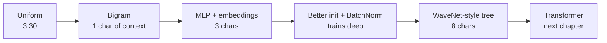

# makemore: character-level language models

Give a program 32,033 names and ask it for more. That small task contains the whole of language modelling: pick a next-token distribution, train it by maximum likelihood, sample from it. Five lectures take one model from counting pairs of letters to a deep hierarchical network, and most of what they teach is why deep networks refuse to train and how you can tell.

The arc continues from [micrograd](01-micrograd.md), which gave us the gradient engine, and ends at [nanoGPT](03-nanogpt.md), where the same setup becomes a transformer. Every number labelled "ours" below comes from running the code in this chapter on a laptop CPU. Most sit beside the lecture's own, and the two differ a little because the seeds and libraries do.



## The framework: a language model is a next-token distribution

A language model assigns a probability to the next token given the previous ones, `P(x_t | x_<t)`. Train it by maximising the likelihood of the data, which is the same as minimising the **average negative log-likelihood** (cross-entropy) of each true next character. Generate by sampling from the distribution one token at a time and feeding the sample back in.

Setup used throughout: 26 letters plus `.` as a start and end token (27 classes), `stoi` and `itos` maps, and an 80/10/10 train/dev/test split of the names.

```python
import math, random, time
import torch
import torch.nn.functional as F

torch.set_num_threads(2)
words = open("../practice/nn-zero-to-hero/makemore/names.txt").read().splitlines()
chars = sorted(set("".join(words)))
stoi = {s: i + 1 for i, s in enumerate(chars)}; stoi["."] = 0
itos = {i: s for s, i in stoi.items()}
vocab_size = len(itos)
random.seed(42)
random.shuffle(words)
n1, n2 = int(0.8 * len(words)), int(0.9 * len(words))
print(len(words), "names, longest", max(map(len, words)), ", vocabulary", vocab_size, ", first:", words[:4])
print("uniform baseline loss:", round(-math.log(1 / vocab_size), 3))
```

A model that guesses uniformly over 27 characters has loss `-log(1/27) = 3.30`, and every model below is measured against that.

## Part 1: bigrams, counted and learned

**Counting.** Tally how often each character follows each other one in a 27×27 matrix, normalise rows into probabilities, and sample.

```python
N = torch.zeros((27, 27), dtype=torch.int32)
for w in words:
    chs = ["."] + list(w) + ["."]
    for c1, c2 in zip(chs, chs[1:]):
        N[stoi[c1], stoi[c2]] += 1

P = (N + 1).float()                     # +1 = add-one smoothing: no zero probabilities, no infinite loss
P /= P.sum(1, keepdim=True)             # keepdim matters; see Pitfalls

def bigram_sample(g):
    ix, out = 0, []
    while True:
        ix = torch.multinomial(P[ix], num_samples=1, generator=g).item()
        if ix == 0:
            return "".join(out)
        out.append(itos[ix])

xs, ys = [], []
for w in words:
    chs = ["."] + list(w) + ["."]
    for c1, c2 in zip(chs, chs[1:]):
        xs.append(stoi[c1]); ys.append(stoi[c2])
xs, ys = torch.tensor(xs), torch.tensor(ys)
print("count model NLL:", round(-P[xs, ys].log().mean().item(), 4))
g = torch.Generator().manual_seed(2147483647)
print("samples:", [bigram_sample(g) for _ in range(8)])
```

TODO_COUNT

**The same model as a neural network.** One-hot encode the previous character, multiply by a 27×27 weight matrix to get *logits* (log-counts), exponentiate and normalise (softmax), and train `W` by gradient descent on the NLL.

```python
xenc = F.one_hot(xs, num_classes=27).float()     # (n, 27)
g = torch.Generator().manual_seed(2147483647)
W = torch.randn((27, 27), generator=g, requires_grad=True)
for k in range(200):
    logits = xenc @ W                             # selecting row xs of W, really
    probs = logits.exp() / logits.exp().sum(1, keepdim=True)
    nll = -probs[torch.arange(len(ys)), ys].log().mean()
    loss = nll + 0.01 * (W**2).mean()
    W.grad = None
    loss.backward()
    W.data += -50 * W.grad
learned = (W.detach().exp() / W.detach().exp().sum(1, keepdim=True))
print("neural bigram NLL:", round(nll.item(), 4))
print("correlation of learned table with the counts:", round(torch.corrcoef(torch.stack([learned.flatten(), P.flatten()]))[0, 1].item(), 4))
```

It converges to nearly the same loss because it *is* the same model: `W.exp()` ends up proportional to the count matrix. There are two lessons in this. The L2 term plays the role of add-one smoothing, since pulling `W` towards 0 makes the distribution more uniform. And the neural version scales to more context, where the counting table would explode (27ⁿ rows).

## Part 2: an MLP over a context window

Bengio et al. ([*JMLR* 2003](https://www.jmlr.org/papers/v3/bengio03a.html)) proposed this for words, and the lecture does it for characters. Use the previous `block_size = 3` characters, embed each into a learned vector, concatenate, and pass through a hidden layer.

```python
STEPS = 200_000     # about a minute per model on a laptop CPU; lower it for a quick look

def build_dataset(words, block_size=3):
    X, Y = [], []
    for w in words:
        context = [0] * block_size                 # start padded with '.'
        for ch in w + ".":
            X.append(context); Y.append(stoi[ch])
            context = context[1:] + [stoi[ch]]     # slide the window
    return torch.tensor(X), torch.tensor(Y)

Xtr, Ytr = build_dataset(words[:n1])
Xdev, Ydev = build_dataset(words[n1:n2])
Xte, Yte = build_dataset(words[n2:])

g = torch.Generator().manual_seed(2147483647)
C  = torch.randn((27, 10), generator=g)          # embedding table: 27 chars -> 10-d
W1 = torch.randn((30, 200), generator=g); b1 = torch.randn(200, generator=g)
W2 = torch.randn((200, 27), generator=g); b2 = torch.randn(27, generator=g)
params = [C, W1, b1, W2, b2]
for p in params: p.requires_grad = True

def mlp_logits(X):
    emb = C[X]                                                 # (n, 3, 10): indexing IS the embedding lookup
    h = torch.tanh(emb.view(-1, 30) @ W1 + b1)                 # (n, 200)
    return h @ W2 + b2                                         # (n, 27)

for i in range(STEPS):
    ix = torch.randint(0, Xtr.shape[0], (32,), generator=g)    # minibatch of 32
    loss = F.cross_entropy(mlp_logits(Xtr[ix]), Ytr[ix])       # fused, numerically stable softmax + NLL
    if i == 0: first_loss = loss.item()
    for p in params: p.grad = None
    loss.backward()
    lr = 0.1 if i < STEPS // 2 else 0.01                       # step decay
    for p in params: p.data += -lr * p.grad

with torch.no_grad():
    print("parameters:", sum(p.numel() for p in params), " examples:", len(Xtr), " first loss:", round(first_loss, 2))
    print("train", round(F.cross_entropy(mlp_logits(Xtr), Ytr).item(), 4), " dev", round(F.cross_entropy(mlp_logits(Xdev), Ydev).item(), 4))
    gs = torch.Generator().manual_seed(2147483647)
    samples = []
    for _ in range(8):
        ctx, out = [0, 0, 0], []
        while True:
            ix = torch.multinomial(F.softmax(mlp_logits(torch.tensor([ctx])), 1), 1, generator=gs).item()
            ctx = ctx[1:] + [ix]
            if ix == 0: break
            out.append(itos[ix])
        samples.append("".join(out))
    print("samples:", samples)
    E = F.normalize(C.detach(), dim=1); sim = E @ E.T
    vowels = [stoi[c] for c in "aeiou"]; cons = [stoi[c] for c in "bcdfgklmnprst"]
    within = sim[vowels][:, vowels][~torch.eye(5, dtype=bool)].mean().item()
    print("mean embedding cosine, vowel to vowel:", round(within, 3), " vowel to consonant:", round(sim[vowels][:, cons].mean().item(), 3))
```

TODO_MLP

| Technique introduced | Detail |
|---|---|
| Minibatches | The gradient from 32 examples is noisy but cheap; many approximate steps beat few exact ones |
| `F.cross_entropy` over hand-written softmax | Subtracts the max logit internally; `exp` of large logits would overflow to `inf` |
| Learning-rate finder | Sweep `lr = 10**linspace(-3, 0)` over 1,000 steps, plot loss against the exponent, and pick the valley (~0.1). You will do this in Try it |
| Train / dev / test | Tune on dev; touch test once. With 11k params and 228k examples, train ≈ dev means underfitting: scale up |
| Embeddings | Vowels end up near each other, because the model finds them interchangeable-ish. The lecture's 2-d plot shows this, and the cosines above measure it |

## Part 3: activations, gradients and BatchNorm

The MLP trains, but the start of training is wasteful and deeper versions do not train at all. The lecture diagnoses why, one fix at a time, logging the loss after each one. Its log, with our run of the same steps below it:

| Step | Problem seen | Fix | Lecture train / val |
|---|---|---|---|
| Original | First loss ~27 instead of 3.30: logits are huge, so softmax is confidently wrong; the "hockey stick" loss curve is the network wasting steps shrinking them | none | 2.12 / 2.17 |
| 1 | Confidently wrong softmax | Initialise `W2 * 0.01`, `b2 * 0` so initial logits ≈ 0 and loss ≈ 3.30 | 2.07 / 2.13 |
| 2 | Histogram of `h` piles up at ±1: tanh is **saturated**, its local gradient `1 − t²` ≈ 0, so gradients vanish; a neuron saturated for every example is dead | Scale `W1` down (`* 0.2`) so pre-activations are small | 2.04 / 2.10 |
| 3 | The 0.2 was hand-tuned | **Kaiming init**: `W1 * gain / sqrt(fan_in)`, gain 5/3 for tanh (√2 for ReLU) | 2.04 / 2.11 |
| 4 | Init still fragile in deep nets | **BatchNorm** after the linear layer | 2.07 / 2.10 |

Kaiming scaling ([arXiv:1502.01852](https://arxiv.org/abs/1502.01852), He et al., ICCV 2015) keeps the variance of activations roughly constant from layer to layer. With unit-variance inputs and `fan_in` inputs per neuron, weights of std `1/sqrt(fan_in)` give unit-variance pre-activations, and the gain compensates for the nonlinearity squashing them. `torch.nn.init.kaiming_normal_` does it.

```python
def experiment(name, w1=1.0, b1s=1.0, w2=1.0, b2s=1.0, batchnorm=False):
    g = torch.Generator().manual_seed(2147483647)
    C = torch.randn((27, 10), generator=g)
    W1 = torch.randn((30, 200), generator=g) * w1
    b1 = torch.randn(200, generator=g) * b1s
    W2 = torch.randn((200, 27), generator=g) * w2
    b2 = torch.randn(27, generator=g) * b2s
    bngain, bnbias = torch.ones((1, 200)), torch.zeros((1, 200))
    mean_run, std_run = torch.zeros((1, 200)), torch.ones((1, 200))
    params = [C, W1, W2, b2] + ([bngain, bnbias] if batchnorm else [b1])
    for p in params: p.requires_grad = True

    def forward(X, training):
        nonlocal mean_run, std_run
        pre = C[X].view(-1, 30) @ W1
        if batchnorm:
            if training:
                m, s = pre.mean(0, keepdim=True), pre.std(0, keepdim=True)
                with torch.no_grad():
                    mean_run = 0.999 * mean_run + 0.001 * m
                    std_run = 0.999 * std_run + 0.001 * s
            else:
                m, s = mean_run, std_run
            pre = bngain * (pre - m) / s + bnbias
        else:
            pre = pre + b1
        return pre, torch.tanh(pre) @ W2 + b2

    with torch.no_grad():
        pre, logits = forward(Xtr[:1000], True)
        sat = (torch.tanh(pre).abs() > 0.97).float().mean().item()
        first = F.cross_entropy(logits, Ytr[:1000]).item()
    for i in range(STEPS):
        ix = torch.randint(0, Xtr.shape[0], (32,), generator=g)
        loss = F.cross_entropy(forward(Xtr[ix], True)[1], Ytr[ix])
        for p in params: p.grad = None
        loss.backward()
        lr = 0.1 if i < STEPS // 2 else 0.01
        for p in params: p.data += -lr * p.grad
    with torch.no_grad():
        tr, dv = [F.cross_entropy(forward(X, False)[1], Y).item() for X, Y in [(Xtr, Ytr), (Xdev, Ydev)]]
    print(f"{name:24} first loss {first:6.2f}   saturated at init {sat:4.0%}   train {tr:.3f}   dev {dv:.3f}")

kaiming = (5 / 3) / 30**0.5
experiment("original")
experiment("1 small output layer", w2=0.01, b2s=0.0)
experiment("2 and small hidden layer", w1=0.2, b1s=0.01, w2=0.01, b2s=0.0)
experiment("3 Kaiming", w1=kaiming, b1s=0.01, w2=0.01, b2s=0.0)
experiment("4 and BatchNorm", w1=kaiming, b1s=0.01, w2=0.01, b2s=0.0, batchnorm=True)
```

TODO_INIT

### BatchNorm

Make the pre-activations unit Gaussian *by construction*, per minibatch, then let the network rescale them. That is the `batchnorm` branch above. Its properties are worth stating plainly:

| Property | Consequence |
|---|---|
| Normalises with **batch** statistics | Each example's output depends on the others in its batch: a jitter that acts as a regulariser |
| Training vs inference differ | At inference use running (or post-training calibrated) mean and variance; forgetting `model.eval()` is a classic bug |
| Makes the preceding bias redundant | Use `bias=False` in the linear layer before it |
| Small batches → noisy statistics | Hence LayerNorm (normalise across features of one example) in transformers ([nanoGPT](03-nanogpt.md)) |

Wu & Johnson's *Rethinking "Batch" in BatchNorm* ([arXiv:2105.07576](https://arxiv.org/abs/2105.07576), 2021-05) catalogues the problems that come from that batch dependence, using ImageNet ResNet-50s. The running average in the code above lags behind the weights. That is worst early in training and in large-batch runs, where the learning rate is higher and there are fewer updates. With a total batch of 8,192 the validation error swung from epoch to epoch. **Recomputing the statistics once after training on 10³–10⁴ samples** ("PreciseBN", the calibrated option in the table) stayed stable and cost about 0.5% extra compute if done every epoch. It also cut error by 3.5 points for a model normalised over batches of 2. The other caveats are that small normalisation batches widen the gap between training and test behaviour, and that mixing domains in one batch shifts the statistics. Examples in a batch can also leak information to each other through the shared mean. Ioffe & Szegedy's original ([PDF](../../sources/ioffe-2015-batch-normalization.pdf)) motivated it as reducing "internal covariate shift", an explanation later work disputes even though the method works. Ba et al. introduced LayerNorm to remove exactly this batch dependence. It takes the mean and variance over one example's hidden units, so it runs at batch size 1 and does the same thing in training and inference. They tested it in recurrent networks. In convolutional nets they found that BatchNorm still won ([arXiv:1607.06450](https://arxiv.org/abs/1607.06450) (Ba et al., 2016, preprint)).

### PyTorch-ifying, and the diagnostics to look at

The lecture rewrites the network as `Linear`, `BatchNorm1d`, `Tanh` classes with the `torch.nn` API, stacks them deeper, and plots four things during the first ~1,000 steps. These classes are the ones part 5 builds on.

```python
class Linear:
    def __init__(self, fan_in, fan_out, bias=True):
        self.weight = torch.randn((fan_in, fan_out)) / fan_in**0.5
        self.bias = torch.zeros(fan_out) if bias else None
    def __call__(self, x):
        self.out = x @ self.weight
        if self.bias is not None: self.out = self.out + self.bias
        return self.out
    def parameters(self):
        return [self.weight] + ([] if self.bias is None else [self.bias])

class BatchNorm1d:
    def __init__(self, dim, eps=1e-5, momentum=0.1, fix_3d=True):
        self.eps, self.momentum, self.training, self.fix_3d = eps, momentum, True, fix_3d
        self.gamma, self.beta = torch.ones(dim), torch.zeros(dim)
        self.running_mean, self.running_var = torch.zeros(dim), torch.ones(dim)
    def __call__(self, x):
        if self.training:
            dim = (0, 1) if x.ndim == 3 and self.fix_3d else 0
            xmean, xvar = x.mean(dim, keepdim=True), x.var(dim, keepdim=True)
            with torch.no_grad():
                self.running_mean = (1 - self.momentum) * self.running_mean + self.momentum * xmean
                self.running_var = (1 - self.momentum) * self.running_var + self.momentum * xvar
        else:
            xmean, xvar = self.running_mean, self.running_var
        self.out = self.gamma * (x - xmean) / (xvar + self.eps).sqrt() + self.beta
        return self.out
    def parameters(self):
        return [self.gamma, self.beta]

class Tanh:
    def __call__(self, x):
        self.out = torch.tanh(x)
        return self.out
    def parameters(self):
        return []

def diagnose(name, layers, steps=1000):
    C = torch.randn((27, 10))
    with torch.no_grad():
        for l in layers:
            if isinstance(l, Linear): l.weight *= 5 / 3
        layers[-1].weight *= 0.1
    params = [C] + [p for l in layers for p in l.parameters()]
    for p in params: p.requires_grad = True
    ratios = []
    for i in range(steps):
        ix = torch.randint(0, Xtr.shape[0], (32,))
        x = C[Xtr[ix]].view(32, -1)
        for l in layers: x = l(x)
        loss = F.cross_entropy(x, Ytr[ix])
        for l in layers:
            if isinstance(l, Tanh): l.out.retain_grad()
        for p in params: p.grad = None
        loss.backward()
        with torch.no_grad():
            ratios.append(torch.tensor([(0.1 * p.grad.std() / p.std()).log10() for p in params if p.ndim == 2]).mean().item())
            for p in params: p.data -= 0.1 * p.grad
    tanhs = [l for l in layers if isinstance(l, Tanh)]
    sat = [f"{(l.out.abs() > 0.97).float().mean().item():.0%}" for l in tanhs]
    grads = [f"{l.out.grad.std().item():.1e}" for l in tanhs]
    print(f"{name:12} loss {loss.item():.2f}  update:data log10 {sum(ratios[-100:]) / 100:.2f}")
    print(f"             saturated by layer {sat}")
    print(f"             gradient std by layer {grads}")

torch.manual_seed(0)
deep = lambda bn: [Linear(30, 100, bias=not bn)] + ([BatchNorm1d(100)] if bn else []) + [Tanh()] + sum(
    [[Linear(100, 100, bias=not bn)] + ([BatchNorm1d(100)] if bn else []) + [Tanh()] for _ in range(4)], []) + [Linear(100, 27)]
diagnose("tanh only", deep(False))
diagnose("+ BatchNorm", deep(True))
```

TODO_DIAG

| Plot | Healthy |
|---|---|
| Histogram of each tanh layer's outputs | Saturation (\|t\| > 0.97) under ~5%; similar spread across layers |
| Histogram of gradients at each layer | Similar magnitude across layers: none vanishing or exploding |
| Weight-gradient to data std ratio per parameter | Roughly the same order everywhere; the last layer often stands out at init |
| **Update-to-data ratio** `log10(std(lr * grad) / std(data))` over steps | Around **−3**: each step changes a weight by ~1/1000 of its size. Much lower: lr too small; much higher: too large |

These plots are the tool for "my deep net won't train". [Neural network fundamentals](../../02-deep-learning/notes/01-neural-networks-fundamentals.md) covers the same initialisation and normalisation ideas from Ng's course.

## Part 4: becoming a backprop ninja

Write the backward pass of the whole MLP (embedding, linear, BatchNorm, tanh, linear, cross-entropy) by hand at the tensor level, and check each gradient against autograd. The notebook breaks the forward pass into atomic steps (`logit_maxes`, `norm_logits`, `counts`, `counts_sum_inv`, `probs`, `logprobs`) so each can be differentiated alone. A few rules cover nearly every line:

| Forward | Backward |
|---|---|
| `y = a @ W` | `da = dy @ W.T`, `dW = a.T @ dy` (shapes force the answer) |
| `y = x.sum(dim, keepdim=True)` | `dx = dy` broadcast back |
| Broadcast in the forward pass (`counts * counts_sum_inv`, a (n,1) column) | **Sum** over the broadcast dimension in the backward |
| Variable used twice | Gradients add (`+=`), as in micrograd |
| `y = tanh(x)` | `dx = (1 − y²) * dy` |
| `emb = C[X]` | Scatter-add rows of `demb` into `dC` at the indices in `X` |

Here is the destination of those exercises: the whole backward pass with the two analytic shortcuts for cross-entropy and BatchNorm, checked against autograd.

```python
g = torch.Generator().manual_seed(1)
C = torch.randn((27, 10), generator=g)
W1 = torch.randn((30, 64), generator=g) * (5 / 3) / 30**0.5
W2 = torch.randn((64, 27), generator=g) * 0.1
b2 = torch.randn(27, generator=g) * 0.1
bngain, bnbias = torch.randn((1, 64), generator=g) * 0.1 + 1.0, torch.randn((1, 64), generator=g) * 0.1
params = [C, W1, W2, b2, bngain, bnbias]
for p in params: p.requires_grad = True

n = 32
ix = torch.randint(0, Xtr.shape[0], (n,), generator=g)
Xb, Yb = Xtr[ix], Ytr[ix]
emb = C[Xb]; embcat = emb.view(n, -1)
hprebn = embcat @ W1
bnmean, bnvar = hprebn.mean(0, keepdim=True), hprebn.var(0, keepdim=True)
bnvar_inv = (bnvar + 1e-5) ** -0.5
bnraw = (hprebn - bnmean) * bnvar_inv
hpreact = bngain * bnraw + bnbias
h = torch.tanh(hpreact)
logits = h @ W2 + b2
loss = F.cross_entropy(logits, Yb)
for p in params: p.grad = None
loss.backward()

with torch.no_grad():
    # Cross-entropy at once: gradient of mean NLL w.r.t. logits is (softmax - one_hot) / n
    dlogits = F.softmax(logits, 1)
    dlogits[range(n), Yb] -= 1
    dlogits /= n
    dh = dlogits @ W2.T
    dW2 = h.T @ dlogits
    db2 = dlogits.sum(0)
    dhpreact = (1.0 - h**2) * dh
    dbngain = (bnraw * dhpreact).sum(0, keepdim=True)
    dbnbias = dhpreact.sum(0, keepdim=True)
    # BatchNorm at once, with Bessel's n-1 in the variance
    dhprebn = bngain * bnvar_inv / n * (n * dhpreact - dhpreact.sum(0)
                - n / (n - 1) * bnraw * (dhpreact * bnraw).sum(0))
    dembcat = dhprebn @ W1.T
    dW1 = embcat.T @ dhprebn
    demb = dembcat.view(emb.shape)
    dC = torch.zeros_like(C)
    dC.index_add_(0, Xb.view(-1), demb.view(-1, 10))

for name, mine, p in [("C", dC, C), ("W1", dW1, W1), ("W2", dW2, W2), ("b2", db2, b2), ("bngain", dbngain, bngain), ("bnbias", dbnbias, bnbias)]:
    print(f"{name:7} largest difference from autograd {(mine - p.grad).abs().max().item():.2e}")
```

TODO_NINJA

The cross-entropy shortcut has a plain reading. Each row pulls the wrong classes' logits down by their probability and pushes the correct one up by `1 − p`, and those pulls and pushes in a row sum to zero. Why bother when autograd exists? Because backprop is a *leaky abstraction*. Knowing that saturated tanh kills gradient, that `dlogits` is `p − y`, or that BatchNorm couples examples is what lets you debug training that silently fails.

## Part 5: a WaveNet-style hierarchy

Longer context helps, but crushing 8 characters into one hidden layer at once is crude. WaveNet fuses information gradually: pairs of characters, then pairs of pairs.

```python
class Embedding:
    def __init__(self, n, dim): self.weight = torch.randn((n, dim))
    def __call__(self, ix):
        self.out = self.weight[ix]
        return self.out
    def parameters(self): return [self.weight]

class FlattenConsecutive:            # (B, T, C) -> (B, T/n, C*n): concatenate n neighbours
    def __init__(self, n): self.n = n
    def __call__(self, x):
        B, T, C = x.shape
        x = x.view(B, T // self.n, C * self.n)
        self.out = x.squeeze(1) if x.shape[1] == 1 else x
        return self.out
    def parameters(self): return []

def block(fan_in, n_hidden, fix=True):
    return [Linear(fan_in, n_hidden, bias=False), BatchNorm1d(n_hidden, fix_3d=fix), Tanh()]

def flat8(n_embd=10, n_hidden=200):
    return [Embedding(27, n_embd), FlattenConsecutive(8), *block(8 * n_embd, n_hidden), Linear(n_hidden, 27)]

def tree(n_embd=10, n_hidden=68, fix=True):
    return [Embedding(27, n_embd),
            FlattenConsecutive(2), *block(2 * n_embd, n_hidden, fix),      # 8 -> 4
            FlattenConsecutive(2), *block(2 * n_hidden, n_hidden, fix),    # 4 -> 2
            FlattenConsecutive(2), *block(2 * n_hidden, n_hidden, fix),    # 2 -> 1
            Linear(n_hidden, 27)]

Xtr8, Ytr8 = build_dataset(words[:n1], 8)
Xdv8, Ydv8 = build_dataset(words[n1:n2], 8)

def run(name, layers, sample=False):
    torch.manual_seed(42)
    with torch.no_grad():
        layers[-1].weight *= 0.1
    params = [p for l in layers for p in l.parameters()]
    for p in params: p.requires_grad = True
    def forward(x):
        for l in layers: x = l(x)
        return x
    start = time.time()
    for i in range(STEPS):
        ix = torch.randint(0, Xtr8.shape[0], (32,))
        loss = F.cross_entropy(forward(Xtr8[ix]), Ytr8[ix])
        for p in params: p.grad = None
        loss.backward()
        lr = 0.1 if i < STEPS * 3 // 4 else 0.01
        for p in params: p.data -= lr * p.grad
    for l in layers:
        if isinstance(l, BatchNorm1d): l.training = False
    with torch.no_grad():
        tr, dv = F.cross_entropy(forward(Xtr8), Ytr8).item(), F.cross_entropy(forward(Xdv8), Ydv8).item()
        print(f"{name:32} {sum(p.numel() for p in params):6} params  train {tr:.3f}  dev {dv:.3f}  {time.time() - start:4.0f}s")
        if sample:
            out = []
            for _ in range(10):
                ctx, s = [0] * 8, []
                while True:
                    ix = torch.multinomial(F.softmax(forward(torch.tensor([ctx])), 1), 1).item()
                    ctx = ctx[1:] + [ix]
                    if ix == 0: break
                    s.append(itos[ix])
                out.append("".join(s))
            print("samples:", out)
    return layers

run("flat, context 8", flat8())
run("tree, BatchNorm bug", tree(fix=False))
run("tree, BatchNorm fixed", tree())
final = run("tree, scaled up (24, 128)", tree(24, 128), sample=True)
```

TODO_WAVE

`Linear` works on 3-d input because `@` broadcasts over leading dimensions. **The bug** is in our `fix_3d=False` path: a hand-written `BatchNorm1d` computing statistics over dimension 0 only, so with (B, T, C) input it kept separate statistics for each of the T positions. The fix reduces over `(0, 1)`. PyTorch's `nn.BatchNorm1d` expects (B, C, T), with channels in the middle, which is another way to get this wrong. The notebook's log, for comparison with ours:

| Change | Params | Lecture train | Lecture val |
|---|---|---|---|
| Part 3 MLP: context 3, 200 hidden | 12k | 2.058 | 2.105 |
| Context 3 → 8 (flat) | 22k | 1.918 | 2.027 |
| Flat → hierarchical | 22k | 1.941 | 2.029 |
| Fix BatchNorm bug | 22k | 1.912 | 2.022 |
| Scale up: n_embd 24, n_hidden 128 | 76k | 1.769 | **1.993** |

The closing preview: running the model at every position of a name separately repeats work. A **dilated causal convolution** computes all positions in one pass, sharing the intermediate nodes. That is WaveNet proper, and the same "process every position in parallel" idea is what the transformer does with attention.

The original WaveNet ([arXiv:1609.03499](https://arxiv.org/abs/1609.03499) (van den Oord et al., SSW 2016)) predicts raw audio, at least 16,000 samples a second, using the same next-token setup as these names. Dilations of 1, 2, 4, …, 512 give each block a receptive field of 1,024 samples, and several blocks are stacked. A μ-law transform squashes 16-bit audio to 256 classes, so the output is a 256-way softmax, the same as a character vocabulary, instead of 65,536 values. The parallelism holds only during training. Sampling still feeds each new sample back in as input, one step at a time. In blind listening tests on US English text-to-speech, it scored a mean opinion score of 4.21 out of 5, against 3.86 for the best concatenative system and 4.55 for natural 16-bit speech. Its receptive field was still only about 240–300 ms, which the authors say is too short for long-range coherence or prosody in speech. The music models had receptive fields of several seconds and still lacked long-range consistency.

## Results across the series

TODO_RESULTS

## Practice

| Notebook | Covers | Runs |
|---|---|---|
| [`makemore_part1_bigrams`](../practice/nn-zero-to-hero/makemore/makemore_part1_bigrams.ipynb) | Counting, sampling, NLL, one-hot neural bigram | Needs `names.txt`; runs offline after |
| [`makemore_part2_mlp`](../practice/nn-zero-to-hero/makemore/makemore_part2_mlp.ipynb) | Embeddings, MLP, minibatches, lr finder, splits | Needs `names.txt` |
| [`makemore_part3_bn`](../practice/nn-zero-to-hero/makemore/makemore_part3_bn.ipynb) | Init, saturation, Kaiming, BatchNorm, diagnostics | Needs `names.txt` |
| [`makemore_part4_backprop`](../practice/nn-zero-to-hero/makemore/makemore_part4_backprop.ipynb) | Manual tensor backprop, the exercises | Needs `names.txt`; exercise cells are blanks to fill |
| [`makemore_part5_cnn1`](../practice/nn-zero-to-hero/makemore/makemore_part5_cnn1.ipynb) | Hierarchical model, `FlattenConsecutive`, BatchNorm 3-d bug | Needs `names.txt` |

Lectures, in order: [building makemore](https://www.youtube.com/watch?v=PaCmpygFfXo), [part 2: MLP](https://www.youtube.com/watch?v=TCH_1BHY58I), [part 3: activations, gradients, BatchNorm](https://www.youtube.com/watch?v=P6sfmUTpUmc), [part 4: becoming a backprop ninja](https://www.youtube.com/watch?v=q8SA3rM6ckI) and [part 5: building a WaveNet](https://www.youtube.com/watch?v=t3YJ5hKiMQ0).

## Pitfalls

| Rule | Why |
|---|---|
| Check the first loss against `-log(1/vocab)` | A loss of 27 where 3.30 belongs means a bad init, before any training |
| Check saturation at init | A dead tanh neuron gets no gradient, ever |
| Switch BatchNorm to inference statistics when evaluating | A batch of one has no meaningful statistics |
| Tie your model to dimensions, not to assumptions | The 3-d BatchNorm bug raised no error and looked like a mere worse model |
| Compare models on dev and only once on test | Every comparison in this chapter used dev |

- **`P.sum(1)` without `keepdim=True`.** It gives shape (27,), which broadcasts across rows, not columns. The result normalises the wrong way and raises no error. Try it below.
- **Fixing everything at once.** The lecture adds one fix per step and logs each. That is how you learn that BatchNorm added little on this shallow model.
- **Trusting loss alone on a deep net.** Saturation, gradient and update-ratio plots show trouble early, while the loss curve merely looks slow.
- **Reading a lower training loss as progress.** Train falling while dev stays is overfitting, as in the scaled-up model's growing gap.

## Try it

1. **The `keepdim` trap.** Normalise the count matrix without `keepdim=True`. What goes wrong, and what is the NLL?

<details><summary>Answer</summary>

```python
Q = (N + 1).float()
bad = Q / Q.sum(1)                # (27, 27) / (27,): divides each COLUMN by a row's total
good = Q / Q.sum(1, keepdim=True)
print("row sums, bad:", bad.sum(1)[:4].round(decimals=3).tolist(), " good:", good.sum(1)[:4].round(decimals=3).tolist())
print("NLL if you trusted it, bad:", round(-bad[xs, ys].log().mean().item(), 3), " good:", round(-good[xs, ys].log().mean().item(), 3))
```

TODO_A1

</details>

2. **Find the learning rate.** Run a sweep over 1,000 steps on the part 2 model, with the rate rising exponentially, and read off where the loss is lowest.

<details><summary>Answer</summary>

```python
g = torch.Generator().manual_seed(2147483647)
C = torch.randn((27, 10), generator=g); W1 = torch.randn((30, 200), generator=g); b1 = torch.randn(200, generator=g)
W2 = torch.randn((200, 27), generator=g); b2 = torch.randn(27, generator=g)
params = [C, W1, b1, W2, b2]
for p in params: p.requires_grad = True
rates = 10 ** torch.linspace(-3, 0, 1000)
seen = []
for i in range(1000):
    ix = torch.randint(0, Xtr.shape[0], (32,), generator=g)
    loss = F.cross_entropy(mlp_logits(Xtr[ix]), Ytr[ix])
    for p in params: p.grad = None
    loss.backward()
    for p in params: p.data += -rates[i] * p.grad
    seen.append(loss.item())
smooth = torch.tensor(seen).unfold(0, 50, 50).mean(1)
for j in range(0, len(smooth), 3):
    print(f"lr {rates[j * 50 + 25].item():.4f}  loss {smooth[j].item():.2f}")
```

TODO_A2

</details>

3. **The `eval` bug.** Using the finished `final` model, score a dev batch of one name's windows with BatchNorm left in training mode, and then in inference mode. Why does it matter, and what happens at batch size 1?

<details><summary>Answer</summary>

```python
def score(layers, X, Y, training):
    for l in layers:
        if isinstance(l, BatchNorm1d): l.training = training
    with torch.no_grad():
        x = X
        for l in layers: x = l(x)
    return F.cross_entropy(x, Y).item()

small = Xdv8[:8], Ydv8[:8]
print("8 windows, inference statistics:", round(score(final, *small, False), 3), " batch statistics:", round(score(final, *small, True), 3))
print("1 window, batch statistics:", score(final, Xdv8[:1], Ydv8[:1], True))
for l in final:
    if isinstance(l, BatchNorm1d): l.training = False
```

TODO_A3

</details>

## Interview checklist

| Question | Short answer |
|---|---|
| What is the loss at init for a good classifier? | `-log(1/C)`, here 3.30, because logits start near zero. |
| Why does the neural bigram match the count table? | Same model family: softmax of a table of logits fitted by maximum likelihood. |
| What does L2 on the table correspond to? | Smoothing: pulling logits to 0 pulls the distribution to uniform. |
| What does saturation do to gradients? | `1 − tanh²` → 0, so nothing flows back through that unit, and a unit saturated on every example is dead. |
| What is Kaiming init for? | Keep activation variance constant across layers with std `gain / sqrt(fan_in)`. |
| What does BatchNorm do at train and at test? | Train: batch statistics, updating running averages. Test: the running or calibrated statistics. |
| Why LayerNorm in transformers? | It does not depend on the batch, so it is the same at train and test, and works at batch size 1. |
| What is the healthy update-to-data ratio? | About `1e-3`, or -3 on a log10 scale. |
| What is the gradient of mean cross-entropy with respect to logits? | `(softmax − one_hot) / n`. |
| Why is the WaveNet-style tree useful? | It fuses context gradually instead of all at once, and dilated convolution reuses the shared computation across positions. |
| How did the BatchNorm 3-d bug hide? | It kept separate statistics per position with no shape error, costing a little loss. |

## Next

[nanoGPT](03-nanogpt.md) makes the same next-token setup a transformer: self-attention, residual connections, LayerNorm, then a from-scratch reproduction of GPT-2 (124M).
