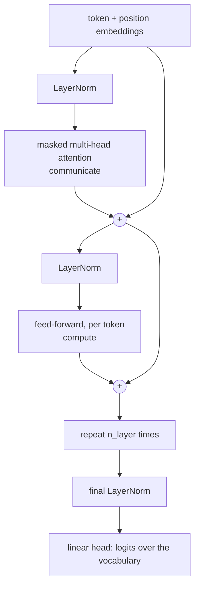

# nanoGPT: the transformer from scratch

The last chapter's best model looks back eight characters through a fixed tree. It has no way to decide, for this letter in this name, which earlier letters matter. Attention is the fix: every token computes, from the data, how much to take from every token before it. This chapter grows a bigram model on Tiny Shakespeare into a decoder-only transformer one idea at a time, measuring what each idea buys. Then it writes GPT-2 (124M) in about a hundred lines, proves the code right by loading OpenAI's weights into it, and walks through what it takes to train one from nothing. The material follows Karpathy's two lectures, [Let's build GPT](https://www.youtube.com/watch?v=kCc8FmEb1nY) and [Let's reproduce GPT-2 (124M)](https://www.youtube.com/watch?v=l8pRSuU81PU), with every CPU-sized step rerun here.

The running example is one prompt in two sizes: characters of Shakespeare on a laptop, then "Hello, I'm a language model," through the real GPT-2.


## The baseline: Tiny Shakespeare and a bigram

Tiny Shakespeare is 1.1 MB of plays, in `practice/nn-zero-to-hero/nanogpt/input.txt`, tokenised per character. Batches are random windows of `block_size` characters, and each position in a window is a separate training example, so a window of 8 gives 8 pairs of context and following character. A separate `estimate_loss` averages many batches with gradients off, so that the number you read is not the noise of a single batch.

```python
import math, time
from dataclasses import dataclass
import torch, torch.nn as nn
from torch.nn import functional as F

text = open("../practice/nn-zero-to-hero/nanogpt/input.txt", encoding="utf-8").read()
chars = sorted(set(text))
stoi = {c: i for i, c in enumerate(chars)}
encode = lambda s: [stoi[c] for c in s]
decode = lambda ids: "".join(chars[i] for i in ids)
data = torch.tensor(encode(text))
n = int(0.9 * len(data))
train_data, val_data = data[:n], data[n:]
vocab_size = len(chars)
print(f"{len(text):,} characters, {vocab_size} unique, uniform loss {math.log(vocab_size):.2f}")

def get_batch(split, block_size, batch_size):
    d = train_data if split == "train" else val_data
    ix = torch.randint(len(d) - block_size, (batch_size,))
    x = torch.stack([d[i:i + block_size] for i in ix])
    y = torch.stack([d[i + 1:i + block_size + 1] for i in ix])   # targets: shifted by one
    return x, y

@torch.no_grad()
def estimate_loss(model, block_size, batch_size=32, eval_iters=200):
    model.eval()
    out = {}
    for split in ("train", "val"):
        losses = [model(*get_batch(split, block_size, batch_size))[1].item() for _ in range(eval_iters)]
        out[split] = sum(losses) / len(losses)
    model.train()
    return out

def train(model, block_size, steps, lr=1e-3, batch_size=32):
    opt = torch.optim.AdamW(model.parameters(), lr=lr)
    for _ in range(steps):
        _, loss = model(*get_batch("train", block_size, batch_size))
        opt.zero_grad(set_to_none=True)
        loss.backward()
        opt.step()
    return estimate_loss(model, block_size)

@torch.no_grad()
def generate(model, block_size, n_new, prompt="\n"):
    idx = torch.tensor([encode(prompt)])
    for _ in range(n_new):
        logits, _ = model(idx[:, -block_size:])                  # crop to the supported context
        probs = F.softmax(logits[:, -1, :], dim=-1)              # last position only
        idx = torch.cat((idx, torch.multinomial(probs, 1)), dim=1)
    return decode(idx[0].tolist())

class Bigram(nn.Module):
    def __init__(self):
        super().__init__()
        self.table = nn.Embedding(vocab_size, vocab_size)        # each token reads off logits
    def forward(self, idx, targets=None):
        logits = self.table(idx)                                 # (B, T, vocab)
        loss = None if targets is None else F.cross_entropy(logits.view(-1, vocab_size), targets.view(-1))
        return logits, loss

torch.manual_seed(1337)
bigram = Bigram()
print("first batch loss", round(bigram(*get_batch("train", 8, 32))[1].item(), 2))
losses = train(bigram, 8, steps=5000, lr=1e-2)
print(f"train {losses['train']:.3f}  val {losses['val']:.3f}")
print(generate(bigram, 8, 120))
```

```text
1,115,390 characters, 65 unique, uniform loss 4.17
first batch loss 4.75
train 2.455  val 2.482


G tl goowon d salorot nge!
F f yothed yo,
Be l'd l my tre! d d qulotre
Yof am power' manoro poilanded-s, Yous g hend y
```

A uniform guess over 65 characters costs 4.17, and the untrained model starts a little above that at 4.75, since its random guesses are confidently wrong. Training settles at a validation loss of 2.48, in line with the about 2.5 of the lecture. Train and validation agree because a table of 65 by 65 numbers has little to overfit with. The text has the shape of a play, with line breaks, capitals and punctuation, and few real words. That is the ceiling of this model: each prediction sees one character, and the characters never talk to each other.

## The trick: looking back is a matrix multiply

Tokens now need to talk to earlier tokens, and only earlier ones, since the model must not see the future it is predicting. The simplest conversation is to average everything so far. A loop does that, and so does one matrix multiply by a lower-triangular matrix of weights.

```python
torch.manual_seed(42)
B, T, C = 1, 4, 2
x = torch.randn(B, T, C)

loop = torch.stack([x[0, :t + 1].mean(0) for t in range(T)]).unsqueeze(0)

tril = torch.tril(torch.ones(T, T))
matrix = tril / tril.sum(1, keepdim=True) @ x

wei = torch.zeros(T, T).masked_fill(tril == 0, float("-inf"))  # future positions get -inf
wei = F.softmax(wei, dim=-1)                                   # each row: uniform over positions <= t
softmaxed = wei @ x                                            # (T, T) @ (B, T, C) -> (B, T, C)

print(wei.round(decimals=2))
print("all three agree:", torch.allclose(loop, matrix) and torch.allclose(loop, softmaxed))
```

```text
tensor([[1.0000, 0.0000, 0.0000, 0.0000],
        [0.5000, 0.5000, 0.0000, 0.0000],
        [0.3300, 0.3300, 0.3300, 0.0000],
        [0.2500, 0.2500, 0.2500, 0.2500]])
all three agree: True
```

The three versions give the same numbers. The softmax version is the one that matters, because the zeros it starts from are just scores. Replace them with scores computed from the data, and the same two lines stop averaging uniformly and become attention.

## Self-attention: scores from the data

Every token emits three vectors: a **query** (what am I looking for), a **key** (what do I contain) and a **value** (what I will pass on if you attend to me). The score between two tokens is one's query dotted with the other's key. That is the entire mechanism, and it comes from [arXiv:1706.03762](https://arxiv.org/abs/1706.03762) (Vaswani et al., NeurIPS 2017), which divides the scores by `sqrt(d_k)` because the authors suspected large dot products push the softmax into regions with very small gradients. You can watch that happen.

```python
class Head(nn.Module):
    def __init__(self, n_embd, head_size, block_size, dropout=0.0):
        super().__init__()
        self.key = nn.Linear(n_embd, head_size, bias=False)
        self.query = nn.Linear(n_embd, head_size, bias=False)
        self.value = nn.Linear(n_embd, head_size, bias=False)
        self.register_buffer("tril", torch.tril(torch.ones(block_size, block_size)))
        self.dropout = nn.Dropout(dropout)
    def forward(self, x):
        B, T, C = x.shape
        k, q = self.key(x), self.query(x)                               # (B, T, hs)
        wei = q @ k.transpose(-2, -1) * k.shape[-1] ** -0.5             # (B, T, T), scaled
        wei = wei.masked_fill(self.tril[:T, :T] == 0, float("-inf"))    # causal mask
        wei = F.softmax(wei, dim=-1)
        self.last_wei = wei.detach()                                    # kept to inspect later
        return self.dropout(wei) @ self.value(x)                        # (B, T, hs)

torch.manual_seed(0)
hs = 64
q, k = torch.randn(4, 8, hs), torch.randn(4, 8, hs)
raw = q @ k.transpose(-2, -1)
scaled = raw * hs ** -0.5
print(f"score variance: raw {raw.var().item():.1f}, scaled {scaled.var().item():.2f}")
print("largest weight per row, raw:   ", [round(v, 2) for v in raw.softmax(-1)[0].max(-1).values.tolist()])
print("largest weight per row, scaled:", [round(v, 2) for v in scaled.softmax(-1)[0].max(-1).values.tolist()])
```

```text
score variance: raw 66.1, scaled 1.03
largest weight per row, raw:    [0.93, 0.99, 0.58, 0.95, 0.74, 1.0, 1.0, 1.0]
largest weight per row, scaled: [0.35, 0.35, 0.17, 0.32, 0.25, 0.41, 0.68, 0.44]
```

Unit-variance keys and queries of size 64 give raw scores with a variance of 66, close to the 64 the arithmetic predicts. Softmax turns scores that spread into something near one-hot: six of the eight rows put 0.93 or more on one earlier token, so that token would receive almost everything from the first step, before learning has chosen anything. Dividing by `sqrt(64)` brings the variance to 1.03, and the largest weights fall to between 0.17 and 0.68. These are random scores with no mask, so they show the effect of the scale and nothing else.

A few things to notice about the mechanism, each of which turns into a design decision.

| Observation | Why it matters |
|---|---|
| Attention is communication on a directed graph | Nodes gather values from the nodes that point to them, and the mask defines that graph |
| It has no notion of position | It works on a set, so **position embeddings** are added to the token embeddings |
| Batch elements never talk | Each sequence is processed on its own |
| Remove the mask and you have an encoder | Every token sees every other one, as in the [BERT pipelines of neural text models](../../02-deep-learning/notes/06-neural-text-models.md) |
| Self versus cross attention | Self: query, key and value all come from `x`. Cross: the query comes from `x`, and keys and values from another source, such as an encoder in translation |

## From one head to a transformer

Communication alone is not enough, so a block alternates it with computation: several heads in parallel, then a small network applied to each token by itself. Two additions make a stack of these trainable. A **residual connection** adds each block's output back to its input, an idea from [arXiv:1512.03385](https://arxiv.org/abs/1512.03385) (He et al., CVPR 2016). Since addition routes gradient straight through, as [micrograd's addition rule](01-micrograd.md) showed, the loss reaches the bottom block through an unobstructed path. **LayerNorm** normalises each token's features over the features rather than over the batch ([arXiv:1607.06450](https://arxiv.org/abs/1607.06450), Ba et al., 2016, preprint), so train and inference behave alike and batch size 1 is fine, unlike [BatchNorm in the last chapter](02-makemore.md#part-3-activations-gradients-and-batchnorm).



The 2017 paper placed LayerNorm after each residual addition. GPT-2 moved it to the input of each sub-block and added one more after the last block, per [its paper](https://cdn.openai.com/better-language-models/language_models_are_unsupervised_multitask_learners.pdf) (Radford et al., 2019, OpenAI report), and that pre-norm form is what we build. There is a theory for why it helps too: [arXiv:2002.04745](https://arxiv.org/abs/2002.04745) (Xiong et al., ICML 2020) proves that post-norm gives large gradients near the output at initialisation, which is what learning rate warm-up guards against, and that pre-norm gradients are well behaved.

The model below takes switches, so that each addition can be measured.

```python
class MultiHead(nn.Module):
    def __init__(self, n_embd, n_head, head_size, block_size, dropout=0.0):
        super().__init__()
        self.heads = nn.ModuleList([Head(n_embd, head_size, block_size, dropout) for _ in range(n_head)])
        self.proj = nn.Linear(head_size * n_head, n_embd)
        self.dropout = nn.Dropout(dropout)
    def forward(self, x):
        return self.dropout(self.proj(torch.cat([h(x) for h in self.heads], dim=-1)))

class FeedForward(nn.Module):
    def __init__(self, n_embd, dropout=0.0):
        super().__init__()
        self.net = nn.Sequential(nn.Linear(n_embd, 4 * n_embd), nn.ReLU(),
                                 nn.Linear(4 * n_embd, n_embd), nn.Dropout(dropout))
    def forward(self, x):
        return self.net(x)

class Block(nn.Module):
    def __init__(self, n_embd, n_head, block_size, ffwd=True, residual=True, norm=True, dropout=0.0):
        super().__init__()
        self.sa = MultiHead(n_embd, n_head, n_embd // n_head, block_size, dropout)
        self.ff = FeedForward(n_embd, dropout) if ffwd else nn.Identity()
        self.ln1 = nn.LayerNorm(n_embd) if norm else nn.Identity()
        self.ln2 = nn.LayerNorm(n_embd) if norm else nn.Identity()
        self.residual = residual
    def forward(self, x):
        if self.residual:
            x = x + self.sa(self.ln1(x))     # pre-norm, as in GPT-2
            return x + self.ff(self.ln2(x))
        return self.ff(self.ln2(self.sa(self.ln1(x))))

class TinyGPT(nn.Module):
    def __init__(self, n_embd=32, n_head=1, n_layer=1, block_size=8, dropout=0.0, **block_kw):
        super().__init__()
        self.tok = nn.Embedding(vocab_size, n_embd)
        self.pos = nn.Embedding(block_size, n_embd)
        self.blocks = nn.Sequential(*[Block(n_embd, n_head, block_size, dropout=dropout, **block_kw) for _ in range(n_layer)])
        self.ln = nn.LayerNorm(n_embd) if block_kw.get("norm", True) else nn.Identity()
        self.head = nn.Linear(n_embd, vocab_size)
    def forward(self, idx, targets=None):
        x = self.tok(idx) + self.pos(torch.arange(idx.shape[1]))
        logits = self.head(self.ln(self.blocks(x)))
        loss = None if targets is None else F.cross_entropy(logits.view(-1, vocab_size), targets.view(-1))
        return logits, loss

runs = [
    ("one head of 32",                 dict(n_head=1, n_layer=1, ffwd=False, residual=False, norm=False)),
    ("4 heads of 8",                   dict(n_head=4, n_layer=1, ffwd=False, residual=False, norm=False)),
    ("+ feed-forward",                 dict(n_head=4, n_layer=1, ffwd=True,  residual=False, norm=False)),
    ("3 blocks, nothing else",         dict(n_head=4, n_layer=3, ffwd=True,  residual=False, norm=False)),
    ("3 blocks + residual",            dict(n_head=4, n_layer=3, ffwd=True,  residual=True,  norm=False)),
    ("3 blocks + residual + LayerNorm", dict(n_head=4, n_layer=3, ffwd=True, residual=True,  norm=True)),
]
for name, kw in runs:
    torch.manual_seed(1337)
    t = time.time()
    m = TinyGPT(**kw)
    r = train(m, 8, steps=5000)
    print(f"{name:32s} {sum(p.numel() for p in m.parameters()):7,} params  train {r['train']:.3f}  val {r['val']:.3f}  {time.time() - t:4.0f}s")
```

```text
one head of 32                     8,609 params  train 2.386  val 2.421    11s
4 heads of 8                       8,609 params  train 2.238  val 2.275    14s
+ feed-forward                    16,961 params  train 2.143  val 2.197    15s
3 blocks, nothing else            41,921 params  train 2.247  val 2.254    82s
3 blocks + residual               41,921 params  train 1.995  val 2.067    76s
3 blocks + residual + LayerNorm   42,369 params  train 1.981  val 2.049    43s
```

Read the validation column from the top: 2.42, 2.28, 2.20, then a step backwards to 2.25, then 2.07 and 2.05. The step backwards is the lesson. Three blocks have 2.5 times the parameters of one block and do worse, because a deeper network that cannot be optimised is not a stronger one. Adding the residual path changes no parameter count at all and is worth 0.19. LayerNorm adds 0.02 at this depth, on one seed, which is too small to call. The table below gives what the lecture reports for each step at the same sizes (embedding 32, context 8, 5,000 steps), and our run lands close to each one, a little lower at the feed-forward step. His order is the same as ours, without the separate row for stacking.

| Addition | Problem it solves | Val loss in the lecture |
|---|---|---|
| Single head (`head_size = 32`) | Tokens can look back selectively | about 2.4 |
| 4 heads of 8 | Several kinds of relation at once | about 2.28 |
| Feed-forward per token | Computation after communication | about 2.24 |
| Stack blocks | Depth, though optimisation gets hard | not reported on its own |
| **Residual connections** | A clean path for gradients, with blocks that start close to the identity | about 2.08 |
| **LayerNorm**, pre-norm | Stable per-token feature scale | about 2.06 |

Then Karpathy simply scales up: `n_embd=384, n_head=6, n_layer=6, block_size=256, dropout=0.2, lr=3e-4`, 10.8M parameters, about 15 minutes on his A100, and a val loss of **1.48**. The output, saved in [`more.txt`](../practice/nn-zero-to-hero/nanogpt/more.txt), opens "LUCIO: We muse hath resistes him so sovere". That run is out of reach of a CPU, and he says so. A much smaller one is not.

```python
torch.manual_seed(1337)
t = time.time()
tiny = TinyGPT(n_embd=64, n_head=4, n_layer=4, block_size=32)
r = train(tiny, 32, steps=5000)
print(f"{sum(p.numel() for p in tiny.parameters()):,} params  train {r['train']:.3f}  val {r['val']:.3f}  {(time.time() - t) / 60:.1f} min on CPU")
print(generate(tiny, 32, 300))
```

```text
209,729 params  train 1.585  val 1.758  1.2 min on CPU

Is of eath, eir lords to she ear till thee:
I'll neary will you king, that were be are it
Presities me the wout for.

DUCKEs OF EDY:
The order envise into firthly with them doth God's nears him; thou we
the madest be like of go thsusboyes service.
Her will, and you have so scail:
Yet he swify.
Alell
```

This took 1.2 minutes on CPU for 209,729 parameters and a validation loss of 1.76, against the bigram's 2.48. The output has a speaker's name in capitals, verse lines and real words ("lords", "thee", "service") where the bigram had none. It is still far from the 1.48 of the 10.8M run, and the gap between train and validation has opened to 0.17, the first sign that this model has enough capacity to overfit a one-megabyte text.

The weights are the interesting part. Asking one head what it looked at, for a real line of the play, shows the scores are no longer uniform.

```python
prompt = "First Citizen:\nBefore we proceed"
idx = torch.tensor([encode(prompt[-32:])])
tiny.eval()
with torch.no_grad():
    tiny(idx)
for h in tiny.blocks[0].sa.heads[:2]:
    w = h.last_wei[0, -1]
    top = w.topk(5)
    print("head looks back at:", [(decode([idx[0, i].item()]), round(v.item(), 2)) for v, i in zip(top.values, top.indices)],
          f" uniform would be {1 / w.numel():.2f}")
tiny.train();
```

```text
head looks back at: [('e', 0.11), ('c', 0.11), ('o', 0.09), ('e', 0.09), ('r', 0.07)]  uniform would be 0.03
head looks back at: [('c', 0.08), ('e', 0.08), (' ', 0.08), ('e', 0.08), (' ', 0.05)]  uniform would be 0.03
```

With 32 characters of context, uniform attention would put 0.03 on each. The first head's largest weight is 0.11, about three and a half times that, and the second head's is 0.08, so each head has concentrated on a few characters, and the two do not pick the same set. Do not read a story into which letters they are. These are two heads in the first block of a small model, and a single prompt says nothing general about what a head does. The claim the output supports is the narrow one: the weights are no longer uniform.

What this leaves out, on purpose: the encoder and cross-attention, which translation needs and a pure language model does not, and everything after pre-training. ChatGPT is this plus supervised fine-tuning and RLHF, which belong to [LLM fundamentals](../../../generative-ai/01-llm-fundamentals/README.md).

## GPT-2 in about a hundred lines

The second lecture starts over with GPT-2's names, for a practical reason. If the parameter names match Hugging Face's checkpoint, OpenAI's weights can be copied in, and a model that generates sensible text proves the architecture is right before any money is spent training it. The differences from what we just built are small.

| Change | Detail |
|---|---|
| Tokens from BPE, not characters | `tiktoken.get_encoding("gpt2")`, 50,257 of them, 1,024 of context |
| Fused query, key, value and flash attention | One `c_attn` linear makes all three, and `F.scaled_dot_product_attention` never materialises the T×T matrix |
| GELU | The activation of [arXiv:1606.08415](https://arxiv.org/abs/1606.08415) (Hendrycks and Gimpel, 2016, preprint), as in GPT-2's released code |
| **Weight tying** | `wte.weight = lm_head.weight`. The input embedding and output projection share one matrix, as recommended by [arXiv:1608.05859](https://arxiv.org/abs/1608.05859) (Press and Wolf, EACL 2017) and [arXiv:1611.01462](https://arxiv.org/abs/1611.01462) (Inan et al., ICLR 2017) |
| Init | std 0.02, and residual projections scaled by `(2 * n_layer) ** -0.5`. GPT-2's paper scales by `1/√N` for N residual layers, and each block has two |
| Sanity check | First loss should be `-ln(1/50257) ≈ 10.8` |

```python
@dataclass
class GPTConfig:
    block_size: int = 1024    # context length
    vocab_size: int = 50257   # 50,000 BPE merges + 256 byte tokens + <|endoftext|>
    n_layer: int = 12
    n_head: int = 12
    n_embd: int = 768

class CausalSelfAttention(nn.Module):
    def __init__(self, c):
        super().__init__()
        self.c_attn = nn.Linear(c.n_embd, 3 * c.n_embd)
        self.c_proj = nn.Linear(c.n_embd, c.n_embd)
        self.c_proj.NANOGPT_SCALE_INIT = 1
        self.n_head, self.n_embd = c.n_head, c.n_embd
    def forward(self, x):
        B, T, C = x.size()
        q, k, v = self.c_attn(x).split(self.n_embd, dim=2)
        split = lambda t: t.view(B, T, self.n_head, C // self.n_head).transpose(1, 2)
        y = F.scaled_dot_product_attention(split(q), split(k), split(v), is_causal=True)  # flash attention
        return self.c_proj(y.transpose(1, 2).contiguous().view(B, T, C))

class MLP(nn.Module):
    def __init__(self, c):
        super().__init__()
        self.c_fc = nn.Linear(c.n_embd, 4 * c.n_embd)
        self.gelu = nn.GELU(approximate="tanh")
        self.c_proj = nn.Linear(4 * c.n_embd, c.n_embd)
        self.c_proj.NANOGPT_SCALE_INIT = 1
    def forward(self, x):
        return self.c_proj(self.gelu(self.c_fc(x)))

class GPTBlock(nn.Module):
    def __init__(self, c):
        super().__init__()
        self.ln_1, self.attn = nn.LayerNorm(c.n_embd), CausalSelfAttention(c)
        self.ln_2, self.mlp = nn.LayerNorm(c.n_embd), MLP(c)
    def forward(self, x):
        x = x + self.attn(self.ln_1(x))
        return x + self.mlp(self.ln_2(x))

class GPT(nn.Module):
    def __init__(self, c):
        super().__init__()
        self.config = c
        self.transformer = nn.ModuleDict(dict(
            wte=nn.Embedding(c.vocab_size, c.n_embd),
            wpe=nn.Embedding(c.block_size, c.n_embd),
            h=nn.ModuleList([GPTBlock(c) for _ in range(c.n_layer)]),
            ln_f=nn.LayerNorm(c.n_embd)))
        self.lm_head = nn.Linear(c.n_embd, c.vocab_size, bias=False)
        self.transformer.wte.weight = self.lm_head.weight        # weight tying
        self.apply(self._init_weights)
    def _init_weights(self, m):
        if isinstance(m, nn.Linear):
            std = 0.02
            if hasattr(m, "NANOGPT_SCALE_INIT"):
                std *= (2 * self.config.n_layer) ** -0.5
            nn.init.normal_(m.weight, mean=0.0, std=std)
            if m.bias is not None:
                nn.init.zeros_(m.bias)
        elif isinstance(m, nn.Embedding):
            nn.init.normal_(m.weight, mean=0.0, std=0.02)
    def forward(self, idx, targets=None):
        x = self.transformer.wte(idx) + self.transformer.wpe(torch.arange(idx.size(1)))
        for block in self.transformer.h:
            x = block(x)
        logits = self.lm_head(self.transformer.ln_f(x))
        loss = None if targets is None else F.cross_entropy(logits.view(-1, logits.size(-1)), targets.view(-1))
        return logits, loss

torch.manual_seed(1337)
gpt = GPT(GPTConfig())
total = sum(p.numel() for p in gpt.parameters())
tied = gpt.lm_head.weight.numel()
x = torch.randint(50257, (2, 32))
with torch.no_grad():
    _, loss = gpt(x, torch.randint(50257, (2, 32)))
print(f"{total:,} parameters, of which {tied:,} ({tied / total:.0%}) are the tied matrix")
print(f"first loss on random tokens {loss.item():.2f}, and -ln(1/50257) is {math.log(50257):.2f}")

# why the residual scaling: a sum of n unit-variance steps has standard deviation sqrt(n)
torch.manual_seed(0)
for n in (24,):
    plain = sum(torch.randn(10000) for _ in range(n))
    scaled = sum(torch.randn(10000) * n ** -0.5 for _ in range(n))
    print(f"after {n} residual additions: std {plain.std().item():.2f} unscaled, {scaled.std().item():.2f} scaled")
```

```text
124,439,808 parameters, of which 38,597,376 (31%) are the tied matrix
first loss on random tokens 11.05, and -ln(1/50257) is 10.82
after 24 residual additions: std 4.94 unscaled, 1.01 scaled
```

The count is 124,439,808, the figure usually rounded to "124M". The output head and the token embedding are one tensor, and that tensor alone is 31% of the model. An untrained model should be guessing evenly over 50,257 tokens, which costs -ln(1/50257) = 10.82, and it scores 11.05. That is the same check as the 3.30 in makemore, and it is the cheapest bug test in this chapter. The last line is why the output projections are scaled at init: each of 12 blocks adds to the residual stream twice, and 24 unit-variance additions give a standard deviation of 4.94, close to `sqrt(24)`. Scaling each one by `n ** -0.5` holds it at 1.01. That line demonstrates the arithmetic on random numbers, not on the model itself.

Now the proof. Hugging Face stores four of the matrices the other way around, since OpenAI's code used a `Conv1D` layer, so those need a transpose. Everything else copies straight in. If our code is right, the two models must agree on every logit.

```python
import tiktoken
from transformers import GPT2LMHeadModel

hf = GPT2LMHeadModel.from_pretrained("gpt2").eval()
ours = gpt.state_dict()
transposed = ("attn.c_attn.weight", "attn.c_proj.weight", "mlp.c_fc.weight", "mlp.c_proj.weight")
with torch.no_grad():
    for name, tensor in hf.state_dict().items():
        if name.endswith((".attn.bias", ".attn.masked_bias")):
            continue
        ours[name].copy_(tensor.t() if name.endswith(transposed) else tensor)
gpt.eval()

enc = tiktoken.get_encoding("gpt2")
idx = torch.tensor([enc.encode("Hello, I'm a language model,")])
with torch.no_grad():
    mine, theirs = gpt(idx)[0], hf(idx).logits
print("tokens:", idx[0].tolist())
print(f"largest logit difference from Hugging Face: {(mine - theirs).abs().max().item():.2e}")

@torch.no_grad()
def sample(model, prompt, n_new=24, top_k=50, seed=42):
    g = torch.Generator().manual_seed(seed)
    idx = torch.tensor([enc.encode(prompt)])
    for _ in range(n_new):
        probs = F.softmax(model(idx)[0][:, -1, :], dim=-1)
        top_p, top_i = probs.topk(top_k, dim=-1)              # keep the 50 likeliest
        idx = torch.cat((idx, top_i.gather(-1, torch.multinomial(top_p, 1, generator=g))), dim=1)
    return enc.decode(idx[0].tolist())

for s in (42, 43, 44):
    print(repr(sample(gpt, "Hello, I'm a language model,", seed=s)))
```

```text
tokens: [15496, 11, 314, 1101, 257, 3303, 2746, 11]
largest logit difference from Hugging Face: 0.00e+00
'Hello, I\'m a language model, not a designer. That\'s all."\n\nAdvertisement\n\n"You\'re in a lot of trouble," I respond'
"Hello, I'm a language model, this is going to be difficult (unless you're not actually familiar with C/C++). We will be doing a"
"Hello, I'm a language model, I don't know how you use that. It's different from English, you know? We're talking an open-"
```

The largest difference over every logit of the prompt prints as 0.00e+00, so the hundred lines above and Hugging Face's implementation are the same function on this input. The exact zero comes from running both in the same floating-point environment. On other hardware expect tiny differences, and judge by the size, since anything near 1e-5 on float32 logits is rounding, and anything near 1 is a bug. The samples are coherent English and do not stay on topic, which is what 124M parameters of GPT-2 does with no fine-tuning. They differ from the lecture's samples because the seeds and the sampling code differ.

## Making it fast

Training begins with speed, since the budget is counted in GPU hours. The lecture reports each step on one A100 at B=16, T=1024. We did not rerun these, as they need the GPU, so read them as his numbers on his machine and PyTorch version.

| Step | Time per step, as reported | Why |
|---|---|---|
| Baseline, float32 | about 1,000 ms | |
| `torch.set_float32_matmul_precision("high")` | about 300 ms | TF32 for matmuls, same code |
| `torch.autocast(dtype=torch.bfloat16)` | about 300 ms, from 333 | Activations in bf16, no gradient scaler needed as its exponent range matches fp32 |
| `torch.compile(model)` | about 129 ms | Fewer Python overheads and memory round trips |
| Flash attention | about 95 ms | No T×T matrix |
| Vocabulary rounded from 50,257 to 50,304 | about 93 ms, some 4% | More work, but kernels prefer powers of two |
| Fused AdamW | about 90 ms | One kernel for the update |
| DDP on 8 GPUs, full batch (`torchrun --nproc_per_node=8`) | 330 ms a step, about 1.5M tokens a second | Gradient all-reduce only on the last micro-step |

`torch.compile` is off in the final script, because a comment there records that it interferes with HellaSwag evaluation and generation. These are the same levers that the [inference engineering](../../../ai-engineering/07-inference-engineering/README.md) pillar covers systematically.

## The training recipe

The hyperparameters follow [GPT-3's paper](https://arxiv.org/abs/2005.14165) (Brown et al., NeurIPS 2020) for its small model of 125M parameters: batches of 0.5M tokens, a peak rate of 6e-4, Adam with betas 0.9 and 0.95 and eps 1e-8, a gradient norm clip of 1.0, a linear warm-up over 375M tokens, then cosine decay to 10% of the peak. The only compression is the horizon, as GPT-3 decayed over 260B tokens where this run has 10B. Weight decay is AdamW's decoupled form ([arXiv:1711.05101](https://arxiv.org/abs/1711.05101), Loshchilov and Hutter, ICLR 2019) and applies only to matrices, not to biases and LayerNorm gains.

```python
total_batch_size = 524_288                         # 2**19, about 0.5M tokens a step
max_lr, min_lr = 6e-4, 6e-5
warmup_steps, max_steps = 715, 19_073              # 19,073 x 0.5M is about 10B tokens: one epoch of the data

def get_lr(it):
    if it < warmup_steps:
        return max_lr * (it + 1) / warmup_steps                         # linear warm-up
    if it > max_steps:
        return min_lr
    ratio = (it - warmup_steps) / (max_steps - warmup_steps)
    return min_lr + 0.5 * (1 + math.cos(math.pi * ratio)) * (max_lr - min_lr)   # cosine decay

print(f"375M tokens of warm-up is {375e6 / total_batch_size:.0f} steps; {max_steps} steps is {max_steps * total_batch_size / 1e9:.1f}B tokens")
print("lr at step", {s: float(f"{get_lr(s):.2e}") for s in (0, 357, 714, 5000, 10000, 15000, 19073)})

decay = [p for p in gpt.parameters() if p.dim() >= 2]
no_decay = [p for p in gpt.parameters() if p.dim() < 2]
print(f"weight decay on {len(decay)} tensors ({sum(p.numel() for p in decay):,} params), none on {len(no_decay)} ({sum(p.numel() for p in no_decay):,} params)")
```

```text
375M tokens of warm-up is 715 steps; 19073 steps is 10.0B tokens
lr at step {0: 8.39e-07, 357: 0.0003, 714: 0.0006, 5000: 0.000531, 10000: 0.000325, 15000: 0.000123, 19073: 6e-05}
weight decay on 50 tensors (124,318,464 params), none on 98 (121,344 params)
```

The schedule's numbers follow from the token counts: 375M tokens at 524,288 a step is 715 steps of warm-up, and 19,073 steps is 10.0B tokens. The rate climbs to 6e-4 at step 714, and the cosine then brings it down to 6e-5 at the last step. The weight-decay split is by tensor rank, and the result is lopsided in a useful way: 98 of the 148 tensors escape decay, yet they hold only 121,344 parameters, about 0.1% of the model. Those are the biases and LayerNorm parameters, which the standard recipe leaves out of decay.

The batch of 0.5M tokens does not fit on one GPU, so gradients accumulate over micro-batches. The subtle line is the division. Cross-entropy already averages over its own batch, so summing gradients from several micro-batches without dividing makes the effective learning rate that many times too large, without a single error.

```python
torch.manual_seed(1337)
net = TinyGPT(n_embd=32, n_head=4, n_layer=1, block_size=8)
x, y = get_batch("train", 8, 32)

net.zero_grad(); net(x, y)[1].backward()
whole = net.head.weight.grad.clone()

def accumulate(divide):
    net.zero_grad()
    for xb, yb in zip(x.chunk(4), y.chunk(4)):
        loss = net(xb, yb)[1]
        (loss / 4 if divide else loss).backward()
    return net.head.weight.grad.clone()

print(f"largest difference with loss / 4: {(accumulate(True) - whole).abs().max().item():.2e}")
print(f"gradient ratio without dividing:  {(accumulate(False).norm() / whole.norm()).item():.2f}")
```

```text
largest difference with loss / 4: 4.10e-08
gradient ratio without dividing:  4.00
```

With `loss / 4`, four micro-batches of 4 reproduce one batch of 16 to within 4.10e-08, which is floating-point noise. Without the division, the gradient is 4.00 times too large. Nothing raises an error, and the training simply behaves as if the learning rate were four times what the schedule says.

The loop itself needs GPUs and the dataset, so it is shown here and not run. The complete version is [`train_gpt2.py`](../practice/nn-zero-to-hero/nanogpt/build-nanogpt/train_gpt2.py).

```python
# illustrative: needs a CUDA GPU (8xA100 for the full run) and the tokenised FineWeb-Edu shards from fineweb.py
for step in range(max_steps):
    optimizer.zero_grad()
    for micro_step in range(grad_accum_steps):         # total_batch_size // (B * T * ddp_world_size)
        x, y = train_loader.next_batch()
        with torch.autocast(device_type="cuda", dtype=torch.bfloat16):
            logits, loss = model(x, y)
        loss = loss / grad_accum_steps                 # accumulate the mean, not the sum
        model.require_backward_grad_sync = (micro_step == grad_accum_steps - 1)   # DDP: sync once
        loss.backward()
    norm = torch.nn.utils.clip_grad_norm_(model.parameters(), 1.0)
    for group in optimizer.param_groups:
        group["lr"] = get_lr(step)
    optimizer.step()
```

## Data, evaluation and the result

| Piece | File | Detail |
|---|---|---|
| Training data | `fineweb.py` | The `sample-10BT` subset of FineWeb-Edu, tokenised into 100 shards of 100M tokens stored as `uint16` |
| Validation loss | `train_gpt2.py` | A held-out shard, every 250 steps |
| HellaSwag | `hellaswag.py` | Sentence completions with 4 endings each. Score each ending by the model's average loss over its tokens and pick the lowest. Random is 0.25 |
| Samples | `train_gpt2.py` | "Hello, I'm a language model," continued, every 250 steps |

FineWeb-Edu is a 1.3-trillion-token subset of web text rated as highly educational by a classifier, from [arXiv:2406.17557](https://arxiv.org/abs/2406.17557) (Penedo et al., NeurIPS 2024). HellaSwag comes from [arXiv:1905.07830](https://arxiv.org/abs/1905.07830) (Zellers et al., ACL 2019). Its scoring fits in a few lines and runs on the weights we just loaded. The item below is one we wrote to show the mechanics, not a real benchmark item.

```python
@torch.no_grad()
def score_endings(model, context, endings):
    ctx = enc.encode(context)
    out = []
    for e in endings:
        toks = ctx + enc.encode(" " + e)
        idx = torch.tensor([toks])
        logits = model(idx)[0][0, :-1]
        losses = F.cross_entropy(logits, idx[0, 1:], reduction="none")
        out.append(losses[len(ctx) - 1:].mean().item())      # average over the ending's tokens only
    return out

context = "A woman fills a kettle at the sink. She"
endings = ["puts it on the stove and waits for the water to boil.",
           "folds it neatly and hangs it in the wardrobe.",
           "throws it over the fence to the waiting horses.",
           "reads it aloud to the rest of the class."]
for e, s in zip(endings, score_endings(gpt, context, endings)):
    print(f"{s:6.3f}  {e}")
```

```text
 1.738  puts it on the stove and waits for the water to boil.
 3.745  folds it neatly and hangs it in the wardrobe.
 3.471  throws it over the fence to the waiting horses.
 2.721  reads it aloud to the rest of the class.
```

The ending that makes physical sense has the lowest loss, 1.738, and is the model's pick. The question is one we wrote to show the mechanism, not a row of HellaSwag, so it says nothing about accuracy. The ordering of the other three is also not meaningful: 2.721 for reading a kettle aloud beats 3.471 for throwing it over a fence, which is a judgement about likely wording. The method does not read for sense. It only asks which string of tokens the model finds less surprising.

In the lecture, one epoch of 10B tokens took about two hours on eight A100s. It passes OpenAI's GPT-2 124M on HellaSwag, a model trained on about 100B tokens. A four-epoch overnight run of 40B tokens comes close to GPT-3's 124M model, which trained on 300B. The [build-nanogpt README](https://github.com/karpathy/build-nanogpt) puts the reproduction at about an hour and about $10 of rented GPU. Karpathy lists the caveats himself: FineWeb-Edu is English and has little code or math, so the model is spending no capacity on those, HellaSwag or a near copy of it may have reached the web crawl, and the two datasets differ in quality, so this is a cross-check that training works and not a fair comparison of efficiency. He also notes a strange periodicity in his loss curve, which he suspects comes from data that was never shuffled.

## The whole arc of data science, in one table

| Chapter | Model | Learns from | Context |
|---|---|---|---|
| [Supervised learning](../../01-classical-ml/notes/02-supervised-learning.md) | Logistic regression | Hand-made features | None |
| [Text classification](../../03-nlp/notes/02-text-classification.md) | TF-IDF and logistic regression | Word counts | Bag of n-grams |
| [Embeddings and similarity](../../03-nlp/notes/04-embeddings-and-similarity.md) | word2vec | Co-occurrence | Window of about 5 |
| [Neural text models](../../02-deep-learning/notes/06-neural-text-models.md) | LSTM | Labels or the following word | Recurrent state |
| [makemore](02-makemore.md) | MLP, WaveNet-style tree | The following character | 3 to 8 characters |
| This chapter | Transformer | The following token, 10B of them | 1,024 tokens, full attention |

Beyond this table lie scale, instruction tuning, RLHF and using these models as components, which [LLM fundamentals](../../../generative-ai/01-llm-fundamentals/README.md) and [RAG and retrieval](../../../generative-ai/02-rag-retrieval/README.md) take up.

## Practice

| File | Covers | Runs |
|---|---|---|
| [`nanogpt/bigram.py`](../practice/nn-zero-to-hero/nanogpt/bigram.py) | Batching, bigram model, `estimate_loss`, generation | Offline on CPU in about a minute; `input.txt` is included |
| [`nanogpt/gpt.py`](../practice/nn-zero-to-hero/nanogpt/gpt.py) | The full decoder-only transformer, by character | Offline; GPU for the default config (about 15 minutes on an A100); shrink `n_embd`, `n_layer`, `block_size` for CPU or Apple `mps` |
| [`build-nanogpt/play.ipynb`](../practice/nn-zero-to-hero/nanogpt/build-nanogpt/play.ipynb) | Hugging Face GPT-2 weights, manual top-k sampling | Needs internet (about 500 MB); the sampling cell hard-codes `cuda`, so change it to `cpu` or `mps` |
| [`build-nanogpt/train_gpt2.py`](../practice/nn-zero-to-hero/nanogpt/build-nanogpt/train_gpt2.py) | GPT-2 from scratch: init, bf16, flash attention, AdamW, cosine schedule, accumulation, DDP, HellaSwag | GPU: 8×A100 for the full run, one GPU slowly; needs `fineweb.py` data and `tiktoken`; `torchrun --nproc_per_node=N` |
| [`build-nanogpt/fineweb.py`](../practice/nn-zero-to-hero/nanogpt/build-nanogpt/fineweb.py) | Tokenise FineWeb-Edu 10B into shards | Needs internet, `datasets`, many CPU cores and disk for 100 shards of 100M 2-byte tokens, about 20 GB |
| [`build-nanogpt/hellaswag.py`](../practice/nn-zero-to-hero/nanogpt/build-nanogpt/hellaswag.py) | HellaSwag download and evaluation | Needs internet; GPU recommended |

The blocks in this chapter run in order with `uv run --python 3.12 --with torch --with transformers --with tiktoken python practice/run_note.py notes/03-nanogpt.md` from the pillar folder. The step-by-step commit history is in [karpathy/build-nanogpt](https://github.com/karpathy/build-nanogpt).

## Pitfalls

| Pitfall | What goes wrong | What to do |
|---|---|---|
| Forgetting the causal mask | The target is in the input, so train and validation loss both look excellent and generation is rubbish | Check generation, since no split can catch it, and check a mask's upper triangle is `-inf` |
| Forgetting position embeddings | Attention sees a set, so order is invisible | Add them, and check that shuffling the context changes the output |
| Leaving out the `sqrt(d)` scaling | Softmax saturates towards one-hot at init | Compare first-step attention weights to uniform |
| Summing accumulated gradients | Effective learning rate multiplied by the number of micro-batches | `loss = loss / grad_accum_steps` |
| Weight tying set after init, or not at all | 38.6M wasted parameters, or a missing weight when loading | Set it in `__init__` and count parameters |
| Transposing the wrong matrices on load | Shape errors at best, and silently wrong logits for square matrices | Compare logits against the reference on a real prompt |
| Decaying biases and LayerNorm gains | Pulls scale and offset parameters towards zero | Decay only tensors of 2 or more dimensions |
| Trusting a loss across different datasets | FineWeb-Edu and WebText are different distributions | Use a held-out benchmark, and still note leakage |
| Sampling every step through a compiled model | A comment in the final script records that `torch.compile` interfered with eval and generation | Check generation with compile on and off |

## Try it

1. **Remove the mask.** Set every `tril` to ones in a small model, train it, then compare the train loss and the generated text with the masked model.

<details><summary>Answer</summary>

```python
torch.manual_seed(1337)
masked = TinyGPT(n_head=4, n_layer=3, ffwd=True, residual=True, norm=True)
r0 = train(masked, 8, steps=2000)

torch.manual_seed(1337)
leaky = TinyGPT(n_head=4, n_layer=3, ffwd=True, residual=True, norm=True)
for module in leaky.modules():
    if isinstance(module, Head):
        module.tril.fill_(1)                              # every position can see every other
r1 = train(leaky, 8, steps=2000)

print(f"masked   train {r0['train']:.3f}  val {r0['val']:.3f}")
print(f"no mask  train {r1['train']:.3f}  val {r1['val']:.3f}")
print("no mask generates:", repr(generate(leaky, 8, 80)))
```

```text
masked   train 2.107  val 2.143
no mask  train 0.288  val 0.292
no mask generates: '\nKAO\n\n\nAULUS:\nJ, I y frory!\nDory loud, sheris wiillednd hid dild her; ou in.\n\nFTu'
```

Validation falls as far as train, to 0.292, and that is the point of the exercise. The leak is present in both splits, so a held-out split cannot catch it: every position can read its own target, which sits one place to the right in the input. Generation does catch it. When sampling, the position being predicted is the last one and there is nothing to its right to read, so the model has learned little it can use. The sample has the outline of a script and few words, from a model whose loss is seven times lower than the masked model's 2.143.

</details>

2. **Remove the positions.** Zero the position embeddings and freeze them, then measure what order was worth.

<details><summary>Answer</summary>

```python
torch.manual_seed(1337)
no_pos = TinyGPT(n_head=4, n_layer=3, ffwd=True, residual=True, norm=True)
nn.init.zeros_(no_pos.pos.weight)
no_pos.pos.weight.requires_grad_(False)
r2 = train(no_pos, 8, steps=2000)
print(f"with positions    train {r0['train']:.3f}  val {r0['val']:.3f}")
print(f"without positions train {r2['train']:.3f}  val {r2['val']:.3f}")
```

```text
with positions    train 2.107  val 2.143
without positions train 2.161  val 2.198
```

Removing positions costs 0.055 on validation, less than might be expected. With a context of eight, each token still knows its own identity, through the query and the residual path, so the model keeps at least what a bigram had. It also still knows which characters occurred in the previous seven, just not their order. What positions add at this size is the order inside a very short window. This one run does not measure what order is worth over longer contexts, so try it at a `block_size` of 32 and compare.

</details>

3. **Count GPT-2 by hand.** Derive 124,439,808 from the config, then check by adding up the model's parameters by section.

<details><summary>Answer</summary>

```python
V, P, L, D = 50257, 1024, 12, 768
embed = V * D + P * D
attn = (D * 3 * D + 3 * D) + (D * D + D)     # c_attn and c_proj, each with bias
mlp = (D * 4 * D + 4 * D) + (4 * D * D + D)  # c_fc and c_proj, each with bias
norms = 2 * (2 * D)                          # two LayerNorms: gain and bias
final = 2 * D
by_hand = embed + L * (attn + mlp + norms) + final
print(f"by hand {by_hand:,}  by model {sum(p.numel() for p in gpt.parameters()):,}")
print(f"embeddings {embed:,}, each block {attn + mlp + norms:,}, final LayerNorm {final:,}")
```

```text
by hand 124,439,808  by model 124,439,808
embeddings 39,383,808, each block 7,087,872, final LayerNorm 1,536
```

The blocks hold 12 x 7,087,872 = 85,054,464 parameters, or 68%, and embeddings hold the other 32%. So almost a third of GPT-2 is a lookup table, and most of that is the single tied matrix of 38,597,376.

</details>

## Interview checklist

| Question | Answer |
|---|---|
| What are query, key and value? | Three learned projections of each token. Query dotted with key gives a score, and softmaxed scores weight the values. |
| Why scale by `1/sqrt(d_k)`? | Dot products of unit-variance vectors have variance `d_k`. Unscaled, softmax goes close to one-hot at init. |
| What does the causal mask do? | It stops a position attending to later positions, so the target is not in the input. |
| Why do we need position embeddings? | Attention treats its inputs as a set and has no idea of order. |
| Why multiple heads? | Several independent kinds of relation at the same total width. |
| What does the feed-forward do? | Per-token computation on what attention gathered. |
| Why residual connections? | Addition routes gradients straight through, so deep stacks train, and blocks start near identity. |
| Pre-norm or post-norm? | GPT-2 moved LayerNorm inside the residual path. Xiong et al. show this gives well-behaved gradients at init, reducing the need for warm-up. |
| Why LayerNorm, not BatchNorm? | It does not depend on the batch, so train and inference match, and batch size 1 works. |
| What is weight tying and what does it save? | Sharing the input embedding and output projection. 38.6M parameters, about 31% of GPT-2 124M. |
| What is the expected first loss for GPT-2? | `-ln(1/50257) ≈ 10.82`. Anything far off means a bad init. |
| Why divide the loss in gradient accumulation? | Each micro-batch's loss is a mean, so an undivided sum scales the gradient by the number of micro-batches. |
| How does HellaSwag score an ending? | By the model's average per-token loss over the ending, with the lowest winning. |
| How do you prove a from-scratch model is right? | Load known weights and compare logits on a real input. |

## Next

The series ends here, and the course moves from building one LLM to using LLMs as systems: tokenisation, pre-training at scale, post-training and inference. Continue with [LLM fundamentals](../../../generative-ai/01-llm-fundamentals/README.md).
