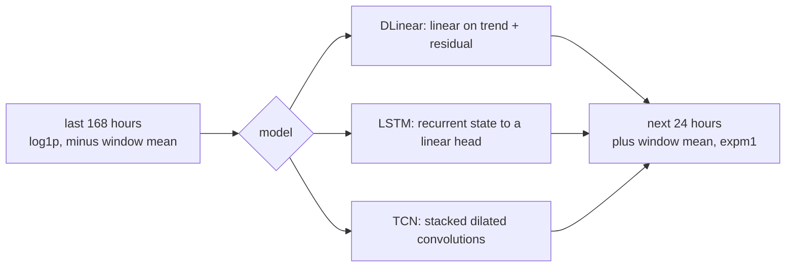

# Time series ML: features, sequence models and backtesting

A forecast is a promise about a future you cannot see, so the standard machine learning habit of shuffling rows and holding some out will report an accuracy you will never get in production. This chapter builds forecasters for one hourly bike rental series, and the main lesson is the procedure: state when the forecast is issued, compare against a naive baseline, and test only on the future. The modelling choices come second, and the measurements below show why.

Scikit-learn gives you `fit` and `predict`, the [pandas time series chapter](../../../data-analytics/01-python-for-data-analysis/notes/06-time-series.md) gives you resampling and shifting, and [neural networks fundamentals](../../02-deep-learning/README.md) gives you the training loop. What is new here is what time does to each of them. Rows are no longer exchangeable, because every row is correlated with its neighbours. Features can only use what was known at the moment of prediction, and that moment has to be stated before any modelling. The level of the series drifts, so a test set can sit outside the range of everything the model has seen.

The running example is the [UCI Bike Sharing Dataset](https://archive.ics.uci.edu/dataset/275/bike+sharing+dataset) (Fanaee-T & Gama, *Progress in Artificial Intelligence*, 2014; CC BY 4.0): two years of hourly rentals from the Capital Bikeshare system in Washington, D.C. The decision we pretend to serve is rebalancing. Each midnight an operator needs the next 24 hours of demand, hour by hour, to plan where the vans go.

## What a forecasting problem is made of

Load the data first and look for the things a time series file hides. The code caches the 280 KB zip under `~/.cache/learn-ai-engineering/`.

```python
import urllib.request, zipfile
from pathlib import Path
import numpy as np, pandas as pd

CACHE = Path.home() / ".cache" / "learn-ai-engineering"
CACHE.mkdir(parents=True, exist_ok=True)
ZIP = CACHE / "bike-sharing.zip"
if not ZIP.exists():
    url = "https://archive.ics.uci.edu/static/public/275/bike+sharing+dataset.zip"
    ZIP.write_bytes(urllib.request.urlopen(url, timeout=60).read())

with zipfile.ZipFile(ZIP) as z:
    raw = pd.read_csv(z.open("hour.csv"), parse_dates=["dteday"])
raw["ts"] = raw["dteday"] + pd.to_timedelta(raw["hr"], unit="h")
print(raw.shape, raw["ts"].min(), raw["ts"].max())

grid = pd.date_range(raw["ts"].min(), raw["ts"].max(), freq="h")
print("hours on the calendar:", len(grid), " rows in the file:", len(raw))
df = raw.set_index("ts").reindex(grid)
df["cnt"] = df["cnt"].fillna(0.0)          # the file omits hours with no record
for c in ["temp", "hum", "windspeed", "weathersit"]:
    df[c] = df[c].ffill()
y = df["cnt"]
print(y.groupby(y.index.year).agg(["mean", "max"]).round(1))
```

```text
(17379, 18) 2011-01-01 00:00:00 2012-12-31 23:00:00
hours on the calendar: 17544  rows in the file: 17379
       mean    max
2011  141.9  651.0
2012  233.3  977.0
```

Two facts in that output shape everything after it. The file has fewer rows than the calendar has hours, so `shift(24)` on the raw file would silently mean "24 rows ago", which is not always yesterday. Reindexing onto a complete hourly grid makes a lag mean what it says. We fill the missing counts with zero on the assumption that a missing hour had no rentals. That is a judgement about this dataset, and it is worth writing down when you make it on your own data.

The second fact is that mean demand rose by about 64% from 2011 to 2012. Every test hour in 2012 sits at a level the early training data never reached, and that matters as soon as trees enter the picture.

A forecasting problem needs four things stated before any model is fitted:

- **Issue time.** When is the forecast made? Here, midnight.
- **Horizon.** How far ahead? Here, 1 to 24 hours.
- **Information set.** What is known at the issue time? Calendar and all rentals up to midnight. Tomorrow's weather is not known, only a forecast of it.
- **Loss.** What does an error cost? Here we use absolute error in bikes, since a van load is roughly linear in missed demand.

## Baselines and a scale-free metric

The first model is one you cannot lose to by accident. For a series with a daily and weekly cycle, the seasonal naive forecast copies the same hour from an earlier period. It costs nothing, needs no training, and is what your model must beat before it has earned any complexity.

Absolute error in bikes means little on its own, and percentage errors break down here, since many hours have zero rentals. Hyndman and Koehler ([*International Journal of Forecasting*, 2006](https://doi.org/10.1016/j.ijforecast.2006.03.001)) surveyed these failures and proposed the mean absolute scaled error: divide your mean absolute error by the mean absolute error of a seasonal naive forecast on the training data. A MASE below 1 means you beat the in-sample naive; above 1 means you did not.

```python
def mase(y_true, y_pred, y_train, m=24):
    """Mean absolute error scaled by the in-sample seasonal-naive error."""
    scale = np.mean(np.abs(y_train[m:] - y_train[:-m]))
    return np.mean(np.abs(y_true - y_pred)) / scale

test_starts = pd.date_range("2012-07-01", periods=6, freq="MS")
def folds():
    """Yield (train_end, test_index): an expanding history, then one month of test."""
    for s in test_starts:
        e = s + pd.offsets.MonthBegin(1)
        yield s, y.index[(y.index >= s) & (y.index < e)]

def backtest(predict, name):
    rows = []
    for s, idx in folds():
        pred = predict(s, idx)
        tr = y[y.index < s].to_numpy()
        rows.append(dict(model=name, month=s.strftime("%Y-%m"),
                         mae=np.mean(np.abs(y[idx].to_numpy() - pred)),
                         mase=mase(y[idx].to_numpy(), pred, tr)))
    return pd.DataFrame(rows)

def same_hour_yesterday(s, idx): return y.shift(24).reindex(idx).to_numpy()
def same_hour_last_week(s, idx): return y.shift(168).reindex(idx).to_numpy()

results = [backtest(same_hour_yesterday, "same hour yesterday"),
           backtest(same_hour_last_week, "same hour last week")]
summary = lambda rs: pd.concat(rs).groupby("model", sort=False)[["mae", "mase"]].mean().round(3)
print(summary(results))
```

```text
                        mae   mase
model
same hour yesterday  80.445  1.317
same hour last week  66.042  1.074
```

Copying last week wins, because a weekday forecast from yesterday is wrong every Saturday and Monday. Both have a MASE above 1 because the second half of 2012 is harder and busier than the training history that sets the scale. Keep that in mind when you read a MASE: it is a ratio against an in-sample yardstick, and it can move with the level of the series as well as with your model.

## A backtest that matches the decision

A backtest replays history as if you were living it. For each of several cut points, train only on data before the cut and predict after it. The picture below shows the expanding-window version we use, one fold per month from July to December 2012. Hyndman and Athanasopoulos call this time series cross-validation in [*Forecasting: Principles and Practice*](https://otexts.com/fpp3/tscv.html), and scikit-learn ships it as [`TimeSeriesSplit`](https://scikit-learn.org/stable/modules/generated/sklearn.model_selection.TimeSeriesSplit.html).

```text
           2011                 2012
           Jan ............... Jun Jul Aug Sep Oct Nov Dec
fold 1     [------- train -------] test
fold 2     [--------- train ---------] test
fold 3     [----------- train -----------] test
fold 4     [------------- train -------------] test
fold 5     [--------------- train ---------------] test
fold 6     [----------------- train -----------------] test

inside each test month, every midnight:

  known: everything before 00:00        unknown: the next 24 hours
  ----------------------------------|   h=1 h=2 ... h=24
                                 issue
```

Six folds is a small number, and that is normal: you get as many independent looks at the future as you have stretches of future. Report the per-fold results, as we will below, because a single average can hide one bad month.

Why not ordinary K-fold? There is a real nuance here, and the common advice overstates it. Bergmeir, Hyndman and Koo ([*Computational Statistics & Data Analysis*, 2018](https://doi.org/10.1016/j.csda.2017.11.003)) show that standard K-fold is valid for purely autoregressive models whose residuals are uncorrelated, which you can check with a Ljung-Box test, and that it fails for underfit models with correlated errors. Their result does not rescue shuffled validation for the general case: a series with a drifting level, calendar features that encode position, and a decision made at a specific moment. Our series has all three, so we backtest forward, and we will measure how much the shuffled version flatters us.

## Feature-based models

The approach that wins most practical forecasting today turns the series into a table. Each row is one target hour, and the columns are what you knew at the issue time: calendar fields, and values of the series at safe lags. A gradient boosted tree then learns the mapping. The [boosting chapter](../../01-classical-ml/README.md) covers the tree side.

The safe lags follow from the issue time. At midnight, the target at 23:00 today can see 24 hours back at the earliest, because anything nearer falls inside the forecast window. So every feature lag here is at least 24. This gives one "direct" model that covers all 24 horizons at once, with `hour` as a feature. The alternative is the recursive strategy, where you predict one step and feed the prediction back in. Recursion is more compact but lets errors compound. Direct models with honest lags are simpler to reason about, and they are what we use here.

The harder problem is the level. A regression tree predicts by averaging training targets in a leaf, so it cannot output a value above anything it has seen. With demand growing year on year, a tree trained on absolute counts is structurally capped. The fix is to divide the target and the lags by a recent level known at issue time, here the mean of the previous week. The tree then learns the shape of a day relative to the current scale, and multiplying back by the level puts the prediction on the right scale. Using a Poisson loss suits a non-negative count.

```python
from sklearn.ensemble import HistGradientBoostingRegressor
LEVEL = y.shift(24).rolling(168).mean() + 1            # last week's mean rate, known at the issue time
LAGS = (24, 48, 168, 336)

def features(y, df, weather=False):
    X = pd.DataFrame(index=y.index)
    X["hour"] = y.index.hour
    X["dow"] = y.index.dayofweek
    X["month"] = y.index.month
    X["holiday"] = df["holiday"].ffill().fillna(0).values
    X["workingday"] = df["workingday"].ffill().fillna(0).values
    for lag in LAGS:
        X[f"lag_{lag}"] = y.shift(lag) / LEVEL
    if weather:
        X[["temp", "hum", "windspeed", "weathersit"]] = df[["temp", "hum", "windspeed", "weathersit"]]
    return X

def gbm_predictor(X, relative=True):
    def predict(s, idx):
        tr = (X.index < s) & X["lag_336"].notna() & LEVEL.notna()
        target = y[tr] / LEVEL[tr] if relative else y[tr]
        m = HistGradientBoostingRegressor(max_iter=300, learning_rate=0.05, loss="poisson", random_state=0)
        m.fit(X[tr], target)
        return m.predict(X.loc[idx]) * (LEVEL[idx].to_numpy() if relative else 1)
    return predict

X = features(y, df)
Xabs = X.copy()
for lag in LAGS:
    Xabs[f"lag_{lag}"] = y.shift(lag)
results.append(backtest(gbm_predictor(Xabs, relative=False), "gbm absolute"))
results.append(backtest(gbm_predictor(X), "gbm relative"))
print(summary(results))
print(results[-1].round(3).to_string(index=False))
```

```text
                        mae   mase
model
same hour yesterday  80.445  1.317
same hour last week  66.042  1.074
gbm absolute         55.375  0.906
gbm relative         48.172  0.786
       model   month    mae  mase
gbm relative 2012-07 47.475 0.816
gbm relative 2012-08 35.948 0.602
gbm relative 2012-09 49.596 0.820
gbm relative 2012-10 67.503 1.091
gbm relative 2012-11 46.724 0.734
gbm relative 2012-12 41.787 0.653
```

Dividing by the level takes MASE from 0.906 to 0.786, a bigger gain than most hyperparameter tuning could hope for, and it costs one line. The monthly rows show why you report folds: October is the only month above 1, and a single average would not tell you that. It is also the point to ask what happened that month. Hurricane Sandy shut the D.C. system down at the end of October 2012, and Fanaee-T and Gama use this dataset's anomalies as their subject, so this is not a model detail you could fix with more trees.

This is the method that won the M5 forecasting competition by a wide margin. Makridakis, Spiliotis and Assimakopoulos ([*International Journal of Forecasting*, 2022](https://ideas.repec.org/a/eee/intfor/v38y2022i4p1346-1364.html)) report on 42,840 hierarchical Walmart sales series with a 28-day horizon. It was the first competition in that series where all the top methods were pure machine learning and clearly better than statistical benchmarks. The winner, an equal-weighted mean of six LightGBM models, improved on the top benchmark by 22.4%, and most leading methods used LightGBM. Even so, only 7.5% of teams beat that benchmark and 35.8% beat the seasonal naive, so most entrants lost to a method they could have written in a line. Essentially all of the top 50 trained one "global" model across many series, which they call cross-learning. That is where machine learning earns its keep, since a global model can borrow patterns from thousands of related series. Januschowski and colleagues give a fuller account of why trees do so well here in ["Forecasting with trees"](https://doi.org/10.1016/j.ijforecast.2021.10.004) (*IJF*, 2022).

## Leakage, measured

Leakage in forecasting is usually subtle, because each feature looks reasonable. Here are three common errors run against the same relative model and the same six months.

```python
from sklearn.model_selection import KFold, cross_val_predict

# 1. A lag shorter than the horizon: the previous hour, which at midnight you do not have.
X_leak = X.assign(lag_1=y.shift(1) / LEVEL)
results_leak = [backtest(gbm_predictor(X_leak), "lag_1 inside the horizon")]

# 2. Actual weather: known afterwards, not at issue time.
results_leak.append(backtest(gbm_predictor(features(y, df, weather=True)), "actual weather"))

# 3. Shuffled K-fold on the same honest features, scored on the same months.
mask = X["lag_336"].notna() & LEVEL.notna()
pred = cross_val_predict(HistGradientBoostingRegressor(max_iter=300, learning_rate=0.05, loss="poisson", random_state=0),
                         X[mask], (y / LEVEL)[mask], cv=KFold(5, shuffle=True, random_state=0)) * LEVEL[mask].to_numpy()
in_win = (X[mask].index >= test_starts[0]) & (X[mask].index < test_starts[-1] + pd.offsets.MonthBegin(1))
tr_arr = y[y.index < test_starts[0]].to_numpy()
print("shuffled 5-fold    mae %.1f  mase %.3f" % (
    np.mean(np.abs(y[mask][in_win].to_numpy() - pred[in_win])),
    mase(y[mask][in_win].to_numpy(), pred[in_win], tr_arr)))
print(summary(results_leak))
```

```text
shuffled 5-fold    mae 43.4  mase 0.747
                             mae   mase
model
lag_1 inside the horizon  25.597  0.419
actual weather            37.653  0.615
```

Each result looks like a breakthrough against the honest 0.786. The previous-hour feature cuts the error nearly in half, and nobody would have that value when planning a day ahead. Weather is the more interesting case. Actual temperature takes MASE to 0.615, and the temptation is to keep it. In production you would only have a weather forecast, whose errors the model never saw in training, so this number is an upper bound for what a weather feed could add. To measure it properly you need archived forecasts as issued at the time, trained and tested as they were. The shuffled folds flatter us less, because every feature here is at least a day old, so a neighbouring hour in training gives away less than you would fear. A 5% optimistic bias still changes a decision when two candidates are that close.

## Sequence models

A neural forecaster takes a window of history and outputs the next 24 hours directly, with no hand-made features. Three families are worth knowing. All three are written below with the same interface: 168 hours in, 24 out, each window scaled by its own level so the level problem does not defeat them.



**Recurrent networks** (LSTM, GRU) read the window one step at a time. DeepAR (Salinas et al., [arXiv:1704.04110](https://arxiv.org/abs/1704.04110), published in *IJF*, 2020) is the influential version: one autoregressive RNN trained across many related series, predicting a distribution instead of a point. The authors report about 15% better accuracy than the state of the art on several datasets.

**Temporal convolutions** stack causal, dilated 1-D convolutions so that the receptive field grows exponentially with depth. Bai, Kolter and Koltun ([arXiv:1803.01271](https://arxiv.org/abs/1803.01271), preprint) found that a simple convolutional architecture beat canonical recurrent networks across a broad range of sequence tasks, with longer effective memory. N-BEATS (Oreshkin et al., [ICLR 2020](https://arxiv.org/abs/1905.10437)) is a deep fully connected stack that doubled down on pure-network forecasting: on M3, M4 and TOURISM it reports 11% over a statistical benchmark and 3% over the M4 winner.

**Linear models** are the uncomfortable result. Zeng and colleagues ([AAAI 2023](https://arxiv.org/abs/2205.13504)) tested an embarrassingly simple one-layer model against the Transformer forecasters that dominated long-horizon papers, and it beat them on nine real datasets in all cases, often by 20% to 50%. Their argument is that attention is permutation invariant at heart and loses the ordering that a time series is all about. Their DLinear splits the window into a moving-average trend and a remainder, then fits one linear map on each, and we reproduce it here.

This block trains all three, once per fold, for about three minutes on a laptop CPU.

```python
import torch, time
from torch import nn
torch.set_num_threads(4)
L, H = 168, 24

class DLinear(nn.Module):
    def __init__(self, L, H, kernel=25):
        super().__init__()
        self.avg = nn.AvgPool1d(kernel, stride=1, padding=kernel // 2, count_include_pad=False)
        self.seasonal = nn.Linear(L, H); self.trend = nn.Linear(L, H)
    def forward(self, x):
        trend = self.avg(x.unsqueeze(1)).squeeze(1)
        return self.seasonal(x - trend) + self.trend(trend)

class LSTMForecaster(nn.Module):
    def __init__(self, H, hidden=64):
        super().__init__()
        self.rnn = nn.LSTM(1, hidden, batch_first=True); self.head = nn.Linear(hidden, H)
    def forward(self, x):
        _, (h, _) = self.rnn(x.unsqueeze(-1))
        return self.head(h[-1])

class TCN(nn.Module):
    def __init__(self, H, ch=32, layers=8):
        super().__init__()
        self.blocks = nn.ModuleList(nn.Conv1d(1 if i == 0 else ch, ch, 3, dilation=2 ** i) for i in range(layers))
        self.head = nn.Linear(ch, H)
    def forward(self, x):
        z = x.unsqueeze(1)
        for i, conv in enumerate(self.blocks):
            out = torch.relu(conv(nn.functional.pad(z, (2 * 2 ** i, 0))))   # left-pad only, so it stays causal
            z = out + z if i else out
        return self.head(z[:, :, -1])

def seq_predictor(make_model, epochs=40, lr=2e-3, bs=32):
    v = np.log1p(y.to_numpy(dtype="float32")); ix = y.index
    win = lambda issue: (np.stack([v[i - L:i] for i in issue]), np.stack([v[i:i + H] for i in issue]))
    def predict(s, idx):
        split = ix.get_indexer([s])[0]
        x, t = win(np.arange(L, split - H + 1, 24))           # one training window per midnight
        level = x.mean(1, keepdims=True)                      # each window is scaled by its own level
        xt, tt = torch.tensor(x - level), torch.tensor(t - level)
        torch.manual_seed(0)
        m = make_model(); opt = torch.optim.Adam(m.parameters(), lr=lr)
        for _ in range(epochs):
            for b in torch.randperm(len(xt)).split(bs):
                loss = nn.functional.mse_loss(m(xt[b]), tt[b])
                opt.zero_grad(); loss.backward(); opt.step()
        days = np.arange(ix.get_indexer([idx[0]])[0], ix.get_indexer([idx[-1]])[0] + 1, H)
        xs, _ = win(days)
        lv = xs.mean(1, keepdims=True)
        with torch.no_grad():
            p = m(torch.tensor(xs - lv)).numpy() + lv
        return np.expm1(p).clip(0).reshape(-1)[: len(idx)]
    return predict

for name, mk in [("dlinear", lambda: DLinear(L, H)), ("lstm", lambda: LSTMForecaster(H)), ("tcn", lambda: TCN(H))]:
    t0 = time.time()
    results.append(backtest(seq_predictor(mk), name))
    print("%-8s %3.0f s" % (name, time.time() - t0), flush=True)
print(summary(results))
```

```text
dlinear    2 s
lstm      56 s
tcn      123 s
                        mae   mase
model
same hour yesterday  80.445  1.317
same hour last week  66.042  1.074
gbm absolute         55.375  0.906
gbm relative         48.172  0.786
dlinear              64.710  1.056
lstm                 63.632  1.039
tcn                  60.188  0.981
```

Read this table with the setup in mind. It is one series with about 550 midnight windows of training at most, no calendar input, no tuning beyond making them train stably, and a window-level normalisation. Under those conditions all three neural models beat the naive baselines, and the two-line DLinear gives up little to the LSTM. None of them beats the gradient boosted trees, which were handed holiday flags and a calendar. That does not prove trees beat networks. Neural forecasters such as DeepAR were designed for global training across many related series, and a single short series starves them. The conclusion that does hold is narrower and more useful: on a small tabular-style problem, start with features and trees, and require any deep model to beat that number in the same backtest.

## Forecasts with error bars

The operator's van plan depends on how wrong the number might be, and a point forecast does not say. Quantile regression is the cheapest honest answer: train one model per quantile with the pinball loss, which charges under- and over-prediction asymmetrically. Then check the result the same way as anything else, on the future.

```python
qpred = {}
for q in (0.1, 0.9):
    parts = []
    for s, idx in folds():
        tr = (X.index < s) & X["lag_336"].notna() & LEVEL.notna()
        m = HistGradientBoostingRegressor(max_iter=300, learning_rate=0.05, loss="quantile", quantile=q, random_state=0)
        m.fit(X[tr], (y / LEVEL)[tr])
        parts.append(pd.Series(m.predict(X.loc[idx]) * LEVEL[idx].to_numpy(), index=idx))
    qpred[q] = pd.concat(parts)
actual = y.reindex(qpred[0.1].index)
inside = (actual >= qpred[0.1]) & (actual <= qpred[0.9])
print("nominal 80%% interval, covered %.1f%%, mean width %.0f bikes" % (100 * inside.mean(), (qpred[0.9] - qpred[0.1]).mean()))
print(inside.groupby(inside.index.strftime("%Y-%m")).mean().round(3).to_string())
```

```text
nominal 80% interval, covered 78.9%, mean width 158 bikes
2012-07    0.747
2012-08    0.891
2012-09    0.812
2012-10    0.755
2012-11    0.756
2012-12    0.772
```

An interval that claims 80% and covers less is overconfident, and it is usually overconfident for the same reason in every fold: the future contains shocks that the training period did not. Report coverage by fold, as with point error. DeepAR's probabilistic output is the deep learning analogue, and the same check applies to it.

## Pitfalls

- **No baseline in the table.** A MAE of 48 bikes means nothing alone. Always print the seasonal naive row in the same backtest.
- **Features from inside the horizon.** The check is mechanical: for each feature, ask when its value would become available, and compare that to the issue time. Lags shorter than the horizon, rolling means that include the target hour, and target encoding fit on all data are the common offenders.
- **Actuals standing in for forecasts.** Weather, prices and promotions all have this trap. Use the forecast as it was issued, or treat the result as an upper bound.
- **Trees asked to extrapolate.** A regression tree cannot predict outside its training targets. Model a ratio or difference against a known level, as above, or forecast the level with something that can extrapolate.
- **Percentage errors on data with zeros.** MAPE is undefined at zero and unbounded near it, so low-demand hours dominate it. Use a scaled error, as Hyndman and Koehler argue.
- **A rolling mean that ends at the target.** `y.rolling(24).mean()` includes the current value. Shift first, by at least the horizon.
- **Scaling on the full series.** Fitting a scaler on all data leaks the future level into training. Normalise per window or fit on the training fold only.
- **Picking the model on the final fold's noise.** Tune on earlier folds and keep later ones untouched, or you have turned the backtest into a training set.
- **Treating one dataset as a verdict.** Our table is one series. Model family rankings change with series count, length and horizon, so re-run the comparison on your own data.

## Try it

The lab [`practice/01_forecast_lab.py`](../practice/01_forecast_lab.py) holds the backtest, so each experiment is a few lines. Run it from this pillar's folder:

```bash
uv run --with scikit-learn --with pandas python practice/01_forecast_lab.py
```

1. **Add a feature.** Add the mean of the same hour over the last four weeks, keeping every input at least 24 hours old. Does it help, and why might the gain be modest?

<details><summary>Answer</summary>

ANSWER1

</details>

2. **Stretch the horizon.** Plan a week ahead rather than a day, so that every lag must be at least 168 hours and the level must be at least a week old. What happens to MASE, and which baseline remains valid?

<details><summary>Answer</summary>

ANSWER2

</details>

3. **Forget the old data.** Train on the trailing 365 days only in each fold. Is more history always better here?

<details><summary>Answer</summary>

ANSWER3

</details>

## Interview checklist

| Question | Short answer |
|---|---|
| Why not shuffle rows for a forecasting model? | Neighbouring rows are correlated and the level drifts, so shuffling tests on interpolation between known points, not on the future. Bergmeir et al. show K-fold is valid only for autoregressive models with uncorrelated residuals. |
| What must you define before fitting anything? | Issue time, horizon, information set at issue time, and the loss. They decide which features are legal and how to validate. |
| What is the seasonal naive baseline and why does it matter? | Copy the value from one season ago. It is free and hard to beat: in M5 only 35.8% of teams did. |
| What is MASE? | MAE divided by the in-sample seasonal naive MAE. It is scale free, works with zeros, and below 1 means better than the in-sample naive. |
| Why do tree models struggle with trend? | They predict averages of training targets, so they cannot exceed what they have seen. Model the target relative to a known level. |
| Direct or recursive multi-horizon? | Recursive feeds predictions back and compounds errors. Direct uses features legal for the horizon, with horizon or hour as an input. |
| What is a global model? | One model trained across many series. It shares patterns between them, and essentially all of the M5 top 50 did this. |
| Why did LTSF-Linear embarrass Transformers? | On nine long-horizon datasets one linear layer beat them, and Zeng et al. argue that permutation-invariant attention loses temporal order. |
| When reach for a deep forecaster? | When you have many related series, enough data for global training, and it beats trees in the same backtest. |
| How do you get a prediction interval cheaply? | Quantile regression with pinball loss, then check coverage per fold on the future. |

## Next

Forecasting predicts the next value of a series. The next problem also learns from history but predicts a preference that was never observed: [collaborative filtering and matrix factorisation](02-collaborative-filtering-and-matrix-factorisation.md).
