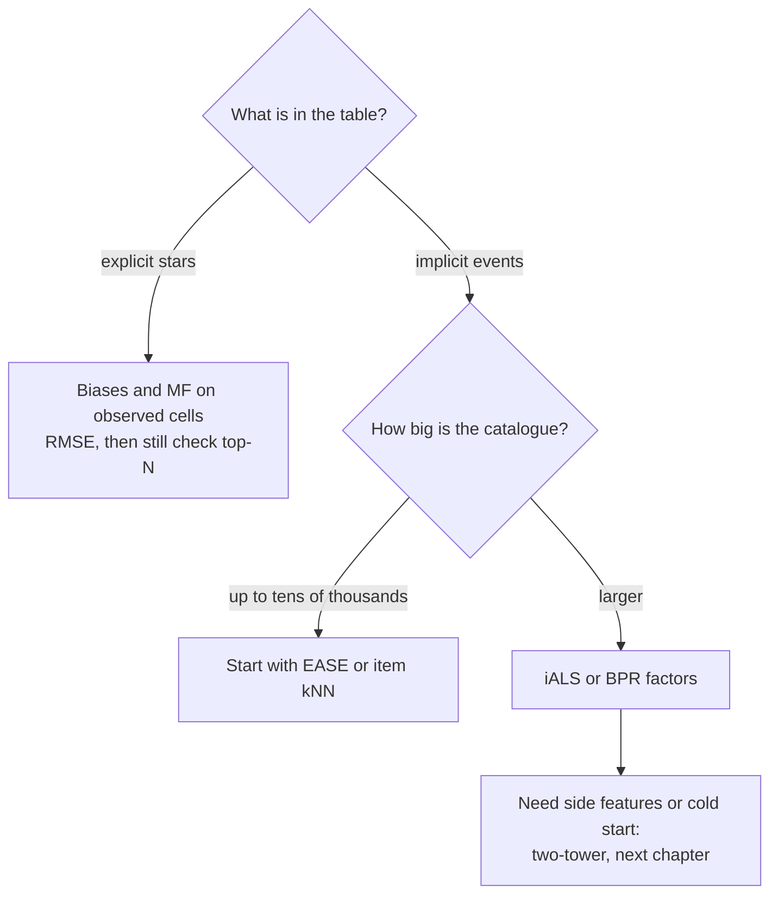

# Collaborative filtering and matrix factorisation

A recommender has to rank a large catalogue for each person from a table that is almost entirely empty, using only the traces other people left behind. Build it naively and you get a model that predicts ratings well and recommends badly, or one that scores beautifully offline only because the test set leaked the future. This chapter builds the classic family of methods on one small dataset, and shows that what you optimise and how you split matter more than which model you pick.

**In plain words.** A recommender is the "people who liked this also liked" shelf on a shopping or film site. It works like asking friends with similar taste what they enjoyed, except that most people have tried only a tiny part of the catalogue, so the table it learns from is nearly empty. At work the test is whether the few items at the top of the list are good ones, which is why a model that's excellent at guessing star ratings can still lose to a plain list of bestsellers.

The [classical ML pillar](../../01-classical-ml/notes/05-unsupervised-learning.md#recommender-systems-ng-ex8-part-2) introduced the collaborative filtering cost function through Andrew Ng's exercise. Here we go from that derivation to the question a working recommender has to answer: does the thing you trained put good items in the top ten?

The running example is [MovieLens 100K](https://grouplens.org/datasets/movielens/100k/) (Harper & Konstan, [*ACM TiiS*, 2015](https://doi.org/10.1145/2827872)): 100,000 ratings from 943 users on 1,682 films. Its licence allows research use and forbids redistribution, so the code downloads it from GroupLens and caches it outside the repo. It is small enough that everything below runs in under a minute on a laptop, which makes it a teaching dataset. Numbers from a dataset this size are a demonstration of method, and the rankings may not survive at scale. The next chapter keeps the same split and extends the same results table.

## The shape of the data

```python
import urllib.request, zipfile, time
from pathlib import Path
import numpy as np, pandas as pd
from scipy import sparse

CACHE = Path.home() / ".cache" / "learn-ai-engineering"
CACHE.mkdir(parents=True, exist_ok=True)
ZIP = CACHE / "ml-100k.zip"
if not ZIP.exists():
    ZIP.write_bytes(urllib.request.urlopen(
        "https://files.grouplens.org/datasets/movielens/ml-100k.zip", timeout=60).read())

with zipfile.ZipFile(ZIP) as z:
    ratings = pd.read_csv(z.open("ml-100k/u.data"), sep="\t", names=["user", "item", "rating", "ts"])
    items = pd.read_csv(z.open("ml-100k/u.item"), sep="|", encoding="latin-1", header=None,
                        usecols=[0, 1], names=["item", "title"])
title = items.set_index("item")["title"]
n_users, n_items = ratings.user.max() + 1, ratings.item.max() + 1
print(ratings.shape, "density %.1f%%" % (100 * len(ratings) / (ratings.user.nunique() * ratings.item.nunique())))
print(ratings.rating.value_counts().sort_index().to_dict())
pop = ratings.item.value_counts()
print("top 10%% of items hold %.0f%% of ratings" % (100 * pop.head(len(pop) // 10).sum() / len(ratings)))
```

```text
(100000, 4) density 6.3%
{1: 6110, 2: 11370, 3: 27145, 4: 34174, 5: 21201}
top 10% of items hold 43% of ratings
```

Two properties define the problem. The matrix is sparse, and this one is dense by the standards of the field: production systems see a far smaller fraction of user-item pairs. And attention is concentrated. A tenth of the films hold over two fifths of the ratings, so any evaluation will be dominated by what is already popular, and a model can look strong by recommending the same blockbusters to everyone.

Those ratings are not a random sample of opinions either. People choose what to watch and then choose what to rate, so the empty cells are not simply unknown. They carry information about taste, and that observation is what the implicit feedback methods below build on.

### Splitting without leaking the future

The honest setup is the one from the [previous chapter](01-time-series-ml.md): train on the past, test on the future. Try the obvious version first.

```python
# Attempt 1: one global cut in time, as a production system would see it.
cut = ratings.ts.quantile(0.8)
future = ratings[ratings.ts >= cut]
print("global cut: %d of %d future raters have any history" % (
    future.user[future.user.isin(ratings[ratings.ts < cut].user)].nunique(), future.user.nunique()))

# So split per user: each user's oldest 80% train, next 10% validate, newest 10% test.
ratings = ratings.sort_values(["user", "ts"])
frac = (ratings.groupby("user").cumcount() + 1) / ratings.groupby("user").user.transform("size")
train = ratings[frac <= 0.8]
valid = ratings[(frac > 0.8) & (frac <= 0.9)]
test = ratings[frac > 0.9]
print("train", len(train), "valid", len(valid), "test", len(test))
print("test items never seen in train: %.1f%% of test rows" % (100 * (~test.item.isin(train.item)).mean()))
```

```text
global cut: 109 of 301 future raters have any history
train 79619 valid 9942 test 10439
test items never seen in train: 0.5% of test rows
```

A global cut is the right idea and the wrong tool on this dataset, because MovieLens users tend to rate in one sitting: most of the people who rate after the cut have no history before it, so a collaborative model has nothing to go on. A per-user chronological split keeps the time order within each person and gives everyone some history. It is a compromise, since a test row for one user can be earlier in absolute time than a training row for another, so some global information does cross the boundary. On a real system, use a global cut. Here we take the compromise and name it.

## Predicting ratings: biases and matrix factorisation

The Netflix Prize framed recommendation as predicting the star rating, scored with root mean squared error. Most of the signal turns out not to be taste at all: some users rate high and some films are liked by everyone. A bias model captures this with one number per user and one per item, plus the global mean $\mu$:

$$\hat r_{ui} = \mu + b_u + b_i$$

Matrix factorisation adds an interaction: each user and each item gets a vector of $k$ latent factors, and their dot product says how well they fit. Koren, Bell and Volinsky ([*IEEE Computer*, 2009](https://doi.org/10.1109/MC.2009.263)) wrote the standard account of why this beat neighbourhood methods in the prize. Their reference points are worth remembering: Netflix's own system scored an RMSE of 0.9514 on the prize data, and the grand prize target was 0.8563.

$$\hat r_{ui} = \mu + b_u + b_i + p_u^\top q_i$$

```text
             items                         k factors       items
         [ 5 . 3 . . 1 ]               [ p_1 ]
 users   [ . 4 . . 2 . ]    is about   [ p_2 ]   x   [ q_1  q_2  q_3  q_4  q_5  q_6 ]
         [ 1 . . 5 . . ]               [ p_3 ]

 943 x 1682, 94% empty                 943 x k   x   k x 1682

 Fill any cell with a dot product: rating(u, i) = mean + b_u + b_i + p_u . q_i
 Fit only on the observed cells, with L2 on everything, or the factors memorise them.
```

Fit on observed cells only, by stochastic gradient descent. The loop below is the whole algorithm, deliberately in plain NumPy.

```python
def rmse(a, b): return float(np.sqrt(np.mean((np.asarray(a) - np.asarray(b)) ** 2)))

te = test[test.item.isin(train.item)]
mu = train.rating.mean()
print("predict the mean      RMSE %.4f" % rmse(te.rating, np.full(len(te), mu)))

def fit_biases(tr, reg=10.0, sweeps=10):
    bu, bi = np.zeros(n_users), np.zeros(n_items)
    for _ in range(sweeps):
        r = tr.rating.to_numpy() - mu - bu[tr.user]
        bi = np.bincount(tr.item, r, n_items) / (np.bincount(tr.item, minlength=n_items) + reg)
        r = tr.rating.to_numpy() - mu - bi[tr.item]
        bu = np.bincount(tr.user, r, n_users) / (np.bincount(tr.user, minlength=n_users) + reg)
    return bu, bi
bu, bi = fit_biases(train)
print("user + item biases    RMSE %.4f" % rmse(te.rating, mu + bu[te.user] + bi[te.item]))

def fit_mf(tr, k=20, lr=0.01, reg=0.05, epochs=30, seed=0):
    rng = np.random.default_rng(seed)
    P, Q = rng.normal(0, 0.1, (n_users, k)), rng.normal(0, 0.1, (n_items, k))
    bu_, bi_ = np.zeros(n_users), np.zeros(n_items)
    u, i, r = tr.user.to_numpy(), tr.item.to_numpy(), tr.rating.to_numpy(dtype=float)
    for ep in range(epochs):
        for j in rng.permutation(len(r)):
            a, b = u[j], i[j]
            e = r[j] - (mu + bu_[a] + bi_[b] + P[a] @ Q[b])
            bu_[a] += lr * (e - reg * bu_[a]); bi_[b] += lr * (e - reg * bi_[b])
            pa = P[a].copy()
            P[a] += lr * (e * Q[b] - reg * P[a]); Q[b] += lr * (e * pa - reg * Q[b])
    return P, Q, bu_, bi_

t0 = time.time()
P, Q, bu_mf, bi_mf = fit_mf(train)
pred_mf = mu + bu_mf[te.user] + bi_mf[te.item] + (P[te.user] * Q[te.item]).sum(1)
print("biased MF, k=20, SGD  RMSE %.4f  (%.0fs)" % (rmse(te.rating, pred_mf), time.time() - t0))
```

```text
predict the mean      RMSE 1.2290
user + item biases    RMSE 1.0147
biased MF, k=20, SGD  RMSE 0.9959  (11s)
```

The biases do most of the work: from the mean to the bias model RMSE falls by about 0.21, and the factors take off only about another 0.02. The size of that second step depends on the split. Ours is chronological, which is harder than the random holdout behind many published MovieLens numbers, so these figures will not match them.

The factors do mean something, which is why people were excited by them. Each film's vector places it near films liked by the same people, with no genre information in the model.

```python
def nearest(item_id, V, n=4):
    v = V / (np.linalg.norm(V, axis=1, keepdims=True) + 1e-9)
    sims = v @ v[item_id]
    known = np.bincount(train.item, minlength=n_items) >= 50       # ignore films with little evidence
    sims[~known] = -1; sims[item_id] = -1
    return [title[i] for i in np.argsort(-sims)[:n]]
for name in ["Star Wars (1977)", "Toy Story (1995)", "Fargo (1996)"]:
    print(name, "->", nearest(title[title == name].index[0], Q))
```

```text
Star Wars (1977) -> ['Empire Strikes Back, The (1980)', 'Return of the Jedi (1983)', 'Raiders of the Lost Ark (1981)', 'Sting, The (1973)']
Toy Story (1995) -> ['Amistad (1997)', 'Cinderella (1950)', 'Beauty and the Beast (1991)', 'Babe (1995)']
Fargo (1996) -> ['Big Night (1996)', 'High Noon (1952)', 'Leaving Las Vegas (1995)', 'Mighty Aphrodite (1995)']
```

## The metric that matters: top-N ranking

Nobody sees your RMSE. A person sees a short list, chosen from the whole catalogue, and the prediction error on films they happened to rate tells you little about it. The ratings a model is scored on are not a random sample of the catalogue, and the model never has to rank the things people ignored. Cremonesi, Koren and Turrin made this point in ["Performance of recommender algorithms on top-n recommendation tasks"](https://doi.org/10.1145/1864708.1864721) (RecSys 2010): algorithms tuned on RMSE do not necessarily do well at top-N, and non-personalised popularity can be surprisingly competitive.

So we measure ranking directly. Turn the problem into: of everything this user has not yet seen, which ten films go on the list? A test item counts as a hit if the user rated it 4 or 5. We report three numbers:

- **Recall@10**, the share of a user's relevant test items that reached the list, capped by how many could fit.
- **NDCG@10**, the same idea with more credit near the top.
- **Coverage**, the share of the catalogue that appears on anybody's list, because accuracy alone rewards showing everyone the same thing.

Popularity and random go in first, for the same reason the seasonal naive went first in the last chapter.

```python
pos = train[train.rating >= 4]
R = sparse.csr_matrix((np.ones(len(pos)), (pos.user, pos.item)), shape=(n_users, n_items))
seen = sparse.csr_matrix((np.ones(len(train)), (train.user, train.item)), shape=(n_users, n_items))
def positives(df): return df[df.rating >= 4].groupby("user").item.apply(set).to_dict()
truth_test, truth_valid = positives(test), positives(valid)
print("users with a test positive:", len(truth_test))

def evaluate(score_fn, truth=truth_test, k=10):
    """score_fn(users) -> matrix of scores. Rank the entire catalogue minus what the user has seen."""
    users = np.array(sorted(truth))
    S = np.asarray(score_fn(users), dtype=float).copy()
    S[seen[users].nonzero()] = -np.inf
    S[:, 0] = -np.inf                                   # item ids start at 1
    top = np.argpartition(-S, k, axis=1)[:, :k]
    top = np.take_along_axis(top, np.argsort(-np.take_along_axis(S, top, 1), axis=1), 1)
    disc = 1 / np.log2(np.arange(2, k + 2)); rec, ndcg, shown = [], [], set()
    for row, u in zip(top, users):
        hits = np.array([i in truth[u] for i in row], dtype=float); m = min(k, len(truth[u]))
        rec.append(hits.sum() / m); ndcg.append((hits * disc).sum() / disc[:m].sum()); shown.update(row.tolist())
    return dict(recall=np.mean(rec), ndcg=np.mean(ndcg), coverage=len(shown) / (n_items - 1))

table = {}
counts = np.asarray(R.sum(0)).ravel()
table["popularity"] = evaluate(lambda us: np.tile(counts, (len(us), 1)))
rng = np.random.default_rng(0)
table["random"] = evaluate(lambda us: rng.random((len(us), n_items)))
table["MF on ratings"] = evaluate(lambda us: mu + bu_mf[us, None] + bi_mf[None, :] + P[us] @ Q.T)
print(pd.DataFrame(table).T.round(4))

def median_list_popularity(score_fn, k=10):
    """How many training positives does the median film on these lists have?"""
    us = np.array(sorted(truth_test)); S = np.asarray(score_fn(us), dtype=float).copy()
    S[seen[us].nonzero()] = -np.inf; S[:, 0] = -np.inf
    return np.median(counts[np.argpartition(-S, k, axis=1)[:, :k]])
print("median training positives per listed film: popularity %.0f, MF on ratings %.0f" % (
    median_list_popularity(lambda us: np.tile(counts, (len(us), 1))),
    median_list_popularity(lambda us: mu + bu_mf[us, None] + bi_mf[None, :] + P[us] @ Q.T)))
```

```text
users with a test positive: 861
               recall    ndcg  coverage
popularity     0.0900  0.0752    0.0446
random         0.0054  0.0049    0.9952
MF on ratings  0.0428  0.0340    0.2140
median training positives per listed film: popularity 262, MF on ratings 90
```

This is the central result of the chapter. The matrix factorisation model that was the best of the three on RMSE recommends worse than a list of the most popular films, with less than half of popularity's NDCG. It was never asked to rank unrated films, and when it does, it reaches for much less popular ones, as the last line shows: the median film on its lists has 90 training positives against 262 for popularity, so its scores rest on far less data. It is not broken. It is answering a different question from the one you are now asking.

## Neighbourhoods: item-based filtering

"People who liked this also liked that" is the oldest idea here, and it remains a serious method. Sarwar and colleagues ([WWW 2001](https://doi.org/10.1145/371920.372071)) made the case for comparing items instead of users: relationships between items change slowly enough to precompute, which scales, and on their MovieLens experiments quality also beat the user-based methods of the day. Compute a similarity between each pair of items from their co-occurrence, keep each item's strongest neighbours, and score an unseen item by summing similarities to what the user liked. The shrink term stops two rare items with one shared fan from looking identical.

## A linear model with a closed form

If similarity computed from co-occurrence works, learn the item-item matrix $B$ by regression instead: predict each column of the user-item matrix from the other columns. EASE (Steck, [WWW 2019](https://arxiv.org/abs/1905.03375)) is this model with L2 regularisation and one crucial constraint, inherited from SLIM: the diagonal of $B$ must be zero, or each item would simply predict itself. The constrained problem has a closed-form solution from the inverse of the regularised Gram matrix, so training is one matrix inversion. Steck reports it beating deep models on most of the public datasets in that paper.

$$\hat B_{ij} = -\frac{P_{ij}}{P_{jj}} \;\;(i \ne j), \qquad \hat B_{jj} = 0, \qquad P = (R^\top R + \lambda I)^{-1}$$

Both fit in a few lines. We pick $\lambda$ on the validation users' future, never on the test set.

```python
def fit_item_knn(R, k=50, shrink=10.0):
    C = (R.T @ R).toarray().astype(float)          # co-occurrence
    d = np.sqrt(np.diag(C)); np.fill_diagonal(C, 0)
    S = C / (np.outer(d, d) + shrink)              # shrunk cosine
    for j in range(S.shape[1]):                    # keep the k strongest neighbours per item
        col = S[:, j]; col[np.argsort(col)[:-k]] = 0
    return S
Sk = fit_item_knn(R)
table["item kNN"] = evaluate(lambda us: R[us] @ Sk)

def fit_ease(R, lam=100.0):
    G = (R.T @ R).toarray().astype(float)
    G[np.diag_indices_from(G)] += lam
    Pm = np.linalg.inv(G)
    B = -Pm / np.diag(Pm)
    np.fill_diagonal(B, 0)
    return B
for lam in (30, 100, 300, 1000):
    print("EASE lambda %4d  validation ndcg %.4f" % (lam, evaluate(lambda us: R[us] @ fit_ease(R, lam), truth_valid)["ndcg"]))
t0 = time.time(); B = fit_ease(R, 100.0); print("EASE fit %.2fs" % (time.time() - t0))
table["EASE"] = evaluate(lambda us: R[us] @ B)
print(pd.DataFrame(table).T.round(4))
```

```text
EASE lambda   30  validation ndcg 0.1378
EASE lambda  100  validation ndcg 0.1406
EASE lambda  300  validation ndcg 0.1374
EASE lambda 1000  validation ndcg 0.1337
EASE fit 0.04s
               recall    ndcg  coverage
popularity     0.0900  0.0752    0.0446
random         0.0054  0.0049    0.9952
MF on ratings  0.0428  0.0340    0.2140
item kNN       0.1369  0.1140    0.2271
EASE           0.1550  0.1259    0.2235
```

Two lines of linear algebra beat everything so far, and fit in well under a second. The inverse costs cubic time in the number of items, so EASE fits catalogues in the tens of thousands, not millions. That limit, more than accuracy, is what pushes large systems towards the factor models.

## Implicit feedback

Most real data has no stars, only clicks, plays and purchases. Hu, Koren and Volinsky ([ICDM 2008](https://doi.org/10.1109/ICDM.2008.22)) named the two things that make this different. There is no negative signal, because not watching something could mean disinterest or never having seen it. And the observation count measures confidence in a preference, not its strength. Their model binarises the target and weights each cell by confidence, $c_{ui} = 1 + \alpha r_{ui}$. Every cell is now in the loss, including the empty ones, which sounds intractable but is not: alternating least squares has a closed form for each user given the items, and the empty cells collapse into one shared matrix.

BPR takes the other route to the same concern (Rendle et al., [UAI 2009](https://arxiv.org/abs/1205.2618)). Rather than predicting cell values, it optimises the order directly: for a user, a seen item should score above an unseen one. It samples these triples and takes a gradient step on each, and the authors show that the criterion relates to optimising AUC.



```python
def fit_ials(R, k=40, alpha=1.0, reg=5.0, sweeps=15, seed=0):
    rng = np.random.default_rng(seed)
    U, V = rng.normal(0, 0.1, (n_users, k)), rng.normal(0, 0.1, (n_items, k))
    Rc, Rt = R.tocsr(), R.T.tocsr()
    I = np.eye(k) * reg
    def sweep(X, Y, M):
        YtY = Y.T @ Y                                      # the empty cells, all at once
        for a in range(X.shape[0]):
            idx = M[a].indices
            if len(idx) == 0: continue
            Yi = Y[idx]
            A = YtY + alpha * Yi.T @ Yi + I                # c = 1 + alpha on observed, 1 elsewhere
            X[a] = np.linalg.solve(A, (1 + alpha) * Yi.sum(0))
    for _ in range(sweeps):
        sweep(U, V, Rc); sweep(V, U, Rt)
    return U, V
for a_, r_ in [(1, 5), (10, 10), (40, 20), (40, 100)]:
    Ux, Vx = fit_ials(R, alpha=a_, reg=r_, sweeps=8)
    print("iALS alpha %2d reg %3d validation ndcg %.4f" % (a_, r_, evaluate(lambda us: Ux[us] @ Vx.T, truth_valid)["ndcg"]))
U, V = fit_ials(R)
table["implicit ALS"] = evaluate(lambda us: U[us] @ V.T)

def fit_bpr(R, k=40, lr=0.05, reg=0.002, epochs=40, seed=0):
    rng = np.random.default_rng(seed)
    U, V = rng.normal(0, 0.1, (n_users, k)), rng.normal(0, 0.1, (n_items, k))
    b = np.zeros(n_items)
    us, its = R.nonzero(); seen_set = set(zip(us.tolist(), its.tolist()))
    for ep in range(epochs):
        for j in rng.permutation(len(us)):
            u, i = us[j], its[j]
            while True:
                n = rng.integers(1, n_items)
                if (u, n) not in seen_set: break
            g = 1 / (1 + np.exp(U[u] @ (V[i] - V[n]) + b[i] - b[n]))
            b[i] += lr * (g - reg * b[i]); b[n] += lr * (-g - reg * b[n])
            ui = U[u].copy()
            U[u] += lr * (g * (V[i] - V[n]) - reg * U[u])
            V[i] += lr * (g * ui - reg * V[i]); V[n] += lr * (-g * ui - reg * V[n])
    return U, V, b
t0 = time.time(); Ub, Vb, bb = fit_bpr(R); print("BPR %.0fs" % (time.time() - t0))
table["BPR"] = evaluate(lambda us: Ub[us] @ Vb.T + bb)
print(pd.DataFrame(table).T.sort_values("ndcg", ascending=False).round(4))
```

```text
iALS alpha  1 reg   5 validation ndcg 0.1348
iALS alpha 10 reg  10 validation ndcg 0.1302
iALS alpha 40 reg  20 validation ndcg 0.1113
iALS alpha 40 reg 100 validation ndcg 0.1305
BPR 14s
               recall    ndcg  coverage
EASE           0.1550  0.1259    0.2235
item kNN       0.1369  0.1140    0.2271
implicit ALS   0.1380  0.1117    0.2515
BPR            0.1257  0.0992    0.3080
popularity     0.0900  0.0752    0.0446
MF on ratings  0.0428  0.0340    0.2140
random         0.0054  0.0049    0.9952
```

Look at the validation lines. Hu and colleagues found $\alpha = 40$ worked well on their television viewing data, where $r_{ui}$ counted how much of a programme someone watched. Here the input is binary and the same setting scores worst of the four. A published hyperparameter is a fact about somebody else's data, so grid search it on your own.

Now read the final table. Every personalised method that targets ranking beats popularity, the implicit factor models offer more coverage, and on this data the two simplest learned models, EASE and item kNN, lead on NDCG. That matches a pattern you should expect, and the literature is blunt about it.

## The reproducibility warning

Dacrema, Cremonesi and Jannach ([RecSys 2019](https://arxiv.org/abs/1907.06902)) tried to reproduce 18 top-n recommendation algorithms recently published at top conferences. Only 7 could be reproduced with reasonable effort, 6 of those were often beaten by simple heuristic methods such as nearest neighbours, and the last did not consistently beat a well-tuned linear method. Rendle and colleagues ([RecSys 2020](https://arxiv.org/abs/2005.09683)) went after one of the most cited ideas in the area, the claim in Neural Collaborative Filtering (He et al., [WWW 2017](https://arxiv.org/abs/1708.05031)) that a learned MLP is a better similarity function than a dot product. With proper tuning, the plain dot product substantially beat the MLP, a universal approximator struggled to learn something as simple as a dot product, and it was also far more expensive to serve.

You should take from this a working habit more than a verdict on deep learning. Put popularity, kNN and EASE in every table, tune them with the same care as your favourite model, and be suspicious of any gain that vanishes when you do.

## Practice

| Lab | Covers | Runs |
|---|---|---|
| [`music-clustering-lab`](../../01-classical-ml/practice/music-clustering-lab/README.md) | The content-based side: audio and genre features, clusters as a candidate filter and a per-playlist reranker, for items with no interactions yet | Needs internet once to fetch its data; about a minute with `scikit-learn`, `lightgbm`, `pandas`, `pyarrow`, `matplotlib`, `scipy` |

## Pitfalls

- **Optimising RMSE and shipping a list.** The table above is the demonstration: best RMSE, worse than popularity on top-10. Score what the product shows.
- **Random holdout on interaction data.** Shuffling lets the model see the future. Exercise 1 shows EASE more than doubling its NDCG this way. Use time.
- **Ranking only a sample of items.** Offline metrics computed on 99 random negatives can disagree with the real ranking, and the next chapter measures it.
- **Treating empty cells as dislikes, or ignoring them.** Both are wrong. Weight them low, sample them, or use a closed form that accounts for them.
- **Not removing seen items at evaluation.** A model that re-recommends what you already rated looks either terrible or suspiciously good, depending on the setup.
- **Copying hyperparameters.** Hu's $\alpha = 40$ is the case above.
- **Tuning on the test set.** Everything here is picked on `valid`, because with a handful of candidates the test set quickly becomes a training set.
- **Accuracy without coverage.** A model with a high NDCG and a coverage of 4% is a bestseller list. Report both.
- **Popularity feedback.** Logs come from the previous recommender, so popular things get shown, clicked, and shown again. The next chapter addresses this.

## Try it

The lab [`practice/02_cf_lab.py`](../practice/02_cf_lab.py) reuses this chapter's split. Run it from this pillar's folder:

```bash
uv run --with numpy --with pandas --with scipy python practice/02_cf_lab.py
```

1. **Leak the future.** Refit EASE on a random 90/10 split and compare with the chronological NDCG of about 0.126. How much of the difference is skill?

<details><summary>Answer</summary>

EASE reaches NDCG 0.309 and recall 0.350 on the random split, about two and a half times the chronological figures. None of that is skill, since it is the same model and the same data. Random holdout hides a film from the middle of someone's single rating session, where its neighbours are in training, whereas the chronological split asks about what comes next. Popularity also jumps, from 0.075 to 0.135, so the easier task lifts every row.

</details>

2. **Keep the bad ratings.** Train EASE on every rating, including ones and twos, rather than only fours and fives, and keep the test definition. Should a 1-star rating count as interest?

<details><summary>Answer</summary>

NDCG falls from 0.126 to 0.116, with coverage rising from 0.22 to 0.28. A low rating says the person chose to watch the film and did not like it, so it is partly a signal of what they watch and partly a signal against it. Dropping low ratings helps here, by a modest amount. On many real logs you have no such choice, because the only signal is that an event occurred.

</details>

3. **Who benefits?** Split test users at the median length of their training history. Compare EASE and popularity for each group. Which group gets the larger lift?

<details><summary>Answer</summary>

Light users gain more: NDCG goes from 0.061 with popularity to 0.131 with EASE. Heavy users go from 0.090 to 0.121. Heavy users have already seen most of the popular films, which get removed from their lists, and they are also harder to surprise. Averages across all users hide this, so break metrics down by segment before you claim a win.

</details>

## Interview checklist

| Question | Short answer |
|---|---|
| Explicit versus implicit feedback? | Explicit is a stated rating. Implicit is behaviour: there is no negative signal, and counts express confidence and not preference. |
| Write the biased MF prediction. | $\mu + b_u + b_i + p_u^\top q_i$, fitted on observed cells with L2, by SGD or ALS. |
| Why do biases matter so much? | Much of the rating variance is user and item offset. In our table they account for most of the RMSE gain. |
| Why can low RMSE give poor recommendations? | RMSE is scored on the items people chose to rate. A list must rank everything, including items the model never saw constraints for. Here MF scored below popularity. |
| What is iALS? | Implicit MF with confidence $c_{ui} = 1 + \alpha r_{ui}$ across all cells, solved by alternating closed forms, which stays tractable because the empty cells share one Gram matrix. |
| What does BPR optimise? | Pairwise order: a user's seen item above an unseen one, sampled by triples, related to AUC. |
| What is EASE, and why the zero diagonal? | A linear item-item model with a closed form via one matrix inverse. Without the zero diagonal each item would just predict itself. |
| Item-based or user-based kNN? | Usually item-based: item relationships change slowly enough to precompute, so it scales, and Sarwar et al. (2001) also measured better quality on MovieLens. |
| What did Dacrema et al. find? | Of 18 algorithms, 7 reproducible; 6 of those often lost to simple heuristics, and the remaining one did not consistently beat a tuned linear method. |
| How should you split interaction data? | By time. A global cut is closest to production. A per-user chronological split is a compromise when users have short active periods. |

## Next

These models ignore everything except the interaction matrix, so they cannot handle a new film, and they say nothing about whether a real person would click. The next chapter covers both: [two-tower retrieval and offline and online evaluation](03-two-tower-and-evaluation.md).
