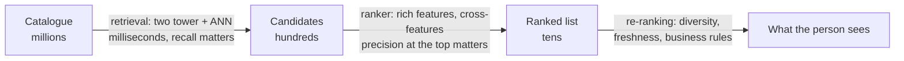
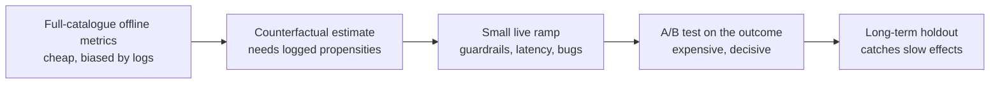

# Two-tower retrieval and offline and online evaluation

Once a catalogue reaches millions of items and new ones arrive every hour, an item-item matrix no longer fits and a new item has no history to work from. A two-tower model solves both by learning embeddings from features, but the same sampling that makes it trainable quietly biases it against popular items. Then comes the harder question of how you know any recommender works at all, since an offline score can flip when you change how it is computed and a real test needs millions of users.

**In plain words.** A big site can't score every item for every visitor, so it works like a shop assistant who first grabs a handful from the stockroom and then picks the best few to show you. A two-tower model is that first grab: it describes people and items from their details, which also lets it handle a brand-new film nobody has watched yet. The second half of the chapter is about proving it works, because the firm answer only comes from showing it to real customers alongside the old version and comparing what they do.

The [previous chapter](02-collaborative-filtering-and-matrix-factorisation.md) ended with EASE on top of the results table. This chapter adds two towers to the same table, on the same split, then spends its second half on evaluation. We repeat the setup so that the chapter runs by itself.

```python
import urllib.request, zipfile, time
from math import ceil
from pathlib import Path
import numpy as np, pandas as pd
import torch
from torch import nn
from scipy import sparse

CACHE = Path.home() / ".cache" / "learn-ai-engineering"
CACHE.mkdir(parents=True, exist_ok=True)
ZIP = CACHE / "ml-100k.zip"
if not ZIP.exists():
    ZIP.write_bytes(urllib.request.urlopen(
        "https://files.grouplens.org/datasets/movielens/ml-100k.zip", timeout=60).read())

genre_cols = [f"g{i}" for i in range(19)]
with zipfile.ZipFile(ZIP) as z:
    ratings = pd.read_csv(z.open("ml-100k/u.data"), sep="\t", names=["user", "item", "rating", "ts"])
    items = pd.read_csv(z.open("ml-100k/u.item"), sep="|", encoding="latin-1", header=None,
                        names=["item", "title", "date", "video", "url"] + genre_cols)
    users = pd.read_csv(z.open("ml-100k/u.user"), sep="|", header=None,
                        names=["user", "age", "gender", "occupation", "zip"])
n_users, n_items = ratings.user.max() + 1, ratings.item.max() + 1

ratings = ratings.sort_values(["user", "ts"])
frac = (ratings.groupby("user").cumcount() + 1) / ratings.groupby("user").user.transform("size")
train, valid, test = ratings[frac <= 0.8], ratings[(frac > 0.8) & (frac <= 0.9)], ratings[frac > 0.9]
pos = train[train.rating >= 4]
R = sparse.csr_matrix((np.ones(len(pos)), (pos.user, pos.item)), shape=(n_users, n_items))
seen = sparse.csr_matrix((np.ones(len(train)), (train.user, train.item)), shape=(n_users, n_items))
def positives(df): return df[df.rating >= 4].groupby("user").item.apply(set).to_dict()
truth_test, truth_valid = positives(test), positives(valid)

def evaluate(score_fn, truth=truth_test, k=10):
    us = np.array(sorted(truth))
    S = np.asarray(score_fn(us), dtype=float).copy()
    S[seen[us].nonzero()] = -np.inf
    S[:, 0] = -np.inf                                   # item ids start at 1
    top = np.argpartition(-S, k, axis=1)[:, :k]
    top = np.take_along_axis(top, np.argsort(-np.take_along_axis(S, top, 1), axis=1), 1)
    disc = 1 / np.log2(np.arange(2, k + 2)); rec, ndcg, shown = [], [], set()
    for row, u in zip(top, us):
        hits = np.array([i in truth[u] for i in row], dtype=float); m = min(k, len(truth[u]))
        rec.append(hits.sum() / m); ndcg.append((hits * disc).sum() / disc[:m].sum()); shown.update(row.tolist())
    return dict(recall=np.mean(rec), ndcg=np.mean(ndcg), coverage=len(shown) / (n_items - 1))

def fit_ease(R, lam=100.0):
    G = (R.T @ R).toarray().astype(float); G[np.diag_indices_from(G)] += lam
    Pm = np.linalg.inv(G); B = -Pm / np.diag(Pm); np.fill_diagonal(B, 0)
    return B
counts = np.asarray(R.sum(0)).ravel()
B = fit_ease(R)
table = {"popularity": evaluate(lambda us: np.tile(counts, (len(us), 1))),
         "EASE": evaluate(lambda us: R[us] @ B)}
print(pd.DataFrame(table).T.round(4))
```

```text
            recall    ndcg  coverage
popularity   0.090  0.0752    0.0446
EASE         0.155  0.1259    0.2235
```

## Why large systems retrieve first

You cannot run a heavy model over ten million items for each page view. So a large recommender is a funnel. Candidate generation narrows the catalogue cheaply to a few hundred, and a ranker that can afford rich features and cross-features orders those. Covington, Adams and Sargin set out this shape for YouTube ([RecSys 2016](https://doi.org/10.1145/2959100.2959190)). Their paper is also the source of several lessons that have outlived its architecture: the "example age" feature that lets a model favour fresh content, and the warning that the surrogate problem you train on matters as much as the model.



Retrieval is judged on recall, since anything it drops can never be recovered downstream. Ranking is judged on precision near the top. That split explains the odd thing about two towers. The model cannot use any feature that crosses user and item, which would be a weakness in a ranker, and that restriction is what makes it fast at retrieval. In the cells of the [confusion matrix](../../01-classical-ml/notes/04-model-evaluation.md#confusion-matrix-precision-recall-f1), an item retrieval drops is a false negative, which recall counts, and a poor item near the top of the list is a false positive, which precision counts. [Choosing a metric](../../01-classical-ml/notes/11-choosing-a-metric.md#ranking-the-table-swept-along-the-list) treats ranking as that table swept along the list, and [Reading the errors](../../01-classical-ml/notes/12-reading-the-errors.md#the-same-habit-in-retrieval-judges-and-traces) reads what lands in each cell.

## The two-tower model

Two networks run side by side. One turns user features into a vector, the other turns item features into a vector, and the score is their [dot product](../../03-nlp/notes/04-embeddings-and-similarity.md#similarity-and-distance). Because the towers never see each other's inputs, you can compute all item vectors once, in batch, put them in an approximate nearest neighbour index, and at request time compute only one user vector and ask for its neighbours. That one structural choice takes serving from "score everything" to "one forward pass and one index lookup". The [vector database chapter](../../../generative-ai/02-rag-retrieval/notes/04-vector-databases-and-ann.md) covers the same index machinery for documents.

Matrix factorisation is the special case where each tower is an embedding lookup on an id. The gain is that a tower can take anything: here genres and release year for a film, age, gender and occupation for a user.

```python
items["year"] = pd.to_datetime(items["date"], errors="coerce").dt.year.fillna(1995)
item_feat = np.zeros((n_items, 20), dtype="float32")
item_feat[items.item, :19] = items[genre_cols].to_numpy(dtype="float32")
item_feat[items.item, 19] = (items["year"] - 1990) / 10
occ = users.occupation.astype("category").cat.codes.to_numpy()
user_num = np.zeros((n_users, 2), dtype="float32")
user_num[users.user, 0] = users.age / 50; user_num[users.user, 1] = (users.gender == "M")
user_occ = np.zeros(n_users, dtype="int64"); user_occ[users.user] = occ + 1

class TwoTower(nn.Module):
    def __init__(self, dim=64):
        super().__init__()
        self.uid = nn.Embedding(n_users, dim); self.iid = nn.Embedding(n_items, dim)
        self.occ = nn.Embedding(user_occ.max() + 1, 8)
        self.user_mlp = nn.Sequential(nn.Linear(dim + 8 + 2, 128), nn.ReLU(), nn.Linear(128, dim))
        self.item_mlp = nn.Sequential(nn.Linear(dim + 20, 128), nn.ReLU(), nn.Linear(128, dim))
        self.uf, self.uo = torch.tensor(user_num), torch.tensor(user_occ)
        self.itf = torch.tensor(item_feat)
    def user(self, u):
        x = torch.cat([self.uid(u), self.occ(self.uo[u]), self.uf[u]], 1)
        return nn.functional.normalize(self.user_mlp(x), dim=1)
    def item(self, i):
        x = torch.cat([self.iid(i), self.itf[i]], 1)
        return nn.functional.normalize(self.item_mlp(x), dim=1)
```

## Training: in-batch softmax and its bias

What should the loss be? We want the positive item to outscore everything else, and a [softmax](../../02-deep-learning/notes/01-neural-networks-fundamentals.md#the-forward-pass) over ten million items for each example is out of the question. The standard trick is to use the other items in the batch as the negatives. A batch of 512 pairs gives a 512 by 512 score matrix whose diagonal holds the positives, and [cross-entropy](../../../generative-ai/01-llm-fundamentals/notes/06-pretraining-data-and-objectives.md#entropy-cross-entropy-kl-and-perplexity) over each row does the rest.

There is a catch. Items enter a batch in proportion to how often they appear in the data, so popular items are also the most frequent negatives. The model learns to push them down, which it should not: a blockbuster gets penalised for being common, not for being a poor match. Yi and colleagues ([RecSys 2019](https://research.google/pubs/sampling-bias-corrected-neural-modeling-for-large-corpus-item-recommendations/)) give the correction, which comes from importance sampling. Subtract the log of each candidate's sampling probability from its logit during training:

$$s^c(x, y_j) = s(x, y_j) - \log p_j$$

Their paper also estimates $p_j$ from a stream, normalises embeddings with L2, and divides by a temperature $\tau$, all of which we use, computing $p_j$ from training frequencies since our data fits in memory. On Wikipedia with 5.3 million pages they report Recall@10 going from 0.0643 to 0.1065 with the correction at $\tau = 0.07$, and they deployed the system on YouTube with live A/B tests. Khrylchenko and colleagues ([arXiv:2507.09331](https://arxiv.org/abs/2507.09331)) have since argued that the standard derivation does not treat the positive correctly, so the details of the correction are still moving.

```python
def train_tower(pairs, logq=True, tau=0.2, epochs=30, bs=512, lr=2e-3, wd=1e-5, seed=0, model_cls=TwoTower):
    torch.manual_seed(seed); np.random.seed(seed)
    m = model_cls(); opt = torch.optim.Adam(m.parameters(), lr=lr, weight_decay=wd)
    u, i = torch.tensor(pairs.user.to_numpy()), torch.tensor(pairs.item.to_numpy())
    freq = np.bincount(pairs.item, minlength=n_items) / len(pairs)
    logp = torch.tensor(np.log(np.maximum(freq, 1e-9)), dtype=torch.float32)
    for ep in range(epochs):
        m.train()
        for b in torch.randperm(len(u)).split(bs):
            logits = m.user(u[b]) @ m.item(i[b]).T / tau
            if logq:
                logits = logits - logp[i[b]]                # correct every in-batch item by its frequency
            same = i[b][:, None] == i[b][None, :]           # a duplicate of the positive is not a negative
            same.fill_diagonal_(False)
            logits = logits.masked_fill(same, -1e9)
            loss = nn.functional.cross_entropy(logits, torch.arange(len(b)))
            opt.zero_grad(); loss.backward(); opt.step()
    return m.eval()

def tower_scores(m):
    with torch.no_grad():
        V = m.item(torch.arange(n_items))
    def f(us):
        with torch.no_grad():
            return (m.user(torch.tensor(us)) @ V.T).numpy()
    return f

for tau in (0.1, 0.2, 0.5):
    r = evaluate(tower_scores(train_tower(pos, logq=True, tau=tau)), truth_valid)
    print("logQ on, tau %.2f validation ndcg %.4f" % (tau, r["ndcg"]))
best = train_tower(pos, logq=True, tau=0.2)
plain = train_tower(pos, logq=False, tau=0.2)
table["two-tower, in-batch softmax"] = evaluate(tower_scores(plain))
table["two-tower, logQ corrected"] = evaluate(tower_scores(best))
print(pd.DataFrame(table).T.round(4))

V = best.item(torch.arange(1, n_items)).detach().numpy()
t0 = time.time(); _ = best.user(torch.arange(1, n_users)).detach().numpy() @ V.T
print("score %d users against %d items by brute force: %.3fs" % (n_users - 1, n_items - 1, time.time() - t0))
```

```text
logQ on, tau 0.10 validation ndcg 0.1122
logQ on, tau 0.20 validation ndcg 0.1258
logQ on, tau 0.50 validation ndcg 0.1134
                             recall    ndcg  coverage
popularity                   0.0900  0.0752    0.0446
EASE                         0.1550  0.1259    0.2235
two-tower, in-batch softmax  0.0532  0.0382    0.8591
two-tower, logQ corrected    0.1413  0.1095    0.3062
score 943 users against 1682 items by brute force: 0.001s
```

The correction takes the tower from below popularity to close to EASE, and it is one line. The uncorrected model's coverage shows what the bias does: it spreads recommendations across most of the catalogue, because it has been taught that being popular is bad. Two honest caveats. EASE still wins here, on a small dataset with a small catalogue, which is its home ground, so the tower's advantage must come from what follows. And the tower has more knobs than anything in the last chapter, so it took more tuning to get this far.

Scoring 943 users against 1,682 items takes a millisecond, so we do not need an index on this data. At millions of items you would use approximate nearest neighbours and report the recall you lose to it.

## Cold start

A new film has no ratings, so EASE, kNN and factorisation can only guess. A tower can still embed it from its features, provided it learned not to lean entirely on the id. We simulate this by hiding 10% of the films from training altogether, randomly dropping item ids during training so the network learns to work without them, and then asking each model to rank only the hidden films.

```python
rng = np.random.default_rng(0)
cold = rng.choice(np.arange(1, n_items), size=(n_items - 1) // 10, replace=False)
is_cold = np.zeros(n_items, bool); is_cold[cold] = True
warm_pos = pos[~is_cold[pos.item]]

class ColdTower(TwoTower):
    """Item id is dropped with probability 0.3 in training and always dropped for cold items."""
    def item(self, i):
        z = self.iid(i)
        if self.training:
            z = z * (torch.rand(len(i), 1) > 0.3)
        z = z * torch.tensor(~is_cold[i.numpy()])[:, None]
        return nn.functional.normalize(self.item_mlp(torch.cat([z, self.itf[i]], 1)), dim=1)

ct = train_tower(warm_pos, logq=True, tau=0.2, model_cls=ColdTower)
cold_truth = {u: s & set(cold.tolist()) for u, s in truth_test.items()}
cold_truth = {u: s for u, s in cold_truth.items() if s}
print("users with a positive among the hidden items:", len(cold_truth))
def cold_only(score_fn):
    def f(us):
        S = np.asarray(score_fn(us), dtype=float).copy(); S[:, ~is_cold] = -np.inf; return S
    return f
show = lambda r: "recall %.3f  ndcg %.3f" % (r["recall"], r["ndcg"])
print("tower on features only:", show(evaluate(cold_only(tower_scores(ct)), cold_truth)))
print("random among cold items:", show(evaluate(cold_only(lambda us: rng.random((len(us), n_items))), cold_truth)))
Rw = sparse.csr_matrix((np.ones(len(warm_pos)), (warm_pos.user, warm_pos.item)), shape=(n_users, n_items))
Bw = fit_ease(Rw)
print("EASE on the cold items:", show(evaluate(cold_only(lambda us: Rw[us] @ Bw + rng.random((len(us), n_items)) * 1e-9), cold_truth)))
```

```text
users with a positive among the hidden items: 340
tower on features only: recall 0.220  ndcg 0.116
random among cold items: recall 0.082  ndcg 0.039
EASE on the cold items: recall 0.079  ndcg 0.039
```

EASE's score for an item it never saw is zero everywhere, so all it has is the random tiebreak, and it matches random. The tower, with only genre and year to go on, does much better. This is the reason to accept its extra complexity. Those features are thin, so richer content such as a text embedding from [LLM embeddings as features](../../03-nlp/notes/07-llm-embeddings-as-features.md) would feed the same slot.

## Offline evaluation: sampled metrics

Ranking every item for every user gets expensive, so for years papers ranked each test positive against 99 random negatives and reported the hit rate. Krichene and Rendle (["On Sampled Metrics for Item Recommendation"](https://research.google/pubs/on-sampled-metrics-for-item-recommendation/), KDD 2020) showed that this is not a noisy version of the true metric, it is a different metric. Sampled metrics are inconsistent with the exact ones: model A can beat B on the full ranking and lose on the sample, even in expectation, and as the sample shrinks all metrics collapse towards AUC. Their advice is to avoid sampling at evaluation time, or to apply a correction if you must. We can reproduce the effect directly on this data.

```python
def hit_rates(score_fn, n_neg=99, k=10, seed=0):
    rng = np.random.default_rng(seed); us = np.array(sorted(truth_test)); S = np.asarray(score_fn(us), dtype=float)
    full, sampled = [], []
    for row, u in enumerate(us):
        sn = set(seen[u].indices)
        cand = np.array([i for i in range(1, n_items) if i not in sn and i not in truth_test[u]])
        for p in truth_test[u]:
            neg = rng.choice(cand, n_neg, replace=False)
            full.append((S[row, cand] > S[row, p]).sum() < k)
            sampled.append((S[row, neg] > S[row, p]).sum() < k)
    return np.mean(full), np.mean(sampled)
models = {"popularity": lambda us: np.tile(counts, (len(us), 1)), "EASE": lambda us: R[us] @ B,
          "two-tower logQ": tower_scores(best), "two-tower plain": tower_scores(plain)}
print("%-20s %10s %14s" % ("model", "full HR@10", "sampled HR@10"))
for name, f in models.items():
    print("%-20s %10.4f %14.4f" % ((name,) + hit_rates(f)))
```

```text
model                full HR@10  sampled HR@10
popularity               0.0904         0.5029
EASE                     0.1366         0.5911
two-tower logQ           0.1248         0.6173
two-tower plain          0.0379         0.3260
```

Two things stand out. The sampled numbers are about four to nine times higher, so a reader would conclude that the models are far better than they are. And the order changes: EASE beats the corrected tower on the full ranking and loses on the sampled one. Had this comparison been made on the sampled metric, we would have picked the other model. With a modern laptop and a retrieval index, there is rarely a reason to accept this.

The table above counts hits. **Mean reciprocal rank** (MRR) asks a narrower question: how far down the list is the first thing this user liked? Each user scores $1/\text{rank}$ of their best-placed relevant item, so it ignores everything after that. Here it is alongside the recall and NDCG from the full ranking.

```python
def mrr(score_fn, truth=truth_test):
    us = np.array(sorted(truth))
    S = np.asarray(score_fn(us), dtype=float).copy()
    S[seen[us].nonzero()] = -np.inf; S[:, 0] = -np.inf
    return np.mean([1 / ((S[row] > S[row, list(truth[u])].max()).sum() + 1) for row, u in enumerate(us)])
print("%-20s %10s %10s %10s" % ("model", "recall@10", "NDCG@10", "MRR"))
for name, f in models.items():
    e = evaluate(f)
    print("%-20s %10.4f %10.4f %10.4f" % (name, e["recall"], e["ndcg"], mrr(f)))
```

```text
model                 recall@10    NDCG@10        MRR
popularity               0.0900     0.0752     0.1582
EASE                     0.1550     0.1259     0.2270
two-tower logQ           0.1413     0.1095     0.1972
two-tower plain          0.0532     0.0382     0.0788
```

All three metrics order these four models the same way, and they needn't. A model that places one liked film first and nothing else in the top 10 would score well on MRR and poorly on recall. Use MRR when a single good result ends the task, as it does for "find me something to watch tonight", and recall and NDCG when the list as a whole is the product. Popularity scores contain ties, and the code counts a tie in the item's favour, so its MRR is slightly generous.

NDCG comes from [Järvelin and Kekäläinen](https://doi.org/10.1145/582415.582418) (ACM TOIS 2002; [preprint](https://trepo.tuni.fi/handle/10024/65718)), who wanted graded relevance and a discount for documents a user is less likely to reach. Our code has only binary hits and divides by $\log_2(\text{rank}+1)$, so here only the discount separates it from recall.

## Offline evaluation: counterfactual estimates

All the offline numbers so far share a deeper flaw. Interaction logs record what people did with what the old system showed them. Gomez-Uribe and Hunt describe this for Netflix ([*ACM TMIS*, 2015](https://doi.org/10.1145/2843948)): offline experiments assume members would have behaved the same way under the new algorithm, so an algorithm that recommends very different things gets little credit, because the log never showed those things.

If the logging system randomised and recorded its probabilities, we can correct for this. Inverse propensity scoring reweights each logged event in which the new policy agrees with the old action by one over the probability of that action. Li, Chu, Langford and Schapire built the classic version for news ([WWW 2010](https://arxiv.org/abs/1003.0146)), replaying 33 million Yahoo! Front Page events logged under uniform random choice. It reported a 12.5% click lift over a context-free bandit. The [RL pillar](../../../generative-ai/05-RL/README.md) develops the bandit side of that work.

Real data does not come with the truth attached, so to test the estimator we simulate a logged bandit where the true value of a new policy is known.

```python
rng = np.random.default_rng(0)
n_events, n_actions = 200_000, 20
true_ctr = rng.beta(1, 20, size=(5, n_actions))          # five user segments
seg = rng.integers(0, 5, n_events)
pop_rank = np.argsort(-true_ctr.mean(0))
logging = np.full(n_actions, 0.2 / n_actions); logging[pop_rank[:5]] += 0.8 / 5   # logger favours overall winners
act = rng.choice(n_actions, n_events, p=logging)
click = rng.random(n_events) < true_ctr[seg, act]
target = true_ctr.argmax(1)                              # a personalised policy we have never shipped
truth_value = true_ctr[np.arange(5), target].mean()
match = act == target[seg]
w = match / logging[act]
print("true value of new policy        %.4f" % truth_value)
print("logged CTR (of the old policy)  %.4f" % click.mean())
print("naive: CTR on matching events   %.4f   (%d events)" % (click[match].mean(), match.sum()))
print("IPS                             %.4f" % (w * click).mean())
print("self-normalised IPS             %.4f" % ((w * click).sum() / w.sum()))
print("largest weight %.0f, effective sample size %.0f" % (w.max(), w.sum() ** 2 / (w ** 2).sum()))
```

```text
true value of new policy        0.2162
logged CTR (of the old policy)  0.0801
naive: CTR on matching events   0.2955   (14908 events)
IPS                             0.2190
self-normalised IPS             0.2161
largest weight 100, effective sample size 3237
```

The naive estimate takes the events where old and new policies agree and overstates the policy's value by more than a third, because those events are skewed towards the actions the logger favoured. IPS and its self-normalised form land close to the truth. The price appears in the last line: 200,000 events shrink to an effective sample of about 3,200, and the less the logger explored, the worse this gets. Without logged propensities and some randomisation, this estimator is unavailable, and that is a reason to design for it early.

## Online evaluation: the A/B test

Only a controlled experiment measures what you care about, because it is the only method where the counterfactual is real. Gomez-Uribe and Hunt report that recommendations influence about 80% of hours streamed on Netflix, and estimate that personalisation and recommendations save more than $1B a year through retention. They run A/B tests on retention, with offline experiments used to prune what gets that far. Covington and colleagues make the same point from YouTube: live A/B results are not always correlated with offline experiments, and the live test is what decides. The cost is traffic, and the arithmetic is unforgiving. The [A/B testing chapter](../../../data-analytics/03-experimentation-and-causality/notes/01-ab-testing.md) covers the statistics. If you read that test per segment, use [partial pooling](../../../data-analytics/04-bayesian-analysis/notes/07-multilevel-models-and-partial-pooling.md#the-ab-application-reading-many-segments) from data analytics, because the winning segment's raw estimate is exaggerated.

```python
def ab_sample_size(p, lift, z_alpha=1.96, z_beta=0.84):
    """Users per arm to detect a relative lift on a conversion rate p (two-sided 5%, power 80%)."""
    q = p * (1 + lift); pbar = (p + q) / 2
    return ceil((z_alpha + z_beta) ** 2 * 2 * pbar * (1 - pbar) / (q - p) ** 2)
for p, lift in [(0.05, 0.05), (0.05, 0.01), (0.30, 0.01)]:
    print("baseline %.0f%%, lift %.0f%%: %d users per arm" % (100 * p, 100 * lift, ab_sample_size(p, lift)))
```

```text
baseline 5%, lift 5%: 121987 users per arm
baseline 5%, lift 1%: 2993309 users per arm
baseline 30%, lift 1%: 366909 users per arm
```

Detecting a 1% lift on a 5% conversion rate takes about three million users in each arm, which is why the ladder exists. A small team cannot run many of these, so each offline stage has to remove candidates before the next, more expensive one.



Choose the outcome carefully. Clicks are easy to move and can be moved by clickbait, which is why both Netflix and YouTube aim beyond the immediate click, at retention and at watch time. Watch for interference too, since a recommender changes what the logs will hold next, and treated and control users share one catalogue and one training pipeline. That first effect is the feedback row in [what is drifting](../../../data-engineering/06-ml-platform/notes/04-drift.md#what-is-drifting): the model's output changes its own future data.

## Pitfalls

- **Forgetting the logQ correction.** In our run it was the difference between losing to popularity and nearly matching EASE. Check that you are also subtracting it only in training, not at serving.
- **Treating a duplicate as a negative.** With popular items, the same item appears several times in a batch. Mask duplicates of the positive, as in the code.
- **Reporting sampled metrics.** They can flip the order of two models, as shown above. Rank the whole catalogue.
- **Cross-features in a tower.** The towers cannot share inputs, so a feature like "has this user watched this director" must go to the ranker.
- **Label leakage through time.** Use features as they stood at event time. Video view counts or user aggregates computed today leak the future, and Covington's example age is a response to the same family of problem.
- **Measuring ANN and model together.** When recall falls, you need to know which one lost it. Evaluate brute force first, then the index.
- **Bandit logs without propensities.** If the serving system did not record the probability of each action, IPS is not available later.
- **Huge weights.** A few events with tiny propensity can dominate IPS. Clip, self-normalise, and report the effective sample size.
- **Stopping an A/B test on a good day.** Repeatedly peeking inflates false positives. Fix the size in advance or use sequential methods; see [Experimentation at scale](../../../data-analytics/03-experimentation-and-causality/notes/03-experimentation-at-scale.md#looking-early-safely) in data analytics.
- **Optimising the click.** A short-term metric can improve while retention falls. Keep a long-term holdout if you can afford one.

## Try it

The lab [`practice/03_two_tower_lab.py`](../practice/03_two_tower_lab.py) holds the tower and the estimators. Run it from this pillar's folder:

```bash
uv run --with numpy --with pandas --with scipy --with torch python practice/03_two_tower_lab.py
```

1. **Batch size is a hyperparameter.** The batch sets how many negatives each positive sees. Train corrected towers with batch sizes of 128 and 2048, keeping the same number of epochs, and compare validation NDCG. Which way does it move, and why?

<details><summary>Answer</summary>

Validation NDCG falls as the batch grows, from 0.1304 at 128 to 0.1258 at 512 and 0.1001 at 2048, with coverage roughly flat at 0.29 to 0.31. Bigger batches give more negatives per positive, which you might expect to help, but at a fixed number of epochs they also mean far fewer gradient steps. On this small dataset the lost steps seem to dominate, although this run does not separate the two effects. To separate them, hold the number of steps constant and vary the batch alone.

</details>

2. **More negatives.** Change the sampled metric from 99 to 999 negatives. Does it get closer to the full metric, and does the ordering of EASE and the tower recover?

<details><summary>Answer</summary>

Yes to both. With 999 negatives EASE scores 0.1723 and the tower 0.1683, against full-catalogue 0.1366 and 0.1248, so the inflation shrinks from more than fourfold to about 1.3 times. The order also recovers: EASE leads again. It took a sample of more than half of this 1,682-item catalogue to get there, which is little help at millions of items, so the practical advice stays the same: rank the whole catalogue.

</details>

3. **Starve the estimator.** Make the logger explore less, so that the uniform share drops from 0.2 to 0.02. What happens to IPS and to the effective sample size?

<details><summary>Answer</summary>

The effective sample size drops from 3,237 to 332, and the largest weight rises from 100 to 1,000. IPS moves from 0.2190 to 0.2037 and SNIPS from 0.2161 to 0.2055, against a true value of 0.2162, so both now miss by about 5%. Nothing warns you in the point estimate. The effective sample size and the largest weight are the numbers to log, and they tell you that exploring less now means weaker evaluation later.

</details>

## Interview checklist

| Question | Short answer |
|---|---|
| Why two stages? | Retrieval narrows millions to hundreds cheaply and is judged on recall. Ranking orders those with rich features and is judged on the top of the list. |
| Why two towers? | Item vectors can be precomputed into an ANN index, so serving is one user forward pass plus a lookup. The cost is no user-item cross-features. |
| What is in-batch softmax, and its bias? | Other batch items serve as negatives. Popular items appear more often as negatives, so the model over-penalises them. |
| What is the logQ correction? | Subtract $\log p_j$ from each candidate's logit in training (Yi et al., 2019). It transformed our tower's NDCG. |
| What does temperature do? | On normalised embeddings it sets how sharply the softmax focuses on hard negatives. Tune it, since it moved our results a lot. |
| How does a tower handle cold start? | It embeds new items from features, provided training dropped ids so it did not rely on them. EASE matched random on the same task. |
| Why avoid sampled metrics? | They are inconsistent with exact ones and can reverse model order (Krichene & Rendle, 2020). We saw EASE and the tower flip. |
| What is IPS? | Reweight logged events matching the new policy by the inverse of the logging probability. It needs logged propensities and exploration, and high variance is its price. |
| Why not trust offline results alone? | Logs only hold what the old system showed, so new behaviours get little credit. YouTube and Netflix both report that offline does not always predict live. |
| How many users does an A/B test need? | About $2(z_\alpha + z_\beta)^2 \bar p(1 - \bar p)/\Delta^2$ per arm. A 1% lift on 5% takes roughly three million. |

## Next

You can now predict the next value of a series and rank a catalogue, and test both honestly. The last chapter of this pillar takes retrieve-then-rank to a harder case, with no user and no catalogue, only two sets of records to join and no shared key: [Entity matching and learning to rank](04-entity-matching-and-learning-to-rank.md).
