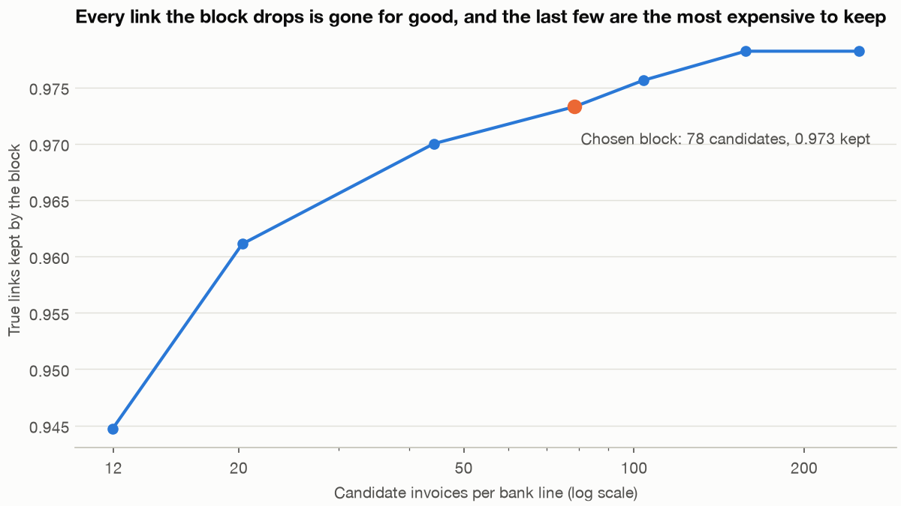
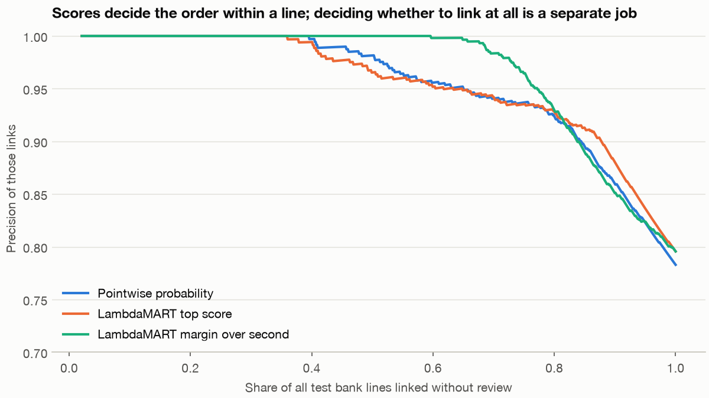

# Entity matching and learning to rank

A bank statement says `BROKADRU TOOLING B` paid 120.41, and somewhere among four thousand invoices is the one that payment settles, if there is one at all. Comparing every line with every invoice means seventeen million pairs, nearly all of them absurd, and a score that looks excellent on those pairs can still link a quarter of the lines wrongly. This chapter works that problem from end to end: cut the candidates, score a pair, rank the candidates for each line, then decide whether to link at all.

**In plain words.** Entity matching means deciding that two records describe the same real thing when no shared ID says so. It's the job of a clerk with a stack of bank lines and a stack of invoices. A good clerk doesn't read every invoice for every line. They pull the few that look about right, put them in order of likelihood, and then either tick the top one or put the line aside for a colleague, because a wrong tick is worse than an honest "not sure". Learning to rank is how you teach a model the middle step, by training on the order of a list and not on each item alone.

The method is general. The same steps deduplicate customers, join two product catalogues and link patient records. We use payments because the errors are easy to price. [Why large systems retrieve first](03-two-tower-and-evaluation.md#why-large-systems-retrieve-first) already gave the two-stage shape, [top-N ranking](02-collaborative-filtering-and-matrix-factorisation.md#the-metric-that-matters-top-n-ranking) gave NDCG, [Boosting in practice](../../01-classical-ml/notes/07-boosting-in-practice.md) gave the trees, and [Reranking](../../../generative-ai/02-rag-retrieval/notes/05-chunking-query-parsing-and-reranking.md#reranking) gave a neural second stage over text.

## The data: a generated ledger

Everything here is generated by [`practice/matching.py`](../practice/matching.py), so the true links are known exactly. No real supplier, invoice or payment is in it, and the difficulties are ones we chose to put in. Most payments settle one invoice. Some are batches that pay several at once, some are part payments that split one invoice across two lines, and about one line in ten has no invoice at all, such as payroll or tax. Bank text is upper case and truncated, with the odd typing slip. A processor hides the supplier's name on 15% of lines. A reference appears on 45% of the lines that can carry one, a third of those with a digit wrong.

```python
import sys
sys.path.insert(0, "../practice")
import pandas as pd
from matching import KINDS, block, make_ledger

invoices, lines, links = make_ledger(0)
print(f"invoices {len(invoices):,}  bank lines {len(lines):,}  true links {len(links):,}")
print(lines.kind.value_counts().reindex(KINDS).to_string())
print(lines.sample(6, random_state=3)[["text", "amount", "day", "kind"]].to_string(index=False))
```

```text
invoices 4,000  bank lines 4,343  true links 4,268
kind
single    3214
batch      199
part       536
none       394
               text  amount  day   kind
RENT STANDING ORDER  615.92   58   none
  BRORIKKA SOFTWARE  579.91  347 single
     BROTARIK PRINT 1680.15  228 single
   BROKADRU TOOLING  147.62  365 single
 BROKADRU TOOLING B  120.41  315 single
        PAYROLL RUN  510.50  427   none
```

Two things to notice. The three counts are close, yet the mapping isn't one-to-one in either direction: a batch line has several invoices and a part-paid invoice has several lines. And a line with no invoice is a correct outcome, so "which invoice?" is the wrong question. The right one is "which invoice, if any?"

## Blocking: cut the candidates, and accept what that costs

**Blocking** means comparing only pairs that share some cheap property. A **block** is the set of pairs that survive. Fellegi and Sunter already had the problem in 1969: two files of $10^5$ records imply $10^{10}$ comparisons, so you compare only inside blocks ([*A Theory for Record Linkage*](https://www.irs.gov/pub/irs-soi/1985preprintar28.pdf), §3.4, *JASA*). Their accounting is the part to keep. Pairs outside a block are what they call implicit non-links: you've decided against them without looking. Blocking therefore raises one error, missed matches, in exchange for fewer comparisons and fewer false links. Later systems keep the shape: [Ditto](https://arxiv.org/abs/2004.00584) places a blocker in front of its matcher for the same reason.

Here's the same trade measured on our ledger. A date window always applies, since a payment can't settle an invoice issued long after it. The other keys are alternatives inside it, joined by OR.

```text
all pairs 17,372,000
                             block   pairs  reduction  per_line  recall
                  date window only 3614233     0.7920  832.1973  1.0000
         window + amount within 3%   68305     0.9961   15.7276  0.7498
                     window + name  283789     0.9837   65.3440  0.8421
                window + reference    1755     0.9999    0.4041  0.3964
           window + amount or name  340786     0.9804   78.4679  0.9634
window + amount, name or reference  340885     0.9804   78.4907  0.9733
```

**Recall** here is the share of true links still inside the block, the same retrieval recall as in DS 05/03. No single key is enough. Amount misses part payments and batches, name misses the hidden processor, and reference is nearly perfect when present but usually absent. Their union keeps 97.3% of true links at 78 candidates per line, a reduction of 98%.

The reference key adds almost no pairs and a full point of recall. A key that is rarely present and very specific is cheap to add, because it can only rescue a link, so check for one before widening anything else.

Reduction ratio alone says nothing, as the 99.99% row shows. Always read it beside recall. And recall isn't evenly spread:

```text
recall of the chosen block by kind of payment
kind
batch     0.8707
part      0.9235
single    0.9981
```

The block quietly loses the awkward payments. A batch carries no reference and its amount matches no single invoice, so a hidden name loses it, and batch recall sits close to the 85% of lines whose name is visible. No later model can recover these, so recall by kind is the ceiling on everything that follows.



```text
amount tol, name min, candidates per line, recall
0.00  0.70     12.0  0.9447
0.01  0.50     20.3  0.9611
0.03  0.40     44.3  0.9700
0.03  0.25     78.5  0.9733
0.05  0.20    104.0  0.9756
0.10  0.15    157.4  0.9782
0.20  0.10    250.0  0.9782
```

Going from 44 to 78 candidates buys 0.33 of a point of recall. From 157 to 250 buys nothing. The date window alone keeps every link, so the ones still missing fail on the other keys: a split amount, a hidden name and no reference. Widening thresholds can't reach them, and only a new kind of key could.

## Scoring a pair: Fellegi and Sunter

A pair survives the block. How strong is the evidence? Fellegi and Sunter's answer is still the clearest way to think about it, and it reads naturally if you know the odds form of Bayes' rule.

Describe each pair by a **comparison vector**, a list of how well each field agrees. Then ask two questions of each agreement level. How often does it happen among pairs that truly match, $m = P(\text{level} \mid \text{match})$? And among pairs that don't, $u = P(\text{level} \mid \text{non-match})$? An agreement that's common among matches and rare among non-matches is strong evidence. If you assume the fields are independent given match status, each field's evidence adds up on a log scale:

$$\text{weight} = \sum_{\text{fields}} \log_2 \frac{m}{u}$$

The paper notes the consequences: rare agreements weigh more, disagreement goes negative, and a missing value carries no weight. Our weights are in bits, so each extra bit doubles the odds.

```python
# illustrative: excerpt from practice/04_matching_lab.py
def fit_fs(p, a):
    """a holds the coded agreement level of each field for each pair. p.linked is the truth."""
    w = {}
    for c in a.columns:
        m = a.loc[p.linked == 1, c].value_counts(normalize=True)
        u = a.loc[p.linked == 0, c].value_counts(normalize=True)
        levels = u.index.union(m.index)
        w[c] = np.log2((m.reindex(levels).fillna(0) + 1e-4) / (u.reindex(levels).fillna(0) + 1e-4))
        if c == "reference":
            w[c]["missing"] = 0.0      # missing is no evidence either way
    return w
```

```text
Fellegi-Sunter weights in bits, log2(m/u), from labelled training pairs
  amount     {'exact': 5.52, 'within 3%': -0.59, 'far': -1.79}
  name       {'strong': 2.49, 'none': -0.36, 'weak': -3.9}
  reference  {'all digits': 11.27, 'one digit off': 8.95, 'missing': 0.0, 'other': -12.04}
  date       {'near due': 1.16, 'later': -2.54, 'far': -5.87}
```

A reference with one digit off still carries nearly 9 bits, which multiplies the odds of a match by about 500. Treating it as a mismatch, as an exact join does, would throw that away. We learned the weights from labelled pairs for brevity. The paper's own method II estimates them from frequencies in the files, with no labels at all, which is why the idea was usable in 1969 and still suits a client with no labelled history.

Look at the name row. A weak name match scores *worse* than no match at all, which can't be right as a fact about names. It comes from the block. A pair with no name match got in on its amount or reference, so it's already a good candidate, and hidden-name lines add true links there. A pair with a weak match may have got in on that weak match alone. So $m$ and $u$ describe pairs *given the block*, and the block has selected on the same fields. That's the same selection effect as in any analysis conditioned on a filter.

### Three decisions, not two

The paper's central idea has aged best. Sort pairs by weight, and instead of one threshold use two: above the upper one **link**, below the lower one **non-link**, and between them **possible link**, sent to a person. The optimal rule, for fixed tolerances on the two error rates, is the one that makes the middle region smallest, because in their words it "will require expensive manual linkage operations". It's a cost argument, and one that [DS 01/13](../../01-classical-ml/notes/13-automate-review-or-reject.md) develops in full.

```text
three-way decision, thresholds set on validation, read on test
thresholds: link at 9.25 bits or more, reject below -2.00 bits
link       305 pairs  precision 1.000
review    6864 pairs  of which true 0.073
reject   57176 pairs  true pairs lost 17 of 824
```

The weights give us a clean link region, but one that holds only 305 of 824 true pairs, and they send nearly 7,000 pairs to review for a test set of 866 lines. Independent per-pair weights know nothing about the other candidates on the same line, and that's what ranking fixes.

### Where a language model fits

Pairwise scoring can also be done by reading both records. [Ditto](https://arxiv.org/abs/2004.00584) (Li et al., *PVLDB* 2020) serialises each record as `[COL] attribute [VAL] value`, gives a pre-trained language model the two as a sequence pair, and classifies match or no match. It's the same [cross-encoder idea as a reranker](../../../generative-ai/02-rag-retrieval/notes/05-chunking-query-parsing-and-reranking.md#reranking). The gains are largest on dirty text: on its hardest dirty benchmark, F1 rose by 31.89 points, from 53.8 to 85.69 (the abstract says up to 29% and the body's table shows more, so read the table). A case study matched two employer files of 789,409 and 412,418 records, and blocking still left 10,652,249 candidate pairs. With 20,000 labelled pairs it reached an F1 of 96.53.

Two cautions from the paper bear on payments. Its language models were trained on general English and "might not capture well" matching tasks with a lot of numeric data, and it suggests adding numeric features. And its output is a yes or no per pair, so ranking and abstaining remain your problem. We didn't run Ditto here. Our ledger's strongest signals are amounts, dates and a reference, which trees handle directly. On messy supplier names at scale, a cross-encoder's score would make a good extra feature.

## Ranking: pointwise, pairwise, listwise

For one bank line, the block gives a short list of candidates. Think of the line as a **query** and the invoices as **documents**, exactly as in search. Each candidate gets a **grade**: 2 for a true link, 1 for another invoice from the right supplier (wrong answer, but a reviewer is at least in the right place), and 0 for anything else. NDCG, from [DS 05/02](02-collaborative-filtering-and-matrix-factorisation.md#the-metric-that-matters-top-n-ranking), handles grades and rewards the top of the list, and we score at 5 as a rough guess at how far a reviewer reads.

There are three ways to set up training. They differ in what one training example is.

**Pointwise.** One example is one pair, and the target is its label. Fit a classifier and sort by probability. It's the obvious baseline and it never looks at the rest of the list.

**Pairwise.** One example is two candidates from the same line, and the target is which one should come first. RankNet writes the model's belief that candidate $i$ beats $j$ as $P_{ij} = 1/(1 + e^{-\sigma(s_i - s_j)})$, where $s$ is the model's score, and minimises cross-entropy against the truth ([Burges 2010](https://www.microsoft.com/en-us/research/wp-content/uploads/2016/02/MSR-TR-2010-82.pdf), §2, a Microsoft Research report). That works with any differentiable model. Burges also shows the trick that made it practical: collect the gradient for each document, a value written $\lambda_i$, and training time per query drops from close to quadratic to close to linear in the number of documents.

**Listwise.** One example is a whole list, and the loss depends on all of it. [Bruch's XE-NDCG](https://arxiv.org/abs/1911.09798) (WWW 2021) is a cross-entropy between the model's distribution over the list and one derived from the grades, shown to bound NDCG.

### Why NDCG can't be optimised directly, and LambdaMART

Sorting makes NDCG, in Burges's words, "everywhere either discontinuous or flat". A small change in a score either changes nothing or swaps two documents and jumps. There's no useful gradient.

Pairwise cross-entropy has a gradient, but counts every swap equally. Burges's figure 1 makes the point: a list can drop from 13 pairwise errors to 11 by moving a top document down, which is better for RankNet and worse for NDCG. LambdaRank's fix is blunt and effective. Don't write a loss at all. Write down the gradient you want: RankNet's, multiplied by $|\Delta\text{NDCG}|$, the change in NDCG if those two documents swapped places. Pairs that matter near the top pull hard, and pairs far down the list barely pull at all. Burges gives the picture of little arrows acting as forces on each document.

**LambdaMART** feeds those gradients to gradient-boosted trees, which he describes as "just use MART, specifying appropriate gradients and the Newton step". Bruch makes the objection precisely: it "forgoes the loss function altogether and heuristically formulates the gradients", so it has no objective to analyse. It works anyway. An ensemble of LambdaMART rankers won the first track of the 2010 Yahoo! learning-to-rank challenge, as Burges reports, though his paper presents no experiments of its own.

The factor is a few lines in code, which is why we can test it directly. This is the custom objective in the lab, with `rho` as $1 - P_{ij}$:

```python
# illustrative: inside a LightGBM custom objective, for one bank line, from practice/04_matching_lab.py
rho = 1 / (1 + np.exp(s[hi, None] - s[None, :]))      # hi indexes the candidates with a grade above 0
mask = g[hi, None] > g[None, :]                       # only pairs where the grades differ, in the right order
wt = 1.0
if delta:                                             # the one line that turns RankNet into LambdaRank
    rank = np.empty(n, int); rank[np.argsort(-s)] = np.arange(n)
    disc = 1 / np.log2(rank + 2)
    gain = 2.0 ** g - 1
    ideal = (np.sort(gain)[::-1] / np.log2(np.arange(n) + 2)).sum()
    wt = np.abs((gain[hi, None] - gain[None, :]) * (disc[hi, None] - disc[None, :])) / ideal
lam, h = rho * mask * wt, rho * (1 - rho) * mask * wt
```

For real use you'd take the library's version:

```python
# illustrative
sizes = q.groupby("line", sort=False).size().to_numpy()          # candidates per bank line, in row order
data = lgb.Dataset(X, label=q.grade, group=sizes)
ranker = lgb.train(dict(objective="lambdarank", label_gain=[0, 1, 3], num_leaves=15, learning_rate=.05), data, 200)
```

### The results

Every model trains on the earliest 60% of bank lines and is tested on the last 20%, over five generated ledgers. As in the rest of this pillar, we split by time and not at random. The ranking table scores only lines with a true link inside the block, so it says nothing yet about abstaining.

```text
mean and sd over five generated ledgers
                                  ndcg5            top1
                                   mean     std    mean     std
model
Closest amount                   0.5397  0.0181  0.4714  0.0434
Fellegi-Sunter weights           0.8703  0.0102  0.8332  0.0274
Pointwise linear                 0.9101  0.0239  0.8012  0.0465
Pairwise linear (RankNet)        0.9374  0.0063  0.8440  0.0202
Pointwise trees                  0.9129  0.0136  0.8513  0.0213
Pairwise trees (no NDCG factor)  0.9416  0.0081  0.8541  0.0202
Pairwise trees + NDCG factor     0.9451  0.0069  0.8600  0.0232
LambdaMART (LightGBM)            0.9469  0.0069  0.8628  0.0276
Listwise trees (XE-NDCG)         0.9413  0.0064  0.8495  0.0204

LambdaMART minus each model, paired by ledger: mean, and how many of five it won (NDCG@5)
Closest amount                     +0.4072  sd 0.0150  wins 5/5
Fellegi-Sunter weights             +0.0767  sd 0.0090  wins 5/5
Pointwise linear                   +0.0368  sd 0.0174  wins 5/5
Pairwise linear (RankNet)          +0.0095  sd 0.0013  wins 5/5
Pointwise trees                    +0.0341  sd 0.0104  wins 5/5
Pairwise trees (no NDCG factor)    +0.0053  sd 0.0028  wins 5/5
Pairwise trees + NDCG factor       +0.0018  sd 0.0005  wins 5/5
LambdaMART (LightGBM)              +0.0000  sd 0.0000  wins 0/5
Listwise trees (XE-NDCG)           +0.0056  sd 0.0028  wins 5/5
```

LambdaMART wins on NDCG, and it wins every paired comparison. The more useful reading is where the gain comes from.

- **The biggest step is having features at all.** Closest amount scores 0.54, and adding names, dates and references with no training tricks takes Fellegi-Sunter to 0.87.
- **The second is changing the training example.** Moving from pointwise to pairwise adds about 0.03 for trees and for linear models alike. A pairwise *linear* model at 0.9374 beats pointwise *trees* at 0.9129, so on this data the objective matters more than the model family.
- **The famous factor is small.** $|\Delta\text{NDCG}|$ moves the same custom trees from 0.9416 to 0.9451, a gain of 0.0035. It's real, but it's about an eighth of what moving to pairs bought. The library's version is another 0.0018 ahead. It differs in detail, since by default it normalises gradients and truncates pairs far down the list.
- **Listwise didn't win.** XE-NDCG lost all five ledgers to LambdaMART, by 0.0056. Bruch's own benchmarks went the other way, with 48.23 against 48.08 NDCG@5 on one web search set and 73.37 against 73.00 on another. Those are web search sets, not payment lists, and those gaps are small too. The honest conclusion is that this gap is small and depends on the data.
- **Top-1 is a harsher and noisier judge.** The trees sit within about 0.015 of each other with a standard deviation of over 0.02 across ledgers. If you only link the top pick, pointwise trees are a defensible and far simpler start. Since the differences in the top-1 column are within ledger-to-ledger variation, don't claim from it that one tree objective is better.

Five generated ledgers show what happens on this generator and no more. We chose its difficulties, and a different mix could reorder the close results. Run it on your own data before you trust the order.

## Match errors are not classification errors

A pair classifier can look superb on a problem it's failing. Here's the pointwise tree classifier scored both ways, on the test lines of one ledger.

```text
--- pair scores against line scores, pointwise trees at P >= 0.5
pairs 64,345  true 824  accuracy 0.9949
precision 0.836  recall 0.750  F1 0.791
bank lines with exactly the right set of invoices, including lines that should have none: 630 of 866 (0.727)
lines given more than one invoice by the threshold: 62, of which truly batch: 2
```

Pairs score 99.5% accuracy, though answering "no" to everything would score 98.7% on this imbalance. What a business cares about is whether each line ended up right, and 27% didn't. A threshold on pairs also has no idea that the pairs belong together, so it handed 62 lines several invoices, of which only 2 were real batches.

Four differences between match errors and classification errors follow.

**One wrong link makes two errors.** A classifier's mistake stays in its own row. A wrong link marks one invoice as paid when it isn't, and leaves the true invoice open, where it may get chased or paid twice.

```text
--- wrong links, and the second invoice each one strands
wrong top picks 101: 97 invoices wrongly marked paid, and 101 bank lines whose true invoices stay open
  by kind {'batch': 16, 'part': 35, 'single': 50}
  share of wrong picks from the right supplier 0.752
```

Three quarters of the wrong picks are the right supplier and the wrong invoice. Identifying a supplier is mostly solved here, and telling apart two near-identical invoices from one supplier is what's left. That's a data problem as much as a model problem: if a monthly fee has been the same amount for a year and the payer left no reference, the evidence simply isn't there.

**Decisions on different lines constrain each other.** Each line picks independently, so two lines can claim one invoice. Solving a one-to-one **assignment** instead looks like the obvious repair: the Hungarian algorithm finds the pairing with the best total score in which each line and each invoice is used at most once. It didn't help overall.

```text
--- independent top pick against one-to-one assignment, LambdaMART scores, lines with a true link
independent: 689 of 790 right; invoices claimed by more than one line 98, extra claims 101
assigned on LambdaMART score: 678 of 790 right
  right by kind {'batch': 25, 'part': 59, 'single': 594}
assigned on pointwise log-odds: 675 of 790 right
  right by kind {'batch': 21, 'part': 57, 'single': 597}
  independent right by kind {'batch': 19, 'part': 85, 'single': 585}
  lines by kind {'single': 635, 'part': 120, 'batch': 35}
```

We expected assignment to win, and it lost, 678 to 689. Singles did improve, from 585 to 594, and batches from 19 to 25. But part payments fell from 85 to 59, because two lines paying one invoice is exactly what a one-to-one constraint forbids. The constraint is true of most of the data and false of the part you most need to get right. A hard constraint has to match the real shape of the problem, or it does harm. You could detect likely part payments and exempt them, though we haven't measured that here.

**One line can match many invoices.** A batch payment's top pick is never fully right, by construction. The amounts have to add up, and that's a check you can search for: among the top candidate's supplier's invoices, look for a set that sums to the payment.

```text
--- one-to-many: per kind of payment, top pick against top pick plus a subset-sum search
        lines  top_all  sum_all  sum_wrong  ambiguous
single    635      585      584          1          1
batch      35        0       22          0          8
part      120       85       85          0          0
```

Batches go from 0 to 22 of 35 fully right, with no wrong sets and a loss of one single. This is arithmetic and not learning, it's completely explainable to an auditor, and it should come before any fancier multi-label model. The search accepted a set only when it was unique, and the 8 ambiguous lines are ones where several sets add up. Send those to a person. Part payments are still partly linked at best, which needs a running balance per invoice.

**Sometimes the right answer is no link.** Ranking always returns something, even for payroll, so ranking scores alone can't decide whether to link. Comparing scores across lines is also doing something the ranker wasn't trained for, as its scores are only meant to order candidates within a line. A useful extra signal is the **margin**: how far the top candidate is ahead of the second.

```text
--- abstaining: should this bank line be linked at all, all test lines
test lines 866, of which no invoice exists 76; with no candidate at all 0
Pointwise probability            coverage at precision: 0.99->0.409  0.98->0.502  0.95->0.650  0.90->0.844  mean precision 0.954
LambdaMART top score             coverage at precision: 0.99->0.403  0.98->0.423  0.95->0.648  0.90->0.878  mean precision 0.955
LambdaMART margin over second    coverage at precision: 0.99->0.685  0.98->0.715  0.95->0.771  0.90->0.837  mean precision 0.966
```



**Coverage** is the share of lines linked automatically. At 99% precision, the margin links 68.5% of lines and the raw top score 40.3%, on the same model and the same ranking. So the ranker didn't change at all, and a better question of its output gained 28 points of coverage. The margin isn't better everywhere: at 90% precision the top score covers more, 87.8% against 83.7%. Note that the top score of LambdaMART and the pointwise probability are level here, so the ranker's NDCG gain doesn't turn into any abstaining gain by itself.

Choosing where to stand on that curve is a business decision based on the price of a wrong link and the price of review. That's the subject of [DS 01/13](../../01-classical-ml/notes/13-automate-review-or-reject.md). The corrections people make in the review queue become your next training labels, with the selection bias that [DS 01/14](../../01-classical-ml/notes/14-learning-from-corrections.md) measures.

## Pitfalls

| Symptom | Cause | Fix |
|---|---|---|
| The ranker's recall looks perfect, and production misses links | The offline test scored only lines whose link survived the block | Report block recall, by kind of payment, as a separate number. It caps everything after it |
| A huge reduction ratio is celebrated | Reduction says nothing alone. Our best reduction, 99.99%, kept 39.6% of links | Always read it beside recall |
| Widening the block buys nothing | Missing links fail on another key, and we saw recall stop at 157 candidates | Inspect what's still missing, and add a kind of key, not a wider threshold |
| Pair accuracy above 99% and an unhappy client | Nearly all pairs are negatives, and always answering "no" scored 98.7% | Score whole lines: did each one end up with exactly the right set? |
| A weak name match gets a lower weight than none | $m$ and $u$ were estimated inside a block that selected on the same field | Read weights as conditional on the block, and don't explain them as facts about names |
| Disagreement is counted against a missing reference | Missing was coded as a mismatch | Keep missing as its own level with zero weight. `ref_digits` returns -1 for this reason |
| Scores from one bank line are compared with another's | A ranker only promises order within a query | Abstain on a calibrated probability or on the margin, and check it on a coverage curve |
| A one-to-one constraint lowers the score | Part payments share an invoice, so the constraint is false for them | Check a constraint against the real shape of the data, kind by kind |
| A test that mixes past and future | A random split puts a supplier's later invoices in training, which production never has | Split by time, as in [Time series ML](01-time-series-ml.md) |
| An excellent NDCG, all from one feature | A label-derived field leaked in, such as a "paid date" on the invoice | Build features only from what's known when the bank line arrives, then remove each group in turn and see what it's worth |

## Try it

Try-it numbers come from [`practice/04_matching_tryit.py`](../practice/04_matching_tryit.py).

1. **What's each kind of evidence worth?** Before running it, guess the order: remove the reference, the name, the amount or the date from LambdaMART. Which removal hurts NDCG most, and which hurts top-1 most?

<details><summary>Answer</summary>

```text
LambdaMART with one kind of evidence removed, mean over five ledgers
               ndcg5    top1
features
all features  0.9469  0.8628
no reference  0.9195  0.7675
no name       0.7720  0.7917
no amount     0.8855  0.6991
no date       0.9193  0.7926
```

The two metrics disagree. Removing the name hurts NDCG most, 0.77, because grade 1 means "right supplier", and without a name the model can't get those candidates up the list. Removing the amount hurts top-1 most, 0.70, because amount is what picks one invoice from a supplier's several. Your metric decides which feature you think matters. This is why the grade definition is a real design decision.

</details>

2. **How tight can the date window go?** Our window is 120 days. Run 30, 60, 90 and 180. Where does recall break, and why there?

<details><summary>Answer</summary>

```text
date window in days, candidates per line, recall of true links, seed 0
  30    20.7  0.3397
  60    41.0  0.7795
  90    60.3  0.9663
 120    78.5  0.9733
 180   111.6  0.9733
```

Recall collapses below 90 days because the window is counted from the *issue* date and the generated payment terms are 14 to 60 days, with lateness on top. The candidates per line fall smoothly while recall falls off a cliff. A key that encodes a real process has a threshold you can read from that process, so look at the distribution of days from issue to payment before you set it.

</details>

3. **Price the margin.** Using the abstaining table, on 866 test lines at 99% precision, how many more lines does the margin link automatically than the top score does? If a person takes 3 minutes a line, what does that save per thousand lines?

<details><summary>Answer</summary>

Margin: $0.685 \times 866 \approx 593$ lines. Top score: $0.403 \times 866 \approx 349$. That's 244 more lines, or 28.2 points of coverage. Per thousand lines, that's 282 fewer reviews, which at 3 minutes is about 14 hours of review saved, from one extra subtraction on scores you already had. The 3 minutes is an assumption to replace with your own figure.

</details>

## Interview checklist

| Question | Short answer |
|---|---|
| What is entity matching? | Deciding that records from different sources describe the same real thing when no shared key says so. Also called record linkage or data matching. |
| What is blocking, and its cost? | Comparing only pairs that share a cheap key. Anything outside the block is an implicit non-link, so its recall caps every later step. |
| How do you evaluate a blocker? | Reduction ratio and recall together, and recall by kind of hard case. We saw 99.99% reduction keep only 39.6% of links. |
| What are $m$ and $u$? | $m$ is the chance of an agreement level among true matches, and $u$ among non-matches. $\log(m/u)$ is that field's evidence, summed under conditional independence. |
| Why did Fellegi and Sunter use three outcomes? | Link, possible link and non-link. For fixed error rates, the best rule minimises the manual middle region, since review is the expensive part. |
| Pointwise, pairwise, listwise? | The training example is an item, a pair from one query, or a whole list. |
| Why not optimise NDCG directly? | Sorting makes it flat or discontinuous in the scores, so it has no usable gradient. |
| What is LambdaMART? | Boosted trees trained on RankNet's gradients, each multiplied by $\lvert\Delta\text{NDCG}\rvert$ of swapping the pair. It defines gradients, not a loss. |
| Did LambdaMART win here? | Yes on NDCG, 0.9469 against 0.9129 for pointwise trees, in five of five ledgers. Most of that came from moving to pairs. The NDCG factor added only 0.0035. |
| Why not report pair accuracy? | Negatives swamp it. We had 99.5% pair accuracy with only 72.7% of lines exactly right. |
| Why does a wrong link cost double? | It marks a wrong invoice as paid and leaves the right one open. |
| Would one-to-one assignment help? | Only where it's true. It helped singles and batches here and hurt part payments, for a net loss of 689 to 678. |
| How do you handle a batch payment? | Search the supplier's candidates for a unique set of invoices that sums to the payment, and send ambiguous cases to a person. |
| How should the system abstain? | Don't threshold raw ranker scores across queries. The margin over the second candidate raised coverage at 99% precision from 40% to 68%. |
| When would you use a language model? | On messy text at scale, as a cross-encoder pair score or feature. Ditto's authors warn it may fit numeric-heavy tasks poorly, and it needs labels. |

## Next

You can now retrieve, rank and evaluate lists. The next step in the course is language modelling proper, and the ranking ideas return as reranking and retrieval metrics: carry on with [the LLM fundamentals pillar in generative AI](../../../generative-ai/01-llm-fundamentals/README.md).
