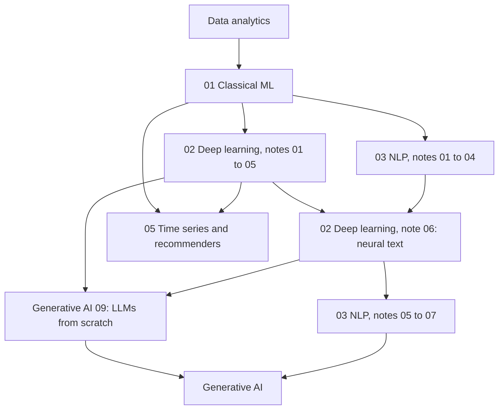

# Data Science: curriculum

> The order to work through the pillars, and what each stage needs first. Contents are in [README.md](README.md), the shared library is in [references.md](references.md), and each pillar's README has its own reading order.

## Prerequisites

- Python and NumPy fluency. Vectorised array code is assumed from the supervised learning chapter onwards.
- From [data analytics](../data-analytics/README.md): distributions, hypothesis tests and the idea of a likelihood. Bayesian modelling stays there and is not repeated here.
- Calculus up to the chain rule and matrix products, for neural network fundamentals and micrograd.

## Path

The path is a tree rather than a line. Classical ML comes first, because its evaluation habits apply to everything afterwards. After it, deep learning and NLP are the two main branches, and they meet at the neural text chapter.

| Stage | Pillar and notes | Depends on | Notes on order |
|---|---|---|---|
| 1 | [01 Classical ML](01-classical-ml/README.md): 01 to 08 in order | Data analytics | Unsupervised learning needs only supervised learning. Read evaluation before you trust any score in the ensembles chapter |
| 2 | [02 Deep learning](02-deep-learning/README.md): 01 to 05 | 01 notes 02 and 04 | Note 03 needs no code. Notes 04 and 05 can swap |
| 3 | [03 NLP](03-nlp/README.md): 01 to 04 | 01 notes 02 to 04 | Can run alongside stage 2. Notes 03 and 04 can swap |
| 4 | [02 Deep learning](02-deep-learning/notes/06-neural-text-models.md): note 06 | Stage 2 and NLP note 04 | Where the two branches meet |
| 5 | [03 NLP](03-nlp/README.md): 05 to 07 | Stage 3, and note 06 for 07 | Note 07 reruns the classical methods on LLM embeddings. Check the [pillar's reading order](03-nlp/README.md#reading-order) for the rest |
| 6 | [Generative AI 09: LLMs from scratch](../generative-ai/09-llms-from-scratch/README.md): 01 to 03 | Logistic regression, softmax | Strictly sequential, as each part reuses the previous code. Learn backprop once in 02 note 01 or here, then use the other as a check |
| 7 | [05 Time series and recommenders](05-time-series-and-recommenders/README.md): 01 to 03 | 01 throughout, 02 note 01 for the sequence and two-tower parts | Independent of stages 3 to 6, so it can come any time after stage 2 |

When nanoGPT is done, continue to [generative AI, LLM fundamentals](../generative-ai/01-llm-fundamentals/README.md).

## If you only have a week

Classical ML notes 01, 02, 04 and 06. Deep learning notes 01 and 03. NLP note 02. That covers what most interviews ask, and it teaches the habit of measuring against a baseline.

## Known gaps

- [Statistical foundations](01-classical-ml/notes/01-statistical-foundations.md) has no coursework of its own. Its practice is in the chapter's Try it section, with ISLP ch. 2 and *Statistics Done Wrong* as readings.
- The Ng deep learning notebooks remain as they were submitted, in NumPy and TF 1.x. Note 01 has the table for reproducing them in PyTorch, but no PyTorch copies of the notebooks exist in the repo.
