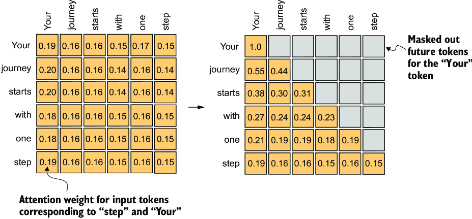
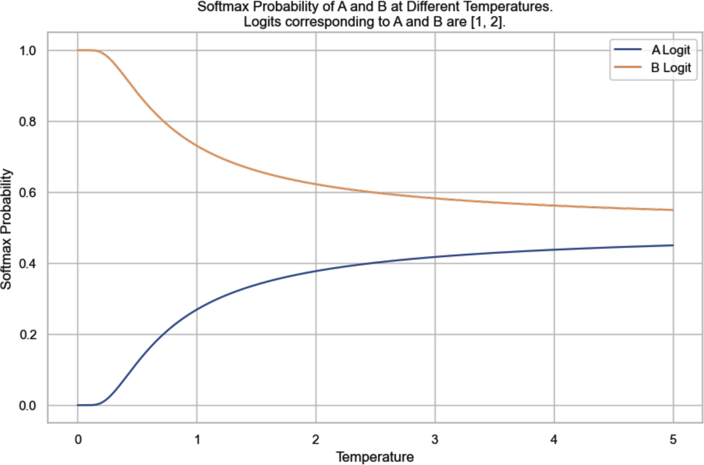
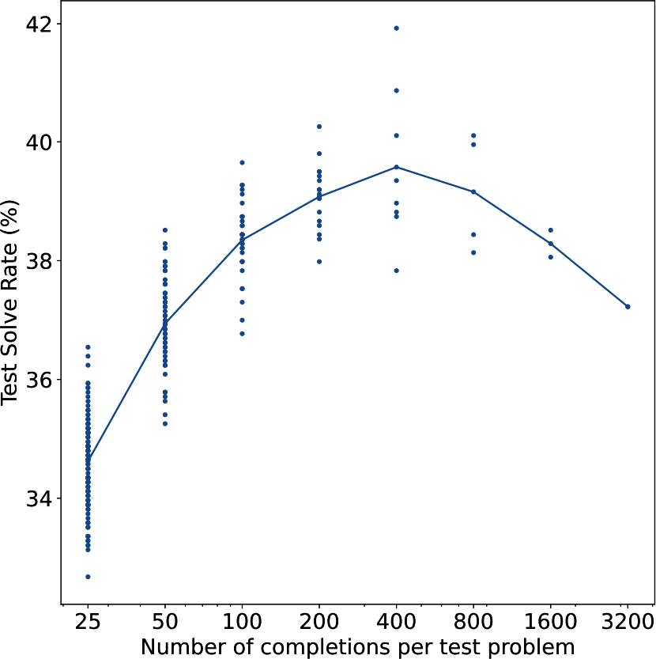

# 1 — How LLMs Work

> An LLM is a decoder-only transformer trained to predict the next token. Tokens, embeddings, causal self-attention and scale explain most of its behaviour, including the failures.

---

## The one-sentence model

A large language model takes a sequence of tokens and returns a probability distribution over the next token. Generation is that step in a loop: sample a token, append it, predict again. Everything else in this pillar (prompting, fine-tuning, RLHF, tools) changes *which* distribution the model produces. None of it changes the loop.

That framing explains three things you will meet constantly:

| Behaviour | Why it follows from next-token prediction |
|---|---|
| Fluent but wrong answers (hallucination) | Training rewards *plausible* continuations, not true ones. A confident-sounding citation is a likely sequence of tokens whether or not the paper exists |
| Sensitivity to wording | The prompt is the conditioning context. Different tokens give a different distribution |
| Few-shot learning | Examples in the prompt make the desired pattern the most likely continuation, with no weight update ([arXiv:2005.14165](https://arxiv.org/abs/2005.14165), Brown et al., 2020) |

Predicting the next token well and compressing well are the same objective. Feed a model's probabilities to an arithmetic coder and the compressed size is the model's log-loss in bits. Delétang et al. used this to compare models with ordinary compressors on 1 GB of data in 2,048-byte chunks. Chinchilla 70B, trained on text, cut ImageNet patches to 48.0% of their size and LibriSpeech audio to 21.0%, against 61.7% for PNG and 30.3% for FLAC on the same chunks. Counting the model's own weights changes the result. Chinchilla's "compressed" 1 GB then comes to 14,008% of the original, and with small transformers trained on enwik8, every dataset size had a best model size past which more parameters made compression worse ([arXiv:2309.10668](https://arxiv.org/abs/2309.10668) (Delétang et al., ICLR 2024)). The abstract's 43.4% and 16.4% do not match the paper's own table. That in-context ability is not tied to words. Mirchandani et al. wrote ARC puzzles as grids of digit tokens, and text-davinci-003 solved 85 of 800 with no training. With each digit swapped for a random vocabulary token, it still solved 44 on average across five alphabets. The prompt format mattered too. In BIG-bench the grids are written without spaces ("8686"), and models scored near zero there, which the authors put down to BPE merging neighbouring digits into one token ([arXiv:2307.04721](https://arxiv.org/abs/2307.04721) (Mirchandani et al., CoRL 2023)).

The loop has a fourth consequence: the model has no scratchpad except the tokens it has already written. Bubeck et al. probed an early, pre-release GPT-4 on `a*b + c*d`. With single-digit numbers it got "only 58% accuracy" on 100 random samples, and with numbers from 10 to 19 it got 16%. When the prompt asked it to write out every intermediate step first, accuracy rose to 100% for numbers from 1 to 40. Asked how many primes lie between 150 and 250, it answered 13. Asked to list them first and then count, it got the right answer. The authors put these failures down to "the model's lack of planning, working memory, ability to backtrack," and separate *incremental* tasks, which can be written one step at a time, from *discontinuous* ones that need an idea before the first word. They also warn that "all quantitative results will be different on the final" model ([arXiv:2303.12712](https://arxiv.org/abs/2303.12712) (Bubeck et al., 2023-03)). This is why chain-of-thought prompting helps arithmetic: the intermediate tokens are the working memory.

The order of the tokens matters as well. Lee et al. trained a 10.6M-parameter NanoGPT from scratch on 3-digit addition. Written the usual way, with the most significant digit first, accuracy plateaued just above 85% even at 10,000 examples, because that digit depends on every digit of both operands. With the answer reversed, each output digit needs only two operand digits and a carry, and accuracy jumped from near zero to 100% between 1,000 and 4,000 examples. A step-by-step scratchpad got to 100% with 1,000 examples, at 281 tokens per example against 15 for the reversed format. No format they tested extrapolated. Trained on up to 7-digit plain additions, the model could not add 8-digit numbers, and a scratchpad model trained on 3 digits silently dropped a digit from 4-digit inputs ([arXiv:2307.03381](https://arxiv.org/abs/2307.03381) (Lee et al., ICLR 2024)). An older architecture did extrapolate, by running a number of steps that grows with the input. Kaiser & Sutskever's Neural GPU applies a convolutional GRU once per input symbol. Trained on binary multiplication up to 20 bits, it made no errors on 2,000-bit numbers, while an LSTM with attention could not even fit the 20-bit training set. Only a few of each 729-run grid search generalized that far, though, and it never learned long decimal multiplication ([arXiv:1511.08228](https://arxiv.org/abs/1511.08228) (Kaiser & Sutskever, ICLR 2016)).

---

## Tokens

Models do not see characters or words. A **tokenizer** splits text into subword units from a fixed vocabulary and maps each to an integer id.

- **Byte-pair encoding (BPE)** starts from bytes or characters and repeatedly merges the most frequent adjacent pair until the vocabulary reaches a target size. The merge rule is Gage's 1994 compression algorithm. Sennrich et al. turned it into a tokenizer so that a translation model could handle words it had never seen, and on WMT15 it beat a dictionary back-off baseline **by up to 1.1 BLEU on English→German and 1.3 on English→Russian** ([arXiv:1508.07909](https://arxiv.org/abs/1508.07909) (Sennrich et al., ACL 2016)). GPT-2's BPE vocabulary has 50,257 entries (*LLMs from Scratch*, ch. 2). WordPiece (BERT) and SentencePiece (T5, Llama) are close relatives. In Google's translation system a 32k-wordpiece model scored 38.95 BLEU on WMT'14 English→French, against 37.90 for whole words and 38.01 for characters, and decoding characters was about five times slower (1.05 vs 0.21 s per sentence) ([arXiv:1609.08144](https://arxiv.org/abs/1609.08144) (Wu et al., 2016-09, preprint)). SentencePiece trains on raw sentences and encodes spaces as the symbol ▁, so decoding is lossless and no language-specific pre-tokenizer is needed; on Kyoto Japanese→English it scored 29.55 BLEU against 28.24 for a word-segmented baseline ([arXiv:1808.06226](https://arxiv.org/abs/1808.06226) (Kudo & Richardson, EMNLP 2018)). Vocabulary size is a design choice: Mixtral 8x7B uses 32,000 tokens and GPT-4's tokenizer 100,256 (*AI Engineering*, ch. 1).
- Why subwords and not words or characters? Huyen gives three reasons. Subwords carry meaning that characters do not ("cook" + "ing"). There are far fewer unique subwords than unique words, so the vocabulary and the embedding table stay small. A made-up word still splits into known pieces ("chatgpt" + "ing"), so nothing is out of vocabulary (*AI Engineering*, ch. 1).
- Common words are one token; rare words, code identifiers and non-English text split into several. A rough English rule: **100 tokens ≈ 75 words** (*Prompt Engineering for GenAI*, ch. 2; *AI Engineering*, ch. 1). GPT-4's tokenizer turns "I can't wait to build AI applications" into nine tokens.
- Tokens are the unit of **cost, latency and context length**. A 200k-token context window is a token budget, not a word budget.
- **The tax is not the same for every language.** On the MASSIVE dataset (the same short sentences translated into 52 languages), the median length with GPT-4's tokenizer was 7 tokens in English, 32 in Hindi and 72 in Burmese. Burmese text therefore costs about ten times as much and takes about ten times as long per API call for the same content. English also makes up 45.88% of Common Crawl, which helps explain why GPT-4 scores best in English on MMLU (*AI Engineering*, ch. 2, citing Yennie Jun's 2023 analysis). Swapping in a language-specific tokenizer after training is not free either. Minixhofer et al. trained a hypernetwork that predicts embeddings for any new vocabulary, and moving Mistral-7B to 50k-token monolingual tokenizers cut sequence length by 30–47% on European languages, but 5-shot multilingual MMLU fell by 8–15 points (Russian 49.9 → 35.1) without further training ([arXiv:2405.07883](https://arxiv.org/abs/2405.07883) (Minixhofer et al., NeurIPS 2024)). Qin et al.'s survey of multilingual LLMs sorts the other fixes for English-centric models into two kinds. Some tune parameters, at pretraining, SFT, RLHF or downstream fine-tuning. Others leave the weights frozen and work through the prompt. Among the prompt-only methods, the survey finds translating the input to English first works best, and it lists unequal token cost across languages as an open fairness problem ([arXiv:2404.04925](https://arxiv.org/abs/2404.04925) (Qin et al., 2024, preprint)).
- **The vocabulary reflects the data it was trained on.** GPT-NeoX-20B kept GPT-2's vocabulary size (50,257) but retrained BPE on the Pile and added tokens for runs of up to 24 spaces ([doi:10.18653/v1/2022.bigscience-1.9](https://doi.org/10.18653/v1/2022.bigscience-1.9) (Black et al., BigScience Workshop 2022)). A short recursive Python function took 39 tokens instead of 55. Across the Pile validation set it needed about 10% fewer tokens (24% fewer on GitHub, 23% fewer on PubMed Central), but on C4, which is outside its training data, it used the same number as GPT-2. GPT-2's longest tokens were scraping artefacts such as "rawdownloadcloneembedreportprint". NeoX's were scientific terms from PubMed, such as "immunohistochemistry". BLOOM, trained on 46 natural and 13 programming languages, went the other way. It grew the vocabulary to 250,680 so that no language would need more than about 10 percentage points more tokens per word than a monolingual tokenizer did. On Universal Dependencies, French came out 11% *lower* than CamemBERT's tokenizer, and Arabic 13% higher than Arabic BERT's. Its first tokenizer, trained on undeduplicated text, stored whole URLs as single tokens ([arXiv:2211.05100](https://arxiv.org/abs/2211.05100) (BigScience Workshop, 2022, preprint)).

Tokenization explains several odd failures: counting letters in a word, reversing strings and arithmetic on long numbers are hard because the model never sees the individual characters. That is only part of the story. On the CUTE benchmark a 7.5B BPE model still spelled words out letter by letter with 91.5% exact match (97.3% for a byte-level model of the same size), but both scored below 25% on character edits such as deleting, substituting or swapping a letter ([arXiv:2506.14761](https://arxiv.org/abs/2506.14761) (Videau et al., NeurIPS 2025)). Spelling can be learned from token patterns; manipulating characters stays hard even with bytes. A separate failure comes from training the tokenizer and the model on different data. A string that was frequent in the tokenizer's corpus gets its own token, but if it hardly appears in the model's training text, that token's embedding is barely trained. Kaddour et al.'s review calls these *glitch tokens*, after Rumbelow and Watkins's 2023 "SolidGoldMagikarp" write-up, and says they cause unexpected behaviour. The review notes that the coupling also means a new tokenizer has to be trained whenever the pretraining corpus changes ([arXiv:2307.10169](https://arxiv.org/abs/2307.10169) (Kaddour et al., 2023, preprint)).

```python
import tiktoken                      # OpenAI's BPE; Anthropic exposes a count_tokens endpoint instead
enc = tiktoken.get_encoding("gpt2")
enc.encode("Tokenization isn't free.")   # -> list of ints; decode() inverts it
```

Open-weight models ship their tokenizer with the weights. Hugging Face's Transformers library defines every model as three parts: a tokenizer, a transformer body and a task head that can be swapped for fine-tuning. `AutoTokenizer.from_pretrained(name)` loads the tokenizer the model was pretrained with, because tokenizers "often differ in small details, but need to be in sync with pretraining" ([doi:10.18653/v1/2020.emnlp-demos.6](https://doi.org/10.18653/v1/2020.emnlp-demos.6) (Wolf et al., EMNLP 2020 Demos)). When the paper was written, its model hub held 2,097 community models. The paper is a system description and reports no controlled benchmarks; its one speed figure is a near-4× ONNX speedup on BERT, RoBERTa and GPT-2, with no setup given.

**Dropping the tokenizer.** Byte-level models read raw UTF-8 bytes (a vocabulary of 256). That removes the language tax and the out-of-vocabulary problem, but sequences get roughly four times longer. A 64-layer, 235M-parameter character transformer reached 1.06 bits per byte on enwik8, yet on the One Billion Word benchmark its word perplexity of 40.6 trailed a word-level model's 23.7 ([arXiv:1808.04444](https://arxiv.org/abs/1808.04444) (Al-Rfou et al., AAAI 2019)). Later work narrowed the gap by spending less compute per byte. MEGABYTE runs a large model over 8-byte patches and a small model inside each patch, and after 400B bytes of PG-19 it reached a word perplexity of 36.4 against 69.4 for a plain byte transformer on the same compute ([arXiv:2305.07185](https://arxiv.org/abs/2305.07185) (Yu et al., NeurIPS 2023)). MambaByte replaces attention with a Mamba state-space model. On PG-19, at the same compute as MEGABYTE but after only 150B bytes, its 972M model reached 33.0. A subword Mamba of similar size, trained on 600B bytes, reached 33.9. When neighbouring bytes were swapped with probability 0.3, its perplexity rose by 28.7 points, against 630.6 for the subword model ([arXiv:2401.13660](https://arxiv.org/abs/2401.13660) (Wang et al., COLM 2024)). AU-Net and H-Net group bytes into chunks before the expensive layers, either at spaces or with a learned router that settled near BPE's ~4.6 bytes per chunk. At about 1B parameters, trained on the same data as a BPE transformer, they matched or beat it. The two-stage H-Net scored 0.715 vs 0.730 bits per byte on FineWeb-Edu and 58.2 vs 55.5 average zero-shot accuracy ([arXiv:2507.07955](https://arxiv.org/abs/2507.07955) (Hwang et al., 2025-07, preprint)). AU-Net scored 73.7 vs 70.2 on HellaSwag, but splitting at spaces cost it on Chinese MMLU at 8B (28.0 vs 33.0) ([arXiv:2506.14761](https://arxiv.org/abs/2506.14761) (Videau et al., NeurIPS 2025)). None of these papers trains past 8B parameters, and lower bits per byte does not guarantee better task scores. Marathe et al. distilled Llama-3-8B into ~1.3B byte models, and at about 1.8×10²¹ FLOPs those models had lower bits per byte than a token model but worse benchmark scores. The point where bytes come out ahead (52.4% vs 48.4% average accuracy) exists only in extrapolated scaling fits ([arXiv:2609.12303](https://arxiv.org/abs/2609.12303) (Marathe et al., 2026-09, preprint)). Compressing harder than BPE has a limit too. When text was compressed with arithmetic coding driven by a small language model, a 2B model trained on the result learned nothing: its predictions stayed uniform. Splitting the stream into windows that each carry the same number of bits made it learnable, at 0.94 bits per byte against 0.87 for SentencePiece and 1.03 for raw bytes. These results are English-only and from undertrained models ([arXiv:2404.03626](https://arxiv.org/abs/2404.03626) (Lester et al., TMLR 2024)).

---

## Embeddings and position

Each token id indexes a row of a learned **embedding matrix** (vocab_size × d_model; 50,257 × 768 for GPT-2 small). The row is a dense vector that ends up encoding meaning: similar tokens land near each other.

The table is older than the transformer. Minaee et al.'s survey splits language modelling into four waves. First came n-gram counts, then task-specific neural models with learned embeddings, then task-agnostic pretrained models fine-tuned per task, and finally LLMs with tens to hundreds of billions of parameters that pick up a task from the prompt ([arXiv:2402.06196](https://arxiv.org/abs/2402.06196) (Minaee et al., 2024, preprint)). The embedding table arrived with the second wave. Bengio et al. learned a feature vector per word (30 to 100 numbers) jointly with a small network that predicted the next word from the previous few. A sentence never seen in training then still got probability from sentences with similar words. On the Brown corpus their test perplexity was about 24% lower than the best smoothed n-gram model (252 against 312), and about 8% lower on 14M words of AP News (109 against 117). Mixing it with a trigram model helped every time. Training took about three weeks on 40 CPUs, almost all of it spent in the softmax over the vocabulary ([JMLR 3:1137](https://www.jmlr.org/papers/v3/bengio03a.html) (Bengio et al., JMLR 2003)). Word2vec dropped the hidden layer and replaced that softmax with negative sampling. On about 1B words of news, 300-d vectors trained in 14 to 38 minutes and scored about 60% on a word-analogy test ([arXiv:1310.4546](https://arxiv.org/abs/1310.4546) (Mikolov et al., NIPS 2013); details in [data-science 11](../../../data-science/notes/11-embeddings-and-similarity.md)).

These vectors are static: a word gets one vector whatever its sense, a limit Bengio et al. already pointed out. ELMo made the vector depend on the sentence. It runs a 2-layer bidirectional LSTM language model over the input, and each task learns its own weighted sum of the layers. That set the state of the art on six tasks, with 6–20% relative error reduction; SQuAD F1, for example, went from 81.1 to 85.8 ([arXiv:1802.05365](https://arxiv.org/abs/1802.05365) (Peters et al., NAACL 2018)). The layers specialize. Part-of-speech tagging works best from the first layer (97.3 against 96.8), and word-sense disambiguation works best from the second (69.0 against 67.4). GloVe's nearest neighbours of "play" are all sports words, while ELMo's separate the theatre sense from the sports sense. Its predecessor, TagLM, fed the top layer of a frozen language model into a tagger and raised CoNLL-2003 NER F1 from 90.87 to 91.93 ([arXiv:1705.00108](https://arxiv.org/abs/1705.00108) (Peters et al., ACL 2017)). A language model trained only on the small task corpus gave no gain, so the gain came from the large unlabeled corpus. A transformer's hidden states are contextual in the same sense. Only the input table is static.

Attention by itself is order-blind, so position is added in:

| Scheme | Used by | Idea |
|---|---|---|
| Learned absolute positions | GPT-2, GPT-3 | A second embedding table indexed by position, added to the token embedding |
| Sinusoidal | Original transformer | Fixed sine/cosine patterns ([arXiv:1706.03762](https://arxiv.org/abs/1706.03762)) |
| Relative | Transformer-XL, T5 | A learned or sinusoidal term for the query–key *offset*, clipped beyond some distance, added inside attention instead of to the input ([arXiv:1803.02155](https://arxiv.org/abs/1803.02155); [doi:10.18653/v1/P19-1285](https://doi.org/10.18653/v1/P19-1285)) (below) |
| Rotary (RoPE) | Llama, most open models | Rotate query/key vectors by an angle that depends on position, so the query–key score depends only on their relative offset ([arXiv:2104.09864](https://arxiv.org/abs/2104.09864)). Does not by itself run past the training length (below) |
| ALiBi | BLOOM, MPT | No position embedding; subtract a per-head linear penalty proportional to query–key distance from the attention scores ([arXiv:2108.12409](https://arxiv.org/abs/2108.12409)) |
| None (NoPE) | Research models | No position signal at all. In a decoder the causal mask alone lets the model work out order ([arXiv:2305.19466](https://arxiv.org/abs/2305.19466)) (below) |

ALiBi's paper (Press et al., 2021-08) tested whether a model trained on short sequences still works on longer ones. WikiText-103 suits that test. It is 103M training tokens of full Wikipedia Good and Featured articles, kept in order with their original case and punctuation. It was built because Penn Treebank's 10k-word vocabulary was unrealistic and the 1B Word benchmark shuffles its sentences, so neither can test long-range context ([arXiv:1609.07843](https://arxiv.org/abs/1609.07843) (Merity et al., ICLR 2017)). On WikiText-103, sinusoidal models got worse as soon as the input passed the training length, and rotary was only somewhat better. A 1.3B ALiBi model trained on 1,024 tokens matched the perplexity of a sinusoidal model trained on 2,048 when both were tested at 2,048, and it trained **11% faster with 11% less memory**. Perplexity was best at about twice the training length, then held steady out to 10,000 tokens. The authors' own appendix limits what that shows. With nonoverlapping evaluation windows, the gain from longer inputs came from fewer tokens sitting at the start of a window with little context (the "early token curse"). It did not come from the model using text far back. Under sliding-window evaluation, where every token gets full context, ALiBi's perplexity stayed flat as the input grew, while the sinusoidal model's still blew up. ALiBi extrapolates without breaking. That is not the same as making use of the extra context. BLOOM chose ALiBi for a different reason. In its 1.3B ablations, ALiBi trained more smoothly and scored better downstream than learned or rotary embeddings, even at the training length. The authors note that results at 1.3B may not carry over to 176B ([arXiv:2211.05100](https://arxiv.org/abs/2211.05100) (BigScience Workshop, 2022, preprint)).

RoPE models break the same way unless something is changed at inference. Qwen-7B, trained on 2,048 tokens, has an arXiv perplexity of 3.78 at 2,048 tokens, 39.35 at 4,096 and 2,645 at 16,384. **With dynamic NTK scaling, LogN attention scaling and window attention added at inference, without retraining, it holds 3.49 at 8,192 and 4.32 at 16,384** ([arXiv:2309.16609](https://arxiv.org/abs/2309.16609) (Bai et al., 2023-09), Table 3). Like ALiBi's result, that shows the model doesn't break. It doesn't show the model uses the far context. The RoPE paper never tested inputs longer than the training length. Its "long text" evidence is a model *trained* on longer inputs. On the Chinese legal case-matching set CAIL2019-SCM, RoFormer reached 68.29% test accuracy with a 512-token cut-off and 69.79% with 1,024, against 68.10% for WoBERT at 512. On WMT14 English–German it gained 0.2 BLEU (27.5 against 27.3). The authors write that they have no "faithful explanation" for why it does better on long texts ([arXiv:2104.09864](https://arxiv.org/abs/2104.09864) (Su et al., Neurocomputing 2024)).

Qwen's fixes come from a short line of RoPE tweaks. *Position interpolation* divides every position by the extension factor *s*, so a longer input maps back into the trained range. *NTK-aware* scaling raises RoPE's base instead, which stretches the slow-rotating dimensions and leaves the fast ones almost unchanged. *Dynamic* scaling raises *s* only once the input passes the training length, which is what Qwen uses. Code Llama's larger base is the NTK-aware kind. Code Llama raised the base from 10,000 to 1,000,000 and fine-tuned on 16,384-token sequences ([arXiv:2308.12950](https://arxiv.org/abs/2308.12950) (Rozière et al., 2023, preprint)). In its 7B ablation on a synthetic task (find a function hidden in a long file and predict its return value), fine-tuning without the base change failed to find keys placed at the start of an 8K file or a fifth of the way in (0.0% and 0.8%). Position interpolation by 4 failed at 16K for keys at the start (2.3%) and everywhere at 24K. Raising the base without the fine-tuning did nothing past 4K. With both, the 7B found keys at 16K (54.7% at the start, 98–100% further in), but at 24K it found almost none at the start (3.1%). YaRN interpolates only the dimensions whose wavelength is longer than the training context ("NTK-by-parts") and adds an attention temperature, √(1/t) = 0.1 ln(s) + 1 ([arXiv:2309.00071](https://arxiv.org/abs/2309.00071) (Peng et al., ICLR 2024)). They fine-tuned Llama 2 7B for 400 steps on 64k-token chunks of PG19, about 0.1% of the pretraining data. With *s* = 32 (200 more steps from the *s* = 16 checkpoint, still on 64k chunks) the model reached a sliding-window perplexity of 2.37 at 128k tokens on Proof-pile and over 99% passkey retrieval across the whole window. Its standard benchmarks dropped by up to 2.1 points (MMLU 43.8 → 41.7). Without any fine-tuning, YaRN on LLaMA 7B (trained at 2k) held a perplexity of 3.45 at 32k, where position interpolation was above 100. Their own table shows that perplexity is not the whole story. Code Llama 13B's perplexity climbs past 100k tokens, yet it still passes passkey retrieval at 128k. Giraffe measured retrieval directly ([arXiv:2308.10882](https://arxiv.org/abs/2308.10882) (Pal et al., 2023, preprint)). LLaMA-13B, trained at 2,048 tokens, was fine-tuned at 4,096 with linear interpolation by 16, which should naively reach about 32k. On a key–value line-lookup task its accuracy fell from 0.64 at 2.5k tokens to 0.10 at 16k and to zero at 17.5k. Linear interpolation still beat xPos, randomized positions and two new frequency-basis schemes. Perplexity ranked those schemes differently from the tasks: their truncated basis had the best perplexity up to 8k but lower task accuracy. Running a model at twice the scale it was fine-tuned at doubled its usable context, with some loss of accuracy, for models fine-tuned at scale 1 or 4 but not 16; beyond twice, it broke. Huang et al.'s survey files all of this under "extrapolative positional encodings", one of five families of long-context fixes. The others are efficient attention, memory, context processing and a catch-all ([arXiv:2311.12351](https://arxiv.org/abs/2311.12351) (Huang et al., 2023, preprint)). It gives the usual explanation of why RoPE breaks. Its slow dimensions never complete a full rotation within the training length, so they are undertrained for positions beyond it. For Llama 2 at 4k, the survey cites a figure of 92 dimensions that do complete one. The survey reports no measured comparison of its own. How well any of these fixes works also depends on choices made long before extension. Bertsch et al. pretrained 26 models of about 7B on 140B tokens each, varying four common design choices: QK norm, grouped-query attention, sliding-window layers, and a 4K pretraining context. They then extended every model to 64K with 10B tokens. Apart from QK norm, which cost 3.8–6 HELMET points on its own, any one choice cost 1–2 points, but three or more together cut long-context scores by up to 47% (HELMET at 32K ranged from 29.9 to 56.4). The count of choices present predicted the score better than anything else (R² = 0.67, 0.61 leave-one-out). Training loss predicted it poorly (R² = 0.29). Even with 50B extension tokens, the worst architecture stayed below the Llama 3 architecture extended on 1B ([arXiv:2608.10296](https://arxiv.org/abs/2608.10296) (Bertsch et al., COLM 2026)).

Relative schemes came before RoPE. Shaw et al. learned one vector per query–key offset, clipped at *k* positions, and added it to the keys and values. On WMT14 English→German the big model went from 27.9 to 29.2 BLEU, at 7% lower training throughput. Adding absolute positions back on top gave nothing, and BLEU was flat for any *k* ≥ 2. They did not test longer inputs ([arXiv:1803.02155](https://arxiv.org/abs/1803.02155) (Shaw et al., NAACL 2018)). Transformer-XL needed relative positions for a different reason. It caches the previous segment's hidden states and attends over them, so absolute positions from two segments would collide. Its encoding uses sinusoidal offset terms plus two global bias vectors, and it reached 18.3 perplexity on WikiText-103, against a previous best of 20.5 ([doi:10.18653/v1/P19-1285](https://doi.org/10.18653/v1/P19-1285) (Dai et al., ACL 2019)). In their 128M-parameter ablation the full model scored 26.77, with Shaw's encoding 27.94 and with absolute encoding 30.97. Only their encoding kept improving when the attention length was raised at evaluation. CAPE keeps absolute sinusoidal positions but randomly shifts and scales them during training. A ViT trained on 224² images and tested on 672² kept 73.4% top-1 accuracy, against 72.2% with learned absolute positions and 70.7% with sinusoidal ones ([arXiv:2106.03143](https://arxiv.org/abs/2106.03143) (Likhomanenko et al., NeurIPS 2021)). On translation CAPE tied relative positions (27.89 against 27.92 BLEU), and on long test sentences relative positions still did best. It was never tried on a language model.

Kazemnejad et al. tested dropping positions entirely ([arXiv:2305.19466](https://arxiv.org/abs/2305.19466) (Kazemnejad et al., NeurIPS 2023)). They trained ~107M-parameter decoders from scratch on ten synthetic tasks, among them copying, addition, sorting and SCAN. Training instances had a task length of up to 20 (20 words to copy, say), and test instances up to twice that. On mean reciprocal rank over the tasks, NoPE came first at 0.69, ahead of T5's relative bias (0.55), ALiBi (0.50), rotary (0.33) and learned absolute positions (0.22). They prove that the causal mask lets the first layer recover absolute position, and NoPE's learned attention patterns were closest to T5's. At 1.3B parameters, trained on code with a 1,024-token context, the ranking narrows. On files of 2,750–3,000 tokens, rotary's perplexity jumps from 3.3 at 1,200 tokens to 156 at 1,400. NoPE and ALiBi are still in single digits at 1,600 (3.8 and 3.7, against about 2.7 at 1,024), but at 1,800 tokens they reach 41 and 14. The authors call that generalizing "up to 1800", which is generous. They did no large-scale pretraining comparison.

Copying, the easiest task on that list, is still not solved at frontier scale. In June 2026 Wen et al. asked GPT-5.5, Claude Opus 4.7, Gemini 3.1 Pro, DeepSeek V4 Pro and Qwen 3.6 Plus to copy binary strings of 128 to 4,095 tokens and Python lists of 200 to 500 numbers, far inside their context windows. Accuracy often fell below 50% on the longer inputs, and fell further the more the input repeated itself. Their explanation is that a trained model mixes two ways of copying. One finds the source token by position, which breaks past the trained lengths. The other matches the local context like an induction head, which is ambiguous wherever substrings repeat. They also prove that no one-layer transformer with a shift-invariant position encoding (RoPE, ALiBi, NoPE) can copy every binary string of length 5 or less. Their fix, 2D-RoPE, gives each token a (row, column) position, with a new row at each newline, so a source token and its copy share a column. They pretrained 1.4B Qwen3-architecture models on 28B DCLM tokens, fine-tuned them on copying with outputs of up to 1K tokens, and tested them on 8K-token strings. 2D-RoPE copied 61.8% exactly and RoPE 0.0% (92.0% against 0.0% at 4K), with similar commonsense averages (46.8 against 45.9). Their headline 87.3% on a second string type does not match their own appendix, which gives 1.8% for the same run. Three of the five frontier models also ran with thinking set low or off ([arXiv:2607.16072](https://arxiv.org/abs/2607.16072) (Wen et al., 2026-07, preprint)).

Position and meaning also compete while a model learns. Cui et al. solved a single attention layer exactly in the limit of large embedding dimension. The layer has tied, low-rank query and key weights, and the target mixes a fixed positional attention pattern with a content-based one ([arXiv:2402.03902](https://arxiv.org/abs/2402.03902) (Cui et al., NeurIPS 2024)). Below a critical number of training samples per dimension, the best solution attends by position. Above it, the best solution attends by content, and the switch is sharp: a phase transition. Only after that switch does attention beat a plain linear layer that can mix tokens by position alone. The setting is a toy. Sentences are two Gaussian tokens, there is one head and no value matrix, and gradient descent was started at one solution or the other. From a random start, Adam at larger dimensions reached the content-based solution less often than the positional one, and often found neither. The authors also train a small transformer on a counting task and find two solutions that both reach over 99.8% accuracy, one positional and one content-based.

---

## Attention

Self-attention lets every token build its representation from every other token it can see ([arXiv:1706.03762](https://arxiv.org/abs/1706.03762), Vaswani et al., 2017). Each token is projected into a **query**, a **key** and a **value**:

```
Attention(Q, K, V) = softmax(Q Kᵀ / √d_k) · V
```

- `Q Kᵀ` scores how relevant each token is to each other token.
- Dividing by `√d_k` keeps the softmax from saturating as dimensions grow. `d_k` is the dimension of each key vector (64 per head in the original transformer), not the sequence length. *Building AI Agents* (ch. 2) says the scores are divided by "the size of the sequence"; Vaswani et al. divide by the square root of the key dimension, and that is what every implementation does.
- The softmax turns scores into weights; the output is a weighted sum of values.

Three refinements make it a language-model layer (*LLMs from Scratch*, ch. 3 builds each in turn):

1. **Causal mask.** A decoder may only attend to earlier positions. Future positions are set to −∞ before the softmax, so training on "predict token *t* from tokens < *t*" is honest.
2. **Multi-head attention.** Several attention heads run in parallel on lower-dimensional projections and are concatenated. Different heads learn different relations (syntax, coreference, copying). Clark et al. checked this head by head in BERT-base (144 heads, scored on Penn Treebank WSJ dependencies). In head 8-10, a direct object's most-attended word was its verb 86.8% of the time, where always picking the best fixed offset gets 40.0%. Head 8-11 found a noun's determiner 94.3% of the time. But no head covered syntax as a whole: the best one, used as a parser, scored 34.5 UAS, against 26.3 for a right-branching baseline. The syntax is spread across heads: a small probe that combined every head's attention with GloVe vectors reached 77 UAS, against 58 for word distances plus GloVe and 30 for the same probe on a randomly initialized BERT ([arXiv:1906.04341](https://arxiv.org/abs/1906.04341) (Clark et al., BlackboxNLP 2019)).
3. **Dropout on attention weights** during training, for regularization.


*Image Source: Raschka, *Build a Large Language Model (From Scratch)* (Manning, 2024), Fig. 3-19*

The whole causal head fits in four lines. This is a rewrite of the idea in Raschka's `CausalAttention` class, not his code; the full version is at [rasbt/LLMs-from-scratch](https://github.com/rasbt/LLMs-from-scratch) (ch03):

```python
# q, k, v: (batch, T, d_k), already projected from the token embeddings
scores = q @ k.transpose(-2, -1) / k.shape[-1] ** 0.5         # (batch, T, T)
future = torch.triu(torch.ones(T, T, dtype=torch.bool), diagonal=1)
weights = torch.softmax(scores.masked_fill(future, float("-inf")), dim=-1)
out = dropout(weights) @ v                                     # (batch, T, d_k)
```

Masking with −∞ *before* the softmax matters. Raschka first zeroes the weights after the softmax and renormalizes, then shows that the −∞ version gives the same result in one step and leaks nothing from the masked positions.

In an encoder–decoder model there is a second kind, **cross-attention**: the *queries* come from the decoder and the *keys and values* from the encoder's output, so each target token can look at the whole source sentence. *Building AI Agents* (ch. 2) has this the wrong way round, with queries from the encoder.

Cross-attention is the older of the two. It began in machine translation as a fix for recurrent networks. Sutskever et al.'s sequence-to-sequence model read the source sentence with a 4-layer LSTM into a single fixed vector and decoded the translation from that vector. On WMT'14 English→French, an ensemble of five reached 34.81 BLEU, against 33.30 for a phrase-based system. Simply reversing the source word order raised a single model from 25.9 to 30.6 BLEU ([arXiv:1409.3215](https://arxiv.org/abs/1409.3215) (Sutskever et al., NIPS 2014)). Bahdanau et al. dropped the fixed vector. At every output step, the decoder scores each encoder state with a small network, takes a softmax over the scores, and reads out the weighted sum. That is cross-attention, with additive scores instead of dot products. On the same task their model scored 26.75 BLEU, against 17.82 for a fixed-vector encoder–decoder of the same size, and it did not get worse on sentences of 50 or more words ([arXiv:1409.0473](https://arxiv.org/abs/1409.0473) (Bahdanau et al., ICLR 2015)). That baseline was much smaller than Sutskever's LSTM, which had shown no trouble with long sentences, and Bahdanau's single model still trailed the phrase-based system's 33.30. Both papers point back to Graves's handwriting model, which Sutskever et al. credit with introducing differentiable attention: a soft window, a mixture of Gaussians that moves forward along the text as the pen writes. Bahdanau et al. name that forward-only movement as the limit their model removes, since translation needs reordering ([arXiv:1308.0850](https://arxiv.org/abs/1308.0850) (Graves, 2013, preprint)). The transformer kept the weighted sum and dropped the recurrence.

The weights are easy to plot, and the plots are easy to over-read. Jain & Wallace trained BiLSTM classifiers with Bahdanau-style attention on ten datasets, including SST, IMDB, 20 Newsgroups, MIMIC and SNLI. The rank correlation (Kendall τ) between attention weights and gradient-based word importance averaged between 0.08 (20 Newsgroups) and 0.47 (MIMIC diabetes) across datasets. Gradients and leave-one-out importance agreed with each other more than either agreed with attention. For many inputs they could also find a different attention distribution, close to the maximum Jensen–Shannon distance of 0.69, that moved the prediction by less than 0.01 ([arXiv:1902.10186](https://arxiv.org/abs/1902.10186) (Jain & Wallace, NAACL 2019)). The weak agreement is partly the BiLSTM's doing: with a plain averaging encoder under the attention, τ rose to 0.48–0.84 (SST 0.69, against 0.40 with the BiLSTM). They tested no transformers, the adversarial weights may be ones the model would never produce, and gradients are not ground truth either. Probes have their own noise. DirectProbe found that the same two-layer MLP probe, retrained from a different random initialization, varied by up to 7.88 accuracy points (BERT-large, preposition supersense roles); a linear probe varied by under 1 point. It instead clusters the representations by label without training a classifier. The distance between the closest clusters tracked the best probe accuracy layer by layer ([arXiv:2104.05904](https://arxiv.org/abs/2104.05904) (Zhou & Srikumar, NAACL 2021)). There is also a theory of why trained attention looks so peaked. Tarzanagh et al. studied a single attention layer with a fixed linear head. Gradient descent sends the attention weights' norm to infinity, and their direction converges to a hard-margin SVM that separates one "optimal" token per input from the rest, so the softmax ends up selecting a single token. Gradient descent is proven to reach that global solution only under extra conditions. Otherwise it can lock onto a "locally optimal" token instead, and in random trials it reached the global one more often as the dimension grew. With separate key and query matrices, as in real models, the limit is the low-rank, nuclear-norm version of that SVM. That limit is proven for the regularization path and only observed for gradient descent. With a small nonlinear head instead of a linear one, attention keeps several tokens rather than one. Every experiment is synthetic, with dimensions in the tens ([arXiv:2308.16898](https://arxiv.org/abs/2308.16898) (Tarzanagh et al., 2023-08, preprint)).

Images became transformer input by treating patches as tokens. ViT cuts an image into 16×16 patches, projects each one linearly to the model width, prepends a learned [class] token and adds learned 1D position embeddings. Everything after that is a standard transformer encoder ([arXiv:2010.11929](https://arxiv.org/abs/2010.11929) (Dosovitskiy et al., ICLR 2021)). When trained on ImageNet alone without strong regularization, ViT came in a few points below ResNets of similar size, because it lacks the convolution's built-in assumptions about locality. The ranking flipped as pretraining data grew. On subsets of Google's in-house JFT, ViT-B/32 lost to a ResNet50 on a 5-shot ImageNet probe at 9M images and beat it from 90M up. ViT-H/14, pretrained on JFT-300M, reached 88.55% ImageNet top-1 for 2.5k TPUv3 core-days, against 87.54% and 9.9k for the BiT-L ResNet. The kind of position embedding barely mattered. In a 5-shot probe, the 1D, 2D and relative variants all scored about 0.64, while a model with no positions scored 0.614. NaViT carried language-model example packing over to images. Patches from several images, each at its native aspect ratio, share one sequence, with attention masked so that each image attends only to itself. Position embeddings are factorized into separate x and y parts, and a random fraction of each image's tokens is dropped ([arXiv:2307.06304](https://arxiv.org/abs/2307.06304) (Dehghani et al., NeurIPS 2023)). Native resolution is possible, but pretraining resized each image to a randomly sampled pixel count, which is what kept padding below 2% of tokens. NaViT matched the best ViT with 4× less pretraining compute. The factorized positions also held up better than ViT's 1D ones at resolutions not seen in training. Its pretraining data (JFT-4B and WebLI) is in-house as well.

Large transformers also put tokens to uses nobody designed. Darcet et al. studied vision transformers, where the tokens are image patches ([arXiv:2309.16588](https://arxiv.org/abs/2309.16588) (Darcet et al., 2023-09)). In DINOv2 ViT-g, about 2% of patch tokens, almost all on plain background, ended up with roughly 10× the norm of the rest. Linear probes showed these tokens had dropped their own patch's content and position and held image-wide information instead. In effect, the model was using them as scratch space. They appeared only in ViT-L and larger, and only after about a third of training. The fix was to append four learned "register" tokens that carry no input and are thrown away at the output. That removed the outliers and lifted DINOv2 ViT-L's ADE20k segmentation from 46.6 to 47.9 mIoU, with ImageNet linear-probe accuracy at 84.3 before and 84.8 after. Those are single training runs.

DINOv2 descends from DINO, which trains a ViT without labels by self-distillation ([arXiv:2104.14294](https://arxiv.org/abs/2104.14294) (Caron et al., ICCV 2021)). A student network sees small and large crops of an image and learns to match a teacher's output on the large crops. The teacher is an exponential moving average of the student. Centering and sharpening the teacher's output stop both networks from collapsing to a constant: removing either one sends the KL divergence between them to zero, and removing the momentum collapses k-NN accuracy to 0.1%. ViT-S/16 reached 77.0% ImageNet linear-probe accuracy, against 79.8% for the same network trained end to end with labels. Its [class]-token attention maps outlined objects better than a supervised model's did (Jaccard 45.9 against 27.3), though MoCo-v2, BYOL and SwAV maps scored as well (46.3–47.8), so this is a property of self-supervised ViTs, not of DINO alone. iBOT added BERT-style masked patch prediction, with the teacher's patch outputs as targets in place of a fixed image tokenizer ([arXiv:2111.07832](https://arxiv.org/abs/2111.07832) (Zhou et al., ICLR 2022)). Its ViT-B/16 reached 79.5% linear-probe and 84.0% fine-tuned accuracy. In a 300-epoch ViT-S ablation, masked prediction on its own gave only 29.8% on a linear probe (BEiT, with a fixed tokenizer, gave 23.5%) and also fine-tuned worst (79.4%, against 80.6% for DINO). The [class]-level DINO loss is what makes the frozen features usable. iBOT costs 25% more memory than DINO (both with multi-crop) and did no better at retrieval.

Language models have their own version of Darcet's outliers. Many heads put most of their weight on the first token, an **attention sink**. Clark et al. saw it first in BERT. More than half of the attention in layers 6–10 went to the [SEP] token, and from layer 5 on the loss barely changed when that attention changed, so those heads were using [SEP] as a no-op ([arXiv:1906.04341](https://arxiv.org/abs/1906.04341) (Clark et al., BlackboxNLP 2019)). Barbero et al. found the same no-op on ⟨bos⟩ in Llama 3.1: averaged over 170 prompts, 45.97% of heads put more than 80% of their attention on it at 8B, and 78.29% at 405B. They argue that it is how a deep stack avoids over-mixing, where tokens blur into one another layer after layer. Gemma 7B, run without its ⟨bos⟩ token, fell from 82.57 to 0.00 on RULER at 4,096 tokens and from 80.61 to 27.35 on HellaSwag ([arXiv:2504.02732](https://arxiv.org/abs/2504.02732) (Barbero et al., COLM 2025)). That drop says more about ⟨bos⟩ than about sinks. In their own 120M-parameter runs, a model trained without a fixed ⟨bos⟩ made whatever token came first the sink (65% sink rate either way), and only a model that always saw ⟨bos⟩ in training lost its sink and broke when it was removed (validation loss 2.69 to 7.56). Sun et al. traced how the sink is built. One or two early feed-forward blocks (layer 2's in Llama 2 7B) act as a quadratic amplifier and put huge values, in the thousands, into a few channels of the first token, whatever that token is (99.65% of Llama 2's vocabulary). The residual stream carries those values until a late block cancels them. Before attention, RMSNorm turns them into a sparse, near-constant key that every query can find. In 7B models trained from scratch, conditional gating of the attention output cut the share of sink heads from 46.0% to 4.5% at the same perplexity (10.0 against 10.1), and sandwich norm cut the spike from 3,818 to 520 while 44.7% of heads stayed sinks. So the two phenomena co-occur because of pre-norm, but either can be removed without the other. Sun et al. also tie sinks to short contexts rather than long ones: computing the training loss only on positions 2,048–4,096 left 1.2% sink heads ([arXiv:2603.05498](https://arxiv.org/abs/2603.05498) (Sun et al., 2026-03, preprint)). Barbero et al. varied the training context window itself, from 128 to 2,048 tokens with the loss on every position, and saw sinks grow with it (almost none at 128), so the two results are not in direct conflict. Sinks may still be worth keeping. Across 26 OlmPool models of about 7B, extended to 64K, more attention mass on the first 100 tokens went with better long-context scores (R² = 0.38), and models with QK norm had weaker sinks ([arXiv:2608.10296](https://arxiv.org/abs/2608.10296) (Bertsch et al., COLM 2026)).

Attention cost grows with the square of sequence length. *Building AI Agents* (ch. 3) puts it as 4,096 tokens costing 64× the attention compute of 512, which is (4,096 / 512)². The parameter count does not grow with context; only compute and the cache of keys and values do (next section).

The first fix was to stop every token from attending to every earlier one. The Sparse Transformer splits attention into two fixed patterns, so any token reaches any earlier one in two steps, at O(n√n) cost instead of O(n²) ([arXiv:1904.10509](https://arxiv.org/abs/1904.10509) (Child et al., 2019, preprint)). On enwik8 with a 12,288-byte context, a 95M-parameter model reached 0.99 bits per byte, matching a 277M Transformer-XL. Dense attention scored 1.00 but took 1.31 s per training step, against 0.55. The pattern has to suit the data: the strided pattern built for images managed only 1.13 on text. Every test was density modelling of text, images or audio, with no downstream tasks. Longformer combines a sliding window of local attention, dilated windows in the upper layers and a few chosen tokens that attend globally, at a cost linear in length ([arXiv:2004.05150](https://arxiv.org/abs/2004.05150) (Beltagy et al., 2020, preprint)). Continued from RoBERTa-base to 4,096 tokens, it beat RoBERTa on WikiHop (75.0 against 72.4 on dev) and Hyperpartisan (94.8 against 87.4). Its ablations show where the gain comes from. Configured like RoBERTa, with 512 tokens and full attention, it scored 71.7, so the extra pretraining was not the cause. Dropping the global attention and its projections cost 8.3 points. Its custom kernel saved memory but was not faster than full attention. LongNet mixes dilated windows of growing size and spacing, and its title claims a billion tokens ([arXiv:2307.02486](https://arxiv.org/abs/2307.02486) (Ding et al., 2023, preprint)). The billion is a forward-pass timing test. The language models were base-size (12 layers, 768 wide), trained on source code (The Stack) at up to 32K tokens, where LongNet's perplexity was 3.01 against 3.64 for a Sparse Transformer. The paper reports no downstream or recall tests. All three cut compute, not memory: a survey of efficient attention points out that sparse attention still stores the full KV cache ([arXiv:2507.19595](https://arxiv.org/abs/2507.19595) (Sun et al., 2025, preprint)).

---

## The transformer block and the GPT stack

A GPT is a stack of identical blocks (*LLMs from Scratch*, ch. 4):

```
x → LayerNorm → masked multi-head attention → + x  (residual)
  → LayerNorm → feed-forward (expand 4×, GELU, project back) → + x  (residual)
```

Then a final LayerNorm and a linear **output head** that projects back to vocabulary size to produce logits. GPT-2 small: 12 layers, 12 heads, d_model 768, 1,024-token context, about 124M parameters.

Three details that the diagram hides:

- **Pre-LayerNorm.** The norm sits *before* attention and the feed-forward layer, inside the residual branch. The original transformer normalized after the residual add (Post-LN), which trains worse in deep stacks (*LLMs from Scratch*, ch. 4). Many newer open models swap LayerNorm for the cheaper RMSNorm.
- **Weight tying.** Count Raschka's GPT-2 module by module and you get 163,009,536 parameters, not 124M. The gap is the output head (50,257 × 768 ≈ 38.6M). GPT-2 reuses the token-embedding matrix as the output projection, which brings the count to 124,412,160. Untied, the model takes 621.83 MB in 32-bit floats (*LLMs from Scratch*, ch. 4). The trick comes from Press & Wolf, who showed that the output matrix is itself a usable word embedding. On Penn Treebank, tying took Zaremba et al.'s large LSTM language model from 66M to 51M parameters and test perplexity **from 78.4 to 74.3**, while training perplexity rose from 37.8 to 48.5, so part of the gain is regularization ([arXiv:1608.05859](https://arxiv.org/abs/1608.05859) (Press & Wolf, EACL 2017)). That was a 1M-word corpus, where overfitting is the main problem. Raschka keeps the two separate in his own model, saying separate layers train better and that "the same is true for modern LLMs". That holds for Llama 2 and most large open models, but small models often still tie (Gemma, Llama 3.2 1B and 3B), because there the embedding table is a large share of the total. Gemma 2B ties a 256,128-token vocabulary, and its embeddings alone are 524.6M of about 2.5B parameters, roughly 21% ([arXiv:2403.08295](https://arxiv.org/abs/2403.08295) (Gemma Team, 2024-03)). Qwen untied its embeddings "for better performance with the price of memory costs" ([arXiv:2309.16609](https://arxiv.org/abs/2309.16609) (Bai et al., 2023-09)). Qwen2.5 draws the line by size: **tied at 0.5B, 1.5B and 3B, untied from 7B up** ([arXiv:2412.15115](https://arxiv.org/abs/2412.15115) (Qwen Team, 2024-12)).
- **Where the parameters are.** Each block has four `d × d` attention matrices (Q, K, V and the output projection) and two feed-forward matrices of `d × 4d`. That is about 4d² + 8d² = 12d² per block, so the **feed-forward layer holds about two-thirds of a block's parameters**, and attention a third. *Building AI Agents* (ch. 3) says attention layers "hold the most parameters"; the arithmetic says otherwise.

The residual add comes from image models. He et al. found that a 34-layer plain convolutional net had *higher training* error than an 18-layer one. Overfitting cannot explain that, and because both nets used batch normalization, the authors thought vanishing gradients "unlikely" to be the cause. Adding each pair of layers' input back to their output (`y = F(x) + x`, with no parameters on the shortcut) fixed it. On ImageNet the 34-layer ResNet reached 25.03% top-1 validation error, against 28.54% for the plain net. On CIFAR-10, the deeper the ResNet, the smaller its residual outputs, so each layer adjusts the signal rather than rewriting it ([arXiv:1512.03385](https://arxiv.org/abs/1512.03385) (He et al., CVPR 2016)). The LSTM's memory cell had used a related trick in 1997, a self-connection of fixed weight 1.0 that carries error back unchanged ([doi:10.1162/neco.1997.9.8.1735](https://doi.org/10.1162/neco.1997.9.8.1735) (Hochreiter & Schmidhuber, Neural Computation 1997)). Pre-LN keeps that identity path clean, but it has a cost. The stream is a running sum, so its magnitude grows with depth, and later layers must write ever larger outputs to change it. Two recent papers make the sum learned:

- **mHC** (DeepSeek) keeps four parallel copies of the stream and mixes them with a learned matrix at each layer. In a 27B MoE model with unconstrained mixing (Hyper-Connections), the product of those matrices across layers amplified signals up to about 3,000×, and the loss spiked near step 12k. Forcing each matrix to be doubly stochastic, so that rows and columns each sum to 1, kept the gain under about 1.6. It also lowered final loss by 0.021 against a plain residual, for 6.7% more training time ([arXiv:2512.24880](https://arxiv.org/abs/2512.24880) (Xie et al., 2025-12, preprint)).
- **Attention Residuals** (Kimi) replaces the fixed sum with softmax attention over earlier layers' outputs, using one learned query vector per layer. Across five sizes up to 528M active parameters, the blocked version matched a baseline trained with 1.25× the compute. On a 48B-total, 3B-active MoE trained on 1.4T tokens it scored at least as well as the baseline on every reported benchmark. GPQA-Diamond moved most, from 36.9 to 44.4 ([arXiv:2603.15031](https://arxiv.org/abs/2603.15031) (Kimi Team, 2026-03, preprint)).

Both papers compare against their own baselines, and both spend much of their length on kernels and pipeline scheduling, because a wider stream costs memory bandwidth more than FLOPs.

LayerNorm was designed for recurrent networks. It normalizes each example over its own hidden units, so it needs no batch statistics, works at batch size 1, and computes the same thing in training and inference. Ba et al. tested it in LSTMs and GRUs, a year before the transformer, and reported that batch normalization still did better in convolutional nets ([arXiv:1607.06450](https://arxiv.org/abs/1607.06450) (Ba et al., 2016, preprint)). The norm layer may be replaceable. DyT swaps every norm for `γ·tanh(αx) + β`, after the authors observed that trained LayerNorms map inputs to outputs along a tanh-shaped curve. On LLaMA 7B to 70B trained on 200B Pile tokens, it matched RMSNorm's loss (1.59 against 1.60 at 7B, 1.45 for both at 70B). That took an initial α tuned to model width, and once compiled it ran no faster ([arXiv:2503.10622](https://arxiv.org/abs/2503.10622) (Zhu et al., CVPR 2025)). He & Hofmann removed more from blocks of about 100M parameters: the skip connections, the value and output projections, and optionally the norms, with attention reshaped to start near the identity. Their simplified GPT trained as fast per step as a Pre-LN one, and in a BERT model the same blocks used 16% fewer parameters (101M vs 120M) for up to 16% higher throughput. Without norms, though, loss per step was slightly worse and fine-tuning produced NaNs, and nothing was tested above about 300M ([arXiv:2311.01906](https://arxiv.org/abs/2311.01906) (He & Hofmann, ICLR 2024)).


*Image Source: Huyen, *AI Engineering* (O'Reilly, 2025), Fig. 2-6*

Huyen's figure makes a second point visible: no matrix inside the block has a dimension that depends on how many tokens you feed in. The only context-sized matrix is the learned position table (`C × d_model`), and rotary models do not have one. Context length changes compute and memory, not the parameter count (*AI Engineering*, ch. 2). *Building AI Agents* (ch. 3) says the weight matrices "can grow in size with context length", which is wrong for the same reason.

For scale, Huyen's table of Llama shapes (*AI Engineering*, ch. 2), from Meta's papers:

| Model | Blocks | d_model | Feed-forward dim | Vocab | Context |
|---|---|---|---|---|---|
| Llama 2-7B | 32 | 4,096 | 11,008 | 32K | 4K |
| Llama 2-70B | 80 | 8,192 | 22,016 | 32K | 4K |
| Llama 3-8B | 32 | 4,096 | 14,336 | 128K | 128K |
| Llama 3-405B | 126 | 16,384 | 53,248 | 128K | 128K |

The book labels the third row "Llama 3-7B"; the model is Llama 3-8B. Its 128K context is Llama 3.1's: Llama 3 as released in April 2024 had an 8K window. Llama's feed-forward layer uses SwiGLU, with three matrices and a hidden size of about 2.7 × d_model in place of GPT-2's two at 4×, so the 12d² rule is approximate for it. The 2.7 is ⅔ × 4. Shazeer cut the hidden size by a third so that a three-matrix gated layer has the same parameter and FLOP count as a two-matrix one. On T5-base span filling over C4, with parameters and compute matched, SwiGLU reached a held-out log-perplexity of **1.636 after 524,288 steps, against 1.677 for ReLU** and 1.679 for GELU. The paper offers "no explanation" for why gating helps ([arXiv:2002.05202](https://arxiv.org/abs/2002.05202) (Shazeer, 2020-02, preprint)). GELU, GPT-2's activation, is `x·Φ(x)`: the input times the probability that a standard normal falls below it. Hendrycks & Gimpel derived it as the expected value of a dropout-like mask that zeroes smaller inputs more often. The same paper defined the SiLU, `x·σ(x)`, which Google Brain later published as "Swish". It is the Swish in SwiGLU, and the GELU paper found it worse than GELU. The evidence was small models only. On CIFAR-10, for example, GELU reached 7.89% error, against 8.16% for ReLU ([arXiv:1606.08415](https://arxiv.org/abs/1606.08415) (Hendrycks & Gimpel, 2016, preprint)).

### Prefill, decode and the KV cache

Running a decoder has two phases (*AI Engineering*, ch. 2):

- **Prefill.** The whole prompt goes through the model in one parallel pass. Every prompt token's keys and values are computed at once.
- **Decode.** Output tokens come one at a time, and each new token needs a full forward pass. The new token attends to the keys and values of everything before it, so those are stored rather than recomputed. That store is the **KV cache**; it grows linearly with context length and is what makes long contexts expensive to *serve*. Two changes shrink it. *Grouped-query attention* (GQA) lets several query heads share one key/value head. In Meta's 30B ablation, on 150B tokens, GQA with 8 KV heads scored about the same as full multi-head attention. The multi-head model ran out of memory at a batch of 128 with 2K context, where GQA still ran, so Llama 2 used GQA for its 34B and 70B models ([arXiv:2307.09288](https://arxiv.org/abs/2307.09288) (Touvron et al., 2023, preprint)). *Sliding-window attention* lets each layer look back only W tokens, so the cache can be a fixed-size rolling buffer. Mistral 7B uses W = 4,096 and keeps both changes. Its authors report 8× less cache memory at 32K tokens "without impacting the model quality", though they give no numbers for that claim ([arXiv:2310.06825](https://arxiv.org/abs/2310.06825) (Jiang et al., 2023, preprint)). DeepSeek's *multi-head latent attention* (MLA) compresses each token's keys and values into one small latent vector and caches only that. For DeepSeek-V2 that came to 4.5 head-widths per token per layer, where full multi-head attention caches two per head. DeepSeek reported that MLA *beat* full attention. A review of the DeepSeek models finds that surprising for a low-rank compression and suspects the decoupled RoPE that MLA needs is the cause, which no published ablation tests ([arXiv:2503.11486](https://arxiv.org/abs/2503.11486) (Wang & Kantarcioglu, 2025, preprint)).

Decode is sequential, so latency adds up per token. Huyen's arithmetic: at 10 ms per token, a 100-token answer takes a full second, against the roughly 100 ms that users expect from a web request (*AI Engineering*, ch. 1). Serving tricks for both phases (batching, paged KV cache, speculative decoding) are in [ai-engineering/07-inference-engineering](../../../ai-engineering/07-inference-engineering/README.md).

The training objective can also make decode cheaper without a separate draft model. Gloeckle et al. gave a shared trunk four output heads, each predicting one of the next four tokens. They kept parameter counts equal by removing trunk layers ([arXiv:2404.19737](https://arxiv.org/abs/2404.19737) (Gloeckle et al., ICML 2024)). At inference only the first head is needed, and the others can propose tokens for the model to check itself. A 7B code model decoded 3.05× faster this way at batch size 42, and a text model 2.7× faster. The 13B code model, trained on about 210B tokens, also scored higher: MBPP pass@1 30.5 against 26.0 with next-token training. Below about 3B parameters it scored lower (0.6B: 3.0 against 4.7). At 7B on 200B tokens of natural language it gave no gain on multiple-choice benchmarks, and four heads did slightly worse than one.

The split between parallel training and sequential generation is older than LLMs. PixelRNN ([arXiv:1601.06759](https://arxiv.org/abs/1601.06759) (van den Oord et al., ICML 2016)) wrote an image as a product of next-pixel distributions in raster order, each a 256-way softmax over intensities. Its PixelCNN variant uses masked convolutions, which play the role of the causal mask. The paper notes that this parallelism exists only in training: "the image generation process is sequential for both". The gated PixelCNN ([arXiv:1606.05328](https://arxiv.org/abs/1606.05328) (van den Oord et al., NIPS 2016)) matched PixelRNN on CIFAR-10 (3.03 against 3.00 bits per dimension) in under half the training time. At sampling time it still fed each new pixel back into the network. WaveNet ([arXiv:1609.03499](https://arxiv.org/abs/1609.03499) (van den Oord et al., SSW 2016)) brought the same setup to raw audio, at 16,000 or more sequential steps per second of speech. Jukebox ([arXiv:2005.00341](https://arxiv.org/abs/2005.00341) (Dhariwal et al., 2020-04, preprint)) shows the bill at scale. It runs autoregressive transformers over VQ-VAE audio codes: a 5B top-level prior, plus 1B upsamplers that refill detail. Rendering one minute of music took about an hour for the top-level tokens and another 8 hours of upsampling. The authors' summary is "fast parallel evaluation of likelihood but slow autoregressive sampling".

One-token-per-step decoding comes from the training objective, not from the transformer itself. Muse trains a transformer to fill in masked image tokens, the way BERT fills in words, and then decodes a 256-token image in 24 parallel steps instead of 256. On Google's own TPUv4 timings, Muse-3B took 0.5 s per 256×256 image against 6.4 s for the autoregressive Parti-3B, with a similar zero-shot COCO FID (7.88 against 8.10) ([arXiv:2301.00704](https://arxiv.org/abs/2301.00704) (Chang et al., 2023-01)). DETR made object detection parallel in a similar way. A decoder turns 100 learned queries into 100 box predictions at once, and a set loss matches them one-to-one to the true objects by Hungarian matching, so the hand-built anchors and non-maximum suppression (NMS) of earlier detectors are gone ([arXiv:2005.12872](https://arxiv.org/abs/2005.12872) (Carion et al., ECCV 2020)). Self-attention between the queries does the de-duplication itself: NMS still helped after the first decoder layer, but after the last it slightly lowered accuracy. With a ResNet-50 backbone it tied a Faster R-CNN with FPN, retrained with DETR's GIoU loss and crops on a 9× schedule, at 42.0 COCO AP. It was better on large objects (61.1 against 53.4 AP) and worse on small ones (20.5 against 26.6), and it needed 500 training epochs. The cost is an assumption that tokens filled in during the same step are independent of each other, given everything else. On text this cost shows up in Bayesian Flow Networks ([arXiv:2308.07037](https://arxiv.org/abs/2308.07037) (Graves et al., 2023-08, preprint)), which set the number of generation steps separately from the sequence length. On text8 they scored 1.41 bits per character using 256-character sequences and 1,000 steps, and 1.43 using 100 steps. An autoregressive transformer scored 1.23. MusicGen measures that cost on audio tokens, where each time step has four codebook tokens. The test used a 300M model on 30-second clips from an in-domain test set ([arXiv:2306.05284](https://arxiv.org/abs/2306.05284) (Copet et al., 2023-06)):

- **Fully sequential** (6,000 steps): FAD 0.86.
- **All four codebooks at once** (1,500 steps): FAD worsened to 2.58.
- **Each codebook offset by one step from the last** (still 1,500 steps): FAD 0.96, recovering most of the loss.


*Image Source: Copet et al., [Simple and Controllable Music Generation](https://arxiv.org/abs/2306.05284) (2023), Fig. 1*

Diffusion avoids token-by-token decoding altogether. Noise2Music generates 30-second clips with a cascade of 1D diffusion U-Nets conditioned on T5 text embeddings: a 3.2 kHz waveform generator, a cascader up to 16 kHz, and a super-resolution stage to 24 kHz ([arXiv:2302.03917](https://arxiv.org/abs/2302.03917) (Huang et al., 2023-02, preprint)). Its training captions are pseudo-labels: the MuLan music-text model ranked about 4M LLM-written descriptions against roughly 340k hours of music. On MusicCaps it scored FAD 2.13 against 4.0 for MusicLM, though MuLan-based scores may favour it because MuLan wrote its labels. The parallelism is not free either: four samples took about 140 s on four TPU v4 chips across the three stages. Neither the data nor the model was released.

| Architecture | Attention | Training objective | Examples | Good at |
|---|---|---|---|---|
| Encoder-only | Bidirectional | Masked-token prediction | BERT ([arXiv:1810.04805](https://arxiv.org/abs/1810.04805)) | Classification, embeddings, retrieval |
| Decoder-only | Causal | Next-token prediction | GPT, Llama, Claude, Gemini | Generation, chat, tool use |
| Encoder–decoder | Both | Sequence-to-sequence | Original transformer, T5 | Translation, summarization |

BERT masks 15% of input tokens and learns to fill them in from both sides; the two original sizes were 110M and 340M parameters (*Building AI Agents*, ch. 2). Huyen frames the same split as *masked* versus *autoregressive* language models: the first sees both directions and suits classification and embeddings, the second sees only the past and can generate (*AI Engineering*, ch. 1). Amatriain et al.'s catalog files 77 models, from ALBERT to XLNet and including non-text ones such as AlphaFold and CLIP, by these three architectures and by eight pretraining tasks: language modelling, causal, prefix and permuted language modelling, masked tokens, denoising, replaced-token detection and next-sentence prediction. It also records each model's family, size, corpus, licence and lab. It is a lookup table and measures nothing itself ([arXiv:2302.07730](https://arxiv.org/abs/2302.07730) (Amatriain et al., 2023-02, preprint)).

Most of BERT's successors changed the training recipe or the parameter budget, not the architecture. RoBERTa retrained BERT-large (355M) and found it undertrained ([arXiv:1907.11692](https://arxiv.org/abs/1907.11692) (Liu et al., 2019, preprint)). Dropping next-sentence prediction (NSP) matched or slightly improved results, and moving from 16GB to 160GB of text, 8K-sequence batches and up to 500K steps raised MNLI from BERT-large's 86.6 to 90.2. The model still had not overfit at 500K steps. The paper cannot separate the effect of more data from more varied data. ALBERT kept the budget fixed and cut parameters instead ([arXiv:1909.11942](https://arxiv.org/abs/1909.11942) (Lan et al., ICLR 2020)). It factorizes the vocabulary embedding through a 128-wide layer and shares one set of weights across all layers, so an ALBERT-large has 18M parameters against BERT-large's 334M. It also replaces NSP with sentence-order prediction: a model trained on NSP scored 52.0% on the order task, about chance, so NSP had been learning topic, not coherence. Fewer parameters do not mean less compute. The 235M ALBERT-xxlarge beat BERT-large (88.7 against 85.2 average on five dev tasks) but ran about 3 times slower per step, and sharing all layers cost 1.5 to 2.5 points at fixed width. ELECTRA changed the objective ([arXiv:2003.10555](https://arxiv.org/abs/2003.10555) (Clark et al., ICLR 2020)). A small masked LM fills in the masked positions, and the encoder being trained labels every token as original or replaced, so it learns from all positions instead of 15%. At the same compute as BERT-Base it scored 85.1 on GLUE dev against 82.2, and ELECTRA-Small, trained on one V100 for 4 days, beat GPT-1 (79.9 against 78.8) with 1/30th of the training compute. Scoring the replaced-token loss only on the 15% masked positions dropped it back to BERT's level (82.4), so the gain comes mostly from the denser signal. DeBERTa changed the attention instead ([arXiv:2006.03654](https://arxiv.org/abs/2006.03654) (He et al., ICLR 2021)). Each token keeps separate content and relative-position vectors, attention adds content-to-position and position-to-content terms, and absolute positions enter only just before the masked-token output layer. Trained on 78GB, about half of RoBERTa's 160GB, its large model reached 91.1 on MNLI against 90.2, at about 30% more attention compute than RoBERTa. Its 1.5B version scored 89.9 on the SuperGLUE test set, just above the human baseline's 89.8. The authors themselves note this is not human-level language understanding.

The encoder–decoder row got its own denoising objectives. T5 cast every task as text in, text out, so a single 220M encoder–decoder baseline, the size of two BERT-Base stacks, could compare architectures and objectives on the same tasks ([arXiv:1910.10683](https://arxiv.org/abs/1910.10683) (Raffel et al., JMLR 2020)). At equal compute with a denoising objective, the encoder–decoder averaged 83.28 on GLUE, a prefix LM 81.82 and a decoder-only LM 74.70, and denoising beat plain language modelling in every architecture. The denoising variants themselves differed little. The authors chose *span corruption* for speed, after SpanBERT (Joshi et al., 2019): 15% of tokens are dropped in spans averaging 3 tokens, each span is replaced by one sentinel, and the model predicts only the dropped spans, so targets stay short. T5-11B, trained on about 1T tokens, reached 90.3 on GLUE and 88.9 on SuperGLUE, against a human baseline of 89.8. It set no record on WMT translation, which the authors put down partly to pretraining on English only. These comparisons are from 2019, at 34B pretraining tokens and with the model fine-tuned for each task. BART paired a BERT-style bidirectional encoder with a GPT-style decoder and compared ways of corrupting the input ([arXiv:1910.13461](https://arxiv.org/abs/1910.13461) (Lewis et al., ACL 2020)). Its *text infilling* replaces spans of Poisson(λ = 3) length with a single mask, so the model also has to work out how many tokens are missing. At BERT-Base size it was the most consistent objective, with 90.8 F1 on SQuAD against 76.7 for a pure language model, although the language model had the best perplexity on ELI5 long-form answers. Trained at RoBERTa's scale, BART matched RoBERTa on GLUE and SQuAD and gained about 3.5 ROUGE-1 on XSum summarization (45.14 against 41.45). The authors name its main limitation: summaries that hallucinate information the source does not support.

Almost every chat model is decoder-only. Embedding models used in [02-rag-retrieval](../../02-rag-retrieval/README.md) are usually encoder-style. The decoder-only transformer was first used on a task that seemed to call for an encoder. To write Wikipedia lead sections from source documents, Liu et al. joined the input, a separator token and the output into one sequence and trained a plain next-token model on it, which almost halved the parameter count. On their WikiSum data the encoder–decoder transformer stopped learning at 2,000 input tokens. The decoder alone kept improving up to 4,000, which was the memory limit of a 16 GB GPU, and with local and compressed attention it reached 11,000 tokens. Test log-perplexity went from 2.47 to 2.22 to 2.05 ([arXiv:1801.10198](https://arxiv.org/abs/1801.10198) (Liu et al., ICLR 2018)). Pretraining a language model and then fine-tuning it on a task had been done with LSTMs (Dai & Le 2015, ULMFiT 2018). GPT-1 did it with a 12-layer decoder-only transformer (768 wide, 40,000 BPE merges) trained on BooksCorpus, more than 7,000 unpublished books, and fine-tuned with only a linear head and delimiter tokens added ([OpenAI report](https://cdn.openai.com/research-covers/language-unsupervised/language_understanding_paper.pdf) (Radford et al., 2018)). It set the state of the art on 9 of 12 tasks, including +8.9 points on Story Cloze and 72.8 against 68.9 on GLUE. Without pretraining, the same network's average over the tasks fell from 74.7 to 59.9, and a 2,048-unit LSTM given the same pretraining averaged 69.1. It did not win everywhere: on RTE it scored 56.0, below a multi-task biLSTM's 61.7.

The table says how a model was trained, but one model can serve more than one row. CodeT5 did this first for code. It used one T5 encoder–decoder (60M and 220M) for both generation and classification tasks on code. It was pretrained on functions from CodeSearchNet with span denoising plus two identifier tasks: tag which tokens are identifiers, and recover identifiers that have been masked. CodeT5-base led on most CodeXGLUE tasks. On medium-length Java bug fixing, for example, it reached 13.96 exact match against GraphCodeBERT's 9.10. Removing span denoising lowered code-generation CodeBLEU from 41.39 to 37.44 but slightly raised defect-detection accuracy ([arXiv:2109.00859](https://arxiv.org/abs/2109.00859) (Wang et al., EMNLP 2021)). CodeT5+ trains a single encoder–decoder on a mix of span denoising, causal language modelling and text–code contrastive matching. It then runs the encoder alone for code search and the decoder alone for completion ([arXiv:2305.07922](https://arxiv.org/abs/2305.07922) (Wang et al., 2023-05)). After task fine-tuning, the 770M model scored 77.4 MRR on CodeSearchNet text-to-code retrieval, against UniXcoder's 74.4. The decoder-only mode depends on having trained for it: without the causal-LM objective, the same 770M model's line-completion exact match on PY150 fell from 44.9 to 36.2. These are the authors' own evaluations. The authors also say that Codex and CodeGen were trained on GitHub code without removing overlap with these benchmarks, so comparisons against those models are not clean. Even a clean CodeSearchNet score is a proxy, as the benchmark's own authors say. The model gets a function's docstring as the query and has to find that function among 999 distractors. On 99 real Bing queries with expert relevance labels (inter-annotator κ = 0.47), their baseline ranking flipped. Self-attention encoders led on the docstring task (0.70 against 0.62 MRR), but a neural bag of words beat them on the real queries (NDCG 0.574 against 0.493). Untuned ElasticSearch keyword search scored 0.337 ([arXiv:1909.09436](https://arxiv.org/abs/1909.09436) (Husain et al., 2019 ⚑)).

A decoder-only model can also fill a gap in the middle of a file if it is trained for it. InCoder (6.7B) was trained with *causal masking*: random spans are cut out of each document and moved to the end behind sentinel tokens, so the model learns to write a span after it has seen the code on both sides. On single-line infilling built from HumanEval, it passed the tests 69.0% of the time. Left-to-right generation from the prefix alone passed 48.2%, and 54.9% when the candidates were reranked using the suffix. On multi-line gaps it scored 38.6% against 24.9%. The objective cost nothing left to right: at 1.3B on the same data, HumanEval / MBPP pass@1 was 8 / 10.9 with causal masking against 6 / 8.9 for a plain language model ([arXiv:2204.05999](https://arxiv.org/abs/2204.05999) (Fried et al., ICLR 2023)). The idea comes from CM3 (Aghajanyan et al., 2022). OpenAI's concurrent fill-in-the-middle (FIM) work found the same, and FIM is the form code models use now. The corpus was 159 GB of permissively licensed code plus 57 GB of StackOverflow, decontaminated against the benchmarks. Adding StackOverflow to Python-only training raised the 1.3B model's MBPP pass@1 from 6.1 to 9.8. Meet in the Middle trains one decoder in both directions at once, left to right and right to left with shared weights, plus a penalty whenever the two directions' next-token distributions disagree ([arXiv:2303.07295](https://arxiv.org/abs/2303.07295) (Nguyen et al., 2023-03, preprint)). To fill a gap, the two directions write toward each other until their outputs share a 4-gram, and a parallel check confirms the join. Pretrained once per size on about 300B tokens of code, the 2.7B model beat the authors' own FIM model on HumanEval infilling (26.3% against 22.8% pass@1) and also on plain left-to-right HumanEval (30.7% against 28.5%). Infilling got only 3–6% faster at 1.3B. The only baselines are those FIM models; there is no plain left-to-right model trained on the same data.

---

## Scale

Three results explain why "large" is in the name:

| Result | Finding | Paper |
|---|---|---|
| Scaling laws | Loss falls as a smooth power law in parameters, data and compute, over more than six orders of magnitude, while depth versus width matters little | Kaplan et al. [arXiv:2001.08361](https://arxiv.org/abs/2001.08361) (2020, preprint) |
| In-context learning | At 175B parameters, GPT-3 does new tasks from a few examples in the prompt. Few-shot accuracy grows faster with size than zero-shot | Brown et al. [arXiv:2005.14165](https://arxiv.org/abs/2005.14165) (NeurIPS 2020) |
| Compute-optimal training | For a fixed compute budget, scale parameters and tokens equally, which works out to roughly 20 tokens per parameter. Chinchilla (70B, 1.4T tokens) beat the 280B Gopher on the same compute | Hoffmann et al. [arXiv:2203.15556](https://arxiv.org/abs/2203.15556) (NeurIPS 2022) |

The first and third rows disagree, and the third won. Kaplan et al. fitted the optimal model size as **N ∝ C^0.73**: for 10× more compute, make the model about 5.5× bigger and give it only about 1.8× more data. Their runs went up to 1.5B non-embedding parameters on WebText2, and many were under 100M. Hoffmann et al. trained over 400 models from 70M to 16B parameters on 5B to 500B tokens. Three different fits gave model-size exponents of 0.46 to 0.50 and data exponents of 0.50 to 0.54, so parameters and tokens should grow together. Their Table 3 asks for 20.2B tokens at 1B parameters and 205.1B at 10B. The low end of that range, 0.46, came from the parametric fit (Approach 3), and **that fit was wrong**. Besiroglu et al. digitized about 240 points from the paper's Figure 4 and refitted the same formula. They got a size exponent of 0.513 (standard error 0.018), against Hoffmann's reported 0.454 with an interval of 0.454 to 0.455. An interval that narrow would take over 600,000 runs. The cause was an optimizer stopped early because the Huber loss was averaged rather than summed. With the fit corrected, all three approaches agree on about 20 tokens per parameter. The published Approach 3 numbers imply about 70, which Chinchilla itself did not use ([arXiv:2404.10102](https://arxiv.org/abs/2404.10102) (Besiroglu et al., 2024, preprint)). Their fit still leaves wide uncertainty: 4 to 40 tokens per parameter at 1e26 FLOPs. It rests on points read off a plot, and it checks Approach 3 only. They trace the gap to Kaplan's single learning-rate schedule. Kaplan trained every model on the same fixed token count and cosine schedule and read losses off intermediate checkpoints, which overstates the loss of shorter runs and so undervalues data. Hoffmann et al. list their own limits: only two large runs to compare (Chinchilla and Gopher), every run under one epoch, and some curvature at the top of the frontier that suggests even their optimal sizes may be too large. Kaplan's appendix concedes there is no theory behind any of the laws. The equal split is also specific to the architecture. Bachmann et al. repeated Hoffmann's analysis on plain MLPs for image classification and found that the best model size grew as C^0.35 and the best number of training examples as C^0.65 ([arXiv:2306.13575](https://arxiv.org/abs/2306.13575) (Bachmann et al., NeurIPS 2023)). Their reading is that an architecture with weaker built-in assumptions needs more data to make up for them. Their models stopped at 124M parameters, pretrained on ImageNet-21k at 64×64 pixels on a single GPU. Their fit used linear-probe error on CIFAR-100 with training fixed at 50 epochs, not pretraining loss. Kaplan and Hoffmann both measure pretraining loss. Neither shows that downstream task scores follow the same curve, which is the subject of the next paragraph.

GPT-3's in-context learning came with its own limits. On TriviaQA, closed-book, it went from 64.3% zero-shot to 71.2% few-shot, the few-shot figure beating the fine-tuned state of the art of the time. On WiC (does a word have the same meaning in two sentences?) it scored 49.4% few-shot, which is chance. Models smaller than GPT-3 sat at about 33%, also chance, on the adversarial NLI set ANLI. The authors leave open whether the model "learns new tasks from scratch at inference time or simply recognizes patterns seen during training". A filtering bug left some benchmark test sets in the training data, and they measured contamination afterwards rather than retraining ([arXiv:2005.14165](https://arxiv.org/abs/2005.14165) (Brown et al., NeurIPS 2020)).

LLaMA ([arXiv:2302.13971](https://arxiv.org/abs/2302.13971)) applied the Chinchilla lesson with public data only: its 13B model beat GPT-3 (175B) on most benchmarks reported in the paper. The GPT-4 report ([arXiv:2303.08774](https://arxiv.org/abs/2303.08774)) adds that final loss could be predicted from runs using under 1/1,000th of the compute, while giving almost no architectural detail.

Lower loss does not translate directly into better task scores. Zhao et al.'s survey warns that "a direct decrease in language modeling loss does not always indicate an improvement of model performance on downstream tasks", and on some tasks performance gets worse as loss falls (inverse scaling). It defines *emergent abilities* as those "not present in small models but arise in large models", such as GPT-3's in-context learning. It also reports the debate over whether emergence is real: the sharp jumps "might be partially attributed to the evaluation setting for special tasks (e.g., the discontinuous evaluation metrics)", and they flatten when the metric is changed. The survey's reply is that users experience many tasks as pass/fail anyway, so code that fails its tests is worth nothing however close it came ([arXiv:2303.18223](https://arxiv.org/abs/2303.18223) (Zhao et al., 2023-03; v16, 2025-03)). The BIG-bench version of the claim comes from PaLM, which trained 8B, 62B and 540B models identically on the same 780B tokens. On most tasks the step from 62B to 540B gained about as much as the step from 8B to 62B, as a power law predicts. On 25% of 150 tasks, though, 540B beat the log-linear projection by more than 10 points (logical_sequence went 13%, 25%, 87%, against a projected 37%). In the same paper, scale plus 8-shot chain-of-thought took GSM8K from 17% to 54%, and to 58% with an external calculator. That beat the 55% of a fine-tuned GPT-3 with a verifier ([arXiv:2204.02311](https://arxiv.org/abs/2204.02311) (Chowdhery et al., JMLR 2023)). Three model sizes make a coarse curve. The metric argument comes from Schaeffer et al. On the GPT-3/InstructGPT family, arithmetic that looked emergent under exact-match accuracy improved smoothly under token edit distance, using the same model outputs. Across BIG-Bench, **at most 5 of the 39 preferred metrics showed emergence, and two of them, multiple-choice grade and exact string match, accounted for over 92% of the claimed emergent abilities.** The LaMDA family's emergent abilities disappeared under the continuous Brier score ([arXiv:2304.15004](https://arxiv.org/abs/2304.15004) (Schaeffer et al., NeurIPS 2023)). The paper says plainly that nothing in it should be read as claiming that LLMs *cannot* show emergent abilities. What it shows is that the reported ones can be explained by the metric. Zhao's reply still applies: if the product scores pass or fail, the jump is real for the user even when the underlying improvement is smooth.

Vision models follow similar laws. Zhai et al. trained ViTs from 5M to 2B parameters on up to 3B weakly labelled images (Google's in-house JFT-3B) ([arXiv:2106.04560](https://arxiv.org/abs/2106.04560) (Zhai et al., CVPR 2022)). Error against compute fit a power law that flattens at both ends. Small models stopped improving when given more data, while large ones reached a given error from fewer images. Their conclusion is that "with sufficient data, training a larger model for fewer steps is preferable". ViT-G/14 (1.8B) reached 90.45% ImageNet top-1. Smith et al. argue that the data and compute were doing the work, not the architecture ([arXiv:2310.16764](https://arxiv.org/abs/2310.16764) (Smith et al., 2023, preprint)). They pretrained convolutional NFNets on JFT-4B. Held-out loss fell as a power law in compute, and the best model size and number of epochs grew at the same rate, as in Chinchilla. Their largest model reached 90.4% after fine-tuning with repeated augmentation (90.3% without) for about 110k TPU-v4 core hours of pretraining, against their own estimate of about 120k for ViT-g/14 at 90.2%. It is a four-page note, the ViT compute figure is the authors' estimate from timing ViT on TPU-v4, their own NFNet figures were read "by eye" from steps per second, and the checkpoint with the lowest pretraining loss was not always the best after fine-tuning.

### Reading a model's size

Huyen names three numbers that signal scale: **parameters** (capacity to learn), **training tokens** (how much it learned) and **training FLOPs** (what it cost) (*AI Engineering*, ch. 2). Some reference points, all as reported in the book:

- **Parameters to memory.** At 2 bytes per parameter (16-bit weights), a 7B model needs at least 14 GB just to hold its weights, before activations and the KV cache.
- **Training tokens keep rising.** Llama 1 saw 1.4T tokens, Llama 2 2T and Llama 3 15T. GPT-3 trained on 300B tokens drawn from a 499B-token dataset (*LLMs from Scratch*, ch. 1). Meta stopped Llama 2 at 2T for "a good performance–cost trade-off", not because learning had stopped: training loss for all four sizes, 7B to 70B, was still falling with "no sign of saturation" ([arXiv:2307.09288](https://arxiv.org/abs/2307.09288) (Touvron et al., 2023, preprint)).
- **"Large" moves.** GPT-1 had 117M parameters (2018) and GPT-2 1.5B (2019). Huyen calls 100B "large" at the time of writing (2024). *Building AI Agents* (ch. 3) defines an LLM as anything over 10B parameters and admits the line is arbitrary; read both as snapshots, not definitions.

**Sparse models break the link between parameters and cost.** In a mixture-of-experts (MoE) layer, the feed-forward block is replaced by several expert feed-forward blocks and a small router that sends each token to a few of them. Mixtral 8x7B has 46.7B parameters in total, but each token passes through only 12.9B, so it runs at roughly the cost of a 13B dense model while needing the memory of a 47B one (*AI Engineering*, ch. 2). *Building AI Agents* (ch. 3) says GPT-4 and Gemini are MoE models, and *Prompt Engineering for GenAI* (ch. 2) gives GPT-4 1.7T parameters. Neither figure has been confirmed by OpenAI or Google; they are press estimates. The same chapter dates GPT-4 to 2024; it was released in March 2023. Cai et al.'s MoE survey repeats the rumoured 8×220B figure for GPT-4, sourced only to a post on X ([arXiv:2407.06204](https://arxiv.org/abs/2407.06204) (Cai et al., IEEE TKDE 2025)).

The idea predates the transformer. Shazeer et al. put a noisy top-k router over thousands of feed-forward experts between LSTM layers. On a 100B-word news corpus at fixed compute per token, 65,536 experts (68B parameters) cut perplexity by 39%, and doubling to 131,072 made it worse ([arXiv:1701.06538](https://arxiv.org/abs/1701.06538) (Shazeer et al., ICLR 2017)). GShard moved it into the transformer, routing each token to its top 2 experts with a per-expert capacity. Its 600B-parameter, 2,048-expert translation model trained in 4 days on 2,048 TPU v3 cores (22.4 core-years) and averaged 44.3 BLEU across 100 languages into English. A dense 2.3B model given about ten times the compute (235.5 core-years) reached 36.9 ([arXiv:2006.16668](https://arxiv.org/abs/2006.16668) (Lepikhin et al., ICLR 2021)). Switch Transformer routes to a single expert. A 64-expert Switch-Base reached T5-Base's pretraining quality 7× faster at the same FLOPs per token on C4. The gain is uneven downstream. At matched pretraining perplexity, the largest Switch models did worse than dense ones on SuperGLUE and better on the knowledge-heavy TriviaQA, a pattern the authors say needs more runs to confirm ([arXiv:2101.03961](https://arxiv.org/abs/2101.03961) (Fedus et al., JMLR 2022)). GLaM took the design to a decoder-only LLM: 1.2T parameters in total, 96.6B active, 64 experts with top-2 routing. It beat GPT-3 175B on average over 29 tasks with about half the inference FLOPs per token and a third of the training energy ([arXiv:2112.06905](https://arxiv.org/abs/2112.06905) (Du et al., ICML 2022)). At small scale its MoE and dense models were about even. All four papers come from Google, and apart from GLaM's comparison with GPT-3, every baseline is one the authors trained themselves.

OLMoE is the cleanest controlled test, and the only fully open one here: 6.9B parameters, 1.3B active, 8 of 64 experts per token. Against a 1.3B dense model on the same data and hardware, it matched the dense model's quality with about 3× fewer tokens. It trained only about 2× faster in wall-clock time (23,600 against 37,500 tokens per second per GPU), because the extra parameters cost memory. More, smaller experts helped: going from 8 to 32 experts gained about 10% on HellaSwag and MMLU, and 64 added only 1–2% more. A shared expert that every token passes through made it slightly worse. The routing also specializes early. Up to about 60% of routing decisions are already fixed after 1% of pretraining, and experts split clearly by domain and vocabulary, which the authors did not see in Mixtral ([arXiv:2409.02060](https://arxiv.org/abs/2409.02060) (Muennighoff et al., ICLR 2025)). It scored 54.1 on MMLU against 46.2 for Llama 2 7B, but 1.3B active parameters still trail Llama 3.1 8B (66.9), and the study is English text only. Converting a dense model into an MoE ("sparse upcycling") helped only early. Upcycled from OLMo-1B, which had seen 2T tokens, the MoE was caught by a from-scratch run after about 500B tokens, 25% of the dense budget, where the original upcycling paper had found an advantage up to 120%. What MoE costs at serving time is in [inference note 06](../../../ai-engineering/07-inference-engineering/notes/06-serving-at-scale.md#parallelism-for-inference).

**Not every LLM is a transformer.** Huyen surveys the alternatives to quadratic attention (*AI Engineering*, ch. 2): RWKV, an RNN that can be trained in parallel; state-space models (S4, H3, Mamba), whose cost grows linearly with sequence length, with Mamba-3B reported to beat transformers of its size and match transformers twice its size; and Jamba, which interleaves transformer and Mamba layers in a 52B-total, 12B-active MoE with a 256K-token context. The Mamba comparison is the authors' own, on language-modelling benchmarks at up to 3B parameters. Trained on 300B Pile tokens with the same tokenizer as Pythia, Mamba-2.8B averaged **63.3 over seven zero-shot tasks, against 59.1 for Pythia-2.8B and 63.0 for GPT-J-6B**, and the authors report 4–5× the inference throughput of a transformer of the same size. Their limitations section says the evaluation stops "below the threshold of most strong open source LLMs" and that it is not yet known whether Mamba holds up at 7B and beyond ([arXiv:2312.00752](https://arxiv.org/abs/2312.00752) (Gu & Dao, COLM 2024)). Every architecture in this note is still the transformer; the alternatives matter when context length, not parameter count, is the cost that hurts. Nor does every LLM generate left to right. Block diffusion is autoregressive over blocks of tokens and fills in each block by denoising, keeping the KV cache across blocks ([arXiv:2503.09573](https://arxiv.org/abs/2503.09573) (Arriola et al., 2025-03)). At 110M parameters on OpenWebText it narrows the perplexity gap with block size 4 (at most 20.73, against 17.54 for autoregressive and at most 22.98 for the earlier masked-diffusion model MDLM). It still trails, and the paper shows no wall-clock speedup at that scale.

The line between transformers and the alternatives is thinner than it looks. Mamba-2 shows that a state-space layer whose state transition is a scalar times the identity computes causal attention with the softmax removed and a learned, input-dependent decay applied to the scores. The same layer can therefore run as a linear-time recurrence or as quadratic matrix multiplications on tensor cores ([arXiv:2405.21060](https://arxiv.org/abs/2405.21060) (Dao & Gu, 2024-05)). At 2.7B parameters trained on 300B Pile tokens, Mamba-2 matched a Transformer++ baseline (Pile perplexity 6.09 against 6.13, zero-shot average 60.2 for both). Replacing 6 of its 64 layers with attention beat both (5.95, 61.0). The authors' guess is that attention does exact look-up of earlier tokens, while the SSM has to compress everything into a fixed-size state. In their 350M sweep, about 10% attention layers was best, but anything from 3 to 9 attention layers landed within 0.03 perplexity. xLSTM rebuilds the LSTM with exponential gates and a matrix-valued memory. At 1.3B parameters on 300B SlimPajama tokens it reached validation perplexity 8.89, against 9.14 for Mamba and 9.44 for a Llama-style transformer ([arXiv:2405.04517](https://arxiv.org/abs/2405.04517) (Beck et al., 2024-05)). Read both papers' comparisons with care: the authors trained every baseline themselves, ran each configuration once and stopped at 2.7B and 1.3B parameters. xLSTM's own paper says its kernels were about 4× slower than FlashAttention.

The equivalence is older than Mamba-2. Katharopoulos et al. replaced the softmax with a kernel feature map and showed that causal attention then becomes a recurrence whose state is a fixed-size matrix. Generating a token costs the same at position 10,000 as at position 10 ([arXiv:2006.16236](https://arxiv.org/abs/2006.16236) (Katharopoulos et al., ICML 2020)). On CIFAR-10 image generation, each model got a week on one GPU. Linear attention matched softmax (3.40 against 3.47 bits per dimension) and generated images 4,462× faster than the softmax baseline. That baseline recomputed attention for every new pixel. A softmax model that cached its keys and values closed most of the gap, leaving linear attention about 56× faster (17.85 against 0.32 images per second). On speech recognition it was worse (phoneme error rate 8.08 against 5.12). It was never tested on language. RetNet adds a fixed exponential decay to that recurrence ([arXiv:2307.08621](https://arxiv.org/abs/2307.08621) (Sun et al., 2023, preprint)). At 6.7B parameters trained on 100B tokens, it averaged 69.51 zero-shot against 66.07 for the authors' own transformer. Training used 2,048-token sequences, and RetNet's perplexity only overtook the transformer's above about 2B parameters. At 8K tokens it decoded 8.4× faster with 70% less memory than a transformer with a KV cache. It reports no long-context recall test. RWKV, the RNN in Huyen's list, applies a decay per channel ([arXiv:2305.13048](https://arxiv.org/abs/2305.13048) (Peng et al., Findings of EMNLP 2023)). From 169M to 14B parameters on 330B Pile tokens, it was on par with Pythia, OPT and BLOOM given the same compute. Its limitations section names the cost: everything the model keeps from the prompt has to pass through a single vector. Reordering an RTE prompt to put the question first lifted the instruction-tuned RWKV-14B (Raven) from 44.2 to 74.8 F1, still short of ChatGPT's 88.1 on the original prompt. Hyena drops attention for long convolutions whose filters are generated by a small network ([arXiv:2302.10866](https://arxiv.org/abs/2302.10866) (Poli et al., ICML 2023)). On a synthetic recall task at 131K tokens with two-layer models, Hyena scored 97.2% and RWKV 2.3%, while attention ran out of memory. Each model saw only 2,000 training examples, a regime where the authors note transformers struggle even at lengths that fit. At 355M parameters on 15B Pile tokens, it matched GPT's perplexity (9.2 against 9.1) with about 20% less compute. It stops below a billion parameters, and its authors expect hybrids to win below 8K tokens. Feng et al. show that softmax attention itself can run as an RNN, using a running maximum and a prefix scan ([arXiv:2405.13956](https://arxiv.org/abs/2405.13956) (Feng et al., 2024, preprint)). The catch is that the query must be a single learned constant rather than each token's own. Their model was tested on reinforcement learning, event forecasting and time series, not language. It roughly matched transformers on 38 datasets, with models of about 3M parameters.

The fixed-size state is where these models lose, and the field's answer has been hybrids. One survey sorts the linear family into four groups: linear attention, linear RNNs, state-space models and test-time-training RNNs ([arXiv:2508.09834](https://arxiv.org/abs/2508.09834) (Sun et al., 2025, preprint)). Within linear attention it traces how the state update has changed. Plain accumulation came first, then a decay that does not depend on the input (as in RetNet), then one that does, then the delta rule, which corrects what a key already stores toward the new value. It judges linear attention's recall over long contexts still deficient. The other survey reports a "growing consensus" that purely linear designs pay "a non-trivial performance penalty" on complex reasoning and ultra-long-context retrieval. It finds production designs mixing in some full-attention layers: MiniMax-01 uses one softmax layer in every eight ([arXiv:2507.19595](https://arxiv.org/abs/2507.19595) (Sun et al., 2025, preprint)). Neither runs experiments of its own. Kimi Linear tests the recipe at scale: three linear layers to every MLA attention layer, in a 48B-total, 3B-active MoE trained on 1.4T tokens ([arXiv:2510.26692](https://arxiv.org/abs/2510.26692) (Kimi Team, 2025, preprint)). Its linear layer, KDA, is a gated delta rule with a separate forget rate for each channel instead of one per head. Against a full-MLA model trained the same way, the base model scored 51.0 against 47.2 on MMLU-Pro (67.4 against 65.7 after fine-tuning) and 84.3 against 81.3 on RULER at 128K, with up to 75% less KV cache. A hybrid using the plain per-head gate scored 80.5 on RULER, below full MLA. At 1M tokens and batch size 1 it decoded about 2.2–2.3× faster (the paper's text and figure differ). The headline 6.3× depends on spending the freed memory on larger batches. In a smaller ablation, at about 650M active parameters, 3:1 had the best validation perplexity (5.65). A 7:1 ratio scored 5.70, all-attention 5.77, and 15:1 was worst at 5.82. The authors note that pure linear attention still struggles with exact copying and retrieval, and they never train a pure-linear model at scale.

A recurrent-looking state does not give an SSM an RNN's power. Merrill et al. prove that SSMs with linear, diagonal state transitions (S4, and Mamba too) fall in the same circuit class as transformers, TC0. Unless TC0 equals the larger class NC1, neither can compose permutations, follow a chess game in move notation, evaluate code or track entities over inputs of arbitrary length at fixed depth. Trained on composing permutations of five elements, both architectures needed more layers as sequences grew, while a one-layer RNN solved every length. An SSM variant with input-dependent, non-diagonal transitions also did ([arXiv:2404.08819](https://arxiv.org/abs/2404.08819) (Merrill et al., ICML 2024)). The bound is worst-case, and the fix was not tested at language-model scale. Wang et al.'s survey of SSMs reaches a softer verdict from benchmarks, most of them in vision: SSMs match some transformers but still trail the state of the art ([arXiv:2404.09516](https://arxiv.org/abs/2404.09516) (Wang et al., Visual Intelligence 2026)). A trained transformer can also be turned into an SSM rather than one being trained from scratch. Moudgil et al. distilled Pythia-1B first into linear attention (Hedgehog) and then into a Mamba-style model, using 10B OpenWebText tokens against the 300B Pile tokens the teacher was trained on. Perplexity came within 0.25 of the teacher (14.11 against 13.86), but downstream gaps remained, for example LAMBADA 32.3 against 42.1. Distilling straight into the SSM, without the linear-attention step, gave perplexity above 100 ([arXiv:2604.14191](https://arxiv.org/abs/2604.14191) (Moudgil et al., 2026-04, preprint)). It is one model family (Pythia, 160M to 1B) on one dataset.

Masked diffusion has since been scaled. LLaDA trains a transformer without a causal mask to predict tokens hidden at a random ratio, and at 8B parameters on 2.3T tokens it scored 65.9 on MMLU, against 65.4 for LLaMA 3 8B trained on 15T, and 70.3 against 48.7 on GSM8K. It trailed on BBH (49.7 against 62.1) and HellaSwag (70.5 against 79.1). Because it sees context on both sides, it handles the reversal curse better: completing the *previous* line of a Chinese poem it scored 45.6, against 34.3 for GPT-4o, which was far ahead going forwards (82.7 against 51.8) ([arXiv:2502.09992](https://arxiv.org/abs/2502.09992) (Nie et al., NeurIPS 2025)). It cannot use a KV cache, the output length must be fixed in advance, and its compute-matched comparison with autoregressive models stops below 10²³ FLOPs. Diffusion's clearest advantage is when data, not compute, runs out. Ni et al. trained 1B models on 96B tokens in total, drawn from pools of 0.5B to 96B unique tokens. With little unique data, repeated many times, diffusion overtook autoregressive training and matched an autoregressive model given about 3× the unique data. The crossover came later with more or better data, and earlier with larger models. The price is compute: diffusion needed over 100× the training FLOPs to reach its peak, and 16 to 4,700 times the inference FLOPs per task. The hyperparameters were tuned for autoregressive models, which the authors say favours them ([arXiv:2511.03276](https://arxiv.org/abs/2511.03276) (Ni et al., 2025-11, preprint)).

---

## Decoding

The model outputs logits; the decoder picks a token.

| Setting | Effect | Use |
|---|---|---|
| Greedy (temperature 0) | Always the top token | Extraction, classification, tests. Not perfectly deterministic on hosted APIs |
| Temperature > 0 | Flattens (>1) or sharpens (<1) the distribution before sampling | Creative or diverse output |
| Top-k / top-p (nucleus) / min-p | Sample only from the k most likely tokens, from the smallest set whose probabilities add up to p ([arXiv:1904.09751](https://arxiv.org/abs/1904.09751)), or from tokens above a minimum probability | Cuts off the long tail of nonsense |
| Max tokens / stop sequences | Hard stop | Cost control; the API reports `stop_reason` so you can tell truncation from completion |

**Temperature** divides the logits before the softmax: `softmax(logits / T)`. Huyen's two-token example (*AI Engineering*, ch. 2): with logits [1, 2], T = 1 gives probabilities [0.27, 0.73], and T = 0.5 gives [0.12, 0.88]. Below about T = 0.1 the model almost always picks the second token. Temperature 0 cannot literally be computed (division by zero), so it is implemented as "take the argmax". Providers usually cap T at 2, and Huyen reports 0.7 as a common starting point for creative work. Transformer Explainer runs GPT-2 small in the browser with a temperature slider, so you can watch the distribution reshape for your own prompt. In a 90-person study of non-experts it scored 73.3% on a 7-question quiz, significantly above a blog post and a video (p = 0.021 each). The biggest gain was on the output-probability question ([arXiv:2408.04619](https://arxiv.org/abs/2408.04619) (Cho et al., CHI 2026)).


*Image Source: Huyen, *AI Engineering* (O'Reilly, 2025), Fig. 2-16*

Raschka makes the same point by counting (*LLMs from Scratch*, ch. 5). On a toy nine-word vocabulary, sampling the next token 1,000 times from his model's distribution after "every effort moves you" gave "forward" 582 times, "toward" 343, "closer" 73 and "inches" 2. At T = 5 the nonsense continuation "pizza" came up about 4% of the time. Top-k with k = 3 removes it entirely. The sampling step, rewritten from his `generate()` (full version in [rasbt/LLMs-from-scratch](https://github.com/rasbt/LLMs-from-scratch), ch05):

```python
logits = model(idx[:, -context_len:])[:, -1, :]               # last position only
if top_k:                                                      # keep the k largest logits
    kth = torch.topk(logits, top_k).values[:, [-1]]
    logits = logits.masked_fill(logits < kth, float("-inf"))
if temperature > 0:
    next_id = torch.multinomial(torch.softmax(logits / temperature, -1), 1)
else:
    next_id = logits.argmax(-1, keepdim=True)                  # greedy
idx = torch.cat([idx, next_id], dim=1)
```

Two things the books get wrong or overstate here:

- **Why top-k exists.** Huyen presents top-k as a way to "reduce the computation workload" of the softmax over a large vocabulary (*AI Engineering*, ch. 2). The model computes the full logit vector either way, and a softmax over 100K numbers is cheap next to the forward pass. The reason top-k was introduced (Fan et al., 2018) and the reason top-p replaced it (Holtzman et al., [arXiv:1904.09751](https://arxiv.org/abs/1904.09751)) is quality: the long tail of unlikely tokens, sampled often enough, derails the text. Holtzman et al. measured both failure directions on GPT-2 Large (762M), generating 5,000 WebText continuations of up to 200 tokens. **Greedy decoding repeated itself in 73.66% of generations and beam search (b = 16) in 28.94%, against 0.28% for human text.** Pure sampling avoided repetition but had worse perplexity than human text (22.73 against 12.38), meaning it wandered into unlikely text. Nucleus sampling at p = 0.95 came closest to human text on perplexity (13.13) and repetition (0.36%), and scored best on HUSE, a combined human and statistical score (0.97). Top-k = 40 scored 0.19 there ([arXiv:1904.09751](https://arxiv.org/abs/1904.09751) (Holtzman et al., ICLR 2020)). These results are for open-ended generation. The authors note that for tasks whose output is tightly fixed by the input, such as translation, beam search is still the norm. Huyen's practical ranges stand: k between 50 and 500, p between 0.9 and 0.95.
- **Greedy decoding is not obsolete.** *Building AI Agents* (ch. 2) says greedy decoding "is no longer used" because it is too predictable. It is the default for extraction, classification, code and evaluation runs, where predictable is the point.

The sampling setting also decides how easy machine text is to detect. Zellers et al. trained Grover, a news generator of up to 1.5B parameters, and found two artifacts that discriminators pick up. Pure sampling drifts out of distribution as the text gets longer, because the model was trained only on human-written prefixes (exposure bias). Truncation leaves an empty tail of tokens that never get sampled. Detection was hardest with nucleus sampling at p between 0.94 and 0.98. With 5,000 Grover articles to train on, the best existing discriminators reached 73% accuracy, and Grover itself used as a discriminator reached 92%. Readers rated propaganda rewritten by Grover as more trustworthy than the human-written original (2.42 against 2.19 out of 3) ([arXiv:1905.12616](https://arxiv.org/abs/1905.12616) (Zellers et al., NeurIPS 2019)).

**Logprobs** (the log of each sampled token's probability) are the window into all of this, useful for classification confidence and for debugging. Availability varies by provider and changes often: when Huyen wrote, OpenAI returned the top 20 alternatives per token and many providers exposed none, partly because logprobs make a model easier to copy (*AI Engineering*, ch. 2).

### Spending more compute at inference

Sampling a whole answer several times and picking one is **test-time compute** (*AI Engineering*, ch. 2):

- **Best-of-N.** Generate N answers and keep the one a reward model or verifier scores highest, or the one with the highest average log probability (average, so long answers are not penalized). **Beam search** does this token by token, keeping the k most promising partial sequences.
- **Majority vote (self-consistency).** For questions with one right answer, sample several and take the most common. Google's Gemini report did not score MMLU by plain majority vote. Its "uncertainty-routed chain-of-thought" takes 32 chain-of-thought samples and uses the majority answer only when agreement clears a threshold tuned on the validation split. Below that threshold it falls back to the greedy answer without chain of thought ([arXiv:2312.11805](https://arxiv.org/abs/2312.11805) (Gemini Team, 2023-12), appendix 10.2). The routing did the work. **Plain majority over 32 samples moved Gemini Ultra only from 84.0% to 85.0%; routing reached 90.04%.** GPT-4 (gpt-4-0613) got 87.3% either way. The headline compared Ultra's 90.04% with GPT-4's 86.4% at 5-shot, so the two numbers come from different methods. All of these are Google's own runs.
- **Verifiers are worth a lot.** On GSM8K grade-school maths (7.5K training problems), OpenAI found that a trained verifier gave about the same boost as a 30× larger model: **a 6B generator with a verifier picking the best of 100 samples slightly beat a fine-tuned 175B model** ([arXiv:2110.14168](https://arxiv.org/abs/2110.14168) (Cobbe et al., 2021-10, preprint)). Huyen illustrates the 30× with a 100M model matching a 3B one (*AI Engineering*, ch. 2). That is her arithmetic, not a run in the paper, whose smallest model is 3B and whose measured comparison is 6B against 175B. Verification only paid off with enough training data; on small subsets fine-tuning alone did better. For the 6B verifier, gains stopped at 400 samples per problem and then fell, which the authors attributed to more samples meaning more wrong answers that fool the verifier. Brown et al.'s "Monkey Business" (2024) found instead that the share of problems solved kept rising log-linearly up to 10,000 samples.


*Image Source: Huyen, *AI Engineering* (O'Reilly, 2025), Fig. 2-19, reproducing Cobbe et al. (2021)*

Huyen adds that she does not "believe anyone in production samples 400 or 10,000 different outputs for each input." That was written before reasoning models (OpenAI o1 shipped in September 2024). They spend their extra inference compute on one long chain of thought rather than many parallel samples, and most providers now charge for those hidden tokens. Test-time compute became a product setting; see [ai-engineering/01-prompt-engineering note 07](../../../ai-engineering/01-prompt-engineering/notes/07-prompting-reasoning-models.md).

A model can also spend extra compute without writing tokens, by running a block of layers more times. Geiping et al. trained a 3.5B model whose 4-layer core is iterated r times at inference, on 800B tokens ([arXiv:2502.05171](https://arxiv.org/abs/2502.05171) (Geiping et al., 2025-02)). **On GSM8K with chain of thought it scored 0.0% at r=1 and 34.8% (strict match) at r=32.** At r=32 its compute is about that of a 32–50B dense model. A fixed-depth model trained the same way to 180B tokens scored 1.8% against the recurrent model's 9.0% at that point. This is one training run, with the baseline compared only at 180B tokens and not matched for FLOPs, and the model still trails OLMo-2-7B (66.7%).

The same weight-sharing idea, the Universal Transformer, works far better on small puzzle benchmarks trained from scratch. Gao et al. compared models on ARC-AGI 1 at a fixed budget of 32× the compute of a base model. Stacking distinct layers reached 23.75% pass@1. A 4-layer block looped 8 times reached 40.0%. Stacking more distinct layers did not close the gap: 64 of them, 256 wide, scored 18.25%. Adding a short convolution inside the feed-forward layer and not backpropagating through the first 2 of the 8 loops raised this to 53.8% (16.0% on ARC-AGI 2). Removing the attention softmax dropped it to 2.0%. These are single runs on augmented ARC training data, with no pretraining ([arXiv:2512.14693](https://arxiv.org/abs/2512.14693) (Gao et al., 2025-12, preprint)).

Sampling several outputs and checking whether they agree is also a cheap hallucination signal. SelfCheckGPT ([arXiv:2303.08896](https://arxiv.org/abs/2303.08896), Manakul et al., 2023) flags sentences that vary across samples as likely fabricated.

### Structured output is a decoding problem

If code will parse the answer, you need more than a polite request. Huyen ranks the options by how deep in the stack they act (*AI Engineering*, ch. 2): prompting for the format; post-processing (LinkedIn's defensive YAML parser took correct outputs from 90% to 99.99%); **constrained sampling**, which at each step masks the logits of every token the grammar does not allow, the same `-inf` trick as top-k; and fine-tuning, up to replacing the language-model head with a classifier head. A provider's "JSON mode" usually guarantees valid JSON, not JSON that matches your schema, and a response cut off by `max_tokens` is invalid whatever the mode. The API patterns are in [note 06](06-calling-models-from-code.md).

---

## Same input, different output

Huyen calls the probabilistic nature of a model the root of its two most reported problems (*AI Engineering*, ch. 2):

- **Inconsistency.** Sampling makes outputs vary by design. Fixing the temperature, top-p, top-k and seed reduces this but does not remove it: hosted models run on different machines, which do not execute the same arithmetic in exactly the same way, and on an API you do not choose the machine. Cache answers that must stay the same.
- **Hallucination.** Huyen reports two hypotheses for *why*, neither settled. In the first (Ortega et al., 2021, DeepMind), a model cannot tell the text it was given from the text it generated, so an early wrong token gets treated as fact and built on; Zhang et al. (2023) call this snowballing, with an example where a model, having started from a wrong assumption, claims that 9,677 is divisible by 13 although it answers correctly when asked directly. In the second (Leo Gao, then John Schulman in an April 2023 talk, both at OpenAI), supervised fine-tuning teaches a model to imitate labelers' answers that use knowledge the model does not have, which trains it to make things up. The first blames self-supervision, the second supervision, so they can both be true. Schulman said RLHF reduced hallucination at OpenAI; the InstructGPT paper measured the opposite, with RLHF plus SFT hallucinating more than SFT alone on its closed-domain tasks, even though labelers preferred the RLHF model overall. The practical upshot is the same either way: answer from provided context, ask for concise answers (fewer tokens, fewer chances to invent), and check claims.

---

## What a base model is not

A pretrained model continues text. Huyen calls it a "completion machine" (*AI Engineering*, ch. 1). Its training is *self-supervised*: the label for each position is the next token of the text, so the sentence "I love street food." yields six training examples, from (BOS → "I") to ("I love street food." → EOS), with no human labelling. That is why pretraining scales to trillions of tokens, and why the model learns what text looks like rather than what is true. Ask it a question and it may produce more questions. The assistant behaviour (answering, refusing, following a system prompt, calling tools) comes from post-training: supervised fine-tuning on demonstrations and then preference optimization. That pipeline is [note 02](02-training-and-adapting.md) and, in depth, [05-RL](../../05-RL/README.md).

Scale does not supply that behaviour. In Google's LaMDA, crowdworkers rated the pretrained model's dialogue responses safe 84.8% of the time at 2B and 88% at 137B. Fine-tuning on annotated dialogue, less than 0.001% of the pretraining data, raised the 137B model to 95.2% and its groundedness from 57.9% to 73.2% ([arXiv:2201.08239](https://arxiv.org/abs/2201.08239) (Thoppilan et al., 2022, preprint)). Bowman's survey puts it this way: instruction following "isn't inherent to the model, but rather is grafted onto it using highly imperfect tools". So a model can fail a request and then succeed once it is reworded, and one failed prompt is not evidence that the capability is missing ([arXiv:2304.00612](https://arxiv.org/abs/2304.00612) (Bowman, Critical AI 2024)).

A base model also reproduces what is in its training text, including the parts nobody wanted. Scored with Google's Perspective API, 4.3% of OpenAI's WebText (GPT-2's training corpus) was toxic, and GPT-2 had trained on at least 40K documents from the quarantined subreddit /r/The_Donald. GPT-1, GPT-2, GPT-3 and CTRL all reached an expected maximum toxicity above 0.5 within 100 generations from an empty prompt. Starting from non-toxic web prompts, GPT-3 produced at least one toxic continuation in 25 samples half the time (0.50). For GPT-2 that rate was 0.48. Further pretraining on non-toxic text cut it to 0.23, PPLM steering to 0.17 and a banned-word filter only to 0.43, and the authors conclude that "no current method is failsafe" ([arXiv:2009.11462](https://arxiv.org/abs/2009.11462) (Gehman et al., Findings of EMNLP 2020)). Those scores come from a classifier that has known biases of its own, against African American English and mentions of identity groups. A better language model is not less biased. On StereoSet's 16,995 crowd-written test items, models' language-modelling scores and stereotype scores correlated at Spearman 0.87. GPT-2 large picked the stereotyped completion over the anti-stereotyped one 60.0% of the time, where 50% is unbiased, and the strongest model, an ensemble, 62.3% ([arXiv:2004.09456](https://arxiv.org/abs/2004.09456) (Nadeem et al., ACL 2021)). Bommasani et al., who coined the term *foundation model*, call the structural version of this **homogenization**. Almost every system is adapted from one of a few base models, so "any flaws in the model are blindly inherited by all adapted models", and the base model becomes a single point of failure ([arXiv:2108.07258](https://arxiv.org/abs/2108.07258) (Bommasani et al., 2021 ⚑)). Post-training and the checks applied downstream have to catch what pretraining put in.

Fluent text is also not evidence of thought. Mahowald et al. separate *formal* linguistic competence (grammar and the rules of a language) from *functional* competence (reasoning, world knowledge, tracking a situation, social inference), which in humans run on different brain networks. Next-token prediction delivers the first reliably. A BabyLM model trained on at most 100M words, about what a child hears, scored 86% on BLiMP's grammatical-versus-ungrammatical sentence pairs against a human baseline of 89%. The second stays patchy and usually comes from fine-tuning or added tools. It is a position paper, and its evidence is drawn from other studies ([arXiv:2301.06627](https://arxiv.org/abs/2301.06627) (Mahowald et al., Trends in Cognitive Sciences 2024)).

---

**Next:** [02 — Training and adapting models](02-training-and-adapting.md) follows the weights from pretraining through SFT, RLHF and LoRA.
