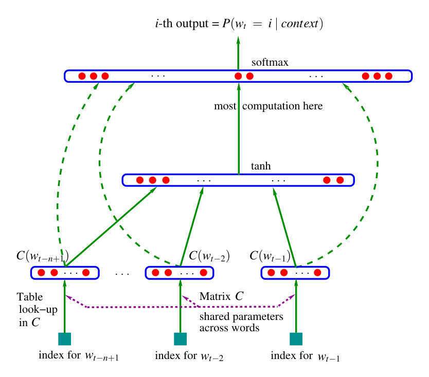
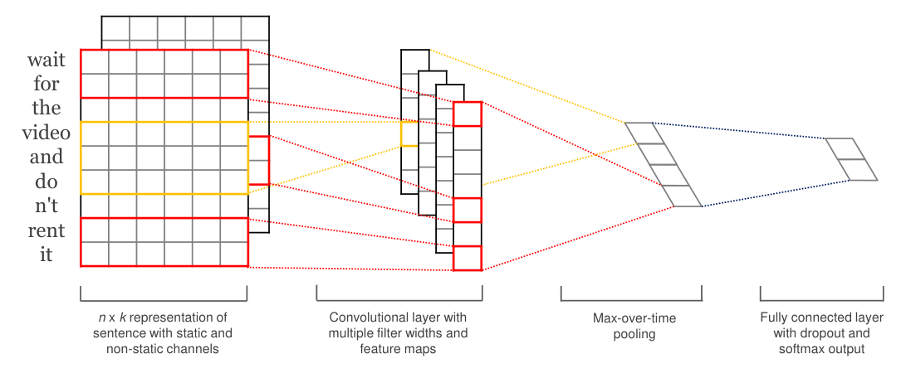
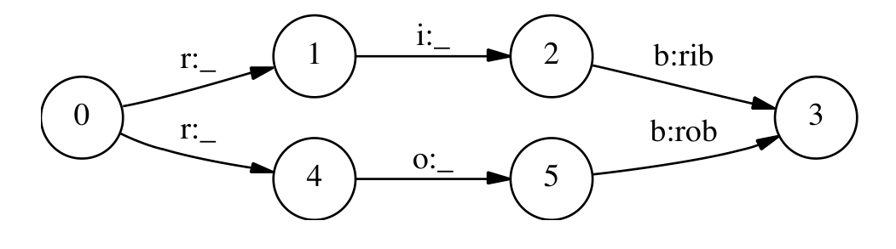
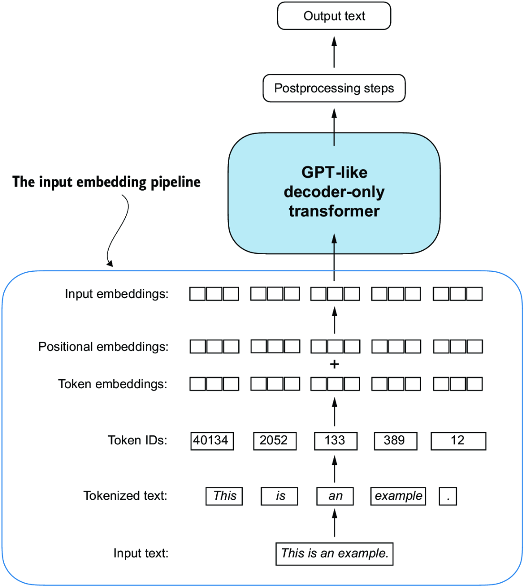

# 1 — Tokens and embeddings

A support ticket arrives: `Refund order #A1B2, please.` You paste it into a model and it replies in fluent English. Before any of that fluency exists, the text has to become numbers, and the way that happens explains a surprising share of what goes wrong later: why the model miscounts letters, why the same sentence costs more tokens in some languages than others, why a long document can quietly fall out of the window. This chapter follows the ticket from characters to tokens to vectors with position in them, which is everything the attention layers of the next chapter receive.

> An LLM is a decoder-only transformer trained to predict the next token. Tokens, embeddings, causal self-attention and scale explain most of its behaviour, including the failures.

---

## The one-sentence model

A large language model takes a sequence of tokens and returns a probability distribution over the next token. Generation is that step in a loop: sample a token, append it, predict again. Everything else in this pillar (prompting, fine-tuning, RLHF, tools) changes *which* distribution the model produces. None of it changes the loop.

That framing explains three things you will meet constantly:

| Behaviour | Why it follows from next-token prediction |
|---|---|
| Fluent but wrong answers (hallucination) | Training rewards *plausible* continuations, not true ones. A confident-sounding citation is a likely sequence of tokens whether or not the paper exists |
| Sensitivity to wording | The prompt is the conditioning context. Different tokens give a different distribution |
| Few-shot learning | Examples in the prompt make the desired pattern the most likely continuation, with no weight update ([arXiv:2005.14165](https://arxiv.org/abs/2005.14165), Brown et al., 2020) |

Predicting the next token well and compressing well are the same objective. Feed a model's probabilities to an arithmetic coder and the compressed size is the model's log-loss in bits. Delétang et al. used this to compare models with ordinary compressors on 1 GB of data in 2,048-byte chunks. Chinchilla 70B, trained on text, cut ImageNet patches to 48.0% of their size and LibriSpeech audio to 21.0%, against 61.7% for PNG and 30.3% for FLAC on the same chunks. Counting the model's own weights changes the result. Chinchilla's "compressed" 1 GB then comes to 14,008% of the original, and with small transformers trained on enwik8, every dataset size had a best model size past which more parameters made compression worse ([arXiv:2309.10668](https://arxiv.org/abs/2309.10668) (Delétang et al., ICLR 2024)).

The abstract's 43.4% and 16.4% do not match the paper's own table. That in-context ability is not tied to words. Mirchandani et al. wrote ARC puzzles as grids of digit tokens, and text-davinci-003 solved 85 of 800 with no training. With each digit swapped for a random vocabulary token, it still solved 44 on average across five alphabets. The prompt format mattered too. In BIG-bench the grids are written without spaces ("8686"), and models scored near zero there, which the authors put down to BPE merging neighbouring digits into one token ([arXiv:2307.04721](https://arxiv.org/abs/2307.04721) (Mirchandani et al., CoRL 2023)).

The loop has a fourth consequence: the model has no scratchpad except the tokens it has already written. Bubeck et al. probed an early, pre-release GPT-4 on `a*b + c*d`. With single-digit numbers it got "only 58% accuracy" on 100 random samples, and with numbers from 10 to 19 it got 16%. When the prompt asked it to write out every intermediate step first, accuracy rose to 100% for numbers from 1 to 40. Asked how many primes lie between 150 and 250, it answered 13. Asked to list them first and then count, it got the right answer. The authors put these failures down to "the model's lack of planning, working memory, ability to backtrack," and separate *incremental* tasks, which can be written one step at a time, from *discontinuous* ones that need an idea before the first word. They also warn that "all quantitative results will be different on the final" model ([arXiv:2303.12712](https://arxiv.org/abs/2303.12712) (Bubeck et al., 2023-03)). This is why chain-of-thought prompting helps arithmetic: the intermediate tokens are the working memory.

The order of the tokens matters as well. Lee et al. trained a 10.6M-parameter NanoGPT from scratch on 3-digit addition. Written the usual way, with the most significant digit first, accuracy plateaued just above 85% even at 10,000 examples, because that digit depends on every digit of both operands. With the answer reversed, each output digit needs only two operand digits and a carry, and accuracy jumped from near zero to 100% between 1,000 and 4,000 examples. A step-by-step scratchpad got to 100% with 1,000 examples, at 281 tokens per example against 15 for the reversed format. No format they tested extrapolated. Trained on up to 7-digit plain additions, the model could not add 8-digit numbers, and a scratchpad model trained on 3 digits silently dropped a digit from 4-digit inputs ([arXiv:2307.03381](https://arxiv.org/abs/2307.03381) (Lee et al., ICLR 2024)). An older architecture did extrapolate, by running a number of steps that grows with the input. Kaiser & Sutskever's Neural GPU applies a convolutional GRU once per input symbol. Trained on binary multiplication up to 20 bits, it made no errors on 2,000-bit numbers, while an LSTM with attention could not even fit the 20-bit training set. Only a few of each 729-run grid search generalized that far, though, and it never learned long decimal multiplication ([arXiv:1511.08228](https://arxiv.org/abs/1511.08228) (Kaiser & Sutskever, ICLR 2016)).

---

## Tokens

Models do not see characters or words. A **tokenizer** splits text into subword units from a fixed vocabulary and maps each to an integer id.

- **Byte-pair encoding (BPE)** starts from bytes or characters and repeatedly merges the most frequent adjacent pair until the vocabulary reaches a target size. The merge rule is Gage's 1994 compression algorithm. Sennrich et al. turned it into a tokenizer so that a translation model could handle words it had never seen, and on WMT15 it beat a dictionary back-off baseline **by up to 1.1 BLEU on English→German and 1.3 on English→Russian** ([arXiv:1508.07909](https://arxiv.org/abs/1508.07909) (Sennrich et al., ACL 2016)). GPT-2's BPE vocabulary has 50,257 entries (*LLMs from Scratch*, ch. 2). WordPiece (BERT) and SentencePiece (T5, Llama) are close relatives. In Google's translation system a 32k-wordpiece model scored 38.95 BLEU on WMT'14 English→French, against 37.90 for whole words and 38.01 for characters, and decoding characters was about five times slower (1.05 vs 0.21 s per sentence) ([arXiv:1609.08144](https://arxiv.org/abs/1609.08144) (Wu et al., 2016-09, preprint)). SentencePiece trains on raw sentences and encodes spaces as the symbol ▁, so decoding is lossless and no language-specific pre-tokenizer is needed; on Kyoto Japanese→English it scored 29.55 BLEU against 28.24 for a word-segmented baseline ([arXiv:1808.06226](https://arxiv.org/abs/1808.06226) (Kudo & Richardson, EMNLP 2018)). Vocabulary size is a design choice: Mixtral 8x7B uses 32,000 tokens and GPT-4's tokenizer 100,256 (*AI Engineering*, ch. 1).
- Why subwords and not words or characters? Huyen gives three reasons. Subwords carry meaning that characters do not ("cook" + "ing"). There are far fewer unique subwords than unique words, so the vocabulary and the embedding table stay small. A made-up word still splits into known pieces ("chatgpt" + "ing"), so nothing is out of vocabulary (*AI Engineering*, ch. 1).
- Common words are one token; rare words, code identifiers and non-English text split into several. A rough English rule: **100 tokens ≈ 75 words** (*Prompt Engineering for GenAI*, ch. 2; *AI Engineering*, ch. 1). GPT-4's tokenizer turns "I can't wait to build AI applications" into nine tokens.
- Tokens are the unit of **cost, latency and context length**. A 200k-token context window is a token budget, not a word budget.
- **The tax is not the same for every language.** On the MASSIVE dataset (the same short sentences translated into 52 languages), the median length with GPT-4's tokenizer was 7 tokens in English, 32 in Hindi and 72 in Burmese. Burmese text therefore costs about ten times as much and takes about ten times as long per API call for the same content. English also makes up 45.88% of Common Crawl, which helps explain why GPT-4 scores best in English on MMLU (*AI Engineering*, ch. 2, citing Yennie Jun's 2023 analysis). Swapping in a language-specific tokenizer after training is not free either. Minixhofer et al. trained a hypernetwork that predicts embeddings for any new vocabulary, and moving Mistral-7B to 50k-token monolingual tokenizers cut sequence length by 30–47% on European languages, but 5-shot multilingual MMLU fell by 8–15 points (Russian 49.9 → 35.1) without further training ([arXiv:2405.07883](https://arxiv.org/abs/2405.07883) (Minixhofer et al., NeurIPS 2024)). Qin et al.'s survey of multilingual LLMs sorts the other fixes for English-centric models into two kinds. Some tune parameters, at pretraining, SFT, RLHF or downstream fine-tuning. Others leave the weights frozen and work through the prompt. Among the prompt-only methods, the survey finds translating the input to English first works best, and it lists unequal token cost across languages as an open fairness problem ([arXiv:2404.04925](https://arxiv.org/abs/2404.04925) (Qin et al., 2024, preprint)).
- **The vocabulary reflects the data it was trained on.** GPT-NeoX-20B kept GPT-2's vocabulary size (50,257) but retrained BPE on the Pile and added tokens for runs of up to 24 spaces ([doi:10.18653/v1/2022.bigscience-1.9](https://doi.org/10.18653/v1/2022.bigscience-1.9) (Black et al., BigScience Workshop 2022)). A short recursive Python function took 39 tokens instead of 55. Across the Pile validation set it needed about 10% fewer tokens (24% fewer on GitHub, 23% fewer on PubMed Central), but on C4, which is outside its training data, it used the same number as GPT-2. GPT-2's longest tokens were scraping artefacts such as "rawdownloadcloneembedreportprint". NeoX's were scientific terms from PubMed, such as "immunohistochemistry". BLOOM, trained on 46 natural and 13 programming languages, went the other way. It grew the vocabulary to 250,680 so that no language would need more than about 10 percentage points more tokens per word than a monolingual tokenizer did. On Universal Dependencies, French came out 11% *lower* than CamemBERT's tokenizer, and Arabic 13% higher than Arabic BERT's. Its first tokenizer, trained on undeduplicated text, stored whole URLs as single tokens ([arXiv:2211.05100](https://arxiv.org/abs/2211.05100) (BigScience Workshop, 2022, preprint)). BloombergGPT tuned the size directly. It trained a Unigram tokenizer on the Pile, tried vocabularies from 25,000 to 550,000, kept the one that gave the smallest encoded C4 and rounded 125,000 up to 2¹⁷ = 131,072. Across C4, the Pile and Wikipedia, the BLOOM, NeoX and OPT tokenizers used 13–26% more tokens, though BLOOM's used 12% fewer on Wikipedia ([arXiv:2303.17564](https://arxiv.org/abs/2303.17564) (Wu et al., 2023, preprint)). That is a count of tokens. No model was trained on a different tokenizer to test the effect, and the authors leave it as future work.

Tokenization explains several odd failures: counting letters in a word, reversing strings and arithmetic on long numbers are hard because the model never sees the individual characters. That is only part of the story. On the CUTE benchmark a 7.5B BPE model still spelled words out letter by letter with 91.5% exact match (97.3% for a byte-level model of the same size), but both scored below 25% on character edits such as deleting, substituting or swapping a letter ([arXiv:2506.14761](https://arxiv.org/abs/2506.14761) (Videau et al., NeurIPS 2025)). Spelling can be learned from token patterns; manipulating characters stays hard even with bytes. A separate failure comes from training the tokenizer and the model on different data. A string that was frequent in the tokenizer's corpus gets its own token, but if it hardly appears in the model's training text, that token's embedding is barely trained. Kaddour et al.'s review calls these *glitch tokens*, after Rumbelow and Watkins's 2023 "SolidGoldMagikarp" write-up, and says they cause unexpected behaviour. The review notes that the coupling also means a new tokenizer has to be trained whenever the pretraining corpus changes ([arXiv:2307.10169](https://arxiv.org/abs/2307.10169) (Kaddour et al., 2023, preprint)).

`tiktoken` is OpenAI's BPE implementation; Anthropic exposes a `count_tokens` endpoint instead. Here is our ticket through GPT-2's tokenizer:

```python
import tiktoken

enc = tiktoken.get_encoding("gpt2")
ticket = "Refund order #A1B2, please. Tokenization isn't free."
ids = enc.encode(ticket)
print(len(ticket), "characters ->", len(ids), "tokens")
print([enc.decode([i]) for i in ids])
print("round trip ok:", enc.decode(ids) == ticket)
```

```text
52 characters -> 17 tokens
['Ref', 'und', ' order', ' #', 'A', '1', 'B', '2', ',', ' please', '.', ' Token', 'ization', ' isn', "'t", ' free', '.']
round trip ok: True
```

`' order'` stays one token and the leading space belongs to it. Capitalised `Refund` splits in two, and the product code `A1B2` falls apart into four pieces. That is why a model that reads `A1B2` perfectly well can still trip when asked to spell it backwards.

Open-weight models ship their tokenizer with the weights. Hugging Face's Transformers library defines every model as three parts: a tokenizer, a transformer body and a task head that can be swapped for fine-tuning. `AutoTokenizer.from_pretrained(name)` loads the tokenizer the model was pretrained with, because tokenizers "often differ in small details, but need to be in sync with pretraining" ([doi:10.18653/v1/2020.emnlp-demos.6](https://doi.org/10.18653/v1/2020.emnlp-demos.6) (Wolf et al., EMNLP 2020 Demos)). When the paper was written, its model hub held 2,097 community models. The paper is a system description and reports no controlled benchmarks; its one speed figure is a near-4× ONNX speedup on BERT, RoBERTa and GPT-2, with no setup given.

**Dropping the tokenizer.** Byte-level models read raw UTF-8 bytes (a vocabulary of 256). That removes the language tax and the out-of-vocabulary problem, but sequences get roughly four times longer. A 64-layer, 235M-parameter character transformer reached 1.06 bits per byte on enwik8, yet on the One Billion Word benchmark its word perplexity ([how many words it is still choosing between](06-pretraining-data-and-objectives.md#entropy-cross-entropy-kl-and-perplexity); lower is better) of 40.6 trailed a word-level model's 23.7 ([arXiv:1808.04444](https://arxiv.org/abs/1808.04444) (Al-Rfou et al., AAAI 2019)). Later work narrowed the gap by spending less compute per byte. MEGABYTE runs a large model over 8-byte patches and a small model inside each patch, and after 400B bytes of PG-19 it reached a word perplexity of 36.4 against 69.4 for a plain byte transformer on the same compute ([arXiv:2305.07185](https://arxiv.org/abs/2305.07185) (Yu et al., NeurIPS 2023)). MambaByte replaces attention with a Mamba state-space model. On PG-19, at the same compute as MEGABYTE but after only 150B bytes, its 972M model reached 33.0. A subword Mamba of similar size, trained on 600B bytes, reached 33.9. When neighbouring bytes were swapped with probability 0.3, its perplexity rose by 28.7 points, against 630.6 for the subword model ([arXiv:2401.13660](https://arxiv.org/abs/2401.13660) (Wang et al., COLM 2024)). AU-Net and H-Net group bytes into chunks before the expensive layers, either at spaces or with a learned router that settled near BPE's ~4.6 bytes per chunk. At about 1B parameters, trained on the same data as a BPE transformer, they matched or beat it. The two-stage H-Net scored 0.715 vs 0.730 bits per byte on FineWeb-Edu and 58.2 vs 55.5 average zero-shot accuracy ([arXiv:2507.07955](https://arxiv.org/abs/2507.07955) (Hwang et al., 2025-07, preprint)). AU-Net scored 73.7 vs 70.2 on HellaSwag, but splitting at spaces cost it on Chinese MMLU at 8B (28.0 vs 33.0) ([arXiv:2506.14761](https://arxiv.org/abs/2506.14761) (Videau et al., NeurIPS 2025)). None of these papers trains past 8B parameters, and lower bits per byte does not guarantee better task scores. Marathe et al. distilled Llama-3-8B into ~1.3B byte models, and at about 1.8×10²¹ FLOPs those models had lower bits per byte than a token model but worse benchmark scores. The point where bytes come out ahead (52.4% vs 48.4% average accuracy) exists only in extrapolated scaling fits ([arXiv:2609.12303](https://arxiv.org/abs/2609.12303) (Marathe et al., 2026-09, preprint)). Compressing harder than BPE has a limit too. When text was compressed with arithmetic coding driven by a small language model, a 2B model trained on the result learned nothing: its predictions stayed uniform. Splitting the stream into windows that each carry the same number of bits made it learnable, at 0.94 bits per byte against 0.87 for SentencePiece and 1.03 for raw bytes. These results are English-only and from undertrained models ([arXiv:2404.03626](https://arxiv.org/abs/2404.03626) (Lester et al., TMLR 2024)).

Character input is older than the transformer. Zhang et al. gave a 9-layer ConvNet (6 convolutional, 3 fully connected layers) one-hot characters from a 70-symbol alphabet, cut to 1,014 characters, with no word segmentation. On eight text-classification sets the large model with thesaurus augmentation reached 4.93% error on Amazon review polarity (3.6M training texts) against 7.98% for the best n-gram model, yet on AG News (120k texts) it trailed, 13.39% against 7.64% for n-gram TF-IDF. The authors read this as character models overtaking word-based ones only at millions of examples ([arXiv:1509.01626](https://arxiv.org/abs/1509.01626) (Zhang et al., NIPS 2015)). These are 2015 baselines, single runs, and classification only.

---

## Embeddings and position

Each token id indexes a row of a learned **embedding matrix** (vocab_size × d_model; 50,257 × 768 for GPT-2 small). The row is a dense vector that ends up encoding meaning: similar tokens land near each other.

### Vectors, dot products and cosine similarity

A **vector** is a list of numbers; an embedding has `d_model` of them, so a token is a point in a 768-dimensional space (GPT-2 small).

- The **dot product** multiplies two vectors entry by entry and adds the results: `a·b = a₁b₁ + a₂b₂ + …`. It is large when they point the same way, zero at right angles.
- The **norm** `‖a‖ = √(a·a)` is the vector's length.
- **Cosine similarity** `a·b / (‖a‖ ‖b‖)` divides the lengths out. It runs from 1 to −1.

The dot product grows with length: ten times longer `a` gives ten times larger `a·b`, with no change of direction. Once every vector is scaled to length 1, the dot product *is* the cosine, and the straight-line (L2) distance `‖a−b‖` shrinks as the cosine grows (`‖a−b‖² = 2 − 2·a·b`), so all three rank neighbours the same way. Attention scores ([chapter 2](02-attention-and-the-transformer-block.md#matrix-products-transpose-and-rank)) are plain dot products.

```python
import numpy as np

query = np.array([3.0, 4.0])
docs = {"short, 53 degrees away": np.array([1.0, 0.0]),
        "same direction, 10x longer": np.array([30.0, 40.0]),
        "at right angles": np.array([-4.0, 3.0])}
cosine = lambda a, b: a @ b / (np.linalg.norm(a) * np.linalg.norm(b))

for name, d in docs.items():
    print(f"{name:28s} dot {query @ d:6.1f}  cosine {cosine(query, d):5.2f}")
q = query / np.linalg.norm(query)
print("scaled to length 1:")
for name, d in docs.items():
    u = d / np.linalg.norm(d)
    print(f"{name:28s} dot {q @ u:5.2f}  cosine {cosine(q, u):5.2f}  L2 distance {np.linalg.norm(q - u):4.2f}")
```

```text
short, 53 degrees away       dot    3.0  cosine  0.60
same direction, 10x longer   dot  250.0  cosine  1.00
at right angles              dot    0.0  cosine  0.00
scaled to length 1:
short, 53 degrees away       dot  0.60  cosine  0.60  L2 distance 0.89
same direction, 10x longer   dot  1.00  cosine  1.00  L2 distance 0.00
at right angles              dot  0.00  cosine  0.00  L2 distance 1.41
```

NumPy, 2-d vectors. More in [similarity and distance](../../../data-science/03-nlp/notes/04-embeddings-and-similarity.md#similarity-and-distance).

The embedding table is older than the transformer. Minaee et al.'s survey splits language modelling into four waves. First came n-gram counts, then task-specific neural models with learned embeddings, then task-agnostic pretrained models fine-tuned per task, and finally LLMs with tens to hundreds of billions of parameters that pick up a task from the prompt ([arXiv:2402.06196](https://arxiv.org/abs/2402.06196) (Minaee et al., 2024, preprint)). The embedding table arrived with the second wave. Bengio et al. learned a feature vector per word (30 to 100 numbers) jointly with a small network that predicted the next word from the previous few. A sentence never seen in training then still got probability from sentences with similar words. [Text representation](../../../data-science/03-nlp/notes/01-text-representation.md#bag-of-words) in data science starts from the word counts that came first.

On the Brown corpus (800,000 training words, a 16,383-word vocabulary) their best network, with an order-5 model (a 4-word context), 100 hidden units and 30-number word features, mixed 50/50 with a trigram model had test perplexity 252 against 312 for the best smoothed n-gram model, about 19% lower (the paper reports the n-gram as 24% above the network). On 14M words of AP News it scored 109 against 117 (about 7% lower; the paper says 8%). Mixing with a trigram model helped every time. Training took about three weeks on 40 CPUs for five epochs, almost all of it spent in the softmax over the vocabulary. Fixed word features taken from a PCA of co-occurrence counts failed, so the features were learned from a random start. Perplexity was the only metric, and the paper never inspects the vectors. This is the JMLR version; the idea first appeared at NIPS 2000 ([JMLR 3:1137](https://www.jmlr.org/papers/v3/bengio03a.html) (Bengio et al., JMLR 2003, NIPS 2000 original; [OpenAlex W2140679639](https://openalex.org/W2140679639))). Word2vec dropped the hidden layer and replaced that softmax with negative sampling. On about 1B words of news, 300-d vectors trained in 14 to 38 minutes and scored about 60% on a word-analogy test ([arXiv:1310.4546](https://arxiv.org/abs/1310.4546) (Mikolov et al., NIPS 2013); details in [data-science 11](../../../data-science/03-nlp/notes/04-embeddings-and-similarity.md)). Mnih & Hinton attacked the same softmax cost from another side. Their hierarchical model replaces it with a product of binary decisions down a tree of words, so only the nodes on one word's path are scored. On 14M words of AP News (100-d features, 5-word context), a tree built from the data gave perplexity 131.3 against 151.2 for a random tree at the same 4 minutes per epoch, and a 2× overcomplete tree reached 115.7 against 117.0 for the full-softmax model of the same family. The slowest tree, 4× overcomplete, took 32 minutes per epoch against 6,420 for the full softmax. These are single runs on one corpus ([NeurIPS 2008 paper](https://openalex.org/W2131462252) (Mnih & Hinton, NeurIPS 2008)). GloVe fitted the vectors to global counts instead: weighted least squares on the logarithm of a word–word co-occurrence matrix, using only its nonzero entries (75–95% of the matrix is zero). With 300-d vectors from 42B tokens of Common Crawl it scored 75.0% on 19,544 analogy questions (81.9% semantic, 69.3% syntactic). On the same 6B-token corpus (Wikipedia 2014 plus Gigaword 5) its 300-d vectors beat word2vec skip-gram and CBOW at 71.7%, although the authors left the word2vec settings other than the number of negative samples at their defaults, and SVD of the raw counts scored 7.3% ([ACL Anthology D14-1162](https://aclanthology.org/D14-1162/) (Pennington et al., EMNLP 2014)).


*Image Source: Bengio et al., [A Neural Probabilistic Language Model](https://www.jmlr.org/papers/v3/bengio03a.html) (JMLR 2003), Fig. 1*


*Image Source: Pennington et al., [GloVe: Global Vectors for Word Representation](https://aclanthology.org/D14-1162/) (EMNLP 2014), Fig. 3*


These vectors are static: a word gets one vector whatever its sense, a limit Bengio et al. already pointed out. Kim's sentence classifier shows what they buy and what tuning them adds. A one-layer CNN over frozen 300-d word2vec vectors (CBOW, 100B words of Google News) beat the same network with random vectors on all three tasks compared: 81.0% against 76.1% on movie reviews (MR), 93.0 against 89.6 on Subj and 86.8 against 82.7 on SST-2. Letting the vectors train with the task helped less and not always: SST-1 went from 45.5 to 48.0, but customer reviews slipped from 84.7 to 84.3. In his two-channel variant the static channel's neighbours of "good" include "bad", since word2vec puts antonyms close together, while in the fine-tuned channel they are "nice", "decent", "solid" and "terrific", with "nice" closer than "great" or "bad" ([arXiv:1408.5882](https://arxiv.org/abs/1408.5882) (Kim, EMNLP 2014)). Each cell is a single run, and all hyperparameters were tuned on the SST-2 dev set.

Collobert et al. had made the same point on tagging, with a lookup table of 50-number vectors for a 100,000-word dictionary (5M of the network's parameters). Trained from random vectors, their window network scored 81.47 F1 on CoNLL 2003 named-entity recognition. Initialising the table from a ranking-loss language model, trained for about four weeks on Wikipedia and three more on Wikipedia plus Reuters (a 130,000-word dictionary; roughly 852M words in all), raised it to 88.67, and took chunking from 90.33 to 93.63 and semantic role labelling from 70.99 to 74.15. The nearest neighbours of "france" went from unrelated rare words to austria, belgium and germany. Training several tasks on a shared table added little (chunking 94.10 against 93.63). All of this is one fixed-window network and one run per cell, and the input is lowercased with a capitalisation feature, so it is not raw characters ([arXiv:1103.0398](https://arxiv.org/abs/1103.0398) (Collobert et al., JMLR 2011)).


*Image Source: Kim, [Convolutional Neural Networks for Sentence Classification](https://arxiv.org/abs/1408.5882) (EMNLP 2014), Fig. 1*

ELMo made the vector depend on the sentence. It runs a 2-layer bidirectional LSTM language model over the input, and each task learns its own weighted sum of the layers. That set the state of the art on six tasks, with 6–20% relative error reduction; SQuAD F1, for example, went from 81.1 to 85.8 ([arXiv:1802.05365](https://arxiv.org/abs/1802.05365) (Peters et al., NAACL 2018)). The layers specialize. Part-of-speech tagging works best from the first layer (97.3 against 96.8), and word-sense disambiguation works best from the second (69.0 against 67.4). GloVe's nearest neighbours of "play" are all sports words, while ELMo's separate the theatre sense from the sports sense. Its predecessor, TagLM, fed the top layer of a frozen language model into a tagger and raised CoNLL-2003 NER F1 from 90.87 to 91.93 ([arXiv:1705.00108](https://arxiv.org/abs/1705.00108) (Peters et al., ACL 2017)). A language model trained only on the small task corpus gave no gain, so the gain came from the large unlabeled corpus. CoNLL-2003 is the standard English NER benchmark behind that number: Reuters news with four entity types (person, location, organization, miscellaneous), 203,621 training tokens, and a test set of 46,435 tokens from a later month (December 1996) than the training data, scored by exact-match entity F1. At the shared task itself the best system scored 88.76 and a majority vote of five systems, chosen on the development set, 90.30 ([ACL Anthology W03-0419](https://aclanthology.org/W03-0419/) (Tjong Kim Sang & De Meulder, CoNLL 2003)). NER is a sequence-labelling task, and the classic model for it is the conditional random field, which scores a whole label sequence with one exponential model instead of normalizing at every step. Lafferty et al. showed why that matters: on synthetic label-bias data its error was 4.6% against 42% for a maximum-entropy Markov model (MEMM), and on Penn Treebank part-of-speech tagging (45 tags, trained on half the 1.1M-word corpus) it reached 4.27% error with spelling features against 4.81% for the MEMM ([ICML 2001](https://openalex.org/W2147880316) (Lafferty et al., ICML 2001)). GloVe's own NER test fed its 50-d vectors to a CRF tagger and scored 93.2 F1 on the CoNLL development set and 88.3 on the test set.


*Image Source: Peters et al., [Deep Contextualized Word Representations](https://arxiv.org/abs/1802.05365) (NAACL 2018), Fig. 2*


*Image Source: Lafferty et al., [Conditional Random Fields: Probabilistic Models for Segmenting and Labeling Sequence Data](https://openalex.org/W2147880316) (ICML 2001), Fig. 1*

A transformer's hidden states are contextual in the same sense. Only the input table is static.

Attention by itself is order-blind, so a position signal is added to the input or inside attention. The comparison table (learned, sinusoidal, relative, RoPE, ALiBi, none), the long-context extension methods (position interpolation, NTK-aware scaling, YaRN) and the evidence on where each scheme breaks are in [01b — Position encodings and context extension](01b-position-encodings-and-context-extension.md#position-schemes-and-length-extension). The worked example below builds the two you will meet most often, a learned table and RoPE.

## Worked example: from ticket to model input

The pipeline has three steps, and each one can be built in a few lines. First, the shape of it:

```text
"Refund order #A1B2"
        |  tokenizer (BPE merges)
        v
[int, int, int, ...]                   integers, one per token
        |  token embedding table       vocab_size x d_model
        v
one d_model vector per token
        |  add position                learned table, or RoPE inside attention
        v
(batch, T, d_model)                    what the first attention layer receives
```

**Step 1: where the merges come from.** BPE starts from characters and repeatedly fuses the most frequent adjacent pair. Run it on a small corpus of tickets and common strings become single tokens, while rare ones stay in pieces:

```python
from collections import Counter

corpus = ["refund order", "refund my order", "refund please", "order status", "order refund"]
words = Counter(w for line in corpus for w in line.split())
vocab = {tuple(w) + ("</w>",): n for w, n in words.items()}

def best_pair(vocab):
    pairs = Counter()
    for symbols, n in vocab.items():
        for a, b in zip(symbols, symbols[1:]):
            pairs[(a, b)] += n
    return max(pairs, key=lambda p: (pairs[p], p))

def merge(vocab, pair):
    out = {}
    for symbols, n in vocab.items():
        s, i = [], 0
        while i < len(symbols):
            if symbols[i:i + 2] == pair:
                s.append(pair[0] + pair[1]); i += 2
            else:
                s.append(symbols[i]); i += 1
        out[tuple(s)] = n
    return out

for step in range(8):
    pair = best_pair(vocab)
    vocab = merge(vocab, pair)
    print(step + 1, "merge", pair)
print(sorted(vocab, key=len))
```

```text
1 merge ('u', 'n')
2 merge ('un', 'd')
3 merge ('und', '</w>')
4 merge ('r', 'e')
5 merge ('re', 'f')
6 merge ('ref', 'und</w>')
7 merge ('r', 'd')
8 merge ('rd', 'e')
[('refund</w>',), ('m', 'y', '</w>'), ('o', 'rde', 'r', '</w>'), ('p', 'l', 'e', 'a', 's', 'e', '</w>'), ('s', 't', 'a', 't', 'u', 's', '</w>')]
```

After eight merges `refund` is one symbol, while the rarer `status` and `please` are still single characters. Real tokenizers do this over gigabytes of text until they reach the target vocabulary, 50,257 entries for GPT-2.

**Step 2: why position has to be added.** An embedding table maps each id to the same vector wherever it appears. Attention, as the next chapter shows, is a weighted average, and an average does not care about order. So without a position signal, `order refund` and `refund order` are the same bag of vectors:

```python
import torch

torch.manual_seed(0)
vocab_size, d_model, context = 50_257, 8, 16
tok = torch.nn.Embedding(vocab_size, d_model)
pos = torch.nn.Embedding(context, d_model)

a = torch.tensor([917, 1502])   # two made-up ids, say "refund order"
b = torch.tensor([1502, 917])   # the same tokens reversed
positions = torch.arange(2)

def as_set(vectors):
    return sorted(tuple(round(x, 4) for x in row.tolist()) for row in vectors)

print("same set of vectors, tokens only:   ", as_set(tok(a)) == as_set(tok(b)))
print("same set of vectors, with positions:",
      as_set(tok(a) + pos(positions)) == as_set(tok(b) + pos(positions)))
print("token table parameters:", sum(p.numel() for p in tok.parameters()))
print("position table parameters:", sum(p.numel() for p in pos.parameters()))
```

```text
same set of vectors, tokens only:    True
same set of vectors, with positions: False
token table parameters: 402056
position table parameters: 128
```

With tokens alone, the two orderings hand attention the same set of vectors, so nothing downstream could tell them apart. Adding a position vector changes each token's own vector, and now the sets differ. The two tables also show where parameters go: the token table is far larger than the position table, and it scales with the vocabulary.


*Image Source: Raschka, *Build a Large Language Model (From Scratch)* (Manning, 2024), Fig. 2-19*

**Step 3: why RoPE works past the table.** The table above has an entry for 16 positions and nothing for the 17th. RoPE has no table. It rotates each query and key by an angle proportional to its position, so a query–key score depends only on the *offset* between them:

```python
import math

def rotate(v, position, theta=0.1):
    c, s = math.cos(position * theta), math.sin(position * theta)
    return (c * v[0] - s * v[1], s * v[0] + c * v[1])

def score(q, k, pos_q, pos_k):
    rq, rk = rotate(q, pos_q), rotate(k, pos_k)
    return rq[0] * rk[0] + rq[1] * rk[1]

q, k = (1.0, 0.5), (0.2, 0.9)
for pq, pk in [(0, 3), (10, 13), (1000, 1003), (0, 4)]:
    print(f"query at {pq:>4}, key at {pk:>4}: score = {score(q, k, pq, pk):.6f}")
```

```text
query at    0, key at    3: score = 0.384553
query at   10, key at   13: score = 0.384553
query at 1000, key at 1003: score = 0.384553
query at    0, key at    4: score = 0.287155
```

The three pairs three apart score the same, wherever they sit in the document, and the pair four apart differs. Real RoPE applies this to many coordinate pairs at different frequencies. So RoPE has no hard maximum, but the positional table above still says it does not by itself run past the training length: the model only ever learned on offsets inside that range. That is why the extensions earlier in this chapter go after its frequencies.

---

## Pitfalls

- **Estimating cost from word counts.** 100 tokens per 75 words is a rule for English prose. Code, identifiers and other languages differ widely (Burmese ran to ten times English, above), so count with the model's own tokenizer, or its counting endpoint, before you promise a budget.
- **Mixing tokenizers.** Token ids mean nothing outside the tokenizer that made them. Counting with GPT-2's and billing against another model's will be wrong, and loading weights with the wrong tokenizer produces fluent-looking garbage.
- **Asking for character-level work and trusting the answer.** Spelling, counting letters and reversing strings ask the model about units it never sees directly. Give it a tool, or split the string into separate tokens first.
- **Treating the context limit as a soft target.** Providers differ on what happens past the limit, and frameworks may truncate silently. Measure the assembled prompt in tokens.
- **Assuming a position scheme extends itself.** A learned table has no entry past its length, and RoPE degrades past the training range. Check the context length a model was trained on, not just the one it accepts.

---

## Try it

1. Tokenize `A1B2`, `a1b2` and ` A1B2` (leading space) with GPT-2's encoding. Do they share tokens? What does that say about normalising case in a retrieval key?
2. In the BPE example, add `"status"` ten more times to the corpus and rerun it. Which merges appear first now?
3. In the RoPE example, change `theta` to `0.5` and check that equal offsets still score equally. What changes?

<details>
<summary>Answers</summary>

1. They produce different ids, and the leading space changes the first token, because a token's identity includes its case and its leading space. A retrieval key or cache key normalised after tokenizing will miss, so normalise the text first.
2. Pairs inside `status` now have the highest counts, so they merge first and `status` collapses to one symbol. Merge order follows frequency, which is why common words end up as single tokens.
3. Equal offsets still match, since the score depends on the offset alone. A larger `theta` makes the score change faster with offset, so it encodes fine distance over a shorter range before the angle wraps around.

</details>

---

## Interview checklist

| Question | Answer |
|---|---|
| Why do LLMs use subword tokens? | Characters give too few units per unit of meaning and whole words cannot cover the open vocabulary. BPE gives a fixed vocabulary that can encode any string |
| What is the effect of tokenization on cost and language quality? | Pricing and context limits are per token. The same short sentence had a median of 7 GPT-4 tokens in English and 72 in Burmese, and languages rare in the training data also tend to score worse |
| Why can a model fail to reverse a string it reads correctly? | It sees tokens, not characters, so the letters inside a token are not directly available to it |
| What does an embedding layer learn? | A trainable table with one vector per token id, fit by next-token loss so that tokens used alike end up with useful vectors |
| Why is a position signal needed at all? | Attention is order-blind on its own, and without one a reordered sentence would produce the same set of vectors |
| Learned positions versus RoPE? | A learned table is simple and has a hard maximum length. RoPE rotates queries and keys so scores depend on relative offset. It has no hard limit, though running past the training length needs extra tricks |

---

## Next

[01b — Position encodings and context extension](01b-position-encodings-and-context-extension.md): the schemes side by side, and what happens when a model runs past its training length. Then [02 — Attention and the transformer block](02-attention-and-the-transformer-block.md) takes these vectors and lets each token gather context from the ones before it.
