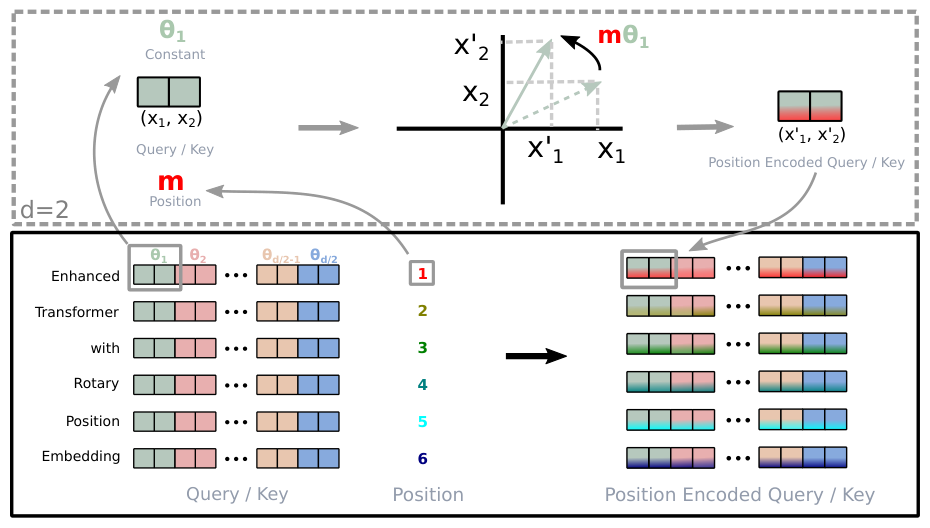
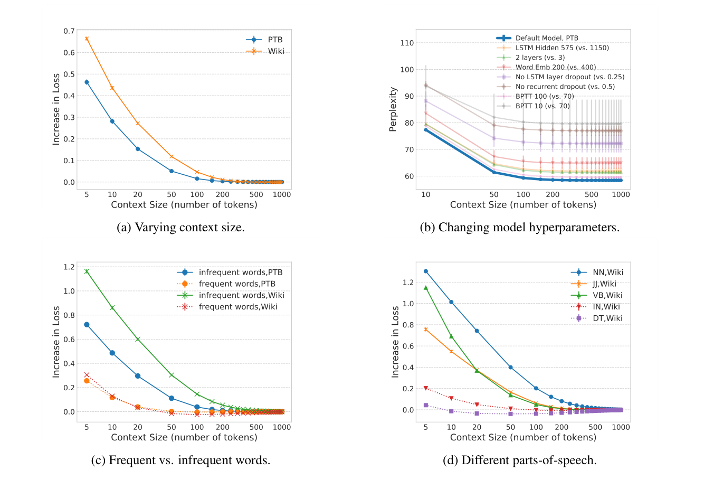

# 1b — Position encodings and context extension

> Part two of [chapter 01](01-tokens-and-embeddings.md). Chapter 01 covers tokens, the embedding table and a worked example that builds a learned position table and RoPE. This note compares the position schemes side by side and follows the evidence on running a model past the length it was trained on.

---

## Position schemes and length extension

Chapter 01 ended with [embeddings](01-tokens-and-embeddings.md#embeddings-and-position): each token is a vector with no sense of order.


Attention by itself is order-blind, so position is added in:

| Scheme | Used by | Idea |
|---|---|---|
| Learned absolute positions | GPT-2, GPT-3 | A second embedding table indexed by position, added to the token embedding |
| Sinusoidal | Original transformer | Fixed sine/cosine patterns ([arXiv:1706.03762](https://arxiv.org/abs/1706.03762)) |
| Relative | Transformer-XL, T5 | A learned or sinusoidal term for the query–key *offset*, clipped beyond some distance, added inside attention instead of to the input ([arXiv:1803.02155](https://arxiv.org/abs/1803.02155); [doi:10.18653/v1/P19-1285](https://doi.org/10.18653/v1/P19-1285)) (below) |
| Rotary (RoPE) | Llama, most open models | Rotate query/key vectors by an angle that depends on position, so the query–key score depends only on their relative offset ([arXiv:2104.09864](https://arxiv.org/abs/2104.09864)). Does not by itself run past the training length (below) |
| ALiBi | BLOOM, MPT | No position embedding; subtract a per-head linear penalty proportional to query–key distance from the attention scores ([arXiv:2108.12409](https://arxiv.org/abs/2108.12409)) |
| None (NoPE) | Research models | No position signal at all. In a decoder the causal mask alone lets the model work out order ([arXiv:2305.19466](https://arxiv.org/abs/2305.19466)) (below) |


*Image Source: Su et al., [RoFormer](https://arxiv.org/abs/2104.09864) (2021), Fig. 1*

ALiBi's paper (Press et al., 2021-08) tested whether a model trained on short sequences still works on longer ones. WikiText-103 suits that test. It is 103M training tokens of full Wikipedia Good and Featured articles, kept in order with their original case and punctuation. It was built because Penn Treebank's 10k-word vocabulary was unrealistic and the 1B Word benchmark shuffles its sentences, so neither can test long-range context ([arXiv:1609.07843](https://arxiv.org/abs/1609.07843) (Merity et al., ICLR 2017)). On WikiText-103, sinusoidal models got worse as soon as the input passed the training length, and rotary was only somewhat better. A 1.3B ALiBi model trained on 1,024 tokens matched the perplexity of a sinusoidal model trained on 2,048 when both were tested at 2,048, and it trained **11% faster with 11% less memory**. Perplexity was best at about twice the training length, then held steady out to 10,000 tokens.

The authors' own appendix limits what that shows. With nonoverlapping evaluation windows, the gain from longer inputs came from fewer tokens sitting at the start of a window with little context (the "early token curse"). It did not come from the model using text far back. Under sliding-window evaluation, where every token gets full context, ALiBi's perplexity stayed flat as the input grew, while the sinusoidal model's still blew up. ALiBi extrapolates without breaking. That is not the same as making use of the extra context. BLOOM chose ALiBi for a different reason. In its 1.3B ablations, ALiBi trained more smoothly and scored better downstream than learned or rotary embeddings, even at the training length. The authors note that results at 1.3B may not carry over to 176B ([arXiv:2211.05100](https://arxiv.org/abs/2211.05100) (BigScience Workshop, 2022, preprint)).

How much context a model actually uses was measured before transformers. Khandelwal et al. perturbed the history of an averaging-SGD LSTM language model at test time (Penn Treebank and WikiText-2 dev sets, mean of 3 seeds). Perplexity rose by only 1% once the context shrank below 150 tokens on PTB and 250 on WikiText-2, so the effective context was about 200 tokens. Shuffling words mattered only within the 20 most recent tokens, and the global order only within 50. Dropping content words five tokens back raised perplexity by about 65%, against 17% for dropping random words. The perturbations were applied to a model trained without them, so the losses are upper bounds. It is one architecture on two small corpora ([ACL 2018](https://arxiv.org/abs/1805.04623) (Khandelwal et al., ACL 2018)).


*Image Source: Khandelwal et al., [Sharp Nearby, Fuzzy Far Away](https://arxiv.org/abs/1805.04623) (2018), Fig. 1*

RoPE models break the same way unless something is changed at inference. Qwen-7B, trained on 2,048 tokens, has an arXiv perplexity of 3.78 at 2,048 tokens, 39.35 at 4,096 and 2,645 at 16,384. **With dynamic NTK scaling, LogN attention scaling and window attention added at inference, without retraining, it holds 3.49 at 8,192 and 4.32 at 16,384** ([arXiv:2309.16609](https://arxiv.org/abs/2309.16609) (Bai et al., 2023-09), Table 3). Like ALiBi's result, that shows the model doesn't break. It doesn't show the model uses the far context. The RoPE paper never tested inputs longer than the training length. Its "long text" evidence is a model *trained* on longer inputs. On the Chinese legal case-matching set CAIL2019-SCM, RoFormer reached 68.29% test accuracy with a 512-token cut-off and 69.79% with 1,024, against 68.10% for WoBERT at 512. On WMT14 English–German it gained 0.2 BLEU (27.5 against 27.3). The authors write that they have no "faithful explanation" for why it does better on long texts ([arXiv:2104.09864](https://arxiv.org/abs/2104.09864) (Su et al., Neurocomputing 2024)).

Qwen's fixes come from a short line of RoPE tweaks. *Position interpolation* divides every position by the extension factor *s*, so a longer input maps back into the trained range. *NTK-aware* scaling raises RoPE's base instead, which stretches the slow-rotating dimensions and leaves the fast ones almost unchanged. *Dynamic* scaling raises *s* only once the input passes the training length, which is what Qwen uses. Code Llama's larger base is the NTK-aware kind. Code Llama raised the base from 10,000 to 1,000,000 and fine-tuned on 16,384-token sequences ([arXiv:2308.12950](https://arxiv.org/abs/2308.12950) (Rozière et al., 2023, preprint)). In its 7B ablation on a synthetic task (find a function hidden in a long file and predict its return value), fine-tuning without the base change failed to find keys placed at the start of an 8K file or a fifth of the way in (0.0% and 0.8%). Position interpolation by 4 failed at 16K for keys at the start (2.3%) and everywhere at 24K. Raising the base without the fine-tuning did nothing past 4K. With both, the 7B found keys at 16K (54.7% at the start, 98–100% further in), but at 24K it found almost none at the start (3.1%).

YaRN interpolates only the dimensions whose wavelength is longer than the training context ("NTK-by-parts") and adds an attention temperature, √(1/t) = 0.1 ln(s) + 1 ([arXiv:2309.00071](https://arxiv.org/abs/2309.00071) (Peng et al., ICLR 2024)). They fine-tuned Llama 2 7B for 400 steps on 64k-token chunks of PG19, about 0.1% of the pretraining data. With *s* = 32 (200 more steps from the *s* = 16 checkpoint, still on 64k chunks) the model reached a sliding-window perplexity of 2.37 at 128k tokens on Proof-pile and over 99% passkey retrieval across the whole window. Its standard benchmarks dropped by up to 2.1 points (MMLU 43.8 → 41.7). Without any fine-tuning, YaRN on LLaMA 7B (trained at 2k) held a perplexity of 3.45 at 32k, where position interpolation was above 100. Their own table shows that perplexity is not the whole story. Code Llama 13B's perplexity climbs past 100k tokens, yet it still passes passkey retrieval at 128k. Giraffe measured retrieval directly ([arXiv:2308.10882](https://arxiv.org/abs/2308.10882) (Pal et al., 2023, preprint)).

LLaMA-13B, trained at 2,048 tokens, was fine-tuned at 4,096 with linear interpolation by 16, which should naively reach about 32k. On a key–value line-lookup task its accuracy fell from 0.64 at 2.5k tokens to 0.10 at 16k and to zero at 17.5k. Linear interpolation still beat xPos, randomized positions and two new frequency-basis schemes. Perplexity ranked those schemes differently from the tasks: their truncated basis had the best perplexity up to 8k but lower task accuracy. Running a model at twice the scale it was fine-tuned at doubled its usable context, with some loss of accuracy, for models fine-tuned at scale 1 or 4 but not 16; beyond twice, it broke. Huang et al.'s survey files all of this under "extrapolative positional encodings", one of five families of long-context fixes. The others are efficient attention, memory, context processing and a catch-all ([arXiv:2311.12351](https://arxiv.org/abs/2311.12351) (Huang et al., 2023, preprint)). It gives the usual explanation of why RoPE breaks. Its slow dimensions never complete a full rotation within the training length, so they are undertrained for positions beyond it.

For Llama 2 at 4k, the survey cites a figure of 92 dimensions that do complete one. The survey reports no measured comparison of its own. How well any of these fixes works also depends on choices made long before extension. Bertsch et al. pretrained 26 models of about 7B on 140B tokens each, varying four common design choices: QK norm, grouped-query attention, sliding-window layers, and a 4K pretraining context. They then extended every model to 64K with 10B tokens. Apart from QK norm, which cost 3.8–6 HELMET points on its own, any one choice cost 1–2 points, but three or more together cut long-context scores by up to 47% (HELMET at 32K ranged from 29.9 to 56.4). The count of choices present predicted the score better than anything else (R² = 0.67, 0.61 leave-one-out). Training loss predicted it poorly (R² = 0.29). Even with 50B extension tokens, the worst architecture stayed below the Llama 3 architecture extended on 1B ([arXiv:2608.10296](https://arxiv.org/abs/2608.10296) (Bertsch et al., COLM 2026)).

Relative schemes came before RoPE. Shaw et al. learned one vector per query–key offset, clipped at *k* positions, and added it to the keys and values. On WMT14 English→German the big model went from 27.9 to 29.2 BLEU, at 7% lower training throughput. Adding absolute positions back on top gave nothing, and BLEU was flat for any *k* ≥ 2. They did not test longer inputs ([arXiv:1803.02155](https://arxiv.org/abs/1803.02155) (Shaw et al., NAACL 2018)). Transformer-XL needed relative positions for a different reason. It caches the previous segment's hidden states and attends over them, so absolute positions from two segments would collide. Its encoding uses sinusoidal offset terms plus two global bias vectors, and it reached 18.3 perplexity on WikiText-103, against a previous best of 20.5 ([doi:10.18653/v1/P19-1285](https://doi.org/10.18653/v1/P19-1285) (Dai et al., ACL 2019)).

In their 128M-parameter ablation the full model scored 26.77, with Shaw's encoding 27.94 and with absolute encoding 30.97. Only their encoding kept improving when the attention length was raised at evaluation. CAPE keeps absolute sinusoidal positions but randomly shifts and scales them during training. A ViT trained on 224² images and tested on 672² kept 73.4% top-1 accuracy, against 72.2% with learned absolute positions and 70.7% with sinusoidal ones ([arXiv:2106.03143](https://arxiv.org/abs/2106.03143) (Likhomanenko et al., NeurIPS 2021)). On translation CAPE tied relative positions (27.89 against 27.92 BLEU), and on long test sentences relative positions still did best. It was never tried on a language model.

Kazemnejad et al. tested dropping positions entirely ([arXiv:2305.19466](https://arxiv.org/abs/2305.19466) (Kazemnejad et al., NeurIPS 2023)). They trained ~107M-parameter decoders from scratch on ten synthetic tasks, among them copying, addition, sorting and SCAN. Training instances had a task length of up to 20 (20 words to copy, say), and test instances up to twice that. On mean reciprocal rank over the tasks, NoPE came first at 0.69, ahead of T5's relative bias (0.55), ALiBi (0.50), rotary (0.33) and learned absolute positions (0.22). They prove that the causal mask lets the first layer recover absolute position, and NoPE's learned attention patterns were closest to T5's. At 1.3B parameters, trained on code with a 1,024-token context, the ranking narrows. On files of 2,750–3,000 tokens, rotary's perplexity jumps from 3.3 at 1,200 tokens to 156 at 1,400. NoPE and ALiBi are still in single digits at 1,600 (3.8 and 3.7, against about 2.7 at 1,024), but at 1,800 tokens they reach 41 and 14. The authors call that generalizing "up to 1800", which is generous. They did no large-scale pretraining comparison.

Copying, the easiest task on that list, is still not solved at frontier scale. In June 2026 Wen et al. asked GPT-5.5, Claude Opus 4.7, Gemini 3.1 Pro, DeepSeek V4 Pro and Qwen 3.6 Plus to copy binary strings of 128 to 4,095 tokens and Python lists of 200 to 500 numbers, far inside their context windows. Accuracy often fell below 50% on the longer inputs, and fell further the more the input repeated itself. Their explanation is that a trained model mixes two ways of copying. One finds the source token by position, which breaks past the trained lengths. The other matches the local context like an induction head, which is ambiguous wherever substrings repeat. They also prove that no one-layer transformer with a shift-invariant position encoding (RoPE, ALiBi, NoPE) can copy every binary string of length 5 or less.

Their fix, 2D-RoPE, gives each token a (row, column) position, with a new row at each newline, so a source token and its copy share a column. They pretrained 1.4B Qwen3-architecture models on 28B DCLM tokens, fine-tuned them on copying with outputs of up to 1K tokens, and tested them on 8K-token strings. 2D-RoPE copied 61.8% exactly and RoPE 0.0% (92.0% against 0.0% at 4K), with similar commonsense averages (46.8 against 45.9). Their headline 87.3% on a second string type does not match their own appendix, which gives 1.8% for the same run. Three of the five frontier models also ran with thinking set low or off ([arXiv:2607.16072](https://arxiv.org/abs/2607.16072) (Wen et al., 2026-07, preprint)).

Position and meaning also compete while a model learns. Cui et al. solved a single attention layer exactly in the limit of large embedding dimension. The layer has tied, [low-rank](02-attention-and-the-transformer-block.md#matrix-products-transpose-and-rank) query and key weights, and the target mixes a fixed positional attention pattern with a content-based one ([arXiv:2402.03902](https://arxiv.org/abs/2402.03902) (Cui et al., NeurIPS 2024)). Below a critical number of training samples per dimension, the best solution attends by position. Above it, the best solution attends by content, and the switch is sharp: a phase transition. Only after that switch does attention beat a plain linear layer that can mix tokens by position alone. The setting is a toy. Sentences are two Gaussian tokens, there is one head and no value matrix, and [gradient descent](../../../data-science/01-classical-ml/notes/02-supervised-learning.md#vectors-matrix-products-and-the-gradient) was started at one solution or the other. From a random start, Adam at larger dimensions reached the content-based solution less often than the positional one, and often found neither. The authors also train a small transformer on a counting task and find two solutions that both reach over 99.8% accuracy, one positional and one content-based.

Position interpolation, the simplest of these fixes, is one line of arithmetic: divide every position by the extension factor, so a longer input maps back into the range the model trained on.

```python
def interpolate(pos, trained=2048, target=8192):
    s = max(1.0, target / trained)            # extension factor
    return pos / s

for p in (100, 2047, 4096, 8191):
    print(f"position {p:>4} -> {interpolate(p):7.2f}")
print("distance between neighbours:", interpolate(1) - interpolate(0))
```

```text
position  100 ->   25.00
position 2047 ->  511.75
position 4096 -> 1024.00
position 8191 -> 2047.75
distance between neighbours: 0.25
```

Every position now lands inside the trained 0 to 2,048 range, but neighbouring tokens sit only 0.25 apart, a spacing the model never saw. That resolution loss is why a short fine-tune at the new length is still needed, and why the methods above differ in which frequencies they stretch.

---

## Pitfalls

- **Trusting the advertised context length.** A model can accept 128k tokens and still retrieve or copy badly from them. Test on your own task at the length you will use.
- **Reading a perplexity curve as long-context ability.** Under non-overlapping windows, much of the gain comes from fewer tokens sitting at the start of a window. Use sliding-window evaluation or a task that needs far-back text.
- **Extending positions without checking short inputs.** Measure quality at the original length before and after. Code Llama's long-context stage, for example, cost 0.52 HumanEval points on short prompts ([chapter 07](07-sft-and-instruction-tuning.md)).

---

## Try it

1. In `interpolate`, set `target=16384`. Where does position 8191 land, and what is the spacing between neighbours?
2. Why can a learned absolute table not be extended this way without new training, while RoPE can be rescaled at inference?

<details>
<summary>Answers</summary>

1. The factor is 8, so position 8191 lands at about 1,024 and neighbours are 0.125 apart. The longer the extension, the finer the spacing the model has to cope with.
2. A learned table has no row for a position it never trained on, and interpolating between rows gives vectors it never learned. RoPE computes its angle from the position, so the position can be rescaled before the angle is taken, though quality still depends on how the model was trained.

</details>

---

## Interview checklist

| Question | Answer |
|---|---|
| Which position schemes put the signal inside attention rather than on the input? | Relative encodings, RoPE and ALiBi act on the query–key score. Learned and sinusoidal positions are added to the token embedding |
| Why does a RoPE model fail past its training length, and what fixes it without retraining? | Positions beyond the trained range rotate queries and keys by angles never seen, so perplexity blows up. Position interpolation, NTK-aware or dynamic scaling and YaRN rescale positions or frequencies at inference, with the limits measured above |

---

## Next

[02 — Attention and the transformer block](02-attention-and-the-transformer-block.md) takes the vectors built in [chapter 01](01-tokens-and-embeddings.md) and lets each token gather context from the ones before it.
