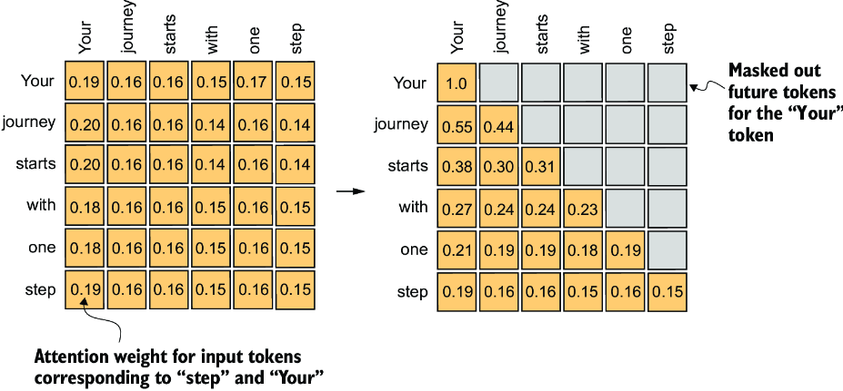
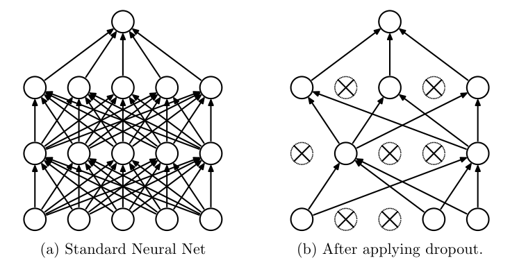
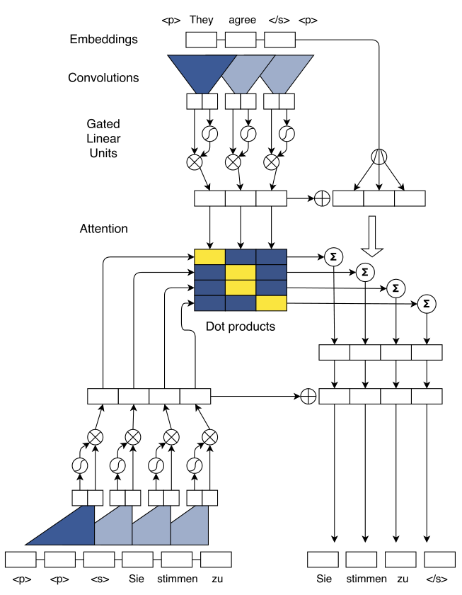
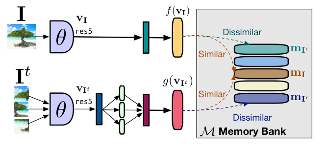

# 2 — Attention and the transformer block

Take the ticket from the last chapter and add a sentence: `The refund for order #A1B2 failed because it was too old.` What does *it* refer to, and how would a model know? An embedding table gives *it* the same vector in every document, so the meaning has to come from elsewhere. Attention is that mechanism: each token computes which earlier tokens matter to it and averages their information into its own vector. Stack that with a little per-token processing, and you have the block that every chat model repeats dozens of times.

> An LLM is a decoder-only transformer trained to predict the next token. Tokens, embeddings, causal self-attention and scale explain most of its behaviour, including the failures.

---

## Attention

Self-attention lets every token build its representation from every other token it can see ([arXiv:1706.03762](https://arxiv.org/abs/1706.03762), Vaswani et al., 2017). Each token is projected into a **query**, a **key** and a **value**.

### Matrix products, transpose and rank

Attention is a few matrix products, so read them by their shapes. A matrix is a grid of numbers with a number of rows and columns. In a **matrix product** `A @ B`, `A` is (m × k) and `B` is (k × n); the inner sizes must match and drop out, and the result is (m × n). Each entry is the dot product ([vectors and dot products](01-tokens-and-embeddings.md#vectors-dot-products-and-cosine-similarity)) of a row of `A` with a column of `B`. That is m·n dot products of k multiplies and k adds each, so the cost is about **2·m·n·k FLOPs** (floating-point operations). This is the number to reach for when estimating the compute of any layer.

The **transpose** `Kᵀ` swaps rows and columns, turning (T × d_k) into (d_k × T). That is why the scores are `Q Kᵀ`: (T × d_k)(d_k × T) gives a (T × T) grid whose entry (i, j) is the dot product of token i's query with token j's key. Without the transpose the inner sizes would not match.

**Broadcasting** is NumPy's and PyTorch's rule for adding or multiplying arrays of different shapes. Line the shapes up from the right; sizes that match, or that are 1 (or missing), are stretched to fit. A (T × T) grid plus a (T,) vector adds the vector to every row. This is how a bias or a scale is applied to a whole batch in one line.

The **rank** of a matrix is how many independent directions it really contains: the most rows you can pick with none of them a weighted sum of the others. A (1000 × 1000) matrix has rank at most 1000. If every row is a mix of just r underlying rows, the rank is at most r. Such a **low-rank** matrix can be written as a product (m × r)(r × n), so it needs r·(m + n) numbers instead of m·n. This is the idea behind LoRA ([chapter 9](09-peft-and-fine-tuning-in-practice.md)) and behind the "low-rank query and key weights" you will meet in the theory papers below.

```python
import numpy as np

rng = np.random.default_rng(0)
Q = rng.normal(size=(5, 8))                    # 5 tokens, 8 numbers each
K = rng.normal(size=(5, 8))
scores = Q @ K.T                               # (5x8)(8x5) -> 5x5
print("Q", Q.shape, " K.T", K.T.shape, " Q @ K.T", scores.shape)
print("FLOPs for Q @ K.T:", 2 * 5 * 5 * 8)     # 2*m*n*k

bias = np.array([0.0, -1.0, -2.0, -3.0, -4.0])
print("broadcast (5,5) + (5,):", (scores + bias).shape)

big = rng.normal(size=(1000, 1000))
low = rng.normal(size=(1000, 4)) @ rng.normal(size=(4, 1000))   # rank 4 by construction
print("rank of big:", np.linalg.matrix_rank(big), " rank of low:", np.linalg.matrix_rank(low))
print("numbers stored: full", low.size, " as two factors", 1000 * 4 + 4 * 1000)
```

```text
Q (5, 8)  K.T (8, 5)  Q @ K.T (5, 5)
FLOPs for Q @ K.T: 400
broadcast (5,5) + (5,): (5, 5)
rank of big: 1000  rank of low: 4
numbers stored: full 1000000  as two factors 8000
```

Run with NumPy, seed 0. The 1,000 × 1,000 matrix built from two thin factors has rank 4 and the same entries stored in 125× fewer numbers (8,000 against 1,000,000).

The formula puts these together:

```text
Attention(Q, K, V) = softmax(Q Kᵀ / √d_k) · V
```

- `Q Kᵀ` scores how relevant each token is to each other token.
- **Softmax** exponentiates each score and divides by the total, so the results are positive and sum to 1. Larger scores get disproportionately more weight: scores [2, 1, 0] become weights 0.67, 0.24, 0.09, and [4, 1, 0] become 0.94, 0.05, 0.02. Once one score dominates, the rest get almost nothing; that is **saturation**. [Chapter 4](04-decoding-and-inference-behaviour.md#decoding) shows how a temperature reshapes it.
- Dividing by `√d_k` keeps the softmax from saturating as dimensions grow. `d_k` is the dimension of each key vector (64 per head in the original transformer), not the sequence length. *Building AI Agents* (ch. 2) says the scores are divided by "the size of the sequence"; Vaswani et al. divide by the square root of the key dimension, and that is what every implementation does.
- Multiplying the (T × T) weights by `V` mixes the value vectors: each token's output is a weighted sum of every token's value, with the softmax weights as the mix.

Three refinements make it a language-model layer (*LLMs from Scratch*, ch. 3 builds each in turn):

1. **Causal mask.** A decoder may only attend to earlier positions. Future positions are set to −∞ before the softmax, so training on "predict token *t* from tokens < *t*" is honest.
2. **Multi-head attention.** Several attention heads run in parallel on lower-dimensional projections and are concatenated. Different heads learn different relations (syntax, coreference, copying). Clark et al. checked this head by head in BERT-base (144 heads, scored on Penn Treebank WSJ dependencies). In head 8-10, a direct object's most-attended word was its verb 86.8% of the time, where always picking the best fixed offset gets 40.0%. Head 8-11 found a noun's determiner 94.3% of the time. But no head covered syntax as a whole: the best one, used as a parser, scored 34.5 UAS, against 26.3 for a right-branching baseline. The syntax is spread across heads: a small probe that combined every head's attention with GloVe vectors reached 77 UAS, against 58 for word distances plus GloVe and 30 for the same probe on a randomly initialized BERT ([arXiv:1906.04341](https://arxiv.org/abs/1906.04341) (Clark et al., BlackboxNLP 2019)).
3. **Dropout on attention weights** during training, for regularization. Dropout zeroes each unit with probability 1 − p in training and scales the weights at test time ([JMLR 15:1929](https://jmlr.org/papers/v15/srivastava14a.html) (Srivastava et al., JMLR 2014)). On permutation-invariant MNIST it cut test error from 1.60% (a published 2-layer, 800-unit net without dropout, Simard et al.) to 1.35% (a 3-layer, 1,024-unit net with dropout), and a CIFAR-10 convnet without augmentation from 15.60% to 12.61% with dropout in every layer. AlexNet used it (p = 0.5) in its first two fully connected layers, where it prevented substantial overfitting but roughly doubled the iterations to converge. Its 7-network ensemble won ILSVRC-2012 with 15.3% top-5 test error against 26.2% for the runner-up ([NeurIPS 2012](https://doi.org/10.1145/3065386) (Krizhevsky et al., NeurIPS 2012; reprinted in CACM 2017)).


*Image Source: Raschka, *Build a Large Language Model (From Scratch)* (Manning, 2024), Fig. 3-19*



*Image Source: Srivastava et al., [Dropout: A Simple Way to Prevent Neural Networks from Overfitting](https://jmlr.org/papers/v15/srivastava14a.html) (2014), Fig. 1*
The whole causal head fits in four lines. This is a rewrite of the idea in Raschka's `CausalAttention` class, not his code; the full version is at [rasbt/LLMs-from-scratch](https://github.com/rasbt/LLMs-from-scratch) (ch03):

```python
import torch

torch.manual_seed(0)
batch, T, d_k = 1, 5, 8
q, k, v = torch.randn(batch, T, d_k), torch.randn(batch, T, d_k), torch.randn(batch, T, d_k)
dropout = torch.nn.Dropout(0.1)   # q, k, v: normally projected from the token embeddings

scores = q @ k.transpose(-2, -1) / k.shape[-1] ** 0.5         # (batch, T, T)
future = torch.triu(torch.ones(T, T, dtype=torch.bool), diagonal=1)
weights = torch.softmax(scores.masked_fill(future, float("-inf")), dim=-1)
out = dropout(weights) @ v                                     # (batch, T, d_k)

print(out.shape)
print(weights[0].round(decimals=2))
print("each row sums to 1:", weights.sum(-1).isclose(torch.tensor(1.0)).all().item())
```

```text
torch.Size([1, 5, 8])
tensor([[1.0000, 0.0000, 0.0000, 0.0000, 0.0000],
        [0.8100, 0.1900, 0.0000, 0.0000, 0.0000],
        [0.0800, 0.8000, 0.1200, 0.0000, 0.0000],
        [0.1200, 0.3000, 0.1300, 0.4400, 0.0000],
        [0.0600, 0.1600, 0.2500, 0.4900, 0.0400]])
each row sums to 1: True
```

Read a row of the weights as one token's budget of attention. Row 3 can spend on tokens 1 to 3 and nothing later, because the mask set the rest to minus infinity before the softmax.

Masking with −∞ *before* the softmax matters. Raschka first zeroes the weights after the softmax and renormalizes, then shows that the −∞ version gives the same result in one step and leaks nothing from the masked positions.

In an encoder–decoder model there is a second kind, **cross-attention**: the *queries* come from the decoder and the *keys and values* from the encoder's output, so each target token can look at the whole source sentence. *Building AI Agents* (ch. 2) has this the wrong way round, with queries from the encoder.

Cross-attention is the older of the two. It began in machine translation as a fix for recurrent networks. Sutskever et al.'s sequence-to-sequence model read the source sentence with a 4-layer LSTM into a single fixed vector and decoded the translation from that vector. On WMT'14 English→French, an ensemble of five reached 34.81 BLEU, against 33.30 for a phrase-based system. Simply reversing the source word order raised a single model from 25.9 to 30.6 BLEU ([arXiv:1409.3215](https://arxiv.org/abs/1409.3215) (Sutskever et al., NIPS 2014)). Bahdanau et al. dropped the fixed vector. At every output step, the decoder scores each encoder state with a small network, takes a softmax over the scores, and reads out the weighted sum. That is cross-attention, with additive scores instead of [dot products](01-tokens-and-embeddings.md#vectors-dot-products-and-cosine-similarity). See [sequence models](../../../data-science/02-deep-learning/notes/05-sequence-models.md#seq2seq-and-attention) in data science for those recurrent networks.

On the same task their model scored 26.75 BLEU, against 17.82 for a fixed-vector encoder–decoder of the same size, and it did not get worse on sentences of 50 or more words ([arXiv:1409.0473](https://arxiv.org/abs/1409.0473) (Bahdanau et al., ICLR 2015)). That baseline was much smaller than Sutskever's LSTM, which had shown no trouble with long sentences, and Bahdanau's single model still trailed the phrase-based system's 33.30. Both papers point back to Graves's handwriting model, which Sutskever et al. credit with introducing differentiable attention: a soft window, a mixture of Gaussians that moves forward along the text as the pen writes. Bahdanau et al. name that forward-only movement as the limit their model removes, since translation needs reordering ([arXiv:1308.0850](https://arxiv.org/abs/1308.0850) (Graves, 2013, preprint)). Gehring et al. showed the recurrence was not needed even before the transformer. Their encoder and decoder are stacks of 1-D convolutions with gated linear units, with a separate dot-product attention over the encoder output in every decoder layer, and learned position embeddings supply the order. With 15 layers on each side and a 40K byte-pair vocabulary, it scored 25.16 BLEU on WMT'14 English→German (0.5 above GNMT) and 40.51 on English→French (1.6 above GNMT's likelihood-trained model). On English→French development sentences with greedy decoding, a K40 GPU translated 9.3 times faster than GNMT on a K80 at 2.25 higher BLEU. In an ablation, dropping both position embeddings cost only 0.5 BLEU (21.2 against 21.7, averaged over three runs), and attention in only the top decoder layer scored worst (20.24) ([arXiv:1705.03122](https://arxiv.org/abs/1705.03122) (Gehring et al., ICML 2017)). The GNMT figures are as the authors report them, not a rerun. The transformer kept the weighted sum and dropped the recurrence.


*Image Source: Gehring et al., [Convolutional Sequence to Sequence Learning](https://arxiv.org/abs/1705.03122) (2017), Fig. 1*

The weights are easy to plot, and the plots are easy to over-read. Jain & Wallace trained BiLSTM classifiers with Bahdanau-style attention on ten datasets, including SST, IMDB, 20 Newsgroups, MIMIC and SNLI. IMDB is 50,000 polarized movie reviews (7 or more stars out of 10 is positive, 4 or fewer negative, neutral ones dropped), split 25,000 for training and 25,000 for test. A weighted bag of words was nearly as good there as the learned word vectors of its authors: 88.23 against 87.44 for a linear SVM on 50-d learned vectors, and 88.89 for vectors plus bag of words, where the vector model also used 50,000 extra unlabeled reviews ([ACL 2011](https://aclanthology.org/P11-1015/) (Maas et al., ACL 2011)). The rank correlation (Kendall τ) between attention weights and gradient-based word importance averaged between 0.08 (20 Newsgroups) and 0.47 (MIMIC diabetes) across datasets. Gradients and leave-one-out importance agreed with each other more than either agreed with attention. For many inputs they could also find a different attention distribution, close to the maximum Jensen–Shannon distance of 0.69, that moved the prediction by less than 0.01 ([arXiv:1902.10186](https://arxiv.org/abs/1902.10186) (Jain & Wallace, NAACL 2019)). The weak agreement is partly the BiLSTM's doing: with a plain averaging encoder under the attention, τ rose to 0.48–0.84 (SST 0.69, against 0.40 with the BiLSTM). They tested no transformers, the adversarial weights may be ones the model would never produce, and gradients are not ground truth either. Two post-hoc methods give the explanation a definition instead of reading it off the weights. Plain gradients fail a basic test: in a one-ReLU network f(x) = 1 − ReLU(1 − x), the output rises from 0 to 1 between baseline 0 and input 2, yet the gradient at the input is 0. Integrated gradients sums the gradients along a straight path from a baseline to the input, and the attributions then add up to F(x) − F(baseline), which is a check you can run: if they do not, take more steps. The authors found 20 to 300 steps enough on their image and text models and 100 to 1,000 on a translation LSTM, and the result depends on the baseline (all-zero embeddings for text). They report no quantitative test of attribution quality ([arXiv:1703.01365](https://arxiv.org/abs/1703.01365) (Sundararajan et al., ICML 2017)). LIME perturbs the input (words removed, image segments switched off), labels the perturbations with the model, and fits a sparse linear model weighted by closeness to the original. It recovered more than 90% of the true features of sparse logistic-regression and decision-tree classifiers on book and DVD reviews, with at most 10 features each, which is a check on interpretable models only, not on a black box ([arXiv:1602.04938](https://arxiv.org/abs/1602.04938) (Ribeiro et al., KDD 2016)). Probes have their own noise. DirectProbe found that the same two-layer MLP probe, retrained from a different random initialization, varied by up to 7.88 accuracy points (BERT-large, preposition supersense roles); a linear probe varied by under 1 point.

It instead clusters the representations by label without training a classifier. The distance between the closest clusters tracked the best probe accuracy layer by layer ([arXiv:2104.05904](https://arxiv.org/abs/2104.05904) (Zhou & Srikumar, NAACL 2021)). There is also a theory of why trained attention looks so peaked. Tarzanagh et al. studied a single attention layer with a fixed linear head. Gradient descent sends the attention weights' norm to infinity, and their direction converges to a hard-margin SVM that separates one "optimal" token per input from the rest, so the softmax ends up selecting a single token. Gradient descent is proven to reach that global solution only under extra conditions. Otherwise it can lock onto a "locally optimal" token instead, and in random trials it reached the global one more often as the dimension grew. With separate key and query matrices, as in real models, the limit is the low-rank, nuclear-norm version of that SVM. That limit is proven for the regularization path and only observed for gradient descent. With a small nonlinear head instead of a linear one, attention keeps several tokens rather than one. Every experiment is synthetic, with dimensions in the tens ([arXiv:2308.16898](https://arxiv.org/abs/2308.16898) (Tarzanagh et al., 2023-08, preprint)).

Images became transformer input by treating patches as tokens. ViT cuts an image into 16×16 patches, projects each one linearly to the model width, prepends a learned [class] token and adds learned 1D position embeddings. Everything after that is a standard transformer encoder ([arXiv:2010.11929](https://arxiv.org/abs/2010.11929) (Dosovitskiy et al., ICLR 2021)). When trained on ImageNet alone without strong regularization, ViT came in a few points below ResNets of similar size, because it lacks the convolution's built-in assumptions about locality. The ranking flipped as pretraining data grew. On subsets of Google's in-house JFT, ViT-B/32 lost to a ResNet50 on a 5-shot ImageNet probe at 9M images and beat it from 90M up. ViT-H/14, pretrained on JFT-300M, reached 88.55% ImageNet top-1 for 2.5k TPUv3 core-days, against 87.54% and 9.9k for the BiT-L ResNet. The kind of position embedding barely mattered.

In a 5-shot probe, the 1D, 2D and relative variants all scored about 0.64, while a model with no positions scored 0.614. NaViT carried language-model example packing over to images. Patches from several images, each at its native aspect ratio, share one sequence, with attention masked so that each image attends only to itself. Position embeddings are factorized into separate x and y parts, and a random fraction of each image's tokens is dropped ([arXiv:2307.06304](https://arxiv.org/abs/2307.06304) (Dehghani et al., NeurIPS 2023)). Native resolution is possible, but pretraining resized each image to a randomly sampled pixel count, which is what kept padding below 2% of tokens. NaViT matched the best ViT with 4× less pretraining compute. The factorized positions also held up better than ViT's 1D ones at resolutions not seen in training. Its pretraining data (JFT-4B and WebLI) is in-house as well.

Large transformers also put tokens to uses nobody designed. Darcet et al. studied vision transformers, where the tokens are image patches ([arXiv:2309.16588](https://arxiv.org/abs/2309.16588) (Darcet et al., 2023-09)). In DINOv2 ViT-g, about 2% of patch tokens, almost all on plain background, ended up with roughly 10× the norm of the rest. Linear probes showed these tokens had dropped their own patch's content and position and held image-wide information instead. In effect, the model was using them as scratch space. They appeared only in ViT-L and larger, and only after about a third of training. The fix was to append four learned "register" tokens that carry no input and are thrown away at the output. That removed the outliers and lifted DINOv2 ViT-L's ADE20k segmentation from 46.6 to 47.9 mIoU, with ImageNet linear-probe accuracy at 84.3 before and 84.8 after. Those are single training runs.

DINOv2 descends from DINO, which trains a ViT without labels by self-distillation ([arXiv:2104.14294](https://arxiv.org/abs/2104.14294) (Caron et al., ICCV 2021)). A student network sees small and large crops of an image and learns to match a teacher's output on the large crops. The teacher is an exponential moving average of the student. Centering and sharpening the teacher's output stop both networks from collapsing to a constant: removing either one sends the KL divergence between them to zero, and removing the momentum collapses k-NN accuracy to 0.1%. ViT-S/16 reached 77.0% ImageNet linear-probe accuracy, against 79.8% for the same network trained end to end with labels. PIRL is an earlier contrastive route to unlabeled features. It makes the representation of an image similar to that of its jigsaw-shuffled version, instead of making it predict the shuffle. A ResNet-50 trained for 800 epochs on the 1.28M unlabeled ImageNet-1k images reached 63.6% top-1 in a linear probe, against 59.0% for the same setup without the invariance term. Fine-tuned in Faster R-CNN on VOC07+12 it beat supervised ImageNet pretraining on AP (54.0) and AP75 (59.7), though not on AP50 on the smaller VOC07 set (73.4 against 74.5). These are single runs, and the paper's Table 5 lists 62.2 for the same Jigsaw model ([arXiv:1912.01991](https://arxiv.org/abs/1912.01991) (Misra & van der Maaten, CVPR 2020)).


*Image Source: Misra & van der Maaten, [Self-Supervised Learning of Pretext-Invariant Representations](https://arxiv.org/abs/1912.01991) (2020), Fig. 3*

Its [class]-token attention maps outlined objects better than a supervised model's did (Jaccard 45.9 against 27.3), though MoCo-v2, BYOL and SwAV maps scored as well (46.3–47.8), so this is a property of self-supervised ViTs, not of DINO alone. iBOT added BERT-style masked patch prediction, with the teacher's patch outputs as targets in place of a fixed image tokenizer ([arXiv:2111.07832](https://arxiv.org/abs/2111.07832) (Zhou et al., ICLR 2022)). Its ViT-B/16 reached 79.5% linear-probe and 84.0% fine-tuned accuracy. In a 300-epoch ViT-S ablation, masked prediction on its own gave only 29.8% on a linear probe (BEiT, with a fixed tokenizer, gave 23.5%) and also fine-tuned worst (79.4%, against 80.6% for DINO). The [class]-level DINO loss is what makes the frozen features usable. iBOT costs 25% more memory than DINO (both with multi-crop) and did no better at retrieval.

Language models have their own version of Darcet's outliers. Many heads put most of their weight on the first token, an **attention sink**. Clark et al. saw it first in BERT. More than half of the attention in layers 6–10 went to the [SEP] token, and from layer 5 on the loss barely changed when that attention changed, so those heads were using [SEP] as a no-op ([arXiv:1906.04341](https://arxiv.org/abs/1906.04341) (Clark et al., BlackboxNLP 2019)). Barbero et al. found the same no-op on ⟨bos⟩ in Llama 3.1: averaged over 170 prompts, 45.97% of heads put more than 80% of their attention on it at 8B, and 78.29% at 405B.

They argue that it is how a deep stack avoids over-mixing, where tokens blur into one another layer after layer. Gemma 7B, run without its ⟨bos⟩ token, fell from 82.57 to 0.00 on RULER at 4,096 tokens and from 80.61 to 27.35 on HellaSwag ([arXiv:2504.02732](https://arxiv.org/abs/2504.02732) (Barbero et al., COLM 2025)). That drop says more about ⟨bos⟩ than about sinks. In their own 120M-parameter runs, a model trained without a fixed ⟨bos⟩ made whatever token came first the sink (65% sink rate either way), and only a model that always saw ⟨bos⟩ in training lost its sink and broke when it was removed (validation loss 2.69 to 7.56). Sun et al. traced how the sink is built.

One or two early feed-forward blocks (layer 2's in Llama 2 7B) act as a quadratic amplifier and put huge values, in the thousands, into a few channels of the first token, whatever that token is (99.65% of Llama 2's vocabulary). The residual stream carries those values until a late block cancels them. Before attention, RMSNorm turns them into a sparse, near-constant key that every query can find. In 7B models trained from scratch, conditional gating of the attention output cut the share of sink heads from 46.0% to 4.5% at the same [perplexity](06-pretraining-data-and-objectives.md#entropy-cross-entropy-kl-and-perplexity) (10.0 against 10.1), and sandwich norm cut the spike from 3,818 to 520 while 44.7% of heads stayed sinks. So the two phenomena co-occur because of pre-norm, but either can be removed without the other.

Sun et al. also tie sinks to short contexts rather than long ones: computing the training loss only on positions 2,048–4,096 left 1.2% sink heads ([arXiv:2603.05498](https://arxiv.org/abs/2603.05498) (Sun et al., 2026-03, preprint)). Barbero et al. varied the training context window itself, from 128 to 2,048 tokens with the loss on every position, and saw sinks grow with it (almost none at 128), so the two results are not in direct conflict. Sinks may still be worth keeping. Across 26 OlmPool models of about 7B, extended to 64K, more attention mass on the first 100 tokens went with better long-context scores (R² = 0.38), and models with QK norm had weaker sinks ([arXiv:2608.10296](https://arxiv.org/abs/2608.10296) (Bertsch et al., COLM 2026)).

Attention cost grows with the square of sequence length. *Building AI Agents* (ch. 3) puts it as 4,096 tokens costing 64× the attention compute of 512, which is (4,096 / 512)². The parameter count does not grow with context; only compute and the cache of keys and values do (next section).

The first fix was to stop every token from attending to every earlier one. The Sparse Transformer splits attention into two fixed patterns, so any token reaches any earlier one in two steps, at O(n√n) cost instead of O(n²) ([arXiv:1904.10509](https://arxiv.org/abs/1904.10509) (Child et al., 2019, preprint)). On enwik8 with a 12,288-byte context, a 95M-parameter model reached 0.99 bits per byte, matching a 277M Transformer-XL. Dense attention scored 1.00 but took 1.31 s per training step, against 0.55. The pattern has to suit the data: the strided pattern built for images managed only 1.13 on text. Every test was density modelling of text, images or audio, with no downstream tasks. Longformer combines a sliding window of local attention, dilated windows in the upper layers and a few chosen tokens that attend globally, at a cost linear in length ([arXiv:2004.05150](https://arxiv.org/abs/2004.05150) (Beltagy et al., 2020, preprint)). Continued from RoBERTa-base to 4,096 tokens, it beat RoBERTa on WikiHop (75.0 against 72.4 on dev) and Hyperpartisan (94.8 against 87.4).

Its ablations show where the gain comes from. Configured like RoBERTa, with 512 tokens and full attention, it scored 71.7, so the extra pretraining was not the cause. Dropping the global attention and its projections cost 8.3 points. Its custom kernel saved memory but was not faster than full attention. LongNet mixes dilated windows of growing size and spacing, and its title claims a billion tokens ([arXiv:2307.02486](https://arxiv.org/abs/2307.02486) (Ding et al., 2023, preprint)). The billion is a forward-pass timing test. The language models were base-size (12 layers, 768 wide), trained on source code (The Stack) at up to 32K tokens, where LongNet's perplexity was 3.01 against 3.64 for a Sparse Transformer. The paper reports no downstream or recall tests. All three cut compute, not memory: a survey of efficient attention points out that sparse attention still stores the full KV cache ([arXiv:2507.19595](https://arxiv.org/abs/2507.19595) (Sun et al., 2025, preprint)).

---

## The transformer block and the GPT stack

This note assumes how such a network is trained, which data science teaches: [backpropagation](../../../data-science/02-deep-learning/notes/01-neural-networks-fundamentals.md), and [AdamW and the learning-rate sweep](../../../data-science/02-deep-learning/notes/02-optimisation-and-regularisation.md).

A GPT is a stack of identical blocks (*LLMs from Scratch*, ch. 4):

```text
x → LayerNorm → masked multi-head attention → + x  (residual)
  → LayerNorm → feed-forward (expand 4×, GELU, project back) → + x  (residual)
```

Then a final LayerNorm and a linear **output head** that projects back to vocabulary size to produce logits. GPT-2 small: 12 layers, 12 heads, d_model 768, 1,024-token context, about 124M parameters.

Three details that the diagram hides:

- **Pre-LayerNorm.** The norm sits *before* attention and the feed-forward layer, inside the residual branch. The original transformer normalized after the residual add (Post-LN), which trains worse in deep stacks (*LLMs from Scratch*, ch. 4). Many newer open models swap LayerNorm for the cheaper RMSNorm. Xiao & Zhu state the same, that most LLMs use pre-norm because it helps deep stacks, but offer no experiment for it (*Foundations of LLMs*, ch. 2).
- **Weight tying.** Count Raschka's GPT-2 module by module and you get 163,009,536 parameters, not 124M. The gap is the output head (50,257 × 768 ≈ 38.6M). GPT-2 reuses the token-embedding matrix as the output projection, which brings the count to 124,412,160. Untied, the model takes 621.83 MB in 32-bit floats (*LLMs from Scratch*, ch. 4). The trick comes from Press & Wolf, who showed that the output matrix is itself a usable word embedding. On Penn Treebank, tying took Zaremba et al.'s large LSTM language model from 66M to 51M parameters and test perplexity **from 78.4 to 74.3**, while training perplexity rose from 37.8 to 48.5, so part of the gain is regularization ([arXiv:1608.05859](https://arxiv.org/abs/1608.05859) (Press & Wolf, EACL 2017)). That was a 1M-word corpus, where overfitting is the main problem. Raschka keeps the two separate in his own model, saying separate layers train better and that "the same is true for modern LLMs". That holds for Llama 2 and most large open models, but small models often still tie (Gemma, Llama 3.2 1B and 3B), because there the embedding table is a large share of the total. Gemma 2B ties a 256,128-token vocabulary, and its embeddings alone are 524.6M of about 2.5B parameters, roughly 21% ([arXiv:2403.08295](https://arxiv.org/abs/2403.08295) (Gemma Team, 2024-03)). Qwen untied its embeddings "for better performance with the price of memory costs" ([arXiv:2309.16609](https://arxiv.org/abs/2309.16609) (Bai et al., 2023-09)). Qwen2.5 draws the line by size: **tied at 0.5B, 1.5B and 3B, untied from 7B up** ([arXiv:2412.15115](https://arxiv.org/abs/2412.15115) (Qwen Team, 2024-12)).
- **Where the parameters are.** Each block has four `d × d` attention matrices (Q, K, V and the output projection) and two feed-forward matrices of `d × 4d`. That is about 4d² + 8d² = 12d² per block, so the **feed-forward layer holds about two-thirds of a block's parameters**, and attention a third. *Building AI Agents* (ch. 3) says attention layers "hold the most parameters"; the arithmetic says otherwise. The 4d rule is older than GPT: BERT-base (d 768, 12 layers, 12 heads) and BERT-large (d 1,024, 24 layers, 16 heads) use d_ffn = 4d and total 110M and 340M parameters (*Foundations of LLMs*, ch. 1). For scale, the book's Table 2.2 lists GPT-3 175B at 96 layers and width 12,288, Llama 3.1 405B at 126 layers and width 16,384, and DeepSeek-V3 671B at 61 layers and width 7,168.

The residual add comes from image models. He et al. found that a 34-layer plain convolutional net had *higher training* error than an 18-layer one. Overfitting cannot explain that, and because both nets used batch normalization, the authors thought vanishing gradients "unlikely" to be the cause. Adding each pair of layers' input back to their output (`y = F(x) + x`, with no parameters on the shortcut) fixed it. On ImageNet the 34-layer ResNet reached 25.03% top-1 validation error, against 28.54% for the plain net. On CIFAR-10, the deeper the ResNet, the smaller its residual outputs, so each layer adjusts the signal rather than rewriting it ([arXiv:1512.03385](https://arxiv.org/abs/1512.03385) (He et al., CVPR 2016)). The LSTM's memory cell had used a related trick in 1997, a self-connection of fixed weight 1.0 that carries error back unchanged ([doi:10.1162/neco.1997.9.8.1735](https://doi.org/10.1162/neco.1997.9.8.1735) (Hochreiter & Schmidhuber, Neural Computation 1997)). Pre-LN keeps that identity path clean, but it has a cost. The stream is a running sum, so its magnitude grows with depth, and later layers must write ever larger outputs to change it. Two recent papers make the sum learned:

- **mHC** (DeepSeek) keeps four parallel copies of the stream and mixes them with a learned matrix at each layer. In a 27B MoE model with unconstrained mixing (Hyper-Connections), the product of those matrices across layers amplified signals up to about 3,000×, and the loss spiked near step 12k. Forcing each matrix to be doubly stochastic, so that rows and columns each sum to 1, kept the gain under about 1.6. It also lowered final loss by 0.021 against a plain residual, for 6.7% more training time ([arXiv:2512.24880](https://arxiv.org/abs/2512.24880) (Xie et al., 2025-12, preprint)).
- **Attention Residuals** (Kimi) replaces the fixed sum with softmax attention over earlier layers' outputs, using one learned query vector per layer. Across five sizes up to 528M active parameters, the blocked version matched a baseline trained with 1.25× the compute. On a 48B-total, 3B-active MoE trained on 1.4T tokens it scored at least as well as the baseline on every reported benchmark. GPQA-Diamond moved most, from 36.9 to 44.4 ([arXiv:2603.15031](https://arxiv.org/abs/2603.15031) (Kimi Team, 2026-03, preprint)).

Both papers compare against their own baselines, and both spend much of their length on kernels and pipeline scheduling, because a wider stream costs memory bandwidth more than FLOPs.

LayerNorm was designed for recurrent networks. It normalizes each example over its own hidden units, so it needs no batch statistics, works at batch size 1, and computes the same thing in training and inference. Ba et al. tested it in LSTMs and GRUs, a year before the transformer, and reported that batch normalization still did better in convolutional nets ([arXiv:1607.06450](https://arxiv.org/abs/1607.06450) (Ba et al., 2016, preprint)). The norm layer may be replaceable. DyT swaps every norm for `γ·tanh(αx) + β`, after the authors observed that trained LayerNorms map inputs to outputs along a tanh-shaped curve. On LLaMA 7B to 70B trained on 200B Pile tokens, it matched RMSNorm's loss (1.59 against 1.60 at 7B, 1.45 for both at 70B).

That took an initial α tuned to model width, and once compiled it ran no faster ([arXiv:2503.10622](https://arxiv.org/abs/2503.10622) (Zhu et al., CVPR 2025)). He & Hofmann removed more from blocks of about 100M parameters: the skip connections, the value and output projections, and optionally the norms, with attention reshaped to start near the identity. Their simplified GPT trained as fast per step as a Pre-LN one, and in a BERT model the same blocks used 16% fewer parameters (101M vs 120M) for up to 16% higher throughput. Without norms, though, loss per step was slightly worse and fine-tuning produced NaNs, and nothing was tested above about 300M ([arXiv:2311.01906](https://arxiv.org/abs/2311.01906) (He & Hofmann, ICLR 2024)).


*Image Source: Huyen, *AI Engineering* (O'Reilly, 2025), Fig. 2-6*

Huyen's figure makes a second point visible: no matrix inside the block has a dimension that depends on how many tokens you feed in. The only context-sized matrix is the learned position table (`C × d_model`), and rotary models do not have one. Context length changes compute and memory, not the parameter count (*AI Engineering*, ch. 2). *Building AI Agents* (ch. 3) says the weight matrices "can grow in size with context length", which is wrong for the same reason.

For scale, Huyen's table of Llama shapes (*AI Engineering*, ch. 2), from Meta's papers:

| Model | Blocks | d_model | Feed-forward dim | Vocab | Context |
|---|---|---|---|---|---|
| Llama 2-7B | 32 | 4,096 | 11,008 | 32K | 4K |
| Llama 2-70B | 80 | 8,192 | 22,016 | 32K | 4K |
| Llama 3-8B | 32 | 4,096 | 14,336 | 128K | 128K |
| Llama 3-405B | 126 | 16,384 | 53,248 | 128K | 128K |

The book labels the third row "Llama 3-7B"; the model is Llama 3-8B. Its 128K context is Llama 3.1's: Llama 3 as released in April 2024 had an 8K window. Llama's feed-forward layer uses SwiGLU, with three matrices and a hidden size of about 2.7 × d_model in place of GPT-2's two at 4×, so the 12d² rule is approximate for it. The 2.7 is ⅔ × 4. Shazeer cut the hidden size by a third so that a three-matrix gated layer has the same parameter and FLOP count as a two-matrix one. On T5-base span filling over C4, with parameters and compute matched, SwiGLU reached a held-out log-perplexity of **1.636 after 524,288 steps, against 1.677 for ReLU** and 1.679 for GELU.

The paper offers "no explanation" for why gating helps ([arXiv:2002.05202](https://arxiv.org/abs/2002.05202) (Shazeer, 2020-02, preprint)). GELU, GPT-2's activation, is `x·Φ(x)`: the input times the probability that a standard normal falls below it. Hendrycks & Gimpel derived it as the expected value of a dropout-like mask that zeroes smaller inputs more often. The same paper defined the SiLU, `x·σ(x)`, which Google Brain later published as "Swish". It is the Swish in SwiGLU, and the GELU paper found it worse than GELU. The evidence was small models only. On CIFAR-10, for example, GELU reached 7.89% error, against 8.16% for ReLU ([arXiv:1606.08415](https://arxiv.org/abs/1606.08415) (Hendrycks & Gimpel, 2016, preprint)).

## Worked example: build the block, then test the mask

The code below is that diagram as a module, using PyTorch's multi-head attention. Its test is the most useful one you can write for a language model: change a later token, and check that no earlier output moves. If the mask were missing or transposed, training would look healthy and the model would be useless, since it could read the answer it is meant to predict.

```python
import torch
from torch import nn

class Block(nn.Module):
    def __init__(self, d_model=32, n_heads=4):
        super().__init__()
        self.norm1, self.norm2 = nn.LayerNorm(d_model), nn.LayerNorm(d_model)
        self.attn = nn.MultiheadAttention(d_model, n_heads, batch_first=True)
        self.ff = nn.Sequential(nn.Linear(d_model, 4 * d_model), nn.GELU(),
                                nn.Linear(4 * d_model, d_model))

    def forward(self, x, masked=True):
        T = x.shape[1]
        mask = torch.triu(torch.ones(T, T, dtype=torch.bool), 1) if masked else None
        h = self.norm1(x)
        x = x + self.attn(h, h, h, attn_mask=mask, need_weights=False)[0]
        return x + self.ff(self.norm2(x))

torch.manual_seed(0)
block = Block().eval()
x = torch.randn(1, 6, 32)
changed = x.clone()
changed[0, 4] = torch.randn(32)       # replace token 5 of 6

for masked in (True, False):
    a, b = block(x, masked), block(changed, masked)
    moved = (a - b).abs().sum(-1)[0].gt(1e-5).tolist()
    print("masked" if masked else "no mask", "outputs that moved:", moved)
print("parameters:", sum(p.numel() for p in block.parameters()))
```

```text
masked outputs that moved: [False, False, False, False, True, True]
no mask outputs that moved: [True, True, True, True, True, True]
parameters: 12704
```

With the mask, only positions 5 and 6 move, because they are the only ones allowed to see the edited token. Without it, the edit leaks into every position. The same test on a whole model is one line in a test suite, and [chapter 12](12-build-a-tiny-gpt.md) adds it to the list of checks that catch most bugs.

The attention layer is also where cost concentrates. Comparing every token to every earlier token is quadratic in `T`, while the feed-forward layer runs once per token:

```python
d_model, n_heads = 768, 12
for T in (256, 1024, 8192):
    attention_scores = n_heads * T * T // 2
    print(f"T={T:>5}: {attention_scores:>12,} attention scores per block, "
          f"{T:>5} feed-forward passes per block")
```

```text
T=  256:      393,216 attention scores per block,   256 feed-forward passes per block
T= 1024:    6,291,456 attention scores per block,  1024 feed-forward passes per block
T= 8192:  402,653,184 attention scores per block,  8192 feed-forward passes per block
```

That quadratic term is what the alternatives surveyed in [chapter 03b](03b-beyond-the-transformer.md) try to escape, and the KV cache in [chapter 04](04-decoding-and-inference-behaviour.md) softens at generation time.

---

## Pitfalls

- **Masking after the softmax.** Zeroing weights after the softmax leaves rows that do not sum to one. Set future entries to minus infinity before it, or renormalize.
- **Reading attention weights as an explanation.** A high weight shows where a head drew from, not why the model answered as it did. Weights are one step in a stack with many heads and layers.
- **Getting the mask's direction wrong.** PyTorch's boolean `attn_mask` marks positions to block, while some other APIs mark positions to keep. The change-a-later-token test above catches either mistake.
- **Forgetting the √d_k.** Without the scale, large `d_k` pushes the softmax towards one-hot and gradients shrink. Models still train, only worse, so the bug is easy to miss.
- **Comparing parameter counts across different bias settings.** Bias terms on the query, key and value projections change the total. Decide what you are counting before you compare to a published number.

---

## Try it

1. In the worked example, edit token 1 instead of token 5, with the mask on. Which outputs should move?
2. Print `weights[0]` from the first code block with `d_k = 2` and with `d_k = 512`, keeping the √d_k scale. Then remove the scale. What happens to the rows at `d_k = 512`?
3. Double `n_heads` in the cost table and keep `d_model` fixed. Does the per-block parameter count of the attention layer double?

<details>
<summary>Answers</summary>

1. All six, since every position may look at position 1.
2. With the scale, the spread of the scores stays about the same across `d_k`. Without it, the scores at `d_k = 512` grow by about √512 ≈ 23 times, and most rows collapse to nearly one-hot.
3. No. Multi-head attention splits `d_model` across the heads, so the projection sizes stay the same and only the number of attention scores doubles.

</details>

---

## Interview checklist

| Question | Answer |
|---|---|
| What do query, key and value do? | A token's query is compared with each key to produce weights, and those weights average the values into the token's new vector |
| Why divide by √d_k? | [Dot products](01-tokens-and-embeddings.md#vectors-dot-products-and-cosine-similarity) grow with dimension, which would push the softmax towards one-hot and shrink its gradients |
| What does the causal mask do? | It stops each position from seeing later positions, so one forward pass can train every position to predict its next token |
| Why multiple heads? | Each head has its own projections, so different heads can attend to different relationships at the same total width |
| What does the residual do, and the LayerNorm? | The residual gives gradients a direct path through deep stacks. LayerNorm keeps each token's activations in a stable range without needing batch statistics |
| What dominates the cost of a block? | The attention step, quadratic in sequence length, and it also sets the memory that the KV cache must hold at generation time |
| How do you test the mask? | Change a later token and check that earlier outputs stay the same |

---

## Next

[03 — Architectures, scale and the model zoo](03-scale-and-the-model-zoo.md) repeats this block more times with more width, and asks what that buys.
