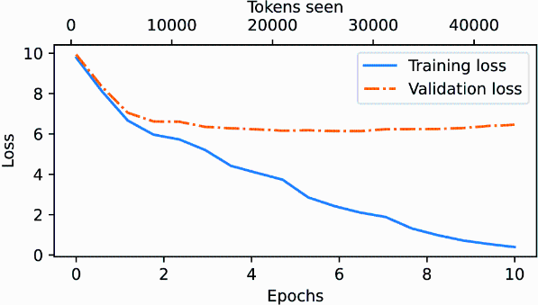

# 2 — Training and Adapting Models

> Pretraining buys knowledge, supervised fine-tuning buys format, preference optimization buys judgment, and LoRA makes the last two affordable. Know which stage a problem belongs to before you reach for fine-tuning.

---

## The pipeline

```
raw text ──pretrain──▶ base model ──SFT──▶ instruction model ──preference optimization──▶ assistant
 (trillions of tokens)   (continues text)   (follows the format)   (RLHF / DPO / RLAIF)    (helpful, harmless)
```

| Stage | Data | Objective | What it changes | Depth |
|---|---|---|---|---|
| Pretraining | Web, books, code; trillions of tokens, unlabeled | Next-token cross-entropy | Knowledge, language, reasoning ability | This note; *LLMs from Scratch*, ch. 5 |
| Supervised fine-tuning (SFT) | Thousands to millions of (instruction, response) pairs | Same loss, on the response tokens | Format, instruction following, persona | This note; *LLMs from Scratch*, ch. 7; *LLM Engineer's Handbook*, ch. 5 |
| Preference optimization | Pairs of responses ranked by humans or a model | Reward model + PPO, or DPO directly | Which of several acceptable answers the model prefers | [05-RL](../../05-RL/README.md) |

The InstructGPT paper ([arXiv:2203.02155](https://arxiv.org/abs/2203.02155), Ouyang et al., 2022) is the reference recipe: demonstrations → SFT, comparisons → reward model, reward model → PPO. Its headline result: labelers preferred outputs of the 1.3B InstructGPT model to the 175B GPT-3. Alignment, not size, made the difference users noticed.

---

## Pretraining

Pretraining is self-supervised: the label for each position is the next token in the text. Raschka writes the loop by hand (*LLMs from Scratch*, ch. 5; full code at [rasbt/LLMs-from-scratch](https://github.com/rasbt/LLMs-from-scratch)):

```python
for input_ids, target_ids in train_loader:          # targets = inputs shifted one to the left
    logits = model(input_ids)                        # (batch, seq, vocab)
    loss = F.cross_entropy(logits.flatten(0, 1), target_ids.flatten())
    optimizer.zero_grad(); loss.backward(); optimizer.step()
```

One forward pass scores every position at once: the causal mask lets the model predict token 2 from token 1, token 3 from tokens 1–2, and so on, all in parallel. Feeding the true previous tokens rather than the model's own guesses is called *teacher forcing* (*Building AI Agents*, ch. 2). It is why training is parallel while generation (note 01, decode) is not.

Things worth knowing about the loss:

- **At initialization** the loss should be about `ln(vocab_size)`, the loss of a uniform guess: ≈ 10.8 for a 50,257-token vocabulary. Raschka's untrained GPT-2 scores 10.7940 on his first batch, a perplexity of about 48,725, close to the vocabulary size (*LLMs from Scratch*, ch. 5). If it starts far higher, the initialization is broken.
- **Perplexity** = `exp(loss)`: the effective number of tokens the model is choosing between.
- **Overfitting looks like this.** Raschka trains the 124M model for 10 epochs on one short story (Edith Wharton's "The Verdict", 5,145 tokens, 90/10 train/validation split, context cut to 256). It takes about five minutes on a MacBook Air. Training loss falls from 9.78 to 0.39 while validation loss stalls near 6.4, and the model starts reciting passages of the story verbatim. Real pretraining makes roughly one pass over a far larger corpus, with batch sizes of 1,024 or more.


*Image Source: Raschka, *Build a Large Language Model (From Scratch)* (Manning, 2024), Fig. 5-12*

- **Save the optimizer state with the weights.** AdamW keeps two running statistics per parameter. Resume from weights alone and the first steps behave like a fresh optimizer (*LLMs from Scratch*, ch. 5).

Real pretraining runs add data curation (deduplication, quality filtering, mixing code and text), learning-rate warmup and cosine decay, gradient clipping and mixed precision. Raschka also loads the released GPT-2 weights into the hand-built model, which proves the architecture in [note 01](01-how-llms-work.md) matches the real one (*LLMs from Scratch*, ch. 5).

### What the data is

Most pretraining text starts as Common Crawl, a scrape of billions of web pages, usually filtered into something like Google's C4. Filtering is crude: GPT-2's WebText kept only pages linked from Reddit posts with at least three upvotes (*AI Engineering*, ch. 2). The mix decides what the model is good at. English is 45.88% of Common Crawl and Russian, second, about 6%, which shows up later as worse quality and higher token cost in other languages (note 01, Tokens). Newer reports filter with a model instead. Qwen2.5 used Qwen2-Instruct as the quality filter, downsampled e-commerce, social media and entertainment, upsampled science and technology, and grew the corpus from 7T to 18T tokens ([arXiv:2412.15115](https://arxiv.org/abs/2412.15115) (Qwen Team, 2024-12)). Phi-3 pushed filtering hardest, keeping heavily filtered web data plus synthetic text in what Microsoft calls a "data optimal regime" ([arXiv:2404.14219](https://arxiv.org/abs/2404.14219) (Abdin et al., 2024-04)). **phi-3-mini (3.8B, 3.3T tokens) scored 68.8% on MMLU 5-shot, close to Mixtral 8x7B's 70.5%, but 64.0 on TriviaQA against Mixtral's 82.2.** Filtering kept reasoning and gave up stored facts. Both results come from Microsoft's internal eval pipeline, and the data was not released.

Two limits are closing in, according to Huyen (*AI Engineering*, ch. 2). **Data:** models consume public text faster than people write it (Villalobos et al., 2022), and sites are shutting crawlers out; Longpre et al. (2024) found 45% of C4 restricted by terms of service or robots.txt after 2023–24. Training on model-generated text is one answer, but *Building AI Agents* (ch. 3) warns of *model collapse*: studies in which models trained on synthetic data lost performance or forgot skills they had learned. **Electricity:** data centres used an estimated 1–2% of world electricity at the time of writing, projected to reach 4–20% by 2030.

### What it costs

Count training compute in **FLOPs** (operations) and hardware speed in **FLOP/s** (operations per second); the two are easy to confuse (*AI Engineering*, ch. 2). GPT-3 175B took 3.14 × 10²³ FLOPs. Huyen's estimate for redoing it on 256 H100s at a peak of 60 TFLOP/s, with no failures, is about 236 days, and at 70% utilization and $2 per H100-hour, over $4 million. Two cautions. First, 60 TFLOP/s is roughly the H100's 32-bit rate; training runs in BF16 on tensor cores, whose dense peak is on the order of 1,000 TFLOP/s, so the real time and cost would be an order of magnitude lower. Second, the book's cost formula multiplies by 256 days, not the 236 in its own text. Read the example as a method, not a quote.

Raschka's estimate for an open model (*LLMs from Scratch*, ch. 5): Llama 2 7B took 184,320 A100 GPU-hours on 2 trillion tokens, about $690,000 at $30 an hour for an 8×A100 cloud server. He cites an estimate of about $4.6 million in cloud credits for GPT-3's pretraining (*LLMs from Scratch*, ch. 1).

### Scaling, in practice

Chinchilla (note 01, Scale) trained 400 models from 70M to over 16B parameters on 5B to 500B tokens and found the compute-optimal ratio is about 20 training tokens per parameter, scaled together: double the model, double the data (*AI Engineering*, ch. 2). Three qualifications from Huyen:

- **Compute-optimal is not deployment-optimal.** Llama was deliberately trained past the Chinchilla point: a smaller model on more tokens costs more to train but less to run. Sardana et al. (2023) rewrote the scaling law to include expected inference demand. Llama 3 8B's 15T tokens is close to 2,000 tokens per parameter. Qwen2.5 trained every size on the same 18T tokens, which is about 36,000 tokens per parameter at 0.5B ([arXiv:2412.15115](https://arxiv.org/abs/2412.15115) (Qwen Team, 2024-12)). The payoff is at deployment. Quantized to 4 bits, phi-3-mini takes about 1.8GB and runs at more than 12 tokens per second on an iPhone 14 ([arXiv:2404.14219](https://arxiv.org/abs/2404.14219) (Abdin et al., 2024-04)).
- **Returns diminish.** Going from a cross-entropy of about 3.4 to 2.8 nats takes ten times more data, yet users notice the difference.
- **Hyperparameters cannot be searched at full size.** Teams tune on small models and extrapolate. Microsoft and OpenAI's μTransfer moved hyperparameters found on a 40M model to a 6.7B one.

*Building AI Agents* (ch. 3) adds the emergent-abilities debate covered in note 01 and the Kaplan law; it adds nothing to either.

---

## Supervised fine-tuning

Huyen's vocabulary (*AI Engineering*, ch. 1) is worth adopting. **Pre-training** builds the base model and is by far the expensive part: for InstructGPT it took about 98% of the compute, post-training 2%. **Post-training** is everything the model developer does afterwards (SFT, preference tuning). **Fine-tuning** is the same machinery when an application developer does it to someone else's model. Changing a prompt is not training of any kind; no weight moves.

SFT continues training on curated examples of the behaviour you want. The examples are expensive because they are written, not scraped: OpenAI used about 13,000 (prompt, response) pairs for InstructGPT, which at $10 a pair would come to $130,000 before task design and quality control. A pair can take up to 30 minutes to write, and about 90% of InstructGPT's demonstration writers had a college degree (*AI Engineering*, ch. 2). *Building AI Agents* (ch. 3) puts typical SFT sets at 10,000 to 100,000 pairs. Raschka builds two flavours (*LLMs from Scratch*, ch. 6–7):

| | Classification fine-tuning (ch. 6) | Instruction fine-tuning (ch. 7) |
|---|---|---|
| Change to the model | Replace the output head with a small one (e.g. 2 classes); usually train only the last block(s) and the head | None; keep the language-model head |
| Data | Labeled examples (spam / not spam) | Instruction–response pairs in a fixed template (Alpaca-style) |
| Loss | Cross-entropy on the last token's class logits | Next-token loss on the response; padding and usually the prompt tokens are masked out |
| Evaluation | Accuracy | Hard; Raschka scores responses with a larger LLM as judge |

*Building AI Agents* (ch. 2) shows the classification route on a small decoder, with a linear head on the last token's hidden state; it is the same pattern as *LLMs from Scratch* ch. 6.

The *LLM Engineer's Handbook* (ch. 5) adds the practical side: building an instruction dataset from your own documents, deduplication, using an LLM to generate and filter pairs, chat templates, and choosing between full fine-tuning, LoRA and QLoRA by GPU budget.

**Rule:** SFT teaches the *form* of an answer far more than new facts. Fine-tuning on a knowledge base to make a model "know" it tends to produce confident paraphrases with errors. For facts that change or need citations, use retrieval ([02-rag-retrieval](../../02-rag-retrieval/README.md)).

---

## Preference optimization, briefly

SFT can only imitate. To make a model prefer the better of two acceptable answers, you train on comparisons:

- **RLHF:** train a reward model on human rankings, then optimize the policy against it with PPO and a KL penalty to the SFT model.
  - *The data is comparisons, because they are cheaper than writing.* For Llama 2, each comparison cost Meta about $3.50, against $25 for a written response, and LMSYS found a careful comparison takes three to five minutes. Agreement is limited: InstructGPT's labelers agreed with each other about 73% of the time (*AI Engineering*, ch. 2).
  - *The reward model turns rankings into a score.* For a prompt `x` with a preferred answer `y_w` and a rejected one `y_l`, InstructGPT minimizes `−log σ(r_θ(x, y_w) − r_θ(x, y_l))`: push the winner's score above the loser's. Three ranked answers give three such pairs.
  - *A reward model is useful on its own.* Stitch Fix and Grab skip the RL step: they sample several answers and serve the one their reward model scores highest (best-of-N, note 01).
- **DPO** ([arXiv:2305.18290](https://arxiv.org/abs/2305.18290)): skip the reward model; optimize directly on (prompt, chosen, rejected) triples. The reward model's optimal policy has a closed form, so RLHF reduces to a classification loss with no sampling during training. It beat PPO-based RLHF at controlling sentiment and matched or beat it on summarization and single-turn dialogue. Meta used RLHF for Llama 2 and switched to DPO for Llama 3 (*AI Engineering*, ch. 2). *LLM Engineer's Handbook* ch. 6 walks through it.
- **Constitutional AI / RLAIF** ([arXiv:2212.08073](https://arxiv.org/abs/2212.08073)): a model critiques and ranks outputs against written principles in place of human labelers.

All three are covered in [05-RL notes 02–04](../../05-RL/README.md#syllabus).

---

## Parameter-efficient fine-tuning

Full fine-tuning updates every weight and needs optimizer state for all of them, several times the model's memory. PEFT methods train a small number of new parameters and freeze the rest ([arXiv:2312.12148](https://arxiv.org/abs/2312.12148), Xu et al., 2023, survey them). *Building AI Agents* (ch. 3) walks through the older options:

- **Adapters** (Houlsby et al., 2019) insert small bottleneck layers inside each block: for BERT, project 1,024 dimensions down to 24 and back up, under 50K parameters per adapter. Training only these (3.6% of the parameters) came close to full fine-tuning on GLUE. Unlike merged LoRA, adapters add a little latency at inference.
- **Prompt and prefix tuning** learn a few "virtual token" embeddings or per-layer prefixes and freeze everything else. They are the cheapest, but the book notes they can be unstable to train, and LoRA and adapters remain the most used.

**LoRA** ([arXiv:2106.09685](https://arxiv.org/abs/2106.09685), Hu et al., 2021) is the default. For a frozen weight matrix `W` (d × k), learn a low-rank update:

```
W' = W + ΔW,   ΔW = B · A,   B: d × r,  A: r × k,  r ≪ min(d, k)
```

- Only `A` and `B` are trained. On GPT-3 175B the paper reports 10,000× fewer trainable parameters and 3× less GPU memory than full fine-tuning, with comparable quality.
- The update can be merged into `W` after training, so inference costs nothing extra; or kept separate so one base model serves many adapters.
- What LoRA is *not*: *Prompt Engineering for GenAI* (ch. 2) calls it "low-rank approximations" that make the network run on consumer hardware. LoRA is low-rank *adaptation*. It shrinks the number of *trainable* parameters during fine-tuning; it does not make the model smaller or faster at inference. Shrinking the model is quantization, pruning or distillation (below).
- **QLoRA** ([arXiv:2305.14314](https://arxiv.org/abs/2305.14314)) keeps the frozen base in 4-bit and trains LoRA adapters on top, which brings 65B-parameter fine-tuning onto a single 48 GB GPU. Three tricks make it fit: a 4-bit NormalFloat data type, quantizing the quantization constants themselves (about 3 GB saved at 65B), and paged optimizers that absorb memory spikes. Its Guanaco models reached 99.3% of ChatGPT's score on the Vicuna benchmark after 24 hours on one GPU. The authors themselves warn that those chatbot benchmarks are not trustworthy, so read the number as "close", not "equal".

```python
from peft import LoraConfig, get_peft_model
config = LoraConfig(r=16, lora_alpha=32, target_modules=["q_proj", "v_proj"], lora_dropout=0.05)
model = get_peft_model(base_model, config)   # model.print_trainable_parameters() -> well under 1%
```

### Making the model smaller

Three ways to cut memory and latency once a model is trained (*Building AI Agents*, ch. 2–3):

- **Quantization** stores weights in fewer bits. The basic affine scheme maps a float `x` to an integer `x_q = round(x / s) + z`, with a scale `s` and zero point `z` chosen per tensor, channel or block. Halving the bits halves the weight memory (note 01, Reading a model's size).
- **Pruning** removes weights or whole layers. Classic prune-and-retrain cycles are too expensive at LLM scale, and the book reports that many one-shot methods fail to remove more than about 10% of weights before the model collapses. SparseGPT reached 60% sparsity on the 175B-class models OPT-175B and BLOOM-176B without retraining (the book says "170-billion-parameter models"). Gromov et al. ([arXiv:2403.17887](https://arxiv.org/abs/2403.17887)) dropped many of the deeper layers of large open models with little loss, and found larger models more redundant than small ones.
- **Distillation** trains a small *student* to match a large *teacher*'s output distribution, typically with a KL-divergence loss on temperature-softened logits plus the usual loss on the labels. DistilGPT-2 is a distilled GPT-2. In the LLM era the cheaper variant is to fine-tune a small model on a large model's generated outputs, which is distillation without access to the teacher's logits. Google's on-device Gemini Nano models (1.8B and 3.25B) were distilled from larger Gemini models and shipped with 4-bit weights ([arXiv:2312.11805](https://arxiv.org/abs/2312.11805) (Gemini Team, 2023-12)).

Quantization for *serving* (int8/int4 weights, KV-cache compression) is an inference topic; see *LLM Engineer's Handbook* ch. 8 and [ai-engineering/07-inference-engineering](../../../ai-engineering/07-inference-engineering/README.md).

---

## Prompt, retrieve or fine-tune?

| Symptom | First fix | Fine-tune when |
|---|---|---|
| Wrong format or tone | Better instructions and examples ([note 03](03-prompting-fundamentals.md)) | The format is still unstable after good prompting, or the prompt is too long to pay for on every call |
| Missing or stale facts | Retrieval | Almost never; fine-tuning is a poor fact store |
| Task needs a skill the model lacks | Decompose the task; use a stronger model | You have thousands of good examples. Phoenix & Taylor's rule of thumb (*Prompt Engineering for GenAI*, ch. 1) is that fine-tuning starts to beat prompting somewhere in the low thousands of examples |
| Cost or latency | Smaller model plus a good prompt | Distil a large model's outputs into a small one |

The *LLM Engineer's Handbook*'s framing (ch. 1) is useful for whole systems: separate **feature**, **training** and **inference** pipelines (the FTI architecture), so data preparation, fine-tuning runs and serving can change independently. Its running example, the "LLM Twin", fine-tunes a model on one person's writing and serves it behind RAG.

---

**Next:** [03 — Prompting fundamentals](03-prompting-fundamentals.md) covers the cheapest of these levers, and the one to try first.
