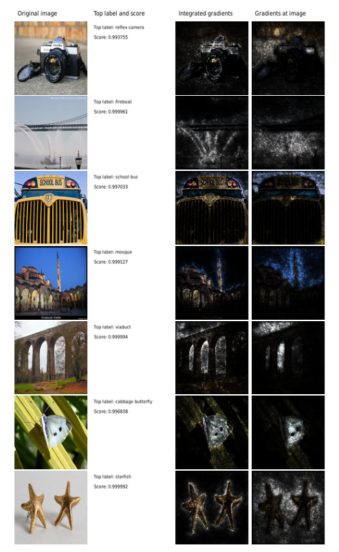
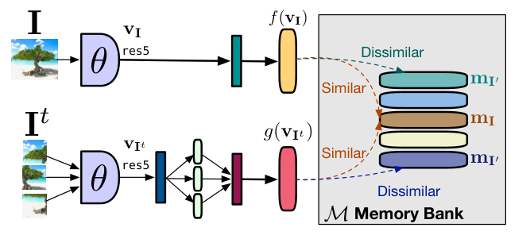

# 2b — What trained attention does: probes, images and sinks

> Part two of [chapter 02](02-attention-and-the-transformer-block.md). Chapter 02 builds attention, the causal mask and the transformer block. This note asks what trained heads do: whether attention weights explain anything, how patches of an image become tokens, and why many heads park their weight on the first token.

---

## Reading the weights

The weights are easy to plot, and the plots are easy to over-read. Jain & Wallace trained BiLSTM classifiers with Bahdanau-style attention on ten datasets, including SST, IMDB, 20 Newsgroups, MIMIC and SNLI. IMDB is 50,000 polarized movie reviews (7 or more stars out of 10 is positive, 4 or fewer negative, neutral ones dropped), split 25,000 for training and 25,000 for test. A weighted bag of words was nearly as good there as the learned word vectors of its authors: 88.23 against 87.44 for a linear SVM on 50-d learned vectors, and 88.89 for vectors plus bag of words, where the vector model also used 50,000 extra unlabeled reviews ([ACL 2011](https://aclanthology.org/P11-1015/) (Maas et al., ACL 2011)). The rank correlation (Kendall τ) between attention weights and gradient-based word importance averaged between 0.08 (20 Newsgroups) and 0.47 (MIMIC diabetes) across datasets. Gradients and leave-one-out importance agreed with each other more than either agreed with attention. For many inputs they could also find a different attention distribution, close to the maximum Jensen–Shannon distance of 0.69, that moved the prediction by less than 0.01 ([arXiv:1902.10186](https://arxiv.org/abs/1902.10186) (Jain & Wallace, NAACL 2019)). The weak agreement is partly the BiLSTM's doing: with a plain averaging encoder under the attention, τ rose to 0.48–0.84 (SST 0.69, against 0.40 with the BiLSTM). They tested no transformers, the adversarial weights may be ones the model would never produce, and gradients are not ground truth either. Two post-hoc methods give the explanation a definition instead of reading it off the weights. Plain gradients fail a basic test: in a one-ReLU network f(x) = 1 − ReLU(1 − x), the output rises from 0 to 1 between baseline 0 and input 2, yet the gradient at the input is 0. Integrated gradients sums the gradients along a straight path from a baseline to the input, and the attributions then add up to F(x) − F(baseline), which is a check you can run: if they do not, take more steps. The authors found 20 to 300 steps enough on their image and text models and 100 to 1,000 on a translation LSTM, and the result depends on the baseline (all-zero embeddings for text). They report no quantitative test of attribution quality ([arXiv:1703.01365](https://arxiv.org/abs/1703.01365) (Sundararajan et al., ICML 2017)). LIME perturbs the input (words removed, image segments switched off), labels the perturbations with the model, and fits a sparse linear model weighted by closeness to the original. It recovered more than 90% of the true features of sparse logistic-regression and decision-tree classifiers on book and DVD reviews, with at most 10 features each, which is a check on interpretable models only, not on a black box ([arXiv:1602.04938](https://arxiv.org/abs/1602.04938) (Ribeiro et al., KDD 2016)). Probes have their own noise. DirectProbe found that the same two-layer MLP probe, retrained from a different random initialization, varied by up to 7.88 accuracy points (BERT-large, preposition supersense roles); a linear probe varied by under 1 point.

It instead clusters the representations by label without training a classifier. The distance between the closest clusters tracked the best probe accuracy layer by layer ([arXiv:2104.05904](https://arxiv.org/abs/2104.05904) (Zhou & Srikumar, NAACL 2021)). There is also a theory of why trained attention looks so peaked. Tarzanagh et al. studied a single attention layer with a fixed linear head. Gradient descent sends the attention weights' norm to infinity, and their direction converges to a hard-margin SVM that separates one "optimal" token per input from the rest, so the softmax ends up selecting a single token. Gradient descent is proven to reach that global solution only under extra conditions. Otherwise it can lock onto a "locally optimal" token instead, and in random trials it reached the global one more often as the dimension grew. With separate key and query matrices, as in real models, the limit is the low-rank, nuclear-norm version of that SVM. That limit is proven for the regularization path and only observed for gradient descent. With a small nonlinear head instead of a linear one, attention keeps several tokens rather than one. Every experiment is synthetic, with dimensions in the tens ([arXiv:2308.16898](https://arxiv.org/abs/2308.16898) (Tarzanagh et al., 2023-08, preprint)).


*Image Source: Sundararajan et al., [Axiomatic Attribution for Deep Networks](https://arxiv.org/abs/1703.01365) (2017), Fig. 2*

Images became transformer input by treating patches as tokens. ViT cuts an image into 16×16 patches, projects each one linearly to the model width, prepends a learned [class] token and adds learned 1D position embeddings. Everything after that is a standard transformer encoder ([arXiv:2010.11929](https://arxiv.org/abs/2010.11929) (Dosovitskiy et al., ICLR 2021)). When trained on ImageNet alone without strong regularization, ViT came in a few points below ResNets of similar size, because it lacks the convolution's built-in assumptions about locality. The ranking flipped as pretraining data grew. On subsets of Google's in-house JFT, ViT-B/32 lost to a ResNet50 on a 5-shot ImageNet probe at 9M images and beat it from 90M up. ViT-H/14, pretrained on JFT-300M, reached 88.55% ImageNet top-1 for 2.5k TPUv3 core-days, against 87.54% and 9.9k for the BiT-L ResNet. The kind of position embedding barely mattered.

In a 5-shot probe, the 1D, 2D and relative variants all scored about 0.64, while a model with no positions scored 0.614. NaViT carried language-model example packing over to images. Patches from several images, each at its native aspect ratio, share one sequence, with attention masked so that each image attends only to itself. Position embeddings are factorized into separate x and y parts, and a random fraction of each image's tokens is dropped ([arXiv:2307.06304](https://arxiv.org/abs/2307.06304) (Dehghani et al., NeurIPS 2023)). Native resolution is possible, but pretraining resized each image to a randomly sampled pixel count, which is what kept padding below 2% of tokens. NaViT matched the best ViT with 4× less pretraining compute. The factorized positions also held up better than ViT's 1D ones at resolutions not seen in training. Its pretraining data (JFT-4B and WebLI) is in-house as well.

Large transformers also put tokens to uses nobody designed. Darcet et al. studied vision transformers, where the tokens are image patches ([arXiv:2309.16588](https://arxiv.org/abs/2309.16588) (Darcet et al., 2023-09)). In DINOv2 ViT-g, about 2% of patch tokens, almost all on plain background, ended up with roughly 10× the norm of the rest. Linear probes showed these tokens had dropped their own patch's content and position and held image-wide information instead. In effect, the model was using them as scratch space. They appeared only in ViT-L and larger, and only after about a third of training. The fix was to append four learned "register" tokens that carry no input and are thrown away at the output. That removed the outliers and lifted DINOv2 ViT-L's ADE20k segmentation from 46.6 to 47.9 mIoU, with ImageNet linear-probe accuracy at 84.3 before and 84.8 after. Those are single training runs.

DINOv2 descends from DINO, which trains a ViT without labels by self-distillation ([arXiv:2104.14294](https://arxiv.org/abs/2104.14294) (Caron et al., ICCV 2021)). A student network sees small and large crops of an image and learns to match a teacher's output on the large crops. The teacher is an exponential moving average of the student. Centering and sharpening the teacher's output stop both networks from collapsing to a constant: removing either one sends the KL divergence between them to zero, and removing the momentum collapses k-NN accuracy to 0.1%. ViT-S/16 reached 77.0% ImageNet linear-probe accuracy, against 79.8% for the same network trained end to end with labels. PIRL is an earlier contrastive route to unlabeled features. It makes the representation of an image similar to that of its jigsaw-shuffled version, instead of making it predict the shuffle. A ResNet-50 trained for 800 epochs on the 1.28M unlabeled ImageNet-1k images reached 63.6% top-1 in a linear probe, against 59.0% for the same setup without the invariance term. Fine-tuned in Faster R-CNN on VOC07+12 it beat supervised ImageNet pretraining on AP (54.0) and AP75 (59.7), though not on AP50 on the smaller VOC07 set (73.4 against 74.5). These are single runs, and the paper's Table 5 lists 62.2 for the same Jigsaw model ([arXiv:1912.01991](https://arxiv.org/abs/1912.01991) (Misra & van der Maaten, CVPR 2020)).


*Image Source: Misra & van der Maaten, [Self-Supervised Learning of Pretext-Invariant Representations](https://arxiv.org/abs/1912.01991) (2020), Fig. 3*

Its [class]-token attention maps outlined objects better than a supervised model's did (Jaccard 45.9 against 27.3), though MoCo-v2, BYOL and SwAV maps scored as well (46.3–47.8), so this is a property of self-supervised ViTs, not of DINO alone. iBOT added BERT-style masked patch prediction, with the teacher's patch outputs as targets in place of a fixed image tokenizer ([arXiv:2111.07832](https://arxiv.org/abs/2111.07832) (Zhou et al., ICLR 2022)). Its ViT-B/16 reached 79.5% linear-probe and 84.0% fine-tuned accuracy. In a 300-epoch ViT-S ablation, masked prediction on its own gave only 29.8% on a linear probe (BEiT, with a fixed tokenizer, gave 23.5%) and also fine-tuned worst (79.4%, against 80.6% for DINO). The [class]-level DINO loss is what makes the frozen features usable. iBOT costs 25% more memory than DINO (both with multi-crop) and did no better at retrieval.

Language models have their own version of Darcet's outliers. Many heads put most of their weight on the first token, an **attention sink**. Clark et al. saw it first in BERT. More than half of the attention in layers 6–10 went to the [SEP] token, and from layer 5 on the loss barely changed when that attention changed, so those heads were using [SEP] as a no-op ([arXiv:1906.04341](https://arxiv.org/abs/1906.04341) (Clark et al., BlackboxNLP 2019)). Barbero et al. found the same no-op on ⟨bos⟩ in Llama 3.1: averaged over 170 prompts, 45.97% of heads put more than 80% of their attention on it at 8B, and 78.29% at 405B.

They argue that it is how a deep stack avoids over-mixing, where tokens blur into one another layer after layer. Gemma 7B, run without its ⟨bos⟩ token, fell from 82.57 to 0.00 on RULER at 4,096 tokens and from 80.61 to 27.35 on HellaSwag ([arXiv:2504.02732](https://arxiv.org/abs/2504.02732) (Barbero et al., COLM 2025)). That drop says more about ⟨bos⟩ than about sinks. In their own 120M-parameter runs, a model trained without a fixed ⟨bos⟩ made whatever token came first the sink (65% sink rate either way), and only a model that always saw ⟨bos⟩ in training lost its sink and broke when it was removed (validation loss 2.69 to 7.56). Sun et al. traced how the sink is built.

One or two early feed-forward blocks (layer 2's in Llama 2 7B) act as a quadratic amplifier and put huge values, in the thousands, into a few channels of the first token, whatever that token is (99.65% of Llama 2's vocabulary). The residual stream carries those values until a late block cancels them. Before attention, RMSNorm turns them into a sparse, near-constant key that every query can find. In 7B models trained from scratch, conditional gating of the attention output cut the share of sink heads from 46.0% to 4.5% at the same [perplexity](06-pretraining-data-and-objectives.md#entropy-cross-entropy-kl-and-perplexity) (10.0 against 10.1), and sandwich norm cut the spike from 3,818 to 520 while 44.7% of heads stayed sinks. So the two phenomena co-occur because of pre-norm, but either can be removed without the other.

Sun et al. also tie sinks to short contexts rather than long ones: computing the training loss only on positions 2,048–4,096 left 1.2% sink heads ([arXiv:2603.05498](https://arxiv.org/abs/2603.05498) (Sun et al., 2026-03, preprint)). Barbero et al. varied the training context window itself, from 128 to 2,048 tokens with the loss on every position, and saw sinks grow with it (almost none at 128), so the two results are not in direct conflict. Sinks may still be worth keeping. Across 26 OlmPool models of about 7B, extended to 64K, more attention mass on the first 100 tokens went with better long-context scores (R² = 0.38), and models with QK norm had weaker sinks ([arXiv:2608.10296](https://arxiv.org/abs/2608.10296) (Bertsch et al., COLM 2026)).

The one-ReLU example from the paragraph above runs in a few lines, and so does the completeness check on integrated gradients (midpoint rule, baseline 0, input 2):

```python
import numpy as np

F = lambda x: 1 - np.maximum(0, 1 - x)            # f(x) = 1 - ReLU(1 - x)
dF = lambda z: 1.0 if 1 - z > 0 else 0.0          # slope: 1 below x = 1, 0 above
x, base = 2.0, 0.0
print("F(x) - F(base):", F(x) - F(base), "| plain gradient at the input:", dF(x))
for steps in (5, 20, 100):
    path = base + (np.arange(steps) + 0.5) / steps * (x - base)
    print(f"steps={steps:>3}: attribution sum = {(x - base) * np.mean([dF(z) for z in path]):.2f}")
```

```text
F(x) - F(base): 1.0 | plain gradient at the input: 0.0
steps=  5: attribution sum = 0.80
steps= 20: attribution sum = 1.00
steps=100: attribution sum = 1.00
```

The plain gradient says the input does not matter (0.0) although the output moved by 1.0. The path integral recovers the full 1.0, and five steps are too few: the sum falls 0.2 short, which is the signal to take more.

---

## Pitfalls

- **Treating a high attention weight as the reason for an answer.** Jain & Wallace found alternative weights that left the prediction unchanged, and weak agreement with gradient importance on most datasets. Use attention as a place to look, not as an explanation.
- **Trusting one probe run.** A probe retrained from another seed moved by up to 7.88 accuracy points. Report several seeds, or use a method with no classifier to train.
- **Reading an attribution without its baseline.** Integrated gradients depends on the baseline (all-zero embeddings for text) and on the step count. Check that the attributions sum to F(x) − F(baseline).
- **Dropping the first token and expecting nothing to change.** In models trained with a fixed ⟨bos⟩, heads park their weight on it. Removing it broke Gemma 7B on RULER (82.57 to 0.00).
- **Carrying a vision result over to text.** The registers fix and the DINO attention maps were measured on image patches. The language-model sink results are separate studies.

---

## Try it

1. In the code above, set the baseline to 1 instead of 0. What should the attributions sum to, and why?
2. Darcet et al. add four register tokens. Why are they discarded at the output rather than kept?
3. A head puts 90% of its weight on the first token in every layer. Does that mean the model ignores the rest of the sequence?

<details>
<summary>Answers</summary>

1. F(2) − F(1) = 1 − 1 = 0, because the output is flat above x = 1. The attribution is 0 for any step count, which shows how much the baseline choice matters.
2. They carry no input and exist only to give the model scratch space. Their outputs are not tied to any patch, so there is nothing to predict from them.
3. Not necessarily. Sink heads use the first token as a no-op, so such a head adds little to the output. The other heads can still use the rest of the sequence.

</details>

---

## Interview checklist

| Question | Answer |
|---|---|
| Is attention an explanation? | Not on its own. Weights show where a head drew from, they can be changed without changing the output, and they agree only loosely with gradient importance |
| What does integrated gradients fix? | Plain gradients can be zero where the output clearly depends on the input. Integrating along a path from a baseline makes the attributions sum to F(x) − F(baseline) |
| How does a transformer read an image? | It cuts the image into patches, projects each to the model width, adds a class token and position embeddings, then runs a standard encoder |
| What is an attention sink? | A head that puts most of its weight on the first token as a no-op, probably to avoid over-mixing. It co-occurs with huge activations on that token, and either can be removed without the other |

---

## Next

[03 — Architectures, scale and the model zoo](03-scale-and-the-model-zoo.md) repeats the block from [chapter 02](02-attention-and-the-transformer-block.md) more times with more width, and asks what that buys.
