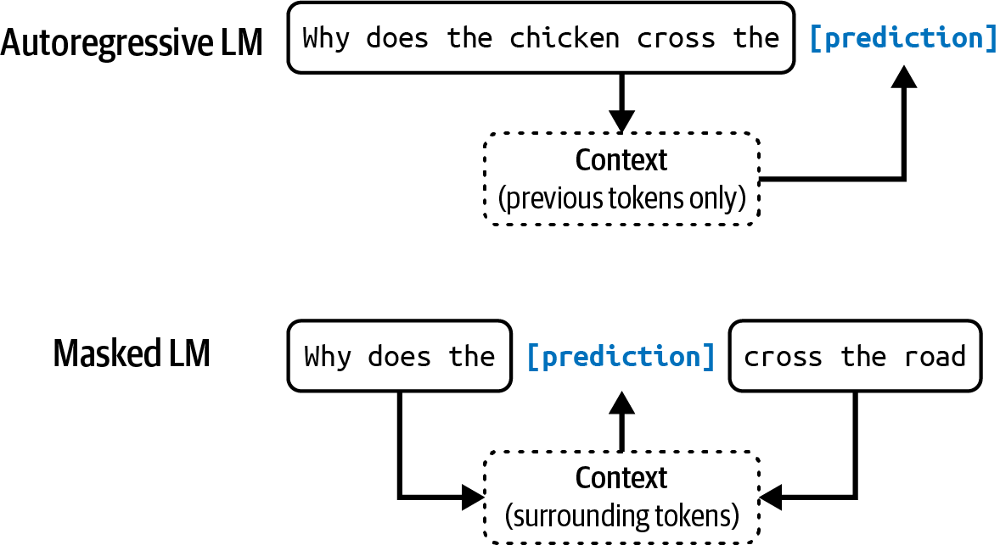
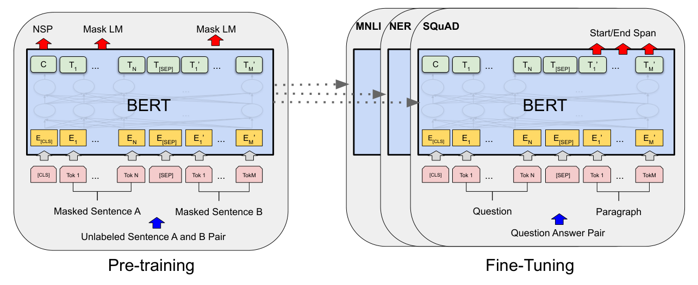
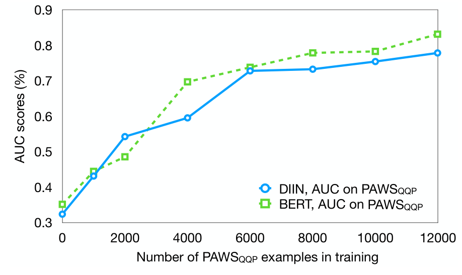
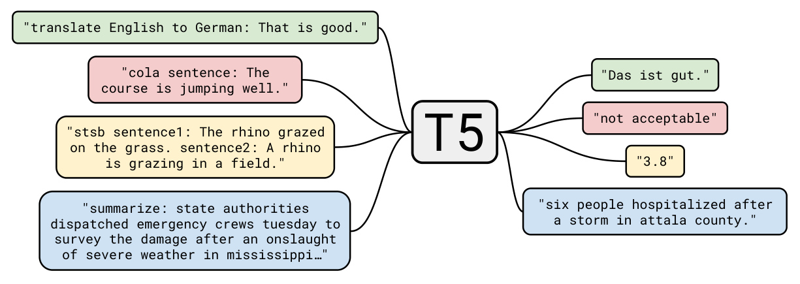
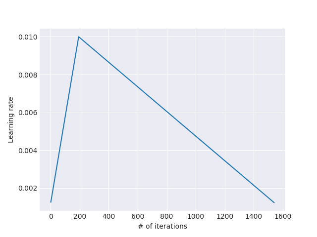
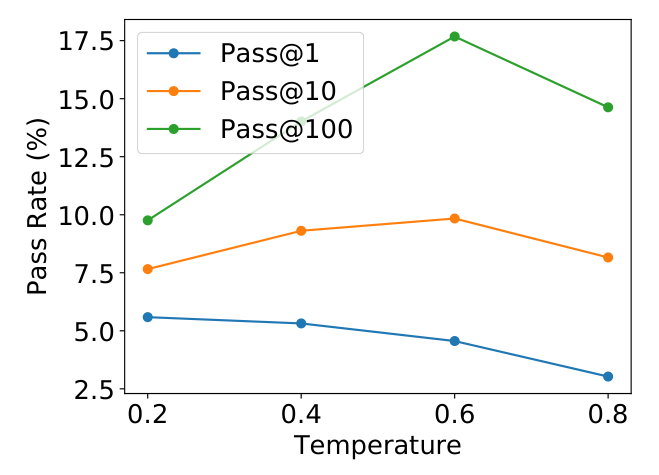
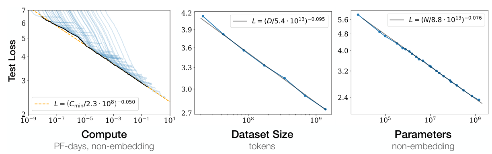
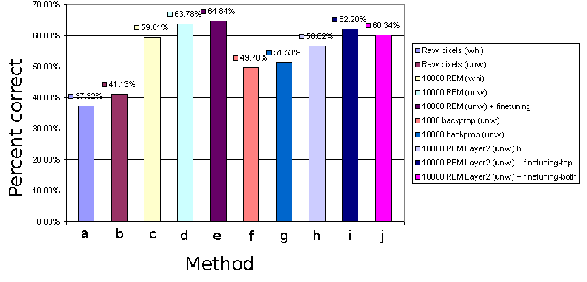
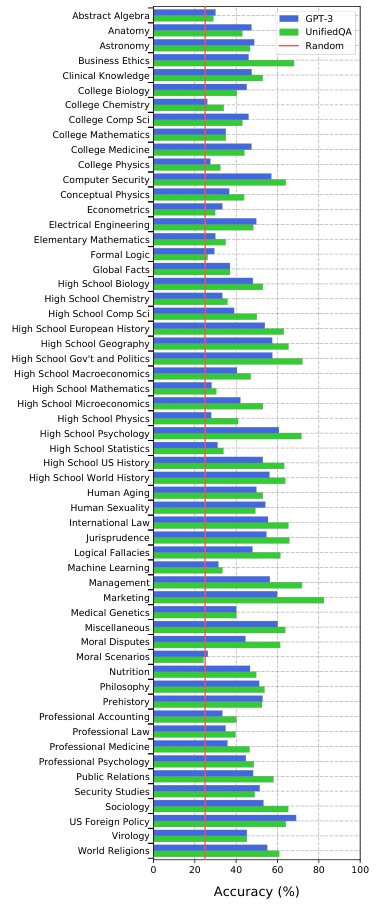
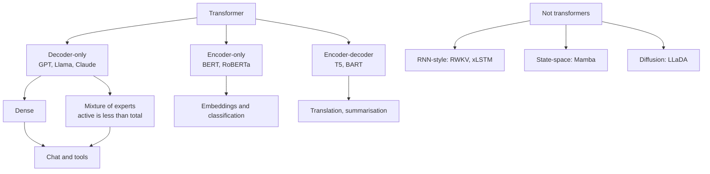

# 3 — Architectures, scale and the model zoo

Someone on your team proposes a model for the ticket assistant and says only "it's a 70B". What does that tell you? It tells you roughly how much memory the weights need, and little about what the model can do, how much data trained it, or whether it can be served on your hardware. This chapter covers the families of architecture you will meet on a model card, the scaling results that made "large" part of the name, and how to read the numbers a model report gives you without being misled by them.

> An LLM is a decoder-only transformer trained to predict the next token. Tokens, embeddings, causal self-attention and scale explain most of its behaviour, including the failures.

---

## Encoder, decoder and the architecture table

| Architecture | Attention | Training objective | Examples | Good at |
|---|---|---|---|---|
| Encoder-only | Bidirectional | Masked-token prediction | BERT ([arXiv:1810.04805](https://arxiv.org/abs/1810.04805)) | Classification, embeddings, retrieval |
| Decoder-only | Causal | Next-token prediction | GPT, Llama, Claude, Gemini | Generation, chat, tool use |
| Encoder–decoder | Both | Sequence-to-sequence | Original transformer, T5 | Translation, summarization |

BERT masks 15% of input tokens and learns to fill them in from both sides; the two original sizes were 110M and 340M parameters (*Building AI Agents*, ch. 2). Huyen frames the same split as *masked* versus *autoregressive* language models: the first sees both directions and suits classification and embeddings, the second sees only the past and can generate (*AI Engineering*, ch. 1). Amatriain et al.'s catalog files 77 models, from ALBERT to XLNet and including non-text ones such as AlphaFold and CLIP, by these three architectures and by eight pretraining tasks: language modelling, causal, prefix and permuted language modelling, masked tokens, denoising, replaced-token detection and next-sentence prediction. It also records each model's family, size, corpus, licence and lab. It is a lookup table and measures nothing itself ([arXiv:2302.07730](https://arxiv.org/abs/2302.07730) (Amatriain et al., 2023-02, preprint)).


*Image Source: Author, [AI Engineering](https://www.oreilly.com/library/view/ai-engineering/9781098166298/) (Huyen, 2025), Fig. 1-2*


*Image Source: Devlin et al., [BERT](https://arxiv.org/abs/1810.04805) (2018), Fig. 1*

Most of BERT's successors changed the training recipe or the parameter budget, not the architecture. RoBERTa retrained BERT-large (355M) and found it undertrained ([arXiv:1907.11692](https://arxiv.org/abs/1907.11692) (Liu et al., 2019, preprint)). Dropping next-sentence prediction (NSP) matched or slightly improved results, and moving from 16GB to 160GB of text, 8K-sequence batches and up to 500K steps raised MNLI from BERT-large's 86.6 to 90.2. The model still had not overfit at 500K steps. The paper cannot separate the effect of more data from more varied data. ALBERT kept the budget fixed and cut parameters instead ([arXiv:1909.11942](https://arxiv.org/abs/1909.11942) (Lan et al., ICLR 2020)). It factorizes the vocabulary embedding through a 128-wide layer and shares one set of weights across all layers, so an ALBERT-large has 18M parameters against BERT-large's 334M. It also replaces NSP with sentence-order prediction: a model trained on NSP scored 52.0% on the order task, about chance, so NSP had been learning topic, not coherence. Fewer parameters do not mean less compute. The 235M ALBERT-xxlarge beat BERT-large (88.7 against 85.2 average on five dev tasks) but ran about 3 times slower per step, and sharing all layers cost 1.5 to 2.5 points at fixed width.

ELECTRA changed the objective ([arXiv:2003.10555](https://arxiv.org/abs/2003.10555) (Clark et al., ICLR 2020)). A small masked LM fills in the masked positions, and the encoder being trained labels every token as original or replaced, so it learns from all positions instead of 15%. At the same compute as BERT-Base it scored 85.1 on GLUE dev against 82.2, and ELECTRA-Small, trained on one V100 for 4 days, beat GPT-1 (79.9 against 78.8) with 1/30th of the training compute. Scoring the replaced-token loss only on the 15% masked positions dropped it back to BERT's level (82.4), so the gain comes mostly from the denser signal. DeBERTa changed the attention instead ([arXiv:2006.03654](https://arxiv.org/abs/2006.03654) (He et al., ICLR 2021)). Each token keeps separate content and relative-position vectors, attention adds content-to-position and position-to-content terms, and absolute positions enter only just before the masked-token output layer. Trained on 78GB, about half of RoBERTa's 160GB, its large model reached 91.1 on MNLI against 90.2, at about 30% more attention compute than RoBERTa. Its 1.5B version scored 89.9 on the SuperGLUE test set, just above the human baseline's 89.8. SuperGLUE existed because GLUE had run out: its best score (88.4) had passed the estimated non-expert human score (87.1), and the replacement's BERT++ baseline still trailed humans by nearly 20 points at launch ([arXiv:1905.00537](https://arxiv.org/abs/1905.00537) (Wang et al., NeurIPS 2019)). The authors themselves note this is not human-level language understanding. Benchmarks designed to resist shortcuts show why. The Winograd Schema Challenge proposed questions where changing one word flips what a pronoun refers to, so word association alone fails. It was a proposal: a 50-question test would take a person about 25 minutes, and no system was scored in the paper ([KR 2012](https://openalex.org/W1599016936) (Levesque et al., KR 2012)). COPA gives a premise and two alternatives and asks for the more plausible cause or effect. It has 1,000 questions, 50% is chance, and the best unsupervised baseline, word co-occurrence over Project Gutenberg, reached 58.3% ([AAAI Spring Symposium 2011](https://people.ict.usc.edu/~gordon/publications/AAAI-SPRING11A.PDF) (Roemmele et al., 2011)). PAWS builds paraphrase pairs that share almost all their words. BERT-base trained on Quora Question Pairs scored 90.5% on QQP but 33.5% on the PAWS-QQP development set (677 pairs), and 85.0% after 11,988 PAWS training pairs were added, with no loss on QQP ([ACL Anthology N19-1131](https://aclanthology.org/N19-1131/) (Zhang et al., NAACL 2019)).


*Image Source: Zhang et al., [PAWS: Paraphrase Adversaries from Word Scrambling](https://aclanthology.org/N19-1131/) (NAACL 2019), Fig. 4*

XLNet went after the `[MASK]` symbol itself, which BERT sees in pretraining and never at fine-tuning. It trains an autoregressive model on a randomly sampled factorization order, so a token is predicted from a different subset of its neighbours each time and the model sees both sides without any mask token ([arXiv:1906.08237](https://arxiv.org/abs/1906.08237) (Yang et al., NeurIPS 2019)). With BERT's data (BooksCorpus and Wikipedia) and hyperparameters, a Transformer-XL backbone and a BERT-Large-sized model, it beat the best of three BERT-Large variants on RACE (77.4 against 75.1), MNLI (88.4 against 87.3), SQuAD2.0 (85.1/87.8 EM/F1 against 82.8/85.5) and RTE (81.2 against 74.0). In a 12-layer ablation (median of five runs), the backbone swap gave part of the gain and the permutation objective the rest (RACE 66.66 against 65.03 for BERT's objective on Transformer-XL and 64.3 for BERT-Base). SST-2 stayed flat. The paper does not give XLNet-Large's parameter count, and several ablation gaps are within a point.

The encoder–decoder row got its own denoising objectives. T5 cast every task as text in, text out, so a single 220M encoder–decoder baseline, the size of two BERT-Base stacks, could compare architectures and objectives on the same tasks ([arXiv:1910.10683](https://arxiv.org/abs/1910.10683) (Raffel et al., JMLR 2020)). At equal compute with a denoising objective, the encoder–decoder averaged 83.28 on GLUE, a prefix LM 81.82 and a decoder-only LM 74.70, and denoising beat plain language modelling in every architecture. The denoising variants themselves differed little. The authors chose *span corruption* for speed, after SpanBERT (Joshi et al., 2019): 15% of tokens are dropped in spans averaging 3 tokens, each span is replaced by one sentinel, and the model predicts only the dropped spans, so targets stay short. T5-11B, trained on about 1T tokens, reached 90.3 on GLUE and 88.9 on SuperGLUE, against a human baseline of 89.8.


*Image Source: Raffel et al., [Exploring the Limits of Transfer Learning with a Unified Text-to-Text Transformer](https://arxiv.org/abs/1910.10683) (2019), Fig. 1*

It set no record on WMT translation, which the authors put down partly to pretraining on English only. These comparisons are from 2019, at 34B pretraining tokens and with the model fine-tuned for each task. BART paired a BERT-style bidirectional encoder with a GPT-style decoder and compared ways of corrupting the input ([arXiv:1910.13461](https://arxiv.org/abs/1910.13461) (Lewis et al., ACL 2020)). Its *text infilling* replaces spans of Poisson(λ = 3) length with a single mask, so the model also has to work out how many tokens are missing. At BERT-Base size it was the most consistent objective, with 90.8 F1 on SQuAD against 76.7 for a pure language model, although the language model had the best perplexity on ELI5 long-form answers. Trained at RoBERTa's scale, BART matched RoBERTa on GLUE and SQuAD and gained about 3.5 ROUGE-1 on XSum summarization (45.14 against 41.45). The authors name its main limitation: summaries that hallucinate information the source does not support.

Almost every chat model is decoder-only. Embedding models used in [02-rag-retrieval](../../02-rag-retrieval/README.md) are usually encoder-style. The decoder-only transformer was first used on a task that seemed to call for an encoder. To write Wikipedia lead sections from source documents, Liu et al. joined the input, a separator token and the output into one sequence and trained a plain next-token model on it, which almost halved the parameter count. On their WikiSum data the encoder–decoder transformer stopped learning at 2,000 input tokens. The decoder alone kept improving up to 4,000, which was the memory limit of a 16 GB GPU, and with local and compressed attention it reached 11,000 tokens. Test log-perplexity went from 2.47 to 2.22 to 2.05 ([arXiv:1801.10198](https://arxiv.org/abs/1801.10198) (Liu et al., ICLR 2018)).

Pretraining a language model and then fine-tuning it on a task had been done with LSTMs. Dai & Le initialised a 1,024-unit LSTM classifier from a sequence autoencoder trained on unlabeled text and cut IMDB test error from 13.50% for a tuned randomly initialised LSTM to 7.24%, below Paragraph Vectors' 7.42%; a language-model initialisation reached 7.64% in their table (8.98% in their text) ([arXiv:1511.01432](https://arxiv.org/abs/1511.01432) (Dai & Le, NIPS 2015)). ULMFiT made the recipe general. It pretrained an AWD-LSTM on Wikitext-103, fine-tuned the language model on the target text with a different learning rate per layer and a short-ramp, long-decay schedule, then unfroze the classifier layer by layer. It reached 4.6% IMDb error against 5.9% for the previous best and 5.01% on AG News against 6.57%, on six English classification sets ([arXiv:1801.06146](https://arxiv.org/abs/1801.06146) (Howard & Ruder, ACL 2018)). GPT-1 did it with a 12-layer decoder-only transformer (768 wide, 40,000 BPE merges) trained on BooksCorpus, more than 7,000 unpublished books, and fine-tuned with only a linear head and delimiter tokens added ([OpenAI report](https://cdn.openai.com/research-covers/language-unsupervised/language_understanding_paper.pdf) (Radford et al., 2018)). It set the state of the art on 9 of 12 tasks, including +8.9 points on Story Cloze and 72.8 against 68.9 on GLUE. Without pretraining, the same network's task average fell from 74.7 to 59.9, and a 2,048-unit LSTM with the same pretraining averaged 69.1. It lost on RTE (56.0 against a multi-task biLSTM's 61.7).


*Image Source: Howard & Ruder, [Universal Language Model Fine-tuning for Text Classification](https://arxiv.org/abs/1801.06146) (2018), Fig. 2*

One model can serve more than one row of the table. CodeT5 did this first for code, with one T5 encoder–decoder (60M and 220M) for both generation and classification tasks on code. It was pretrained on functions from CodeSearchNet with span denoising plus two identifier tasks: tag which tokens are identifiers, and recover identifiers that have been masked. CodeT5-base led on most CodeXGLUE tasks. On medium Java bug fixing it reached 13.96 exact match against GraphCodeBERT's 9.10. Removing span denoising lowered code-generation CodeBLEU from 41.39 to 37.44 ([arXiv:2109.00859](https://arxiv.org/abs/2109.00859) (Wang et al., EMNLP 2021)). CodeT5+ trains a single encoder–decoder on a mix of span denoising, causal language modelling and text–code contrastive matching. It then runs the encoder alone for code search and the decoder alone for completion ([arXiv:2305.07922](https://arxiv.org/abs/2305.07922) (Wang et al., 2023-05)). PolyCoder is a 2.7B decoder-only model (32 layers, 2,048 context) trained from scratch on about 250 GB of GitHub code in 12 languages. On HumanEval (164 prompts, best of four temperatures, top-p 0.95, 100 samples per prompt) it scored 5.59% pass@1, above CodeParrot 1.5B (3.58%) but below GPT-Neo 2.7B (6.41%), GPT-J 6B (11.62%) and Codex 12B (28.81%). The authors partly blame its 2.5B Python tokens (4.3B for GPT-Neo). On 100 unseen GitHub files per language it had the lowest perplexity in C (2.33), Codex included, though Codex may have seen them ([arXiv:2202.13169](https://arxiv.org/abs/2202.13169) (Xu et al., MAPS 2022)).


*Image Source: Xu et al., [A Systematic Evaluation of Large Language Models of Code](https://arxiv.org/abs/2202.13169) (MAPS 2022), Fig. 5*

After task fine-tuning, the 770M model scored 77.4 MRR on CodeSearchNet text-to-code retrieval, against UniXcoder's 74.4. The decoder-only mode depends on having trained for it: without the causal-LM objective, the same 770M model's line-completion exact match on PY150 fell from 44.9 to 36.2. These are the authors' own evaluations. The authors also say that Codex and CodeGen were trained on GitHub code without removing overlap with these benchmarks, so comparisons against those models are not clean. Even a clean CodeSearchNet score is a proxy, as the benchmark's own authors say. The model gets a function's docstring as the query and has to find that function among 999 distractors. On 99 real Bing queries with expert relevance labels (inter-annotator κ = 0.47), their baseline ranking flipped. Self-attention encoders led on the docstring task (0.70 against 0.62 MRR), but a neural bag of words beat them on the real queries (NDCG 0.574 against 0.493). Untuned ElasticSearch keyword search scored 0.337 ([arXiv:1909.09436](https://arxiv.org/abs/1909.09436) (Husain et al., 2019 ⚑)).

A decoder-only model can also fill a gap in the middle of a file if it is trained for it. InCoder (6.7B) was trained with *causal masking*: random spans are cut out of each document and moved to the end behind sentinel tokens, so the model learns to write a span after it has seen the code on both sides. On single-line infilling built from HumanEval, it passed the tests 69.0% of the time. Left-to-right generation from the prefix alone passed 48.2%, and 54.9% when the candidates were reranked using the suffix. On multi-line gaps it scored 38.6% against 24.9%. The objective cost nothing left to right: at 1.3B on the same data, HumanEval / MBPP pass@1 was 8 / 10.9 with causal masking against 6 / 8.9 for a plain language model ([arXiv:2204.05999](https://arxiv.org/abs/2204.05999) (Fried et al., ICLR 2023)). The idea comes from CM3 (Aghajanyan et al., 2022). OpenAI's concurrent fill-in-the-middle (FIM) work found the same, and FIM is the form code models use now.

The corpus was 159 GB of permissively licensed code plus 57 GB of StackOverflow, decontaminated against the benchmarks. Adding StackOverflow to Python-only training raised the 1.3B model's MBPP pass@1 from 6.1 to 9.8. Meet in the Middle trains one decoder in both directions at once, left to right and right to left with shared weights, plus a penalty whenever the two directions' next-token distributions disagree ([arXiv:2303.07295](https://arxiv.org/abs/2303.07295) (Nguyen et al., 2023-03, preprint)). To fill a gap, the two directions write toward each other until their outputs share a 4-gram, and a parallel check confirms the join. Pretrained once per size on about 300B tokens of code, the 2.7B model beat the authors' own FIM model on HumanEval infilling (26.3% against 22.8% pass@1) and also on plain left-to-right HumanEval (30.7% against 28.5%). Infilling got only 3–6% faster at 1.3B. The only baselines are those FIM models; there is no plain left-to-right model trained on the same data.

---

## Scale

Three results explain why "large" is in the name:

| Result | Finding | Paper |
|---|---|---|
| Scaling laws | Loss falls as a smooth power law in parameters, data and compute, over more than six orders of magnitude, while depth versus width matters little | Kaplan et al. [arXiv:2001.08361](https://arxiv.org/abs/2001.08361) (2020, preprint) |
| In-context learning | At 175B parameters, GPT-3 does new tasks from a few examples in the prompt. Few-shot accuracy grows faster with size than zero-shot | Brown et al. [arXiv:2005.14165](https://arxiv.org/abs/2005.14165) (NeurIPS 2020) |
| Compute-optimal training | For a fixed compute budget, scale parameters and tokens equally, which works out to roughly 20 tokens per parameter. Chinchilla (70B, 1.4T tokens) beat the 280B Gopher on the same compute | Hoffmann et al. [arXiv:2203.15556](https://arxiv.org/abs/2203.15556) (NeurIPS 2022) |


*Image Source: Kaplan et al., [Scaling Laws for Neural Language Models](https://arxiv.org/abs/2001.08361) (2020), Fig. 1*

The first and third rows disagree, and the third won. Kaplan et al. fitted the optimal model size as **N ∝ C^0.73**: for 10× more compute, make the model about 5.5× bigger and give it only about 1.8× more data. Their runs went up to 1.5B non-embedding parameters on WebText2, and many were under 100M. Hoffmann et al. trained over 400 models from 70M to 16B parameters on 5B to 500B tokens. Three different fits gave model-size exponents of 0.46 to 0.50 and data exponents of 0.50 to 0.54, so parameters and tokens should grow together. Their Table 3 asks for 20.2B tokens at 1B parameters and 205.1B at 10B. The low end of that range, 0.46, came from the parametric fit (Approach 3), and **that fit was wrong**.

Besiroglu et al. digitized about 240 points from the paper's Figure 4 and refitted the same formula. They got a size exponent of 0.513 (standard error 0.018), against Hoffmann's reported 0.454 with an interval of 0.454 to 0.455. An interval that narrow would take over 600,000 runs. The cause was an optimizer stopped early because the Huber loss was averaged rather than summed. With the fit corrected, all three approaches agree on about 20 tokens per parameter. The published Approach 3 numbers imply about 70, which Chinchilla itself did not use ([arXiv:2404.10102](https://arxiv.org/abs/2404.10102) (Besiroglu et al., 2024, preprint)). Their fit still leaves wide uncertainty: 4 to 40 tokens per parameter at 1e26 FLOPs.

It rests on points read off a plot, and it checks Approach 3 only. They trace the gap to Kaplan's single learning-rate schedule. Kaplan trained every model on the same fixed token count and cosine schedule and read losses off intermediate checkpoints, which overstates the loss of shorter runs and so undervalues data. Hoffmann et al. list their own limits: only two large runs to compare (Chinchilla and Gopher), every run under one epoch, and some curvature at the top of the frontier that suggests even their optimal sizes may be too large. Kaplan's appendix concedes there is no theory behind any of the laws. The equal split is also specific to the architecture.

Bachmann et al. repeated Hoffmann's analysis on plain MLPs for image classification and found that the best model size grew as C^0.35 and the best number of training examples as C^0.65 ([arXiv:2306.13575](https://arxiv.org/abs/2306.13575) (Bachmann et al., NeurIPS 2023)). Their reading is that an architecture with weaker built-in assumptions needs more data to make up for them. Their models stopped at 124M parameters, pretrained on ImageNet-21k at 64×64 pixels on a single GPU. Their fit used linear-probe error on CIFAR-100 with training fixed at 50 epochs, not pretraining loss. CIFAR-10 and CIFAR-100 are Krizhevsky's hand-verified subsets of the 80 million Tiny Images collection: 32×32 colour images, 6,000 in each of 10 classes and 600 in each of 100. In the same report, logistic regression scored roughly 41% on raw CIFAR-10 pixels and roughly 64% on features of an RBM pretrained on about 2 million tiny images, values read off its Fig. 3.1 ([technical report](https://doi.org/10.57702/zp44cu3g) (Krizhevsky, Univ. of Toronto, 2009)). Kaplan and Hoffmann both measure pretraining loss. Neither shows that downstream task scores follow the same curve, which is the subject of the next paragraph.


*Image Source: Krizhevsky, [Learning Multiple Layers of Features from Tiny Images](https://doi.org/10.57702/zp44cu3g) (Univ. of Toronto technical report, 2009), Fig. 3.1*

GPT-3's in-context learning came with its own limits. On TriviaQA, closed-book, it went from 64.3% zero-shot to 71.2% few-shot, the few-shot figure beating the fine-tuned state of the art of the time. On WiC (does a word have the same meaning in two sentences?) it scored 49.4% few-shot, which is chance. Models smaller than GPT-3 sat at about 33%, also chance, on the adversarial NLI set ANLI. The authors leave open whether the model "learns new tasks from scratch at inference time or simply recognizes patterns seen during training". A filtering bug left some benchmark test sets in the training data, and they measured contamination afterwards rather than retraining ([arXiv:2005.14165](https://arxiv.org/abs/2005.14165) (Brown et al., NeurIPS 2020)).

Those scores come from a handful of benchmarks, each built to resist a shortcut that had beaten its predecessor. MMLU has 14,079 four-way test questions over 57 subjects. Few-shot GPT-3 175B scored 43.9% (37.7% zero-shot) and its 2.7B, 6.7B and 13B sizes sat near the 25% chance level ([arXiv:2009.03300](https://arxiv.org/abs/2009.03300) (Hendrycks et al., ICLR 2021)). TriviaQA pairs 95,956 trivia questions with Bing and Wikipedia evidence found afterwards, so the answer string is in the evidence for about 75% of questions. A BiDAF reader scored 40% exact match against 68% on SQuAD ([arXiv:1705.03551](https://arxiv.org/abs/1705.03551) (Joshi et al., ACL 2017)). LAMBADA asks for the last word of a passage and keeps only passages that simple language models got wrong, so none of the 2016 models topped 1% while picking a random capitalised word scored 7.3% ([arXiv:1606.06031](https://arxiv.org/abs/1606.06031) (Paperno et al., ACL 2016)). OpenBookQA lets a model have the science fact but not the extra common knowledge to apply it. Pretrained solvers without the book scored 17.9–24.4% on the test set against a 25% chance level, a choice-only classifier reached 49.6%, and humans reached about 92% ([arXiv:1809.02789](https://arxiv.org/abs/1809.02789) (Mihaylov et al., EMNLP 2018)). Reading comprehension moved from span lookup toward reasoning. RACE draws 97,687 questions from English exams, where the Gated-Attention Reader scored 44.1% against 73.3% for crowd workers ([arXiv:1704.04683](https://arxiv.org/abs/1704.04683) (Lai et al., EMNLP 2017)). DROP needs counting and arithmetic over paragraphs: a BERT baseline reached 32.7 F1 and its authors' NAQANet 47.0, against 96.4 for experts ([DROP](https://doi.org/10.18653/v1/n19-1246) (Dua et al., NAACL 2019)). CoQA and QuAC make the questions conversational. The best CoQA system scored 65.4 F1 against 88.8 for humans ([arXiv:1808.07042](https://arxiv.org/abs/1808.07042) (Reddy et al., TACL 2019)). On QuAC, BiDAF++ scored 60.1 test F1 against 81.1 for humans, and adding one previous question–answer pair lifted dev F1 from 51.8 to 59.9 ([QuAC](https://doi.org/10.18653/v1/d18-1241) (Choi et al., EMNLP 2018)). For inference, SNLI supplied 570,152 sentence pairs, where a feature-based classifier (78.2% test) and a 100-d LSTM (77.6%) were close, and unlexicalised features alone gave 50.4% ([SNLI](https://doi.org/10.18653/v1/d15-1075) (Bowman et al., EMNLP 2015)). MultiNLI spread 433k pairs over ten genres so a model can be tested on genres it never saw: ESIM trained on it scored 72.3% matched and 72.1% mismatched ([arXiv:1704.05426](https://arxiv.org/abs/1704.05426) (Williams et al., NAACL 2018)). APPS does the same for code: 5,000 test problems checked by hidden test cases, where fine-tuned GPT-Neo 2.7B solved 1.12% outright and few-shot GPT-3 175B solved 3 ([arXiv:2105.09938](https://arxiv.org/abs/2105.09938) (Hendrycks et al., NeurIPS D&B 2021)). Each score is the one reported in its own paper, under the setup given there.


*Image Source: Hendrycks et al., [Measuring Massive Multitask Language Understanding](https://arxiv.org/abs/2009.03300) (2021), Fig. 6*

LLaMA ([arXiv:2302.13971](https://arxiv.org/abs/2302.13971)) applied the Chinchilla lesson with public data only: its 13B model beat GPT-3 (175B) on most benchmarks reported in the paper. The GPT-4 report ([arXiv:2303.08774](https://arxiv.org/abs/2303.08774)) adds that final loss could be predicted from runs using under 1/1,000th of the compute, while giving almost no architectural detail.

Lower loss does not translate directly into better task scores. Zhao et al.'s survey warns that "a direct decrease in language modeling loss does not always indicate an improvement of model performance on downstream tasks", and on some tasks performance gets worse as loss falls (inverse scaling). It defines *emergent abilities* as those "not present in small models but arise in large models", such as GPT-3's in-context learning. It also reports the debate over whether emergence is real: the sharp jumps "might be partially attributed to the evaluation setting for special tasks (e.g., the discontinuous evaluation metrics)", and they flatten when the metric is changed. The survey's reply is that many tasks are pass/fail for users anyway, so code that fails its tests is worth nothing ([arXiv:2303.18223](https://arxiv.org/abs/2303.18223) (Zhao et al., 2023-03; v16, 2025-03)). The BIG-bench version of the claim comes from PaLM, which trained 8B, 62B and 540B models identically on the same 780B tokens. On most tasks the step from 62B to 540B gained about as much as the step from 8B to 62B, as a power law predicts. On 25% of 150 tasks, though, 540B beat the log-linear projection by more than 10 points (logical_sequence went 13%, 25%, 87%, against a projected 37%).

In the same paper, scale plus 8-shot chain-of-thought took GSM8K from 17% to 54%, and to 58% with an external calculator. That beat the 55% of a fine-tuned GPT-3 with a verifier ([arXiv:2204.02311](https://arxiv.org/abs/2204.02311) (Chowdhery et al., JMLR 2023)). The metric argument comes from Schaeffer et al. On the GPT-3/InstructGPT family, arithmetic that looked emergent under exact-match accuracy improved smoothly under token edit distance, using the same model outputs. Across BIG-Bench, **at most 5 of the 39 preferred metrics showed emergence, and two of them, multiple-choice grade and exact string match, accounted for over 92% of the claimed emergent abilities.** The LaMDA family's emergent abilities disappeared under the continuous Brier score ([arXiv:2304.15004](https://arxiv.org/abs/2304.15004) (Schaeffer et al., NeurIPS 2023)). The paper does not claim that LLMs *cannot* show emergent abilities, only that the reported ones can be explained by the metric. Zhao's reply still applies: if the product scores pass or fail, the jump is real for the user even when the underlying improvement is smooth.

Ganguli et al. put the two halves in one frame: loss is predictable, specific capabilities are not. Their examples are re-plotted from other papers: 3-digit addition went from 8% at 13B to 80% at GPT-3 175B, Gopher stayed under 30% on MMLU below 6B parameters and reached 60% at 280B, and Google's program-synthesis models moved from 6% to 13% between 68B and 138B ([arXiv:2202.07785](https://arxiv.org/abs/2202.07785) (Ganguli et al., FAccT 2022)). Their own small experiments, run on Anthropic models up to 52B, show that harms can scale smoothly too. A few-shot recidivism predictor (50 labelled COMPAS examples) reached 63% accuracy against COMPAS's 66%, and with race left out of the prompt its false-positive-rate ratio between Black and white defendants rose to 1.5 for the largest model (COMPAS: 1.92). Position paper; single readouts.

Vision models follow similar laws. Zhai et al. trained ViTs from 5M to 2B parameters on up to 3B weakly labelled images (Google's in-house JFT-3B) ([arXiv:2106.04560](https://arxiv.org/abs/2106.04560) (Zhai et al., CVPR 2022)). Error against compute fit a power law that flattens at both ends. Small models stopped improving when given more data, while large ones reached a given error from fewer images. Their conclusion is that "with sufficient data, training a larger model for fewer steps is preferable". ViT-G/14 (1.8B) reached 90.45% ImageNet top-1. Smith et al. argue that the data and compute were doing the work, not the architecture ([arXiv:2310.16764](https://arxiv.org/abs/2310.16764) (Smith et al., 2023, preprint)). They pretrained convolutional NFNets on JFT-4B. Held-out loss fell as a power law in compute, and the best model size and number of epochs grew at the same rate, as in Chinchilla. Their largest model reached 90.4% after fine-tuning with repeated augmentation (90.3% without) for about 110k TPU-v4 core hours of pretraining, against their own estimate of about 120k for ViT-g/14 at 90.2%. It is a four-page note, the ViT compute figure is the authors' own estimate, and the NFNet figures were read "by eye" from steps per second.

---

### Reading a model's size

Huyen names three numbers that signal scale: **parameters** (capacity to learn), **training tokens** (how much it learned) and **training FLOPs** (what it cost) (*AI Engineering*, ch. 2). Some reference points, all as reported in the book:

- **Parameters to memory.** At 2 bytes per parameter (16-bit weights), a 7B model needs at least 14 GB just to hold its weights, before activations and the KV cache.
- **Training tokens keep rising.** Llama 1 saw 1.4T tokens, Llama 2 2T and Llama 3 15T. GPT-3 trained on 300B tokens drawn from a 499B-token dataset (*LLMs from Scratch*, ch. 1). Meta stopped Llama 2 at 2T for "a good performance–cost trade-off", not because learning had stopped: training loss for all four sizes, 7B to 70B, was still falling with "no sign of saturation" ([arXiv:2307.09288](https://arxiv.org/abs/2307.09288) (Touvron et al., 2023, preprint)).
- **"Large" moves.** GPT-1 had 117M parameters (2018) and GPT-2 1.5B (2019). Huyen calls 100B "large" at the time of writing (2024). *Building AI Agents* (ch. 3) defines an LLM as anything over 10B parameters and admits the line is arbitrary; read both as snapshots, not definitions.

**Sparse models break the link between parameters and cost.** In a mixture-of-experts (MoE) layer, the feed-forward block is replaced by several expert feed-forward blocks and a small router that sends each token to a few of them. Mixtral 8x7B has 46.7B parameters in total, but each token passes through only 12.9B, so it runs at roughly the cost of a 13B dense model while needing the memory of a 47B one (*AI Engineering*, ch. 2). *Building AI Agents* (ch. 3) says GPT-4 and Gemini are MoE models, and *Prompt Engineering for GenAI* (ch. 2) gives GPT-4 1.7T parameters. Neither figure has been confirmed by OpenAI or Google; they are press estimates. The same chapter dates GPT-4 to 2024; it was released in March 2023. Cai et al.'s MoE survey repeats the rumoured 8×220B figure for GPT-4, sourced only to a post on X ([arXiv:2407.06204](https://arxiv.org/abs/2407.06204) (Cai et al., IEEE TKDE 2025)).

The idea predates the transformer. Shazeer et al. put a noisy top-k router over thousands of feed-forward experts between LSTM layers. On a 100B-word news corpus at fixed compute per token, 65,536 experts (68B parameters) cut perplexity by 39%, and doubling to 131,072 made it worse ([arXiv:1701.06538](https://arxiv.org/abs/1701.06538) (Shazeer et al., ICLR 2017)). GShard moved it into the transformer, routing each token to its top 2 experts with a per-expert capacity. Its 600B-parameter, 2,048-expert translation model trained in 4 days on 2,048 TPU v3 cores (22.4 core-years) and averaged 44.3 BLEU across 100 languages into English. A dense 2.3B model given about ten times the compute (235.5 core-years) reached 36.9 ([arXiv:2006.16668](https://arxiv.org/abs/2006.16668) (Lepikhin et al., ICLR 2021)). Switch Transformer routes to a single expert.

A 64-expert Switch-Base reached T5-Base's pretraining quality 7× faster at the same FLOPs per token on C4. The gain is uneven downstream. At matched pretraining [perplexity](06-pretraining-data-and-objectives.md#entropy-cross-entropy-kl-and-perplexity), the largest Switch models did worse than dense ones on SuperGLUE and better on the knowledge-heavy TriviaQA, a pattern the authors say needs more runs to confirm ([arXiv:2101.03961](https://arxiv.org/abs/2101.03961) (Fedus et al., JMLR 2022)). GLaM took the design to a decoder-only LLM: 1.2T parameters in total, 96.6B active, 64 experts with top-2 routing. It beat GPT-3 175B on average over 29 tasks with about half the inference FLOPs per token and a third of the training energy ([arXiv:2112.06905](https://arxiv.org/abs/2112.06905) (Du et al., ICML 2022)). All of these come from Google, and apart from GLaM's comparison with GPT-3, every baseline is one the authors trained themselves. Clark et al. fitted one scaling law to three routing methods (S-BASE, RL-R, Hash; 2 to 512 experts, 130B tokens): a 5M dense model with 128 experts matches a 55M dense model that costs over ten times more compute per inference. Their extrapolated cutoffs where routing stops helping (937B, 85B and 83B) are very sensitive to one fitted constant, and the models were not trained to convergence ([arXiv:2202.01169](https://arxiv.org/abs/2202.01169) (Clark et al., ICML 2022)).

OLMoE is the cleanest controlled test, and the only fully open one here: 6.9B parameters, 1.3B active, 8 of 64 experts per token. Against a 1.3B dense model on the same data and hardware, it matched the dense model's quality with about 3× fewer tokens. It trained only about 2× faster in wall-clock time (23,600 against 37,500 tokens per second per GPU), because the extra parameters cost memory. More, smaller experts helped: going from 8 to 32 experts gained about 10% on HellaSwag and MMLU, and 64 added only 1–2% more. A shared expert that every token passes through made it slightly worse. The routing also specializes early.

Up to about 60% of routing decisions are already fixed after 1% of pretraining, and experts split clearly by domain and vocabulary, which the authors did not see in Mixtral ([arXiv:2409.02060](https://arxiv.org/abs/2409.02060) (Muennighoff et al., ICLR 2025)). It scored 54.1 on MMLU against 46.2 for Llama 2 7B, but 1.3B active parameters still trail Llama 3.1 8B (66.9), and the study is English text only. Converting a dense model into an MoE ("sparse upcycling") helped only early. Upcycled from OLMo-1B, which had seen 2T tokens, the MoE was caught by a from-scratch run after about 500B tokens, 25% of the dense budget, where the original upcycling paper had found an advantage up to 120%. What MoE costs at serving time is in [inference note 06](../../../ai-engineering/07-inference-engineering/notes/06-serving-at-scale.md#parallelism-for-inference).

**Not every LLM is a transformer.** The alternatives to quadratic attention (RWKV, state-space models such as Mamba, linear attention, hybrids like Jamba and Kimi Linear) and the models that do not generate left to right (block and masked diffusion) are in [03b — Beyond the transformer](03b-beyond-the-transformer.md#linear-time-models-and-non-autoregressive-generation). Every architecture in this note is still the transformer; the alternatives matter when context length, not parameter count, is the cost that hurts.

## Worked example: read a model's size yourself

A size label is a count you can reproduce from the config. The two numbers worth reproducing for GPT-2 small are Raschka's 163,009,536 parameters, with a separate output head and no Q/K/V bias, and 124,412,160 with the head tied to the token embedding (*LLMs from Scratch*, ch. 4). OpenAI's released checkpoints have the Q/K/V bias, so they come out a little higher:

```python
def gpt_params(vocab, context, d, layers, qkv_bias=False, tie_head=True):
    tok, pos = vocab * d, context * d
    attn = 3 * d * d + (3 * d if qkv_bias else 0) + d * d + d     # Q, K, V, output projection
    ff = (d * 4 * d + 4 * d) + (4 * d * d + d)                    # expand, then project back
    norms = 2 * 2 * d                                             # two LayerNorms per block
    block = attn + ff + norms
    head = 0 if tie_head else vocab * d
    return tok + pos + layers * block + 2 * d + head              # final LayerNorm

print(f"GPT-2 small, separate head:   {gpt_params(50257, 1024, 768, 12, tie_head=False):>13,}")
print(f"GPT-2 small, tied head:       {gpt_params(50257, 1024, 768, 12):>13,}")
print(f"GPT-2 small, tied, QKV bias:  {gpt_params(50257, 1024, 768, 12, qkv_bias=True):>13,}")
```

```text
GPT-2 small, separate head:     163,009,536
GPT-2 small, tied head:         124,412,160
GPT-2 small, tied, QKV bias:    124,439,808
```

Those first two lines match the book's figures exactly. To check the third against a real implementation, build the architecture from its config, with random weights and no download:

```python
from transformers import GPT2Config, GPT2LMHeadModel

model = GPT2LMHeadModel(GPT2Config())                  # defaults are GPT-2 small
print(f"{sum(p.numel() for p in model.parameters()):,} parameters")
```

```text
124,439,808 parameters
```

Once you have a count, three questions follow directly. How much memory do the weights need? How many tokens would a compute-optimal training run use (the Chinchilla ratio, about 20 per parameter)? How does that compare to the 2,000 billion tokens Meta used for each Llama 2 size (*LLMs from Scratch*, ch. 5; [arXiv:2307.09288](https://arxiv.org/abs/2307.09288))?

```python
BYTES = {"fp32": 4, "fp16/bf16": 2, "int8": 1, "4-bit": 0.5}

for name, params in [("GPT-2 small", 124e6), ("Llama 2 7B", 7e9), ("Llama 2 70B", 70e9)]:
    mem = ", ".join(f"{k} {params * b / 1e9:.1f} GB" for k, b in BYTES.items())
    print(f"{name:<12} {mem}")
    print(f"{'':<12} Chinchilla tokens: {params * 20 / 1e12:.3f}T; "
          f"tokens per parameter at 2T: {2e12 / params:,.0f}")
```

```text
GPT-2 small  fp32 0.5 GB, fp16/bf16 0.2 GB, int8 0.1 GB, 4-bit 0.1 GB
             Chinchilla tokens: 0.002T; tokens per parameter at 2T: 16,129
Llama 2 7B   fp32 28.0 GB, fp16/bf16 14.0 GB, int8 7.0 GB, 4-bit 3.5 GB
             Chinchilla tokens: 0.140T; tokens per parameter at 2T: 286
Llama 2 70B  fp32 280.0 GB, fp16/bf16 140.0 GB, int8 70.0 GB, 4-bit 35.0 GB
             Chinchilla tokens: 1.400T; tokens per parameter at 2T: 29
```

The memory lines are lower bounds, because weights are not everything: the KV cache in [chapter 04](04-decoding-and-inference-behaviour.md) and the file overhead in [chapter 14](14-open-weight-models-and-local-inference.md) come on top. The token lines show why the 20-tokens rule is a statement about compute, not about quality. Llama 2's 7B got about 286 tokens per parameter, far more than compute-optimal. LLaMA's authors gave the reason: the Chinchilla objective ignores the inference budget, and for a fixed level of performance the preferred model is the one that is fastest at inference, not fastest to train ([arXiv:2302.13971](https://arxiv.org/abs/2302.13971)). Parameters also tell you nothing about active parameters. A mixture-of-experts model with 32B active out of 355B needs the full 355B in memory, and uses compute closer to the active count.

The family map below is the short form of this chapter:



---

## Pitfalls

- **Comparing models by parameter count.** Size is a label for memory, and a weak predictor of ability. LLaMA's 13B beat the 175B GPT-3 on most of its report's benchmarks.
- **Assuming a higher count means a higher bill.** Compute at inference follows active parameters and context length. A mixture-of-experts model's total and active numbers answer different questions: memory, and speed.
- **Treating 20 tokens per parameter as a recipe for quality.** It is the training-compute optimum. An operator that cares about inference cost will rationally train a smaller model past it.
- **Trusting a benchmark table from one report.** Read what was held out, and whether the same suite scores the competitors.
- **Reaching for an encoder-only model to generate, or a chat model to embed.** They were trained on different objectives.

---

## Try it

1. Compute the parameters for GPT-2 XL: `d = 1600`, 48 layers, 25 heads, context 1,024, tied head, Q/K/V bias on. How close is it to the 1,558M label?
2. How much memory would a 355B model need for its weights in [bf16](../../../programming/computer-science/notes/04-numbers-and-memory.md#smaller-floats)? In 4-bit?
3. A model has 8B parameters and is trained on 2T tokens. Is it above or below the Chinchilla ratio, and by how much?

<details>
<summary>Answers</summary>

1. `gpt_params(50257, 1024, 1600, 48, qkv_bias=True)` gives 1,557,611,200, which is the 1,558M label. The head count does not change the total, since heads split `d`.
2. 710 GB in bf16 and about 178 GB in 4-bit, weights alone.
3. Above: 2T / 8B = 250 tokens per parameter, about 12.5 times the Chinchilla ratio.

</details>

---

## Interview checklist

| Question | Answer |
|---|---|
| What did Chinchilla change? | For a fixed compute budget, scale parameters and tokens about equally, roughly 20 tokens per parameter, which overturned Kaplan's fit of bigger models with less data |
| Why might an operator still train past 20 tokens per parameter? | Inference traffic can dwarf training cost, so a smaller model on more data costs less over its life |
| Encoder-only, decoder-only, encoder-decoder? | Masked-token prediction suits embeddings and classification. Next-token prediction suits generation. Sequence-to-sequence suits translation and summarisation |
| What does "355B with 32B active" mean? | A mixture-of-experts model holds all 355B in memory but routes each token through only a few experts, so compute per token follows the active count |
| Does lower language-modelling loss guarantee better tasks? | No. Downstream scores do not always follow loss, and some tasks get worse as it falls |
| How do you estimate memory for a model? | Parameters times bytes per parameter for the chosen precision, plus KV cache and activations for serving |

---

## Next

[03b — Beyond the transformer](03b-beyond-the-transformer.md): linear-time and diffusion alternatives to attention. Then [04 — Decoding and inference behaviour](04-decoding-and-inference-behaviour.md) moves from what the model is to what it does at run time, from one prompt to one token to the next.
