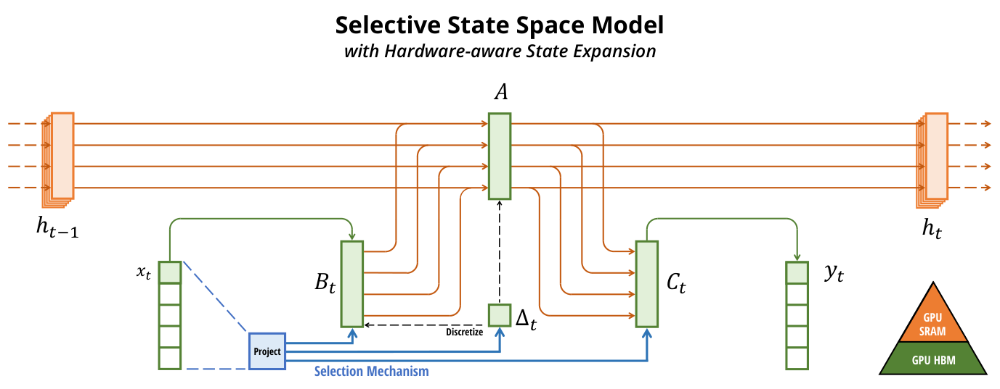
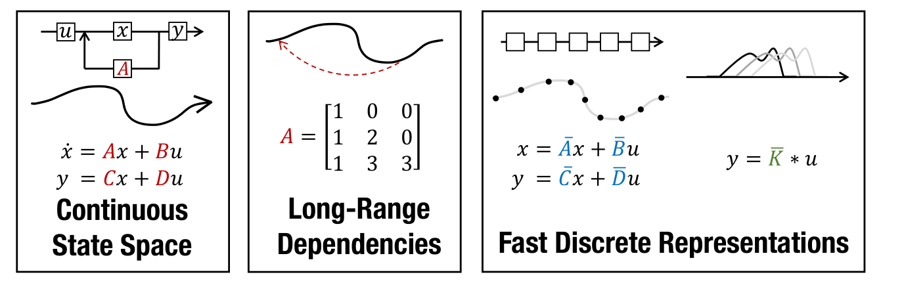
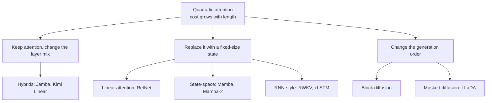
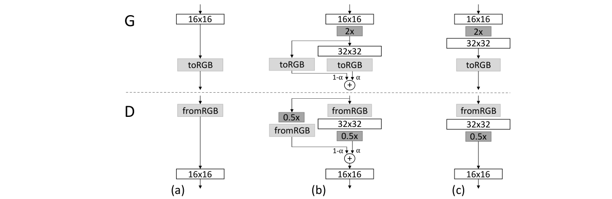
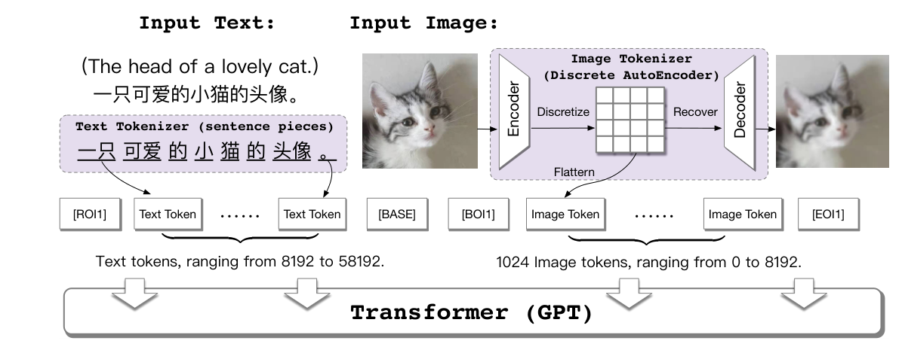

# 3b — Beyond the transformer

> Part two of [chapter 03](03-scale-and-the-model-zoo.md). Chapter 03 reads a model's size, scale and the mixture-of-experts split between total and active parameters. This note covers the architectures that replace or approximate attention and the models that generate in a different order.

---

## Linear-time models and non-autoregressive generation


**Not every LLM is a transformer.** Huyen surveys the alternatives to quadratic attention (*AI Engineering*, ch. 2): RWKV, an RNN that can be trained in parallel; state-space models (S4, H3, Mamba), whose cost grows linearly with sequence length, with Mamba-3B reported to beat transformers of its size and match transformers twice its size; and Jamba, which interleaves transformer and Mamba layers in a 52B-total, 12B-active MoE with a 256K-token context. The Mamba comparison is the authors' own, on language-modelling benchmarks at up to 3B parameters. Trained on 300B Pile tokens with the same tokenizer as Pythia, Mamba-2.8B averaged **63.3 over seven zero-shot tasks, against 59.1 for Pythia-2.8B and 63.0 for GPT-J-6B**, and the authors report 4–5× the inference throughput of a transformer of the same size. Their limitations section says the evaluation stops "below the threshold of most strong open source LLMs" and that it is not yet known whether Mamba holds up at 7B and beyond ([arXiv:2312.00752](https://arxiv.org/abs/2312.00752) (Gu & Dao, COLM 2024)). Every architecture in this note is still the transformer; the alternatives matter when context length, not parameter count, is the cost that hurts. Nor does every LLM generate left to right. Block diffusion is autoregressive over blocks of tokens and fills in each block by denoising, keeping the KV cache across blocks ([arXiv:2503.09573](https://arxiv.org/abs/2503.09573) (Arriola et al., 2025-03)). At 110M parameters on OpenWebText it narrows the perplexity gap with block size 4 (at most 20.73, against 17.54 for autoregressive and at most 22.98 for the earlier masked-diffusion model MDLM). It still trails, and the paper shows no wall-clock speedup at that scale.


*Image Source: Gu & Dao, [Mamba](https://arxiv.org/abs/2312.00752) (2023), Fig. 1*

S4 is the structured state-space layer behind much of this line. It runs as a convolution in training and as a recurrence at generation time, and a special parameterisation of the state matrix makes the convolution kernel cheap to compute. On Long Range Arena it averaged 80.48% in the original submission (86.09 in the updated paper) against under 60% for every baseline (best 59.37), and it was the first model to solve Path-X (length 16,384) at 88% in the original version (96.35 in the updated table) against 50% chance. As a replacement for attention on WikiText-103 it reached 20.95 test perplexity at 249M parameters against 20.51 for a 247M Transformer, so it matched rather than beat attention at language modelling. Generation ran about 60x faster (48K against 0.8K tokens per second; the Transformer timing excludes the embedding and softmax). The HiPPO initialisation matters: random state matrices performed poorly in the authors' ablation (sequential CIFAR-10, 84.27% with HiPPO). The models are around 250M parameters with no large-scale pretraining ([arXiv:2111.00396](https://arxiv.org/abs/2111.00396) (Gu et al., ICLR 2022)).


*Image Source: Gu et al., [Efficiently Modeling Long Sequences with Structured State Spaces](https://arxiv.org/abs/2111.00396) (2022), Fig. 1*

The line between transformers and the alternatives is thinner than it looks. Mamba-2 shows that a state-space layer whose state transition is a scalar times the identity computes causal attention with the softmax removed and a learned, input-dependent decay applied to the scores. The same layer can therefore run as a linear-time recurrence or as quadratic [matrix multiplications](02-attention-and-the-transformer-block.md#matrix-products-transpose-and-rank) on tensor cores ([arXiv:2405.21060](https://arxiv.org/abs/2405.21060) (Dao & Gu, 2024-05)). At 2.7B parameters trained on 300B Pile tokens, Mamba-2 matched a Transformer++ baseline (Pile perplexity 6.09 against 6.13, zero-shot average 60.2 for both). Replacing 6 of its 64 layers with attention beat both (5.95, 61.0). The authors' guess is that attention does exact look-up of earlier tokens, while the SSM has to compress everything into a fixed-size state. In their 350M sweep, about 10% attention layers was best, but anything from 3 to 9 attention layers landed within 0.03 perplexity. xLSTM rebuilds the LSTM with exponential gates and a matrix-valued memory. At 1.3B parameters on 300B SlimPajama tokens it reached validation perplexity 8.89, against 9.14 for Mamba and 9.44 for a Llama-style transformer ([arXiv:2405.04517](https://arxiv.org/abs/2405.04517) (Beck et al., 2024-05)). Read both papers' comparisons with care: the authors trained every baseline themselves, ran each configuration once and stopped at 2.7B and 1.3B parameters. xLSTM's own paper says its kernels were about 4× slower than FlashAttention.

The equivalence is older than Mamba-2. Katharopoulos et al. replaced the softmax with a kernel feature map and showed that causal attention then becomes a recurrence whose state is a fixed-size matrix. Generating a token costs the same at position 10,000 as at position 10 ([arXiv:2006.16236](https://arxiv.org/abs/2006.16236) (Katharopoulos et al., ICML 2020)). On CIFAR-10 image generation, each model got a week on one GPU. Linear attention matched softmax (3.40 against 3.47 bits per dimension) and generated images 4,462× faster than the softmax baseline. That baseline recomputed attention for every new pixel. A softmax model that cached its keys and values closed most of the gap, leaving linear attention about 56× faster (17.85 against 0.32 images per second).

On speech recognition it was worse (phoneme error rate 8.08 against 5.12). It was never tested on language. RetNet adds a fixed exponential decay to that recurrence ([arXiv:2307.08621](https://arxiv.org/abs/2307.08621) (Sun et al., 2023, preprint)). At 6.7B parameters trained on 100B tokens, it averaged 69.51 zero-shot against 66.07 for the authors' own transformer. Training used 2,048-token sequences, and RetNet's perplexity only overtook the transformer's above about 2B parameters. At 8K tokens it decoded 8.4× faster with 70% less memory than a transformer with a KV cache. It reports no long-context recall test. RWKV, the RNN in Huyen's list, applies a decay per channel ([arXiv:2305.13048](https://arxiv.org/abs/2305.13048) (Peng et al., Findings of EMNLP 2023)).

From 169M to 14B parameters on 330B Pile tokens, it was on par with Pythia, OPT and BLOOM given the same compute. Its limitations section names the cost: everything the model keeps from the prompt has to pass through a single vector. Reordering an RTE prompt to put the question first lifted the instruction-tuned RWKV-14B (Raven) from 44.2 to 74.8 F1, still short of ChatGPT's 88.1 on the original prompt. Hyena drops attention for long convolutions whose filters are generated by a small network ([arXiv:2302.10866](https://arxiv.org/abs/2302.10866) (Poli et al., ICML 2023)). On a synthetic recall task at 131K tokens with two-layer models, Hyena scored 97.2% and RWKV 2.3%, while attention ran out of memory.

Each model saw only 2,000 training examples, a regime where the authors note transformers struggle even at lengths that fit. At 355M parameters on 15B Pile tokens, it matched GPT's perplexity (9.2 against 9.1) with about 20% less compute. It stops below a billion parameters, and its authors expect hybrids to win below 8K tokens. Feng et al. show that softmax attention itself can run as an RNN, using a running maximum and a prefix scan ([arXiv:2405.13956](https://arxiv.org/abs/2405.13956) (Feng et al., 2024, preprint)). The catch is that the query must be a single learned constant rather than each token's own. Their model was tested on reinforcement learning, event forecasting and time series, not language. It roughly matched transformers on 38 datasets, with models of about 3M parameters.

The fixed-size state is where these models lose, and the field's answer has been hybrids. One survey sorts the linear family into four groups: linear attention, linear RNNs, state-space models and test-time-training RNNs ([arXiv:2508.09834](https://arxiv.org/abs/2508.09834) (Sun et al., 2025, preprint)). Within linear attention it traces how the state update has changed. Plain accumulation came first, then a decay that does not depend on the input (as in RetNet), then one that does, then the delta rule, which corrects what a key already stores toward the new value. It judges linear attention's recall over long contexts still deficient. The other survey reports a "growing consensus" that purely linear designs pay "a non-trivial performance penalty" on complex reasoning and ultra-long-context retrieval. It finds production designs mixing in some full-attention layers: MiniMax-01 uses one softmax layer in every eight ([arXiv:2507.19595](https://arxiv.org/abs/2507.19595) (Sun et al., 2025, preprint)). Neither runs experiments of its own.

Kimi Linear tests the recipe at scale: three linear layers to every MLA attention layer, in a 48B-total, 3B-active MoE trained on 1.4T tokens ([arXiv:2510.26692](https://arxiv.org/abs/2510.26692) (Kimi Team, 2025, preprint)). Its linear layer, KDA, is a gated delta rule with a separate forget rate for each channel instead of one per head. Against a full-MLA model trained the same way, the base model scored 51.0 against 47.2 on MMLU-Pro (67.4 against 65.7 after fine-tuning) and 84.3 against 81.3 on RULER at 128K, with up to 75% less KV cache. A hybrid using the plain per-head gate scored 80.5 on RULER, below full MLA. At 1M tokens and batch size 1 it decoded about 2.2–2.3× faster (the paper's text and figure differ). The headline 6.3× depends on spending the freed memory on larger batches. In a smaller ablation, at about 650M active parameters, 3:1 had the best validation perplexity (5.65). A 7:1 ratio scored 5.70, all-attention 5.77, and 15:1 was worst at 5.82. The authors note that pure linear attention still struggles with exact copying and retrieval, and they never train a pure-linear model at scale.

A recurrent-looking state does not give an SSM an RNN's power. Merrill et al. prove that SSMs with linear, diagonal state transitions (S4, and Mamba too) fall in the same circuit class as transformers, TC0. Unless TC0 equals the larger class NC1, neither can compose permutations, follow a chess game in move notation, evaluate code or track entities over inputs of arbitrary length at fixed depth. Trained on composing permutations of five elements, both architectures needed more layers as sequences grew, while a one-layer RNN solved every length. An SSM variant with input-dependent, non-diagonal transitions also did ([arXiv:2404.08819](https://arxiv.org/abs/2404.08819) (Merrill et al., ICML 2024)). The bound is worst-case, and the fix was not tested at language-model scale.

Wang et al.'s survey of SSMs reaches a softer verdict from benchmarks, most of them in vision: SSMs match some transformers but still trail the state of the art ([arXiv:2404.09516](https://arxiv.org/abs/2404.09516) (Wang et al., Visual Intelligence 2026)). A trained transformer can also be turned into an SSM rather than one being trained from scratch. Moudgil et al. distilled Pythia-1B first into linear attention (Hedgehog) and then into a Mamba-style model, using 10B OpenWebText tokens against the 300B Pile tokens the teacher was trained on. Perplexity came within 0.25 of the teacher (14.11 against 13.86), but downstream gaps remained, for example LAMBADA 32.3 against 42.1. Distilling straight into the SSM, without the linear-attention step, gave perplexity above 100 ([arXiv:2604.14191](https://arxiv.org/abs/2604.14191) (Moudgil et al., 2026-04, preprint)). It is one model family (Pythia, 160M to 1B) on one dataset.

Masked diffusion has since been scaled. LLaDA trains a transformer without a causal mask to predict tokens hidden at a random ratio, and at 8B parameters on 2.3T tokens it scored 65.9 on MMLU, against 65.4 for LLaMA 3 8B trained on 15T, and 70.3 against 48.7 on GSM8K. It trailed on BBH (49.7 against 62.1) and HellaSwag (70.5 against 79.1). Because it sees context on both sides, it handles the reversal curse better: completing the *previous* line of a Chinese poem it scored 45.6, against 34.3 for GPT-4o, which was far ahead going forwards (82.7 against 51.8) ([arXiv:2502.09992](https://arxiv.org/abs/2502.09992) (Nie et al., NeurIPS 2025)). It cannot use a KV cache, the output length must be fixed in advance, and its compute-matched comparison with autoregressive models stops below 10²³ FLOPs.

Diffusion's clearest advantage is when data, not compute, runs out. Ni et al. trained 1B models on 96B tokens in total, drawn from pools of 0.5B to 96B unique tokens. With little unique data, repeated many times, diffusion overtook autoregressive training and matched an autoregressive model given about 3× the unique data. The crossover came later with more or better data, and earlier with larger models. The price is compute: diffusion needed over 100× the training FLOPs to reach its peak, and 16 to 4,700 times the inference FLOPs per task. The hyperparameters were tuned for autoregressive models, which the authors say favours them ([arXiv:2511.03276](https://arxiv.org/abs/2511.03276) (Ni et al., 2025-11, preprint)).

The family, in one picture:



The recurrence behind the middle branch is short enough to run. Causal linear attention gives the same outputs as a loop over a state whose size does not depend on how many tokens came before:

```python
import numpy as np

rng = np.random.default_rng(0)
d, T = 4, 6
phi = lambda x: np.maximum(x, 0) + 1e-3          # a positive feature map, for illustration
q, k, v = (rng.normal(size=(T, d)) for _ in range(3))

# 1. the usual view: each step looks back at every earlier key (a growing cache)
parallel = []
for t in range(T):
    w = np.array([phi(q[t]) @ phi(k[s]) for s in range(t + 1)])
    parallel.append((w[:, None] * v[: t + 1]).sum(0) / w.sum())

# 2. the same outputs as a recurrence over a fixed-size state
S, z, recurrent = np.zeros((d, d)), np.zeros(d), []
for t in range(T):
    S += np.outer(phi(k[t]), v[t])
    z += phi(k[t])
    recurrent.append(phi(q[t]) @ S / (phi(q[t]) @ z))

print("same outputs:", np.allclose(parallel, recurrent))
print("recurrent state:", S.size + z.size, "numbers at any length")
for n in (6, 10_000):
    print(f"softmax KV cache at {n:>6} tokens:", 2 * n * d, "numbers")
```

```text
same outputs: True
recurrent state: 20 numbers at any length
softmax KV cache at      6 tokens: 48 numbers
softmax KV cache at  10000 tokens: 80000 numbers
```

NumPy, one head, a made-up feature map. The state is what makes generation cheap and what the limits above are about: everything the model remembers of the prompt has to fit in it.

## Image generators: GANs, and a transformer over image tokens

The same course covers generative image models, and two designs sit on either side of the transformer. A generative adversarial network (GAN) trains a generator and a discriminator against each other, so the generator learns whatever fools the discriminator. A short Japanese glossary entry puts it plainly: introduced by Goodfellow et al. in 2014, with DCGAN adding deep convolutional networks for stability, it gives sharper images than a VAE but is less stable to train. The entry has no experiments or numbers, so it is a pointer, not evidence ([doi:10.3156/jsoft.29.5_177_2](https://doi.org/10.3156/jsoft.29.5_177_2) (Shibata, Journal of Japan Society for Fuzzy Theory and Intelligent Informatics 2017)).

Progressive growing made large GANs trainable by starting at low resolution and adding layers that fade in as training proceeds. On CelebA at 128x128 it roughly halved training time, and reaching 6.4M images at 1024x1024 took 96 hours against an extrapolated 520 (a 5.4x speed-up; the baseline time is extrapolated, not run). The final CelebA-HQ model reached FID 7.30 on 50K images after 4 days on 8 V100s, with 23.1M parameters in each network ([arXiv:1710.10196](https://arxiv.org/abs/1710.10196) (Karras et al., ICLR 2018)).


*Image Source: Karras et al., [Progressive Growing of GANs for Improved Quality, Stability, and Variation](https://arxiv.org/abs/1710.10196) (2018), Fig. 2*

StyleGAN2 is an artefact-by-artefact repair of StyleGAN, and its ablation ladder shows which changes earned their cost. FFHQ FID fell from 4.40 to 2.84 and LSUN Car from 3.27 to 2.32. Weight demodulation alone left FID unchanged (4.40 to 4.39), and path-length regularisation made LSUN Car FID worse (2.83 to 3.43) while improving the smoothness measure. Two LSUN Cat models with the same FID of 8.53 differed in path length by 924 against 387, so FID alone hides a quality axis. The whole project used 131.61 MWh and 51.05 V100 GPU-years ([arXiv:1912.04958](https://arxiv.org/abs/1912.04958) (Karras et al., CVPR 2020)).

CogView takes the other route: quantise an image into a 32x32 grid of tokens from an 8,192-entry codebook with a discrete autoencoder, then let one GPT-style transformer model the text tokens and image tokens as a single sequence. On COCO it scored FID 27.1 against 27.5 for DALL-E (a figure read from the DALL-E comparison) and 26.5 for DM-GAN and DF-GAN, and the blurred FID-2 was 13.9 against 45.5. Those FIDs use a Gaussian-blur variant and 60 candidates reranked by the model itself. Human raters picked CogView best 37.02% of the time against 59.53% for the original image, and DM-GAN ranked last in preference despite the best FID, so the metric and the raters disagree. The training story is in [15](15-pretraining-runs-cost-and-scale.md) ([arXiv:2105.13290](https://arxiv.org/abs/2105.13290) (Ding et al., NeurIPS 2021)).


*Image Source: Ding et al., [CogView: Mastering Text-to-Image Generation via Transformers](https://arxiv.org/abs/2105.13290) (2021), Fig. 3*

---

## Pitfalls

- **Quoting a throughput win without its setup.** Reported speedups depend on sequence length, batch size and kernel quality.
- **Generalising from small scale.** Most comparisons here stop at a few billion parameters and on the authors' own benchmarks. Wins at 3B say little about 70B.
- **Assuming a recurrent state is as expressive as attention.** A fixed-size state loses detail, and the theory results above show diagonal-transition SSMs sit in the same circuit class as transformers, not above it.

---

## Try it

1. In the code above, set `T = 12`. Does the equivalence still hold, and what happens to the recurrent state size?
2. A hybrid uses 3 linear layers for every attention layer. Roughly how does its KV cache compare with an all-attention model of the same depth?

<details>
<summary>Answers</summary>

1. It still holds and the state is still 20 numbers. Only the softmax cache grows with T.
2. Only the attention layers keep a cache that grows with length, so it is about a quarter of the all-attention cache, ignoring differences in head count and cache compression such as MLA.

</details>

---

## Interview checklist

| Question | Answer |
|---|---|
| Why look beyond attention at all? | Attention cost grows quadratically with sequence length. Linear-time models keep a fixed-size state, which makes long sequences cheap but loses what does not fit in the state |
| Do state-space models beat transformers? | Not in general. Reported wins are at small scale and on the authors' own benchmarks, and hybrids that mix a few attention layers with linear layers are the field's current answer |

---

## Next

[04 — Decoding and inference behaviour](04-decoding-and-inference-behaviour.md) moves from what the model is to what it does at run time, from one prompt to one token to the next.
