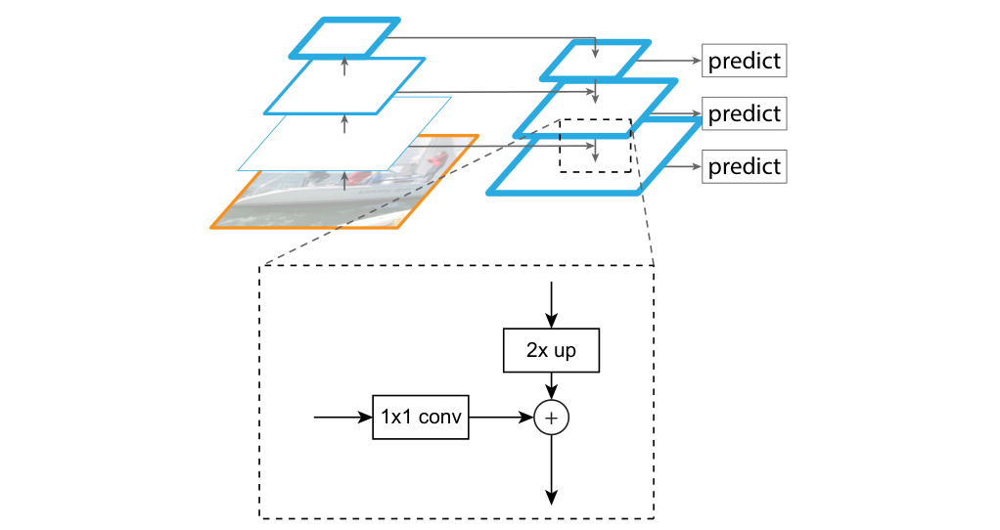
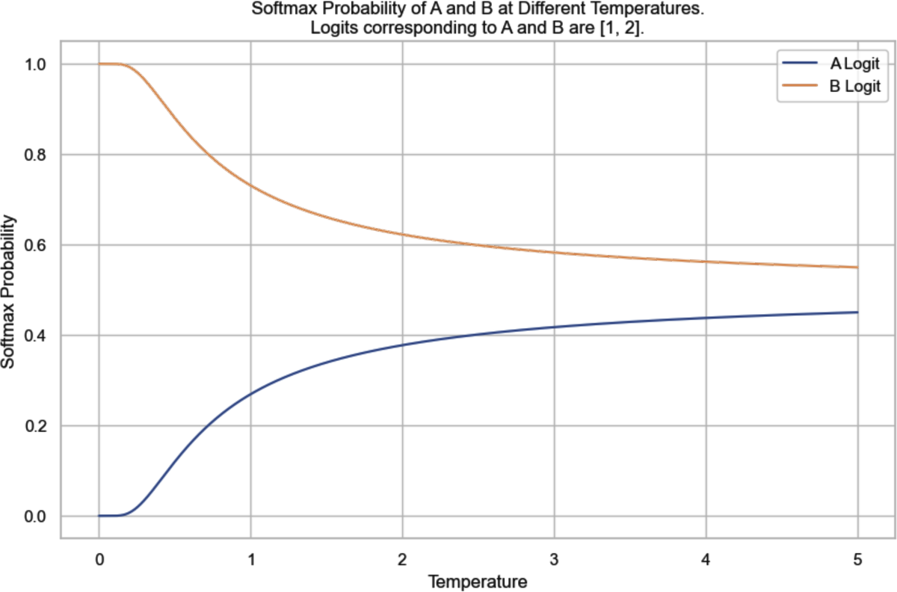
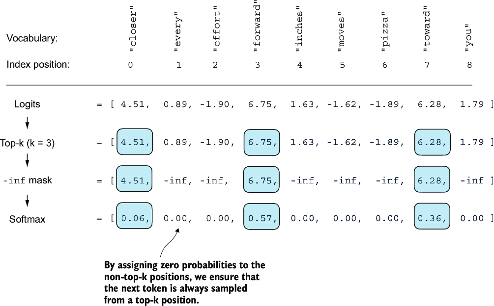
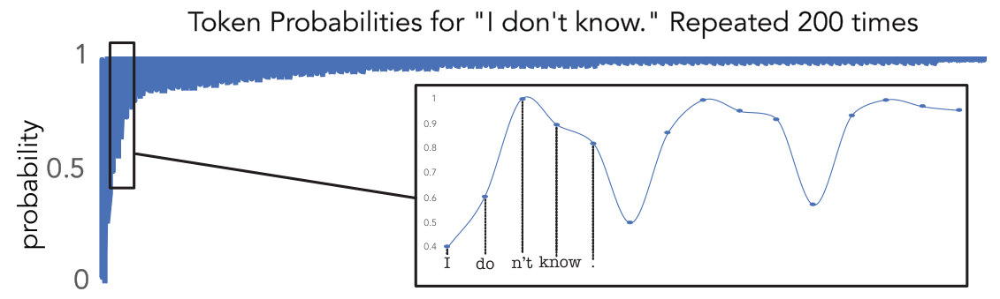
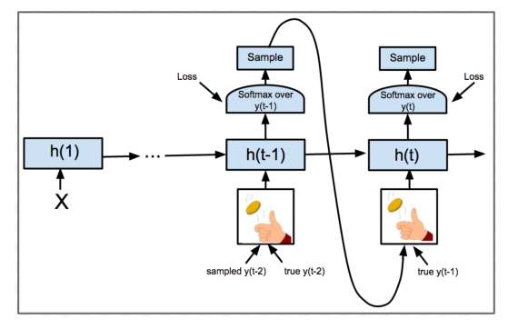
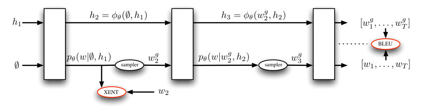
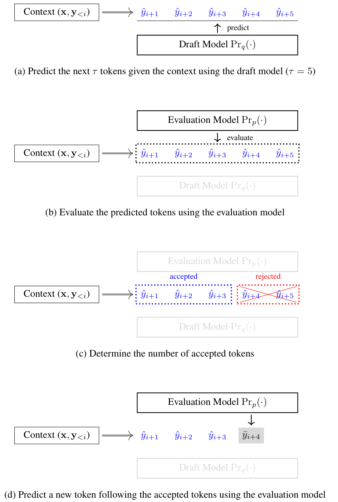
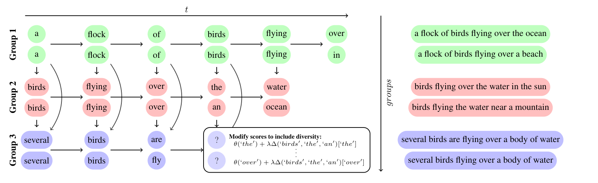
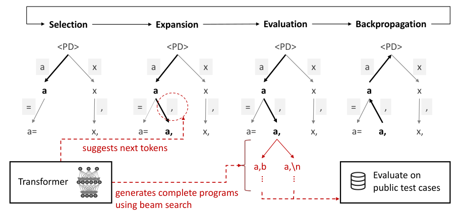
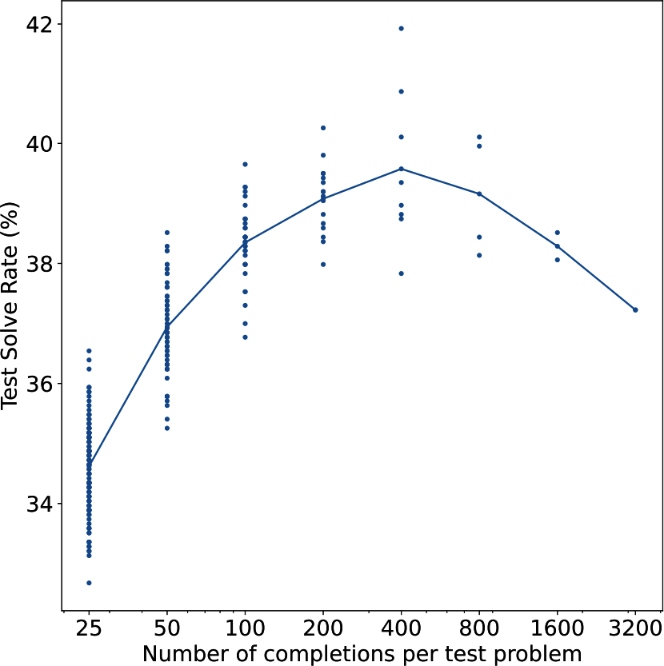

# 4 — Decoding and inference behaviour

Run the ticket assistant twice on the same ticket and it may reply in different words. Ask for JSON and one run in a hundred may break your parser. Lengthen the conversation and it gets slower and its memory use climbs. None of these is a bug in your code. They follow from how a decoder produces text at run time: one parallel pass over the prompt, then one token at a time, each picked from a distribution by a rule you can configure. This chapter opens that loop.

> An LLM is a decoder-only transformer trained to predict the next token. Tokens, embeddings, causal self-attention and scale explain most of its behaviour, including the failures.

---

## Prefill, decode and the KV cache

Running a decoder has two phases (*AI Engineering*, ch. 2):

- **Prefill.** The whole prompt goes through the model in one parallel pass. Every prompt token's keys and values are computed at once.
- **Decode.** Output tokens come one at a time, and each new token needs a full forward pass. The new token attends to the keys and values of everything before it, so those are stored rather than recomputed. That store is the **KV cache**; it grows linearly with context length and is what makes long contexts expensive to *serve*. Two changes shrink it. *Grouped-query attention* (GQA) lets several query heads share one key/value head. In Meta's 30B ablation, on 150B tokens, GQA with 8 KV heads scored about the same as full multi-head attention. The multi-head model ran out of memory at a batch of 128 with 2K context, where GQA still ran, so Llama 2 used GQA for its 34B and 70B models ([arXiv:2307.09288](https://arxiv.org/abs/2307.09288) (Touvron et al., 2023, preprint)). *Sliding-window attention* lets each layer look back only W tokens, so the cache can be a fixed-size rolling buffer. Mistral 7B uses W = 4,096 and keeps both changes. Its authors report 8× less cache memory at 32K tokens "without impacting the model quality", though they give no numbers for that claim ([arXiv:2310.06825](https://arxiv.org/abs/2310.06825) (Jiang et al., 2023, preprint)). DeepSeek's *multi-head latent attention* (MLA) compresses each token's keys and values into one small latent vector and caches only that. For DeepSeek-V2 that came to 4.5 head-widths per token per layer, where full multi-head attention caches two per head. DeepSeek reported that MLA *beat* full attention. A review of the DeepSeek models finds that surprising for a [low-rank](02-attention-and-the-transformer-block.md#matrix-products-transpose-and-rank) compression and suspects the decoupled RoPE that MLA needs is the cause, which no published ablation tests ([arXiv:2503.11486](https://arxiv.org/abs/2503.11486) (Wang & Kantarcioglu, 2025, preprint)).

Decode is sequential, so latency adds up per token. Huyen's arithmetic: at 10 ms per token, a 100-token answer takes a full second, against the roughly 100 ms that users expect from a web request (*AI Engineering*, ch. 1). Serving tricks for both phases (batching, paged KV cache, speculative decoding) are in [ai-engineering/07-inference-engineering](../../../ai-engineering/07-inference-engineering/README.md).

The training objective can also make decode cheaper without a separate draft model. Gloeckle et al. gave a shared trunk four output heads, each predicting one of the next four tokens. They kept parameter counts equal by removing trunk layers ([arXiv:2404.19737](https://arxiv.org/abs/2404.19737) (Gloeckle et al., ICML 2024)). At inference only the first head is needed, and the others can propose tokens for the model to check itself. A 7B code model decoded 3.05× faster this way at batch size 42, and a text model 2.7× faster. The 13B code model, trained on about 210B tokens, also scored higher: MBPP pass@1 30.5 against 26.0 with next-token training. Below about 3B parameters it scored lower (0.6B: 3.0 against 4.7). At 7B on 200B tokens of natural language it gave no gain on multiple-choice benchmarks, and four heads did slightly worse than one.

The split between parallel training and sequential generation is older than LLMs. PixelRNN ([arXiv:1601.06759](https://arxiv.org/abs/1601.06759) (van den Oord et al., ICML 2016)) wrote an image as a product of next-pixel distributions in raster order, each a 256-way softmax over intensities. Its PixelCNN variant uses masked convolutions, which play the role of the causal mask. The paper notes that this parallelism exists only in training: "the image generation process is sequential for both". The gated PixelCNN ([arXiv:1606.05328](https://arxiv.org/abs/1606.05328) (van den Oord et al., NIPS 2016)) matched PixelRNN on CIFAR-10 (3.03 against 3.00 bits per dimension; bits are nats divided by ln 2, see [nats and bits](06-pretraining-data-and-objectives.md#entropy-cross-entropy-kl-and-perplexity)) in under half the training time. At sampling time it still fed each new pixel back into the network. WaveNet ([arXiv:1609.03499](https://arxiv.org/abs/1609.03499) (van den Oord et al., SSW 2016)) brought the same setup to raw audio, at 16,000 or more sequential steps per second of speech. Jukebox ([arXiv:2005.00341](https://arxiv.org/abs/2005.00341) (Dhariwal et al., 2020-04, preprint)) shows the bill at scale. It runs autoregressive transformers over VQ-VAE audio codes: a 5B top-level prior, plus 1B upsamplers that refill detail. Rendering one minute of music took about an hour for the top-level tokens and another 8 hours of upsampling. The authors' summary is "fast parallel evaluation of likelihood but slow autoregressive sampling".

One-token-per-step decoding comes from the training objective, not from the transformer itself. Muse trains a transformer to fill in masked image tokens, the way BERT fills in words, and then decodes a 256-token image in 24 parallel steps instead of 256. On Google's own TPUv4 timings, Muse-3B took 0.5 s per 256×256 image against 6.4 s for the autoregressive Parti-3B, with a similar zero-shot COCO FID (7.88 against 8.10) ([arXiv:2301.00704](https://arxiv.org/abs/2301.00704) (Chang et al., 2023-01)). DETR made object detection parallel in a similar way. A decoder turns 100 learned queries into 100 box predictions at once, and a set loss matches them one-to-one to the true objects by Hungarian matching, so the hand-built anchors and non-maximum suppression (NMS) of earlier detectors are gone ([arXiv:2005.12872](https://arxiv.org/abs/2005.12872) (Carion et al., ECCV 2020)). Self-attention between the queries does the de-duplication itself: NMS still helped after the first decoder layer, but after the last it slightly lowered accuracy.

With a ResNet-50 backbone it tied a Faster R-CNN with FPN, retrained with DETR's GIoU loss and crops on a 9× schedule, at 42.0 COCO AP. It was better on large objects (61.1 against 53.4 AP) and worse on small ones (20.5 against 26.6), and it needed 500 training epochs. The FPN in that baseline gives the detector a feature map at every scale. A top-down path upsamples deep features 2× and adds them to shallower ones through 1×1 lateral convolutions, so small objects get features with deep-layer meaning. In Faster R-CNN with ResNet-50 on COCO minival it added 2.3 AP over the authors' reproduced single-scale baseline, reaching 33.9. In a Fast R-CNN ablation on fixed proposals, removing the top-down path dropped AP from 33.9 to 24.9 ([arXiv:1612.03144](https://arxiv.org/abs/1612.03144) (Lin et al., CVPR 2017)).


*Image Source: Lin et al., [Feature Pyramid Networks for Object Detection](https://arxiv.org/abs/1612.03144) (CVPR 2017), Fig. 3*

The cost is an assumption that tokens filled in during the same step are independent of each other, given everything else. On text this cost shows up in Bayesian Flow Networks ([arXiv:2308.07037](https://arxiv.org/abs/2308.07037) (Graves et al., 2023-08, preprint)), which set the number of generation steps separately from the sequence length. On text8 they scored 1.41 bits per character using 256-character sequences and 1,000 steps, and 1.43 using 100 steps. An autoregressive transformer scored 1.23. MusicGen measures that cost on audio tokens, where each time step has four codebook tokens. The test used a 300M model on 30-second clips from an in-domain test set ([arXiv:2306.05284](https://arxiv.org/abs/2306.05284) (Copet et al., 2023-06)):

- **Fully sequential** (6,000 steps): FAD 0.86.
- **All four codebooks at once** (1,500 steps): FAD worsened to 2.58.
- **Each codebook offset by one step from the last** (still 1,500 steps): FAD 0.96, recovering most of the loss.


*Image Source: Copet et al., [Simple and Controllable Music Generation](https://arxiv.org/abs/2306.05284) (2023), Fig. 1*

Diffusion avoids token-by-token decoding altogether. Noise2Music generates 30-second clips with a cascade of 1D diffusion U-Nets conditioned on T5 text embeddings: a 3.2 kHz waveform generator, a cascader up to 16 kHz, and a super-resolution stage to 24 kHz ([arXiv:2302.03917](https://arxiv.org/abs/2302.03917) (Huang et al., 2023-02, preprint)). Its training captions are pseudo-labels: the MuLan music-text model ranked about 4M LLM-written descriptions against roughly 340k hours of music. On MusicCaps it scored FAD 2.13 against 4.0 for MusicLM, though MuLan-based scores may favour it because MuLan wrote its labels. The parallelism is not free either: four samples took about 140 s on four TPU v4 chips across the three stages. Neither the data nor the model was released.

---

## Decoding

The model outputs logits; the decoder picks a token.

| Setting | Effect | Use |
|---|---|---|
| Greedy (temperature 0) | Always the top token | Extraction, classification, tests. Not perfectly deterministic on hosted APIs |
| Temperature > 0 | Flattens (>1) or sharpens (<1) the distribution before sampling | Creative or diverse output |
| Top-k / top-p (nucleus) / min-p | Sample only from the k most likely tokens, from the smallest set whose probabilities add up to p ([arXiv:1904.09751](https://arxiv.org/abs/1904.09751)), or from tokens above a minimum probability | Cuts off the long tail of nonsense |
| Max tokens / stop sequences | Hard stop | Cost control; the API reports `stop_reason` so you can tell truncation from completion |

Xiao & Zhu run the cut-offs on one five-token distribution (0.34, 0.32, 0.21, 0.12, 0.01) (*Foundations of LLMs*, ch. 5, Fig. 5.5). Top-k with k = 3 keeps the first three, which renormalise to about 0.39, 0.37 and 0.24 (recomputed here). Top-p with p = 0.6 keeps only the first two, because 0.34 + 0.32 = 0.66 is the first sum to reach 0.6, and they renormalise to about 0.52 and 0.48. With p = 1 and the temperature driven towards zero, top-p collapses to greedy search. For beam search they say a width of K = 2 to 5 is usually enough in LLM inference, a rule of thumb with no measurement behind it.


*Image Source: Xiao & Zhu, [Foundations of Large Language Models](https://arxiv.org/abs/2501.09223) (2025), Fig. 5.5*

**Temperature** divides the logits before the softmax: `softmax(logits / T)`. Huyen's two-token example (*AI Engineering*, ch. 2): with logits [1, 2], T = 1 gives probabilities [0.27, 0.73], and T = 0.5 gives [0.12, 0.88]. Below about T = 0.1 the model almost always picks the second token. Temperature 0 cannot literally be computed (division by zero), so it is implemented as "take the argmax". Providers usually cap T at 2, and Huyen reports 0.7 as a common starting point for creative work. Transformer Explainer runs GPT-2 small in the browser with a temperature slider, so you can watch the distribution reshape for your own prompt. In a 90-person study of non-experts it scored 73.3% on a 7-question quiz, significantly above a blog post and a video (p = 0.021 each). The biggest gain was on the output-probability question ([arXiv:2408.04619](https://arxiv.org/abs/2408.04619) (Cho et al., CHI 2026)).


*Image Source: Huyen, *AI Engineering* (O'Reilly, 2025), Fig. 2-16*

Raschka makes the same point by counting (*LLMs from Scratch*, ch. 5). On a toy nine-word vocabulary, sampling the next token 1,000 times from his model's distribution after "every effort moves you" gave "forward" 582 times, "toward" 343, "closer" 73 and "inches" 2. At T = 5 the nonsense continuation "pizza" came up about 4% of the time. Top-k with k = 3 removes it entirely. The sampling step, rewritten from his `generate()` (full version in [rasbt/LLMs-from-scratch](https://github.com/rasbt/LLMs-from-scratch), ch05):

```python
import torch

vocab = ["closer", "every", "effort", "forward", "inches", "moves", "pizza", "toward", "you"]
fixed = torch.tensor([[4.51, 0.89, -1.90, 6.75, 1.63, -1.62, -1.89, 6.28, 1.79]])
model = lambda idx: fixed.expand(idx.shape[1], -1).unsqueeze(0)   # stands in for a real model

def step(idx, temperature=1.0, top_k=None, context_len=8):
    logits = model(idx[:, -context_len:])[:, -1, :]               # last position only
    if top_k:                                                      # keep the k largest logits
        kth = torch.topk(logits, top_k).values[:, [-1]]
        logits = logits.masked_fill(logits < kth, float("-inf"))
    if temperature > 0:
        next_id = torch.multinomial(torch.softmax(logits / temperature, -1), 1)
    else:
        next_id = logits.argmax(-1, keepdim=True)                  # greedy
    return torch.cat([idx, next_id], dim=1)

idx = torch.tensor([[1, 2, 5, 8]])                                 # "every effort moves you"
for settings in [dict(), dict(temperature=0.1), dict(temperature=5.0),
                 dict(temperature=5.0, top_k=3), dict(temperature=0)]:
    torch.manual_seed(123)
    counts = torch.bincount(torch.cat([step(idx, **settings)[0, -1:] for _ in range(1000)]),
                            minlength=len(vocab))
    print(settings, {w: int(c) for w, c in zip(vocab, counts) if c})
```

```text
{} {'closer': 73, 'forward': 582, 'inches': 2, 'toward': 343}
{'temperature': 0.1} {'forward': 985, 'toward': 15}
{'temperature': 5.0} {'closer': 165, 'every': 75, 'effort': 42, 'forward': 239, 'inches': 71, 'moves': 46, 'pizza': 32, 'toward': 227, 'you': 103}
{'temperature': 5.0, 'top_k': 3} {'closer': 258, 'forward': 385, 'toward': 357}
{'temperature': 0} {'forward': 1000}
```

The logits are the toy values from Raschka's chapter, so `model` here is a stand-in that returns the same distribution every time. A real model takes the last position of a forward pass. Plain sampling at T = 1 follows the distribution, T = 5 lets `pizza` through, and top-k removes it again.


*Image Source: Raschka, *Build a Large Language Model (From Scratch)* (Manning, 2024), Fig. 5-15*

Two things the books get wrong or overstate here:

- **Why top-k exists.** Huyen presents top-k as a way to "reduce the computation workload" of the softmax over a large vocabulary (*AI Engineering*, ch. 2). The model computes the full logit vector either way, and a softmax over 100K numbers is cheap next to the forward pass. The reason top-k was introduced (k = 10 for story generation, because beam search gave generic, repetitive text and pure sampling picked very unlikely words; [arXiv:1805.04833](https://arxiv.org/abs/1805.04833) (Fan et al., ACL 2018)) and the reason top-p replaced it (Holtzman et al., [arXiv:1904.09751](https://arxiv.org/abs/1904.09751)) is quality: the long tail of unlikely tokens, sampled often enough, derails the text. Holtzman et al. measured both failure directions on GPT-2 Large (762M), generating 5,000 WebText continuations of up to 200 tokens. **Greedy decoding repeated itself in 73.66% of generations and beam search (b = 16) in 28.94%, against 0.28% for human text.** Pure sampling avoided repetition but had worse perplexity than human text (22.73 against 12.38), meaning it wandered into unlikely text. Nucleus sampling at p = 0.95 came closest to human text on perplexity (13.13) and repetition (0.36%), and scored best on HUSE, a combined human and statistical score (0.97). Top-k = 40 scored 0.19 there ([arXiv:1904.09751](https://arxiv.org/abs/1904.09751) (Holtzman et al., ICLR 2020)). These results are for open-ended generation. The authors note that for tasks whose output is tightly fixed by the input, such as translation, beam search is still the norm. Huyen's practical ranges stand: k between 50 and 500, p between 0.9 and 0.95.
- **Greedy decoding is not obsolete.** *Building AI Agents* (ch. 2) says greedy decoding "is no longer used" because it is too predictable. It is the default for extraction, classification, code and evaluation runs, where predictable is the point.


*Image Source: Holtzman et al., [The Curious Case of Neural Text Degeneration](https://arxiv.org/abs/1904.09751) (2019), Fig. 4*

The sampling setting also decides how easy machine text is to detect. Zellers et al. trained Grover, a news generator of up to 1.5B parameters, and found two artifacts that discriminators pick up. Pure sampling drifts out of distribution as the text gets longer, because the model was trained only on human-written prefixes (exposure bias). Truncation leaves an empty tail of tokens that never get sampled. Detection was hardest with nucleus sampling at p between 0.94 and 0.98. With 5,000 Grover articles to train on, the best existing discriminators reached 73% accuracy, and Grover itself used as a discriminator reached 92%. Readers rated propaganda rewritten by Grover as more trustworthy than the human-written original (2.42 against 2.19 out of 3) ([arXiv:1905.12616](https://arxiv.org/abs/1905.12616) (Zellers et al., NeurIPS 2019)).

The exposure bias behind that drift has a training-side fix, older than LLMs. A teacher-forced model never sees its own mistakes, so at inference one wrong token puts it in a state it was not trained on. Bengio et al. flip a coin at every step during training: with probability ε the input is the true previous token, otherwise a token sampled from the model, and ε decays over training (linear, exponential or inverse-sigmoid). On MSCOCO captioning with an LSTM (512 units, dev set of 5,000 images) BLEU-4 went from 28.8 for the baseline to **30.6 with an inverse-sigmoid schedule, while always sampling collapsed it to 11.2**; the gradient does not flow through the sampling choice, and each configuration is a single run ([arXiv:1506.03099](https://arxiv.org/abs/1506.03099) (Bengio et al., NIPS 2015)). Ranzato et al. attack the same gap with REINFORCE on the test metric itself. MIXER starts from a cross-entropy model and swaps in sampled steps from the end of the sequence backwards. With greedy decoding on Gigaword summarization it scored ROUGE-2 16.22 against 13.01 for cross-entropy, and on IWSLT14 German-to-English BLEU-4 20.73 against 17.74, at small RNN scale with one run per method. Training on ROUGE did not carry over to BLEU (5.80 against 9.32 when trained on BLEU), so the metric you optimise is the metric you gain on ([arXiv:1511.06732](https://arxiv.org/abs/1511.06732) (Ranzato et al., ICLR 2016)). Paulus et al. applied it to long summaries: a mixed maximum-likelihood and self-critical RL loss, plus a decode-time rule that **blocks any repeated trigram in beam search (beam 5)**, because reference summaries almost never repeat one. On CNN/Daily Mail the ML-only model scored ROUGE-1 38.3, ML+RL 39.87 and RL-only 41.16, but RL-only was the least readable to Mechanical Turk raters (100 test items, 5 raters each), so ML+RL was the one they reported. These scores use Paulus et al.'s own preprocessing, so they are not comparable with the 39.53 that See et al. report in [note 05](05-hallucination-and-base-vs-assistant.md). They did not ablate the trigram block ([arXiv:1705.04304](https://arxiv.org/abs/1705.04304) (Paulus et al., ICLR 2018)). All three are pre-transformer models; modern post-training meets the same gap with RL on sampled outputs ([05-RL](../../05-RL/README.md)).


*Image Source: Bengio et al., [Scheduled Sampling for Sequence Prediction with Recurrent Neural Networks](https://arxiv.org/abs/1506.03099) (2015), Fig. 1*


*Image Source: Ranzato et al., [Sequence Level Training with Recurrent Neural Networks](https://arxiv.org/abs/1511.06732) (2015), Fig. 4*

**Logprobs** (the log of each sampled token's probability, in nats; see [log-probabilities](06-pretraining-data-and-objectives.md#entropy-cross-entropy-kl-and-perplexity)) are the window into all of this, useful for classification confidence and for debugging. Availability varies by provider and changes often: when Huyen wrote, OpenAI returned the top 20 alternatives per token and many providers exposed none, partly because logprobs make a model easier to copy (*AI Engineering*, ch. 2).

---

**Speculative decoding** makes decode cheaper without changing the output distribution. A small draft model proposes τ tokens (Fig. 5.7 uses τ = 5), the large model scores all of them in one parallel, prefill-style pass, and the longest agreeing prefix is kept. The book works through the greedy version, where a draft token survives while it matches the large model's argmax. For sampling, it keeps a draft token when a uniform draw falls below the ratio p/q of the large model's probability to the draft model's (*Foundations of LLMs*, ch. 5, Eq. 5.32; the idea is Leviathan et al.'s). The book gives no speedup measurements.


*Image Source: Xiao & Zhu, [Foundations of Large Language Models](https://arxiv.org/abs/2501.09223) (2025), Fig. 5.7*

### Spending more compute at inference

Sampling a whole answer several times and picking one is **test-time compute** (*AI Engineering*, ch. 2):

- **Best-of-N.** Generate N answers and keep the one a reward model or verifier scores highest, or the one with the highest average [log probability](06-pretraining-data-and-objectives.md#entropy-cross-entropy-kl-and-perplexity) (average, so long answers are not penalized). **Beam search** does this token by token, keeping the k most promising partial sequences.
- **Majority vote (self-consistency).** For questions with one right answer, sample several and take the most common. Google's Gemini report did not score MMLU by plain majority vote. Its "uncertainty-routed chain-of-thought" takes 32 chain-of-thought samples and uses the majority answer only when agreement clears a threshold tuned on the validation split. Below that threshold it falls back to the greedy answer without chain of thought ([arXiv:2312.11805](https://arxiv.org/abs/2312.11805) (Gemini Team, 2023-12), appendix 10.2). The routing did the work. **Plain majority over 32 samples moved Gemini Ultra only from 84.0% to 85.0%; routing reached 90.04%.** GPT-4 (gpt-4-0613) got 87.3% either way. The headline compared Ultra's 90.04% with GPT-4's 86.4% at 5-shot, so the two numbers come from different methods. All of these are Google's own runs.
- **Where the check sits.** An *outcome* verifier scores only the final answer, so it gives false positives when wrong steps reach a right answer (the book's example reasons 2x + 4 = 10 to x = 3). A *process* verifier scores each step and aggregates by minimum or mean. Step scores come from human labels or from Monte Carlo rollouts: the share of rollouts from that step that reach the reference answer. Generative verifiers write a critique and read the probability of the token "Correct" as the score (*Foundations of LLMs*, ch. 5, 5.3.4; ch. 6, 6.3.4, Eq. 6.9–6.14). The books attach no numbers to the comparison.
- **Diversity trades against quality.** Best-of-N over near-identical samples wastes N. The book scores a candidate as log Pr(y|x) + λ·D, a diversity term against the other top candidates, and notes that search gains plateau because the model's ceiling is hit and path diversity falls (*Foundations of LLMs*, ch. 6, 6.3.2–6.3.3, Eq. 6.7). Both claims are asserted from cited work, without data. Diverse beam search is the measured version of the diversity term. Gimpel et al. had pushed beam search towards diverse outputs in 2013 by running it repeatedly; Vijayakumar et al. split a beam of B into G groups and decode the groups in turn. Each group's token scores are lowered in proportion to how many earlier groups chose that token at the same step, and the first group is plain beam search. On COCO captioning with an early captioner (neuraltalk2), B = 20 and G = 20, it produced 13.44 distinct 4-grams per word against 5.67 for ordinary beam search, and oracle SPICE over the 20 outputs rose from 27.34 to 28.09, while top-1 SPICE went from 16.27 to 16.78. On English-to-French translation (a GRU attention model, newstest-2013) oracle BLEU-4 rose from 18.44 to 18.77, and an earlier modified-objective baseline (Li et al., 2015) was ahead at 20 outputs (18.86). Oracle scores reward diversity by construction, the gains are small in absolute terms, the models are 2015-era LSTMs and GRUs and not LLMs, and no variance is reported. The diversity strength lambda worked from 0.2 to 0.8; higher values let the penalty override the model's probabilities and made the text ungrammatical ([doi:10.1609/aaai.v32i1.12340](https://doi.org/10.1609/aaai.v32i1.12340) (Vijayakumar et al., AAAI 2018); the numbers are from the [arXiv:1610.02424](https://arxiv.org/abs/1610.02424) v2 text, which carries the full experiments). The older, simpler fix targets why beam search gives bland text in the first place. Li et al. found that a conversation model maximising p(response | message) prefers generic replies, and reranked a 200-best list by also scoring how well each reply predicts the message (MMI-bidi). On a Twitter test set with a 4-layer LSTM seq2seq trained on 23M pairs (multi-reference BLEU), BLEU rose to **5.22 (Table 2)** and distinct-2 from 0.107 to 0.270, and five human judges preferred it to the baseline by a mean 0.11 (95% CI 0.07 to 0.14) on 1,000 items. The text of the paper quotes 5.90 for the same system, so cite the table. The method needs a long, diverse N-best list and is applied at test time only ([doi:10.18653/v1/n16-1014](https://doi.org/10.18653/v1/n16-1014) (Li et al., HLT-NAACL 2016)). **Sharpens** the diversity point above with a measured reranking baseline.


*Image Source: Vijayakumar et al., [Diverse Beam Search](https://arxiv.org/abs/1610.02424) (AAAI 2018), Fig. 2*
- **Pass@k and Cons@k.** Pass@k asks whether any of k samples is correct, estimated unbiasedly as 1/N Σᵢ (1 − C(n−cᵢ, k)/C(n, k)) over n samples with cᵢ correct for problem i. Cons@k asks whether the majority vote of k samples is correct (*Foundations of LLMs*, ch. 6, Eq. 6.31, 6.33).
- **Execution-based selection (CodeT).** Sample many programs, sample many tests from the same model, and score each group of programs that pass the same tests by how many programs and how many tests it holds. With code-davinci-002 at temperature 0.8 and 100 programs and 100 test samples per problem, HumanEval pass@1 rose from 47.0 to 65.8, MBPP from 58.1 to 67.7 and APPS introductory from 27.2 to 34.6, but APPS competition only from 1.8 to 2.2. Scoring by program count alone gave 55.9 and by test count alone 58.4 on HumanEval, and an AlphaCode-style clustering by output 55.1. It works only for executable code and costs the extra generations, and the example input/output was removed from the HumanEval prompts, so the numbers are not the standard benchmark ([arXiv:2207.10397](https://arxiv.org/abs/2207.10397) (Chen et al., ICLR 2023)).
- **Tree search over tokens (PG-TD).** Instead of sampling whole programs, run Monte Carlo tree search over next tokens, with the model's top-k tokens as the branches, a beam-search completion at each leaf, and the share of public test cases passed as the reward. With GPT-2 (1.5B) on APPS introductory problems and 256 Transformer generations, it reached a **26.70% pass rate against 11.95% for plain beam search**; with GPT-Neo 29.27% against 27.71% for sampling plus filtering. The gain over sampling shrinks at larger budgets, strict accuracy was not always better (13.10 against 13.80 for sampling plus filtering with GPT-2), and each step costs a beam search. On the first 100 problems with Codex (code-davinci-002) the pass rate went from 33.26 to 59.14 against beam search. It needs test cases ([arXiv:2303.05510](https://arxiv.org/abs/2303.05510) (Zhang et al., ICLR 2023)).


*Image Source: Zhang et al., [Planning with Large Language Models for Code Generation](https://arxiv.org/abs/2303.05510) (2023), Fig. 2*
- **Verifiers are worth a lot.** On GSM8K grade-school maths (7.5K training problems), OpenAI found that a trained verifier gave about the same boost as a 30× larger model: **a 6B generator with a verifier picking the best of 100 samples slightly beat a fine-tuned 175B model** ([arXiv:2110.14168](https://arxiv.org/abs/2110.14168) (Cobbe et al., 2021-10, preprint)). Huyen illustrates the 30× with a 100M model matching a 3B one (*AI Engineering*, ch. 2). That is her arithmetic, not a run in the paper, whose smallest model is 3B and whose measured comparison is 6B against 175B. Verification only paid off with enough training data; on small subsets fine-tuning alone did better. For the 6B verifier, gains stopped at 400 samples per problem and then fell, which the authors attributed to more samples meaning more wrong answers that fool the verifier. Brown et al.'s "Monkey Business" (2024) found instead that the share of problems solved kept rising log-linearly up to 10,000 samples.


*Image Source: Huyen, *AI Engineering* (O'Reilly, 2025), Fig. 2-19, reproducing Cobbe et al. (2021)*

Huyen adds that she does not "believe anyone in production samples 400 or 10,000 different outputs for each input." That was written before reasoning models (OpenAI o1 shipped in September 2024). They spend their extra inference compute on one long chain of thought rather than many parallel samples, and most providers now charge for those hidden tokens. Test-time compute became a product setting; see [ai-engineering/01-prompt-engineering note 07](../../../ai-engineering/01-prompt-engineering/notes/07-prompting-reasoning-models.md).

A model can also spend extra compute without writing tokens, by running a block of layers more times. Geiping et al. trained a 3.5B model whose 4-layer core is iterated r times at inference, on 800B tokens ([arXiv:2502.05171](https://arxiv.org/abs/2502.05171) (Geiping et al., 2025-02)). **On GSM8K with chain of thought it scored 0.0% at r=1 and 34.8% (strict match) at r=32.** At r=32 its compute is about that of a 32–50B dense model. A fixed-depth model trained the same way to 180B tokens scored 1.8% against the recurrent model's 9.0% at that point. This is one training run, with the baseline compared only at 180B tokens and not matched for FLOPs, and the model still trails OLMo-2-7B (66.7%).

The same weight-sharing idea, the Universal Transformer, works far better on small puzzle benchmarks trained from scratch. Gao et al. compared models on ARC-AGI 1 at a fixed budget of 32× the compute of a base model. Stacking distinct layers reached 23.75% pass@1. A 4-layer block looped 8 times reached 40.0%. Stacking more distinct layers did not close the gap: 64 of them, 256 wide, scored 18.25%. Adding a short convolution inside the feed-forward layer and not backpropagating through the first 2 of the 8 loops raised this to 53.8% (16.0% on ARC-AGI 2). Removing the attention softmax dropped it to 2.0%. These are single runs on augmented ARC training data, with no pretraining ([arXiv:2512.14693](https://arxiv.org/abs/2512.14693) (Gao et al., 2025-12, preprint)).

Sampling several outputs and checking whether they agree is also a cheap hallucination signal. SelfCheckGPT ([arXiv:2303.08896](https://arxiv.org/abs/2303.08896), Manakul et al., 2023) flags sentences that vary across samples as likely fabricated.

---

### Structured output is a decoding problem

If code will parse the answer, you need more than a polite request. Huyen ranks the options by how deep in the stack they act (*AI Engineering*, ch. 2): prompting for the format; post-processing (LinkedIn's defensive YAML parser took correct outputs from 90% to 99.99%); **constrained sampling**, which at each step masks the logits of every token the grammar does not allow, the same `-inf` trick as top-k; and fine-tuning, up to replacing the language-model head with a classifier head. A provider's "JSON mode" usually guarantees valid JSON, not JSON that matches your schema, and a response cut off by `max_tokens` is invalid whatever the mode. The API patterns are in [chapter 13](13-calling-models-from-code.md).

## Worked example: the KV cache and a constrained decode

**The cache is an optimisation that changes no answer.** The new token's output depends on its own query and on every key and value so far. Everything else in the full recompute is wasted work. So you can store the keys and values, compute only the new token's, and get the identical result:

```python
import torch

torch.manual_seed(0)
d = 16
Wq, Wk, Wv = [torch.nn.Linear(d, d, bias=False) for _ in range(3)]

def attend(q_last, k, v):
    scores = q_last @ k.transpose(-2, -1) / d ** 0.5
    return torch.softmax(scores, -1) @ v

prompt = torch.randn(1, 9, d)
new_token = torch.randn(1, 1, d)
x = torch.cat([prompt, new_token], 1)

full = attend(Wq(x)[:, -1:], Wk(x), Wv(x))                        # recompute everything

k_cache, v_cache = Wk(prompt), Wv(prompt)                         # stored during prefill
k = torch.cat([k_cache, Wk(new_token)], 1)
v = torch.cat([v_cache, Wv(new_token)], 1)
cached = attend(Wq(new_token), k, v)

print("same output:", torch.allclose(full, cached))
print("K, V vectors computed for this token: full =", 2 * x.shape[1], " cached = 2")
```

```text
same output: True
K, V vectors computed for this token: full = 20  cached = 2
```

What you pay for that is memory, and it scales with every part of the model's shape. One key and one value per token, per head, per layer. Reducing the number of key/value heads is exactly what GQA does:

The book gives the per-token cache size symbolically: with L layers, head size d_h, m bytes per value and τ heads, it is proportional to L·τ·d_h·m for multi-head attention, L·d_h·m for multi-query attention (one KV head) and L·n_g·d_h·m for grouped-query attention with n_g KV groups. Setting n_g = τ recovers MHA and n_g = 1 recovers MQA (*Foundations of LLMs*, ch. 2). The sizes below are the n_g = 8 case.


*Image Source: Xiao & Zhu, [Foundations of Large Language Models](https://arxiv.org/abs/2501.09223) (2025), Fig. 2.8*

```python
def kv_gb(layers, kv_heads, head_dim, context, bytes_per=2):
    return 2 * layers * kv_heads * head_dim * context * bytes_per / 1e9

shape = dict(layers=32, head_dim=128)                             # a 4096-wide model, like a Llama 2 7B
for kv_heads, label in [(32, "one KV head per query head"), (8, "GQA, 8 KV heads")]:
    for context in (4_096, 128_000):
        print(f"{label:<27} T={context:>7,}: {kv_gb(kv_heads=kv_heads, context=context, **shape):6.1f} GB per conversation")
```

```text
one KV head per query head  T=  4,096:    2.1 GB per conversation
one KV head per query head  T=128,000:   67.1 GB per conversation
GQA, 8 KV heads             T=  4,096:    0.5 GB per conversation
GQA, 8 KV heads             T=128,000:   16.8 GB per conversation
```

So a long context is expensive twice: in compute at prefill, and in memory for every conversation the server holds open.

**Constrained sampling** is the same mask as top-k with a different rule. At each step a grammar names the tokens that are legal, and everything else gets minus infinity. The toy below has a vocabulary of a few tokens, and a state machine for one small JSON shape. The logits favour prose, but the output cannot break the shape:

```python
import json
import torch

tokens = ['{"', 'priority', '":"', 'high', 'low', '"}', 'Sure', 'here', ' is']
index = {t: i for i, t in enumerate(tokens)}
legal_after = {None: ['{"'], '{"': ['priority'], 'priority': ['":"'],
               '":"': ['high', 'low'], 'high': ['"}'], 'low': ['"}']}

torch.manual_seed(7)
logits = torch.randn(len(tokens))
logits[index['Sure']] = 10.0                # the model strongly wants to chat

out, last = [], None
while last != '"}':
    mask = torch.full_like(logits, float("-inf"))
    mask[[index[t] for t in legal_after[last]]] = 0.0
    last = tokens[(logits + mask).argmax().item()]
    out.append(last)

text = "".join(out)
print("unconstrained first token:", tokens[logits.argmax().item()])
print("constrained output:", text)
print("parses:", json.loads(text))
```

```text
unconstrained first token: Sure
constrained output: {"priority":"low"}
parses: {'priority': 'low'}
```

The result is valid by construction. It is not necessarily correct, because a grammar can force `high` or `low` but cannot tell you which is true.

---

## Pitfalls

- **Taking temperature 0 as a determinism guarantee.** It removes sampling and nothing else. Hosted models can run on different hardware, and hosted versions change. Cache what must be stable.
- **Setting both temperature and top-p, then tuning each by feel.** Each changes the same distribution. Fix one, tune the other, and measure on more than one run.
- **Reading `stop_reason` last, or never.** A truncated JSON object fails loudly and a truncated sentence passes unnoticed. Check it before trusting the output.
- **Forgetting that the KV cache is per conversation.** Load tests with short prompts will miss the memory ceiling that production's long ones hit.
- **Trusting a schema as if it were validation.** Constrained decoding guarantees the shape. Whether the values are right is still a job for checks and evals.
- **Expecting best-of-N or self-consistency for free.** Cost scales with the number of samples, and only answers you can compare exactly can be majority-voted.

---

## Try it

1. Add top-p to `step` in the first code block: keep the smallest set of tokens whose probabilities reach `p`. Set `p = 0.9` and count how often `closer` appears.
2. In the KV table, what is the memory per conversation for 16 KV heads at a 32,000-token context?
3. Add a third priority, `medium`, to the constrained decode. What has to change besides the vocabulary?

<details>
<summary>Answers</summary>

1. Sort the probabilities in descending order, take the cumulative sum and keep tokens until it reaches 0.9, then mask the rest. In this toy distribution `forward` and `toward` already hold about 0.93 at T = 1, so `closer` drops out. The same `p` can keep one token on a peaked distribution and dozens on a flat one, and that adaptivity is its advantage over top-k.
2. `kv_gb(32, 16, 128, 32_000)` is 2 × 32 × 16 × 128 × 32,000 × 2 bytes, about 8.4 GB.
3. The state machine: `legal_after['":"']` needs the new token, and a `medium` entry must lead to `'"}'`. The grammar, not the logits, decides what is legal.

</details>

---

## Interview checklist

| Question | Answer |
|---|---|
| What are prefill and decode? | Prefill runs the prompt through the model in one parallel pass. Decode generates one token at a time, each with its own forward pass |
| What does the KV cache store, and what does it cost? | Keys and values of all earlier tokens per layer and head, so the new token needs only its own. It grows linearly with context, and it is the part of serving memory that long prompts push up, on top of the weights |
| What does temperature do? | It divides logits before the softmax, so values above 1 flatten the distribution and values below 1 sharpen it. Zero is implemented as argmax |
| Top-k or top-p? | Top-k keeps a fixed number of tokens. Top-p keeps however many reach a probability mass, so it adapts to how peaked the distribution is |
| Why isn't temperature 0 fully reproducible on an API? | Hosted runs can differ in hardware and version, even with sampling removed |
| How does constrained decoding work, and what doesn't it solve? | It masks tokens the grammar forbids at each step. It guarantees shape but not the truth of the values |
| What is GQA for? | Several query heads share one key/value head, which shrinks the KV cache at a small quality cost |

---

## Next

[05 — Hallucination and base versus assistant](05-hallucination-and-base-vs-assistant.md) turns from how the model produces tokens to what those tokens can and cannot be trusted to mean.
