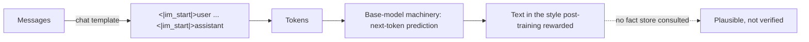

# 5 — Hallucination and base versus assistant

Our ticket assistant tells a customer that refunds take fourteen days. The policy says five. Nothing in the logs looks wrong: the request succeeded, the sentence is well formed, and the model sounded sure. This chapter is about why that happens. A model generates plausible next tokens and has no separate store of facts to consult. The assistant you talk to is a text-continuer that has been trained on top to behave like an assistant. Knowing where those two layers meet tells you what you can trust and how to check the rest.

> An LLM is a decoder-only transformer trained to predict the next token. Tokens, embeddings, causal self-attention and scale explain most of its behaviour, including the failures.

---

## Same input, different output

Huyen calls the probabilistic nature of a model the root of its two most reported problems (*AI Engineering*, ch. 2):

- **Inconsistency.** Sampling makes outputs vary by design. Fixing the temperature, top-p, top-k and seed reduces this but does not remove it: hosted models run on different machines, which do not execute the same arithmetic in exactly the same way, and on an API you do not choose the machine. Cache answers that must stay the same.
- **Hallucination.** Huyen reports two hypotheses for *why*, neither settled. In the first (Ortega et al., 2021, DeepMind), a model cannot tell the text it was given from the text it generated, so an early wrong token gets treated as fact and built on; Zhang et al. (2023) call this snowballing, with an example where a model, having started from a wrong assumption, claims that 9,677 is divisible by 13 although it answers correctly when asked directly. In the second (Leo Gao, then John Schulman in an April 2023 talk, both at OpenAI), supervised fine-tuning teaches a model to imitate labelers' answers that use knowledge the model does not have, which trains it to make things up. The first blames self-supervision, the second supervision, so they can both be true. Schulman said RLHF reduced hallucination at OpenAI; the InstructGPT paper measured the opposite, with RLHF plus SFT hallucinating more than SFT alone on its closed-domain tasks, even though labelers preferred the RLHF model overall. The practical upshot is the same either way: answer from provided context, ask for concise answers (fewer tokens, fewer chances to invent), and check claims.

---

## What a base model is not

A pretrained model continues text. Huyen calls it a "completion machine" (*AI Engineering*, ch. 1). Its training is *self-supervised*: the label for each position is the next token of the text, so the sentence "I love street food." yields six training examples, from (BOS → "I") to ("I love street food." → EOS), with no human labelling. That is why pretraining scales to trillions of tokens, and why the model learns what text looks like rather than what is true. Ask it a question and it may produce more questions. The assistant behaviour (answering, refusing, following a system prompt, calling tools) comes from post-training: supervised fine-tuning on demonstrations and then preference optimization. That pipeline is [chapters 06–09](06-pretraining-data-and-objectives.md) and, in depth, [05-RL](../../05-RL/README.md).

Scale does not supply that behaviour. In Google's LaMDA, crowdworkers rated the pretrained model's dialogue responses safe 84.8% of the time at 2B and 88% at 137B. Fine-tuning on annotated dialogue, less than 0.001% of the pretraining data, raised the 137B model to 95.2% and its groundedness from 57.9% to 73.2% ([arXiv:2201.08239](https://arxiv.org/abs/2201.08239) (Thoppilan et al., 2022, preprint)). Bowman's survey puts it this way: instruction following "isn't inherent to the model, but rather is grafted onto it using highly imperfect tools". So a model can fail a request and then succeed once it is reworded, and one failed prompt is not evidence that the capability is missing ([arXiv:2304.00612](https://arxiv.org/abs/2304.00612) (Bowman, Critical AI 2024)).

A base model also reproduces what is in its training text, including the parts nobody wanted. Scored with Google's Perspective API, 4.3% of OpenAI's WebText (GPT-2's training corpus) was toxic, and GPT-2 had trained on at least 40K documents from the quarantined subreddit /r/The_Donald. GPT-1, GPT-2, GPT-3 and CTRL all reached an expected maximum toxicity above 0.5 within 100 generations from an empty prompt. Starting from non-toxic web prompts, GPT-3 produced at least one toxic continuation in 25 samples half the time (0.50). For GPT-2 that rate was 0.48. Further pretraining on non-toxic text cut it to 0.23, PPLM steering to 0.17 and a banned-word filter only to 0.43, and the authors conclude that "no current method is failsafe" ([arXiv:2009.11462](https://arxiv.org/abs/2009.11462) (Gehman et al., Findings of EMNLP 2020)). Those scores come from a classifier that has known biases of its own, against African American English and mentions of identity groups.

A better language model is not less biased. On StereoSet's 16,995 crowd-written test items, models' language-modelling scores and stereotype scores correlated at Spearman 0.87. GPT-2 large picked the stereotyped completion over the anti-stereotyped one 60.0% of the time, where 50% is unbiased, and the strongest model, an ensemble, 62.3% ([arXiv:2004.09456](https://arxiv.org/abs/2004.09456) (Nadeem et al., ACL 2021)). Bommasani et al., who coined the term *foundation model*, call the structural version of this **homogenization**. Almost every system is adapted from one of a few base models, so "any flaws in the model are blindly inherited by all adapted models", and the base model becomes a single point of failure ([arXiv:2108.07258](https://arxiv.org/abs/2108.07258) (Bommasani et al., 2021 ⚑)). Post-training and the checks applied downstream have to catch what pretraining put in.

Fluent text is also not evidence of thought. Mahowald et al. separate *formal* linguistic competence (grammar and the rules of a language) from *functional* competence (reasoning, world knowledge, tracking a situation, social inference), which in humans run on different brain networks. Next-token prediction delivers the first reliably. A BabyLM model trained on at most 100M words, about what a child hears, scored 86% on BLiMP's grammatical-versus-ungrammatical sentence pairs against a human baseline of 89%. The second stays patchy and usually comes from fine-tuning or added tools. It is a position paper, and its evidence is drawn from other studies ([arXiv:2301.06627](https://arxiv.org/abs/2301.06627) (Mahowald et al., Trends in Cognitive Sciences 2024)).

---

## A worked example: the same model, with and without a template

A base model has no notion of a question. It continues whatever it is given in the style of its training text. You can watch this with the smallest possible language model, a table of word bigrams built from a tiny mock forum:

```python
import random
from collections import defaultdict

corpus = """how do i get a refund ? how do i change my address ? how long does a refund take ?
how do i cancel my order ? why is my order late ? why was my card charged twice ?
a refund takes five days . my order is late . my card was charged twice .""".split()

next_words = defaultdict(list)
for a, b in zip(corpus, corpus[1:]):
    next_words[a].append(b)

def continue_text(prompt, steps=14, seed=3):
    rng = random.Random(seed)
    out = prompt.split()
    for _ in range(steps):
        out.append(rng.choice(next_words[out[-1]]))
    return " ".join(out)

print(continue_text("how long does a refund take ?"))
```

```text
how long does a refund take ? how do i cancel my card charged twice . my order ? how do
```

Ask a question and you get more text in the shape of the corpus, in this case more forum questions. It isn't refusing or confused; it was only ever asked to continue. This is the behaviour Huyen's "completion machine" describes, at a scale where you can read the whole model.

Post-training fixes the shape by teaching the model a template. The *LLM Engineer's Handbook* (ch. 5) makes the point in practical terms. Base models have no template, so when you fine-tune one you may choose any, but you then have to use that same template at inference. ChatML, from OpenAI, is a popular choice, and Alpaca, Llama 3 and Mistral each have their own. The template is just a string:

```python
def chatml(messages, generation_prompt=True):
    text = ""
    for m in messages:
        text += f"<|im_start|>{m['role']}\n{m['content']}<|im_end|>\n"
    if generation_prompt:
        text += "<|im_start|>assistant\n"
    return text

ticket = [{"role": "system", "content": "You answer refund questions from the policy."},
          {"role": "user", "content": "How long does a refund take?"}]
print(chatml(ticket))
print("---- one stray space changes what the model sees ----")
print(repr(chatml(ticket)[-25:]))
print(repr((chatml(ticket)[:-1] + " \n")[-26:]))
```

```text
<|im_start|>system
You answer refund questions from the policy.<|im_end|>
<|im_start|>user
How long does a refund take?<|im_end|>
<|im_start|>assistant

---- one stray space changes what the model sees ----
'|>\n<|im_start|>assistant\n'
'|>\n<|im_start|>assistant \n'
```

The rendered string ends where the model must take over, with `<|im_start|>assistant` and a newline. The model continues that, and it answers because it has seen thousands of examples whose continuation at that point was an answer. It remains a text-continuer. It also explains a whole class of silent failures: a template that differs by one space from the one used in training gives you a model that seems slightly worse, with no error anywhere. The handbook warns that every whitespace matters. In Transformers the template ships with the tokenizer, written in Jinja, so `tokenizer.apply_chat_template` is safer than writing your own.



---

## Checking for hallucination from the outside

If the model has no fact store, what can you measure? One useful observation is that the model's sampling reveals what its weights are sure of. If a fact is well supported, repeated samples agree on it. If it was made up, each sample tends to invent something different. **SelfCheckGPT** uses exactly that ([arXiv:2303.08896](https://arxiv.org/abs/2303.08896) (Manakul et al., EMNLP 2023)). It draws extra samples for the same prompt and scores each sentence of the answer by how far the samples support it, with no outside database and no access to the model's internals.

```python
samples = {
    "How many days does a refund take?": ["5", "5", "5", "5", "5", "5", "5", "7", "5", "5"],
    "What year was the refunds team founded?": ["2009", "2014", "2011", "2009", "1998",
                                                 "2016", "2003", "2012", "2014", "2001"],
}

def inconsistency(answer, others):
    """Share of extra samples that disagree with the answer: 0 is steady, 1 is invented."""
    return sum(s != answer for s in others) / len(others)

for question, runs in samples.items():
    answer, others = runs[0], runs[1:]
    print(f"{question:<42} answer={answer:<5} inconsistency={inconsistency(answer, others):.2f}")
```

```text
How many days does a refund take?          answer=5     inconsistency=0.11
What year was the refunds team founded?    answer=2009  inconsistency=0.89
```

The samples here are written by hand to show the arithmetic. In a real run, you draw them from the model, and since real sentences rarely match exactly, the paper compares them with sentence-level methods instead of string equality: BERTScore, question answering, n-grams, NLI or an LLM prompt.

On 238 passages generated by `text-davinci-003` from WikiBio, annotated across 1,908 sentences (39.9% major inaccurate, 33.1% minor inaccurate, 27.0% accurate), detecting non-factual sentences scored these AUC-PRs:

| Method | Non-factual AUC-PR |
|---|---|
| Random | 72.96 |
| GPT-3 average token −log p | 83.21 |
| GPT-3 max token −log p | 87.51 |
| SelfCheck NLI | 92.50 |
| SelfCheck with an LLM prompt | 93.42 |

Two limits sit alongside those numbers. The random baseline is high because most sentences in the set are inaccurate, and it matters more that factual sentences are hard to find: on that task random is 27.04, average −log p is 53.97 and the prompt method 67.09. Also, a model that is consistently wrong passes the check, because all it measures is agreement, not truth, and the cost grows with the number of samples.

Can you ask the model itself? Partly. Kadavath et al. tested two self-reports in Anthropic's models ([arXiv:2207.05221](https://arxiv.org/abs/2207.05221) (Kadavath et al., 2022, preprint)). On multiple-choice questions with lettered options, large models' answer probabilities were already well calibrated zero-shot. **P(True)** asks the model to judge whether an answer it proposed itself is correct, and that needed examples. It was prompted, not trained: zero-shot it was poorly calibrated, mostly near 50%, while their largest model (52B) with 20-shot prompts (which also showed it five of its own samples) was well calibrated. Showing those samples helped on its own too, less so on code and maths. **P(IK)**, "I know the answer", was trained to predict whether the model would get a question right. It partially generalised across tasks, but it was poorly calibrated on new ones, and it rose when relevant source material was supplied. A model's confidence is a signal to route on, not a claim to show a customer.

---

## Pitfalls

- **Treating fluency as evidence.** The model's grammar is excellent whether or not its facts are, so a clean sentence tells you nothing about either.
- **Blaming the model for a template bug.** Check the rendered string first. A stray space or a missing generation prompt looks like a quality problem.
- **Fine-tuning a base model and leaving the template unspecified.** Pick one, write it down and ship it with the tokenizer. Training and serving must match exactly.
- **Reading a low inconsistency score as "true".** A model that learned a falsehood repeats it steadily. Self-consistency finds some invention, not all error.
- **Showing raw self-reported confidence to users.** Kadavath's P(IK) was poorly calibrated on new tasks. Calibrate on your own data first.
- **Using a closed-domain fix for an open-domain problem.** "Answer only from the context" helps when there is a context to check against. Without retrieval, it only asks the model to behave as if it had one.

---

## Try it

1. Change `seed` in `continue_text` a few times and try a prompt ending in `.` rather than `?`. What does the toy produce, and why can it never give an answer it has not seen?
2. Change the `chatml` call to `generation_prompt=False`. What would the model most plausibly generate next, given how it was trained?
3. Add a third question to `samples` where the model is confidently wrong: all ten samples say "14" and the policy says 5. What does the score say? What would catch this one?

<details>
<summary>Answers</summary>

1. It always prints a walk through words seen in the corpus, following adjacent pairs it has seen. It has no way to produce anything else, and it knows nothing about what `?` is for.
2. With no assistant header, the model has nothing that marks the next turn as its own. It might start another user turn, or a new `<|im_start|>` of any role, since that is what often follows `<|im_end|>` in training text.
3. Inconsistency is 0.00, the "most trusted" value. Only a check against the policy document can catch it, which is why retrieval and evals sit in later pillars.

</details>

---

## Interview checklist

| Question | Answer |
|---|---|
| What is a base model? | A pretrained text-continuer, trained by self-supervision on next tokens. It has no instruction-following behaviour of its own |
| Where does assistant behaviour come from? | Post-training: supervised fine-tuning on demonstrations, then preference optimisation, in a fixed chat template |
| What are the two hypotheses for hallucination? | The model can't tell given text from its own generated text, so errors snowball; or SFT teaches it to imitate knowledge it doesn't have. Neither is settled |
| What does a chat template do? | It turns role-tagged messages into the one string the model sees, ending in a generation prompt. A mismatch with training silently degrades quality |
| How does SelfCheckGPT work? | It draws more samples and scores each sentence by how far they support it, on the idea that invented facts disagree across samples |
| What can't self-consistency catch? | Consistent errors, such as a falsehood present in the training data |
| How far can you trust a model's self-confidence? | P(True) can be calibrated in the right setup, but P(IK) generalises poorly to new tasks. Calibrate on your own data |

---

## Next

[06 — Pretraining: data and objectives](06-pretraining-data-and-objectives.md) opens the training pipeline at its first and most expensive stage.
