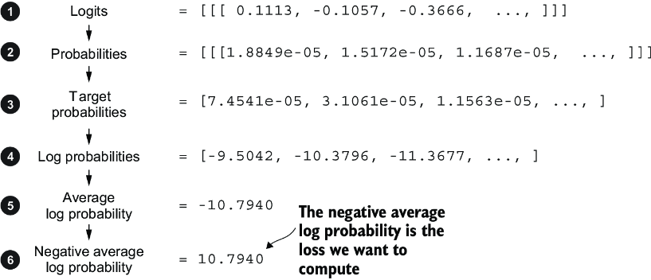

# 6 — Pretraining: data and objectives

> Pretraining buys knowledge, supervised fine-tuning buys format, preference optimization buys judgment, and LoRA makes the last two affordable. Know which stage a problem belongs to before you reach for fine-tuning.

A team asks whether they should train their own support model on five years of tickets. Before anyone reaches for a GPU, it helps to know what the question means: what training optimises, what it needs, and what it costs. Pretraining is the stage that builds the base model every later stage inherits, and it takes almost all of the compute. Its loop is short enough to fit on a slide, while the scale it runs at is what makes it a capital decision. This chapter starts with the loop, runs it on the smallest data that shows every moving part, then looks at the data it reads. [Chapter 15](15-pretraining-runs-cost-and-scale.md) scales the arithmetic up until the reasons few organisations do this are plain.

---

## The pipeline

```text
raw text ──pretrain──▶ base model ──SFT──▶ instruction model ──preference optimization──▶ assistant
 (trillions of tokens)   (continues text)   (follows the format)   (RLHF / DPO / RLAIF)    (helpful, harmless)
```

| Stage | Data | Objective | What it changes | Depth |
|---|---|---|---|---|
| Pretraining | Web, books, code; trillions of tokens, unlabeled | Next-token cross-entropy | Knowledge, language, reasoning ability | This note; *LLMs from Scratch*, ch. 5 |
| Supervised fine-tuning (SFT) | Thousands to millions of (instruction, response) pairs | Same loss, on the response tokens | Format, instruction following, persona | [Chapter 07](07-sft-and-instruction-tuning.md); *LLMs from Scratch*, ch. 7; *LLM Engineer's Handbook*, ch. 5 |
| Preference optimization | Pairs of responses ranked by humans or a model | Reward model + PPO, or DPO directly | Which of several acceptable answers the model prefers | [Chapter 08](08-preference-optimisation-overview.md); [05-RL](../../05-RL/README.md) |

The InstructGPT paper ([arXiv:2203.02155](https://arxiv.org/abs/2203.02155), Ouyang et al., 2022) is the reference recipe: demonstrations → SFT, comparisons → reward model, reward model → PPO. Its headline result: labelers preferred outputs of the 1.3B InstructGPT model to the 175B GPT-3. Alignment, not size, made the difference users noticed.

---

## Pretraining

Pretraining is self-supervised: the label for each position is the next token in the text. [Fundamentals](../../../data-science/02-deep-learning/notes/01-neural-networks-fundamentals.md#backpropagation) and [optimisation](../../../data-science/02-deep-learning/notes/02-optimisation-and-regularisation.md#optimisers) in data science teach backprop, AdamW and the learning-rate sweep. Raschka writes the loop by hand (*LLMs from Scratch*, ch. 5; full code at [rasbt/LLMs-from-scratch](https://github.com/rasbt/LLMs-from-scratch)):

Next-token prediction is one of several objectives. BERT-style masked language modelling picks about 15% of the tokens as targets and, of those, replaces 80% with `[MASK]`, 10% with a random token and leaves 10% unchanged. The last two stop the model learning that only `[MASK]` positions matter, a symbol it never sees at fine-tuning (*Foundations of LLMs*, ch. 1; recipe as described there, Devlin et al.'s). RoBERTa found that dropping the next-sentence loss costs nothing once training is scaled up (same chapter, reported from Liu et al., 2019). The book's Table 1.1 maps objective to architecture: causal LM to decoder-only, masked and denoising objectives to encoder or encoder-decoder. It is BERT-era and encoder-centric, so read it for the objectives, not for current practice.

```python
import math
import torch
import torch.nn as nn
import torch.nn.functional as F

text = ("my refund is late. please refund my order. the order arrived late. "
        "please cancel my order. my card was charged twice. refund my card. ") * 40
chars = sorted(set(text))
ids = torch.tensor([chars.index(c) for c in text])
split = int(0.9 * len(ids))
train_ids, val_ids = ids[:split], ids[split:]

def batches(data, seq=32, batch=32, steps=300):
    for _ in range(steps):
        starts = torch.randint(0, len(data) - seq - 1, (batch,))
        yield (torch.stack([data[s:s + seq] for s in starts]),
               torch.stack([data[s + 1:s + seq + 1] for s in starts]))   # shifted one left

torch.manual_seed(0)
model = nn.Sequential(nn.Embedding(len(chars), 32), nn.Linear(32, 64), nn.ReLU(), nn.Linear(64, len(chars)))
optimizer = torch.optim.AdamW(model.parameters(), lr=3e-3)

def mean_loss(data):
    with torch.no_grad():
        return sum(F.cross_entropy(model(x).flatten(0, 1), y.flatten()).item()
                   for x, y in batches(data, steps=10)) / 10

print(f"untrained loss {mean_loss(train_ids):.3f}  ln(vocab) {math.log(len(chars)):.3f}")
for input_ids, target_ids in batches(train_ids):     # targets = inputs shifted one to the left
    logits = model(input_ids)                        # (batch, seq, vocab)
    loss = F.cross_entropy(logits.flatten(0, 1), target_ids.flatten())
    optimizer.zero_grad(); loss.backward(); optimizer.step()
train, val = mean_loss(train_ids), mean_loss(val_ids)
print(f"after 300 steps: train {train:.3f}  val {val:.3f}  val perplexity {math.exp(val):.1f}")
```

```text
untrained loss 3.210  ln(vocab) 3.091
after 300 steps: train 1.168  val 1.191  val perplexity 3.3
```

The first printed line is the check to run before any long job. An untrained model should score about `ln(vocab)`, because it spreads probability evenly across the vocabulary, and a very different value means a bug in the data or the loss. The model here sees only the previous character, so it stops improving at the entropy of that one-character view of this text. Its perplexity is about how many next characters it is still choosing between. The loop is the same one you would run on a real model.

One forward pass scores every position at once: the causal mask lets the model predict token 2 from token 1, token 3 from tokens 1–2, and so on, all in parallel. Feeding the true previous tokens rather than the model's own guesses is called *teacher forcing* (*Building AI Agents*, ch. 2). It is why training is parallel while generation ([chapter 04](04-decoding-and-inference-behaviour.md)) is not.

Things worth knowing about the loss:

- **At initialization** the loss should be about `ln(vocab_size)`, the loss of a uniform guess: ≈ 10.8 for a 50,257-token vocabulary. Raschka's untrained GPT-2 scores 10.7940 on his first batch, a perplexity of about 48,725, close to the vocabulary size (*LLMs from Scratch*, ch. 5). If it starts far higher, the initialization is broken.
- **Perplexity** = `exp(loss)`: the effective number of tokens the model is choosing between. [Entropy, cross-entropy, KL and perplexity](#entropy-cross-entropy-kl-and-perplexity) below derives it and the nats-versus-bits convention.
- **Overfitting looks like this.** Raschka trains the 124M model for 10 epochs on one short story (Edith Wharton's "The Verdict", 5,145 tokens, 90/10 train/validation split, context cut to 256). It takes about five minutes on a MacBook Air. Training loss falls from 9.78 to 0.39 while validation loss stalls near 6.4, and the model starts reciting passages of the story verbatim. Real pretraining makes roughly one pass over a far larger corpus, with batch sizes of 1,024 or more. Verbatim recall survives that, though. GPT-2 XL (1.5B) had a training loss only about 10% below its test loss. Even so, Carlini et al. sampled 600,000 generations from it, ranked them with six membership-inference scores (the most precise compared the model's likelihood with zlib compression), and checked the top 1,800 candidates by hand. 604 were memorized training text, including names with phone numbers, 128-bit UUIDs and code. Some strings appeared in a single document of the training set ([arXiv:2012.07805](https://arxiv.org/abs/2012.07805) (Carlini et al., USENIX Security 2021)). The 604 are a lower bound from one model; the authors could not measure recall over the whole training set.


*Image Source: Raschka, *Build a Large Language Model (From Scratch)* (Manning, 2024), Fig. 5-12*

- **Save the optimizer state with the weights.** AdamW keeps two running statistics per parameter. Resume from weights alone and the first steps behave like a fresh optimizer (*LLMs from Scratch*, ch. 5). LLM360 made that mistake at scale: Amber's training code saved no optimizer state, so AdamW restarted from scratch at every resume. The authors suspect this caused the NaN losses that made them drop 4 of 360 data chunks ([arXiv:2312.06550](https://arxiv.org/abs/2312.06550) (Liu et al., 2023, preprint)). That state is most of the training memory. With mixed precision, Adam needs about 16 bytes per parameter: 2 for [fp16](../../../programming/computer-science/notes/04-numbers-and-memory.md#smaller-floats) weights, 2 for fp16 gradients, and 12 for the fp32 master weights, momentum and variance. A 1.5B GPT-2 therefore needs at least 24 GB before activations, against 3 GB for its fp16 weights (ZeRO's accounting, cited below). The fp32 master copy is there because fp16 drops small numbers. Any value below 2⁻²⁴ becomes zero, and about 5% of a Mandarin speech model's weight gradients were that small. In that model's 800-hour, 20-epoch run, **updating fp16 weights directly cost 80% relative accuracy**; the authors give underflow and updates too small relative to their weights as the two likely causes. Mixed-precision training also scales the loss before backpropagation, which shifts the gradients into fp16's range. A 2×8192 LSTM language model on One Billion Word diverged from its fp32 run after 300K iterations without scaling, and matched it with a factor of 128 ([arXiv:1710.03740](https://arxiv.org/abs/1710.03740) (Micikevicius et al., ICLR 2018)). That paper tests no Transformers, never mentions bf16, and the largest parameter count it reports is 215M. It quantifies only weight memory, which the master copy raises by 50% over fp32, and never counts optimizer state. ZeRO's answer is to shard that state across the data-parallel GPUs instead of copying it to each one. Sharding the optimizer state cuts per-GPU model-state memory 4×, and sharding the gradients as well cuts it 8×, at the same communication volume as plain data parallelism. With that, models of up to 13B trained with no model parallelism on 32 GB V100s, where plain data parallelism ran out of memory above 1.4B ([arXiv:1910.02054](https://arxiv.org/abs/1910.02054) (Rajbhandari et al., SC 2020)). Sharding the weights too (stage 3, the scheme PyTorch FSDP's full sharding follows) was described but not yet built at publication. The "W" in AdamW is *decoupled* weight decay. Under Adam, an L2 penalty is divided by the adaptive denominator, so weights with large gradients are barely regularized. Shrinking the weights directly, outside the gradient, cut test error by about 15% relative on CIFAR-10 and ImageNet 32×32 ResNets, and made the best learning rate independent of the best decay ([arXiv:1711.05101](https://arxiv.org/abs/1711.05101) (Loshchilov & Hutter, ICLR 2019)). That evidence is image classification only; the LLM default came by adoption.


*Image Source: Micikevicius et al., [Mixed Precision Training](https://arxiv.org/abs/1710.03740) (2018), Fig. 1*

Real pretraining runs add data curation (deduplication, quality filtering, mixing code and text), learning-rate warmup and cosine decay ([chapter 15](15-pretraining-runs-cost-and-scale.md#the-batch-and-the-optimizer)), gradient clipping and mixed precision. Clipping does not prevent every blow-up. PaLM 540B's loss spiked about 20 times during training, at irregular intervals and sometimes late, although none of the smaller models spiked. The fix was to restart about 100 steps before the spike and skip 200–500 batches. Replaying those same batches from an earlier checkpoint caused no spike, so the authors blame the combination of data and parameter state, not bad data. PaLM also dropped all bias terms and added an auxiliary *z-loss* (10⁻⁴ · log²Z) that keeps the softmax normalizer near 1, both for stability ([arXiv:2204.02311](https://arxiv.org/abs/2204.02311) (Chowdhery et al., JMLR 2023)). Raschka also loads the released GPT-2 weights into the hand-built model, which proves the architecture in [chapter 02](02-attention-and-the-transformer-block.md) matches the real one (*LLMs from Scratch*, ch. 5).

BloombergGPT's trouble came on slowly, and diagnosing it did not settle the cause. The 50.6B model, on 512 A100s, first read its finance data in date order as curriculum learning. That run stalled about a week in, the authors could not tell whether the ordering was to blame, and they switched to shuffling. In the next run the gradient norm climbed from about 12K steps (about 4.5 days). Four follow-up runs tried lower learning rates, a clip cut from 1.0 to 0.3 and an FP32 LM head, and all failed to fix it. Plotting each component's weight norm separately pointed to the input LayerNorm at layer 1. It also exposed weight decay on LayerNorm multipliers, a practice the authors trace to the BERT implementation, though that would explain a fall and not the sudden growth. They restarted from scratch with about ten conservative changes at once and got a stable run, but **"we cannot conclude which of these changes was decisive"** ([arXiv:2303.17564](https://arxiv.org/abs/2303.17564) (Wu et al., 2023, preprint)). When validation loss then stalled for a week, further runs varying learning rate, dropout and weight decay brought no clear gain: the checkpoint finally chosen, step 139,200 of one follow-up run, beat step 115,500 of the original on perplexity only by 8.14 to 8.30 and on MMLU by 39.02 to 38.79. That validation set covers a single month, which the authors concede may not have reflected the model's abilities.


*Image Source: Wu et al., [BloombergGPT: A Large Language Model for Finance](https://arxiv.org/abs/2303.17564) (2023), Fig. 9*

**Most "open" models release only the weights, which hides those steps.** LLM360 scored 16 open models, from GPT-J (2021) to Yi (2023), on seven artifacts: code, configs, weight checkpoints, optimizer checkpoints, data mix, data order and the data itself. Disclosure shrank as the models got stronger. Llama 2, Qwen, Mistral and Yi released weights and little else. LLM360's Amber (6.7B, 1.26T tokens) released all seven, with 360 checkpoints. It copied LLaMA's hyperparameters and still trailed LLaMA-7B, 45.2 to 49.7 averaged over four leaderboard tasks. The authors blame LLaMA's undisclosed data ([arXiv:2312.06550](https://arxiv.org/abs/2312.06550) (Liu et al., 2023, preprint)). OLMo released its 2.7T-token corpus (Dolma), more than 500 checkpoints, its training logs and a reproducible data order, under Apache 2.0 ([arXiv:2402.00838](https://arxiv.org/abs/2402.00838) (Groeneveld et al., ACL 2024)). OLMo 2 closed most of the gap. Its 7B model, trained on 4.05T tokens, averaged 62.9 on ten benchmarks against Llama 3.1 8B's 61.8, with about a quarter of the training compute (1.8 against 7.2 × 10²³ FLOPs). The last 5–10% of that compute is a *mid-training* stage: the learning rate decays to zero on a smaller mix of filtered web pages, academic text and synthetic math, and three or four such runs are averaged into the final model ([arXiv:2501.00656](https://arxiv.org/abs/2501.00656) (OLMo et al., 2024, preprint)). Open-weight frontier reports give that stage much more. GLM-4.5, a 355B mixture-of-experts model with 32B active, pretrained on 22T tokens: 15T of general text, then 7T with code, maths and science upweighted. Its highest-quality web bucket was repeated more than 3.2 times. It then mid-trained on about 1.1T more tokens. That was 500B of repository-level code with issues and pull requests, 500B of synthetic reasoning traces and 100B of long documents and agent trajectories, while the context grew from 4K to 32K and then 128K ([arXiv:2508.06471](https://arxiv.org/abs/2508.06471) (GLM-4.5 Team, 2025, preprint)). It used [Muon](15-pretraining-runs-cost-and-scale.md#the-batch-and-the-optimizer), and kept cosine decay after a warmup-stable-decay schedule underfit in early tests. The report has no ablation of the mid-training stages. The FLOPs are 6ND estimates and the benchmarks are Ai2's own suite, though four of the ten were held out from development.

Not every curation step is a guaranteed win. Pythia trained eight model sizes, from 70M to 12B parameters, twice each: once on the Pile (300B tokens) and once on a near-deduplicated Pile of 207B tokens, run for about 1.5 epochs so that it also reached 300B. Both runs used the same data order and saved 154 checkpoints ([arXiv:2304.01373](https://arxiv.org/abs/2304.01373) (Biderman et al., 2023-04)). On eight standard benchmarks, deduplication showed "no clear benefit", and seeing the data a second time did no visible harm. Galactica pushed repetition further on a small, curated corpus: 106B tokens, 83% of them scientific papers, run for about 4.25 epochs (450B tokens). **Validation loss kept falling through four epochs at every size from 125M to 120B, and the 120B model first overfit at the start of the fifth, where it was stopped** ([arXiv:2211.09085](https://arxiv.org/abs/2211.09085) (Taylor et al., 2022, preprint)). The authors expected the opposite from earlier work on repeated data and leave the cause open, guessing at data quality or the scientific modalities. The exception was a held-out protein-sequence set, whose perplexity started rising at the fourth epoch, and there is no matched run on uncurated web text. The same suite showed that memorized 32-token sequences turn up at a steady rate through training, fitting a Poisson process. So putting sensitive data early or late in training does not change how much of it gets memorized. Each size was trained with one seed; the authors estimate that 25 seeds would have cost about $10 million. The 12B model alone took 72,300 A100-hours.


*Image Source: Taylor et al., [Galactica: A Large Language Model for Science](https://arxiv.org/abs/2211.09085) (2022), Fig. 6*

Deduplication pays off on memorization more than on benchmarks. In C4, Lee et al. found one 61-word sentence repeated 61,036 times, and 4.6% of validation examples had a near-duplicate in training. They trained 1.5B models for about two epochs on the original and on deduplicated copies. On the original C4, 1.93% of tokens in unprompted generations sat inside a 50-token exact match with training data. On the deduplicated copies it was 0.14–0.19%, about 10× less, at equal or better perplexity ([doi:10.18653/v1/2022.acl-long.577](https://doi.org/10.18653/v1/2022.acl-long.577) (Lee et al., ACL 2022)). They ran no downstream tasks, so their result and Pythia's benchmark null measure different things. Goldfish loss tackles memorization in the objective.

It leaves 1 in k tokens out of the loss, chosen by hashing the 13 preceding tokens, so every copy of a passage is masked in the same places. LLaMA-2-7B trained for 100 epochs on 100 Wikipedia articles reproduced 84 of them verbatim with the standard loss and none with k = 4. In a normal 1.1B run on 20B tokens, benchmark scores barely moved. The price is that it needs about a third more raw tokens (26.7B) to match a 20B-token standard run ([arXiv:2406.10209](https://arxiv.org/abs/2406.10209) (Hans et al., NeurIPS 2024)). It is not a privacy guarantee. In the 1.1B run, where 2,000 Wikipedia documents were repeated 50 times, a zlib-based membership-inference attack still flagged 88.5% of those documents at a 0.1% false-positive rate, against 99.75% with the standard loss.

How much can a model hold at all? Morris et al. trained GPT-style models of up to 20M parameters on random bitstrings, which cannot be learned except by memorizing them, and measured about 3.6 bits per parameter. On deduplicated text, models memorized until that capacity was full, then began to generalize, with double descent at that point ([arXiv:2505.24832](https://arxiv.org/abs/2505.24832) (Morris et al., 2025-05, preprint)). For facts rather than random bits, Allen-Zhu & Li measured about 2 bits per parameter. They trained models from scratch on synthetic biographies, (name, attribute, value) facts written out as text, and the figure held across GPT-2, LLaMA and Mistral sizes once each fact had been seen 1,000 times.

At 100 exposures it fell to 1 bit per parameter. Quantizing to int8 kept the full capacity and int4 cut it to 0.7. Mixing in junk data at 7 junk tokens per useful one cut capacity for the useful facts 20-fold. Prepending a domain-style tag to the useful data brought that loss down to 2× ([arXiv:2404.05405](https://arxiv.org/abs/2404.05405) (Allen-Zhu & Li, 2024-04, preprint)). Their fitted law says loss-based membership inference falls to chance at about 100 tokens per parameter, a ratio the authors say contemporary LLMs already exceed. They checked the law only on GPT-2 models up to 1.5B, and it covers a loss-threshold attack only, not extraction of rare strings like Carlini's UUIDs.

---

### Entropy, cross-entropy, KL and perplexity

The model assigns each possible next token a probability `p`. Its **log-probability** is `ln p`, a number at or below 0 (log 1 = 0; smaller probabilities go further negative). Logs are used because the probability of a whole text is a product of per-token probabilities, and a log turns a product into a sum, which is stable to compute and to average. The course uses the natural log, so losses are in **nats**. Divide by `ln 2 ≈ 0.693` to get **bits**, the unit behind "bits per byte" in the [byte-level tokenizer results](01-tokens-and-embeddings.md#tokens): bits = nats / ln 2.

- **Entropy** `H(p) = −Σ p·ln p` measures how uncertain a distribution is: the average surprise of drawing from it. A fair coin has 0.693 nats (1 bit), a certain outcome has 0.
- **Cross-entropy** `H(p, q) = −Σ p·ln q` is the average surprise when the truth is `p` but you predict with `q`. In training the truth is one real next token, so this reduces to `−ln q(true token)`, the negative log-likelihood of the token the text actually contained. The loss is that number averaged over all positions.
- **KL divergence** is the extra cost of using `q` in place of `p`: `KL(p‖q) = H(p, q) − H(p) = Σ p·ln(p/q)`. It is never negative and is 0 only when `q = p`. Because the entropy of the data does not depend on the model, minimising cross-entropy and minimising KL are the same job. The average loss cannot go below `H(p)`, the true uncertainty of the next token given its context. On real text that floor is above 0, because many continuations are plausible.
- **KL is not symmetric**: `KL(p‖q) ≠ KL(q‖p)`. The forward form `KL(p‖q)` is large when the model gives near-zero probability to a token the data uses, so a model trained on it spreads probability over every plausible token. The reverse form `KL(q‖p)` is large when the model puts probability where the data has almost none, so the model can safely concentrate on one common continuation (one *mode*, a peak of the distribution). Pretraining minimises the forward form. RLHF ([chapter 8](08-preference-optimisation-overview.md)) penalises the reverse form `KL(π‖π_ref)`, where `π` is the model being tuned and `π_ref` its frozen starting copy; [RL 12](../../05-RL/notes/12-rlhf-failure-modes.md#overoptimization) explains why that keeps the tuned model where its reward can be trusted.
- **Perplexity** is `exp(cross-entropy)`, the effective number of equally likely tokens the model is choosing between. A model that is certain has perplexity 1; a uniform guess over a vocabulary of V tokens has perplexity V.


*Image Source: Raschka, *Build a Large Language Model (From Scratch)* (Manning, 2024), Fig. 5-7*

```python
import numpy as np

p = np.array([0.5, 0.25, 0.25])    # true next-token distribution over 3 tokens
q = np.array([0.4, 0.4, 0.2])      # the model's distribution

entropy = -(p * np.log(p)).sum()
cross_entropy = -(p * np.log(q)).sum()
print(f"entropy H(p)          {entropy:.4f} nats")
print(f"cross-entropy H(p,q)  {cross_entropy:.4f} nats = {cross_entropy / np.log(2):.4f} bits")
print(f"KL(p||q)              {(p * np.log(p / q)).sum():.4f}  (cross-entropy - entropy = {cross_entropy - entropy:.4f})")
print(f"KL(q||p)              {(q * np.log(q / p)).sum():.4f}  (different)")
print(f"perplexity exp(H(p,q)) {np.exp(cross_entropy):.3f}   exp(H(p)) {np.exp(entropy):.3f}")
print(f"if token 0 is the true one: loss {-np.log(q[0]):.4f} = -ln(0.4)")
```

```text
entropy H(p)          1.0397 nats
cross-entropy H(p,q)  1.0896 nats = 1.5719 bits
KL(p||q)              0.0499  (cross-entropy - entropy = 0.0499)
KL(q||p)              0.0541  (different)
perplexity exp(H(p,q)) 2.973   exp(H(p)) 2.828
if token 0 is the true one: loss 0.9163 = -ln(0.4)
```

Run with NumPy on a three-token vocabulary. The model pays 0.05 nats more than the best possible 1.04, and its perplexity of 2.97 sits just above the 2.83 that perfect knowledge of `p` would give. The same arithmetic runs in the training loop earlier in this chapter: `F.cross_entropy` returns the average `−ln q(true token)` in nats, and the `ln(vocab)` check is the entropy of a uniform guess.

---

## Pitfalls

- **Skipping the `ln(vocab)` check.** A loss that starts wrong is telling you there is a bug, long before the expensive part begins.
- **Using only training loss.** Keep a held-out split from the same distribution, and watch it for the gap.
- **Reading perplexity across tokenizers.** It depends on the vocabulary, so scores from different tokenizers are not comparable.
- **Splitting after shuffling overlapping windows.** The same text ends up on both sides of the split and the validation score looks better than it is. Split first, then cut windows.
- **Saving weights without the optimizer state.** A resumed run then behaves as if its optimizer were new.

---

## Try it

1. In the training block, set `steps=0` in the training loop's `batches` call. What is the printed loss, and why?
2. Change the model so that it cannot learn: replace `model(input_ids)` with `model(input_ids).detach().requires_grad_()`. What happens to the loss?

<details>
<summary>Answers</summary>

1. Train loss stays at the untrained value, about 3.2 here, close to ln(22) = 3.09 for this text's 22 characters. Nothing has trained.
2. The loss stays at the untrained value. The gradient stops at the detached tensor, so the weights never change, which is a common bug behind a flat curve.

</details>

---

## Interview checklist

| Question | Answer |
|---|---|
| What is the training objective of pretraining? | Cross-entropy of the next token at every position, with labels being the input shifted by one, so no human labels are needed |
| What is teacher forcing, and why does it make training parallel? | Each position sees the true previous tokens, so one masked forward pass scores all positions at once. Generation has to wait for its own output |
| What should the loss be before training? | About `ln(vocab)`. A different value suggests a bug |
| Why does training need far more memory than inference? | Weights, gradients and optimizer state for every parameter, and activations. Adam alone keeps two extra values per weight |

---

## Next

[6b — Pretraining data: what goes in](06b-pretraining-data.md) covers where the text comes from and how it is filtered. [15 — The pretraining run: batch, cost and scale](15-pretraining-runs-cost-and-scale.md) then prices the loop at real scale and answers the question about the tickets.
