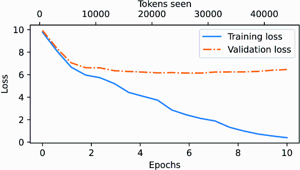
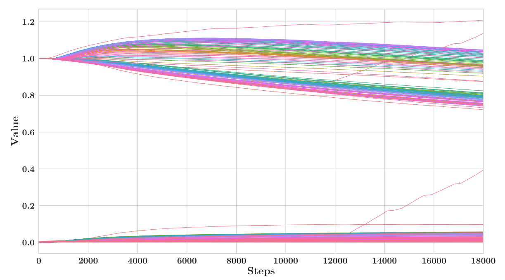
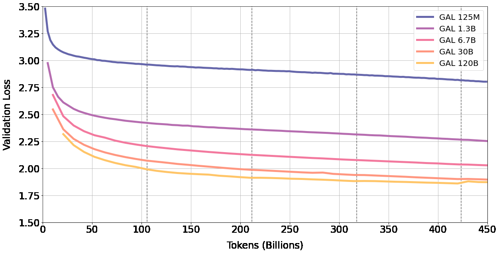

# 6 — Pretraining: data and objectives

> Pretraining buys knowledge, supervised fine-tuning buys format, preference optimization buys judgment, and LoRA makes the last two affordable. Know which stage a problem belongs to before you reach for fine-tuning.

A team asks whether they should train their own support model on five years of tickets. Before anyone reaches for a GPU, it helps to know what the question means: what training optimises, what it needs, and what it costs. Pretraining is the stage that builds the base model every later stage inherits, and it takes almost all of the compute. Its loop is short enough to fit on a slide, while the scale it runs at is what makes it a capital decision. This chapter starts with the loop, runs it on the smallest data that shows every moving part, then looks at the data it reads. [Chapter 15](15-pretraining-runs-cost-and-scale.md) scales the arithmetic up until the reasons few organisations do this are plain.

---

## The pipeline

```text
raw text ──pretrain──▶ base model ──SFT──▶ instruction model ──preference optimization──▶ assistant
 (trillions of tokens)   (continues text)   (follows the format)   (RLHF / DPO / RLAIF)    (helpful, harmless)
```

| Stage | Data | Objective | What it changes | Depth |
|---|---|---|---|---|
| Pretraining | Web, books, code; trillions of tokens, unlabeled | Next-token cross-entropy | Knowledge, language, reasoning ability | This note; *LLMs from Scratch*, ch. 5 |
| Supervised fine-tuning (SFT) | Thousands to millions of (instruction, response) pairs | Same loss, on the response tokens | Format, instruction following, persona | [Chapter 07](07-sft-and-instruction-tuning.md); *LLMs from Scratch*, ch. 7; *LLM Engineer's Handbook*, ch. 5 |
| Preference optimization | Pairs of responses ranked by humans or a model | Reward model + PPO, or DPO directly | Which of several acceptable answers the model prefers | [Chapter 08](08-preference-optimisation-overview.md); [05-RL](../../05-RL/README.md) |

The InstructGPT paper ([arXiv:2203.02155](https://arxiv.org/abs/2203.02155), Ouyang et al., 2022) is the reference recipe: demonstrations → SFT, comparisons → reward model, reward model → PPO. Its headline result: labelers preferred outputs of the 1.3B InstructGPT model to the 175B GPT-3. Alignment, not size, made the difference users noticed.

---

## Pretraining

Pretraining is self-supervised: the label for each position is the next token in the text. [Fundamentals](../../../data-science/02-deep-learning/notes/01-neural-networks-fundamentals.md#backpropagation) and [optimisation](../../../data-science/02-deep-learning/notes/02-optimisation-and-regularisation.md#optimisers) in data science teach backprop, AdamW and the learning-rate sweep. Raschka writes the loop by hand (*LLMs from Scratch*, ch. 5; full code at [rasbt/LLMs-from-scratch](https://github.com/rasbt/LLMs-from-scratch)):

```python
import math
import torch
import torch.nn as nn
import torch.nn.functional as F

text = ("my refund is late. please refund my order. the order arrived late. "
        "please cancel my order. my card was charged twice. refund my card. ") * 40
chars = sorted(set(text))
ids = torch.tensor([chars.index(c) for c in text])
split = int(0.9 * len(ids))
train_ids, val_ids = ids[:split], ids[split:]

def batches(data, seq=32, batch=32, steps=300):
    for _ in range(steps):
        starts = torch.randint(0, len(data) - seq - 1, (batch,))
        yield (torch.stack([data[s:s + seq] for s in starts]),
               torch.stack([data[s + 1:s + seq + 1] for s in starts]))   # shifted one left

torch.manual_seed(0)
model = nn.Sequential(nn.Embedding(len(chars), 32), nn.Linear(32, 64), nn.ReLU(), nn.Linear(64, len(chars)))
optimizer = torch.optim.AdamW(model.parameters(), lr=3e-3)

def mean_loss(data):
    with torch.no_grad():
        return sum(F.cross_entropy(model(x).flatten(0, 1), y.flatten()).item()
                   for x, y in batches(data, steps=10)) / 10

print(f"untrained loss {mean_loss(train_ids):.3f}  ln(vocab) {math.log(len(chars)):.3f}")
for input_ids, target_ids in batches(train_ids):     # targets = inputs shifted one to the left
    logits = model(input_ids)                        # (batch, seq, vocab)
    loss = F.cross_entropy(logits.flatten(0, 1), target_ids.flatten())
    optimizer.zero_grad(); loss.backward(); optimizer.step()
train, val = mean_loss(train_ids), mean_loss(val_ids)
print(f"after 300 steps: train {train:.3f}  val {val:.3f}  val perplexity {math.exp(val):.1f}")
```

```text
untrained loss 3.210  ln(vocab) 3.091
after 300 steps: train 1.168  val 1.191  val perplexity 3.3
```

The first printed line is the check to run before any long job. An untrained model should score about `ln(vocab)`, because it spreads probability evenly across the vocabulary, and a very different value means a bug in the data or the loss. The model here sees only the previous character, so it stops improving at the entropy of that one-character view of this text. Its perplexity is about how many next characters it is still choosing between. The loop is the same one you would run on a real model.

One forward pass scores every position at once: the causal mask lets the model predict token 2 from token 1, token 3 from tokens 1–2, and so on, all in parallel. Feeding the true previous tokens rather than the model's own guesses is called *teacher forcing* (*Building AI Agents*, ch. 2). It is why training is parallel while generation ([chapter 04](04-decoding-and-inference-behaviour.md)) is not.

Things worth knowing about the loss:

- **At initialization** the loss should be about `ln(vocab_size)`, the loss of a uniform guess: ≈ 10.8 for a 50,257-token vocabulary. Raschka's untrained GPT-2 scores 10.7940 on his first batch, a perplexity of about 48,725, close to the vocabulary size (*LLMs from Scratch*, ch. 5). If it starts far higher, the initialization is broken.
- **Perplexity** = `exp(loss)`: the effective number of tokens the model is choosing between. [Entropy, cross-entropy, KL and perplexity](#entropy-cross-entropy-kl-and-perplexity) below derives it and the nats-versus-bits convention.
- **Overfitting looks like this.** Raschka trains the 124M model for 10 epochs on one short story (Edith Wharton's "The Verdict", 5,145 tokens, 90/10 train/validation split, context cut to 256). It takes about five minutes on a MacBook Air. Training loss falls from 9.78 to 0.39 while validation loss stalls near 6.4, and the model starts reciting passages of the story verbatim. Real pretraining makes roughly one pass over a far larger corpus, with batch sizes of 1,024 or more. Verbatim recall survives that, though. GPT-2 XL (1.5B) had a training loss only about 10% below its test loss. Even so, Carlini et al. sampled 600,000 generations from it, ranked them with six membership-inference scores (the most precise compared the model's likelihood with zlib compression), and checked the top 1,800 candidates by hand. 604 were memorized training text, including names with phone numbers, 128-bit UUIDs and code. Some strings appeared in a single document of the training set ([arXiv:2012.07805](https://arxiv.org/abs/2012.07805) (Carlini et al., USENIX Security 2021)). The 604 are a lower bound from one model; the authors could not measure recall over the whole training set.


*Image Source: Raschka, *Build a Large Language Model (From Scratch)* (Manning, 2024), Fig. 5-12*

- **Save the optimizer state with the weights.** AdamW keeps two running statistics per parameter. Resume from weights alone and the first steps behave like a fresh optimizer (*LLMs from Scratch*, ch. 5). LLM360 made that mistake at scale: Amber's training code saved no optimizer state, so AdamW restarted from scratch at every resume. The authors suspect this caused the NaN losses that made them drop 4 of 360 data chunks ([arXiv:2312.06550](https://arxiv.org/abs/2312.06550) (Liu et al., 2023, preprint)). That state is most of the training memory. With mixed precision, Adam needs about 16 bytes per parameter: 2 for [fp16](../../../programming/computer-science/notes/04-numbers-and-memory.md#smaller-floats) weights, 2 for fp16 gradients, and 12 for the fp32 master weights, momentum and variance. A 1.5B GPT-2 therefore needs at least 24 GB before activations, against 3 GB for its fp16 weights (ZeRO's accounting, cited below). The fp32 master copy is there because fp16 drops small numbers. Any value below 2⁻²⁴ becomes zero, and about 5% of a Mandarin speech model's weight gradients were that small. In that model's 800-hour, 20-epoch run, **updating fp16 weights directly cost 80% relative accuracy**; the authors give underflow and updates too small relative to their weights as the two likely causes. Mixed-precision training also scales the loss before backpropagation, which shifts the gradients into fp16's range. A 2×8192 LSTM language model on One Billion Word diverged from its fp32 run after 300K iterations without scaling, and matched it with a factor of 128 ([arXiv:1710.03740](https://arxiv.org/abs/1710.03740) (Micikevicius et al., ICLR 2018)). That paper tests no Transformers, never mentions bf16, and the largest parameter count it reports is 215M. It quantifies only weight memory, which the master copy raises by 50% over fp32, and never counts optimizer state. ZeRO's answer is to shard that state across the data-parallel GPUs instead of copying it to each one. Sharding the optimizer state cuts per-GPU model-state memory 4×, and sharding the gradients as well cuts it 8×, at the same communication volume as plain data parallelism. With that, models of up to 13B trained with no model parallelism on 32 GB V100s, where plain data parallelism ran out of memory above 1.4B ([arXiv:1910.02054](https://arxiv.org/abs/1910.02054) (Rajbhandari et al., SC 2020)). Sharding the weights too (stage 3, the scheme PyTorch FSDP's full sharding follows) was described but not yet built at publication. The "W" in AdamW is *decoupled* weight decay. Under Adam, an L2 penalty is divided by the adaptive denominator, so weights with large gradients are barely regularized. Shrinking the weights directly, outside the gradient, cut test error by about 15% relative on CIFAR-10 and ImageNet 32×32 ResNets, and made the best learning rate independent of the best decay ([arXiv:1711.05101](https://arxiv.org/abs/1711.05101) (Loshchilov & Hutter, ICLR 2019)). That evidence is image classification only; the LLM default came by adoption.


*Image Source: Micikevicius et al., [Mixed Precision Training](https://arxiv.org/abs/1710.03740) (2018), Fig. 1*

Real pretraining runs add data curation (deduplication, quality filtering, mixing code and text), learning-rate warmup and cosine decay ([chapter 15](15-pretraining-runs-cost-and-scale.md#the-batch-and-the-optimizer)), gradient clipping and mixed precision. Clipping does not prevent every blow-up. PaLM 540B's loss spiked about 20 times during training, at irregular intervals and sometimes late, although none of the smaller models spiked. The fix was to restart about 100 steps before the spike and skip 200–500 batches. Replaying those same batches from an earlier checkpoint caused no spike, so the authors blame the combination of data and parameter state, not bad data. PaLM also dropped all bias terms and added an auxiliary *z-loss* (10⁻⁴ · log²Z) that keeps the softmax normalizer near 1, both for stability ([arXiv:2204.02311](https://arxiv.org/abs/2204.02311) (Chowdhery et al., JMLR 2023)). Raschka also loads the released GPT-2 weights into the hand-built model, which proves the architecture in [chapter 02](02-attention-and-the-transformer-block.md) matches the real one (*LLMs from Scratch*, ch. 5).

BloombergGPT's trouble came on slowly, and diagnosing it did not settle the cause. The 50.6B model, on 512 A100s, first read its finance data in date order as curriculum learning. That run stalled about a week in, the authors could not tell whether the ordering was to blame, and they switched to shuffling. In the next run the gradient norm climbed from about 12K steps (about 4.5 days). Four follow-up runs tried lower learning rates, a clip cut from 1.0 to 0.3 and an FP32 LM head, and all failed to fix it. Plotting each component's weight norm separately pointed to the input LayerNorm at layer 1. It also exposed weight decay on LayerNorm multipliers, a practice the authors trace to the BERT implementation, though that would explain a fall and not the sudden growth. They restarted from scratch with about ten conservative changes at once and got a stable run, but **"we cannot conclude which of these changes was decisive"** ([arXiv:2303.17564](https://arxiv.org/abs/2303.17564) (Wu et al., 2023, preprint)). When validation loss then stalled for a week, further runs varying learning rate, dropout and weight decay brought no clear gain: the checkpoint finally chosen, step 139,200 of one follow-up run, beat step 115,500 of the original on perplexity only by 8.14 to 8.30 and on MMLU by 39.02 to 38.79. That validation set covers a single month, which the authors concede may not have reflected the model's abilities.


*Image Source: Wu et al., [BloombergGPT: A Large Language Model for Finance](https://arxiv.org/abs/2303.17564) (2023), Fig. 9*

**Most "open" models release only the weights, which hides those steps.** LLM360 scored 16 open models, from GPT-J (2021) to Yi (2023), on seven artifacts: code, configs, weight checkpoints, optimizer checkpoints, data mix, data order and the data itself. Disclosure shrank as the models got stronger. Llama 2, Qwen, Mistral and Yi released weights and little else. LLM360's Amber (6.7B, 1.26T tokens) released all seven, with 360 checkpoints. It copied LLaMA's hyperparameters and still trailed LLaMA-7B, 45.2 to 49.7 averaged over four leaderboard tasks. The authors blame LLaMA's undisclosed data ([arXiv:2312.06550](https://arxiv.org/abs/2312.06550) (Liu et al., 2023, preprint)). OLMo released its 2.7T-token corpus (Dolma), more than 500 checkpoints, its training logs and a reproducible data order, under Apache 2.0 ([arXiv:2402.00838](https://arxiv.org/abs/2402.00838) (Groeneveld et al., ACL 2024)). OLMo 2 closed most of the gap. Its 7B model, trained on 4.05T tokens, averaged 62.9 on ten benchmarks against Llama 3.1 8B's 61.8, with about a quarter of the training compute (1.8 against 7.2 × 10²³ FLOPs). The last 5–10% of that compute is a *mid-training* stage: the learning rate decays to zero on a smaller mix of filtered web pages, academic text and synthetic math, and three or four such runs are averaged into the final model ([arXiv:2501.00656](https://arxiv.org/abs/2501.00656) (OLMo et al., 2024, preprint)). Open-weight frontier reports give that stage much more. GLM-4.5, a 355B mixture-of-experts model with 32B active, pretrained on 22T tokens: 15T of general text, then 7T with code, maths and science upweighted. Its highest-quality web bucket was repeated more than 3.2 times. It then mid-trained on about 1.1T more tokens. That was 500B of repository-level code with issues and pull requests, 500B of synthetic reasoning traces and 100B of long documents and agent trajectories, while the context grew from 4K to 32K and then 128K ([arXiv:2508.06471](https://arxiv.org/abs/2508.06471) (GLM-4.5 Team, 2025, preprint)). It used [Muon](15-pretraining-runs-cost-and-scale.md#the-batch-and-the-optimizer), and kept cosine decay after a warmup-stable-decay schedule underfit in early tests. The report has no ablation of the mid-training stages. The FLOPs are 6ND estimates and the benchmarks are Ai2's own suite, though four of the ten were held out from development.

Not every curation step is a guaranteed win. Pythia trained eight model sizes, from 70M to 12B parameters, twice each: once on the Pile (300B tokens) and once on a near-deduplicated Pile of 207B tokens, run for about 1.5 epochs so that it also reached 300B. Both runs used the same data order and saved 154 checkpoints ([arXiv:2304.01373](https://arxiv.org/abs/2304.01373) (Biderman et al., 2023-04)). On eight standard benchmarks, deduplication showed "no clear benefit", and seeing the data a second time did no visible harm. Galactica pushed repetition further on a small, curated corpus: 106B tokens, 83% of them scientific papers, run for about 4.25 epochs (450B tokens). **Validation loss kept falling through four epochs at every size from 125M to 120B, and the 120B model first overfit at the start of the fifth, where it was stopped** ([arXiv:2211.09085](https://arxiv.org/abs/2211.09085) (Taylor et al., 2022, preprint)). The authors expected the opposite from earlier work on repeated data and leave the cause open, guessing at data quality or the scientific modalities. The exception was a held-out protein-sequence set, whose perplexity started rising at the fourth epoch, and there is no matched run on uncurated web text. The same suite showed that memorized 32-token sequences turn up at a steady rate through training, fitting a Poisson process. So putting sensitive data early or late in training does not change how much of it gets memorized. Each size was trained with one seed; the authors estimate that 25 seeds would have cost about $10 million. The 12B model alone took 72,300 A100-hours.


*Image Source: Taylor et al., [Galactica: A Large Language Model for Science](https://arxiv.org/abs/2211.09085) (2022), Fig. 6*

Deduplication pays off on memorization more than on benchmarks. In C4, Lee et al. found one 61-word sentence repeated 61,036 times, and 4.6% of validation examples had a near-duplicate in training. They trained 1.5B models for about two epochs on the original and on deduplicated copies. On the original C4, 1.93% of tokens in unprompted generations sat inside a 50-token exact match with training data. On the deduplicated copies it was 0.14–0.19%, about 10× less, at equal or better perplexity ([doi:10.18653/v1/2022.acl-long.577](https://doi.org/10.18653/v1/2022.acl-long.577) (Lee et al., ACL 2022)). They ran no downstream tasks, so their result and Pythia's benchmark null measure different things. Goldfish loss tackles memorization in the objective.

It leaves 1 in k tokens out of the loss, chosen by hashing the 13 preceding tokens, so every copy of a passage is masked in the same places. LLaMA-2-7B trained for 100 epochs on 100 Wikipedia articles reproduced 84 of them verbatim with the standard loss and none with k = 4. In a normal 1.1B run on 20B tokens, benchmark scores barely moved. The price is that it needs about a third more raw tokens (26.7B) to match a 20B-token standard run ([arXiv:2406.10209](https://arxiv.org/abs/2406.10209) (Hans et al., NeurIPS 2024)). It is not a privacy guarantee. In the 1.1B run, where 2,000 Wikipedia documents were repeated 50 times, a zlib-based membership-inference attack still flagged 88.5% of those documents at a 0.1% false-positive rate, against 99.75% with the standard loss.

How much can a model hold at all? Morris et al. trained GPT-style models of up to 20M parameters on random bitstrings, which cannot be learned except by memorizing them, and measured about 3.6 bits per parameter. On deduplicated text, models memorized until that capacity was full, then began to generalize, with double descent at that point ([arXiv:2505.24832](https://arxiv.org/abs/2505.24832) (Morris et al., 2025-05, preprint)). For facts rather than random bits, Allen-Zhu & Li measured about 2 bits per parameter. They trained models from scratch on synthetic biographies, (name, attribute, value) facts written out as text, and the figure held across GPT-2, LLaMA and Mistral sizes once each fact had been seen 1,000 times.

At 100 exposures it fell to 1 bit per parameter. Quantizing to int8 kept the full capacity and int4 cut it to 0.7. Mixing in junk data at 7 junk tokens per useful one cut capacity for the useful facts 20-fold. Prepending a domain-style tag to the useful data brought that loss down to 2× ([arXiv:2404.05405](https://arxiv.org/abs/2404.05405) (Allen-Zhu & Li, 2024-04, preprint)). Their fitted law says loss-based membership inference falls to chance at about 100 tokens per parameter, a ratio the authors say contemporary LLMs already exceed. They checked the law only on GPT-2 models up to 1.5B, and it covers a loss-threshold attack only, not extraction of rare strings like Carlini's UUIDs.

---

### Entropy, cross-entropy, KL and perplexity

The model assigns each possible next token a probability `p`. Its **log-probability** is `ln p`, a number at or below 0 (log 1 = 0; smaller probabilities go further negative). Logs are used because the probability of a whole text is a product of per-token probabilities, and a log turns a product into a sum, which is stable to compute and to average. The course uses the natural log, so losses are in **nats**. Divide by `ln 2 ≈ 0.693` to get **bits**, the unit behind "bits per byte" in the [byte-level tokenizer results](01-tokens-and-embeddings.md#tokens): bits = nats / ln 2.

- **Entropy** `H(p) = −Σ p·ln p` measures how uncertain a distribution is: the average surprise of drawing from it. A fair coin has 0.693 nats (1 bit), a certain outcome has 0.
- **Cross-entropy** `H(p, q) = −Σ p·ln q` is the average surprise when the truth is `p` but you predict with `q`. In training the truth is one real next token, so this reduces to `−ln q(true token)`, the negative log-likelihood of the token the text actually contained. The loss is that number averaged over all positions.
- **KL divergence** is the extra cost of using `q` in place of `p`: `KL(p‖q) = H(p, q) − H(p) = Σ p·ln(p/q)`. It is never negative and is 0 only when `q = p`. Because the entropy of the data does not depend on the model, minimising cross-entropy and minimising KL are the same job. The average loss cannot go below `H(p)`, the true uncertainty of the next token given its context. On real text that floor is above 0, because many continuations are plausible.
- **KL is not symmetric**: `KL(p‖q) ≠ KL(q‖p)`. The forward form `KL(p‖q)` is large when the model gives near-zero probability to a token the data uses, so a model trained on it spreads probability over every plausible token. The reverse form `KL(q‖p)` is large when the model puts probability where the data has almost none, so the model can safely concentrate on one common continuation (one *mode*, a peak of the distribution). Pretraining minimises the forward form. RLHF ([chapter 8](08-preference-optimisation-overview.md)) penalises the reverse form `KL(π‖π_ref)`, where `π` is the model being tuned and `π_ref` its frozen starting copy; [RL 12](../../05-RL/notes/12-rlhf-failure-modes.md#overoptimization) explains why that keeps the tuned model where its reward can be trusted.
- **Perplexity** is `exp(cross-entropy)`, the effective number of equally likely tokens the model is choosing between. A model that is certain has perplexity 1; a uniform guess over a vocabulary of V tokens has perplexity V.

```python
import numpy as np

p = np.array([0.5, 0.25, 0.25])    # true next-token distribution over 3 tokens
q = np.array([0.4, 0.4, 0.2])      # the model's distribution

entropy = -(p * np.log(p)).sum()
cross_entropy = -(p * np.log(q)).sum()
print(f"entropy H(p)          {entropy:.4f} nats")
print(f"cross-entropy H(p,q)  {cross_entropy:.4f} nats = {cross_entropy / np.log(2):.4f} bits")
print(f"KL(p||q)              {(p * np.log(p / q)).sum():.4f}  (cross-entropy - entropy = {cross_entropy - entropy:.4f})")
print(f"KL(q||p)              {(q * np.log(q / p)).sum():.4f}  (different)")
print(f"perplexity exp(H(p,q)) {np.exp(cross_entropy):.3f}   exp(H(p)) {np.exp(entropy):.3f}")
print(f"if token 0 is the true one: loss {-np.log(q[0]):.4f} = -ln(0.4)")
```

```text
entropy H(p)          1.0397 nats
cross-entropy H(p,q)  1.0896 nats = 1.5719 bits
KL(p||q)              0.0499  (cross-entropy - entropy = 0.0499)
KL(q||p)              0.0541  (different)
perplexity exp(H(p,q)) 2.973   exp(H(p)) 2.828
if token 0 is the true one: loss 0.9163 = -ln(0.4)
```

Run with NumPy on a three-token vocabulary. The model pays 0.05 nats more than the best possible 1.04, and its perplexity of 2.97 sits just above the 2.83 that perfect knowledge of `p` would give. The same arithmetic runs in the training loop earlier in this chapter: `F.cross_entropy` returns the average `−ln q(true token)` in nats, and the `ln(vocab)` check is the entropy of a uniform guess.

### What the data is

Most pretraining text starts as Common Crawl, a scrape of billions of web pages, usually filtered into something like Google's C4. Filtering is crude: GPT-2's WebText kept only pages linked from Reddit posts with at least three upvotes (*AI Engineering*, ch. 2). C4 itself was one month of Common Crawl (April 2019). T5's authors kept only lines that end in terminal punctuation and dropped pages with fewer than three sentences, a word from a bad-word list or a curly bracket. They deduplicated repeated three-sentence spans and kept pages that langdetect scored at least 0.99 English, which left about 750GB ([arXiv:1910.10683](https://arxiv.org/abs/1910.10683) (Raffel et al., JMLR 2020)). With their 220M baseline trained on 34B tokens, the 6.1TB unfiltered version scored worst on every task (GLUE 81.46 against 83.28). Small in-domain sets won on matching tasks: Wikipedia plus books raised exact match on the fiction-heavy MultiRC from 25.78 to 50.93. Repetition hurt only at extremes. Cycling a small subset 1,024 times cut GLUE to 79.55, while 64 repeats barely moved it. CCNet, from Facebook the same year, filtered by resemblance instead of rules. It removed duplicate paragraphs, which made up 70% of the text in a monthly snapshot, and only then ran fastText language identification, so boilerplate no longer pulled pages in small languages into English. It then scored each page by its perplexity under a 5-gram model trained on that language's Wikipedia and split each language into thirds. On one shard of the February 2019 snapshot, 42% of characters survived deduplication against that shard alone and 28% against 100 shards. A BERT-Base trained on the lowest-perplexity third beat the same model trained on Wikipedia by 3.3 XNLI points averaged over English, Russian, Chinese and Urdu (75.9 against 72.6), at the same step count but with more data in most languages. Urdu's 7-point gain came from 2.2GB against Wikipedia's 106MB, so quantity and quality are mixed, and each score is one run. The filter rewards text that reads like Wikipedia: the authors note that valid blog comments and jargon-heavy forums land in the worst-scoring third ([arXiv:1911.00359](https://arxiv.org/abs/1911.00359) (Wenzek et al., LREC 2020)). Books entered through BookCorpus, which was gathered for a different job: training sentence embeddings to align novels with their film adaptations.

It holds 11,038 free books by unpublished authors, each over 20,000 words, about 985M words in all, and Romance is the largest genre at 2,865 books ([arXiv:1506.06724](https://arxiv.org/abs/1506.06724) (Zhu et al., ICCV 2015)). The paper says nothing about licensing, consent or duplicates, yet the corpus went on to train GPT-1 and BERT. The mix decides what the model is good at. English is 45.88% of Common Crawl and Russian, second, about 6%, which shows up later as worse quality and higher token cost in other languages ([chapter 01](01-tokens-and-embeddings.md)). mT5 rebuilt C4 for 101 languages from all 71 monthly Common Crawl scrapes, replacing the English punctuation rule with a line-length filter. It sampled each language in proportion to its size raised to the power 0.3, which boosts the low-resource ones ([doi:10.18653/v1/2021.naacl-main.41](https://doi.org/10.18653/v1/2021.naacl-main.41) (Xue et al., NAACL 2021)). On zero-shot XNLI with mT5-Large, raising the exponent to 0.7 helped Russian (81.5 to 82.8) and hurt Swahili (75.4 to 70.6), and dropping the line-length filter cost 2 points.

Sharing capacity across 101 languages cost the small models: mT5-Small trailed English-only T5-Small on SQuAD (84.7 against 87.2 F1), and the gap had almost closed at XXL (95.6 against 96.2). Newer reports filter with a model instead. Qwen2.5 used Qwen2-Instruct as the quality filter, downsampled e-commerce, social media and entertainment, upsampled science and technology, and grew the corpus from 7T to 18T tokens ([arXiv:2412.15115](https://arxiv.org/abs/2412.15115) (Qwen Team, 2024-12)). An earlier Phi model, phi-1.5, leaned on synthetic data even harder. It carried phi-1's synthetic Python "textbooks" ([arXiv:2306.11644](https://arxiv.org/abs/2306.11644) (Gunasekar et al., 2023-06, preprint)) over to common-sense text. The 1.3B model trained on 150B tokens drawn from a 30B-token set. About 20B of that set was synthetic "textbook" text generated from 20K seed topics, and the only real data was 6B tokens of filtered code. It used about 1.5K A100-hours of training compute. It matched Llama2-7B on common sense (WinoGrande 0.734 vs 0.691) and trailed it on knowledge (MMLU 0.376 vs 0.453) ([arXiv:2309.05463](https://arxiv.org/abs/2309.05463) (Li et al., 2023-09, preprint)).

The generation recipe is described only as "intricate iterations", and there is no contamination analysis. Phi-3 pushed filtering hardest, keeping heavily filtered web data plus synthetic text in what Microsoft calls a "data optimal regime" ([arXiv:2404.14219](https://arxiv.org/abs/2404.14219) (Abdin et al., 2024-04)). **phi-3-mini (3.8B, 3.3T tokens) scored 68.8% on MMLU 5-shot, close to Mixtral 8x7B's 70.5%, but 64.0 on TriviaQA against Mixtral's 82.2.** Filtering kept reasoning and gave up stored facts. Both results come from Microsoft's internal eval pipeline, and the data was not released. Filtering can also remove a capability on purpose. With medicine as a proxy forget domain, dropping or loss-masking only the medical *tokens* hit medicine as hard as dropping whole documents and cost less on neighbouring biology. **At 1.8B parameters, matching an unfiltered model's medical loss would take about 7000× the compute.** It held up 10× better than an unlearning baseline against adversarial fine-tuning, and the filtered models still learned to refuse medical questions ([arXiv:2601.21571](https://arxiv.org/abs/2601.21571) (Rathi & Radford, 2026-01, preprint)). The evidence is that single proxy domain, at up to 1.8B parameters.

Most mixtures are still set by hand. Megatron-Turing NLG (530B) kept the Common Crawl pages a fastText classifier scored as most like OpenWebText2, Wikipedia and Books3, about 20% of the extracted text, and removed near-duplicates with MinHash at a Jaccard similarity of 0.8. Only 53% and 34% of the documents in its two newest Common Crawl snapshots came from URLs unseen in earlier ones. Its weights then ran OpenWebText2 3.6 times and Wikipedia 3.2 times while seeing 0.2 of arXiv and GitHub and half of each crawl ([arXiv:2201.11990](https://arxiv.org/abs/2201.11990) (Smith et al., 2022, preprint)). The paper reports none of these choices against an alternative. BloombergGPT's rule was simpler: its curated finance corpus, FinPile, must not fall below half of training, so the 363B tokens it had capped the corpus at 709B, again with no alternative mix tested ([chapter 15](15-pretraining-runs-cost-and-scale.md#worked-example-price-a-pretraining-run-before-you-plan-one); [arXiv:2303.17564](https://arxiv.org/abs/2303.17564) (Wu et al., 2023, preprint)). The mixture weights can be learned rather than hand-set. DoReMi trains a 280M proxy model with Group DRO, which upweights whichever domain the proxy is furthest behind a reference model on, and reuses its domain weights for an 8B model. On the Pile, the weights moved Pile-CC from 11% to 61% of the mix and cut arXiv from 10.5% to 0.4%. The 8B model gained 6.5 points of average one-shot exact match on five generative QA tasks, reached the baseline's accuracy in 2.6× fewer steps, and improved perplexity on all 22 domains. The tuning cost 8% of the 8B run's compute ([arXiv:2305.10429](https://arxiv.org/abs/2305.10429) (Xie et al., NeurIPS 2023)). A 1B proxy did worse than the 280M one, and the authors cannot explain why the weights transfer across scales. DSIR selects documents instead of domains. It resamples raw data so its hashed n-gram distribution matches a target such as Wikipedia and books, and it processed 100M Pile documents in 4.5 hours on one CPU node. A BERT-base trained from scratch on the selection scored 82.30 on GLUE against 80.25 for random data ([arXiv:2302.03169](https://arxiv.org/abs/2302.03169) (Xie et al., NeurIPS 2023)). That is masked-LM evidence only, and n-grams are a surface signal. Code is in nearly every mix on the belief that it teaches reasoning.

A survey of that belief cites GSM8K chain-of-thought scores rising from 12.4 for text-davinci-001 to 46.9 for code-trained text-davinci-002 ([arXiv:2401.00812](https://arxiv.org/abs/2401.00812) (Yang et al., 2024-01, preprint)). Those are different models, and the survey concedes that explicit causal evidence is still missing. Ruis et al. looked at the data side. They ranked 5M pretraining documents (2.5B tokens) of Cohere's Command R 7B and 35B by influence on 40 simple maths queries. Answers to factual questions turned up in the top 500 documents for 55% of queries at 7B. Answers to reasoning questions almost never did. The influential documents instead showed the procedure, often as code or formulas, and StackExchange appeared about 10× more often than its share of the data ([arXiv:2411.12580](https://arxiv.org/abs/2411.12580) (Ruis et al., ICLR 2025)). The sample is 2.5B tokens out of trillions, influence is computed only through MLP weights, and code was over-represented for control queries that need no reasoning. Capabilities also come from data nobody labelled. 1.4% of PaLM's training instances were bilingual, holding over 30M translation pairs across 44 languages. Removing the translation pairs, about 0.5% of examples, cost a 1B model 7.4 BLEU on zero-shot translation into English from high-resource languages, but only 2–3 BLEU at 8B ([arXiv:2305.10266](https://arxiv.org/abs/2305.10266) (Briakou et al., ACL 2023)). That evidence covers PaLM's data and English-paired translation only.

Reflection is another behaviour nobody labelled. Essential AI took OLMo-2 7B, 13B and 32B stage-1 pre-training checkpoints (40 in all) and gave them six tasks (BBH, CRUXEval input and output, GSM8K, GSM8K-Platinum, TriviaQA) in which a chain of thought carried an injected error, then appended "Wait,". **231 of 240 dataset-checkpoint pairs showed at least one instance of situational reflection (explicit or implicit recovery), the 7B model did so after only 198B tokens, and accuracy on the adversarial sets tracked log pre-training compute at an average Pearson r of 0.76**, all before any RL, which contests DeepSeek-R1's claim that reflection emerges from RL ([arXiv:2504.04022](https://arxiv.org/abs/2504.04022) (Essential AI, 2025-04, preprint)). Self-correction of a model's own wrong answers was rarer, 154 of 240 pairs, and those sets keep only questions every checkpoint of that size failed. The reflection classifier (DeepSeek-V3, checked on 3 of the 6 datasets) had precision 0.95–1.00 but recall 0.61–0.76, so the counts understate it. The correlation mixes model size with token count, the errors are synthetic, no RL model is compared, and the paper does not say which pre-training data produces reflection.

Adding scarce data after the fact has its own risk, forgetting. CALM keeps a PaLM 2-S anchor frozen, joins it by cross-attention at every fourth layer to a frozen PaLM 2-XXS model further pre-trained on low-resource languages or on code, and trains only the joining layers on 5–7% of the data. On multilingual GSM8K, further pre-training the anchor itself on the low-resource data took its high-resource-language average from 28.0 to 25.6, while the composed model reached 31.8 (25 low-resource languages: 25.0 against 22.5 for the anchor and 22.6 for the further pre-trained anchor). On code, the further pre-trained anchor lost Python code-to-text (chrF1 30.4 to 18.9) where the composed model held 30.5, yet it still beat the composed model on HumanEval (24.3 against 22.5) and MBPP (43.0 against 32.2) ([arXiv:2401.02412](https://arxiv.org/abs/2401.02412) (Bansal et al., 2024-01, preprint)). The models are closed PaLM 2 variants, no variance is reported (HumanEval is zero-shot, MBPP and code-to-text 3-shot), the low-resource GSM8K set is machine-translated, and forgetting is the authors' reading, not a measured mechanism.


Code corpora show what a documented pipeline involves. BigCode's StarCoder started from The Stack v1.2, 6.4TB of permissively licensed GitHub code in 384 languages, with an opt-out form; 44 people had opted out when the data was processed ([arXiv:2305.06161](https://arxiv.org/abs/2305.06161) (Li et al., TMLR 2023)). It kept 86 languages, near-deduplicated with MinHash, and removed files matching HumanEval, MBPP, APPS, GSM8K or DS-1000. To redact personal data, 1,399 crowd workers labelled 22,950 entities in 12,000 files, which trained an encoder to find secrets. It detected keys at 70.4 F1, against 6.7 for a regex baseline. StarCoderBase (15.5B) trained on 1T tokens, and StarCoder added 35B Python tokens on top. The paper also shows HumanEval misleading. CodeGen-16B-Mono came close to StarCoderBase on HumanEval (29.3 vs 30.4 pass@1) but scored half as much on DS-1000's data-science tasks (11.7 vs 23.8).

The authors concede the opt-out works per repository, so copies of the same code in other repositories stay in the data, and that the model can still emit personal data. OpenCoder released its whole pipeline and its 960B-token corpus with ablations at 1.5B ([arXiv:2411.04905](https://arxiv.org/abs/2411.04905) (Huang et al., 2024, preprint)). About 75% of GitHub files were exact duplicates. On 485M Python files, deduplicating per file kept 32.7B tokens and deduplicating per repository kept 99.5B, yet the file-level corpus trained the better model on HumanEval and MBPP. Keeping only repositories with at least 5 GitHub stars, as SantaCoder had also tested, lowered training loss but made the model worse, which the authors put down to lost diversity. Dropping the algorithmic and synthetic data from the final annealing stage also hurt. These comparisons are shown only as training curves, one run per setting.

A survey of code language models puts the same pipeline in a table. Its Table 2 lists code corpora from CodeSearchNet (20 GB) and the code part of the Pile (95 GB) up to The Stack (3,136 GB) and The Stack v2 (32 TB). General mixes carry code too: LaMDA 12.5% and PaLM 5%, at 14.0 and 26.2 pass@1 on HumanEval. PaLM-Coder, PaLM plus 7.8B extra code tokens, reached 36.0 at the same 540B size ([arXiv:2311.07989](https://arxiv.org/abs/2311.07989) (Zhang et al., 2023-11, preprint, v7 2024-06)). The scores are 0-shot HumanEval pass@1 taken from cited papers (LaMDA, PaLM and PaLM-Coder from Chowdhery et al.), so they were not run under one harness, and the survey itself calls the benefit of fill-in-the-middle training "controversial".

Two limits are closing in, according to Huyen (*AI Engineering*, ch. 2). **Data:** models consume public text faster than people write it (Villalobos et al., 2022), and sites are shutting crawlers out; Longpre et al. (2024) found 45% of C4 restricted by terms of service or robots.txt after 2023–24. Training on model-generated text is one answer, but *Building AI Agents* (ch. 3) warns of *model collapse*: studies in which models trained on synthetic data lost performance or forgot skills they had learned. Rephrasing real pages is safer than generating new ones. WRAP had Mistral-7B rewrite C4 in Wikipedia and Q&A styles and trained on the rewrites mixed with the originals. A 1.3B model reached the same zero-shot accuracy about 3x faster, and Pile perplexity fell by about half. Training on the rewrites alone hurt perplexity on messy real text ([arXiv:2401.16380](https://arxiv.org/abs/2401.16380) (Maini et al., ACL 2024)). Meta's self-improving pretraining goes a step past rewriting: a post-trained model rewrites each 128-token suffix and judges K policy rollouts against it, and the policy trains by online DPO on the best candidate against the worst. **In continued pretraining of a 1.4B Llama-2-style model for 2,000 steps with 16 rollouts, factuality evals rose from 42.3 to 57.6 and safety from 76.9 to 91.1 against the original checkpoint, and the generation-quality win rate reached 86.3%** ([arXiv:2601.21343](https://arxiv.org/abs/2601.21343) (Tan et al., 2026-01, preprint)). The win rate is judged by the same GPT-OSS-120B that trained the policy, each objective is a separately trained single run, judge tokens are not costed, and standard evals move only from 47.6 to 50.8 in the quality run (49.1 in the safety run), so read it as evidence that the judge's preferences transfer, not that pretraining got cheaper. Its ablation sharpens the collapse warning: SFT on one unjudged rollout fell to a quality win rate of 2.0, while training on the rewrites alone held safety at 86.5 with almost no quality gain. **Electricity:** data centres used an estimated 1–2% of world electricity at the time of writing, projected to reach 4–20% by 2030.

---

## Pitfalls

- **Skipping the `ln(vocab)` check.** A loss that starts wrong is telling you there is a bug, long before the expensive part begins.
- **Using only training loss.** Keep a held-out split from the same distribution, and watch it for the gap.
- **Reading perplexity across tokenizers.** It depends on the vocabulary, so scores from different tokenizers are not comparable.
- **Splitting after shuffling overlapping windows.** The same text ends up on both sides of the split and the validation score looks better than it is. Split first, then cut windows.
- **Saving weights without the optimizer state.** A resumed run then behaves as if its optimizer were new.

---

## Try it

1. In the training block, set `steps=0` in the training loop's `batches` call. What is the printed loss, and why?
2. Change the model so that it cannot learn: replace `model(input_ids)` with `model(input_ids).detach().requires_grad_()`. What happens to the loss?

<details>
<summary>Answers</summary>

1. Train loss stays at the untrained value, about 3.2 here, close to ln(22) = 3.09 for this text's 22 characters. Nothing has trained.
2. The loss stays at the untrained value. The gradient stops at the detached tensor, so the weights never change, which is a common bug behind a flat curve.

</details>

---

## Interview checklist

| Question | Answer |
|---|---|
| What is the training objective of pretraining? | Cross-entropy of the next token at every position, with labels being the input shifted by one, so no human labels are needed |
| What is teacher forcing, and why does it make training parallel? | Each position sees the true previous tokens, so one masked forward pass scores all positions at once. Generation has to wait for its own output |
| What should the loss be before training? | About `ln(vocab)`. A different value suggests a bug |
| Why does training need far more memory than inference? | Weights, gradients and optimizer state for every parameter, and activations. Adam alone keeps two extra values per weight |

---

## Next

[15 — The pretraining run: batch, cost and scale](15-pretraining-runs-cost-and-scale.md) prices the loop at real scale and answers the question about the tickets.
