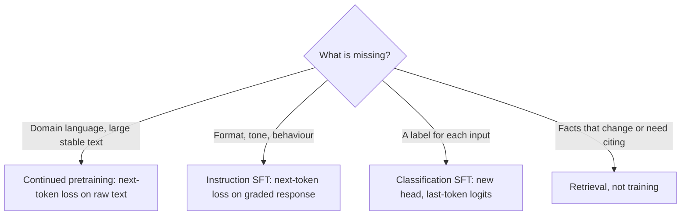

# 7 — Continued pretraining and supervised fine-tuning

The ticket assistant now has a base model, which continues text and answers nothing. Two different things can be added to it. Knowledge, such as the vocabulary of a domain, comes from reading more of that domain's text. Behaviour, such as answering in a fixed format, comes from training on examples of that behaviour. Mixing these up is the most expensive mistake in applied fine-tuning: people try to teach facts with examples, and get a model that states falsehoods in exactly the right tone. This chapter takes the two in turn, with the masks and the prompt format made explicit in running code.

---

## Continued pretraining

To add knowledge, run more pretraining: the same next-token loss on raw, unlabeled domain text, before any SFT. Gururangan et al. named it *domain-adaptive pretraining* (DAPT) ([arXiv:2004.10964](https://arxiv.org/abs/2004.10964) (Gururangan et al., ACL 2020)). A second pretraining phase of RoBERTa on domain text raised macro-F1 on ACL-ARC citation intent from 63.0 to 75.4, and micro-F1 on ChemProt from 81.9 to 84.2. **The gain tracks how far the domain is from the original corpus.** On AG News, whose news domain RoBERTa had already seen, the gain was zero, and adapting to an *unrelated* domain made most tasks worse. *Task-adaptive* pretraining, on just the task's own unlabeled text, cost far less and beat DAPT on five of the eight tasks. The domain text need not be hand-curated. DSIR (see What the data is) picked 25M Pile documents matching each task's unlabeled text and averaged 83.76 F1 over the same eight tasks, against 83.46 for DAPT's curated corpora and 82.58 for random Pile text ([arXiv:2302.03169](https://arxiv.org/abs/2302.03169) (Xie et al., NeurIPS 2023)).

The recipe scales to LLMs at a small fraction of the original cost:

- **CodeGen** ([arXiv:2203.13474](https://arxiv.org/abs/2203.13474) (Nijkamp et al., ICLR 2023)) chained the stages. It trained models from 350M to 16.1B parameters first on the Pile (355B natural-language tokens plus 32B of code), then on 119B tokens of code in six languages, then on 72B tokens of Python only. At 16.1B, HumanEval pass@1 went from 14.2 to 18.3 to 29.3 across the three stages, level with Codex-12B (28.8). The same paper built a multi-turn benchmark of 115 problems split into at least three prompts each. Asking in turns beat one concatenated prompt (47.3 vs 38.7 pass rate at 16.1B), but not on the easiest problems, where the gain vanished at 6.1B and above.
- **Code Llama** ([arXiv:2308.12950](https://arxiv.org/abs/2308.12950) (Rozière et al., 2023, preprint)) started from Llama 2 and trained on 500B tokens (1T for the 70B): 85% code, 8% natural language about code and 7% general text kept to limit forgetting. Starting from Llama 2 paid off. A 7B trained from scratch on the same mix ended at the loss Code Llama 7B had reached about 240B tokens earlier, and the gap was still widening. On Python, Code Llama 7B roughly matched Llama 2 70B (HumanEval 33.5 vs 30.5). A further 100B Python-heavy tokens added 4.3–8.3 points of HumanEval pass@1. Infilling training cost little: 0.6 points at 7B and 1.1 at 13B, averaged over HumanEval and MBPP pass@1/10/100. The long-context stage cost 0.52 HumanEval points and 1.9 MBPP points on short prompts (RoPE details in [chapter 01b](01b-position-encodings-and-context-extension.md#position-schemes-and-length-extension)). The evaluations are Meta's own.
- **Minerva** ([arXiv:2206.14858](https://arxiv.org/abs/2206.14858) (Lewkowycz et al., NeurIPS 2022)) did the same for maths, and showed that the formatting of the domain text has to survive cleaning. It continued PaLM on 38.5B tokens: arXiv papers, and web pages picked because their HTML contained MathJax or `<math`, with the LaTeX kept rather than stripped as ordinary HTML cleaning would; 5% general text limited forgetting. **At 540B, MATH accuracy went from PaLM's 8.8% to 33.6% greedy, and to 50.3% with a majority vote over 64 samples.** Fine-tuning on MATH's training set afterwards gave the 8B model nothing (14.1% before, 12.9–13.4% after). Checked by hand on 100 MATH problems, about 8% of the 62B model's correct greedy answers had wrong reasoning, rising to 30% on the hardest level, and the authors found no sign that the test problems had been memorized. The paper has no run with the LaTeX stripped, so the value of keeping it is argued, not measured.
- **Llemma** ([arXiv:2310.10631](https://arxiv.org/abs/2310.10631) (Azerbayev et al., ICLR 2024)) repeated Minerva's recipe on open data, starting from Code Llama. Proof-Pile-2 is 55B tokens: 29B of arXiv, 15B of maths web pages and 11B of maths code, mixed 95% with 5% general text and code. The 7B model trained on 200B tokens for about 23,000 A100-hours. **On 4-shot MATH, Llemma 7B scored 18.0% against Code Llama 7B's 4.5% and Minerva 8B's 14.1%.** At 34B it scored 25.0%, short of Minerva 62B's 27.6%, and the two were level with majority voting (43.1% vs 43.4%). A 30-gram search matched about 7% of MATH test problems in the training data, but accuracy on those problems was no higher. There is no from-scratch comparison, and the mixture was picked on short runs by perplexity on MATH's training set.
- **ChipNeMo** ([arXiv:2311.00176](https://arxiv.org/abs/2311.00176) (Liu et al., 2023-11, preprint)) continued LLaMA 2 on 24B tokens of NVIDIA's internal chip-design documents and code, then ran SFT. For the 7B model, DAPT took 2,620 A100-hours and SFT 90, against 184,320 for the original pretraining: under 1.5% extra. ChipNeMo-70B beat GPT-4 on two of three internal tasks (an engineering-assistant chatbot and EDA script generation). DAPT through LoRA adapters left a significant accuracy gap against full-parameter DAPT. The benchmarks are NVIDIA's own and unreleased.
- **LLaMA Pro** ([arXiv:2401.02415](https://arxiv.org/abs/2401.02415) (Wu et al., ACL 2024)) attacks forgetting by adding parameters. It copies 8 transformer blocks into LLaMA2-7B, zero-initializes their output projections so the model starts unchanged, and trains only the new blocks, on 80B tokens of code and math. Against the base model, HumanEval pass@1 rose from 13.1 to 28.7 and GSM8K from 14.5 to 17.9, while MMLU held (46.9 to 47.9). In its law-domain ablation, the 8-block expansion kept general scores (56.7 average) better than full fine-tuning (55.0) and learned the domain task better than LoRA (75.1 vs 65.3 on Unfair-ToS). LoRA preserved general ability but struggled to learn the new domain.
- **Branch-Train-MiX** ([arXiv:2403.07816](https://arxiv.org/abs/2403.07816) (Sukhbaatar et al., 2024-03, preprint)) runs continued pretraining for several domains in parallel and then merges the copies into one mixture-of-experts model (see [chapter 03](03-scale-and-the-model-zoo.md#reading-a-models-size)). Starting from Llama 2 7B, it trained separate copies on math (201B tokens), code (210B) and Wikipedia (42B). Each copy's feed-forward blocks became an expert, next to the original model's, and the attention weights were averaged. A router was then trained on 80B more tokens, picking the top 2 experts per token. Averaged over math, code, knowledge, reasoning and general tasks it scored 47.9. On the same data, upcycling the seed into an MoE scored 46.3, a dense model 44.5 and Llama 2 13B 45.4. Upcycling still won narrowly on math and code, and with compute matched rather than data, the gap closes to 47.9 against 47.3. The test covers three domains and four experts, with no SFT or RLHF afterwards.
- **Qwen2.5-Coder** ([arXiv:2409.12186](https://arxiv.org/abs/2409.12186) (Hui et al., 2024, preprint)) continued every Qwen2.5 size from 0.5B to 32B on 5.5T tokens. That was 5.2T of single files at 8K context, then 300B of whole repositories at 32K with the RoPE base raised from 10,000 to 1,000,000, the same change Code Llama made. Its mix ablation at 7B tested 100% code, 85:10:5 and 70:20:10 code, text and maths. Pure code scored worst on average (31.3 against 55.0 for 70:20:10), mostly because maths and general scores collapsed (GSM8K 23.8 against 64.5). The authors say 70:20:10 also beat the code-heavier mixes on code, but their table shows pure code slightly ahead there (49.8 against 48.3 on the table's "common" code benchmarks, 40.3 against 38.3 on BigCodeBench). The quality filters for code-related web text were small fastText classifiers; larger models brought no significant gain. Four rounds of filtering raised a 1.5B model's HumanEval/MBPP average from 41.6 to 46.8.

---

## Supervised fine-tuning

Huyen's vocabulary (*AI Engineering*, ch. 1) is worth adopting. **Pre-training** builds the base model and is by far the expensive part: for InstructGPT it took about 98% of the compute, post-training 2%. **Post-training** is everything the model developer does afterwards (SFT, preference tuning). **Fine-tuning** is the same machinery when an application developer does it to someone else's model. Changing a prompt is not training of any kind; no weight moves.

SFT continues training on curated examples of the behaviour you want. The examples are expensive because they are written, not scraped: OpenAI used about 13,000 (prompt, response) pairs for InstructGPT, which at $10 a pair would come to $130,000 before task design and quality control. A pair can take up to 30 minutes to write, and about 90% of InstructGPT's demonstration writers had a college degree (*AI Engineering*, ch. 2). *Building AI Agents* (ch. 3) puts typical SFT sets at 10,000 to 100,000 pairs. The idea is older than chat. *Instruction tuning* began with FLAN ([arXiv:2109.01652](https://arxiv.org/abs/2109.01652) (Wei et al., ICLR 2022)) and T0 ([arXiv:2110.08207](https://arxiv.org/abs/2110.08207) (Sanh et al., ICLR 2022)), which fine-tuned on dozens of existing NLP datasets rewritten as instructions. FLAN's 137B model then beat zero-shot GPT-3 175B on 20 of 25 held-out datasets. The lineage, and what each successor learned, is in [05-RL note 02](../../05-RL/notes/02-rlhf-pipeline.md#stage-1--supervised-fine-tuning-sft). Raschka builds two flavours (*LLMs from Scratch*, ch. 6–7):

| | Classification fine-tuning (ch. 6) | Instruction fine-tuning (ch. 7) |
|---|---|---|
| Change to the model | Replace the output head with a small one (e.g. 2 classes); usually train only the last block(s) and the head | None; keep the language-model head |
| Data | Labeled examples (spam / not spam) | Instruction–response pairs in a fixed template (Alpaca-style) |
| Loss | [Cross-entropy](06-pretraining-data-and-objectives.md#entropy-cross-entropy-kl-and-perplexity) on the last token's class logits | Next-token loss on the response; padding and usually the prompt tokens are masked out (*Foundations of LLMs*, ch. 4: log Pr(x,y) = log Pr(x) + log Pr(y|x), and SFT drops the first term) |
| Evaluation | Accuracy | Hard; Raschka scores responses with a larger LLM as judge |

*Building AI Agents* (ch. 2) shows the classification route on a small decoder, with a linear head on the last token's hidden state; it is the same pattern as *LLMs from Scratch* ch. 6.

The *LLM Engineer's Handbook* (ch. 5) adds the practical side: building an instruction dataset from your own documents, deduplication, using an LLM to generate and filter pairs, chat templates, and choosing between full fine-tuning, LoRA and QLoRA by GPU budget.

**Rule:** SFT teaches the *form* of an answer far more than new facts. Fine-tuning on a knowledge base to make a model "know" it tends to produce confident paraphrases with errors. For facts that change or need citations, use retrieval ([02-rag-retrieval](../../02-rag-retrieval/README.md)); for a large, stable body of domain text, use continued pretraining (above).

The evidence for the rule:

- **Little data, mostly format.** Flan-PaLM's instruction tuning used 1.4B tokens, 0.2% of its 780B pretraining tokens, and most of its gain came from the first 282 of 1,836 tasks. The authors' reading is that the model was learning to express knowledge it already had ([arXiv:2210.11416](https://arxiv.org/abs/2210.11416) (Chung et al., JMLR 2024)). LIMA's *Superficial Alignment Hypothesis* says the same from 1,000 examples ([arXiv:2305.11206](https://arxiv.org/abs/2305.11206) (Zhou et al., NeurIPS 2023)).
- **How big the sets are.** Xiao & Zhu cite the FLAN collection at 1,836 tasks and 15 million samples, against LIMA's 1,000 curated examples that left a LLaMA 65B competitive with models tuned on far more. They record no benchmark numbers for LIMA (*Foundations of LLMs*, ch. 4, 4.2.3). Early open sets (over 100 NLP tasks, more than a million samples) were mostly academic tasks, which is one reason they generalised to chat less well than small curated sets.
- **Where data comes from.** Manual routes turn existing NLP datasets into prompt templates, mine natural question–answer pages, or pay annotators. Automatic routes are self-instruct (a few seed tasks prompt a model to write new instructions, then inputs and outputs, then filter), input inversion (take good outputs and have a model write the instruction that would produce them) and evol-instruct (rewrite instructions to be harder) (*Foundations of LLMs*, ch. 4, 4.2.2).
- **A weak teacher can still help a strong student.** Burns et al.'s weak-to-strong setup fine-tunes a strong model on labels from a weaker one. The performance gap recovered is PGR = max{0, (P_w2s − P_weak)/(P_ceiling − P_weak)}, and the book reports it near 0.8 on 22 NLP classification tasks, with GPT-2-level supervision on a GPT-4-level model. It is reported from that paper and it covers classification, not open-ended generation, and the authors say it needs more investigation (*Foundations of LLMs*, ch. 4, 4.2.5).
- **New facts make it hallucinate.** In a controlled study on PaLM 2-S closed-book QA, examples the model didn't already know were fit far more slowly than known ones. **As they were fit, test accuracy fell linearly**, so the model got worse at using what it knew. Early stopping, or relabelling unknown answers "I don't know", avoided most of the damage ([arXiv:2405.05904](https://arxiv.org/abs/2405.05904) (Gekhman et al., EMNLP 2024)).
- **Not much semantics is needed either.** The instruction-tuning survey ([arXiv:2308.10792](https://arxiv.org/abs/2308.10792) (Zhang et al., 2023-08, preprint)) collects the critique. In Kung and Peng (2023), models tuned on task definitions stripped of meaning, or on examples with *wrong* input–output pairs, scored close to models tuned on the real ones.

In a multi-turn dialogue you do not need one pass per turn. Mask the user turns and grade every assistant turn in a single forward pass, since one causal pass already conditions each turn on all earlier ones (*Foundations of LLMs*, ch. 4, 4.2.1, Eq. 4.5–4.7). The book's remedies for forgetting are a smaller learning rate, early stopping, regularisation toward the pretrained weights and diverse data.

Fine-tuning can also erase what pretraining taught. The effect shrinks with scale and can be offset by replaying old data. When PaLM-E unfroze its LLM for multimodal training, its language-generation score dropped by 87.3% (relative) at 12B but by only 3.9% at 562B ([arXiv:2303.03378](https://arxiv.org/abs/2303.03378) (Driess et al., 2023-03)). Qwen-VL mixed pure-text samples into its multimodal training and held MMLU at 50.7, against 49.9 for the LLM it started from ([arXiv:2308.12966](https://arxiv.org/abs/2308.12966) (Bai et al., 2023-08)).

Replay works, but it gets more expensive as a model accumulates training stages. The alternative is to limit which weights move. Two examples are LLaMA Pro's frozen-base block expansion (Continued pretraining, above) and sparse memory finetuning ([arXiv:2510.15103](https://arxiv.org/abs/2510.15103) (Lin et al., 2025-10, preprint)). Sparse memory finetuning needs a model with a *memory layer*: a pool of 1M slots, of which each token reads only 32. On each step it updates only the slots that the new data uses much more than pretraining data did (a TF-IDF ranking). **Trained on a stream of TriviaQA facts to the same recall, a 1.3B model lost 89% of its NaturalQuestions F1 under full fine-tuning, 71% under LoRA and 11% under sparse memory finetuning.** The result covers fact learning only, at 1.3B, on a memory-layer architecture you would have to pretrain yourself.

---

## Worked example: what the instruction loss actually sees

Raschka's chapter 7 builds SFT from a dataset of 1,100 instruction–response pairs in the Alpaca format. The only unusual step is the collation: padding lets a batch have one shape, and setting a target to `-100` tells cross-entropy to ignore that position, since PyTorch's `ignore_index` defaults to that value. The following keeps his template and also masks the prompt, the "usually" option from the table above, on one of our tickets:

```python
import tiktoken
import torch
import torch.nn.functional as F

enc = tiktoken.get_encoding("gpt2")
PAD, IGNORE = 50256, -100

def alpaca(instruction, response):
    prompt = ("Below is an instruction that describes a task. "
              "Write a response that appropriately completes the request.\n\n"
              f"### Instruction:\n{instruction}\n\n### Response:\n")
    return enc.encode(prompt), enc.encode(response) + [PAD]

def collate(pairs):
    rows = [alpaca(*p) for p in pairs]
    longest = max(len(p) + len(r) for p, r in rows)
    inputs, targets = [], []
    for p, r in rows:
        ids = p + r + [PAD] * (longest - len(p) - len(r))
        tgt = ids[1:] + [PAD]
        tgt[:len(p) - 1] = [IGNORE] * (len(p) - 1)                  # prompt: not graded
        tgt[len(p) + len(r) - 1:] = [IGNORE] * (longest - len(p) - len(r) + 1)   # padding: not graded
        inputs.append(ids); targets.append(tgt)
    return torch.tensor(inputs), torch.tensor(targets)

x, y = collate([("Classify this ticket.", "billing"),
                ("Reply to a late parcel.", "Sorry, your parcel is on its way.")])
print("shape:", tuple(x.shape), " graded positions per row:", (y != IGNORE).sum(1).tolist())
print("graded text, row 0:", repr(enc.decode([t for t in y[0].tolist() if t != IGNORE])))

logits = torch.randn(*x.shape, 50257, generator=torch.Generator().manual_seed(0))
masked = F.cross_entropy(logits.flatten(0, 1), y.flatten())
keep = y.flatten() != IGNORE
manual = F.cross_entropy(logits.flatten(0, 1)[keep], y.flatten()[keep])
print(f"ignore_index loss {masked:.4f} == loss on graded positions only {manual:.4f}")
```

```text
shape: (2, 46)  graded positions per row: [3, 10]
graded text, row 0: 'billing<|endoftext|>'
ignore_index loss 11.6498 == loss on graded positions only 11.6498
```

The last token graded is the end-of-text marker, which is how the model learns to stop. Without it, you get a model that answers and then carries on writing. The prompt positions cost nothing here because the gradient only comes from the graded ones.

Classification fine-tuning has a different change: you swap the head. This is the entire difference between a language model and a two-class ticket classifier, with the sizes printed:

```python
import torch.nn as nn

class Tiny(nn.Module):
    def __init__(self, vocab=50257, d=768, layers=2):
        super().__init__()
        self.tok = nn.Embedding(vocab, d)
        self.blocks = nn.ModuleList(nn.TransformerEncoderLayer(d, 12, 4 * d, batch_first=True) for _ in range(layers))
        self.head = nn.Linear(d, vocab, bias=False)

def trainable(m):
    return sum(p.numel() for p in m.parameters() if p.requires_grad)

model = Tiny()
print(f"language model, all trainable: {trainable(model):>12,}")
for p in model.parameters():
    p.requires_grad = False
model.head = nn.Linear(768, 2)                       # spam / not spam
print(f"new head only:                 {trainable(model):>12,}")
for p in model.blocks[-1].parameters():
    p.requires_grad = True
print(f"head plus last block:          {trainable(model):>12,}")
```

```text
language model, all trainable:   91,370,496
new head only:                        1,538
head plus last block:             7,089,410
```

Which of these routes you choose follows from what you are teaching:



---

## Pitfalls

- **Teaching facts with fine-tuning.** Gekhman's result is the warning: as unknown facts are fitted, test accuracy falls.
- **Forgetting the end-of-text target.** The model won't learn to stop.
- **Grading padding.** Without `-100` the model is rewarded for predicting padding, and the loss looks better than the model is.
- **Training and serving with different templates.** The chat template and its whitespace are part of the model now.
- **Replaying no old data on a long run.** Continued pretraining forgets. Code Llama kept 7% general text for this reason.
- **Trusting a loss curve for instruction tuning.** A falling next-token loss says little about whether answers are right. Evaluate on a held-out set of tasks with a judge or a metric.
- **Skipping the small-scale baseline.** Most of the format gain comes early in Flan-PaLM. Try hundreds of examples first and measure the curve before paying for thousands.

---

## Try it

1. Change `collate` to grade the prompt too (delete the first mask line). How do the graded positions per row change, and why is it usually left out?
2. In the head-swap block, also unfreeze the token embedding. How many parameters are now trainable, and what is the risk with a small dataset?
3. For a dataset of 2,000 tickets, of which half are "billing", what is the accuracy of a model that always says "billing"? What does that imply for how you report a classification fine-tune?

<details>
<summary>Answers</summary>

1. Each row grades all of its prompt tokens as well. Usually you leave them out because the model can't choose the prompt, though Raschka's own version does grade the prompt by default and treats masking as an exercise, so both are in use.
2. Add 50,257 × 768 = 38,597,376 to the head-plus-last-block count. Embeddings make up most of the model, and with little data they mostly overfit.
3. 50%. Report against that baseline, and report per-class precision and recall.

</details>

---

## Interview checklist

| Question | Answer |
|---|---|
| Continued pretraining or SFT? | Continued pretraining adds knowledge from raw domain text with the same next-token loss. SFT teaches format and behaviour from demonstrations |
| How does the loss differ from pretraining? | It is the same next-token cross-entropy, with padding (and usually the prompt) masked out via `ignore_index=-100` |
| What does a classification fine-tune change? | It replaces the head and usually trains only the last blocks and the head, taking the loss on the last token's logits |
| How many SFT examples do you need? | InstructGPT used about 13,000 and typical sets run from 10,000 to 100,000, but much of the format gain arrives early, as with Flan-PaLM and LIMA |
| What happens if you fine-tune on unknown facts? | The model fits them slowly, and as it does, test accuracy falls. Early stopping or "I don't know" labels reduce the damage |
| Why does fine-tuning cause forgetting, and how do you limit it? | Weights that held older knowledge move. Replay old data or limit which weights move |

---

## Next

[08 — Preference optimisation: an overview](08-preference-optimisation-overview.md) trains on comparisons, which demonstrations alone cannot do.
