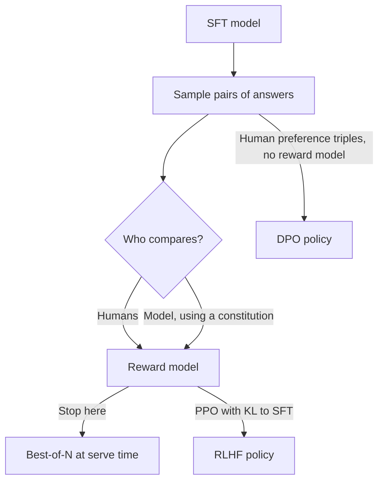

# 8 — Preference optimisation: an overview

Two replies to the same ticket are both accurate and both in the right format. One is curt and the other tells the customer what happens next. SFT cannot separate them, because it can only imitate the example it was given and has no idea which of two good answers people prefer. Preference optimisation trains on exactly that comparison. This chapter is the overview in this pillar: what the three families of methods do, one small worked example of each loss, and what each will and won't get you. The full treatment, with the math and the experiments, lives in the RL pillar.

---

## Preference optimization, briefly

SFT can only imitate. To make a model prefer the better of two acceptable answers, you train on comparisons:

- **RLHF:** train a reward model on human rankings, then optimize the policy against it with PPO and a [KL penalty](06-pretraining-data-and-objectives.md#entropy-cross-entropy-kl-and-perplexity) to the SFT model.
  - *The data is comparisons, because they are cheaper than writing.* For Llama 2, each comparison cost Meta about $3.50, against $25 for a written response, and LMSYS found a careful comparison takes three to five minutes. Agreement is limited: InstructGPT's labelers agreed with each other about 73% of the time (*AI Engineering*, ch. 2).
  - *The reward model turns rankings into a score.* For a prompt `x` with a preferred answer `y_w` and a rejected one `y_l`, InstructGPT minimizes `−log σ(r_θ(x, y_w) − r_θ(x, y_l))`, where the sigmoid `σ(z) = 1/(1 + e^(−z))` squashes the score gap into the probability that the winner wins: push the winner's score above the loser's. Three ranked answers give three such pairs.
  - *The reward model is the language model with a scalar head.* Take a decoder, put a linear layer on the last token's hidden state, and train it on pairs with the Bradley–Terry loss, Pr(y_a ≻ y_b | x) = σ(r(x, y_a) − r(x, y_b)). At RL time it is used pointwise, one score per response, although it was trained only on differences (*Foundations of LLMs*, ch. 4, 4.3.2). Four models then sit in memory during PPO: the policy being trained, a frozen reference copy for the KL penalty, the reward model, and a value model that estimates the baseline for the advantage A = r + γV(s′) − V(s). The policy and value models start from the SFT model and the reward model from a pretrained one (4.3.3, Fig. 4.9). Each response token is an action, and the reward usually arrives only at the end, which is why the value model matters.
  - *PPO is a policy-gradient method.* The policy gradient theorem says the gradient of expected return is a sum over states and actions of the state's visit weight times ∂π/∂θ times the action value Q. There is no term for how the state distribution shifts when θ changes. A learned approximator of Q keeps the gradient exact if its gradient matches ∂π/∂θ divided by π, and subtracting any state-only baseline leaves the gradient unchanged while changing its variance. The paper has no experiments ([NIPS 1999](https://papers.nips.cc/paper/1713-policy-gradient-methods-for-reinforcement-learning-with-function-approximation) (Sutton et al., NIPS 12, 1999)).
  - *A reward model is useful on its own.* Stitch Fix and Grab skip the RL step: they sample several answers and serve the one their reward model scores highest (best-of-N, [chapter 04](04-decoding-and-inference-behaviour.md#spending-more-compute-at-inference)). OpenAI's WebGPT found the same: on long-form questions answered by browsing, keeping the best of 64 samples was preferred to the plain fine-tuned 175B model 68% of the time, against 58% for PPO on the same reward model ([arXiv:2112.09332](https://arxiv.org/abs/2112.09332) (Nakano et al., 2021, preprint)).
- **DPO** ([arXiv:2305.18290](https://arxiv.org/abs/2305.18290)): skip the reward model; optimize directly on (prompt, chosen, rejected) triples. The reward model's optimal policy has a closed form, so RLHF reduces to a classification loss with no sampling during training. It beat PPO-based RLHF at controlling sentiment and matched or beat it on summarization and single-turn dialogue. Meta used RLHF for Llama 2 and switched to DPO for Llama 3 (*AI Engineering*, ch. 2). *LLM Engineer's Handbook* ch. 6 walks through it.
  - *DPO removes two of the four models.* Substituting the KL-regularised optimum into the Bradley–Terry loss cancels the partition term Z(x), leaving σ(β log π_θ(y_a)/π_ref(y_a) − β log π_θ(y_b)/π_ref(y_b)). The reward and value models drop out, at the price of training offline on fixed pairs rather than on the policy's own samples (*Foundations of LLMs*, ch. 4, 4.4.2, Eq. 4.81–4.82, Fig. 4.10).
- **Outcome versus process labels.** Preference pairs can judge whole answers or steps. Step-level labels (correct, incorrect, neutral) give a dense reward and are the route to o1-style reasoning models; the book offers no measurements (*Foundations of LLMs*, ch. 4, 4.4.4). Its summary of reward overoptimisation is that no fix is satisfactory: ensembles of reward models help but do not remove it (4.4.1).
- **Constitutional AI / RLAIF** ([arXiv:2212.08073](https://arxiv.org/abs/2212.08073)): a model critiques and ranks outputs against written principles in place of human labelers. When an LLM labels the pairs, the probability of the label token can be kept as a soft label instead of a hard 0 or 1 (*Foundations of LLMs*, ch. 4, 4.4.3).

All three are covered in [05-RL notes 02–04](../../05-RL/README.md#reading-order).

---

## Worked example: a reward model from ten comparisons

The reward-model loss is simple enough to train by hand. Each reply is reduced to four numbers (whether it cites the policy, whether it says what happens next, its length, whether it invents a detail). A linear model scores them, and each comparison is one step on the loss quoted above:

```python
import torch

FEATURES = ["cites_policy", "next_step", "length_100s", "invents_detail"]
replies = {  # reply -> features
    "Refunds take 5 days per policy; we have started yours.":   [1, 1, 0.5, 0],
    "Refunds take 5 days per policy.":                           [1, 0, 0.3, 0],
    "Your refund should arrive soon.":                           [0, 0, 0.3, 0],
    "Refunds take 14 days and I have emailed your bank.":        [0, 1, 0.5, 1],
    "Thanks so much for reaching out! " + "We value you. " * 8:  [0, 0, 1.3, 0],
}
names = list(replies)
X = torch.tensor([replies[n] for n in names])
pairs = [(0, 1), (0, 2), (0, 3), (0, 4), (1, 2), (1, 3), (1, 4), (2, 3), (4, 3), (2, 4)]   # (winner, loser)

torch.manual_seed(0)
w = torch.zeros(4, requires_grad=True)
opt = torch.optim.Adam([w], lr=0.1)
first = None
for step in range(300):
    r = X @ w
    loss = -torch.stack([torch.nn.functional.logsigmoid(r[a] - r[b]) for a, b in pairs]).mean()
    first = first if first is not None else loss.item()
    opt.zero_grad(); loss.backward(); opt.step()

print(f"loss: start {first:.3f} (ln 2 = 0.693), end {loss.item():.3f}")
print({f: round(v, 2) for f, v in zip(FEATURES, w.tolist())})

new = torch.tensor([[1, 0, 0.8, 0], [0, 1, 0.4, 1], [1, 1, 0.9, 0]], dtype=torch.float)    # N = 3 samples
scores = new @ w.detach()
print("best-of-3 scores:", [round(s, 2) for s in scores.tolist()], "serve sample", scores.argmax().item())
```

```text
loss: start 0.693 (ln 2 = 0.693), end 0.015
{'cites_policy': 4.37, 'next_step': 3.69, 'length_100s': -3.04, 'invents_detail': -9.24}
best-of-3 scores: [1.94, -6.77, 5.32] serve sample 2
```

Three things carry over to the real system. The starting loss is `ln 2` because a model that can't tell the two apart gets each comparison half right. The learned weights are the preferences the labelers expressed, and nothing more: if nobody marks invented details down, the model will not learn to either. And the last two lines are best-of-N, the option that stops here and needs no RL step. InstructGPT's real version is the same idea at a larger scale, with labelers ranking 4–9 responses per prompt across about 33,000 prompts, on top of about 13,000 SFT demonstrations ([arXiv:2203.02155](https://arxiv.org/abs/2203.02155) (Ouyang et al., NeurIPS 2022)). Its reward model starts from an SFT model with the final unembedding layer removed and outputs one score. The paper used only 6B reward models, to save compute, against policies of up to 175B.

DPO skips the reward model. It works straight on (prompt, chosen, rejected) triples, with a frozen copy of the SFT model as the reference: `−log σ(β[(log π_θ(y_w|x) − log π_ref(y_w|x)) − (log π_θ(y_l|x) − log π_ref(y_l|x))])`. The toy below reduces the "policy" to one distribution over three replies, so you can watch what the objective moves:

```python
import torch
import torch.nn.functional as F

reply = ["chosen", "rejected", "unrelated"]
ref = torch.tensor([0.30, 0.50, 0.20]).log()
logits = ref.clone().requires_grad_()
beta = 1.0

def dpo(log_p):
    return -F.logsigmoid(beta * ((log_p[0] - ref[0]) - (log_p[1] - ref[1])))

print(f"policy = reference: loss {dpo(F.log_softmax(logits, -1)).item():.3f}  (ln 2 = 0.693)")
both_up = ref + torch.tensor([1.0, 1.0, 0.0])
print(f"both raised equally: loss {dpo(both_up).item():.3f}")

opt = torch.optim.SGD([logits], lr=0.5)
for _ in range(200):
    loss = dpo(F.log_softmax(logits, -1))
    opt.zero_grad(); loss.backward(); opt.step()
print("reference:", {k: round(v, 2) for k, v in zip(reply, ref.exp().tolist())})
print("policy:   ", {k: round(v, 2) for k, v in zip(reply, F.softmax(logits, -1).tolist())})
print(f"final loss {loss.item():.3f}")
```

```text
policy = reference: loss 0.693  (ln 2 = 0.693)
both raised equally: loss 0.693
reference: {'chosen': 0.3, 'rejected': 0.5, 'unrelated': 0.2}
policy:    {'chosen': 0.95, 'rejected': 0.01, 'unrelated': 0.04}
final loss 0.005
```

Raising both answers leaves the loss at `ln 2`, so only the relative shift pays. On the published evidence, in TL;DR summarisation with GPT-J, a GPT-4 judge preferred DPO over the human-written reference 61% of the time against 57% for PPO ([arXiv:2305.18290](https://arxiv.org/abs/2305.18290) (Rafailov et al., NeurIPS 2023)). [05-RL note 03](../../05-RL/notes/03-preference-optimization.md) has the derivation and the later comparisons.

Constitutional AI changes who does the labelling, not the machinery ([arXiv:2212.08073](https://arxiv.org/abs/2212.08073) (Bai et al., 2022, preprint)). In its supervised stage, a helpful-only model answers harmful prompts, critiques its own response against a written principle and revises it, and the revisions become SFT data. In its RL stage, the model compares pairs of responses against the principles, and those comparisons train a preference model for RL. Harms get no human labels, though the helpfulness data still comes from people. See [05-RL note 04](../../05-RL/notes/04-constitutional-ai.md).



---

## Pitfalls

- **Assuming agreement among labelers.** InstructGPT's labelers agreed about 73% of the time, and the best model you can fit is capped by how far people agree.
- **Letting the reward model drift from the goal.** It learns whatever raters actually rewarded, and the policy will maximise that. Length, hedging and flattery are common leaks, since PPO looks for whatever raises the score.
- **Reading RLHF as a truth signal.** Raters like confident text. InstructGPT's RLHF model hallucinated more than its SFT model on its closed-domain tasks ([chapter 05](05-hallucination-and-base-vs-assistant.md)).
- **Reaching for RL when best-of-N would do.** If you already have a reward model, best-of-N may solve the problem, trading serving cost for no training instability.
- **Tuning β in DPO as if it were cosmetic.** It scales the margin the loss pays for. A very low value barely changes the policy.
- **Calling a principle list a safety guarantee.** A constitution is only as good as the model's reading of it and the coverage of its principles.

---

## Try it

1. Delete the pair `(2, 3)` and add `(3, 2)`, teaching the model that the invented answer beats the vague one. What happens to the `invents_detail` weight?
2. In the DPO block, change `ref` to `[0.05, 0.90, 0.05]`, then run. Does the chosen answer overtake the rejected one? What about the third reply, which no triple mentions?
3. Using the 73% agreement figure, what is the highest accuracy you should expect from a model on the same pairs, if labels from one rater are the ground truth?

<details>
<summary>Answers</summary>

1. It rises from about −9.2 to about −4.6, because the data now rewards it, and stays negative because three other comparisons still rank that reply below. The loss also stops near 0.21: the pairs now form a cycle (3 beats 2, 2 beats 4, 4 beats 3), which no scoring can satisfy. Real rater disagreement does the same.
2. Yes. After 200 steps the chosen reply is at 0.86 and the rejected at 0.08. The objective only pays for the shift relative to the reference, so a low starting point does not stop it. The third reply stays near its start (0.05 to 0.06), moving only through normalisation, since no triple covers it.
3. About 73%, as a rough ceiling, because a second rater would match the first at that rate. In practice, your measured accuracy should be read against that figure, not against 100%.

</details>

---

## Interview checklist

| Question | Answer |
|---|---|
| Why train on comparisons at all? | Comparing two acceptable answers is cheaper than writing a good one, and captures preferences demonstrations can't, such as which of two right answers is better |
| What is the reward-model loss? | `−log σ(r(x, y_w) − r(x, y_l))`, which pushes the winner's score above the loser's and starts at `ln 2` |
| What does best-of-N give you? | Many of the gains of RL with no RL training, at the serving cost of N samples per request |
| How does DPO avoid a reward model? | RLHF's optimal policy has a closed form in terms of the reward, so substituting it gives a classification loss on log-probability ratios against a frozen reference |
| Why doesn't raising both answers reduce the DPO loss? | It depends only on the difference of the two shifts. The objective pays for separation, not for confidence |
| What does Constitutional AI replace? | Human harm labels, with model critiques, revisions and comparisons against written principles. People still write those principles and supply helpfulness data |

---

## Next

[09 — PEFT and fine-tuning in practice](09-peft-and-fine-tuning-in-practice.md) gets back to the case where you are the one running a fine-tune, on a budget.
