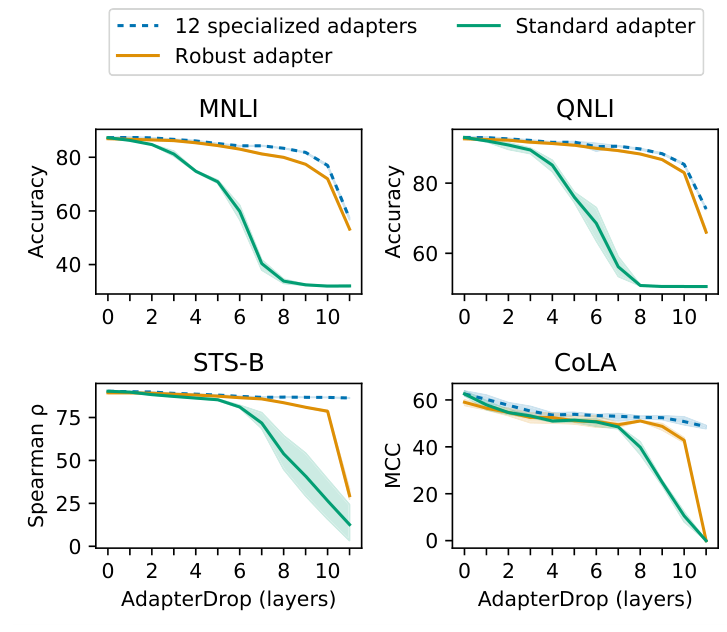
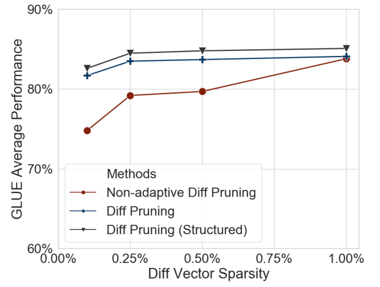
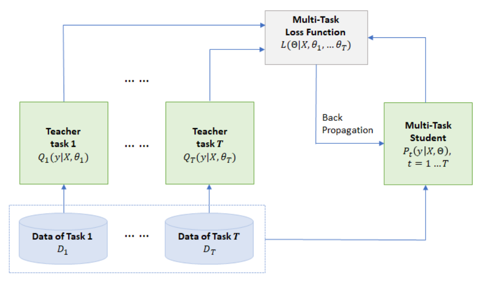
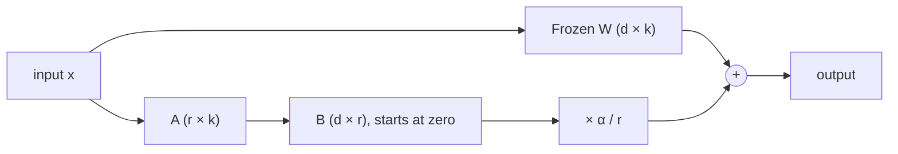

# 9 — PEFT and fine-tuning in practice

You have decided a fine-tune is justified. The ticket classifier can't be reached by prompting, and you have a few thousand examples. A full fine-tune would need optimizer state for every weight and might still erase what the model knew. A smaller option exists for nearly every budget, and this chapter walks through them: the older parameter-efficient methods and why LoRA displaced them, how to build a LoRA in thirty lines and with the `peft` library, how to shrink a model once trained, and the question that comes before all of that, which is whether to fine-tune at all.

---

## Parameter-efficient fine-tuning

Full fine-tuning updates every weight and needs optimizer state for all of them, several times the model's memory. PEFT methods train a small number of new parameters and freeze the rest ([arXiv:2312.12148](https://arxiv.org/abs/2312.12148), Xu et al., 2023, survey them). *Building AI Agents* (ch. 3) walks through the older options. Pfeiffer et al.'s survey ([arXiv:2302.11529](https://arxiv.org/abs/2302.11529) (Pfeiffer et al., TMLR 2023)) sorts them by where the new parameters go: into the existing weights (BitFit, LoRA), into the input (prompt and prefix tuning), or as new layers (adapters). All of them reduce to "frozen output plus a learned correction". Their reading of the comparisons: prompt tuning loses from limited capacity, bias-only tuning has the smallest footprint but lower scores, and adapters score best but add parameters.

- **Adapters** ([arXiv:1902.00751](https://arxiv.org/abs/1902.00751) (Houlsby et al., ICML 2019)) insert small bottleneck layers inside each block: for BERT, project 1,024 dimensions down to 24 and back up, under 50K parameters per adapter. Training only these (3.6% of the parameters) came close to full fine-tuning on GLUE. Unlike merged LoRA, adapters add a little latency at inference.
- **AdapterDrop** ([arXiv:2010.11918](https://arxiv.org/abs/2010.11918) (Rücklé et al., EMNLP 2021)) measured the adapter's runtime cost and cut it. On a BERT-base configuration, adapter training steps ran up to 60% faster than full fine-tuning (1.60 relative speed at sequence length 128, batch 32, shrinking to 1.33–1.37 at 512), because backpropagation skips the frozen parts, but inference ran at 94–96% of its speed. Removing the adapters from the first five layers, after training with a random number of layers dropped per batch, kept 95.4% of the full adapter's GLUE score (RoBERTa-base, eight tasks, three runs; 97.1% if one model is trained per drop count). A standard adapter with the same layers removed only at test time kept 89.0%. Inference on eight tasks sharing one input was 39% faster. AdapterFusion, which passes the input through every task's adapter, is the expensive case: with eight adapters it ran at 0.53 of full fine-tuning's training speed and 0.38 at inference, and pruning to the two most-activated adapters matched it on RTE and CoLA with 68% faster inference. Timing is on V100-class GPUs, the gains need several tasks on one input, RTE and CoLA degrade steeply when layers are dropped, and nothing here is at LLM scale.


*Image Source: Rücklé et al., [AdapterDrop: On the Efficiency of Adapters in Transformers](https://arxiv.org/abs/2010.11918) (EMNLP 2021), Fig. 2*

- **Diff pruning** ([doi:10.18653/v1/2021.acl-long.378](https://doi.org/10.18653/v1/2021.acl-long.378) (Guo et al., ACL 2021)) learns a sparse difference vector added to frozen weights, so there are no new layers. A relaxed L0 penalty learns which entries are nonzero; the vector is then magnitude-pruned to a target sparsity and fine-tuned with that mask fixed. On BERT-large, the structured variant (one mask per weight matrix) changed 0.5% of the parameters per task and averaged 80.6 on the GLUE test server, the same as full fine-tuning, against 80.4 for Houlsby adapters at 3.6%. Pruning by magnitude alone, without the learned mask, reached 75.5, so the mask is what matters. On SQuAD v1.1 validation it beat full fine-tuning (F1 93.2 at 1.0% of parameters against 90.8), which the authors read as a regularization effect without testing it. Storing a task's diff cost 13.6 MB against 51.7 MB for adapters and 1,297 MB for a full copy, in a basic estimate that stores positions as well as values. Training is 1.5–2× slower per minibatch and needs more memory. The evidence is BERT only, there is no inference speedup, and it predates LoRA and was not compared with prefix or prompt tuning.


*Image Source: Guo et al., [Parameter-Efficient Transfer Learning with Diff Pruning](https://doi.org/10.18653/v1/2021.acl-long.378) (ACL 2021), Fig. 1 (left)*

- **Prefix tuning** ([doi:10.18653/v1/2021.acl-long.353](https://doi.org/10.18653/v1/2021.acl-long.353) (Li & Liang, ACL 2021)) learns key/value vectors prepended at every layer: 250K parameters (0.1%) on GPT-2 Medium. It matched full fine-tuning on table-to-text and beat it by 2.9 BLEU on average with 50–500 training examples, an edge that shrank as the data grew. On XSUM summarization it trailed, 35.05 vs 37.25 ROUGE-L at 0.1%. Optimising the prefix directly was unstable, so the authors had to reparametrise it through an MLP during training.
- **Prompt tuning** ([arXiv:2104.08691](https://arxiv.org/abs/2104.08691) (Lester et al., EMNLP 2021)) keeps only the input-layer soft tokens: 20,480 parameters per task for a 5-token prompt on T5-XXL. **It works only at scale.** On SuperGLUE it lags model tuning badly at T5-Small through Large, and matches even multi-task model tuning only at 11B. The smaller sizes also depended on first continuing T5's training with a plain language-modelling objective; the 11B model worked without it. Its upside is robustness: trained on SQuAD, it beat model tuning on most out-of-domain QA sets, by 12.5 F1 on TextbookQA.
- **BitFit** ([doi:10.18653/v1/2022.acl-short.1](https://doi.org/10.18653/v1/2022.acl-short.1) (Ben Zaken et al., ACL 2022)) trains only the bias terms, 0.08% of BERT-Large, and matched full fine-tuning on the GLUE dev average (84.2 vs 84.1). The win is small-data only. It fell behind on the largest task, QQP (85.4 vs 87.5), and on SQuAD the ordering flipped once more training data was available. LLaMA-family models have no bias terms in their linear layers, so it does not carry over to them as is.
- **LLaMA-Adapter** ([arXiv:2303.16199](https://arxiv.org/abs/2303.16199) (Zhang et al., ICLR 2024)) brought prefix-style prompts to instruction tuning. It inserts learned prompts into the top 30 layers of a frozen LLaMA-7B, with a gate initialised at zero so they start out with no effect: 1.2M parameters and one hour on 8 A100s, against Alpaca's three hours of full fine-tuning on the same 52K examples. The zero gate is the trick. With random initialisation, ScienceQA validation accuracy was 40.77%, near chance; with the zero gate it was 83.85%. Its quality claim against Alpaca rests on GPT-4 judging 80 Vicuna questions, which is thin evidence.

**Where they lose to LoRA.** Hu et al. ran the old methods side by side on GPT-3 175B. On WikiSQL, full fine-tuning scored 73.8, BitFit 71.3, input-layer prompt tuning 63.1, per-layer prefixes 70.1, adapters 71.9–73.2 and LoRA 73.4–74.0 (Table 4). WikiSQL pairs 80,654 crowd-paraphrased questions with SQL queries over 24,241 Wikipedia tables. Each table sits in only one split, so a model must handle schemas it has not seen ([arXiv:1709.00103](https://arxiv.org/abs/1709.00103) (Zhong et al., 2017, preprint)). Its authors scored it two ways because each metric fails differently. Execution accuracy credits a wrong query that happens to return the right rows, and exact match on the query text penalizes a correct query whose conditions are in a different order. Their own Seq2SQL, an LSTM pointer network trained in part with execution results as an RL reward, reached 59.4% execution accuracy and 48.3% exact match on the test set. Only LoRA matched or beat full fine-tuning on that task. With few examples the ranking changes. (IA)³ learns three vectors per layer that rescale the attention keys, values and feed-forward activations, 540K parameters on T0-3B. On nine held-out tasks with 20–70 training examples each, it was the only PEFT method tested, LoRA (9.1M parameters) included, to beat full fine-tuning. The full recipe, T-Few, on T0 11B scored 72.4% against 66.6% for few-shot in-context learning with GPT-3 175B, at about 1,000× fewer inference FLOPs per example. Fine-tuning cost about as much as GPT-3 spends on 20 in-context examples, half an hour on one A100 ([arXiv:2205.05638](https://arxiv.org/abs/2205.05638) (Liu et al., NeurIPS 2022)). Every task was classification or multiple choice, scored by ranking the answer options, so this says nothing about generation.

**LoRA** ([arXiv:2106.09685](https://arxiv.org/abs/2106.09685), Hu et al., 2021) is the default. For a frozen weight matrix `W` (d × k), learn a [low-rank](02-attention-and-the-transformer-block.md#matrix-products-transpose-and-rank) update:

```text
W' = W + ΔW,   ΔW = B · A,   B: d × r,  A: r × k,  r ≪ min(d, k)
```

- Only `A` and `B` are trained. On GPT-3 175B the paper reports 10,000× fewer trainable parameters and 3× less GPU memory than full fine-tuning, with comparable quality.
- The update can be merged into `W` after training, so inference costs nothing extra; or kept separate so one base model serves many adapters. That is the case for PEFT in an agent system with many specialised roles: one stored base, one small adapter per role, swapped per request (*Agentic Architectural Patterns*, ch. 2–3), where a fully fine-tuned copy per role would multiply storage and serving cost.
- What LoRA is *not*: *Prompt Engineering for GenAI* (ch. 2) calls it "low-rank approximations" that make the network run on consumer hardware. LoRA is low-rank *adaptation*. It shrinks the number of *trainable* parameters during fine-tuning; it does not make the model smaller or faster at inference. Shrinking the model is quantization, pruning or distillation (below).
- **QLoRA** ([arXiv:2305.14314](https://arxiv.org/abs/2305.14314)) keeps the frozen base in 4-bit and trains LoRA adapters on top, which brings 65B-parameter fine-tuning onto a single 48 GB GPU. Three tricks make it fit: a 4-bit NormalFloat data type, quantizing the quantization constants themselves (about 3 GB saved at 65B), and paged optimizers that absorb memory spikes. Its Guanaco models reached 99.3% of ChatGPT's score on the Vicuna benchmark after 24 hours on one GPU. The authors themselves warn that those chatbot benchmarks are not trustworthy, so read the number as "close", not "equal".
- **GaLore** ([arXiv:2403.03507](https://arxiv.org/abs/2403.03507) (Zhao et al., 2024-03)) targets optimizer memory instead of the trainable-parameter count. It projects each gradient into a low-rank subspace, cutting optimizer-state memory by up to 65.5%. That is enough to pre-train LLaMA-7B on a 24 GB consumer GPU. Unlike LoRA it updates all the weights, so it also works for pre-training. Its 8-bit 7B run on C4 reached a validation perplexity of 14.65 after 150K steps, a single run.
- **LoRA+** ([arXiv:2402.12354](https://arxiv.org/abs/2402.12354) (Hayou et al., ICML 2024)) gives `B` a larger learning rate than `A`. The authors' width-scaling argument says a shared rate under-trains `B`. It is the same compute as LoRA, with 1–2% better scores and up to 2× faster convergence, mostly on hard tasks. On Llama-7B trained on a 100K flan-v2 subset, MMLU rose about 1.3 points; on MNLI, which Llama finds easy, equal rates were already near-optimal. The best ratio varies by model and task: about 2⁴ for RoBERTa, 2¹–2² for Llama.
- **DoRA** ([arXiv:2402.09353](https://arxiv.org/abs/2402.09353) (Liu et al., ICML 2024)) borrows the split from weight normalisation ([arXiv:1602.07868](https://arxiv.org/abs/1602.07868) (Salimans & Kingma, NeurIPS 2016)). Each pretrained weight becomes a per-column magnitude and a direction. DoRA trains the magnitude directly and updates the direction with LoRA, and the result merges back into `W`, so inference costs the same as LoRA. The motivation is an observation on one model, VL-BART: full fine-tuning's changes in magnitude and direction were negatively correlated (−0.62), while LoRA's were positive (0.83). The authors suspect that LoRA can't make a large change in one without the other, but they don't prove it. **At the same rank it beat LoRA on eight commonsense-reasoning tasks by 3.7 points on LLaMA-7B (74.7 to 78.4) and by 4.4 on LLaMA3-8B (80.8 to 85.2), for 0.01% more parameters. At half the rank it still beat full-rank LoRA.** Read the margins with care: they come from single runs. The LLaMA2 and LLaMA3 LoRA baselines reused older hyperparameters while DoRA's learning rate was retuned, and LoRA's low-rank cells (40.7% at r = 8) look like failed runs. Where full fine-tuning already trailed LoRA, on LLaVA-1.5-7B, the gain shrank to 0.7. Treating the column norm as a constant in backprop cut training memory by 24.4% on LLaMA-7B for 0.2 points of accuracy. The paper never compares DoRA's step time or memory with plain LoRA's. In `peft` it is one flag, `LoraConfig(use_dora=True)`.
- **LongLoRA** ([arXiv:2309.12307](https://arxiv.org/abs/2309.12307) (Chen et al., ICLR 2024)) found the case where plain LoRA fails: **extending the context window**. Taking Llama 2 7B to 32K tokens, LoRA reached a PG19 perplexity of 11.44 at rank 8, against 8.08 for full fine-tuning, and rank 256 did no better (11.98). Making the embedding and normalisation layers trainable as well (about 2% of the parameters) brought it to 8.12. With shifted sparse attention during training it took Llama 2 7B to 100K tokens, or 70B to 32K, on one 8× A100 machine.
- **LOMO** ([arXiv:2306.09782](https://arxiv.org/abs/2306.09782) (Lv et al., ACL 2024)) keeps *full* fine-tuning and removes the optimizer state instead. It uses plain SGD and applies each layer's update as soon as its gradient is computed, so the full gradient is never held in memory. For LLaMA-7B (batch 8, length 512, activation checkpointing) that is 14.6 GB against 102.2 GB for AdamW. It also trained a 65B model on 8× RTX 3090s. On six SuperGLUE tasks with 1,000 examples it beat LoRA by 2.8 points on average at 13B. That is a narrow test, and it is SGD, not Adam.
- **MeZO** ([arXiv:2305.17333](https://arxiv.org/abs/2305.17333) (Malladi et al., NeurIPS 2023)) drops backpropagation altogether. It estimates the gradient from two forward passes with a shared random perturbation, so training needs only inference memory. One A100 80GB can then fine-tune a 30B model, where backprop with Adam fits 2.7B. On OPT-13B with 1,000 examples it came within 1% of full fine-tuning on 7 of 11 tasks, using 12× less memory. The gaps elsewhere were large: 67.9 vs 83.9 on CB, 60.1 vs 71.1 on MultiRC. It needs many more steps (20K vs 625) and works only when the task is phrased as a prompt.

**Without the weights.** Three methods adapt a model whose weights you cannot touch, and each needs something closed APIs do not give.
- Black-box tuning ([arXiv:2201.03514](https://arxiv.org/abs/2201.03514) (Sun et al., ICML 2022)) searches a 500-dimensional random projection of a soft prompt with CMA-ES, using 8,000 API calls. On RoBERTa-Large with 16 examples per class it averaged 73.0 across seven tasks, against 63.5 for gradient prompt tuning and 78.9 for full model tuning. It needs an API that accepts prompt embeddings and returns logits.
- Offsite-tuning ([arXiv:2302.04870](https://arxiv.org/abs/2302.04870) (Xiao et al., 2023-02, preprint)) has the model owner send a few top and bottom layers plus a compressed "emulator" of the middle. The data owner tunes those layers and sends them back. On GPT-2 XL and OPT-1.3B the plugged-back model came within a few points of full fine-tuning on most tasks. Combined with LoRA it trained GPT-2 XL 6.5× faster in 5.6× less memory than full fine-tuning. The authors say they have not shown that the emulator and adapter don't leak the model or the data.
- Proxy-tuning ([arXiv:2401.08565](https://arxiv.org/abs/2401.08565) (Liu et al., COLM 2024)) works at decoding time. It adds the logit difference between a small tuned model and its untuned base to a large base model's logits. Llama-2-7B-Chat minus Llama-2-7B, applied to Llama-2-70B, closed 88% of the gap to Llama-2-70B-Chat across the paper's benchmarks, and it beat the chat model on open-ended TruthfulQA (85.1 vs 79.6% informative and true), though not on the multiple-choice version (59.2 vs 68.3). Reasoning did not transfer: GSM8K was 32.0 against 51.8 for the real chat model. It needs a shared vocabulary and full logits (top-5 for their GPT-3.5 case), and it ran about 1.5× slower at 70B.

**Adapters as reusable parts.** With one base model and many LoRAs, new adapters can be assembled from old ones without training.
- LoraHub ([arXiv:2307.13269](https://arxiv.org/abs/2307.13269) (Huang et al., COLM 2024)) picks weights for a mix of existing LoRAs, with gradient-free search on five examples. On Big-Bench Hard with FLAN-T5-Large it scored 34.7, below 5-shot in-context learning (37.3), LoRA (37.7) and full fine-tuning (42.1). It used a fifth of in-context learning's tokens per example.
- Text-to-LoRA ([arXiv:2506.06105](https://arxiv.org/abs/2506.06105) (Charakorn et al., ICML 2025)) trains a hypernetwork on 479 tasks to write a LoRA from a task description in one forward pass. On Mistral-7B its adapters for unseen tasks averaged 73.9 on eight benchmarks, against 71.9 for a multi-task LoRA and 75.8 for LoRAs trained on each task. Its descriptions were written by GPT-4o-mini, and the authors expect worse results from what users actually type.

```python
from peft import LoraConfig, get_peft_model
from transformers import LlamaConfig, LlamaForCausalLM

base_model = LlamaForCausalLM(LlamaConfig(vocab_size=1000, hidden_size=256, num_hidden_layers=4,
                                          num_attention_heads=4, intermediate_size=512))
config = LoraConfig(r=16, lora_alpha=32, target_modules=["q_proj", "v_proj"], lora_dropout=0.05)
model = get_peft_model(base_model, config)
model.print_trainable_parameters()
```

```text
trainable params: 65,536 || all params: 3,201,280 || trainable%: 2.0472
```

That is a small random Llama, so it runs on a laptop with no downloads, and its share of trainable parameters is much higher than on a real model because it has only 4 layers and a low `d`. On real LLM sizes the same config comes in well under 1%.

For LoRA on a real vision-language model, with the target layers, label masks and 4-bit merge measured over three seeds, see [Fine-tuning a vision-language model](../../../ai-engineering/08-multimodal-engineering/notes/02b-fine-tuning-a-vision-language-model.md).

---

### Making the model smaller

Three ways to cut memory and latency once a model is trained (*Building AI Agents*, ch. 2–3):

- **Quantization** stores weights in fewer bits. The basic affine scheme maps a float `x` to an integer `x_q = round(x / s) + z`, with a scale `s` and zero point `z` chosen per tensor, channel or block ([absmax vs zero-point, and the methods that handle outliers](../../../ai-engineering/07-inference-engineering/notes/08c-quantization-and-low-precision.md#quantization)). Halving the bits halves the weight memory ([chapter 03](03-scale-and-the-model-zoo.md#reading-a-models-size)). Fewer bits do not always mean faster, though. Lu et al. ran Phi-1.5 under llama.cpp on a Jetson Orin NX GPU with prompts of up to 50 tokens. 4-bit k-quants (Q4_K_M) cut prefill latency by about 50% on average, and the formats tested cut decode latency by 17–75%. The 3-bit and 6-bit formats were about as slow as FP16 at prefill by 50 tokens, because hardware has no fast path for irregular bit widths ([arXiv:2409.15790](https://arxiv.org/abs/2409.15790) (Lu et al., 2024, preprint)). Decode gains more because it is limited by memory bandwidth, not compute.
- **Pruning** removes weights or whole layers. Classic prune-and-retrain cycles are too expensive at LLM scale, and the book reports that many one-shot methods fail to remove more than about 10% of weights before the model collapses. SparseGPT reached 60% sparsity on the 175B-class models OPT-175B and BLOOM-176B without retraining (the book says "170-billion-parameter models"). Wanda also needs no retraining. It holds LLaMA-7B at 7.26 perplexity at 50% unstructured sparsity, against 5.68 dense, but perplexity reaches 84.5 at 70% ([arXiv:2306.11695](https://arxiv.org/abs/2306.11695) (Sun et al., 2023-06)). Unstructured sparsity also gives no speedup on its own; see [inference 08](../../../ai-engineering/07-inference-engineering/notes/08c-quantization-and-low-precision.md#quantization). Gromov et al. dropped blocks of the deeper layers from open models and "healed" each pruned model with a small QLoRA fine-tune. **Llama-2-70B kept its 5-shot MMLU score until roughly half its layers were gone**, and across the Llama-2, Qwen, Mistral and Phi-2 models the collapse to chance came between 20% and 55% pruned. Larger, deeper models tolerated more pruning. "Little loss" holds only for knowledge question-answering, though. Next-token loss on C4 rose steadily with every layer removed, and GSM8K and HellaSwag dropped from the first layer cut. The authors read this as shallow layers storing knowledge and deeper layers doing reasoning ([arXiv:2403.17887](https://arxiv.org/abs/2403.17887) (Gromov et al., ICLR 2025)). Structured pruning pays off once distillation does the retraining. NVIDIA's Minitron recipe width-pruned Mistral NeMo 12B to 8B and retrained it on a KL loss against the teacher's logits. That took 380B tokens, against 15T to train Llama 3.1 8B from scratch, and the result scored 69.5 on 5-shot MMLU against Llama 3.1 8B's 65.3 ([arXiv:2408.11796](https://arxiv.org/abs/2408.11796) (Sreenivas et al., 2024-08, preprint)). Two practical findings. When you don't have the teacher's pretraining data, fine-tune the teacher on your distillation corpus first (about 100B tokens; they call it "teacher correction"), or its guidance is off-distribution. And at 4B from Llama 3.1 8B, width pruning beat depth pruning on accuracy, while depth pruning gave the larger speedup (2.7× vs 1.8×).
- **Distillation** trains a small *student* to match a large *teacher*'s output distribution. The idea of training a small model on a big model's outputs starts with Buciluă, Caruana & Niculescu-Mizil, who compressed a tabular ensemble into one small net trained on the ensemble's labels for synthetic cases (RMSE 0.264 against 0.263 for the ensemble, on eight binary problems with 4,000 training points each; [KDD 2006](https://doi.org/10.1145/1150402.1150464), covered in [inference 08](../../../ai-engineering/07-inference-engineering/notes/08-adaptive-inference.md)). The recipe is Hinton, Vinyals and Dean's ([arXiv:1503.02531](https://arxiv.org/abs/1503.02531) (Hinton et al., 2015, NIPS 2014 Deep Learning Workshop)). Raise the softmax [temperature](04-decoding-and-inference-behaviour.md#decoding) T so that the teacher's *soft targets* show how it ranks the wrong answers. Train the student on those at the same T, add a lower-weighted [cross-entropy](06-pretraining-data-and-objectives.md#entropy-cross-entropy-kl-and-perplexity) on the true labels at T = 1, and multiply the soft-target gradients by T² so the mix stays balanced when T changes. Matching logits is the high-temperature limit of this loss. Label smoothing is the version without a teacher. Szegedy et al. trained Inception-v3 on targets that put 1 − ε on the true class and spread ε evenly over all K classes. That equals the usual loss plus a cross-entropy against the uniform distribution, and it keeps the top logit from growing without limit. On ImageNet (K = 1,000, ε = 0.1) it cut top-1 error from 23.1% to 22.8% ([arXiv:1512.00567](https://arxiv.org/abs/1512.00567) (Szegedy et al., CVPR 2016)). The original transformer trained with the same ε = 0.1. **Soft targets carry far more information per example than labels.** On an 85M-parameter speech model trained on only 3% of the data, hard labels overfit at 44.5% test frame accuracy, while soft targets reached 57.0%, against 58.9% for the full-data baseline. A single distilled model also kept more than 80% of a 10-model ensemble's accuracy gain. The same recipe works on language-understanding ensembles. Liu et al. built three-model ensemble teachers for MNLI, QQP, RTE and QNLI and trained a multi-task student of the original architecture on the average of hard- and soft-label cross-entropy. On GLUE dev the student scored 87.3 on MNLI-m against 87.1 without distillation, and its 88.6 on RTE exceeded its teacher ensemble's 86.7. On the GLUE test server it scored 83.7, 3.2 above BERT-large. The gains on the two large tasks were tiny (QQP stayed at 91.9), and the paper reports no variance across runs ([arXiv:1904.09482](https://arxiv.org/abs/1904.09482) (Liu et al., 2019, preprint)). DistilBERT applied the recipe during pretraining rather than for one task ([arXiv:1910.01108](https://arxiv.org/abs/1910.01108) (Sanh et al., 2019, preprint)). The student keeps BERT-base's width, drops every other layer and starts from the teacher's remaining layers. It trains on soft targets plus the masked-LM loss and a cosine loss on hidden states. At 66M parameters against 110M, it scored 77.0 on GLUE dev against 79.5 (the "97% retained"), ran 60% faster on CPU at batch size 1, and trained in about 90 hours on 8 V100s. The average hides the spread: RTE fell from 69.3 to 59.9 and MNLI from 86.7 to 82.2. Removing the two distillation losses cost 2.96 GLUE points, and starting from random weights instead of the teacher's cost 3.69. DistilGPT-2 is a distilled GPT-2. In the LLM era the cheaper variant is to fine-tune a small model on a large model's generated outputs, which is distillation without access to the teacher's logits. Distilling the teacher's *rationales* as well as its answers cuts the data the student needs. A 770M T5 trained to output PaLM-540B's chain-of-thought rationales as a second task beat few-shot PaLM-540B on ANLI using 80% of the labeled data, which standard fine-tuning of the same T5 could not match with all of it ([arXiv:2305.02301](https://arxiv.org/abs/2305.02301) (Hsieh et al., ACL Findings 2023)). The rationale is a training-only task, so at inference the student emits just the label. The teacher also needn't be bigger, or single. FuseLLM continually trained Llama-2 7B on the token distributions of three 7B models with different architectures (Llama-2, MPT, OpenLLaMA) and gained 5.16% (relative) on BBH. Distilling from Llama-2 13B gained 2.97%, and plain continued training on the same corpus gained 1.86% ([arXiv:2401.10491](https://arxiv.org/abs/2401.10491) (Wan et al., ICLR 2024)). Gains this small are worth trying only if the models are already on hand. Google's on-device Gemini Nano models (1.8B and 3.25B) were distilled from larger Gemini models and shipped with 4-bit weights ([arXiv:2312.11805](https://arxiv.org/abs/2312.11805) (Gemini Team, 2023-12)).


*Image Source: Liu et al., [Improving Multi-Task Deep Neural Networks via Knowledge Distillation for Natural Language Understanding](https://arxiv.org/abs/1904.09482) (2019, preprint), Fig. 2*

Wang et al.'s survey of small language models uses the same three routes from a large model to a small one: pruning, distillation and quantization. It splits distillation by what the student can see. *White-box* distillation trains on the teacher's output distributions or internal states, as Hinton's recipe and Minitron do. *Black-box* distillation has only the teacher's generated text, as with rationale distillation ([arXiv:2411.03350](https://arxiv.org/abs/2411.03350) (Wang et al., ACM TIST 2025)). Closed APIs allow only black-box distillation. Chen & Varoquaux's survey adds when a small model is the right end point and not just a cheaper copy. They list three settings: limited compute (on-device or low-latency serving), narrow tasks with little data, and work where the decision must be explained ([arXiv:2409.06857](https://arxiv.org/abs/2409.06857) (Chen & Varoquaux, Computational Linguistics 2026)). Their MTEB plots of embedding models from about 100M parameters up to 7B show diminishing returns from size on text similarity and classification, which is one reason small encoders still do most retrieval.

Here is the affine scheme in full, on a weight tensor. It is a lossy round trip. The worst-case error is half of one quantization step, and the step grows quickly as the bits drop:

```python
import torch

torch.manual_seed(0)
x = torch.randn(10_000) * 0.1 + 0.02

for bits in (8, 4):
    levels = 2 ** bits - 1
    s = (x.max() - x.min()) / levels                 # scale
    z = -torch.round(x.min() / s)                    # zero point
    x_q = torch.round(x / s) + z                     # float -> int
    x_back = (x_q - z) * s                           # int -> float
    print(f"{bits} bits: {x_q.min():.0f}..{x_q.max():.0f}  step {s:.5f}  "
          f"max error {(x - x_back).abs().max():.5f}  storage {100 * bits / 32:.1f}% of FP32")
```

```text
8 bits: 0..255  step 0.00331  max error 0.00166  storage 25.0% of FP32
4 bits: 0..15  step 0.05630  max error 0.02815  storage 12.5% of FP32
```

Quantization for *serving* (int8/int4 weights, KV-cache compression) is an inference topic; see *LLM Engineer's Handbook* ch. 8 and [ai-engineering/07-inference-engineering](../../../ai-engineering/07-inference-engineering/README.md).

---

## Prompt, retrieve or fine-tune?

| Symptom | First fix | Fine-tune when |
|---|---|---|
| Wrong format or tone | Better instructions and examples ([chapter 10](10-prompting-fundamentals.md)) | The format is still unstable after good prompting, or the prompt is too long to pay for on every call |
| Missing or stale facts | Retrieval | Almost never; fine-tuning is a poor fact store |
| Task needs a skill the model lacks | Decompose the task; use a stronger model | You have thousands of good examples. Phoenix & Taylor's rule of thumb (*Prompt Engineering for GenAI*, ch. 1) is that fine-tuning starts to beat prompting somewhere in the low thousands of examples |
| Cost or latency | Smaller model plus a good prompt | Distil a large model's outputs into a small one |

*Agentic Architectural Patterns* (ch. 3) lays the same choice out as a spectrum of how deep the change goes: in-context learning changes no weights and lasts one prompt (its example is three few-shot review-to-JSON demonstrations steering a feature-sentiment extractor); PEFT trains a small set of weights; full fine-tuning (FFT) changes all of them and may reach the highest ceiling at a very high cost. Its comparison table says PEFT needs less data, forgets less and iterates faster, while FFT suits the deepest specialisation. Treat those as design claims, not findings: the chapter runs no experiment and gives no figures, so "forgets less" is asserted, and its in-context example lists the tripod twice (wobbly, cheap) despite its own one-entry-per-feature demonstrations. It also separates unsupervised fine-tuning (continued pretraining on unlabeled domain text, for vocabulary and style) from SFT on input-output pairs (for tasks, instruction following and format; [chapter 07](07-sft-and-instruction-tuning.md)).

The ladder is the same one an introductory vendor primer lists for adapting a model: prompt engineering, in-context learning, retrieval, fine-tuning, then RLHF (*GenAI and LLMs for Dummies*, ch. 3). Two of its definitions are wrong, though. It says in-context learning means "training a language model with a data set" aligned to the domain, but in-context learning updates no weights: the examples sit in the prompt and are gone after the call. It also calls RLHF "ongoing" fine-tuning "in near real time"; RLHF is an offline stage run on a fixed batch of human preference labels ([chapter 08](08-preference-optimisation-overview.md)). Its fine-tuning recipe (pick a pretrained model, gather task examples, evaluate) is correct but leaves out the hard part, which is the data.

The "skill the model lacks" row matters most for narrow classification with plenty of labels. HELM's 2022 runs found that on CivilComments toxicity detection even the best prompted LLM scored barely above chance. Yang et al.'s practitioner survey uses that result to argue that a fine-tuned small model (their cut-off is under 20B parameters) still wins such tasks. Their example is Google's Perspective API, a fine-tuned multilingual BERT with distilled CNNs, which remained among the best toxicity detectors ([arXiv:2304.13712](https://arxiv.org/abs/2304.13712) (Yang et al., TKDD 2024)).

The *LLM Engineer's Handbook*'s framing (ch. 1) is useful for whole systems: separate **feature**, **training** and **inference** pipelines (the FTI architecture), so data preparation, fine-tuning runs and serving can change independently. Its running example, the "LLM Twin", fine-tunes a model on one person's writing and serves it behind RAG.

---

## Worked example: LoRA in thirty lines

The library wraps a simple idea, and it is worth writing it once. A frozen layer gets two small matrices beside it, the second starts at zero so the model is unchanged at the first step, and only those two are trained. The task is deliberately small: a frozen `W` must learn a low-rank correction that shifts its outputs for a new domain.

```python
import torch
import torch.nn as nn

class LoRALinear(nn.Module):
    def __init__(self, base, r=4, alpha=8):
        super().__init__()
        self.base = base
        for p in self.base.parameters():
            p.requires_grad = False
        self.A = nn.Parameter(torch.randn(r, base.in_features) / r)
        self.B = nn.Parameter(torch.zeros(base.out_features, r))     # zero: starts as a no-op
        self.scale = alpha / r

    def forward(self, x):
        return self.base(x) + self.scale * x @ self.A.T @ self.B.T

torch.manual_seed(0)
base = nn.Linear(256, 256, bias=False)
lora = LoRALinear(base)
x = torch.randn(512, 256)
print("no change at init:", torch.equal(lora(x), base(x)))

target_delta = torch.randn(256, 2) @ torch.randn(2, 256) * 0.05     # a rank-2 shift to learn
y = base(x).detach() + x @ target_delta.T

opt = torch.optim.Adam([lora.A, lora.B], lr=0.01)
before = nn.functional.mse_loss(lora(x), y).item()
for _ in range(400):
    loss = nn.functional.mse_loss(lora(x), y)
    opt.zero_grad(); loss.backward(); opt.step()

full = base.weight.numel()
small = lora.A.numel() + lora.B.numel()
print(f"loss {before:.4f} -> {loss.item():.6f}")
print(f"trainable {small:,} of {full + small:,} ({100 * small / (full + small):.1f}%), base unchanged: {base.weight.requires_grad is False}")
```

```text
no change at init: True
loss 1.3381 -> 0.000000
trainable 2,048 of 67,584 (3.0%), base unchanged: True
```

A few things to read in it. `B` starting at zero is the reason adding a LoRA is safe at step 0; gated LLaMA-Adapter and LLaMA Pro use the same trick. `scale` (α / r) means changing `r` does not silently rescale the update. At serve time you can merge `W + scale · BA` back into one matrix, so LoRA costs nothing extra at inference, which is why it beats adapter layers there.



---

## Pitfalls

- **Fine-tuning before the prompt has been tried.** Do the table above first. It is the cheapest ten minutes in the project.
- **Targeting the wrong modules.** `target_modules` is matched against module names, and these differ across architectures. Check `print_trainable_parameters` every time.
- **Comparing LoRAs of different `r` at the same `lora_alpha` without thinking about scale.** The update is multiplied by α / r.
- **Using a LoRA to store facts.** ChipNeMo's DAPT through LoRA left a significant accuracy gap, and LoRA does not change the argument of chapter 07. Facts belong in retrieval.
- **Assuming fewer bits mean faster.** On some hardware, quantized formats need more work per operation. Measure on the serving target, as Lu et al. did.
- **Quantizing without re-evaluating.** It changes the model. Run the same evals before and after.
- **Forgetting that a LoRA is tied to its base.** The adapter is meaningless without the exact base weights, so version them together.

---

## Try it

1. In `LoRALinear`, set `r=1`. The target shift has rank 2. What happens to the final loss, and why?
2. Take a 32-layer model whose `q_proj` and `v_proj` are both 4,096 × 4,096 matrices. How many parameters does one LoRA with `r=16` add across both modules in all layers?
3. In the quantization block, add `bits = 2`. What is the max error now relative to the standard deviation of the weights, and what might that do to a model?

<details>
<summary>Answers</summary>

1. The final loss stalls near 0.47, against practically zero at `r=4`: a rank-1 update can't represent a rank-2 change, so part of the target is out of reach however long you train.
2. Each matrix adds `r × (4096 + 4096)` = 131,072 parameters, so 2 × 32 × 131,072 = 8,388,608, about 8.4M, far below a 7B model's total.
3. Levels drop to 4 and the step grows to 0.28, a third of the total range. The max error is 0.14, larger than the weights' 0.10 standard deviation, so this scheme would destroy most of what the weights encode. The *LLM Engineer's Handbook* (ch. 8) rates GGUF's lowest-bit formats as low quality for the same reason.

</details>

---

## Interview checklist

| Question | Answer |
|---|---|
| Why PEFT over full fine-tuning? | Full fine-tuning needs gradients and optimizer state for every weight, several times the model's memory. PEFT trains a small set of new parameters and freezes the rest |
| How does LoRA work? | It adds a low-rank update `BA` to frozen weight matrices, starting from zero so the model is unchanged at first. It is merged for serving |
| Which modules are usually targeted? | The attention projections, commonly `q_proj` and `v_proj`, and more if the budget allows |
| LoRA versus adapters and prefix tuning? | Hu et al. found LoRA at or above the older methods on GPT-3, with no inference overhead once merged |
| What is QLoRA? | LoRA on a base held in 4-bit NF4, so the frozen weights take less memory during training |
| When is fine-tuning the wrong answer? | When facts are missing or stale (retrieval) or when the format is reachable by prompting |
| What is the FTI architecture? | Separate feature, training and inference pipelines, so each can change independently |

---

## Next

[10 — Prompting fundamentals](10-prompting-fundamentals.md) goes to the first fix in the table above: no weight moves at all.
