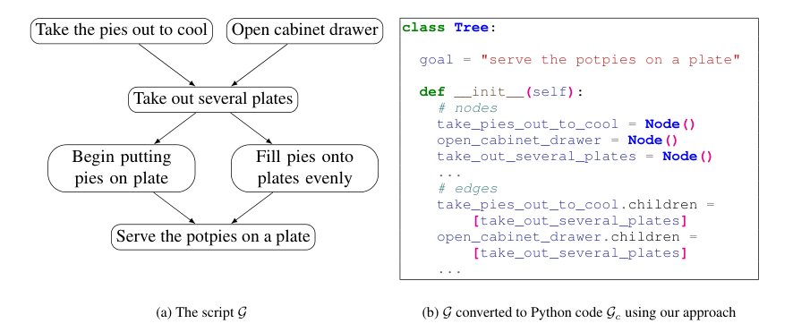
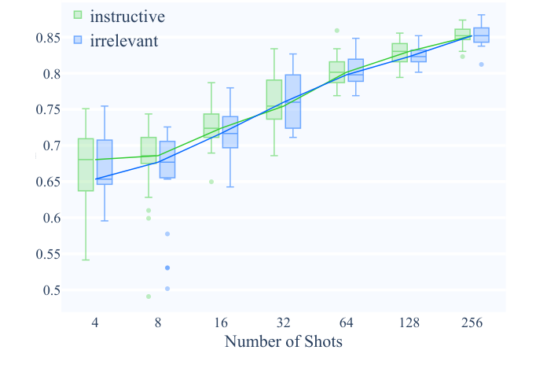
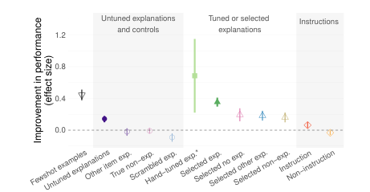
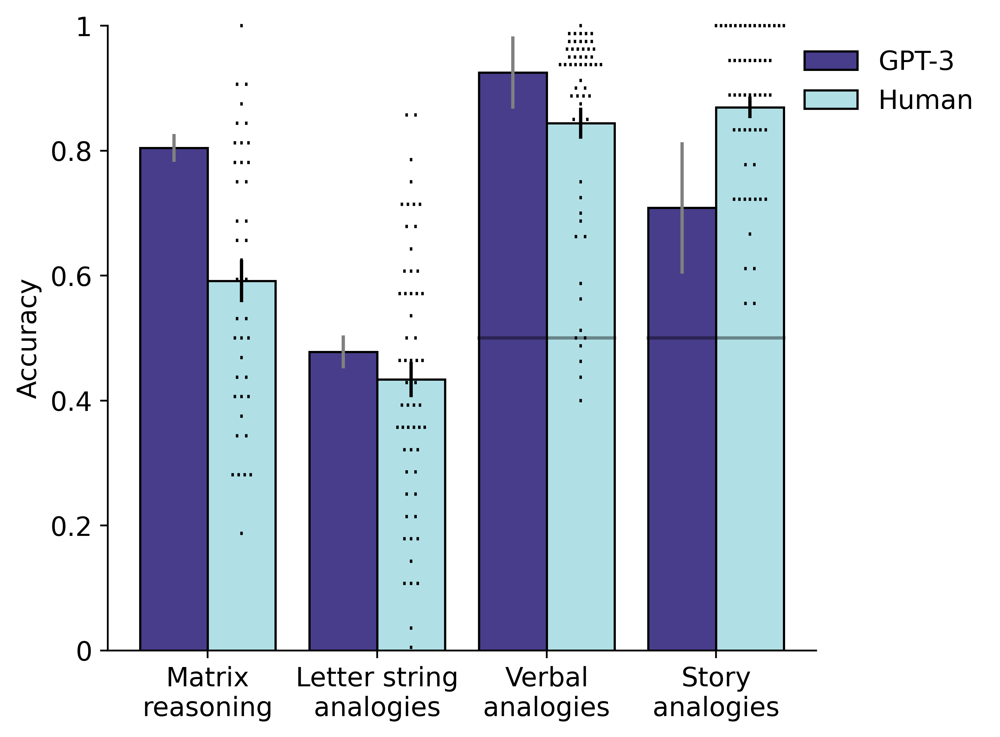
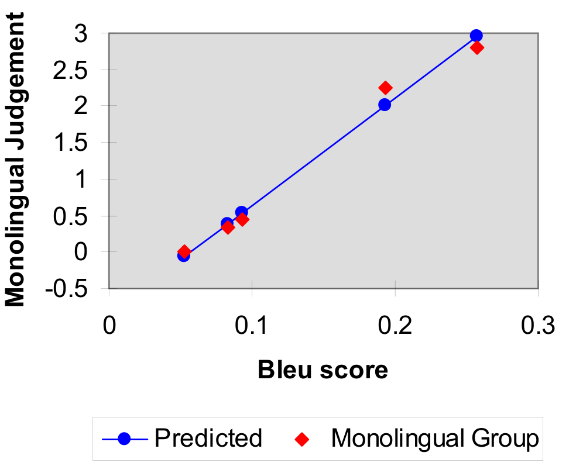
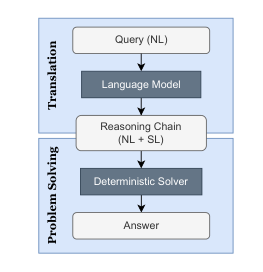
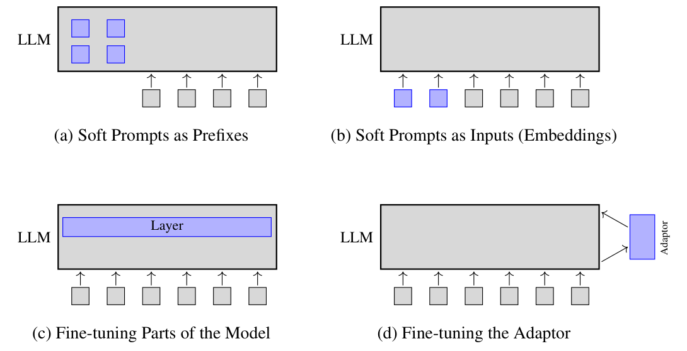
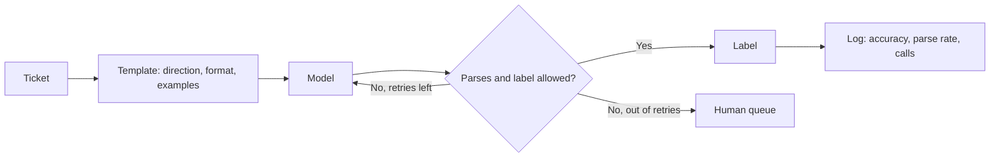

# 10 — Prompting fundamentals

The ticket assistant is due to go live on Monday, and its prompt is one line: "Classify this ticket." Sometimes it returns `billing`, sometimes a paragraph explaining what billing is, and once it returned `Billing issue (likely)`. Nothing in the model is broken. A prompt is the only thing you have changed so far, and it is the cheapest change you will ever make, because no weight moves. This chapter takes a one-line prompt and fixes it, with code that runs without an API key.

> Five principles cover most of what makes a prompt work: give direction, specify format, provide examples, evaluate quality, divide labor. This note is the application-level summary; technique depth lives in [ai-engineering/01-prompt-engineering](../../../ai-engineering/01-prompt-engineering/README.md).

---

## Why prompts fail

Phoenix & Taylor open (*Prompt Engineering for GenAI*, ch. 1) by taking a one-line naive prompt and listing what is wrong with it. The list doubles as a checklist:

| Problem | What it looks like | Principle that fixes it |
|---|---|---|
| Vague direction | The model guesses style, audience and constraints | Give direction |
| Unformatted output | Prose when you needed a list you can parse | Specify format |
| No examples | The model invents its own idea of "good" | Provide examples |
| No evaluation | You judge from one lucky run | Evaluate quality |
| One giant task | Everything in one call, nothing checkable | Divide labor |

The reason any of this works is [chapter 01](01-tokens-and-embeddings.md): the prompt is the conditioning context for next-token prediction. Each principle makes the output you want a more likely continuation.

---

## The five principles

### 1. Give direction

Tell the model who it is writing as, for whom and under which rules.

- **Role or persona** ("You are a senior tax accountant…") shifts vocabulary and level of detail.
- **Insert the expert's rules.** If you know what a good answer must contain, say it; do not hope the model infers it.
- **Prewarming:** ask the model first for best practices on the task, then ask it to do the task following its own list. Cheap, and often better than a bare request.

Depth: [02 — Prompt anatomy](../../../ai-engineering/01-prompt-engineering/notes/02-prompt-anatomy.md), [03 — Core techniques](../../../ai-engineering/01-prompt-engineering/notes/03-core-techniques.md).

### 2. Specify format

Say exactly what shape the output takes: a numbered list of five, JSON with these keys, YAML, a table, a CSV with these headers.

- Machine-readable formats let code check the answer. If parsing fails, retry; that retry loop is the simplest reliability mechanism there is.
- Remove anything in the prompt that contradicts the format (an example in prose when you asked for JSON).
- Prefer the provider's structured-output or tool-call mechanism over "please return JSON" when you need a guarantee. See [chapter 13](13-calling-models-from-code.md) and [04 — Controlling output](../../../ai-engineering/01-prompt-engineering/notes/04-controlling-output.md).
- **For structured outputs, the format can be code.** Madaan et al. wrote each target graph (a script of steps, an explanation graph) as a Python class, with the input as an attribute or comment, and prompted a code model to finish the class. With 15 examples, Codex (code-davinci-002) scored 25.24 BLEU on ProScript script generation against 23.80 for T5 fine-tuned on all 3,500 training examples. On ExplaGraphs structural accuracy, 30 examples gave 45.20 against 38.19 for T5 on 1,500. Neither piece alone was enough: with the same text-davinci model, text and code prompts scored 33.16 and 33.00, and Codex with a text prompt 38.02 (Table 5). The format has to be designed per task, and Codex is closed and since retired ([arXiv:2210.07128](https://arxiv.org/abs/2210.07128) (Madaan et al., EMNLP 2022)).


*Image Source: Madaan et al., [Language Models of Code are Few-Shot Commonsense Learners](https://arxiv.org/abs/2210.07128) (2022), Fig. 1 (a, b)*

### 3. Provide examples

| Shots | Behaviour |
|---|---|
| Zero-shot | Relies on direction alone; most creative, least predictable |
| One-shot | Fixes format quickly, but the model may copy the example's content too |
| Few-shot (3–5) | Reliable format and style. Beyond that, reliability keeps rising and variety falls |

The authors' advice: try direction first, then add examples. Examples are powerful and easy to over-fit to. Vary them so the model learns the pattern, not one instance. Min et al. ran 12 model variants on 26 classification and multiple-choice datasets with 16 demonstrations and found that swapping the gold labels for random ones cost only 0–5% absolute. What mattered was the label space, the distribution of the input text and the format: out-of-distribution inputs cost 3–16% for most models, and demonstrations with no labels, or labels only, scored close to or worse than none. Generation tasks were not tested ([arXiv:2202.12837](https://arxiv.org/abs/2202.12837) (Min et al., EMNLP 2022)). The survey of prompting methods notes how much the choice of examples can matter, swinging from near the state of the art to near chance, and that majority-label and recency biases can be reduced by calibrating on a content-free input such as "N/A". Both are reported from earlier work. The survey runs no experiments of its own and stops in mid-2021 ([arXiv:2107.13586](https://arxiv.org/abs/2107.13586) (Liu et al., ACM Computing Surveys 2023)).

Four papers show how much wording and example choice carry. Schick & Schütze's PET recasts classification as a cloze question with a verbalizer (the pattern "It was ___." with the words terrible to great) and fine-tunes a masked language model on it. With 10 labelled Yelp examples RoBERTa-large reached 52.9 accuracy against 21.1 for ordinary fine-tuning, and with 100 MNLI examples 74.7 against 47.9 (3 seeds). It is gradient fine-tuning, not in-context prompting ([arXiv:2001.07676](https://arxiv.org/abs/2001.07676) (Schick & Schütze, EACL 2021)). Jiang et al. mined and paraphrased prompts for LAMA fact probes: an optimised ensemble raised BERT-base from 31.1% to 39.6% on T-REx, and changing "plays in" to "plays at" moved one relation by 23.2 points, so a failed probe measures the prompt as much as the model ([arXiv:1911.12543](https://arxiv.org/abs/1911.12543) (Jiang et al., TACL 2020)). Zhao et al. found the same instability in GPT-3 2.7B on 4-shot SST-2: permuting the examples moved accuracy from 54.3% to 93.4%, which they trace to majority-label, recency and common-token bias. Contextual calibration, which divides the label probabilities by those the model gives a content-free input such as "N/A", gained up to 30.0 points, and a calibrated 2.7B beat the uncalibrated 175B by up to 19.3. They tested only base GPT-2 and GPT-3 ([arXiv:2102.09690](https://arxiv.org/abs/2102.09690) (Zhao et al., ICML 2021)). Reynolds & McDonell argued that zero-shot had been underrated: on WMT14 French to English a bare "French: ... English:" prompt scored 33.3 BLEU on Curie against 22.4 for OpenAI's reported zero-shot, and adding one example lowered it to 27.6, which they put down to the model reading the example as part of the text. It is one task on two engines with no variance ([arXiv:2102.07350](https://arxiv.org/abs/2102.07350) (Reynolds & McDonell, CHI EA 2021)).

Two later papers ask what the prompt is doing. Webson & Pavlick trained models on RTE with templates of different meaning. In few-shot fine-tuning (4 to 256 shots for T0 3B, 16 shots for the 11B models and GPT-3's 175B priming), irrelevant templates learned as fast as instructive ones, and even misleading ones were close, with only the extremely misleading category clearly worse at 8 to 128 shots for T0 3B. T0++ (11B) scored 78% zero-shot on RTE with the template "Is that grammatically correct?", where a true grammaticality judge would score 52.7% since every RTE sentence is grammatical. The target words mattered more than the template: for ALBERT at 32 shots, reversing yes/no to no/yes changed the median accuracy by 22.2 percentage points (the baseline median was 70.22, standard deviation 6.3). All of it is on NLI with 2021-era models, so it shows that models do not need the instruction's meaning to learn the task, not that instructions never help ([arXiv:2109.01247](https://arxiv.org/abs/2109.01247) (Webson & Pavlick, NAACL 2022)).


*Image Source: Webson & Pavlick, [Do Prompt-Based Models Really Understand the Meaning of Their Prompts?](https://arxiv.org/abs/2109.01247) (2022), Fig. 1*

Akyürek et al. asked what algorithm an in-context learner runs, using linear regression as the testbed. A transformer trained from scratch on noiseless regression with d = 8 matched ordinary least squares (squared error under 0.01), and with noise the best-fit ridge parameter was the Bayes-optimal one. Depth set the behaviour: a one-layer model resembled a single gradient-descent step, two to four layers resembled ridge regression, and eight or more layers resembled least squares. The theory shows that a transformer can implement gradient descent and ridge regression, an existence construction, not a proof that trained models do. No pretrained language model was tested, so it is a mechanism for small models trained on the task, not a description of how GPT-class models learn in context ([arXiv:2211.15661](https://arxiv.org/abs/2211.15661) (Akyürek et al., ICLR 2023)).


*Image Source: Akyürek et al., [What learning algorithm is in-context learning? Investigations with linear models](https://arxiv.org/abs/2211.15661) (2023), Fig. 3*

Three papers test the setup around the examples. Perez et al. asked what few-shot results look like when the prompt must be chosen from the few examples alone, with no held-out set. On LAMA-UHN (nine LMs from 82M to 175B, 5 examples, 5 runs), cross-validation and MDL picked prompts 5–7% absolute below the best prompt chosen on held-out data and closed only 20–40% of the gap between an average and the best prompt. For GPT-3 175B, cross-validation picked the best prompt 21% of the time against 9% for chance. Earlier few-shot numbers that tuned on large dev sets are therefore optimistic. The study covers LAMA and three classification tasks on 2021 models ([arXiv:2105.11447](https://arxiv.org/abs/2105.11447) (Perez et al., NeurIPS 2021)).


*Image Source: Perez et al., [True Few-Shot Learning with Language Models](https://arxiv.org/abs/2105.11447) (2021), Fig. 1*

Lampinen et al. added an explanation after each example's answer ("Explanation:" line). On 40 BIG-bench multiple-choice tasks with a 280B Gopher-family model, 5-shot, untuned explanations raised the log-odds of a correct answer by 0.25, against 0.80 for the examples themselves and 0.12 for task instructions (Table 1). Scrambled explanations hurt (−0.17). Hand-tuned explanations gave 1.23 but on only five hard tasks, and choosing examples together with their explanations beat choosing examples alone (0.64 against 0.35). The 1B and 7B models did not benefit. One author wrote all the explanations, and the tasks were adversarial ones. Scoring is answer likelihood, no instruction-tuned model was tested, and because the explanation follows the answer it is not chain of thought ([doi:10.18653/v1/2022.findings-emnlp.38](https://doi.org/10.18653/v1/2022.findings-emnlp.38) (Lampinen et al., EMNLP Findings 2022)).


*Image Source: Lampinen et al., [Can language models learn from explanations in context?](https://doi.org/10.18653/v1/2022.findings-emnlp.38) (2022), Fig. 2*

Zero-shot prompting can do more than the shot table suggests. Webb et al. gave text-davinci-003 analogy problems with no examples and compared it with undergraduates. On the text-based Digit Matrices the odds of a correct generative answer were 1.88 times the humans' (N = 40 humans), and 6.27 times in the 8-choice version. On letter-string analogies it was 1.76 times (N = 57), with a similar pattern of errors. It was weaker on far story analogies and physical transfer, and fell on letter strings when the prompt format changed. Contamination was checked only by asking the model to recall items, and later work disputes the reading as emergent reasoning ([arXiv:2212.09196](https://arxiv.org/abs/2212.09196) (Webb et al., Nature Human Behaviour 2023)).


*Image Source: Webb et al., [Emergent analogical reasoning in large language models](https://arxiv.org/abs/2212.09196) (2023), Fig. 1*

### 4. Evaluate quality

"Blind prompting" means changing a prompt and eyeballing one output. Instead, run each variant several times and rate the outputs without knowing which prompt produced them. In the book's small test, a few-shot prompt earned three times the thumbs-up rate of the zero-shot version (0.6 vs 0.2). That is a toy sample, but it is the right method.

What to measure, once you have more than a handful of cases:

| Criterion | How |
|---|---|
| Cost, latency, number of calls | Logged per run |
| Correctness | Exact match or classification accuracy against labels |
| Faithfulness / hallucination | Check claims against the provided context |
| Safety and refusals | Rate of harmful completions and of unnecessary refusals |
| Similarity to a reference | BLEU/ROUGE, or embedding distance |
| Preference between variants | Pairwise comparison by humans or an LLM judge, ranked with Elo |

Reference-overlap metrics are cheap, and their limits are known. BLEU is the geometric mean of 1- to 4-gram precisions, each clipped by the n-gram's count in the references, times a brevity penalty. On 500 Chinese→English news sentences it correlated 0.99 with monolingual judges' ratings across five systems (three MT systems and two human translators, two references). Its scores depend on the references, though: one human translator scored 0.2571 against two references and 0.3468 against four ([ACL 2002](https://aclanthology.org/P02-1040/) (Papineni et al., ACL 2002)).


*Image Source: Papineni et al., [BLEU: a Method for Automatic Evaluation of Machine Translation](https://aclanthology.org/P02-1040/) (ACL 2002), Fig. 5*

ROUGE is recall-oriented, counting overlapping n-grams or longest common subsequences with reference summaries. Its system-level Pearson correlation with human coverage scores depended on the task. On 100-word single-document summaries (DUC 2001, 12 systems, one reference) ROUGE-2 scored 0.84 and ROUGE-1 0.76. On 10-word summaries (DUC 2003, 14 systems) ROUGE-2 fell to 0.75 while ROUGE-1 reached 0.96 ([ACL 2004 workshop](https://aclanthology.org/W04-1013/) (Lin, 2004)).

Depth: [09 — Evaluating prompts](../../../ai-engineering/01-prompt-engineering/notes/09-evaluating-prompts.md) and [generative-ai/08-eval](../../08-eval/README.md).

### 5. Divide labor

Split a task into steps, each with its own prompt and its own check.

- **Chaining:** the output of one call is the input of the next (outline → draft → edit).
- **Self-evaluation:** a second call grades or critiques the first.
- **Reasoning before answering:** asking for step-by-step work improves multi-step problems. Chain-of-thought exemplars took PaLM 540B to state of the art on GSM8K ([arXiv:2201.11903](https://arxiv.org/abs/2201.11903), Wei et al., 2022). Even the zero-shot phrase "Let's think step by step" lifted text-davinci-002 from 17.7% to 78.7% on MultiArith ([arXiv:2205.11916](https://arxiv.org/abs/2205.11916), Kojima et al., 2022). **Self-consistency** goes one step further: sample several chains of thought and take the majority answer. It only works when the answer can be compared exactly (a number, a choice), and it multiplies cost by the number of samples. The vote, not the sampling, does the work: on MATH, Minerva 62B scored 26.5% greedy, 21.8% from a single sample, 23.8% when it kept the sample the model itself rated likeliest, and 42.0% with a majority vote over 256 samples, with 97% of that accuracy already reached at 64 ([arXiv:2206.14858](https://arxiv.org/abs/2206.14858), Lewkowycz et al., NeurIPS 2022). Gemini's MMLU score was reported this way, with 32 samples per question (*AI Engineering*, ch. 2; *Building AI Agents*, ch. 3). Modern reasoning models do the step-by-step part internally; see [07 — Prompting reasoning models](../../../ai-engineering/01-prompt-engineering/notes/07-prompting-reasoning-models.md). A 2023 survey places the emergence of reasoning at roughly 100B parameters (reported from earlier work) and concludes that models are "not yet capable of robust reasoning"; it ran no experiments of its own and predates RL-trained reasoning models ([arXiv:2212.10403](https://arxiv.org/abs/2212.10403) (Huang & Chang, ACL Findings 2023)).

- **Faithful reasoning.** A chain of thought can reach the right answer for reasons it does not state. Faithful CoT has the model write each step as a natural-language comment plus code, which a deterministic solver then runs. With code-davinci-002 and greedy decoding, GSM8K accuracy was 72.3 against 63.3 for chain of thought, and CLUTRR 58.9 against 48.5 (Table 1). Letting the model predict the answer instead of the solver cost 50.8 points on GSM8K (Table 4). It lost on StrategyQA (63.0 against 72.5), where 29% of 70 sampled failures were Datalog syntax errors. Codex has been retired and Table 1 is single runs ([doi:10.18653/v1/2023.ijcnlp-main.20](https://doi.org/10.18653/v1/2023.ijcnlp-main.20) (Lyu et al., IJCNLP 2023)).


*Image Source: Lyu et al., [Faithful Chain-of-Thought Reasoning](https://doi.org/10.18653/v1/2023.ijcnlp-main.20) (2023), Fig. 2*
- **Decomposition, refinement, ensembling.** Xiao & Zhu organise this family as a generation step that splits the problem and a solving step per sub-problem; the solver can be a retriever, a calculator or another model call, which is why RAG and tool use are decomposition with the call made at inference time (*Foundations of LLMs*, ch. 3). Self-refinement is predict, get feedback, refine. Ensembling can vary the model, the prompt or the output, and self-consistency is the third kind. Their worked example samples three chains on a coin-flip question: two agree on 37.5% and one says 33.3%, so 37.5% wins. It is an illustration, not a measurement. The book notes diverse prompts help less with strong models.
- **Meta-prompting:** have a model write or improve the prompt.
- **Soft prompts.** Instead of rewording text, learn vectors: prefix tuning adds L × n × d trainable parameters (layers × prefix length × width), prompt tuning learns input embeddings only, and context distillation trains a model to behave as if a long prompt were present (*Foundations of LLMs*, ch. 3). Fine-tuning detail lives in [chapter 09](09-peft-and-fine-tuning-in-practice.md).


*Image Source: Xiao & Zhu, [Foundations of Large Language Models](https://arxiv.org/abs/2501.09223) (2025), Fig. 3.8*
- **Reason + act:** interleave thoughts with tool calls (ReAct, [arXiv:2210.03629](https://arxiv.org/abs/2210.03629)). This is where prompting turns into agents ([03-agentic-foundations](../../03-agentic-foundations/README.md)).

Depth: [06 — Chaining and workflows](../../../ai-engineering/01-prompt-engineering/notes/06-chaining-and-workflows.md).

---

## Standard practices

*Prompt Engineering for GenAI* ch. 3 is a catalogue of everyday text tasks. The recurring patterns:

| Task | Practice |
|---|---|
| Lists and hierarchical lists | Fix the count, the bullet style and "no commentary before or after". For nested lists, define the levels explicitly and parse with code, not regex, once nesting gets deep |
| JSON / YAML | Give the schema and an example. YAML avoids quote escaping and reads better; filter the payload in code and handle invalid output with a retry |
| Ask for context | Let the model say "I need more information about X" by default, instead of guessing |
| Style unbundling | Extract a text's features (tone, length, vocabulary, structure) into a list, then generate new content against that list. Gives brand consistency without copying |
| Explain like I'm five, translation | The model's language skills are general; ask for a reading level or a target language directly |
| Summarization | Say the audience and length; for long input, chunk first |
| Chunking | Split by sentence, paragraph, topic, length or tokens (tiktoken). Overlapping sliding windows keep context across boundaries. Do not chunk short or single-topic documents |
| Sentiment and classification | Give the labels, examples per label and a rule for mixed cases |
| Least to most | Ask for the plan, then each part, then the tests, building up a larger artifact in steps |
| Role prompting | Assign the expert persona that would answer best |

Chapter 10 of the book assembles these into a full application (an AI blog writer: topic research, an expert-interview step that generates questions, outline, draft with retrieval, writing-style pass, title optimization, images and a Gradio UI). It is a good model of "divide labor" at system scale.

---

## Where to go deeper

| Need | Go to |
|---|---|
| How the model parses a prompt; system vs user turns | [01 — How models read prompts](../../../ai-engineering/01-prompt-engineering/notes/01-how-models-read-prompts.md) |
| The full technique set with examples | [03 — Core techniques](../../../ai-engineering/01-prompt-engineering/notes/03-core-techniques.md) |
| Tool use and function calling | [05 — Tools and function calling](../../../ai-engineering/01-prompt-engineering/notes/05-tools-and-function-calling.md) |
| Automatic prompt optimization (DSPy and friends) | [08 — Prompt optimization](../../../ai-engineering/01-prompt-engineering/notes/08-prompt-optimization.md) |
| Prompt injection and jailbreaks | [10 — Adversarial prompting](../../../ai-engineering/01-prompt-engineering/notes/10-adversarial-prompting.md) |
| Copy-paste templates | [Prompt library](../../../ai-engineering/01-prompt-engineering/notes/prompt-library.md) |

---

## Worked example: from one line to something you can test

Here are the five principles in about thirty lines. `call_model` is a stand-in that behaves like the model described in the opening: it drifts when the prompt doesn't pin the format. It is scripted so that the code runs anywhere, so its output says nothing about any real model. Everything around it is the code you would keep. To use a real model, replace that one function with the call from [chapter 13](13-calling-models-from-code.md).

```python
import json
import random

LABELS = ["billing", "shipping", "account"]

def build_prompt(ticket, examples=()):
    lines = ["You triage support tickets for an online shop.",                    # direction
             f"Reply with JSON only: {{\"label\": one of {LABELS}}}."]             # format
    for text, label in examples:                                                   # examples
        lines += [f"Ticket: {text}", json.dumps({"label": label})]
    return "\n".join(lines + [f"Ticket: {ticket}"])

def call_model(prompt, rng):
    """Stand-in for an LLM: malformed more often when the prompt has no examples."""
    label = next((l for w, l in [("charged", "billing"), ("refund", "billing"), ("parcel", "shipping"),
                                 ("password", "account")] if w in prompt.rsplit("Ticket:", 1)[1].lower()), "account")
    drift = 0.15 if prompt.count("Ticket:") > 1 else 0.5
    return json.dumps({"label": label}) if rng.random() > drift else f"This looks like a {label} issue."

def classify(ticket, examples, rng, retries=2):
    prompt = build_prompt(ticket, examples)
    for attempt in range(retries + 1):
        try:
            label = json.loads(call_model(prompt, rng))["label"]
            if label in LABELS:
                return label, attempt
        except (json.JSONDecodeError, KeyError):
            pass
    return None, retries

print(build_prompt("Where is my parcel?", [("I was charged twice", "billing")]))

tickets = [("I was charged twice", "billing"), ("My parcel is late", "shipping"), ("Reset my password", "account"),
           ("Refund my order", "billing"), ("Parcel arrived broken", "shipping"), ("Forgot password", "account")] * 50
few_shot = [("Card charged two times", "billing"), ("Parcel never came", "shipping")]

print(f"\n{'variant':<12}{'accuracy':>10}{'first-try parse':>18}{'calls per ticket':>18}")
for name, examples in [("zero-shot", ()), ("few-shot", few_shot)]:
    rng, right, first, calls = random.Random(0), 0, 0, 0
    for ticket, gold in tickets:
        label, attempt = classify(ticket, examples, rng)
        right += label == gold; first += attempt == 0; calls += attempt + 1
    n = len(tickets)
    print(f"{name:<12}{right / n:>10.2f}{first / n:>18.2f}{calls / n:>18.2f}")
```

```text
You triage support tickets for an online shop.
Reply with JSON only: {"label": one of ['billing', 'shipping', 'account']}.
Ticket: I was charged twice
{"label": "billing"}
Ticket: Where is my parcel?

variant       accuracy   first-try parse  calls per ticket
zero-shot         0.89              0.50              1.75
few-shot          1.00              0.86              1.16
```

Read the table for its method, since the numbers come from the stand-in's built-in drift. Two prompts, the same 300 labelled tickets, and three logged measures, accuracy, parse rate and calls, take the place of eyeballing one output. The retry loop is what raises accuracy far above the first-try rate, and it costs extra calls. That trade only shows up if you log it.



---

## Pitfalls

- **Judging from one run.** Output is sampled. A single good answer is an anecdote, so run each variant over a labelled set.
- **Adding examples before direction.** Try direction first. Examples are easy to over-fit, and the model may copy their content too.
- **Examples that contradict the format.** A prose example beside "reply with JSON only" tells the model two things, and it may follow the example.
- **Retrying forever.** Each retry is a paid call. Set a limit and name a fallback, as with the human queue above.
- **Parsing with regex once nesting gets deep.** Use a real parser, and validate labels against the allowed set.
- **Treating "please return JSON" as a guarantee.** Use structured output when code consumes the answer ([chapter 13](13-calling-models-from-code.md)), and still validate it.
- **Testing on the tickets you tuned with.** You will measure your memory of them. Keep a held-out set.

---

## Try it

1. Add a fourth label, `returns`, to `LABELS`. Which line changes, and what else should change before you trust the new prompt?
2. Set `retries=0` in `classify`. What happens to accuracy for both variants, and why?
3. Write a sixth row for the table in "Why prompts fail": a prompt that tells the model it may say it doesn't know. Which principle does it belong to?

<details>
<summary>Answers</summary>

1. `LABELS` changes and `build_prompt` picks it up. You also need `returns` examples and labelled tickets, or you will not measure the new class at all.
2. Accuracy falls to the first-try parse rate, since every drifted reply becomes a failure. With the stand-in's drift that is about 0.50 for zero-shot and 0.86 for few-shot.
3. *Give direction*, using the "ask for context" practice. Without it, the model guesses when it should ask.

</details>

---

## Interview checklist

| Question | Answer |
|---|---|
| What are the five principles? | Give direction, specify format, provide examples, evaluate quality, divide labor |
| Why does a prompt work at all? | It is the conditioning context for next-token prediction, so it makes the answer you want a more likely continuation |
| Zero-shot or few-shot? | Start with direction. Add 3–5 varied examples when the format must be reliable, accepting some loss of variety |
| How do you compare two prompts? | Run both over a labelled, held-out set, several times. Rate blind, and log accuracy, parse rate, cost and latency |
| What does "let's think step by step" do? | It prompts reasoning before the answer. It took text-davinci-002 from 17.7% to 78.7% on MultiArith. Modern reasoning models do this internally |
| What is self-consistency, and what does it cost? | Sample several chains of thought and take the majority. It needs exactly comparable answers, and multiplies cost by the number of samples |
| When do you stop prompting and fine-tune? | When format is unstable after good prompting, or a skill is missing and you have thousands of examples ([chapter 09](09-peft-and-fine-tuning-in-practice.md)) |

---

## Next

[11 — LangChain basics](11-langchain-basics.md) turns these principles into reusable templates and chains.
