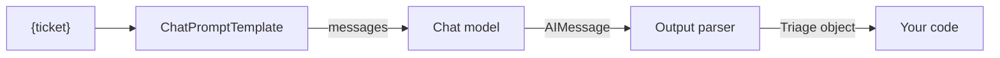

# 11 — LangChain basics

By now the ticket assistant has a prompt template, a parser, a retry and a model call, all held together by hand. A second assistant is about to be written, and someone wants to try another provider. You could write a small framework of your own, or use the one most tutorials assume. This chapter teaches LangChain's five building blocks, and when to skip them. Every block below runs offline on a fake chat model that ships with `langchain-core`, so you can see the wiring without an API key. The output text is scripted, not a real model's.

> LangChain wraps models, prompts and parsers in one interface (the Runnable) so they can be swapped and composed. Learn the five building blocks and the pipe; LangGraph and RAG build on exactly these.

---

## Why a framework at all

[Chapter 13](13-calling-models-from-code.md) shows that calling a model needs no framework. LangChain earns its place when you want:

| Need | LangChain answer |
|---|---|
| Swap providers without rewriting code | One chat-model interface over Anthropic, OpenAI, Google, local models |
| Reusable prompts with variables | Prompt templates |
| Parsed, validated output | Structured output and output parsers |
| Compose steps and get streaming, batching and async for free | The Runnable interface and LCEL |
| Retrieval plumbing | Document loaders, splitters, embeddings, vector stores, retrievers ([02-rag-retrieval](../../02-rag-retrieval/README.md)) |

*Learning LangChain* (ch. 1) frames the value as prebuilt common patterns plus interchangeable building blocks. The cost is an extra abstraction layer, frequent API churn and harder debugging. The versions in both books are already dated; check the current docs before copying code. Both books also show every example in JavaScript; this note uses Python.

---

## Building block 1: chat models and messages

A chat model takes a list of messages and returns a message.

| Message | Role | Holds |
|---|---|---|
| `SystemMessage` | system | Instructions the model should follow for the whole conversation |
| `HumanMessage` | user | The user's input |
| `AIMessage` | assistant | Model output, including any tool calls |
| `ToolMessage` | tool | The result of a tool call, linked by id |

```python
from langchain_core.language_models.fake_chat_models import FakeListChatModel
from langchain_core.messages import HumanMessage, SystemMessage

model = FakeListChatModel(responses=["billing!!!"])   # scripted, so this runs with no key
reply = model.invoke([
    SystemMessage("Answer in one word, then three exclamation marks."),
    HumanMessage("I was charged twice. What kind of ticket is this?"),
])
print(type(reply).__name__, repr(reply.content))
```

```text
AIMessage 'billing!!!'
```

For a real model, only the constructor changes, which is the point of the abstraction:

```python
# illustrative: needs ANTHROPIC_API_KEY, the langchain-anthropic package, and makes a paid call
from langchain.chat_models import init_chat_model

model = init_chat_model("claude-opus-5-5", model_provider="anthropic")
```

---

## Building block 2: prompt templates

Templates separate the fixed instruction from the variables, which is how you apply [chapter 10's](10-prompting-fundamentals.md) principles once and reuse them.

```python
from langchain_core.prompts import ChatPromptTemplate

prompt = ChatPromptTemplate.from_messages([
    ("system", "Answer using only the context. If it is not there, say \"I don't know\"."),
    ("human", "Context: {context}\n\nQuestion: {question}"),
])
value = prompt.invoke({"context": "Refunds take 5 days.", "question": "How long is a refund?"})
for message in value.to_messages():
    print(type(message).__name__, "->", message.content)

try:
    prompt.invoke({"context": "Refunds take 5 days."})
except KeyError as e:
    print("missing variable caught:", str(e)[:58])
```

```text
SystemMessage -> Answer using only the context. If it is not there, say "I don't know".
HumanMessage -> Context: Refunds take 5 days.

Question: How long is a refund?
missing variable caught: "Input to ChatPromptTemplate is missing variables {'questi
```

Templates validate that all variables are supplied, compose with each other, and can be saved to and loaded from YAML or JSON (O'Reilly ch. 4). `FewShotChatMessagePromptTemplate` adds examples, with selectors that pick a fixed number of examples or as many as fit a length budget.

---

## Building block 3: structured output and parsers

Two ways to get machine-readable output:

**`with_structured_output`** (preferred). Pass a Pydantic model or JSON Schema. LangChain converts it to the provider's tool-calling or JSON mode and validates the result.

```python
# illustrative: needs a real provider model (the fake chat model has no structured-output support)
from pydantic import BaseModel

class AnswerWithJustification(BaseModel):
    answer: str
    justification: str

structured = model.with_structured_output(AnswerWithJustification)
structured.invoke("What weighs more, a pound of bricks or a pound of feathers?")
# AnswerWithJustification(answer='They weigh the same', justification='...')
```

The three strategies underneath differ in strength: asking in the prompt is only a suggestion, while tool calling and JSON mode constrain the output. A field's name and its `Field(description=...)` are all the model sees when it decides what goes where, so describe every field. Run at low temperature to cut schema violations (*Learning LangChain*, ch. 8).

**Output parsers** for formats a provider cannot enforce. A parser does two jobs: it injects format instructions into the prompt (`parser.get_format_instructions()`) and it parses the text that comes back. O'Reilly ch. 4 tours the set: list, datetime, enum, Pydantic/JSON, XML, and the **auto-fixing** and **retry** parsers that send a malformed output back to a model for repair. That is the "specify format, retry on failure" loop from [chapter 10](10-prompting-fundamentals.md), packaged. This one runs offline, because a parser only needs text:

```python
from langchain_core.language_models.fake_chat_models import FakeListChatModel
from langchain_core.output_parsers import PydanticOutputParser
from langchain_core.prompts import ChatPromptTemplate
from pydantic import BaseModel, Field

class Triage(BaseModel):
    label: str = Field(description="one of billing, shipping, account")
    urgent: bool = Field(description="true if the customer is blocked")

parser = PydanticOutputParser(pydantic_object=Triage)
prompt = ChatPromptTemplate.from_messages([
    ("system", "Triage the ticket.\n{format_instructions}"),
    ("human", "{ticket}"),
]).partial(format_instructions=parser.get_format_instructions())

model = FakeListChatModel(responses=['{"label": "billing", "urgent": true}', "It is a billing issue."])
chain = prompt | model | parser

print(chain.invoke({"ticket": "I was charged twice and my card is now blocked"}))
try:
    chain.invoke({"ticket": "second call gets the malformed reply"})
except Exception as e:
    print("parser refused it:", type(e).__name__)
```

```text
label='billing' urgent=True
parser refused it: OutputParserException
```

---

## Building block 4: the Runnable interface

Models, prompts, parsers, retrievers and chains all implement the same methods:

| Method | Does |
|---|---|
| `invoke(input)` | One input → one output |
| `batch([inputs])` | Many inputs, run in parallel |
| `stream(input)` | Yields output chunks as they are produced |
| `ainvoke`, `abatch`, `astream` | Async versions |

Because everything is a Runnable, anything can be dropped into a chain, and the chain gets all six methods for free.

---

## Building block 5: composition

*Learning LangChain* ch. 1 contrasts two styles.

**Declarative: LCEL.** The `|` operator pipes one Runnable's output into the next.

```python
from langchain_core.language_models.fake_chat_models import FakeListChatModel
from langchain_core.output_parsers import StrOutputParser
from langchain_core.prompts import ChatPromptTemplate

prompt = ChatPromptTemplate.from_template("Context: {context}\nQuestion: {question}")
model = FakeListChatModel(responses=["Refunds take 5 days."])

chain = prompt | model | StrOutputParser()
inputs = {"context": "Refunds take 5 days.", "question": "How long is a refund?"}
print(chain.invoke(inputs))
print(chain.batch([inputs, inputs]))
print(list(chain.stream(inputs))[:6], "...")
```

```text
Refunds take 5 days.
['Refunds take 5 days.', 'Refunds take 5 days.']
['R', 'e', 'f', 'u', 'n', 'd'] ...
```

The chain gained `batch` and `stream` without any new code.

**Imperative: plain functions** wrapped with `@chain`, for logic LCEL expresses awkwardly (branches, loops, early exits).

```python
from langchain_core.language_models.fake_chat_models import FakeListChatModel
from langchain_core.prompts import ChatPromptTemplate
from langchain_core.runnables import chain

prompt = ChatPromptTemplate.from_template("Ticket: {ticket}")
model = FakeListChatModel(responses=["billing"])

@chain
def answer(values):
    if not values["ticket"].strip():      # an early exit, which LCEL expresses awkwardly
        return "empty ticket"
    return model.invoke(prompt.invoke(values)).content

print(answer.invoke({"ticket": "charged twice"}))
print(answer.invoke({"ticket": "   "}))
```

```text
billing
empty ticket
```

| | Imperative (`@chain`) | Declarative (LCEL) |
|---|---|---|
| Parallel execution | You write threads or `asyncio.gather` | Automatic |
| Streaming | You `yield` | Automatic |
| Async | You write `async def` | Automatic |
| Readability for branching logic | Better | Worse |

When the flow needs loops, persistent state or human approval, move up to LangGraph ([04-agentic-frameworks](../../04-agentic-frameworks/README.md)).

---

## Patterns from the books worth knowing

- **Sequential chains** (O'Reilly ch. 4): a story generator that produces characters, then plot, then scenes, each step a chain fed by the last. "Divide labor" as code.
- **Document chains** for text longer than the context window:

  | Strategy | How | Trade-off |
  |---|---|---|
  | Stuff | Put all documents in one prompt | Simplest; fails past the context limit |
  | Refine | Answer from doc 1, then refine with each next doc | Sequential, slow; order matters |
  | Map-reduce | Summarize each doc in parallel, then combine | Parallel; loses cross-document detail |
  | Map-rerank | Answer from each doc with a confidence score, keep the best | Good for lookup; bad for synthesis |

- **Function calling with Pydantic tools**: define tools as Pydantic classes, `bind_tools` them to the model, parse the calls with a tools parser. Covered in depth in [ai-engineering/01-prompt-engineering note 05](../../../ai-engineering/01-prompt-engineering/notes/05-tools-and-function-calling.md).
- **Patterns to make the most of LLMs** (*Learning LangChain* ch. 8): the agency–reliability trade-off. The more freedom an architecture has, the more it needs structured output, streamed intermediate output, human-in-the-loop checkpoints and a policy for "double texting" (a user sending a new message while the last one is still running).
- **Building with LLMs** (ch. 11) closes the book with three product shapes: interactive chatbots, collaborative editing (shared state, versioning, undo), and ambient agents that run in the background with long-term memory and reflection.

---

## Where the rest of *Learning LangChain* lives

| Chapters | Topic | Home |
|---|---|---|
| 2–3 | RAG: indexing and retrieval | [02-rag-retrieval](../../02-rag-retrieval/README.md) |
| 4–7 | LangGraph memory, cognitive architectures, agents | [04-agentic-frameworks](../../04-agentic-frameworks/README.md), [03-agentic-foundations](../../03-agentic-foundations/README.md) |
| 9–10 | Deployment, testing, evaluation, monitoring | [06-observability](../../06-observability/README.md), [generative-ai/08-eval](../../08-eval/README.md) |

---

## How the pieces fit



Each arrow is a Runnable passing its output on, so you can test each box alone, and swap the model box without touching the others.

---

## Pitfalls

- **Copying from a book without checking versions.** The package splits and APIs move quickly. Check the current docs, and pin versions.
- **Using a framework for one API call.** It adds a layer to debug. [Chapter 13](13-calling-models-from-code.md) needs no framework.
- **Treating `with_structured_output` as validation of meaning.** It enforces the shape. The value of `urgent` can still be wrong.
- **Describing fields poorly.** A field's name and description are all the model sees. `x: str` gets you a guess.
- **Stretching LCEL into loops.** If you need cycles, state or human approval, move to LangGraph.
- **Testing chains only against a real model.** A fake model makes wiring tests free and deterministic. Keep real calls for evals.
- **Assuming fake models test behaviour.** They test the plumbing and say nothing about answer quality.

---

## Try it

1. Add a `(lambda text: text.upper())` step to the end of the LCEL chain. Does `stream` still work?
2. In the parser block, add a field `reason: str` to `Triage` without changing the scripted response. What happens, and what does that mean for a real model that omits a required field?
3. Which document-chain strategy would you pick for answering "which of these 500 tickets mention a refund delay?", and why not stuff?

<details>
<summary>Answers</summary>

1. Yes, it still runs. A plain function in a chain becomes a `RunnableLambda`, but it buffers its input, so you get one chunk at the end instead of a stream.
2. Parsing raises `OutputParserException`, because the required field is missing. With a real model, you catch it and retry, or use the retry parsers.
3. Map-reduce or map-rerank: it is a per-document lookup that can run in parallel. Stuffing 500 tickets in one prompt risks the context limit, and makes each ticket's answer harder to check.

</details>

---

## Interview checklist

| Question | Answer |
|---|---|
| What is a Runnable? | The common interface (`invoke`, `batch`, `stream` and async versions) implemented by models, prompts, parsers and chains, so that they compose |
| What does `|` do? | It pipes one Runnable's output into the next, giving the result all the Runnable methods |
| LCEL or `@chain`? | LCEL for linear pipelines, where parallelism and streaming come free. `@chain` for branches and early exits |
| `with_structured_output` or an output parser? | The former uses the provider's tool or JSON mechanisms and is stronger. Use a parser for formats a provider can't enforce |
| When do you move to LangGraph? | When the flow needs loops, persistent state or human approval |
| Stuff, refine, map-reduce or map-rerank? | Stuff until the context limit. Refine for sequential synthesis. Map-reduce for parallel summaries. Map-rerank for lookup |
| What does LangChain cost you? | An extra abstraction, API churn and harder debugging |

---

## Next

[12 — Build a tiny GPT](12-build-a-tiny-gpt.md) goes below the API and builds the model itself.
