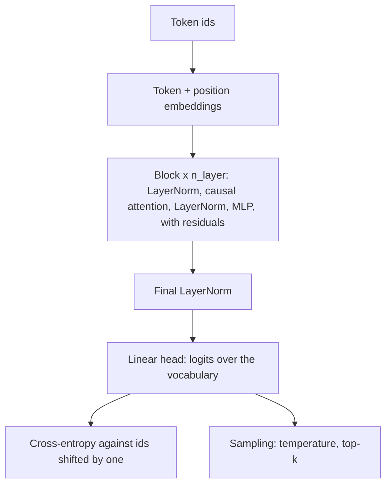
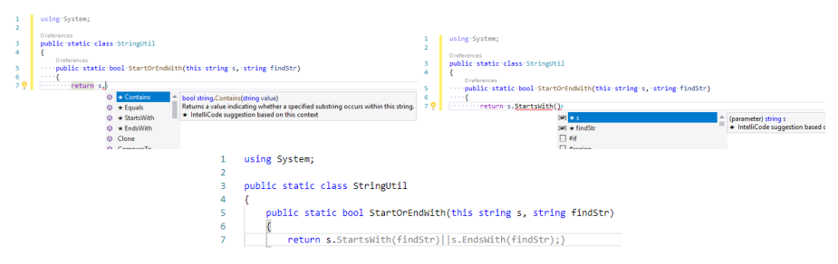

# 12 — Build a tiny GPT

You have read about tokens, attention and sampling, and you could probably pass a quiz on them. The next test is harder: when the ticket assistant's fine-tune produces garbage, can you tell a bad mask from a bad learning rate? Writing the model yourself is the quickest way to get there. This chapter maps the two best routes through that work, then runs a complete GPT in about 80 lines, small enough to train on a laptop CPU in under a minute, along with the checks that find most bugs.

> The fastest way to make [chapters 01–05](01-tokens-and-embeddings.md) stick is to write it: a character-level GPT that trains on a laptop in minutes. Two routes cover the same ground; this chapter maps them and says what to check at each step.

---

## The two routes

| | Karpathy, *Neural Networks: Zero to Hero* | Raschka, *Build a Large Language Model (From Scratch)* |
|---|---|---|
| Format | Video lectures + notebooks | Book chapters + notebooks |
| Local copy | [data-science/practice/nn-zero-to-hero](../../09-llms-from-scratch/practice/nn-zero-to-hero/README.md) (MIT) | Chapter PDFs listed in [references.md](../references.md#books) (purchased); code at [rasbt/LLMs-from-scratch](https://github.com/rasbt/LLMs-from-scratch) |
| Starts from | Scalar autograd (micrograd) | PyTorch basics (appendix A) |
| Tokenizer | Characters first; BPE in lecture 8 | BPE (tiktoken GPT-2) from ch. 2 |
| Ends at | GPT-2 (124M) reproduction in `build-nanogpt/` | Loading GPT-2 weights, then fine-tuning (ch. 6–7) |
| Best for | Intuition for gradients and training dynamics | A clean, chapter-by-chapter GPT-2 implementation |

Doing both is not redundant: Karpathy builds intuition from the bottom up, Raschka gives a tidy reference implementation to compare against.

---

## Step by step

| Step | Karpathy | Raschka | What you build |
|---|---|---|---|
| 1. Autograd and backprop | Lecture 1, `micrograd/` | Appendix A | A scalar `Value` class with `.backward()`, then the same idea in PyTorch tensors |
| 2. Language modelling framework | Lecture 2, `makemore_part1_bigrams` | Ch. 2 | Bigram model; negative log-likelihood; sampling |
| 3. Text → tensors | Lectures 2, 8 | Ch. 2 | Tokenizer, vocabulary, sliding-window (input, target) pairs, `DataLoader` |
| 4. MLP language model and training hygiene | Lectures 3–5 | — | Embeddings, train/dev/test splits, learning-rate search, activation and gradient statistics, BatchNorm, manual backprop |
| 5. Attention | Lecture 7 (first half) | Ch. 3 | Self-attention → causal mask → multi-head |
| 6. The GPT | Lecture 7, `nanogpt/gpt.py` | Ch. 4 | Transformer block (LayerNorm, attention, MLP, residuals), stacked, with an output head |
| 7. Pretraining | Lecture 7, `nanogpt/gpt.py` | Ch. 5 | Training loop, loss curves, temperature and top-k sampling, saving and loading weights |
| 8. Real scale | `nanogpt/build-nanogpt/` (GPT-2 on FineWeb, HellaSwag eval) | Ch. 5 (load OpenAI GPT-2 weights) | Confidence that your architecture matches the real one |

---

## The tiny model

The config in [`nanogpt/gpt.py`](../../09-llms-from-scratch/practice/nn-zero-to-hero/nanogpt) trains a character-level model on Tiny Shakespeare:

```python
batch_size = 64      # sequences per step
block_size = 256     # context length in characters
n_embd     = 384     # model width
n_head     = 6
n_layer    = 6
dropout    = 0.2
learning_rate = 3e-4
max_iters  = 5000
```

That is about 10M parameters, and the arrows below show where they sit. It needs a GPU for the full run; on a laptop CPU, shrink `n_layer`, `n_embd` and `block_size` and it still learns recognisable pseudo-Shakespeare. Raschka's GPT-2 config (12 layers, 12 heads, width 768; *LLMs from Scratch*, ch. 4–5) is the same code at larger settings. OpenAI's released GPT-2 sizes are 124M, 355M, 774M and 1,558M parameters; the smallest checkpoint is a 498 MB download, and the larger ones differ only in width, depth and head count.



---

## The whole thing, on a CPU

This is a character-level GPT, trained on a few repeated support replies. A corpus this small can only be memorised, which suits the purpose: you are testing the machine, not teaching it English. The attention line `q @ k.transpose(-2, -1)` is the `Q Kᵀ` product explained in [matrix products, transpose and rank](02-attention-and-the-transformer-block.md#matrix-products-transpose-and-rank). The script runs three of the checks from the next section as it goes, on the untrained model where that matters.

```python
import math
import torch
import torch.nn as nn
import torch.nn.functional as F

torch.manual_seed(0)
text = ("Your refund is on its way. Your parcel has shipped. "
        "Your password was reset. Your invoice is attached. ") * 40
chars = sorted(set(text))
stoi = {c: i for i, c in enumerate(chars)}
data = torch.tensor([stoi[c] for c in text])
vocab, block, d, heads, layers = len(chars), 32, 64, 4, 2

class Block(nn.Module):
    def __init__(self):
        super().__init__()
        self.ln1, self.ln2 = nn.LayerNorm(d), nn.LayerNorm(d)
        self.attn = nn.Linear(d, 3 * d)
        self.out = nn.Linear(d, d)
        self.mlp = nn.Sequential(nn.Linear(d, 4 * d), nn.GELU(), nn.Linear(4 * d, d))
        self.register_buffer("mask", torch.tril(torch.ones(block, block)).bool())

    def forward(self, x):
        B, T, _ = x.shape
        q, k, v = self.attn(self.ln1(x)).chunk(3, dim=-1)
        split = lambda t: t.view(B, T, heads, d // heads).transpose(1, 2)
        q, k, v = split(q), split(k), split(v)
        w = q @ k.transpose(-2, -1) / math.sqrt(d // heads)
        w = w.masked_fill(~self.mask[:T, :T], float("-inf")).softmax(dim=-1)
        x = x + self.out((w @ v).transpose(1, 2).reshape(B, T, d))
        return x + self.mlp(self.ln2(x))

class GPT(nn.Module):
    def __init__(self):
        super().__init__()
        self.tok, self.pos = nn.Embedding(vocab, d), nn.Embedding(block, d)
        self.blocks = nn.Sequential(*[Block() for _ in range(layers)])
        self.ln, self.head = nn.LayerNorm(d), nn.Linear(d, vocab, bias=False)
        self.apply(lambda m: nn.init.normal_(m.weight, std=0.02)
                   if isinstance(m, (nn.Linear, nn.Embedding)) else None)

    def forward(self, idx):
        x = self.tok(idx) + self.pos(torch.arange(idx.shape[1]))
        return self.head(self.ln(self.blocks(x)))

def batch(n=32):
    i = torch.randint(len(data) - block - 1, (n,)).tolist()
    return (torch.stack([data[j:j + block] for j in i]),
            torch.stack([data[j + 1:j + block + 1] for j in i]))

def loss_of(model, x, y):
    return F.cross_entropy(model(x).view(-1, vocab), y.view(-1))

model = GPT()
print(f"parameters {sum(p.numel() for p in model.parameters()):,}, vocabulary {vocab}")

x, y = batch()
print(f"loss at step 0 {loss_of(model, x, y).item():.3f}, ln(vocab) {math.log(vocab):.3f}")

probe = data[:block][None].clone()
before = model(probe)
probe[0, 20] = (probe[0, 20] + 1) % vocab
after = model(probe)
print("logits before position 20 changed:", not torch.equal(before[0, :20], after[0, :20]))
print("logits from position 20 on changed:", not torch.equal(before[0, 20:], after[0, 20:]))

opt = torch.optim.AdamW(model.parameters(), lr=3e-3)
for step in range(301):
    x, y = batch()
    loss = loss_of(model, x, y)
    opt.zero_grad(); loss.backward(); opt.step()
    if step % 100 == 0:
        print(f"step {step:3d} loss {loss.item():.3f}")

@torch.no_grad()
def sample(prompt, n, temperature=0.8, top_k=5):
    idx = torch.tensor([[stoi[c] for c in prompt]])
    for _ in range(n):
        logits = model(idx[:, -block:])[0, -1] / temperature
        top = torch.topk(logits, top_k)
        pick = top.indices[torch.multinomial(top.values.softmax(-1), 1)]
        idx = torch.cat([idx, pick[None]], dim=1)
    return "".join(chars[i] for i in idx[0].tolist())

print(sample("Your ", 80))
```

```text
parameters 104,832, vocabulary 21
loss at step 0 3.039, ln(vocab) 3.045
logits before position 20 changed: False
logits from position 20 on changed: True
step   0 loss 3.039
step 100 loss 0.117
step 200 loss 0.076
step 300 loss 0.071
Your password was resey. Your password was reset. Your invoice is attached. Your refu
```

Each of these lines is evidence. A first loss near `ln(vocab)` says the model starts out uniformly ignorant. Changing position 20 leaves every earlier logit exactly alone, so nothing leaks from the future. The loss then falls to near zero, because the model has memorised four sentences. The sample reads like the corpus because the corpus is all it knows, and that memorising behaviour is the point of the one-batch check below.

---

## Checks that catch most bugs

| Check | Expected | If not |
|---|---|---|
| Loss at step 0 | ≈ `ln(vocab_size)`: 4.17 for 65 characters, 10.8 for GPT-2's 50,257 tokens | Initialization or a wrong target shift |
| Overfit one batch | Loss falls towards 0 within a few hundred steps | Bug in the model or optimizer wiring |
| Causal mask | Changing token *t+1* does not change the logits at position *t* | The mask is missing or transposed |
| Train vs val loss | Track together; a widening gap means overfitting. On a 5,145-token story, 10 epochs drive train loss to 0.39 while validation stalls near 6.4: the model is memorizing ([chapter 06](06-pretraining-data-and-objectives.md#pretraining) has the plot) | More data, more dropout or a smaller model |
| Samples during training | Gibberish → words → plausible lines | If samples stop improving while loss falls, check the sampling code |
| Parameter count | Matches a hand calculation (embedding + 12·d² per block + head, roughly). For GPT-2 small: 163,009,536 with a separate output head, 124,412,160 with the head tied to the token embedding (*LLMs from Scratch*, ch. 4) | Weight tying or layer sizes are off |
| Pretrained weights load | Every tensor shape matches and sampled text is fluent | For OpenAI's GPT-2 checkpoints, set `qkv_bias=True` and context 1,024: GPT-2 has bias terms on the Q/K/V projections. Raschka says biases are "not commonly used in LLMs anymore"; that is true of Llama, but not of every family (Qwen2 keeps a Q/K/V bias), so read the config of the model you load |

---

## What this teaches that the API does not

- Why context length costs quadratic compute: you will write the `T × T` attention matrix yourself.
- Why temperature 0 and top-k behave as they do: you will implement them. The ten-line sampling step is in [chapter 04](04-decoding-and-inference-behaviour.md#decoding). Raschka's own settings are a useful reference: `top_k=25, temperature=1.4` for his story-trained model, `top_k=50, temperature=1.5` once the real GPT-2 weights are loaded (*LLMs from Scratch*, ch. 5).
- Why fine-tuning on a few examples overfits: you will watch val loss turn.
- Why hallucination is structural: the model you trained produces confident text with no notion of truth.
- That a small decoder trained from scratch on one narrow domain can ship. IntelliCode Compose trained GPT-C, a GPT-2-style decoder, on over 1.2B lines of Python, C#, JavaScript and TypeScript to complete whole lines under a 100 ms budget. On Python it reached perplexity 1.82 and 86.7% edit similarity, against 59.7% for the best n-gram model and 34.6% for GPT-2 medium trained on WebText. A distilled 12-layer student of a 26-layer model ran 2.7× faster at 6% lower edit similarity. Click-through was 10% in an internal rollout. The metric is string similarity, not whether the code runs, and it is a single training run ([arXiv:2005.08025](https://arxiv.org/abs/2005.08025) (Svyatkovskiy et al., ESEC/FSE 2020)).


*Image Source: Svyatkovskiy et al., [IntelliCode Compose: Code Generation Using Transformer](https://arxiv.org/abs/2005.08025) (2020), Fig. 1*

---

## Pitfalls

- **Skipping the step-0 check.** A first loss far above `ln(vocab)` means something is wrong before training starts, and it takes one line to see.
- **Reading a falling loss as success.** The script above reaches a tiny loss by memorising. Only a validation split tells you whether a model generalises.
- **A mask that is built but not applied.** Training still runs and the loss still falls, because the model can read the answer from the next position. The perturbation test is the one that catches it.
- **Targets not shifted by one.** The model learns to copy its input, loss falls fast and samples are nonsense.
- **Forgetting to crop the context when sampling.** Once `idx` is longer than `block`, the position embedding runs out of range and raises an error.
- **Scaling up before the small version works.** Debugging takes seconds at this size and hours at GPT-2's.
- **Assuming your config matches a checkpoint's.** Read the config of the model you load. Details such as a Q/K/V bias differ by family.

---

## Try it

Copy the script and run each experiment. Each takes a one-line change.

1. Remove the `masked_fill` part of `Block.forward`. Which line of the output changes, and what does it now print?
2. Tie the output head to the token embedding by adding `self.head.weight = self.tok.weight` in `GPT.__init__`, after the `apply` call. How many parameters does it save, and why that number?
3. Set `temperature=0.01` in `sample`, then `top_k=1`. Do the two runs differ much, and why?

<details>
<summary>Answers</summary>

1. `logits before position 20 changed:` now prints `True`, because each position reads the whole sequence. The loss still falls, so the training loop alone would never have told you.
2. It saves `vocab × d` parameters, the size of the head's weight matrix, because the two layers now share one matrix. That is the same trick that takes GPT-2 small from 163,009,536 to 124,412,160.
3. They are close to the same thing. Near-zero temperature puts almost all probability on the largest logit, and `top_k=1` keeps only that one. Both amount to greedy decoding.

</details>

---

## Interview checklist

| Question | Answer |
|---|---|
| What should the loss be at step 0? | About `ln(vocab_size)`, since an untrained model should be near uniform: 4.17 for 65 characters |
| How do you test a causal mask? | Change the token at position *t* and confirm that logits before *t* are exactly unchanged |
| Why overfit one batch? | A model that can't memorise a batch has a wiring bug. It is the fastest test of the model and optimizer |
| What does training-loss-near-zero mean by itself? | Memorisation is possible. You need a validation loss to claim learning |
| Why does attention cost grow quadratically with context? | Every position compares with every earlier one, so the matrix is `T × T` |
| What is weight tying? | Sharing the token embedding matrix with the output head. It cuts parameters, from 163M to 124M in GPT-2 small |
| Karpathy or Raschka? | Karpathy for intuition about gradients and training, Raschka for a clean reference implementation. They complement each other |

---

## Next

[13 — Calling models from code](13-calling-models-from-code.md) goes back up to the API, now knowing what sits behind it.
