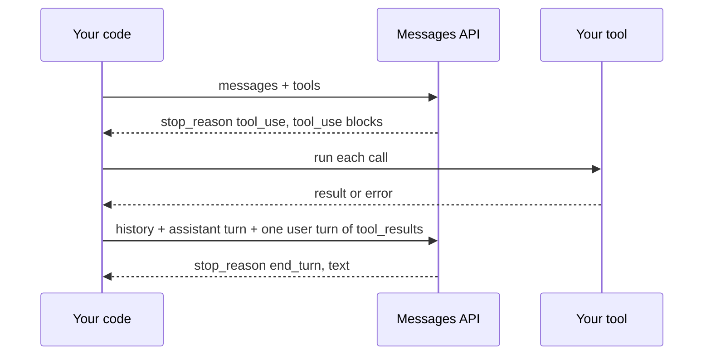

# 13 — Calling models from code

The ticket assistant has been a stand-in so far. To ship it, you call a hosted model over HTTP, and that is where the small failures live. A reply cut off at the token limit parses as an error, or worse, reads as a complete answer. A tool loop with no cap runs up a bill overnight. A chat "forgets" everything because nobody re-sent the history. A request that worked last year returns a 400 because the model it now names no longer accepts that parameter. This chapter teaches the request shape and the patterns that avoid all four.

The examples use Python, the course language, with Anthropic's Messages API. Calls that need a key and cost money are marked `# illustrative`. The loop and validation logic runs offline against a small scripted client, so you can see it working without an account. The [TypeScript lab](../practice/01-typescript-sdk/) stays as a bridge for readers who ship in TypeScript, with the same patterns as one file each.

> Five patterns cover almost every application: one request, a stream, structured output, a loop that feeds tool results back, and conversation state. The [TypeScript lab](../practice/01-typescript-sdk/) has one file per pattern.

---

## The request shape

Every Messages API call is the same object. Learn its fields once:

| Field | Meaning |
|---|---|
| `model` | Model id. Pin it; ids are retired over time. The lab uses `claude-opus-5-5`; check the models page for current ids |
| `max_tokens` | Hard cap on output tokens. Hitting it sets `stop_reason: "max_tokens"` |
| `system` | Instructions for the whole conversation (direction, persona, rules: [chapter 10](10-prompting-fundamentals.md)) |
| `messages` | Alternating `user` / `assistant` turns. The API is stateless: you send the full history every time |
| `tools`, `tool_choice` | Tool definitions (JSON Schema) and how the model may use them. On current Claude models, forcing a call with `any` or a named tool returns a 400, so use `auto` |
| `temperature`, `top_p`, `top_k` | Decoding settings from [chapter 04](04-decoding-and-inference-behaviour.md#decoding). You control these on open-weight models and many other providers. Current Claude models reject them with a 400 (Opus 5.5 and Fable 5.1 outright, Sonnet 5.5 and Haiku 5.5 for non-default values), so an old request can fail for this reason alone |

The response's `content` is an **array of blocks** (`text`, `tool_use`, `thinking`), not a string. `stop_reason` says why generation ended: `end_turn`, `max_tokens`, `stop_sequence`, `tool_use`, `pause_turn` (a server-side tool paused the turn: send the content back to continue) or `refusal` (check it before you read the content). `usage` reports input and output tokens, which is your cost.

---

## Pattern 1: one request ([`01-api-call.ts`](../practice/01-typescript-sdk/01-api-call.ts))

```ts
const message = await client.messages.create({
  model, max_tokens: 256,
  messages: [{ role: "user", content: "What is a large language model?" }],
});
const text = message.content.filter(b => b.type === "text").map(b => b.text).join("");
```

The same call in Python:

```python
# illustrative: needs ANTHROPIC_API_KEY and makes a paid call
import anthropic

client = anthropic.Anthropic()    # reads ANTHROPIC_API_KEY from the environment
message = client.messages.create(
    model="claude-opus-5-5",
    max_tokens=16000,
    messages=[{"role": "user", "content": "What is a large language model?"}],
)
if message.stop_reason == "end_turn":
    print("".join(b.text for b in message.content if b.type == "text"))
print(message.usage.input_tokens, message.usage.output_tokens)
```

The file also shows deliberately hitting `max_tokens: 1` so you can see a truncated `stop_reason`, and catching `Anthropic.APIError` for 4xx/5xx responses. Always check `stop_reason` before trusting the output: a truncated JSON object parses as an error, a truncated sentence passes silently.

## Pattern 2: streaming (same file)

`client.messages.stream()` returns an async iterable of server-sent events; print text deltas as they arrive and call `.finalMessage()` for the assembled message and usage. Stream anything a person waits for. Time-to-first-token matters more to perceived speed than total time.

```python
# illustrative: needs ANTHROPIC_API_KEY and makes a paid call
import anthropic

client = anthropic.Anthropic()
with client.messages.stream(
    model="claude-opus-5-5",
    max_tokens=16000,
    messages=[{"role": "user", "content": "Explain a causal mask in two lines."}],
) as stream:
    for text in stream.text_stream:
        print(text, end="", flush=True)
    final = stream.get_final_message()    # the assembled message, with usage
```

## Pattern 3: structured output ([`02-structured-output.ts`](../practice/01-typescript-sdk/02-structured-output.ts))

Older tutorials define a tool and then force it with `tool_choice: {type: "tool", name: ...}`. On Opus 5.5, Sonnet 5.5 and Fable 5.1 that request returns a 400. You have two replacements. If you want a JSON answer, ask for structured output and pass the shape:

```python
# illustrative: needs ANTHROPIC_API_KEY and makes a paid call
import anthropic
from pydantic import BaseModel

class Triage(BaseModel):
    label: str
    urgent: bool

client = anthropic.Anthropic()
response = client.messages.parse(
    model="claude-opus-5-5",
    max_tokens=16000,
    messages=[{"role": "user", "content": "Triage this ticket: I was charged twice."}],
    output_format=Triage,
)
print(response.parsed_output)
```

If the output should stay a tool call, as the lab does, leave `tool_choice` on `auto`, set `strict: true` on the tool, give the schema `additionalProperties: false` and `required`, and tell the model in the prompt to call it:

```ts
tools: [{ name: "record_book_review", description: "...", strict: true,
  input_schema: { type: "object", properties: {...}, required: [...], additionalProperties: false } }],
tool_choice: { type: "auto" },
```

The answer arrives as the `input` of a `tool_use` block, already parsed. `auto` doesn't guarantee a call, so check that the block exists and re-prompt if it doesn't. This is the API-level form of "specify format" and the idea behind LangChain's `with_structured_output` ([chapter 11](11-langchain-basics.md)).

Validate it anyway. A schema fixes the shape, while the meaning and your business rules remain yours to check, and a reply stopped by `max_tokens` is not whole. This validation runs offline on canned replies:

```python
import json
from typing import Literal
from pydantic import BaseModel, ValidationError

class Triage(BaseModel):
    label: Literal["billing", "shipping", "account"]
    urgent: bool

def read_reply(stop_reason, text):
    if stop_reason == "refusal":
        return "refused: route to a human"
    if stop_reason == "max_tokens":
        return "truncated: raise max_tokens and retry"
    try:
        return Triage.model_validate_json(text)
    except ValidationError as e:
        return f"invalid: {e.errors()[0]['type']}, retry with the error message"

print(read_reply("end_turn", '{"label": "billing", "urgent": true}'))
print(read_reply("end_turn", '{"label": "refunds", "urgent": true}'))
print(read_reply("max_tokens", '{"label": "bill'))
print(read_reply("refusal", ""))

schema = Triage.model_json_schema()
schema["additionalProperties"] = False     # what strict tools and output_format expect
print(json.dumps({k: schema[k] for k in ("required", "additionalProperties")}))
```

```text
label='billing' urgent=True
invalid: literal_error, retry with the error message
truncated: raise max_tokens and retry
refused: route to a human
{"required": ["label", "urgent"], "additionalProperties": false}
```

## Pattern 4: the tool loop ([`03-function-calling.ts`](../practice/01-typescript-sdk/03-function-calling.ts))

```text
loop:
  response = create(messages, tools)
  if stop_reason == "end_turn" or no tool_use blocks: print text, stop
  messages += assistant turn (all of response.content, including tool_use blocks)
  results  = run each tool_use → tool_result {tool_use_id, content}
  messages += one user turn containing all tool_result blocks
```

Three details the lab gets right and hand-rolled loops often get wrong:

1. Append the assistant's **entire** content array, not just its text; the API needs the `tool_use` blocks to match results to calls.
2. Return **all** results for a turn in **one** user message, each with its `tool_use_id`. The model may call several tools in parallel.
3. Put a cap on iterations in production (the lab loops until `end_turn`). A model that keeps calling tools is a cost incident.

Here is the loop in Python, with those three details and a cap. `ScriptedClient` has the same shape as `client.messages` and plays back fixed replies, so this runs with no key. To go live, replace it with `anthropic.Anthropic().messages` and pass the `model`, `max_tokens` and `tools` fields the real API requires.

```python
from types import SimpleNamespace as NS

class ScriptedClient:
    """Plays back canned replies and records what it was sent."""
    def __init__(self, replies):
        self.replies, self.sent = list(replies), []
    def create(self, messages):
        self.sent.append(len(messages))
        return self.replies.pop(0)

def text(s): return NS(type="text", text=s)
def call(i, name, **args): return NS(type="tool_use", id=i, name=name, input=args)

ORDERS = {"A17": "shipped", "B02": "refunded"}
def lookup_order(order_id):
    return ORDERS[order_id]          # raises KeyError for an unknown id
TOOLS = {"lookup_order": lookup_order}

def run(client, question, max_turns=5):
    messages = [{"role": "user", "content": question}]
    for turn in range(max_turns):
        r = client.create(messages)
        if r.stop_reason == "refusal":
            return "refused", turn + 1
        messages.append({"role": "assistant", "content": r.content})    # entire content
        if r.stop_reason != "tool_use":
            return "".join(b.text for b in r.content if b.type == "text"), turn + 1
        results = []
        for b in (b for b in r.content if b.type == "tool_use"):
            try:
                results.append({"type": "tool_result", "tool_use_id": b.id,
                                "content": TOOLS[b.name](**b.input)})
            except Exception as e:
                results.append({"type": "tool_result", "tool_use_id": b.id,
                                "content": f"error: {e!r}", "is_error": True})
        messages.append({"role": "user", "content": results})           # one user turn
    return "stopped: hit the turn cap", max_turns

two_calls = NS(stop_reason="tool_use", content=[text("Checking both."), call("t1", "lookup_order", order_id="A17"),
                                                call("t2", "lookup_order", order_id="Z99")])
done = NS(stop_reason="end_turn", content=[text("A17 has shipped. I can't find Z99.")])
client = ScriptedClient([two_calls, done])
print(run(client, "Where are A17 and Z99?"))
print("messages sent on each call:", client.sent)

stuck = [NS(stop_reason="tool_use", content=[call("t", "lookup_order", order_id="A17")]) for _ in range(9)]
print(run(ScriptedClient(stuck), "Keep checking A17"))
print(run(ScriptedClient([NS(stop_reason="refusal", content=[])]), "Something it refuses"))
```

```text
("A17 has shipped. I can't find Z99.", 2)
messages sent on each call: [1, 3]
('stopped: hit the turn cap', 5)
('refused', 1)
```

The message count grows from 1 to 3 between calls: that is the entire history going back each time, and it is why long loops get expensive. The unknown order did not crash the loop. It went back to the model as an error result that the model could report to the customer.



This loop is the seed of every agent in [03-agentic-foundations](../../03-agentic-foundations/README.md) and of the loop discipline in [ai-engineering/04-loop-engineering](../../../ai-engineering/04-loop-engineering/README.md).

## Pattern 5: conversation state ([`04-multi-turn.ts`](../practice/01-typescript-sdk/04-multi-turn.ts))

The model remembers nothing between calls. A chat is an array you append to: user turn, assistant turn, user turn… The lab runs as an interactive REPL, or a scripted demo when stdin is not a TTY. Once history grows, you decide what to keep, summarize or drop; that decision is [context engineering](../../../ai-engineering/02-context-engineering/README.md).

---

## Production habits

| Habit | Why |
|---|---|
| Read the key from the environment (`ANTHROPIC_API_KEY`), never from source | The SDK does this by default |
| Retry 429 and 5xx with backoff; do not retry 400 | The SDK retries some errors automatically; know which |
| Log `usage` per call | Cost and context growth show up here first |
| Set a timeout and an iteration cap on tool loops | Bounds worst-case latency and spend |
| Pin the model id; test before changing it | Behaviour shifts between versions |
| Cache long, stable prefixes (system prompt, tool definitions) | Prompt caching cuts cost and latency on repeated prefixes; see [ai-engineering/02-context-engineering](../../../ai-engineering/02-context-engineering/README.md) |

| Check `stop_reason` before reading content | Truncation and refusals otherwise pass as answers |

Depth on tool design and function calling: [05 — Tools and function calling](../../../ai-engineering/01-prompt-engineering/notes/05-tools-and-function-calling.md). Output control: [04 — Controlling output](../../../ai-engineering/01-prompt-engineering/notes/04-controlling-output.md).

---

## Pitfalls

- **Copying request code from an older tutorial.** Forced `tool_choice`, `temperature`, assistant prefill and thinking budgets all return 400s on current Claude models. Read the 400's message.
- **Treating `content` as a string.** It is an array of blocks, and a thinking block can come before the text. Filter by type.
- **Reading content before `stop_reason`.** A `max_tokens` stop gives you half an answer, and a `refusal` gives you none.
- **Appending only the assistant's text in a tool loop.** The next request fails, because the API can't match results to calls.
- **Uncapped loops.** A model that keeps calling tools costs real money. Cap turns and spend, and log `usage`.
- **Raising on a tool failure.** Send it back with `is_error: true`. The model can often recover or explain.
- **Retrying a 400.** It will fail the same way. Retry 429s and 5xx, and the SDK already retries those twice by default.
- **Assuming `auto` means a tool will be called.** It might not be. Check, and re-prompt.
- **Counting tokens with another vendor's tokenizer.** Use `messages.count_tokens` for Claude. `tiktoken` is OpenAI's encoding.
- **Testing the loop only against the live API.** A scripted client makes the error paths free to test.

---

## Try it

1. In the tool-loop script, change `max_turns` to 1 and run the first question. What does it return, and how would a customer experience it?
2. Add a third reply to `two_calls`'s script so that the model looks up `B02` before finishing. What does `client.sent` become?
3. In the validation script, what does `read_reply("end_turn", '{"label": "billing"}')` return, and which part of your retry prompt should carry that information?

<details>
<summary>Answers</summary>

1. It returns `('stopped: hit the turn cap', 1)`: the tools ran, but the model never saw the results. The customer needs a fallback message, so a cap needs a designed exit.
2. `[1, 3, 5]`, since each round adds an assistant turn and a user turn.
3. `invalid: missing, retry with the error message`. Include pydantic's message in the retry, so that the model knows which field to supply.

</details>

---

## Interview checklist

| Question | Answer |
|---|---|
| Why is the API described as stateless? | The server keeps no conversation. You send the whole history each time, so cost grows with it |
| What does `stop_reason` tell you? | Why generation ended: `end_turn`, `max_tokens`, `stop_sequence`, `tool_use`, `pause_turn` or `refusal`. Check it before reading content |
| How do you get structured output from current Claude models? | `messages.parse` with a schema, or `output_config.format`, or a `strict` tool under `auto` with a prompt instruction. Forcing a tool now returns a 400 |
| Walk through a tool loop | Call, append the full assistant content, run each `tool_use`, return all results in one user turn with their ids, repeat until a stop other than `tool_use`, with a cap |
| Why stream? | Time-to-first-token sets perceived speed, and it avoids request timeouts on long outputs |
| How should a failed tool be handled? | Return a `tool_result` with `is_error: true`, so that the model can recover |
| Which errors do you retry? | 429 and 5xx with backoff, not 400. The SDK handles connection errors, 408, 409, 429 and 5xx |
| Why would an old request start failing? | Parameters are removed or changed on newer models, and old ids are retired. Pin the id and test before changing it |

---

## Next

[14 — Open-weight models and local inference](14-open-weight-models-and-local-inference.md) looks at the other option: running the model yourself.
