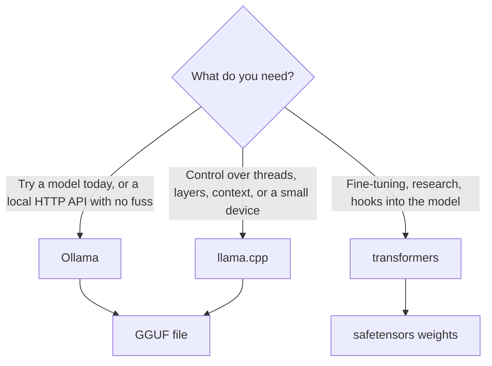

# 14 — Open-weight models and local inference

Legal reads the ticket assistant's design and asks one question: do customer messages leave our network? If the answer has to be no, a hosted API is off the table, whatever its quality. Someone suggests "just run Llama", and three new questions arrive. Are we allowed to? Which file do we download? Will it fit on the machine we have, and is it actually cheaper? This chapter answers them with measurements you can repeat. It closes the pillar, because it completes the choice that every LLM application starts with: call a model, or run one.

> Open weights mean you hold the parameters: you can run, fine-tune and quantize them without asking. They do not automatically mean open source, or free for your use. Read the licence, measure the memory, and compare against the API at your real volume.

---

## Open weights are not open source

Three things can be released separately: the weights, the code that runs them, and the data and code that produced them. Hosted models such as Claude release none of them, and you reach them only through an API. Most "open" LLMs release the weights and inference code but not the training data. The Open Source Initiative's [Open Source AI Definition 1.0](https://opensource.org/ai/open-source-ai-definition) asks for more: detailed information about the training data, the complete code to train and run the system, and the parameters, all under OSI-approved terms. So "open-weight" is the accurate general term, and the rest of this chapter uses it. AI2's OLMo is the kind of release that aims at the fuller meaning ([arXiv:2402.00838](https://arxiv.org/abs/2402.00838), Groeneveld et al., ACL 2024).

Terms differ by model family, and sometimes by generation. These were read from the licence pages and the Hub's metadata on 2026-11-02. Treat the table as an example of what to check, since terms change:

| Model | Licence | What to notice |
|---|---|---|
| OLMo 2 7B | Apache 2.0 | Permissive |
| Qwen2.5 7B Instruct | Apache 2.0 | Permissive. Other sizes in a family can differ, so check the exact repo |
| DeepSeek-R1 | MIT | The model card explicitly allows commercial use and distillation |
| Gemma 4 E4B | Apache 2.0 | Earlier Gemma releases have [custom terms](https://ai.google.dev/gemma/terms) with use restrictions you must pass on when redistributing |
| Llama 3.1 8B | [Llama 3.1 Community License](https://dev.meta.ai/llama/llama3_1/license) | Custom. Gated on the Hub. You must request a licence above 700 million monthly active users, display "Built with Llama", and any distributed model trained on its outputs must have a name beginning with "Llama" |

The last row is the one that surprises teams. A fine-tune of Llama inherits those terms, and so does a model trained on its outputs. A licence attaches to what you ship, not only to what you download, which is why a [chapter 09](09-peft-and-fine-tuning-in-practice.md) adapter is not a licensing clean slate. This chapter is engineering guidance, so take real decisions to your lawyer.

You can read the Hub's licence tag in code, which makes a useful CI check on any model you adopt. It needs network access but no account. The tag is a label supplied by the uploader, so it tells you where to look and does not replace reading the licence.

```python
from huggingface_hub import HfApi

api = HfApi()
for repo in ["Qwen/Qwen2.5-7B-Instruct", "deepseek-ai/DeepSeek-R1",
             "meta-llama/Llama-3.1-8B-Instruct", "allenai/OLMo-2-1124-7B-Instruct"]:
    info = api.model_info(repo)
    licence = [t.split(":", 1)[1] for t in info.tags if t.startswith("license:")]
    print(f"{repo:<36} {licence[0]:<12} gated={info.gated}")
```

```text
Qwen/Qwen2.5-7B-Instruct             apache-2.0   gated=False
deepseek-ai/DeepSeek-R1              mit          gated=False
meta-llama/Llama-3.1-8B-Instruct     llama3.1     gated=manual
allenai/OLMo-2-1124-7B-Instruct      apache-2.0   gated=False
```

---

## Choosing a model

Start from your constraints and treat leaderboards as a shortlist. Four numbers narrow the field, and a fifth, your own eval, decides.

| Criterion | Where to find it | Ticket assistant |
|---|---|---|
| Capability | Your own labelled set first ([chapter 10](10-prompting-fundamentals.md)), then public benchmarks | Triage accuracy over 500 real tickets |
| Context length | Model card or `config.json`. Qwen2.5 7B Instruct states 131,072 tokens | A ticket and the prompt fit in 2,000, so this is no constraint |
| Knowledge cutoff | Model card, when stated | Irrelevant to triage, and critical to anything answering about current facts ([02-rag-retrieval](../../02-rag-retrieval/README.md) is the fix) |
| Cost | Price per token for an API. Hardware and staff for local | See the break-even below |
| Licence | The section above | Must allow commercial use |

Model size is a poor proxy for capability. LLaMA's 13B model beat the 175B GPT-3 on most benchmarks in its paper ([arXiv:2302.13971](https://arxiv.org/abs/2302.13971), Touvron et al., 2023), and [chapter 03](03-scale-and-the-model-zoo.md) explains why. For a narrow task like triage, a small model is often enough, and you learn that only by running your own set.

### Reading a model card

A model card is the `README.md` of a Hub repo: a YAML metadata block, then text. The form comes from Model Cards for Model Reporting ([arXiv:1810.03993](https://arxiv.org/abs/1810.03993), Mitchell et al., FAT* 2019), and [the Hub's documentation](https://huggingface.co/docs/hub/model-cards) says it should cover intended uses and limitations, training parameters, datasets and evaluation results. Read the metadata for `license`, `base_model` and `datasets`. `base_model` matters most in a chain: a GGUF on someone's personal account is often a quantized version of a fine-tune of a base model, and the terms and the behaviour come from further up the chain. Treat a card with no evaluation section as an unevaluated model.

---

## Will it fit? Memory, measured

Weights dominate memory. As [chapter 03](03-scale-and-the-model-zoo.md) showed, the estimate is parameters times bytes per parameter, so a 7B model needs 14 GB at 16-bit and 3.5 GB at a pure 4-bit. Published files let you check that estimate. This script reads actual file sizes for one community set of GGUF conversions from the Hub:

```python
from huggingface_hub import HfApi

repo = "bartowski/Qwen2.5-7B-Instruct-GGUF"
sizes = {s.rfilename.split("-")[-1].removesuffix(".gguf"): s.size / 1e9
         for s in HfApi().model_info(repo, files_metadata=True).siblings
         if s.rfilename.endswith(".gguf")}
params = 7.61e9      # stated on the Qwen2.5-7B-Instruct model card

print(f"{'format':<10}{'file GB':>9}{'bits per param':>16}")
for fmt in ["f16", "Q8_0", "Q6_K", "Q5_K_M", "Q4_K_M", "Q4_0", "Q3_K_M", "IQ2_M"]:
    print(f"{fmt:<10}{sizes[fmt]:>9.2f}{sizes[fmt] * 1e9 * 8 / params:>16.2f}")
```

```text
format      file GB  bits per param
f16           15.24           16.02
Q8_0           8.10            8.51
Q6_K           6.25            6.57
Q5_K_M         5.44            5.72
Q4_K_M         4.68            4.92
Q4_0           4.44            4.67
Q3_K_M         3.81            4.00
IQ2_M          2.78            2.92
```

Two things to read from that. A `Q4` file takes more than 4 bits per parameter, because the format stores per-block scale data and keeps some tensors at higher precision. And the file size is a floor, because running the model also needs a KV cache that grows with the context you use ([chapter 04](04-decoding-and-inference-behaviour.md#prefill-decode-and-the-kv-cache)), plus memory for the process. Leave headroom beyond the file size, then measure on your own machine.

```text
What a local model occupies

  +--------------------+-----------------------+-----------+
  |  weights           |  KV cache             |  runtime  |
  |  file size above   |  grows with context   |  buffers  |
  +--------------------+-----------------------+-----------+
  fixed by the format     you set it (-c, num_ctx)
```

### GGUF and the quantization names

GGUF is the single-file format used by llama.cpp, the C/C++ runtime begun by Georgi Gerganov that runs on CPUs and phones and can offload some or all layers to a GPU. A GGUF file name tells you the format: the digit is the bit width of the weights, and `K` marks the k-quant methods. The *LLM Engineer's Handbook* (ch. 8) gives this rough guide:

| Name | Quality | Use |
|---|---|---|
| `IQ1`, `IQ2`, `IQ3` | Low | Only when memory leaves no choice |
| `Q4_K_S`, `Q4_K_M`, `IQ4_XS` | Good | The default for most models |
| `Q5` | High | When you have the room |
| `Q6_K` | Very high | When quality matters more than size |
| `Q8_0` | Highest | The largest of the quantized formats |

[Chapter 09](09-peft-and-fine-tuning-in-practice.md#making-the-model-smaller) explains why quantization works at all. Treat the quality column as a prior: your eval decides. Rerun your labelled tickets at `Q4_K_M` and at `Q8_0`, and if the numbers match, take the smaller file. Published guidance can't tell you how your task responds.

For GPU inference through `transformers`, the usual route is 8-bit LLM.int8() ([arXiv:2208.07339](https://arxiv.org/abs/2208.07339), Dettmers et al., NeurIPS 2022) or 4-bit NF4 from QLoRA ([arXiv:2305.14314](https://arxiv.org/abs/2305.14314), Dettmers et al., NeurIPS 2023), both through the `bitsandbytes` library. The Handbook reports about half the memory for LLM.int8(), under 1% loss, and about 20% slower inference at the same model size.

---

## Three ways to run a model locally

They suit different jobs, and they share a Hub download underneath.



### transformers

`transformers` is the closest to the model, and the route to fine-tuning. This runs on a CPU in seconds, because the model is a tiny random test checkpoint. It shows the mechanics only, so its output is noise.

```python
import torch
from transformers import AutoModelForCausalLM, AutoTokenizer

repo = "hf-internal-testing/tiny-random-gpt2"
tokenizer = AutoTokenizer.from_pretrained(repo)
model = AutoModelForCausalLM.from_pretrained(repo).eval()

print("parameters:", sum(p.numel() for p in model.parameters()))
print("context length:", model.config.n_positions, " vocabulary:", model.config.vocab_size)

ids = tokenizer("My parcel", return_tensors="pt")
torch.manual_seed(0)
with torch.no_grad():
    out = model.generate(**ids, max_new_tokens=8, do_sample=True, temperature=0.8,
                         top_k=20, pad_token_id=tokenizer.eos_token_id)
print("new tokens generated:", out.shape[1] - ids["input_ids"].shape[1])
```

```text
parameters: 111968
context length: 512  vocabulary: 1000
new tokens generated: 8
```

Notice that `temperature` and `top_k` are back. On your own model, the [chapter 04](04-decoding-and-inference-behaviour.md#decoding) controls are all yours, including ones that the hosted APIs in [chapter 13](13-calling-models-from-code.md) no longer accept. The real thing differs in the repo name and hardware:

```python
# illustrative: needs an NVIDIA GPU with several GB free, bitsandbytes, and a multi-GB download
from transformers import AutoModelForCausalLM, BitsAndBytesConfig

model = AutoModelForCausalLM.from_pretrained(
    "Qwen/Qwen2.5-7B-Instruct",
    device_map="auto",
    quantization_config=BitsAndBytesConfig(load_in_4bit=True, bnb_4bit_quant_type="nf4"),
)
```

### Ollama

[Ollama](https://github.com/ollama/ollama) wraps download, quantized weights and a local server into one command, and serves on port 11434. The block below is illustrative because it needs Ollama installed and a multi-GB download, so we didn't run it here.

```text
# illustrative: needs Ollama installed, and downloads a model
ollama run gemma4
curl http://localhost:11434/api/chat -d '{"model": "gemma4", "messages": [{"role": "user", "content": "Classify: I was charged twice"}]}'

# or import a GGUF you chose, with a Modelfile containing: FROM /path/to/file.gguf
ollama create my-model
ollama run my-model
```

Ollama [does not quantize a GGUF on import](https://docs.ollama.com/import), so choose the file you want before you start.

### llama.cpp

[llama.cpp](https://github.com/ggml-org/llama.cpp) gives you the most control, and supports the widest hardware: Apple silicon, x86 with AVX, NVIDIA and AMD GPUs and more. Its server is OpenAI-compatible, at `/v1/chat/completions`. The commands below are also illustrative, for the same reason. The project's command names have changed recently: its current README uses `llama cli`, and its [server README](https://github.com/ggml-org/llama.cpp/blob/master/tools/server/README.md) still uses `llama-server`, so check your build's help.

```text
# illustrative: needs llama.cpp installed, and downloads a model
llama cli -hf ggml-org/Qwen3.5-0.8B-GGUF
llama-server -m models/7B/ggml-model.gguf -c 2048     # listens on 127.0.0.1:9931 by default
```

---

## When does local beat the API?

Usually for a reason other than price. The strongest cases are data that may not leave your network, a need to fine-tune weights or inspect internals, a requirement to work offline, and pinning a model forever. For price, do the arithmetic with your own volume. API prices below are Anthropic's list prices for two Claude models as of October 2026. The server cost is an **assumption** to replace with your own quote.

```python
PRICES = {"Haiku 5.5": (0.10, 0.50), "Sonnet 5.5": (2.00, 10.00)}   # $ per 1M input, output tokens
SERVER_PER_MONTH = 1000.0     # assumed: one always-on GPU machine, hosting and upkeep; no staff time
TOKENS_IN, TOKENS_OUT = 800, 60     # one triage call

for name, (p_in, p_out) in PRICES.items():
    per_call = (TOKENS_IN * p_in + TOKENS_OUT * p_out) / 1e6
    print(f"{name:<11} ${per_call:.6f} per ticket, breaks even at {SERVER_PER_MONTH / per_call:>12,.0f} tickets a month")

for tickets in [10_000, 1_000_000, 50_000_000]:
    haiku = tickets * (TOKENS_IN * 0.10 + TOKENS_OUT * 0.50) / 1e6
    print(f"{tickets:>11,} tickets a month: Haiku ${haiku:>10,.2f}, server ${SERVER_PER_MONTH:,.2f}")
```

```text
Haiku 5.5   $0.000110 per ticket, breaks even at    9,090,909 tickets a month
Sonnet 5.5  $0.002200 per ticket, breaks even at      454,545 tickets a month
     10,000 tickets a month: Haiku $      1.10, server $1,000.00
  1,000,000 tickets a month: Haiku $    110.00, server $1,000.00
 50,000,000 tickets a month: Haiku $  5,500.00, server $1,000.00
```

The server's line is flat and the API's rises with volume, so at some point they cross. In this setup it takes millions of tickets a month against a cheap model, and that is before staff time, and before asking if the local model is as accurate. A server also has limited throughput, which this ignores, and a busy one needs more machines. [ai-engineering/07-inference-engineering](../../../ai-engineering/07-inference-engineering/README.md) covers serving at that scale.

---

## Pitfalls

- **Reading "open" as "free for anything".** Check the licence of the exact repo, and of its `base_model`.
- **Trusting a community conversion blindly.** A GGUF on a personal account was produced by somebody's tools, from some revision. Prefer known publishers, and rerun your eval.
- **Assuming the file size is the memory you need.** The KV cache and buffers come on top, and context length drives the cache.
- **Comparing quantization levels by name only.** Your task decides, so measure at two levels.
- **Using the wrong chat template.** A local model given the wrong template produces odd output that looks like a quality issue. The template lives with the model ([chapter 07](07-sft-and-instruction-tuning.md)).
- **Comparing only per-token cost.** The server's price also pays for staff, upgrades, idle time and peaks.
- **Assuming local means private.** It does for the model call. Logs, telemetry and download paths need their own review.
- **Assuming hosted-API request code works on a local server unchanged.** "OpenAI-compatible" covers the common path, and tools or structured output may differ. Test what you use.

---

## Try it

1. Using the memory table, which of `Q4_K_M` and `Q6_K` fits on a machine with 8 GB of free memory, and how would you decide between them if both fit?
2. In the break-even script, change `TOKENS_IN` to 8,000, as if RAG had added retrieved context. How does the break-even against Haiku change?
3. A colleague finds a GGUF tagged `apache-2.0` whose `base_model` is a Llama 3.1 fine-tune. What do you do?

<details>
<summary>Answers</summary>

1. By file size alone, both are under 8 GB (4.68 and 6.25 GB). `Q6_K` leaves about 1.75 GB for the cache and process, which is tight, so prefer `Q4_K_M`. If you have the room, run your labelled set on both and take the smaller one if the scores match.
2. It falls from about 9.1 million to about 1.2 million tickets a month, since each call now costs about $0.00083. Longer prompts make the API dearer per call and move break-even towards local, but the local model's cache and latency also grow.
3. Don't rely on the tag. It is set by whoever uploaded the file, and the base model's Llama licence likely still applies. Trace the chain up to the base model, read that licence, and ask legal if it matters.

</details>

---

## Interview checklist

| Question | Answer |
|---|---|
| Open weights or open source? | Open weights release the parameters. The OSI definition also requires code and detailed data information under approved terms. Most LLMs are open-weight |
| What does the Llama community licence require? | Attribution, a licence request above 700M monthly active users, and a "Llama" name prefix on models distributed after training on its outputs |
| How do you estimate memory? | Parameters × bytes per parameter for the weights, then add the KV cache for your context, and leave headroom |
| What is GGUF? | A single-file format for llama.cpp, in sizes named by bit width. It runs on a CPU and can offload layers to a GPU |
| Which quantization do you start with? | `Q4_K_M`, then compare with a higher level on your own eval |
| Ollama, llama.cpp or transformers? | Ollama for simplicity, llama.cpp for control and small devices, transformers for fine-tuning and research |
| When does local beat an API? | Data residency, weight access, offline use or pinning. On cost, only at high and steady volume, once staff time is counted |
| Why read `base_model`? | Licence and behaviour come from up the chain |

---

## Next

That completes how a model works, how it's trained, and how you use one. It still knows nothing about your company. [02-rag-retrieval](../../02-rag-retrieval/README.md) gives the model knowledge it was not trained on.
