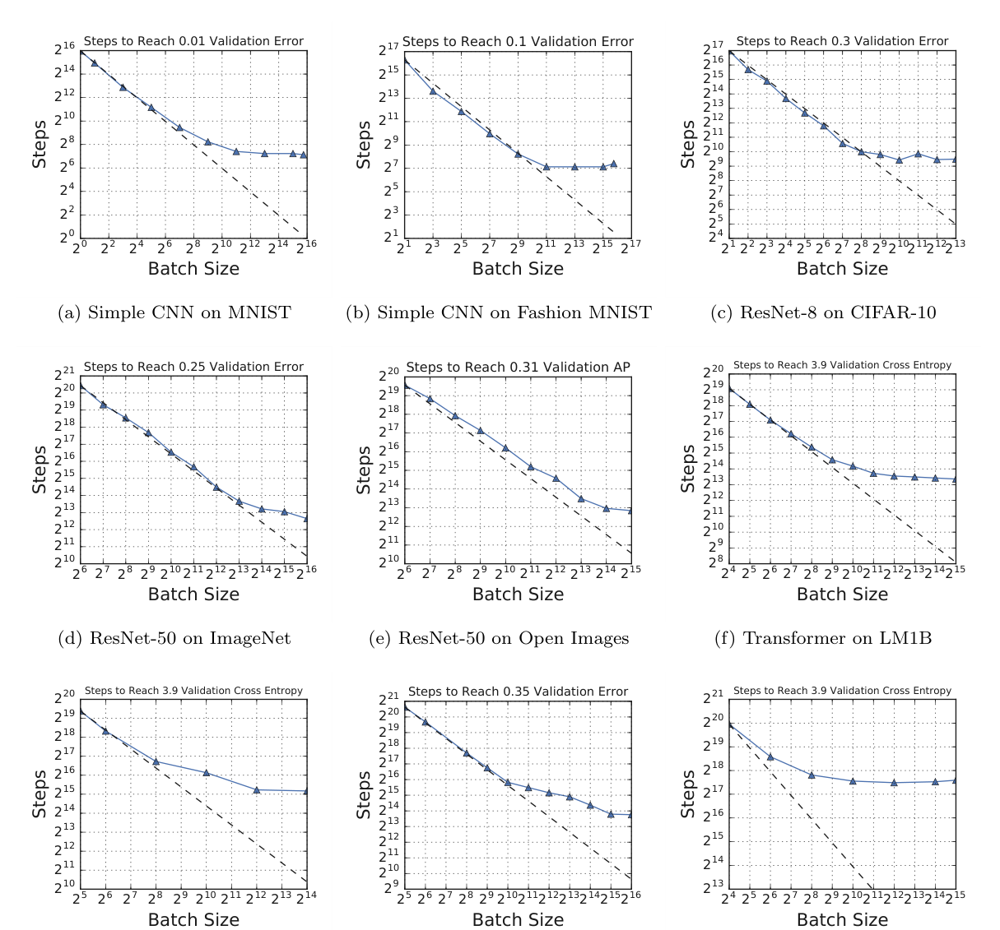
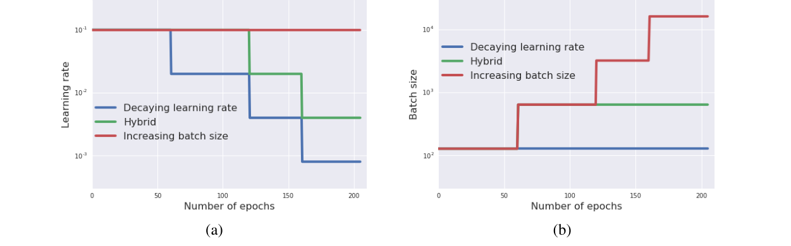
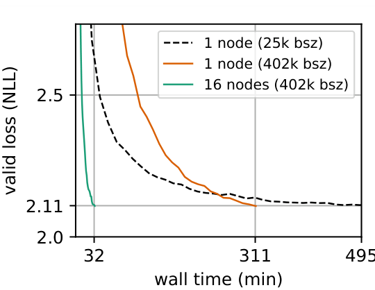
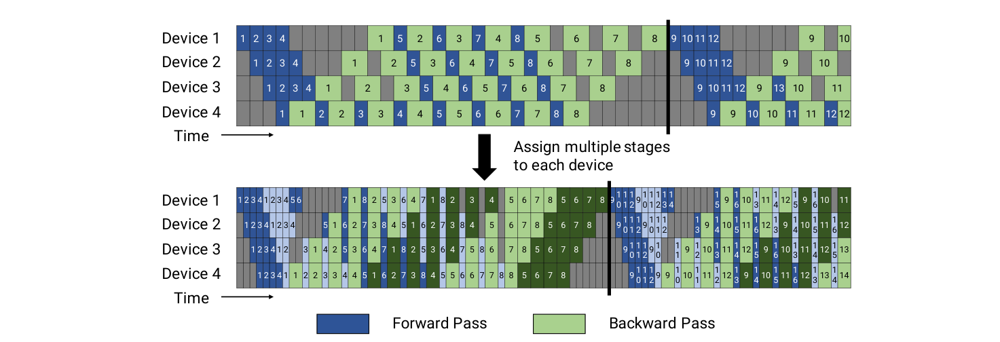
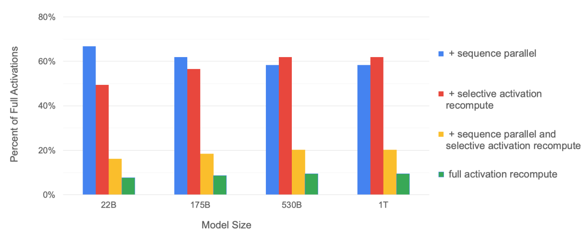
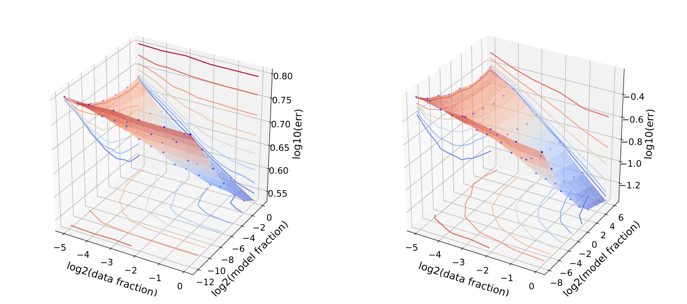

# 15 — The pretraining run: batch, cost and scale

> Count the work in FLOPs, the speed in FLOP/s and the bill in hours times price, and keep the assumptions attached to every number. A compute-optimal ratio answers a training question, not a deployment one.

A team asks whether they should train their own support model on five years of tickets. [Chapter 06](06-pretraining-data-and-objectives.md) ran the loop on toy data and looked at what real runs read. Its loop is short enough to fit on a slide, while the scale it runs at is what makes it a capital decision. This chapter sets the batch and the optimizer, scales the arithmetic up until the reasons few organisations do this are plain, and then answers the team.

Every bill below follows the same chain:

```text
parameters, tokens ──▶ FLOPs ──÷ (FLOP/s × utilisation)──▶ GPU-hours ──× price──▶ dollars
                                                            │
                                                            └── × power × PUE ──▶ energy ──× grid intensity──▶ tCO2e
```

---

## The batch and the optimizer

[Chapter 06](06-pretraining-data-and-objectives.md#pretraining) runs AdamW on a fixed batch of 32. A real run has to choose how far to raise that batch, and the optimizer has to survive the choice.

**Batch size and learning rate move together, up to a limit.** Goyal et al. trained ResNet-50 on ImageNet with a batch of 8,192 on 256 GPUs in one hour and matched the batch-256 top-1 error (23.74% vs 23.60%). They multiplied the learning rate by the batch-size ratio and ramped it up linearly over the first 5 epochs. Without the warmup, error was 24.84%; past 8k it rose anyway, to 27.55% at 32k ([arXiv:1706.02677](https://arxiv.org/abs/1706.02677) (Goyal et al., 2017, preprint)). This is where the linear warmup in LLM recipes comes from, although the evidence is SGD on images. McCandlish et al. explain where the limit sits. The *gradient noise scale*, the gradient's variance divided by its squared norm, predicted the critical batch size to within an order of magnitude on tasks ranging from about 20 (an SVHN autoencoder) to over 10 million (Dota 5v5). At that batch, training takes twice the minimum number of steps and twice the minimum data. The noise scale grows as the loss falls, often 10× over a run, so later training tolerates bigger batches ([arXiv:1812.06162](https://arxiv.org/abs/1812.06162) (McCandlish et al., 2018, preprint)). Their model rests on training loss and a local quadratic approximation.

**Two earlier papers show the same limit from the other side, and both are image or translation workloads.** Smith et al. kept the learning rate fixed and grew the batch at the points where a step schedule would have cut the rate. On a Wide ResNet 16-4 for CIFAR-10 the test accuracy matched (batch multiplied by 5 at each step; 94.4% in about 29,000 parameter updates, against 94.3% in about 80,000 with decay); for Inception-ResNet-V2 on ImageNet (90 epochs, two runs each; the batch rose once, to 81,920, and the rate decayed at the other two steps) updates fell from over 14,000 to under 6,000 at a cost of 0.6 to 1.0 points of final accuracy (78.1 and 76.8 against 78.7 and 77.8). On a half TPU pod (256 tensorcores) a ResNet-50 (batch 8,192, then 16,384 after epoch 30) reached 76.1% top-1 in under 30 minutes, against under 45 at a constant 8,192. That 76.1% top-1 (23.9% error) is Smith's own run, not Goyal's 23.74% above, and Smith used no warmup for Inception-ResNet-V2. Only image classification with step schedules was tested, no language model ([arXiv:1711.00489](https://arxiv.org/abs/1711.00489) (Smith et al., ICLR 2018)). Shallue et al. then measured how far the batch can go on nine workloads (six model families, seven data sets, metaparameters re-tuned at every batch size). In each, steps to a fixed validation goal fell in proportion to the batch, then showed diminishing returns, then stopped falling. Perfect scaling ended anywhere from a batch of about 2⁴ to 2¹³ (read from the paper's figures) and the largest useful batch ranged from about 2⁹ to 2¹⁶. Momentum moved the end of perfect scaling: for an 8-layer ResNet on CIFAR-10 (goal error 0.3), from a batch of 16 with plain SGD to 256 with Nesterov momentum. The best effective learning rate rose with batch size but followed neither the linear nor the square-root rule, and with tuning they found no sign that larger batches hurt out-of-sample error. The critical batch therefore belongs to the workload, not to the model family ([arXiv:1811.03600](https://arxiv.org/abs/1811.03600) (Shallue et al., JMLR 2019)).


*Image Source: Shallue et al., [Measuring the Effects of Data Parallelism on Neural Network Training](https://arxiv.org/abs/1811.03600) (2019), Fig. 1*


*Image Source: Smith et al., [Don't Decay the Learning Rate, Increase the Batch Size](https://arxiv.org/abs/1711.00489) (2018), Fig. 1*

**Newer optimizers go after [AdamW's memory](06-pretraining-data-and-objectives.md#pretraining) and its batch limit.** Adafactor stores only row and column averages of the squared gradient, O(n + m) memory for an n × m matrix instead of O(nm), and can drop momentum. On a WMT'14 En→De Transformer, the factored version without momentum matched Adam (BLEU 25.4 vs 25.4, with warmup). Without warmup, its β₂ = 0.999 setting collapsed (BLEU 0.2) unless updates were clipped (22.4) ([arXiv:1804.04235](https://arxiv.org/abs/1804.04235) (Shazeer & Stern, ICML 2018)). Muon keeps a single momentum buffer and orthogonalizes each matrix update with a Newton–Schulz iteration. Across models of 100M–4B parameters and batches up to 16M tokens, it reached AdamW's loss with 10–15% fewer tokens, and the gap held beyond the critical batch. Hyperparameters transferred with μP up to 3.7B ([arXiv:2505.02222](https://arxiv.org/abs/2505.02222) (Essential AI, 2025, preprint)). Both comparisons are on training loss. NVIDIA took Muon and SOAP to an 8B dense model, a 30B-A3B MoE and a 72B-A8B hybrid on 1–3T tokens. Both stayed stable up to batches of about 100M tokens, where AdamW degraded. Downstream gains were uneven: the 72B-A8B hybrid with Muon at twice the batch scored 4.5 points higher than AdamW on coding and 3.3 points lower on math. Plain SOAP diverged at 8B until they changed how it estimates its preconditioner. They also scale the learning rate by the square root of the batch ratio, not Goyal's linear rule, for large batch jumps ([arXiv:2607.20548](https://arxiv.org/abs/2607.20548) (Khona et al., 2026, preprint)).

---

## What it costs

Count training compute in **FLOPs** (operations) and hardware speed in **FLOP/s** (operations per second); the two are easy to confuse (*AI Engineering*, ch. 2). GPT-3 175B took 3.14 × 10²³ FLOPs. Huyen's estimate for redoing it on 256 H100s at a peak of 60 TFLOP/s, with no failures, is about 236 days, and at 70% utilization and $2 per H100-hour, over $4 million. Two cautions. First, 60 TFLOP/s is roughly the H100's 32-bit rate; training runs in [BF16](../../../programming/computer-science/notes/04-numbers-and-memory.md#smaller-floats) on tensor cores, whose dense peak is on the order of 1,000 TFLOP/s, so the real time and cost would be an order of magnitude lower. Second, the book's cost formula multiplies by 256 days, not the 236 in its own text. Read the example as a method, not a quote.

Raschka's estimate for an open model (*LLMs from Scratch*, ch. 5): Llama 2 7B took 184,320 A100 GPU-hours on 2 trillion tokens, about $690,000 at $30 an hour for an 8×A100 cloud server. He cites an estimate of about $4.6 million in cloud credits for GPT-3's pretraining (*LLMs from Scratch*, ch. 1). The 184,320 is from Meta's own table, which puts the whole Llama 2 family (7B, 13B, 34B and 70B, each on 2T tokens) at 3.3M A100-hours and 539 tCO2e. Those figures assume every GPU drew its rated peak power (350–400 W), and they leave out cooling, networking and the rest of the server ([arXiv:2307.09288](https://arxiv.org/abs/2307.09288) (Touvron et al., 2023, preprint)).

Growing the model during training is one way to cut the bill. FLM-101B trained a 16B model on 245B tokens, then expanded it with function-preserving operators to 51B (40B more tokens) and to 101B (27B more). The run took 21.5 days on 192 A800 GPUs, against an estimated 76.7 days for a 101B model from scratch, for about $100K ([arXiv:2309.03852](https://arxiv.org/abs/2309.03852) (Li et al., 2023, preprint)). The headline, 80% of the baselines' scores for 10% of their FLOPs, flatters the result. On four leaderboard tasks it averaged 43.9, against 54.3 for Llama 2 7B, which had about 4× the training compute of FLM's English share. Its MMLU of 28.3 is close to chance (25%), and there was no from-scratch 101B run to compare against.

The same accounting gives the carbon bill. Energy is hours × processors × measured average power × the data centre's overhead (PUE). Emissions are energy × the grid's carbon intensity. Patterson et al. put GPT-3's training at 1,287 MWh and 552 tCO2e: 10,000 V100s for 14.8 days, at PUE 1.1 and 0.429 kg CO2e per kWh. Some of those inputs are guesses: the GPU count comes from an NVIDIA press release, and 0.429 is the US average because the Azure site was not reported. **They estimate that the choice of model, data centre and processor can shrink the footprint by about 100–1000×.** They also cut an earlier, widely quoted estimate for a neural-architecture search by 88× ([arXiv:2104.10350](https://arxiv.org/abs/2104.10350) (Patterson et al., 2021, preprint)). The grid matters as much as the GPUs. In OLMo's comparison table, BLOOM-176B used 433 MWh but emitted only 30 t on France's low-carbon grid, against 380 t for Gopher's 1,066 MWh.

Strubell et al. did this accounting first, in 2019, from published training times and a power draw measured on one GPU type, with PUE 1.58 and the US average of 0.954 lb CO2e per kWh. BERT-base (64 V100s for 79 hours) came to 1,438 lb CO2e, against 1,984 lb for a New York to San Francisco flight. A Transformer architecture search (274,120 GPU-hours on 8 P100s) came to 626,155 lb and, as reported from So et al., bought 0.1 BLEU on English-German. What still applies is the multiplier from run to project: developing one parser took 4,789 jobs over 172 days, about 9,998 GPU-days, and cost $52–$175 of cloud time for one run, $1,238–$4,205 for a 24-job sweep and $103k–$350k for the project. The hardware, prices and grids are 2019's, and the power figure was applied across GPU types without repeats ([arXiv:1906.02243](https://arxiv.org/abs/1906.02243) (Strubell et al., ACL 2019)).

OLMo-7B's A100 run in Australia took 104 MWh and emitted about 70 t, while its twin on LUMI's hydro-powered MI250Xs counted as zero (about 3.5 t at a typical hydro intensity of 0.024 kg/kWh) ([arXiv:2402.00838](https://arxiv.org/abs/2402.00838) (Groeneveld et al., ACL 2024)). OLMo 2 added water: 202 kL for the 7B and 892 kL for the 13B, next to 52 and 101 tCO2e. On the same table, Llama 3.1 8B used 1,022 MWh and 420 tCO2e, against 131 MWh for OLMo 2 7B ([arXiv:2501.00656](https://arxiv.org/abs/2501.00656) (OLMo et al., 2024, preprint)). These are lower bounds. They count the final run's electricity only, not hardware manufacture, failed and tuning runs, or inference, and Patterson et al. are Google authors measuring mostly Google hardware. OPT-175B shows what the final-run figure leaves out. Meta trained it on 992 80GB A100s, at up to 147 TFLOP/s per GPU, and estimated 75 tCO2e, against 500 t it attributes to GPT-3 (Patterson's table says 552) and 380 t for Gopher.

Over two months, hardware failures forced at least 35 manual restarts and the cycling of more than 100 hosts. Loss divergences were handled by lowering the learning rate and rewinding to an earlier checkpoint. Counting ablations, baselines and downtime, the authors put their own total at roughly 2× the 75 t ([arXiv:2205.01068](https://arxiv.org/abs/2205.01068) (Zhang et al., 2022, preprint)). BLOOM's report counts more of the life cycle. Training the 176B model took 3.5 months on 384 A100s, and it estimates 81 tCO2e. Of that, 25 t was electricity for training (OLMo's table lists 30 t), 11 t was hardware manufacture and 45 t was the cluster's idle draw. The final run was about 37% of the project's compute emissions. At 57 gCO2e/kWh, its 433 MWh emitted about a third of OPT's 70 t (BLOOM's figure for OPT) from 324 MWh at 231 g.

It had one loss spike and 1–2 GPU failures a week, absorbed by spare nodes and checkpoints every three hours. The authors credit bfloat16 for the stability: their earlier float16 runs at 104B had diverged irreversibly ([arXiv:2211.05100](https://arxiv.org/abs/2211.05100) (BigScience Workshop, 2022, preprint)). PaLM 540B used 2.56 × 10²⁴ FLOPs: 1,200 hours on 6,144 TPU v4 chips plus 336 on 3,072, including downtime. It was trained in an Oklahoma data centre (PUE 1.08) running on 89% carbon-free energy at 0.079 tCO2e/MWh, and the estimate is 271 tCO2e. The same paper introduced *model FLOPs utilization* (MFU): achieved tokens per second divided by what the chips' peak FLOP/s would allow, without counting recomputed activations. PaLM reached 46.2%. By the paper's own calculation, GPT-3 reached 21.3% and Megatron-Turing NLG 30.2% ([arXiv:2204.02311](https://arxiv.org/abs/2204.02311) (Chowdhery et al., JMLR 2023)). MT-NLG's own paper reports 113–126 TFLOP/s per A100, 36–40% of the 16-bit peak, on 280–420 eight-GPU servers. Each copy of the model spanned 280 GPUs, split 8 ways by tensor slicing inside a server and 35 ways by pipeline stage across servers ([arXiv:2201.11990](https://arxiv.org/abs/2201.11990) (Smith et al., 2022, preprint)). The two figures measure different things: MFU leaves out recomputed activations, and the paper does not say which configuration ran the full 270B tokens.

GLM-130B hit the same FP16 instability and fixed it in the model rather than the number format. It is a 70-layer bidirectional model trained on 400B tokens of English and Chinese for about 60 days on 96 DGX-A100 40G nodes. DeepNorm bounded the growth of the value scale, and *embedding gradient shrink*, which scales the embedding gradient by 0.1, removed most loss spikes in 40B-scale tests. The final run saw three late divergences. With 4-way tensor and 8-way pipeline parallelism it reached 43.3% hardware and 32.5% model FLOPs utilisation by the paper's own definitions, with a 3.8% pipeline bubble. Weight-only INT4 cut inference memory to 70GB, enough for four RTX 3090s, for a loss of 0.74 points on LAMBADA and none on MMLU. About 30% of its activation dimensions had outliers, so only the weights were quantised. Headline scores were 80.2% zero-shot LAMBADA and 44.8 on 5-shot MMLU against GPT-3's 43.9. The authors say its few-shot gains were weaker than GPT-3's and suggest bidirectionality and zero-shot-only multi-task data as causes, without testing either ([arXiv:2210.02414](https://arxiv.org/abs/2210.02414) (Zeng et al., ICLR 2023)).

CogView met the same wall in text-to-image form. Its 4B-parameter transformer (48 layers, hidden size 2,560, sequence length 1,088) produced NaN losses within 1,000 iterations in 16-bit precision. The authors regularised the values instead of tolerating overflow: precision-bottleneck relaxation (dividing by the maximum before the final LayerNorm and reordering the attention-score computation, alpha = 32) plus Sandwich-LN. The stability evidence is thin, a toy 64-layer experiment and a 500M run. The final run was 144,000 steps at batch 6,144 on 512 V100s, about 96B tokens against DALL-E's 56B as the paper states it (its own batch-times-steps product is nearer 960B, so treat the figure as loose), and reached FID-0 of 27.1 on COCO against 27.5 for DALL-E (with 60 candidates reranked by the model itself; see [03b](03b-beyond-the-transformer.md)) ([arXiv:2105.13290](https://arxiv.org/abs/2105.13290) (Ding et al., NeurIPS 2021)).

fairseq is the open toolkit behind many of these runs and states the mixed-precision recipe plainly: forward, backward and the gradient all-reduce in FP16, parameter updates in FP32, dynamic loss scaling to avoid underflow. FP16 decoding was 54% faster than FP32 (88.1 against 136.0 sentences per second, WMT'14 En-De, big Transformer, one V100). Going from 8 to 128 V100s cut En-De training from about 12 hours to 1.3 and En-Fr from about 73 to 7.2, at 29.3 and 43.2 BLEU, though its Table 2 does not say whether the number of updates was held fixed. It is a demonstration paper with no ablations ([doi:10.18653/v1/N19-4009](https://doi.org/10.18653/v1/N19-4009) (Ott et al., NAACL Demonstrations 2019)).

The recipe comes from the same group's earlier paper, which measured each step on a big Transformer (WMT'16 En-De, newstest13, mean of 3 seeds, time to validation perplexity 4.32). 16-bit arithmetic alone gave a 2.9× speedup. Accumulating 16 backward passes before each update (simulating 16 nodes), doubling the learning rate and packing 5k tokens per GPU on 8 V100s cut the time to 294 minutes (4.9× the FP32 reference). On 128 V100s (16 nodes, 402k-token batch) it took 37 minutes, and overlapping gradient communication with the backward pass cut it to 32, a 44.7× speedup. Its own Table 2 reports the final models, trained longer and checkpoint-averaged: 29.3 BLEU on En-De in 85 minutes and 43.2 on En-Fr in 8.5 hours, both on 128 GPUs (tokenized BLEU). Those times differ from the demo paper's "about 1.3 hours" and "about 7.2 hours" for the same BLEU; the 2018 paper is the one that describes the runs ([arXiv:1806.00187](https://arxiv.org/abs/1806.00187) (Ott et al., WMT 2018)).


*Image Source: Ott et al., [Scaling Neural Machine Translation](https://arxiv.org/abs/1806.00187) (2018), Fig. 4*

Mesh-TensorFlow is the layout view of that split. Name each tensor dimension and map it to an axis of the processor grid: batch over every processor is data parallelism, hidden size over every processor is model parallelism, and batch on the rows with feed-forward width, heads and vocabulary on the columns mixes them. Its cost model has data parallelism all-reducing about the parameter count per processor and model parallelism all-reducing in proportion to batch times layer width, so a 2-D mix lets the processor count grow while batch and width grow only linearly. A 4.9B-parameter Transformer language model (feed-forward width 262,144, 256 heads) ran 10 epochs of One Billion Word on a 16×32 mesh of 512 TPUv2 cores in 13 hours, at about 6 of 11.5 PFLOP/s peak, and reached word perplexity 24.0 against 28.0 for the previous best single network. Returns flattened: 25.1, 24.1 and 24.0 at 1.28B, 2.48B and 4.90B. On WMT14 English-German the 2.89B model (26.7 BLEU) fell below the 1.48B one (27.5). Layouts were chosen by hand, on fixed data and single runs, and the optimizer is not given ([arXiv:1811.02084](https://arxiv.org/abs/1811.02084) (Shazeer et al., NeurIPS 2018)).

Two older system papers bracket this layout work. TensorFlow was built around a dataflow graph that workers run synchronously or asynchronously, and its measurements show the cost of waiting. On Inception-v3 (K40 GPUs, 17 parameter-server tasks, a shared production cluster) throughput reached 2,300 images per second at 200 workers with diminishing returns. A median synchronous step ran about 10% longer than an asynchronous one, and stragglers dominated above the 90th percentile. Three backup workers gave the best normalized speedup (9.5% at 50 workers); four gave the shortest median step. The paper reports step time, not time to accuracy, so it never shows that synchronous training converges faster ([arXiv:1605.08695](https://arxiv.org/abs/1605.08695) (Abadi et al., OSDI 2016)). At the other end, Narayanan et al. combine tensor, pipeline and data parallelism (PTD-P). A 1T-parameter GPT (128 layers, hidden size 25,600, sequence length 2,048, batch 3,072, mixed precision, tensor parallel 8, pipeline parallel 64) reached 502 petaFLOP/s on 3,072 A100s, 52% of peak and 163 teraFLOP/s per GPU. An interleaved pipeline schedule, which assigns several stages to each device and shrinks the bubble, gained up to 10% over the default schedule at small batches, and the gap closed as the batch grew. With the global batch held fixed and the GPU count doubled, PTD-P beat ZeRO-3 by 70% on 175B and 530B models. The training times they give (34 days for GPT-3 175B on 1,024 A100s and 300B tokens, 84 days for the 1T model on 450B tokens) are estimates from measured throughput, not finished runs ([arXiv:2104.04473](https://arxiv.org/abs/2104.04473) (Narayanan et al., SC 2021)).


*Image Source: Narayanan et al., [Efficient Large-Scale Language Model Training on GPU Clusters Using Megatron-LM](https://arxiv.org/abs/2104.04473) (2021), Fig. 4*

Activation memory is what forces the recomputation that PTD-P leaves in place. Korthikanti et al. add sequence parallelism, which splits the layer-norm and dropout activations that tensor parallelism leaves replicated, and selective recomputation of only the attention scores and softmax, the cheap-to-recompute and memory-hungry part. Together they cut activation memory about 5× from the tensor-parallel baseline, to under 20% of it, for 22B to 1T models at tensor parallel 8 and sequence length 2,048. The per-layer overhead of recomputation fell from 36% with full recomputation to 2% on the 530B and 1T models. End-to-end, a 530B model on 2,240 A100s reached 54.2% model FLOPs utilization against 42.1% with full recomputation, and the 1T model reached 56.3% (iteration time 71.49 s against 94.42 s), a 29.0% to 32.1% throughput gain across 22B to 1T ([arXiv:2205.05198](https://arxiv.org/abs/2205.05198) (Korthikanti et al., MLSys 2023)). The numbers are the authors' own measurements on GPT-3-style models.


*Image Source: Korthikanti et al., [Reducing Activation Recomputation in Large Transformer Models](https://arxiv.org/abs/2205.05198) (2023), Fig. 7*

---

## Scaling, in practice

Chinchilla ([chapter 03](03-scale-and-the-model-zoo.md#scale)) trained 400 models from 70M to over 16B parameters on 5B to 500B tokens and found the compute-optimal ratio is about 20 training tokens per parameter, scaled together: double the model, double the data (*AI Engineering*, ch. 2). Three qualifications from Huyen:

Token budgets have moved far past that ratio. The book's Table 2.3 lists reported pre-training tokens of 0.3T for GPT-3 175B (under 2 tokens per parameter), 0.78T for PaLM 540B, 14.8T for DeepSeek-V3 (671B total parameters, a mixture of experts) and 15.6T for Llama 3.1 405B, about 39 per parameter (*Foundations of LLMs*, ch. 2; counts depend on the tokenizer and may include repeated epochs). Its Chinchilla form is L(N, D) = 406.4/N^0.34 + 410.7/D^0.28 + 1.69, where 1.69 is the irreducible loss. The book adds that a lower test loss does not always mean better downstream performance, so a scaling law is a statement about loss, not about every task.

- **Compute-optimal is not deployment-optimal.** Llama was deliberately trained past the Chinchilla point: a smaller model on more tokens costs more to train but less to run. Sardana et al. (2023) rewrote the scaling law to include expected inference demand. Mistral 7B is the case for it. On Mistral's own re-run of every benchmark it beat Llama 2 13B on all of them (MMLU 60.1% against 55.6%), and on reasoning and MMLU it scored like a Llama 2 more than 3× its size. On knowledge (NaturalQuestions, TriviaQA) the factor was only 1.9×, which the authors put down to how much a 7B model can store ([arXiv:2310.06825](https://arxiv.org/abs/2310.06825) (Jiang et al., 2023, preprint)). They call scaling a three-way problem: capability, training cost and inference cost. They never disclosed the training data or token count, so the training-cost side cannot be checked. Llama 3 8B's 15T tokens is close to 2,000 tokens per parameter. Qwen2.5 trained every size on the same 18T tokens, which is about 36,000 tokens per parameter at 0.5B ([arXiv:2412.15115](https://arxiv.org/abs/2412.15115) (Qwen Team, 2024-12)). The payoff is at deployment. Quantized to 4 bits, phi-3-mini takes about 1.8GB and runs at more than 12 tokens per second on an iPhone 14 ([arXiv:2404.14219](https://arxiv.org/abs/2404.14219) (Abdin et al., 2024-04)).
- **Returns diminish.** Going from a cross-entropy of about 3.4 to 2.8 nats takes ten times more data, yet users notice the difference.
- **Hyperparameters cannot be searched at full size.** Teams tune on small models and extrapolate. Microsoft and OpenAI's μTransfer moved hyperparameters found on a 40M model to a 6.7B one.

**Rosenfeld et al. fitted a joint law first, at small scale.** Their form adds a data power law, a model power law and an irreducible error, with exponents fitted per task (data 0.75 and model 0.61 for ImageNet; 0.74 and 0.56 for WikiText-103). With hyperparameters held fixed at each scale and base models of 25.5M (ResNet-50) and 41M (Transformer-XL) scaled down by factors of 4, a 10-fold cross-validated fit had relative error under 2% on ImageNet and WikiText-103. Fitting only on a model 1/16 the size and 1/8 of the data predicted the rest to 4.5% mean divergence on ImageNet (ResNet-50) and 0.5% on WikiText-103 (Transformer-XL). It predates Kaplan and Chinchilla, so read it as a precursor: no compute axis, word-level language modelling and no derivation of an optimal ratio that was tested ([arXiv:1909.12673](https://arxiv.org/abs/1909.12673) (Rosenfeld et al., ICLR 2020)). Fitted laws also carry caveats: Clark et al.'s routed-model law, fitted on 130B-token runs that were not trained to convergence, puts the point where routing stops helping at 937B, 85B or 83B parameters depending on the method, and those values move a lot with one fitted constant (cite its Table 4 for the model sizes, not the text's count) ([arXiv:2202.01169](https://arxiv.org/abs/2202.01169) (Clark et al., ICML 2022)).


*Image Source: Rosenfeld et al., [A Constructive Prediction of the Generalization Error Across Scales](https://arxiv.org/abs/1909.12673) (2020), Fig. 1*

**The 20 survived a re-check, but the formula is shakier than it looks.** Chinchilla's parametric fit had been mis-optimized. Refitted, it agrees with the other two approaches on about 20 tokens per parameter, though with an interval of 4 to 40 at 1e26 FLOPs ([arXiv:2404.10102](https://arxiv.org/abs/2404.10102) (Besiroglu et al., 2024, preprint); details in [chapter 03](03-scale-and-the-model-zoo.md#scale)). The fitted law also adds a size term to a data term, so the benefit of more data cannot depend on model size. Skaling raises that sum to a fitted power k. On Farseer's 404 runs up to 6.4B parameters, k came out at 0.41, and extrapolation error to the largest models fell from 1.48% to 0.47% MAPE. One order of magnitude past the data, at 2e25 FLOPs, the recommended token-to-parameter ratios sit more than 10× apart: about 380 for Chinchilla's fit, against 20–40 for Skaling and for a fit-free estimate read off the runs ([arXiv:2608.07222](https://arxiv.org/abs/2608.07222) (Videau et al., 2026, preprint)). Skaling fitted only to an L-shaped grid of cheap runs (small models swept over data, short runs swept over size), about a tenth of the fitting compute, still matched or beat Chinchilla fitted to the full grid. That result depends on the data. On Chinchilla's own measurements (k = 0.77) and on Farseer's code subset, k is 0.77 to 0.90 and the gain disappears. On the authors' own grid the recommended ratio moves in the opposite direction with compute, so the sign of the correction depends on data and recipe.

**"Compute-optimal" also depends on which loss you scale.** Roberts et al. ran IsoFLOP sweeps from 6e18 to 3e21 FLOPs on a Llama-3-style recipe, with models from 40M to 8B parameters, and fitted a separate optimum for each skill. Knowledge QA wanted more parameters and code wanted more tokens. The gap held after they equalized the share of each skill's data in the mix; the two optima only lined up when code made up about 2.1× as much of the mix as knowledge data. At the smallest budget, changing the datamix moved one skill's optimal parameter count by almost 50%, and just changing the validation set moved the optimal parameter count by more than 30%. At the three largest budgets it still moved it by more than 10% ([arXiv:2503.10061](https://arxiv.org/abs/2503.10061) (Roberts et al., 2025, preprint)). Mixed-modal training adds a term for interaction between modalities. Over 250 runs on seven modalities, with laws fitted on models up to 6.7B and tested at 30B, Aghajanyan et al. found modalities compete in small models and help each other past a size their law predicts. For speech and text, the predicted point was about 28B parameters on 45B tokens, and a 30B model trained on 50B tokens did cross from competition into synergy ([arXiv:2301.03728](https://arxiv.org/abs/2301.03728) (Aghajanyan et al., ICML 2023)). All of this is perplexity, mostly at one epoch.

*Building AI Agents* (ch. 3) adds the emergent-abilities debate covered in [chapter 03](03-scale-and-the-model-zoo.md) and the Kaplan law; it adds nothing to either.

---

## Worked example: price a pretraining run before you plan one

Every figure above reduces to the same few multiplications, so it is worth having them as code. Using Raschka's and Meta's numbers for Llama 2 7B, and counting memory per parameter for a 1.5B model trained with Adam (weights, gradients and two running statistics at 32 bits each):

```python
def cloud_cost(gpu_hours, gpus_per_server, price_per_server_hour):
    return gpu_hours / gpus_per_server * price_per_server_hour

def adam_memory_gb(params, bytes_per_value=4):
    weights, gradients, adam_stats = 1, 1, 2
    return params * (weights + gradients + adam_stats) * bytes_per_value / 1e9

print(f"Llama 2 7B at $30/hour for 8×A100:  ${cloud_cost(184_320, 8, 30):>10,.0f}")
print(f"Training memory, 1.5B params with Adam: {adam_memory_gb(1.5e9):.0f} GB, before any activations")
print(f"Tokens per parameter, Llama 2 7B on 2T: {2e12 / 7e9:.0f}")

support_tokens = 5 * 365 * 20_000 * 300    # 5 years, 20k tickets/day, 300 tokens each
print(f"Five years of tickets: {support_tokens:,} tokens = {support_tokens / 2e12:.2%} of Llama 2's data")
```

```text
Llama 2 7B at $30/hour for 8×A100:  $   691,200
Training memory, 1.5B params with Adam: 24 GB, before any activations
Tokens per parameter, Llama 2 7B on 2T: 286
Five years of tickets: 10,950,000,000 tokens = 0.55% of Llama 2's data
```

The last line answers the question that opened the chapter. The ticket volume there is an assumption, chosen to be generous. Even so, a company's own text is a fraction of a percent of what a useful base model takes, so that data will not pretrain one. It might suit continued pretraining or fine-tuning, which is what [chapter 07](07-sft-and-instruction-tuning.md) covers.

BloombergGPT is the documented exception, and it shows what "enough" takes. It pretrained a 50.6B model on a 709B-token corpus, 363B of it (51%) from FinPile, Bloomberg's curated finance archive of 2007–2022. That is about 33× the tickets above, but 298B of it is a web crawl and the text Bloomberg wrote itself is about 5B, so even this company did not pretrain on its own writing. The archive mixes public, purchased and private documents. The authors planned around a budget of 1.3M A100-hours, leaving about 30% for failures. Their own Chinchilla fits asked for about 1.1–1.2T tokens at that compute in one pass, so they planned as data-limited, while cautioning that the law may not transfer to their tokenizer. The chosen checkpoint came about 53 days in on 512 GPUs, at 569B tokens, about 80% of one pass, and training ended soon after because validation loss had stalled and the budget was nearly spent. That is roughly 650K GPU-hours to that checkpoint by multiplication; the paper reports neither the hours used nor a dollar cost, and failed runs came on top. At this chapter's $30 per 8×A100 server-hour, the whole budget would price at about $4.9M, an illustration and not a quote. **On Bloomberg's private aspect-sentiment tasks it averaged 62.47 F1, against 35.76 for the next model, OPT-66B.** The gap shrank on the public finance tasks (average 62.51 against BLOOM-176B's 54.35) and nearly vanished on equity social media (72.40 against 71.36). On MMLU it barely led BLOOM-176B (39.18 against 39.13) and trailed the 43.9 published for GPT-3, which the authors did not rerun ([arXiv:2303.17564](https://arxiv.org/abs/2303.17564) (Wu et al., 2023, preprint)). They credit the data first, the tokenizer second and the architecture third, but there is no public-only twin to test that order. The test text, private and public, likely overlaps the training data, though they note competitors may have seen some of it too. The shot counts were picked for the best average across models, and neither weights nor data are released. So this is what 363B of curated finance text and that budget bought, not evidence that your tickets would do the same.

---

## Pitfalls

- **Confusing FLOPs with FLOP/s.** One measures the work and the other the speed. Copying a cost example without noticing which is which can leave you an order of magnitude out.
- **Quoting a headline cost as if it were a quote.** Most published costs are estimates, built on utilisation, price and hardware assumptions. Keep the setup attached to the number.
- **Reading the final run as the whole footprint.** Most energy and carbon figures count only the final run. OPT's authors put their total at roughly 2× the 75 t, and BLOOM's final run was about 37% of the project's compute emissions.
- **Treating 20 tokens per parameter as a target.** It is the compute-optimal ratio, not the deployment-optimal one. Llama 3 8B trained at close to 2,000, and a smaller model on more tokens costs more to train and less to run.
- **Raising the batch without the warmup.** Goyal et al.'s batch of 8,192 reached 24.84% error without warmup, against 23.74% with it, and past 8k the error rose anyway. Scale the learning rate, ramp it up, and expect a limit.

---

## Try it

1. Meta's table puts the whole Llama 2 family at 3.3M A100-hours. Price that with `cloud_cost` and compare it to the 7B alone.
2. At Chinchilla's 20 tokens per parameter, how many tokens would a 7B model take? How does that compare with the 2T Llama 2 7B actually used?
3. Take the 10.95B tokens of tickets from the worked example at face value and apply the same ratio. What size of model would that be compute-optimal for, and does that make the plan a good one?

<details>
<summary>Answers</summary>

1. `cloud_cost(3.3e6, 8, 30)` is about $12.4M, roughly 18 times the 7B's $691,200, under the same price assumption.
2. 20 × 7B = 140B tokens. Llama 2 used about 14 times that, the script's 286 tokens per parameter, which is the deliberate step past the Chinchilla point.
3. 10.95B ÷ 20 is about 550M parameters. The ratio only says how to split a training budget. It says nothing about whether that model would be useful, and the text is still 0.55% of Llama 2's data, so continue pretraining or fine-tune instead.

</details>

---

## Interview checklist

| Question | Answer |
|---|---|
| What dominates the cost of a run? | Compute-hours times price, set by parameters, tokens and hardware utilisation. Pretraining is about 98% of the compute for InstructGPT |
| Why not pretrain on your company's data? | It is usually orders of magnitude too small, so continue pretraining or fine-tune. BloombergGPT is the exception, and even it relied on 363B tokens of curated finance text, mostly a web crawl, and a 1.3M A100-hour budget, for a 50.6B model that still lacked data by its own Chinchilla fit |
| What is the difference between FLOPs and FLOP/s? | FLOPs count the work and FLOP/s the speed. Hours are FLOPs divided by (FLOP/s × utilisation), and mixing them up can leave you an order of magnitude out |
| Should you train at 20 tokens per parameter? | Only if training cost is all that matters. Llama went past it on purpose, because a smaller model on more tokens costs more to train and less to run |
| What is the critical batch size? | The batch at which training takes twice the minimum steps and data. The gradient noise scale predicted it to within an order of magnitude, and it grows as the loss falls |
| What does MFU measure? | Achieved tokens per second against what the chips' peak FLOP/s would allow, without counting recomputed activations. PaLM reached 46.2%, and by the same paper's calculation GPT-3 reached 21.3% |

---

## Next

[07 — Continued pretraining and supervised fine-tuning](07-sft-and-instruction-tuning.md) starts from an existing base model and teaches it a domain and a format.
