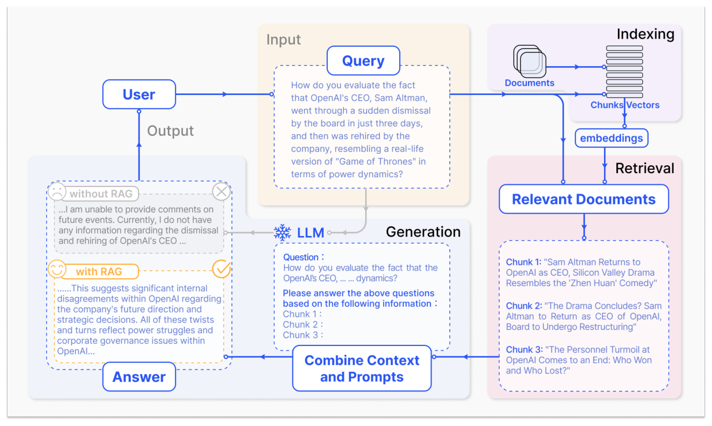
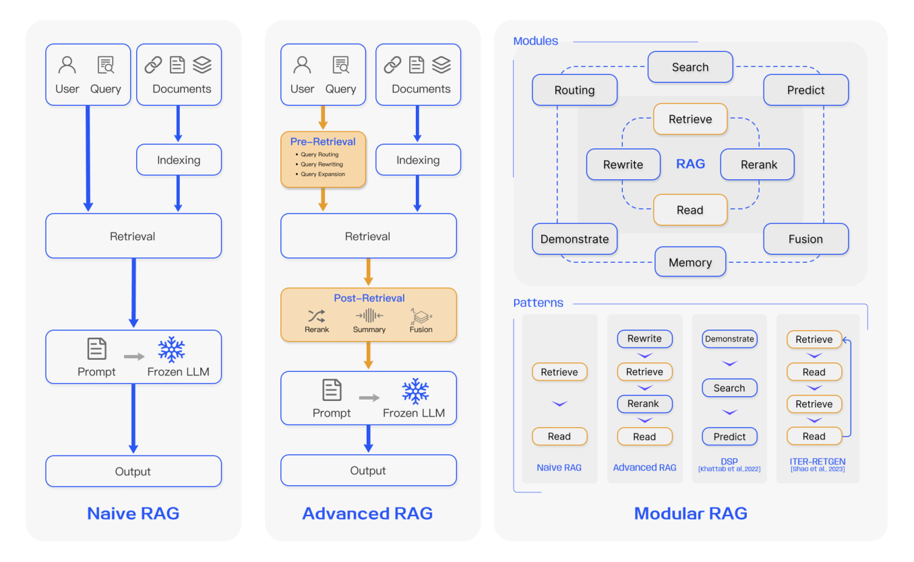
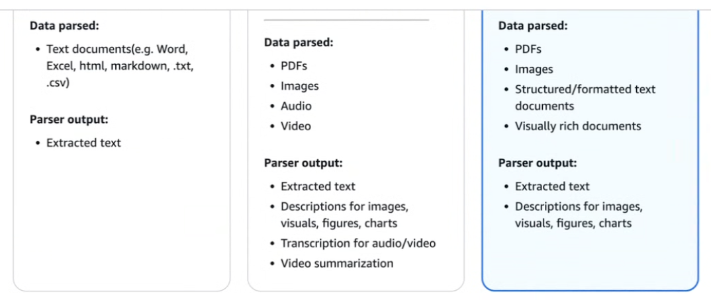
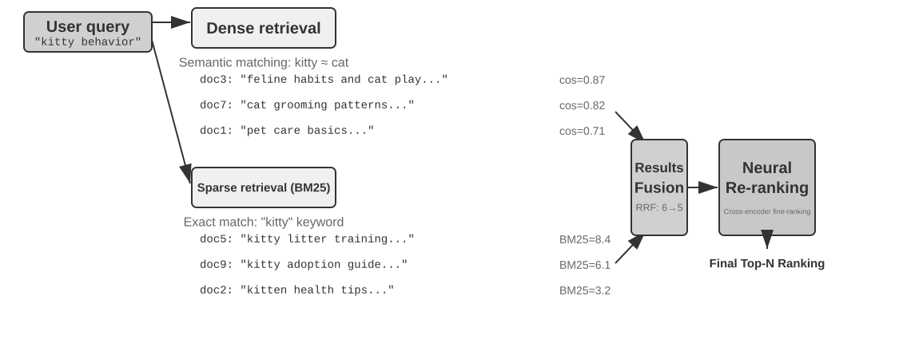
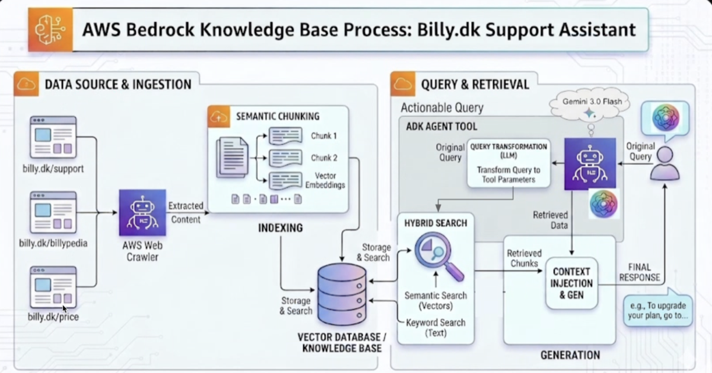
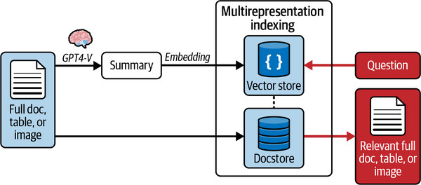

# 1 — The RAG pipeline

A support assistant for an invoicing product gets the question "can I get my money back?" The refund page exists, but the retriever returns an archived version with the old 14-day window, and the model repeats it with full confidence. Nothing crashed. The logs look clean, and a customer now has the wrong answer. Most RAG failures have this shape: one quiet stage upstream decides what the model can say.

Retrieval-augmented generation fetches relevant documents at inference time, puts them in the prompt, and lets the model answer from them. This note is the map. It covers the **mechanics**: architectures, the pipeline stages, chunking, hybrid search, worked production pipelines, index-time structures, agentic and conversational RAG, and what to measure. Later chapters take each stage apart.

**The running example.** Every chapter in this pillar uses the same corpus: 18 synthetic help-centre pages and 20 labelled questions for Tallybook, a fictional invoicing product. It lives in [`practice/ragkit.py`](../practice/ragkit.py) with BM25, a toy embedder and the metrics. Blocks that start `from ragkit import ...` run from the `practice/` folder with `uv run --with numpy python your_file.py`, with no API key. The toy embedder is hand-built so it needs no download. It shows mechanics, and its scores are not evidence about real models; [03](03-keyword-semantic-and-hybrid-search.md#a-real-embedder-on-the-same-questions) runs a real one.

The context-engineering view, where retrieval is one lever among several (when to retrieve rather than cache or load everything, how much, where results land in the window), is in [02-context 04 — retrieval](../../../ai-engineering/02-context-engineering/notes/04-retrieval.md). Read that first if you're deciding *whether* to build a pipeline.


*Image Source: Gao et al. (2024), [Retrieval-Augmented Generation for Large Language Models: A Survey](https://arxiv.org/abs/2312.10997), Figure 2*

---

## Architectures

### Naive, advanced, modular

The Gao et al. survey arranges RAG as three paradigms. **Naive RAG** is index → retrieve → read. **Advanced RAG** adds a pre-retrieval stage (query routing, rewriting, expansion) and a post-retrieval stage (rerank, summarise, fuse). **Modular RAG** treats each stage as a swappable module (search, routing, predict, memory, fusion, demonstrate) and composes them into patterns: rewrite → retrieve → rerank → read, or iterative retrieve ↔ read loops (ITER-RETGEN).


*Image Source: Gao et al. (2024), [Retrieval-Augmented Generation for Large Language Models: A Survey](https://arxiv.org/abs/2312.10997), Figure 3*

All three paradigms put retrieved text into the prompt. Zhao et al. sort RAG on a second axis, by where the retrieved object enters the generator. **Query-based** RAG puts it in the input; that is the prompt-stuffing this note covers. **Latent-representation** RAG fuses retrieved encodings inside the model (FiD, RETRO's chunked cross-attention), which needs training to align the two spaces. **Logit-based** RAG blends retrieval scores into the next-token distribution at each decoding step (kNN-LM). **Speculative** RAG uses retrieval in place of generation: retrieved drafts for speculative decoding (REST), or a cached answer instead of a model call (GPTCache, [10](10-semantic-cache.md)). Only the first and last work with a model behind an API. The survey reports no experiments of its own ([arXiv:2402.19473](https://arxiv.org/abs/2402.19473) (Zhao et al., 2024-02)).

The same progression in practice, each step adding control at the cost of latency and complexity:

| Architecture | Shape | Use when |
|---|---|---|
| **Naive RAG** | Embed query → top-k → stuff into prompt | One-hop factual questions over a clean corpus |
| **Modular RAG** | Swappable stages: query rewrite → retrieve → rerank → compress → generate | You need to tune or replace one stage without rebuilding the rest |
| **Agentic RAG** | The model decides *whether*, *what* and *when* to retrieve, and loops until it has enough | Multi-step questions ([below](#agentic-rag)) |
| **Graph-enhanced RAG** | Entities and relations extracted into a graph; retrieval walks edges | Multi-hop and "how is X related to Y" questions ([05-graph](../../../ai-engineering/05-graph-engineering/README.md)) |
| **Text-to-SQL** | Generate a query against structured data instead of searching chunks | Filtering, counting, aggregation ([below](#text-to-sql-is-a-retrieval-strategy)) |

### Where naive RAG fails

Each advanced-RAG module exists to fix one failure of the naive pipeline. Raieli and Iuculano map those failures onto the step where they start (*Building AI Agents*, ch. 6):


*Image Source: Raieli & Iuculano, *Building AI Agents with LLMs, RAG, and Knowledge Graphs* (Packt, 2025), Fig. 6.1*

| Step | Failure | What it looks like |
|---|---|---|
| Collection and indexing | Data-type issues, missing content | One chunker applied to PDFs, HTML and tables alike; the answer was never indexed, or the index is stale |
| Search | Missed top ranks | The answer chunk exists but ranks below k. Often the embedder is too small or was trained on another domain |
| Context | Not in context | Retrieval found every relevant chunk, but too many to fit the window |
| Generation | Failed extraction | The answer is in the prompt, but noise or conflicting chunks hide it (*contextual hallucination*, [06](06-generation-for-rag.md#hallucinations-and-citations)) |
| Generation | Wrong format, incorrect specificity, incomplete | A table was asked for and prose came back; too general or too detailed; only part of a multi-part answer |
| System | Redundancy, scale, flexibility | Near-duplicate chunks crowd out others; latency grows with volume; one component can't be swapped |

Work out which row you are in before adding a module. A reranker fixes missed top ranks; it does nothing for missing content.

### Nine named patterns

A popular catalogue ([Towards AI](https://pub.towardsai.net/9-rag-architectures-that-save-you-months-of-dev-work-0e219eb637cb)) names nine variants. Start with standard RAG as the baseline, prototype **one** additional pattern for your main failure, and A/B test it.

| # | Pattern | Shape | When | Production tip |
|---|---|---|---|---|
| 1 | **Standard** | Retrieve top-k → inject → generate | Baseline | — |
| 2 | **Conversational** | Standard + dialogue state and query condensation | Chat | See [conversational RAG](#conversational-multi-turn-rag) |
| 3 | **Corrective (CRAG)** | Generate → extract claims → retrieve evidence → verify and rewrite | Accuracy-critical | Fewer factual errors, evidence-backed answers; higher latency and cost. Build a robust claim extractor (rules + NER) and track claim-level precision |
| 4 | **Adaptive** | Intent classifier → pipeline. Fast path: low-k, cached or templated answers. Deep path: high-k, multi-hop or iterative retrieval | Mixed workloads (FAQs, research, creative) | Keep the intent model small and cheap; make routing rules auditable. Speed for simple queries, depth where it matters |
| 5 | **Query generation** (the catalogue calls it "Self-RAG"; see below) | The LLM writes query expansions or keywords used for retrieval | Vague inputs; paraphrase-heavy domains | Validate or constrain generated queries so the model can't invent out-of-scope terms |
| 6 | **Fusion** | Vector search + web API + SQL → merge and rerank → synthesise with provenance labels | Enterprise: internal docs + web + DBs | Use it when breadth of sources matters |
| 7 | **HyDE** | An LLM writes a *hypothetical answer*; that answer, not the raw question, is embedded and searched. Variant: generate Q/A pairs per document at index time and index those | Short or vague queries; dense technical docs | Costs an extra LLM call but often much better recall. Regenerate index-time entries when models or documents change |
| 8 | **Agentic** | Planner → retriever-as-tool → executor → verifier, spawning sub-queries | Multi-step automation, research agents | Sandbox tool execution; step-level rollbacks. Moves you from Q&A to action |
| 9 | **GraphRAG** | Retrieve passages → entity-link to graph nodes → traverse for multi-hop → synthesise and show the path | Biotech, legal, research: provenance-critical | Invest in entity linking and a provenance UI |

**Quick decision cheat-sheet:** accuracy-critical → CRAG or GraphRAG. Conversational → conversational RAG + condensation. Mixed workload → adaptive or fusion. Paraphrase-heavy or sparse docs → HyDE or query generation. Automation → agentic.

The catalogue's "Self-RAG" label is wrong. **Self-RAG proper** ([arXiv:2310.11511](https://arxiv.org/abs/2310.11511), Asai et al., 2023-10) is a trained model, not a query-rewriting prompt. Llama 2 is fine-tuned on 150k examples to emit *reflection tokens*. These tokens decide whether to retrieve at all and grade each passage for relevance. They also check whether the passage supports the generated sentence and how useful the answer is. A GPT-4-distilled critic inserts the tokens offline, so no critic runs at inference. At 13B it beat retrieval-augmented Llama2-chat 13B on PopQA, TriviaQA, PubHealth, ARC and biography factuality, but not on ASQA exact match. On ASQA citation precision it beat retrieval-augmented ChatGPT (70.3 vs 65.1 at 13B). It belongs with **adaptive** (#4), except the model makes the routing decision itself. **FLARE** ([arXiv:2305.06983](https://arxiv.org/abs/2305.06983), Jiang et al., 2023-05) gets adaptive retrieval without training. It drafts the next sentence, and if any token falls below a confidence threshold, it uses the draft as the query and regenerates the sentence. On 2WikiMultihopQA with text-davinci-003 it reached 51.0 EM, against 39.4 for retrieving once and 47.8 for question decomposition. The authors report no significant gain on Wizard of Wikipedia or ELI5, where short or open-ended answers leave little to look ahead to. Every triggered retrieval also adds a generation pass.

---

## The pre-retrieval pipeline

When you retrieve up front, the operations compose in this order. Each stage narrows the candidate set, so cheap filters go first.

```
User Query
      ↓
Metadata Filtering       <- cheapest; drop by permission, date, source, tenant
      ↓
Vector Search            <- semantic top-k over what survived
      ↓
Context Ranking          <- rerank with a cross-encoder; send only top of rerank
      ↓
Deduplication            <- collapse near-identical chunks
      ↓
Compression              <- reduce each doc to what answers *this* query
      ↓
Memory Injection         <- add cross-session facts
      ↓
Structured Formatting    <- tag and delimit; never dump raw text
      ↓
LLM
```

Stage notes:

- **Metadata filtering first.** Permission checks and freshness filters are near-free compared with embedding search, and dropping candidates early makes every later stage cheaper. Push the filter *into* the vector query rather than applying it to the results (see the funnel in [PRINCE](#a-tuned-pipeline-bayers-prince)). Permission filtering here is a security control, not just an optimisation.
- **Ranking ≠ retrieval.** Bi-encoder vector search is fast and approximate; a cross-encoder reranker is slow and accurate. Retrieve wide, rerank, send narrow: order-of-magnitude k=50→5, though real numbers are corpus-specific.
- **Deduplication has a trap.** A chunk retrieved by several sub-queries is often the *most* relevant one, not redundant noise. Collapse duplicates but treat multi-retrieval as a positive ranking signal.
- **Compression is query-conditional.** Reduce each document to the part that answers the current question, not a generic summary, which discards the specific detail the query needed.
- **Structured formatting.** Wrap in tags with source attribution so the model can cite, and so injected content stays distinguishable from instructions ([framing](../../../ai-engineering/02-context-engineering/notes/04-retrieval.md#framing-retrieved-content)).

Iusztin and Labonne sort the same operations into three stages (*LLM Engineer's Handbook*, ch. 4):

- **Pre-retrieval** works on the data (sliding-window chunks, small-to-big, richer metadata) and on the query (routing, rewriting, HyDE, self-query).
- **Retrieval** improves the search itself: hybrid weighting, filtered vector search, or an *instructor* embedder that takes a domain instruction alongside the text.
- **Post-retrieval** trims what came back: prompt compression and cross-encoder reranking.


*Image Source: Iusztin & Labonne, *LLM Engineer's Handbook* (Packt, 2024), Fig. 4.5*

The order is easier to trust once you have run it. Here are the first stages over Tallybook. Filtering removes the internal runbook `kb-18` before search can find it, and the dedupe step lets the current refund page beat its 2024 archive (`kb-05`):

```python
from ragkit import DOCS, Retriever

def build_context(query: str, audience: str = "public", k: int = 3) -> str:
    # 1. Metadata filter first: the cheapest stage, and the access-control one.
    allowed = [d for d in DOCS if d.audience == audience]
    # 2. Search what survived, wider than we plan to send.
    candidates = Retriever(allowed).hybrid(query, k=k * 3)
    # 3. Dedupe: an archived page loses to the current page on the same topic.
    by_id = {d.id: d for d in allowed}
    seen, kept = set(), []
    for doc_id in candidates:
        doc = by_id[doc_id]
        topic = doc.title.split(" (")[0]
        if topic not in seen:
            seen.add(topic)
            kept.append(doc)
    # 4. Format with tags, so the model can cite and instructions stay separate.
    return "\n".join(f'<doc id="{d.id}" updated="{d.updated}">{d.title}: {d.text[:40]}...</doc>'
                     for d in kept[:k])

print(build_context("what is the refund policy"))
```

```text
<doc id="kb-04" updated="2026-10-01">Refund policy: Annual plans can be refunded in full wit...</doc>
<doc id="kb-06" updated="2026-07-30">Cancelling your subscription: The workspace owner can cancel under Set...</doc>
<doc id="kb-08" updated="2026-03-19">Invoice numbering: Invoice numbers must run in an unbroken ...</doc>
```

This dedupe is deliberately crude: it works because the first-ranked page here is the current one. If the archive ranked first, it would win. The sturdier fix is a `status` or `superseded_by` field set at ingestion, so the stale page never competes. That is an example of the pipeline's general rule: repair a problem at the earliest stage that can see it.

One rule from the same chapter sits under all three stages. Preprocess the query exactly as you preprocessed the documents: the same cleaning and the same embedding model. Any mismatch is *training–serving skew*, and retrieval degrades without raising an error.

---

## Ingestion determines the ceiling

Retrieval can only return what parsing extracted. Parser capability comes in tiers:


*Image Source: AWS Bedrock Knowledge Bases, parsing options (console screenshot)*

A tier-one parser over a PDF-heavy corpus silently turns every chart, diagram and table into nothing or garbled text. The retrieval layer then looks broken (low recall, irrelevant chunks) when the failure happened at ingestion. Check what the parser produced before tuning k, rerankers or chunk size.

The ceiling is literal. Suppose Tallybook's refund page was a scanned PDF and the parser kept only a filename. No retriever can recover it, however well tuned:

```python
from dataclasses import replace
from ragkit import DOCS, QUERIES, Retriever, evaluate

refund_queries = [q for q in QUERIES if q[1] == {"kb-04"}]
# The parser kept a filename and a stub: the policy text never reached the index.
parsed = [replace(d, title="scan_0042.pdf", text="See attached.") if d.id == "kb-04" else d
          for d in DOCS]
for name, docs in [("clean parse", DOCS), ("failed parse", parsed)]:
    r = Retriever(docs)
    print(f"{name:13}", {m: evaluate(s, refund_queries)["recall@3"]
                         for m, s in [("bm25", r.sparse), ("dense", r.dense), ("hybrid", r.hybrid)]})
```

```text
clean parse   {'bm25': 0.0, 'dense': 1.0, 'hybrid': 1.0}
failed parse  {'bm25': 0.0, 'dense': 0.0, 'hybrid': 0.0}
```

Dense and hybrid search drop from 1.0 to 0.0, and no rerank stage can bring the page back. BM25 scores 0.0 in both rows for a different reason: "money back" shares no word with the page, the paraphrase gap of [03](03-keyword-semantic-and-hybrid-search.md).

**Multimodal ingestion.** Non-text content (charts, PDF layout, audio) enters here, and the path sets the ceiling. **Native multimodal** keeps layout and charts but costs the most. **Extract-to-text** (OCR, transcription) is cheap and cacheable, but anything visual is lost. **Extract plus an analysis tool** (`analyze_image`, `analyze_pdf`) answers most questions from the text and goes back to the original only when needed (Li, ch. 3; lab: upstream [multimodal-agent](https://github.com/bojieli/ai-agent-book/tree/main/chapter4/multimodal-agent)).

### Keeping the index in sync

The source changes after the first load. If re-ingestion is naive, the index either duplicates chunks or keeps ones whose source was deleted.

**Batch first.** The Handbook's advice is to start with a scheduled batch pipeline and move to streaming only when freshness demands it. A batch run every minute is fine for thousands of records (*LLM Engineer's Handbook*, ch. 4). To find what changed, it lists the *change data capture* (CDC) options:

| CDC method | How | Catch |
|---|---|---|
| Naive full pull | Re-read everything each run | Fine at thousands to tens of thousands of records |
| Timestamp | Pull rows with `updated_at` after the last run | Misses deletes; scans the table |
| Trigger | Database triggers write changes to an audit table | Adds write overhead to the source |
| Log-based | Read the database's transaction log | Best fidelity and no source load, but vendor-specific and needs a queue |

**Make writes idempotent.** The Handbook uses the MD5 of a chunk's content as its ID, so re-running the pipeline overwrites rather than duplicates. Content-derived IDs also make deletes possible: whatever this source no longer produces must be stale. The whole idea fits in a few lines:

```python
import hashlib

def chunk_id(source: str, text: str) -> str:
    return hashlib.md5(f"{source}|{text}".encode()).hexdigest()[:8]

def sync(index: dict, source: str, chunks: list[str]) -> dict:
    """Make the index match the source. Safe to re-run. index: {chunk_id: (source, text)}"""
    wanted = {chunk_id(source, c): c for c in chunks}
    existing = {i for i, (s, _) in index.items() if s == source}
    for i in wanted.keys() - existing:
        index[i] = (source, wanted[i])            # new or changed text gets a new id
    for i in existing - wanted.keys():
        del index[i]                              # stale chunk of this source
    return {"added": len(wanted.keys() - existing), "deleted": len(existing - wanted.keys()),
            "unchanged": len(wanted.keys() & existing)}

index = {}
print(sync(index, "kb-05", ["Refunds within 14 days.", "Kept for old customers."]))
print(sync(index, "kb-05", ["Refunds within 14 days.", "Kept for old customers."]))   # re-run
print(sync(index, "kb-05", ["Refunds within 30 days.", "Kept for old customers."]))   # edit
print(sync(index, "kb-05", []))                                                       # page removed
print("chunks left:", len(index))
```

```text
{'added': 2, 'deleted': 0, 'unchanged': 0}
{'added': 0, 'deleted': 0, 'unchanged': 2}
{'added': 1, 'deleted': 1, 'unchanged': 1}
{'added': 0, 'deleted': 2, 'unchanged': 0}
chunks left: 0
```

LangChain's indexing API is the production form. A `RecordManager` stores a hash of each document's content and metadata, its write time and its source ID. On re-run it skips unchanged documents and, depending on `cleanup`, deletes stale ones (*Learning LangChain*, ch. 2):

```python
# illustrative: needs a Postgres database for the record manager and a vector store
from langchain.indexes import SQLRecordManager, index

record_manager = SQLRecordManager("pgvector/my_docs", db_url=DB_URL)
record_manager.create_schema()

# cleanup=None: only add; "incremental": also delete old versions of the sources in this batch;
# "full": also delete every source NOT in this batch (pass the whole corpus, or lose data)
index(docs, record_manager, vectorstore, cleanup="incremental", source_id_key="source")
```

The book uses the 2025 `langchain` / `langchain_community` import paths. Check current docs before copying.

**Bulk deletes can be asynchronous.** Rothman's dual-RAG build clears a Pinecone namespace with `delete_all` and upserts straight after. Pinecone performs the delete in the background, so it can sweep away vectors written after the call returned. The fix is to poll the index stats until the namespace is empty before writing (*Context Engineering for MAS*, ch. 3):

```python
# illustrative: needs a Pinecone account and an existing index
index.delete(delete_all=True, namespace=ns)
while index.describe_index_stats().namespaces.get(ns, {"vector_count": 0})["vector_count"] > 0:
    time.sleep(2)      # the delete is async: wait, or later upserts may be wiped
```

The Handbook also stores two snapshots of each document in its feature store: one cleaned (for fine-tuning) and one chunked and embedded (for RAG). Then a new chunking or embedding choice doesn't mean re-crawling.

---

## Chunking

| Strategy | Splits on | Trade-off |
|---|---|---|
| **Fixed-size + overlap** | Token count (e.g. 512 with 10–20% overlap) | Simple, predictable; cuts across meaning |
| **Structural** | Headings, sections, functions, table rows | Respects the document's own units; needs format-aware parsing |
| **Semantic** | Embedding-similarity breakpoints between sentences | Coherent chunks; slower ingestion, variable size |
| **Hierarchical** | Small chunks for matching, parent sections for context | Best precision *and* context; more index plumbing |

Chunk size is a recall/precision dial: small chunks match precisely but arrive without context; large chunks carry context but dilute the embedding. The hierarchical "retrieve small, return big" pattern sidesteps most of the trade-off. **Contextual retrieval** (an LLM-written prefix per chunk at index time) repairs the context a chunk loses; it's covered in [02-context 04](../../../ai-engineering/02-context-engineering/notes/04-retrieval.md#contextual-retrieval).

The chunking code, a comparison on a Tallybook page, and the sizes and overlaps from each book are in [05](05-chunking-query-parsing-and-reranking.md#chunking-code).

---

## Hybrid retrieval


*Image Source: Li, [AI Agents in Depth](https://github.com/bojieli/ai-agent-book/blob/main/book-en/chapter3.md) (2026), Figure 3-9: Hybrid Retrieval and Reranking Pipeline (Apache-2.0)*

Lexical search (BM25) finds exact terms: names, error codes, identifiers. Dense search finds paraphrases. Run both, fuse the rankings (reciprocal rank fusion is the common default), then rerank the fused top-n with a cross-encoder. That pipeline is the reasonable default for production retrieval.

Huyen names the two ways to combine retrievers (*AI Engineering*, ch. 6). **In sequence**: a cheap term-based retriever narrows the corpus, then vector search or a reranker reorders the survivors. **In parallel**: both run over the whole corpus and RRF merges the lists. Sequence is cheaper; parallel keeps documents that only one retriever would find.

Each stage has its own job:

- **Sparse.** BM25's `k1` saturates term frequency, so the 20th mention adds little. `b` normalises for document length. Rare terms dominate through IDF. *Learned sparse* models (SPLADE, BGE-M3's sparse head) learn the term weights and can add related terms that aren't in the text, while staying sparse and inspectable. Worked example: [BM25 from scratch](03-keyword-semantic-and-hybrid-search.md#bm25-from-scratch).
- **Dense.** Cosine similarity compares direction, not magnitude, so length doesn't count. Contextual encoders (BERT, BGE-M3) give "bank" a different vector in each sentence; Word2Vec gave it one. The ANN index choice (HNSW for live corpora, ANNOY for static ones) is in [09 — vector database comparison](09-vector-database-comparison.md#ann-index-types-hnsw-vs-annoy). Lab: upstream [3-4 dense-embedding](https://github.com/bojieli/ai-agent-book/tree/main/chapter3/dense-embedding).
- **Fusion.** Dense scores (roughly 0–1) and BM25 scores (0 to tens) aren't on the same scale. RRF (`Σ 1/(60 + rank)`) ignores scores and fuses ranks: robust, but it throws signal away. Normalise-and-weight keeps the scores but is hard to tune.
- **Rerank.** A cross-encoder reads the query and the candidate *together* (the interviewer), where the bi-encoder compares two independent vectors (the résumé screen). It's too slow to run over the corpus, so it reranks the fused top 50 or so. It refines fusion; it doesn't replace it. Lab: upstream [3-6 retrieval-pipeline](https://github.com/bojieli/ai-agent-book/tree/main/chapter3/retrieval-pipeline) reports each document's rank before and after reranking.

Both fusions fit in a few lines. The weighted version is PRINCE's 0.7/0.3 split; it needs each score list normalised first, or BM25's larger range swamps the dense half. The first printed line shows why: the raw scores are not on one scale.

```python
from ragkit import BM25, DOCS, embed

def rrf(rankings, k=60):                       # rankings: list of ranked doc-id lists
    scores = {}
    for ranked in rankings:
        for rank, doc in enumerate(ranked, start=1):
            scores[doc] = scores.get(doc, 0) + 1 / (k + rank)
    return sorted(scores, key=scores.get, reverse=True)

def minmax(s):                                 # {doc: score} -> scores in [0, 1]
    lo, hi = min(s.values()), max(s.values())
    return {d: (v - lo) / (hi - lo or 1) for d, v in s.items()}

def weighted(dense, sparse, w_dense=0.7):      # each: {doc: raw score}
    d, s = minmax(dense), minmax(sparse)
    fused = {doc: w_dense * d.get(doc, 0) + (1 - w_dense) * s.get(doc, 0)
             for doc in d.keys() | s.keys()}
    return sorted(fused, key=fused.get, reverse=True)

ids = [d.id for d in DOCS]
query = "HTTP-403 access denied"
sparse = dict(zip(ids, BM25([d.full for d in DOCS]).scores(query).round(3)))
dense = dict(zip(ids, (embed([d.full for d in DOCS]) @ embed([query])[0]).round(3)))
print("best raw sparse:", max(sparse.values()), " best raw dense:", max(dense.values()))
print("sparse  ", sorted(sparse, key=sparse.get, reverse=True)[:3])
print("dense   ", sorted(dense, key=dense.get, reverse=True)[:3])
print("rrf     ", rrf([sorted(sparse, key=sparse.get, reverse=True),
                       sorted(dense, key=dense.get, reverse=True)])[:3])
print("weighted", weighted(dense, sparse)[:3])
```

```text
best raw sparse: 2.514  best raw dense: 0.592
sparse   ['kb-01', 'kb-07', 'kb-13']
dense    ['kb-01', 'kb-07', 'kb-02']
rrf      ['kb-01', 'kb-07', 'kb-02']
weighted ['kb-01', 'kb-07', 'kb-13']
```

The DAIR course's `HybridRAG` (keyword weight 0.3, keyword score = query-term overlap) breaks off mid-method, so the combination step above was written for this note rather than copied.

### BM25 from scratch

The sparse half fits in about 40 lines of standard-library Python. The formula, the code, its output and what to read off it are now in [03 § BM25 from scratch](03-keyword-semantic-and-hybrid-search.md#bm25-from-scratch).

### Measure each stage

- **recall@k**: did a relevant document reach the top k? The metric closest to what RAG needs. Many reports, Anthropic's included, mean *hit rate*: at least one relevant document in the top k. "Retrieval failure rate" is 1 − recall@20.
- **MRR**: how high the first hit ranked.
- **nDCG**: grades the whole ranked list.

Check the definition and the k before comparing numbers across sources ([06-eval](../../../ai-engineering/06-eval/README.md)).

---

## A worked example

A first production pipeline: ingestion and indexing on the left, query and retrieval on the right.


*Image Source: Billy.dk support assistant on AWS Bedrock Knowledge Bases (author's diagram)*

Two things to note against the abstract pipeline. **Hybrid search** runs semantic and keyword retrieval together rather than choosing: vectors catch paraphrase, keywords catch exact identifiers, and each covers the other's failure mode. **Query transformation** sits before retrieval: the user's phrasing is rewritten into tool parameters, because the text a human types is rarely the text that retrieves best.

What the diagram omits is as informative: there's no reranking and no deduplication, typical of a first cut. Those are the stages teams add after retrieval quality plateaus. Configuration details: [12 — managed RAG](12-managed-rag.md#bedrock-knowledge-bases).

---

## A tuned pipeline: Bayer's PRINCE

Bayer's PRINCE platform ([Martin Fowler article](https://martinfowler.com/articles/reliable-llm-bayer.html); its verification loops in [03-harness — three kinds of reflection](../../../ai-engineering/03-harness-engineering/notes/05-verification-loops.md#three-kinds-of-reflection)) is the same pipeline after that plateau, with the numbers filled in. It retrieves over decades of preclinical study reports, and the query-time path runs:

1. **Keyword extraction and filter generation, concurrently.** One LLM pass pulls search keywords out of the question (domain terms like `piloerection`, `ataxia`); a second generates a structured metadata filter (`eq(study_id, T123456-2)`) via few-shot prompting over permutation examples.
2. **Query expansion, n=5.** A smaller, faster model rewrites the question into five semantically similar variants, covering phrasing and terminology drift.
3. **Metadata pre-filtering.** The generated filter is applied *inside* the vector database query, not after it, cutting the search space from millions of vectors to tens or hundreds before any similarity math runs.
4. **Parallel hybrid search, weighted 0.7/0.3.** Each expanded query runs its own hybrid search over the filtered space: kNN vector similarity (weight **0.7**) plus keyword search (weight **0.3**). The split was found by experiment, not derived. For a new corpus the right prior is "measure it", not "use 0.7". (OpenClaw's memory search lands on the same 70/30, [02-context 06](../../../ai-engineering/02-context-engineering/notes/06-memory.md#production-memory-designs).)
5. **Aggregate and rank, k≈20.** Union the chunks across all five searches, score each by its *highest* weighted score across the runs, keep the top ~20.
6. **Cross-encoder rerank, k=20 → 7.** A `bge-reranker-large` cross-encoder scores each candidate against the *original* question and keeps the top 7.

Three things generalise past the numbers:

- **Expansion multiplies retrieval, so the filter has to come first.** Five queries against an unfiltered corpus is five times the expensive search. Pre-filtering is what makes fan-out affordable.
- **Max-score aggregation is a dedup policy.** Taking the highest score a chunk earned, rather than summing or averaging, treats multi-retrieval as a ranking signal without letting a chunk win by appearing everywhere weakly. It's the practical answer to the deduplication trap.
- **The rerank scores against the original query.** Expansion is a recall device; the user's actual question is still the relevance target. Reranking against a rewrite would compound the rewrite's drift.

The funnel: **millions → hundreds (filter) → ~20 (hybrid + aggregate) → 7 (rerank)**. Retrieve wide, rerank hard, send narrow, with each narrowing done by a mechanism more accurate and more expensive than the last.

### Text-to-SQL is a retrieval strategy

Vector search over chunks is the wrong tool for questions that need precise filtering, aggregation or comparison: "give me 50 studies done on rat", or any numerical rollup. Embedding similarity doesn't count, sum or compare. PRINCE routes these to a Text-to-SQL tool, so a retrieval layer that spans structured and unstructured data needs a **router**, not a single index. The details, with a runnable SELECT-only validator, the retrieved few-shot pattern and the five kinds of router, are in [08 § Text-to-SQL](08-agentic-rag-prince.md#text-to-sql). The same funnel at small scale (the LLM Twin) is in [08 § the LLM Twin](08-agentic-rag-prince.md#the-same-funnel-at-small-scale-the-llm-twin).

---

## Index-time structures: RAPTOR, GraphRAG, filesystems

Flat chunks fail on aggregation and rule-induction questions however good the retriever (the cats and nurse examples are in [02-context 04](../../../ai-engineering/02-context-engineering/notes/04-retrieval.md#distill-at-index-time-beyond-flat-chunks)). The fix is to spend LLM compute at index time and store structure:

| Structure | How it's built | Answers | Notes |
|---|---|---|---|
| **RAPTOR** | Cluster leaf chunks, summarise each cluster as a parent, recurse to a root | "Drill down from a concept to the details" | Retrieval works at any level of abstraction |
| **GraphRAG** | LLM-extracted entities and relations, then community detection and summaries | Multi-hop ("my doctor's hospital's address") and disambiguation (two Dr. Zhangs are two nodes) | Converting to triples loses meaning: "if it rains I'll cancel the beach and go to the museum" loses its condition. Use it as an index alongside natural-language text, not instead of it ([05-graph 11](../../../ai-engineering/05-graph-engineering/notes/11-kg-rag-and-text-to-cypher.md)) |
| **Filesystem (OpenViking)** | Every resource gets L0 (~100-token abstract), L1 (~2k-token overview) and L2 (full text), with `.abstract`/`.overview` per directory | Navigation: most queries resolve at L1 | Progressive disclosure for a corpus. Needs **cross-links between files**, wiki-style, plus index pages. Weaker models append orphan files unless the writing prompt requires them to link and update the index |
| **Knowledge discovery** | Extract a schema per case (bottom-up factor discovery), encode it, cluster into prototypes, rank the factors | "What decides outcomes here?" | The ranked factors also tell the agent which questions to ask, in order. Lab: upstream [3-13](https://github.com/bojieli/ai-agent-book/tree/main/chapter3/structured-knowledge-extraction) (Chinese legal data) |

Raieli and Iuculano's *hierarchical indexing* is the two-level version of RAPTOR. Summarise each document (one or more summaries per ~10 pages or 10K tokens), search the summaries first, then search chunks only inside the documents that matched. More levels give more precise routing, but the summaries multiply and each level adds a search step. The authors warn that with too many levels the number of summaries explodes combinatorially (*Building AI Agents*, ch. 6).

### Embed one thing, return another

What gets embedded doesn't have to be what goes to the model. LangChain's `MultiVectorRetriever` embeds a summary of each document (for tables and images, a summary written by a vision model) and stores the full original in a separate docstore under the same `doc_id`. Search runs over the summaries; the model gets the original (*Learning LangChain*, ch. 2).


*Image Source: Oshin & Campos, *Learning LangChain* (O'Reilly, 2025), Fig. 2-5*

Rothman uses the same move for *procedural* context (*Context Engineering for MAS*, ch. 3). His system keeps two namespaces in one Pinecone index:

- a *KnowledgeStore* of fact chunks;
- a *ContextLibrary* of "semantic blueprints", JSON instructions for how to write a given kind of output.

For each blueprint only its one-line description is embedded (the library card), and the JSON rides along in metadata. A Librarian agent finds the blueprint for the user's intent, a Researcher retrieves and synthesises facts, and a Writer combines the two. Facts decide what to say; the blueprint decides how to say it.


*Image Source: Rothman, *Context Engineering for Multi-Agent Systems* (Packt, 2025), Fig. 3.1*

The Librarian has a gap. It queries with `top_k=1` and falls back to "generate the content neutrally" if nothing comes back. With no score threshold, nearest-neighbour search always returns *something* while the namespace holds any vector. The fallback fires only on an empty namespace, and an unrelated blueprint gets applied instead. Add a similarity floor.

**When to use it:** if questions are "find the passage that says X", hybrid retrieval is enough. If they need cross-document synthesis or multi-level navigation, structured indexing is worth its large up-front LLM cost. Lab: upstream [3-8 structured-index](https://github.com/bojieli/ai-agent-book/tree/main/chapter3/structured-index) (RAPTOR vs. GraphRAG over an Intel architecture manual).

---

## Agentic RAG

Agentic RAG's loop is ReAct applied to retrieval: *assess what's missing → plan a query → retrieve → reason → check whether the question is answered*. It's the most capable design and the hardest to evaluate, because the retrieval path differs per run ([02-context 12](../../../ai-engineering/02-context-engineering/notes/12-evaluating-context.md)). It's just-in-time retrieval ([02-context 04](../../../ai-engineering/02-context-engineering/notes/04-retrieval.md#just-in-time-context)) with a search tool. Huyen frames it from the other side: RAG is a special case of an agent whose only tool is the retriever (*AI Engineering*, ch. 6). Raieli and Iuculano name three loop shapes (*Building AI Agents*, ch. 6). *Iterative* retrieval retrieves again with what the last generation produced. *Recursive* retrieval breaks the query into sub-queries. *Adaptive* retrieval lets the model decide when to retrieve, as FLARE and Self-RAG do ([above](#nine-named-patterns)). Agent-side patterns (retrieval as a tool, planners, verifiers) are in [08 — agentic RAG (PRINCE)](08-agentic-rag-prince.md).

### Agentic vs. single-pass: Li Experiment 3-9

Li runs the two side by side on legal Q&A. A simple question ("rules on self-defense") gives the same quality either way, and the single pass is faster. A compound question (sentencing for negligent serious injury while intoxicated, with a prior theft conviction) separates them. Single-pass retrieval with the wrong first keywords misses the link. The agent searches the three sub-questions in parallel, sees that what joins them is missing (how an unrelated prior conviction affects sentencing), and runs a second, targeted round on recidivism. Use agentic RAG when questions decompose; keep the single pass for narrow ones. Lab: upstream [3-9 agentic-rag](https://github.com/bojieli/ai-agent-book/tree/main/chapter3/agentic-rag).

When it pays, and the checks to run before shipping it, are in [08 § when agentic RAG pays](08-agentic-rag-prince.md#when-agentic-rag-pays).

---

## Conversational multi-turn RAG

In multi-turn settings three things change (memory-side treatment in [02-context 06](../../../ai-engineering/02-context-engineering/notes/06-memory.md#conversational-memory-the-corpus-includes-the-conversation)):

1. **The corpus includes the conversation.** Systems store and retrieve prior user messages, assistant outputs, tool results and distilled memory objects, not just the knowledge base.
2. **The challenge is continuity and intent resolution, not only relevance.** Follow-ups contain pronouns, ellipsis, references ("what about the second one?") and topic drift. Query rewriting and memory selection often matter more than the retrieval model.
3. **The agent decides when and where to retrieve.** Retrieving every turn can be wasteful or harmful. Policies like "reuse previous evidence", "retrieve only if needed" or "ask a clarifying question first" become part of the system.

The mechanics (rewriting with CONQRR, history-aware retrieval, the dual retrieval data flow and the benchmarks) are in [05 § conversational retrieval](05-chunking-query-parsing-and-reranking.md#conversational-retrieval).

---

## Monitoring and production

Retrieval quality is only one number to watch. The metric list and the production checklist are in [07 § monitoring](07-rag-in-production.md#monitoring-metrics-and-checklist).

---

## Labs

- BM25 from scratch: [worked example in 03](03-keyword-semantic-and-hybrid-search.md#bm25-from-scratch); full engine upstream at [Li 3-5 sparse-embedding](https://github.com/bojieli/ai-agent-book/tree/main/chapter3/sparse-embedding) (offline, standard library).
- Tallybook running example: [`practice/`](../practice/README.md) (offline, `uv run --with numpy`).
- Retrieved few-shot examples with ChromaDB: [snippet in 08](08-agentic-rag-prince.md#retrieved-few-shot-examples); notebook upstream at DAIR [`pe-rag.ipynb`](https://github.com/dair-ai/Prompt-Engineering-Guide/blob/main/notebooks/pe-rag.ipynb) (legacy models).
- Upstream *AI Agents in Depth* ch. 3 labs (need models or API keys): [ANNOY vs. HNSW, hybrid + rerank, agentic RAG, RAPTOR vs. GraphRAG](https://github.com/bojieli/ai-agent-book/tree/main/chapter3).
- DeepLearning.AI *Retrieval Augmented Generation* course: condensed into [02](02-why-rag-and-the-augmented-prompt.md)–[07](07-rag-in-production.md); the graded labs are linked upstream from each note (need the course's Weaviate/Together/Phoenix environment).

---

## Pitfalls

- **Tuning the wrong stage.** Symptom: recall stays low after swapping embedders and rerankers. Check the parsed text first. If the answer never reached the index, nothing downstream can find it.
- **Filtering after search.** Symptom: top-k comes back short, or an internal page appears in a trace. Push permission and date filters into the query, so they run before similarity.
- **Stale pages competing with current ones.** Symptom: the answer is confident and out of date, like the 14-day refund window. Mark superseded pages at ingestion instead of trusting rank order.
- **Comparing raw scores across retrievers.** Symptom: one retriever always wins a weighted sum. BM25 runs from 0 to tens and cosine from 0 to 1 here. Normalise first or fuse ranks with RRF.
- **Naive re-ingestion.** Symptom: duplicate chunks fill the top-k after each run, or deleted pages keep answering. Use content-derived ids and delete what a source no longer produces.
- **Adding a pattern before naming the failure.** Symptom: latency climbs and quality does not move. Locate the failure in the table under [where naive RAG fails](#where-naive-rag-fails), then add the one module that addresses it.

---

## Try it

1. In `build_context`, set `audience="internal"`. Which documents become visible, and what does that tell you about where access control has to live?
2. Run `build_context("refund window for old customers")`. Which refund page should win, and does the crude dedupe pick it?
3. Extend `sync` so a page that has not changed since the last run is not re-embedded. What do content-derived ids already give you for free?

<details>
<summary>Answers</summary>

1. Only `kb-18` is visible, because the filter is an equality test on `audience`. A real rule would be "public plus anything this user's group may read". Access control belongs in the retrieval filter, where the model never sees the forbidden text. A prompt instruction cannot enforce it.
2. `kb-05` ranks first here and survives the dedupe, which happens to be right, since those customers are on the old terms. The rule has no idea why: whichever page ranks first wins. Dedupe by topic is a policy decision, and a `valid_for` field would let the query choose.
3. They already give it. An unchanged chunk hashes to an existing id, so it lands in `unchanged` and you embed only the `added` set.

</details>

---

## Interview checklist

| Question | Answer |
|---|---|
| Name the three RAG paradigms in Gao et al. | Naive (index, retrieve, read). Advanced (adds pre- and post-retrieval). Modular (swappable stages composed into patterns). |
| Why does ingestion set the ceiling? | Retrieval can only return what parsing extracted, and no later stage can recover missing text. |
| What order do the query-time stages run in, and why? | Filter, search, rerank, dedupe, compress, inject memory, format. Each stage narrows the set, so cheap stages go first and expensive ones see fewer items. |
| Why not sum BM25 and cosine scores? | They are on different scales, so the larger range swamps the other. Normalise and weight, or fuse ranks with RRF. |
| How does RRF work? | Each list contributes `1/(k + rank)` per document, usually with k=60, and documents are sorted by the sum. It needs no score calibration, and it discards score magnitude. |
| Why rerank against the original query after expansion? | Expansion is a recall device. The user's question remains the relevance target, and reranking against a rewrite would compound its drift. |
| Why is Text-to-SQL a retrieval strategy? | Embedding similarity cannot count, sum or compare, so aggregation questions go to a query against structured data. Choosing that path is a routing decision. |
| When is agentic RAG worth the cost? | When questions decompose into sub-questions or need several sources compared. For narrow questions a single pass matches it at lower latency. |
| What is the difference between Self-RAG and FLARE? | Self-RAG is a fine-tuned model emitting reflection tokens that decide when to retrieve. FLARE needs no training: it retrieves when a drafted token falls below a confidence threshold. |
| How do you keep an index in sync? | Start with scheduled batches and a change-detection method, and make writes idempotent with content-derived ids and source-scoped deletes. |

---

## Next

[02 — Why RAG and the augmented prompt](02-why-rag-and-the-augmented-prompt.md) is a first-principles walk through the same pipeline, starting from why retrieval beats retraining.
