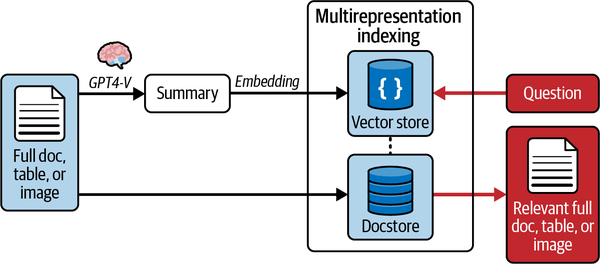

# 1b — Index-time structures, agentic and conversational RAG

Tallybook's support lead asks the bot, "which plan changes caused the most refund complaints last year?" No single help-centre page holds that answer. It lives across dozens of tickets and policy pages, and a retriever that returns the five most similar chunks will hand back five refund pages and miss the pattern. Hybrid search finds passages. Some questions need structure built ahead of time, or a retriever that searches more than once.

[01](01-rag-pipeline.md) drew the single-pass pipeline: ingestion, chunking, hybrid retrieval and the tuned PRINCE funnel. This part covers what goes beyond one pass over flat chunks. It starts with structures that spend LLM compute at index time, then covers retrieval that loops, and ends with retrieval across the turns of a conversation.

---

## Index-time structures: RAPTOR, GraphRAG, filesystems

Flat chunks fail on aggregation and rule-induction questions however good the retriever (the cats and nurse examples are in [02-context 04](../../../ai-engineering/02-context-engineering/notes/04-retrieval.md#distill-at-index-time-beyond-flat-chunks)). The fix is to spend LLM compute at index time and store structure:

| Structure | How it's built | Answers | Notes |
|---|---|---|---|
| **RAPTOR** | Cluster leaf chunks, summarise each cluster as a parent, recurse to a root | "Drill down from a concept to the details" | Retrieval works at any level of abstraction |
| **GraphRAG** | LLM-extracted entities and relations, then community detection and summaries | Multi-hop ("my doctor's hospital's address") and disambiguation (two Dr. Zhangs are two nodes) | Converting to triples loses meaning: "if it rains I'll cancel the beach and go to the museum" loses its condition. Use it as an index alongside natural-language text, not instead of it ([05-graph 11](../../../ai-engineering/05-graph-engineering/notes/11-kg-rag-and-text-to-cypher.md)) |
| **Filesystem (OpenViking)** | Every resource gets L0 (~100-token abstract), L1 (~2k-token overview) and L2 (full text), with `.abstract`/`.overview` per directory | Navigation: most queries resolve at L1 | Progressive disclosure for a corpus. Needs **cross-links between files**, wiki-style, plus index pages. Weaker models append orphan files unless the writing prompt requires them to link and update the index |
| **Knowledge discovery** | Extract a schema per case (bottom-up factor discovery), encode it, cluster into prototypes, rank the factors | "What decides outcomes here?" | The ranked factors also tell the agent which questions to ask, in order. Lab: upstream [3-13](https://github.com/bojieli/ai-agent-book/tree/main/chapter3/structured-knowledge-extraction) (Chinese legal data) |

Raieli and Iuculano's *hierarchical indexing* is the two-level version of RAPTOR. Summarise each document (one or more summaries per ~10 pages or 10K tokens), search the summaries first, then search chunks only inside the documents that matched. More levels give more precise routing, but the summaries multiply and each level adds a search step. The authors warn that with too many levels the number of summaries explodes combinatorially (*Building AI Agents*, ch. 6).

The structure can also be built at query time. Jiang et al. survey what they call retrieval and structuring augmented generation. The graph-retrieval line they map includes HippoRAG (Gutiérrez et al., NeurIPS 2024), which extracts triples from passages with an LLM, then runs personalized PageRank around the query's entities to find passages linked only through other passages. They also propose a loop in which each round's retrieved text is turned into a subgraph of a knowledge graph built for that one query, and the model writes its next subquery from that graph until it has enough. The loop is a proposal that was never run, and the survey reports no experiments, latency or indexing cost, so it shows the design space and not whether structure beats hybrid chunk retrieval ([arXiv:2509.10697](https://arxiv.org/abs/2509.10697), Jiang et al., KDD 2025).

A document's own table of contents is a structure that costs nothing to build. STAIR puts a book's whole table of contents in the prompt and fine-tunes the model to write the title of the one leaf section that answers the query. It extends the differentiable search index (DSI, Tay et al., NeurIPS 2022), where a model learns to generate document ids. On SearchTome (18 open textbooks in 6 domains, with Mixtral-generated test questions), a LoRA-tuned Mistral-7B reached **Recall@1 of 82.6 against 76.9 for DSI on the same base model**, 68.7 for off-the-shelf NV-Embed-v2 and 59.5 for BM25. The gap over DSI was significant in each domain, and only 0.05% of its outputs named a section that is not a leaf. It is trained per book with up to 14k tokens of contents in each prompt, so a changed corpus means retraining. It was never compared with tuned chunk retrieval or a reranker, and it reports no answer quality. The authors limit it to corpora that have a global structure ([arXiv:2609.03874](https://arxiv.org/abs/2609.03874), Kumar et al. (IBM), 2026-09, v2 2026-10, preprint).

Entities can be the structure an agent walks instead. GraphRAG and HippoRAG keep their graph inside the retriever. CorpusMap writes it out as files: one page per entity that appears in at least two documents, linking to those documents, for an agent searching with find, grep and cat. Across three enterprise-style benchmarks of 2.8k–6.4k documents (multi-document questions only, four GPT-5.5/5.6 models, 3 runs), it **raised overall quality by 6.4 to 11.7 points over the agent searching the raw files, with 34–57% fewer input tokens**. Other navigation layers (per-document pages, cluster pages, an LLM wiki) did not reliably beat the raw files. Adding entity-to-entity edges, as a knowledge graph would, changed document recall by −2.6 to +0.2 points and enlarged the pages by 27–52%. On one benchmark, against fixed-context retrievers with GPT-5.5, it scored 76.60 against 65.05 for dense, 64.66 for HippoRAG and 47.95 for GraphRAG, but that compares an agent with full file access to a fixed context. The authors estimate a one-time build cost of up to $4,732 with GPT-5.5, recovered after about 9,000 queries (12,400 to 26,300 for the other builders), and a map built by the cheapest model still beat the raw files for every answering model. A judge model scored all the results, and pooling content by entity can expose documents across permission levels, so the authors advise one map per permission level ([arXiv:2609.37226](https://arxiv.org/abs/2609.37226), Jeong et al. (KAIST, Microsoft), 2026-09, preprint).

### Embed one thing, return another

What gets embedded doesn't have to be what goes to the model. LangChain's `MultiVectorRetriever` embeds a summary of each document (for tables and images, a summary written by a vision model) and stores the full original in a separate docstore under the same `doc_id`. Search runs over the summaries; the model gets the original (*Learning LangChain*, ch. 2).


*Image Source: Oshin & Campos, *Learning LangChain* (O'Reilly, 2025), Fig. 2-5*

Rothman uses the same move for *procedural* context (*Context Engineering for MAS*, ch. 3). His system keeps two namespaces in one Pinecone index:

- a *KnowledgeStore* of fact chunks;
- a *ContextLibrary* of "semantic blueprints", JSON instructions for how to write a given kind of output.

For each blueprint only its one-line description is embedded (the library card), and the JSON rides along in metadata. A Librarian agent finds the blueprint for the user's intent, a Researcher retrieves and synthesises facts, and a Writer combines the two. Facts decide what to say; the blueprint decides how to say it.


*Image Source: Rothman, *Context Engineering for Multi-Agent Systems* (Packt, 2025), Fig. 3.1*

The Librarian has a gap. It queries with `top_k=1` and falls back to "generate the content neutrally" if nothing comes back. With no score threshold, nearest-neighbour search always returns *something* while the namespace holds any vector. The fallback fires only on an empty namespace, and an unrelated blueprint gets applied instead. Add a similarity floor.

**When to use it:** if questions are "find the passage that says X", hybrid retrieval is enough. If they need cross-document synthesis or multi-level navigation, structured indexing is worth its large up-front LLM cost. Lab: upstream [3-8 structured-index](https://github.com/bojieli/ai-agent-book/tree/main/chapter3/structured-index) (RAPTOR vs. GraphRAG over an Intel architecture manual).

---

## Agentic RAG

Agentic RAG's loop is ReAct applied to retrieval: *assess what's missing → plan a query → retrieve → reason → check whether the question is answered*. It's the most capable design and the hardest to evaluate, because the retrieval path differs per run ([02-context 12](../../../ai-engineering/02-context-engineering/notes/12-evaluating-context.md)). It's just-in-time retrieval ([02-context 04](../../../ai-engineering/02-context-engineering/notes/04-retrieval.md#just-in-time-context)) with a search tool. Huyen frames it from the other side: RAG is a special case of an agent whose only tool is the retriever (*AI Engineering*, ch. 6). Raieli and Iuculano name three loop shapes (*Building AI Agents*, ch. 6). *Iterative* retrieval retrieves again with what the last generation produced. *Recursive* retrieval breaks the query into sub-queries. *Adaptive* retrieval lets the model decide when to retrieve, as FLARE and Self-RAG do ([01 § nine named patterns](01-rag-pipeline.md#nine-named-patterns)). Agent-side patterns (retrieval as a tool, planners, verifiers) are in [08 — agentic RAG (PRINCE)](08-agentic-rag-prince.md).

Arsanjani and Bustos sort the same ladder by how much of the retrieval the system controls: vanilla RAG (one knowledge source), advanced RAG (re-ranking, fusion, cited sources, often several sources) and agentic RAG (agents run the retrieval, possibly several together). They line the three up with their maturity levels 2, 4 and 5–6 (*Agentic Architectural Patterns*, ch. 3). That mapping is the authors' own and untested, but it is a handy way to say how much machinery a use case has earned, and it matches Gao et al.'s naive, advanced and modular split in [01](01-rag-pipeline.md). Their compliance example shows the part a vector store alone does not cover. A $75,000 wire checks a regulatory database, a version-controlled internal policy manual and a live sanctions API, and each snippet comes back with its effective date or version ("effective June 1, 2025"; "Policy Manual v3.1.2"; "as of June 27, 2025"). The answer cites a $50,000 external and a $25,000 internal threshold, and holds the wire. The figures are the chapter's invented illustration, with no with-and-without evaluation, but the design point stands: carry the date or version with every retrieved snippet so the decision leaves an audit trail ([07 § text that changes by legal effect](07-rag-in-production.md#text-that-changes-by-legal-effect) covers the as-of filter).

IRCoT uses each chain-of-thought sentence as the next BM25 query. With GPT-3 (code-davinci-002) on 500-question samples of four multi-hop QA sets, it raised gold-paragraph recall over one-step retrieval by 11.3–22.6 points, within a 15-paragraph cap tuned on dev. Answer F1 rose 7.1–13.2 on three of the sets and not at all on IIRC. Each CoT sentence costs one more LLM call, up to 8, and the paper never times it ([arXiv:2212.10509](https://arxiv.org/abs/2212.10509), Trivedi et al., ACL 2023). DSP's two-hop search program over frozen text-davinci-002 and ColBERTv2 reached 51.4 EM on HotPotQA dev, against 36.9 for retrieve-then-read. On single-hop Open-SQuAD a different DSP program, one retrieval of 7 passages plus 20-sample self-consistency, managed only 36.6 against 33.8. Both are 1,000-question dev samples, with no ablation and no cost reported ([arXiv:2212.14024](https://arxiv.org/abs/2212.14024), Khattab et al., 2022, preprint).

EfficientRAG takes the per-hop step off the large model. Contriever-MSMARCO retrieves chunks. A small DeBERTa-v3-large model (304M) labels the useful tokens in each chunk and tags it Continue or Terminate, and a second one turns the question plus those tokens into the next-hop query. The loop ends when every chunk is Terminate or the iteration cap is reached, and one LLM call answers over the pooled chunks. On 200 MuSiQue samples that cost 1.00 LLM calls and 3.62 s, against 3.00 calls and 9.68 s for Iter-RetGen at three iterations and 7.18 calls and 27.47 s for SelfAsk. Retrieval was mixed: HotpotQA recall 81.84 at 6.41 chunks (Direct retrieval of 30 chunks: 77.05), 2WikiMQA 84.08 at 3.69 chunks (SelfAsk 88.90 at 33.68), and MuSiQue 49.51 at 6.09, just under direct retrieval of 10 (50.86). End to end with a Llama-3-8B-Instruct reader, accuracy was 57.86, 20.00 and 53.41 on HotpotQA, MuSiQue and 2WikiMQA, second best on two and best on none, so the abstract's "surpasses existing RAG methods" is stronger than its Table 3. The training data came from a 70B LLM and is dataset-specific, transfer was tested only between HotpotQA and 2WikiMQA, and the runs are single ([arXiv:2408.04259](https://arxiv.org/abs/2408.04259), Zhuang et al., EMNLP 2024).

### Agentic vs. single-pass: Li Experiment 3-9

Li runs the two side by side on legal Q&A. A simple question ("rules on self-defense") gives the same quality either way, and the single pass is faster. A compound question (sentencing for negligent serious injury while intoxicated, with a prior theft conviction) separates them. Single-pass retrieval with the wrong first keywords misses the link. The agent searches the three sub-questions in parallel, sees that what joins them is missing (how an unrelated prior conviction affects sentencing), and runs a second, targeted round on recidivism. Use agentic RAG when questions decompose; keep the single pass for narrow ones. Lab: upstream [3-9 agentic-rag](https://github.com/bojieli/ai-agent-book/tree/main/chapter3/agentic-rag).

Lakshmanan and Hapke call the loop *Deep Search*: retrieve, think, generate, repeat until the answer is good enough or the budget runs out, with tools beyond the index (web search, APIs) and state carried between rounds. *Deep research* is the same loop when the output accumulates into a long report rather than one concise answer. Their demo recurses `deep_search(query, depth)` over Wikipedia with LLM page ranking and gap-finding follow-up queries, run at depth 1. They report no latency figure, only that "the overall system is very slow", and suggest parallel sub-queries and early stopping (*Generative AI Design Patterns*, ch. 4, Pattern 12).

When it pays, and the checks to run before shipping it, are in [08 § when agentic RAG pays](08b-routing-sub-agents-and-evaluation.md#when-agentic-rag-pays).

---

## Conversational multi-turn RAG

In multi-turn settings three things change (memory-side treatment in [02-context 06](../../../ai-engineering/02-context-engineering/notes/06-memory.md#conversational-memory-the-corpus-includes-the-conversation)):

1. **The corpus includes the conversation.** Systems store and retrieve prior user messages, assistant outputs, tool results and distilled memory objects, not just the knowledge base. Arsanjani and Bustos advise a sliding window or a summary for short-term memory and a RAG store for long-term memory, kept to high-value items (profiles, key decisions, finalised facts) so it does not fill with noise (*Agentic Architectural Patterns*, ch. 9). Their sample "summary" keeps only the last exchange, so it drops every earlier turn; a summariser has to fold the old summary into the new one.
2. **The challenge is continuity and intent resolution, not only relevance.** Follow-ups contain pronouns, ellipsis, references ("what about the second one?") and topic drift. Query rewriting and memory selection often matter more than the retrieval model.
3. **The agent decides when and where to retrieve.** Retrieving every turn can be wasteful or harmful. Policies like "reuse previous evidence", "retrieve only if needed" or "ask a clarifying question first" become part of the system.

The mechanics (rewriting with CONQRR, history-aware retrieval, the dual retrieval data flow and the benchmarks) are in [5b § conversational retrieval](05b-query-parsing-conversational-retrieval-and-reranking.md#conversational-retrieval).

---

## Pitfalls

- **Replacing text with triples.** Symptom: graph answers lose their conditions ("if it rains, the museum" becomes two unrelated facts). Keep the natural-language chunks and use the graph as an index beside them.
- **Nearest neighbour with no floor.** Symptom: an unrelated blueprint or chunk shapes the answer, and the fallback branch never fires. Top-k always returns something while the store holds a vector, so set a similarity threshold and test the miss path.
- **Too many summary levels.** Symptom: index cost and search steps grow with every level while routing barely improves. Two levels (documents, then chunks) are often enough; add a level only for a measured routing failure.
- **One entity map across permission levels.** Symptom: an entity page links a document the user may not open. Build one map per permission level, as the CorpusMap authors advise.
- **Agentic retrieval for narrow questions.** Symptom: latency climbs and quality does not move. In Li's Experiment 3-9 a simple question came out the same either way, and the single pass was faster; route narrow questions to the single pass.
- **Retrieving on every turn.** Symptom: follow-ups like "what about the second one?" pull unrelated chunks. Rewrite the query against the conversation first, and let the policy reuse earlier evidence.
- **A mock retriever that always answers.** Symptom: the demo passes and proves nothing. The book's RAG loan agent looks up the policy with keyword triggers and returns the standard policy on any miss (*Agentic Architectural Patterns*, ch. 9). The prose query "policy for high-value loan" matches none of those triggers (the code tests "high value" with a space, and the loan amount), so the $750,000 loan would get the 680 policy and the 720 score would pass. The code's own query happens to contain "750000". Its decision is a hard-coded `if`/`elif` that never reads the retrieved text, so removing retrieval changes nothing. When you test a RAG agent, swap the context for a wrong policy and check that the decision follows it, and make the miss path return nothing instead of a default.

---

## Try it

The block below is Rothman's Librarian with the missing floor added. Only each blueprint's one-line description is embedded, and the toy embedder from `ragkit` scores the intent against those cards. Run it from `practice/` with `uv run --with numpy python your_file.py`.

```python
from ragkit import embed

# The library card: only each blueprint's one-line description is embedded.
BLUEPRINTS = {
    "refund-reply": "Reply to a customer asking for a refund or money back",
    "api-error-guide": "Step-by-step guide for an API authentication error",
    "release-note": "Short release note announcing a new invoicing feature",
}
names = list(BLUEPRINTS)
cards = embed(list(BLUEPRINTS.values()))

def librarian(intent: str, floor: float | None = None) -> tuple[str | None, float]:
    scores = cards @ embed([intent])[0]
    best = int(scores.argmax())
    if floor is not None and scores[best] < floor:
        return None, float(scores[best])   # fall back to neutral generation
    return names[best], float(scores[best])

for intent in ["can I get my money back?", "write a haiku about autumn leaves"]:
    picked, score = librarian(intent)
    print(f"{intent!r}: top-1 {picked}, score {score:.2f}; with floor 0.3: {librarian(intent, 0.3)[0]}")
```

```text
'can I get my money back?': top-1 refund-reply, score 0.95; with floor 0.3: refund-reply
'write a haiku about autumn leaves': top-1 release-note, score 0.08; with floor 0.3: None
```

1. Ask for `"announce the new recurring invoices feature"`. The right blueprint is `release-note`. What does the floor do, and is lowering the floor the fix?
2. Ask for `"refund for a failed API payment"`. It scores 0.70 for `api-error-guide` and 0.49 for `refund-reply`. Does the floor help here, and what check would?
3. Which structure from the table would you build for the support lead's question in the opening paragraph, and what would you keep beside it?

<details>
<summary>Answers</summary>

1. Every card scores about 0.01, so the floor sends it to neutral generation. That is a miss, not a wrong match. The toy embedder does not stem, so "announce" never meets "announcing", and plain words carry little weight. Lowering the floor to catch it would also let the haiku through. The fix is the card: write descriptions in the words users use, or embed a few example intents per blueprint.
2. No. Both scores clear 0.3, so the floor passes the top one. The question really needs both blueprints, or a clarifying question. Check the margin between the top two as well as the top score: a 0.21 gap on two plausible cards is a signal to ask, or to combine them.
3. Knowledge discovery or a GraphRAG-style index over tickets: extract plan change, complaint type and date per ticket, then aggregate. The counting itself is a Text-to-SQL job once the fields exist ([08 § Text-to-SQL](08-agentic-rag-prince.md#text-to-sql)). Keep the original tickets and pages searchable beside the structure, so an answer can cite the text it came from.

</details>

---

## Interview checklist

| Question | Answer |
|---|---|
| Why do flat chunks fail on aggregation questions? | Each chunk is retrieved on its own similarity, and the answer is a pattern across many chunks. Structure built at index time (summaries, graphs, schemas) gives the retriever something to match at that level. |
| What does RAPTOR build? | A tree: leaf chunks are clustered, each cluster is summarised into a parent, and the process recurses to a root. Retrieval can then match at any level of abstraction. |
| What do knowledge graphs lose, and how do you keep it? | Conditions and nuance: a conditional sentence becomes separate triples. Use the graph as an index beside the natural-language text, not instead of it. |
| What did CorpusMap find about entity pages? | On three enterprise-style benchmarks, entity pages as files raised an agent's quality by 6.4 to 11.7 points over raw files with 34–57% fewer input tokens. Entity-to-entity edges added nothing. |
| What is multi-representation indexing? | Embed one thing (a summary, a description) and return another (the full document) under a shared id. Search runs over the short form and the model gets the original. |
| Why add a similarity floor to nearest-neighbour lookup? | Top-k always returns something while the index holds any vector. Without a threshold the fallback for "nothing relevant" never fires. |
| When is agentic RAG worth the cost? | When questions decompose into sub-questions or need several sources compared. For narrow questions a single pass matches it at lower latency. |
| What does IRCoT do? | It uses each chain-of-thought sentence as the next retrieval query. It raised gold-paragraph recall by 11.3–22.6 points over one-step retrieval on multi-hop QA, at up to 8 extra LLM calls. |
| What changes in multi-turn RAG? | The corpus includes the conversation, follow-ups need intent resolution, and the system decides whether to retrieve on each turn. |

---

## Next

[02 — Why RAG and the augmented prompt](02-why-rag-and-the-augmented-prompt.md) is a first-principles walk through the same pipeline, starting from why retrieval beats retraining.
