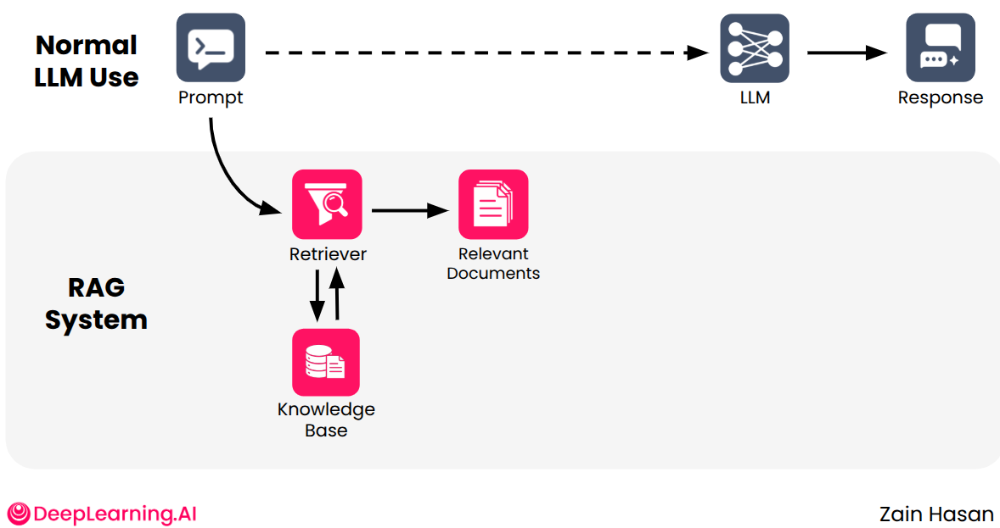
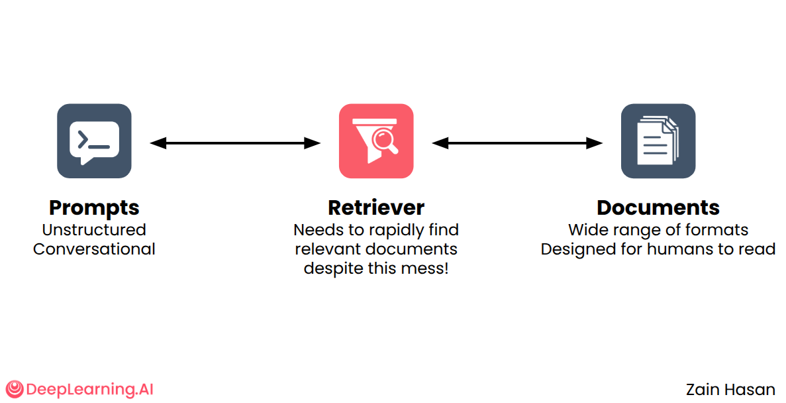
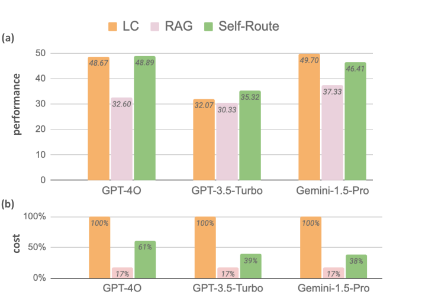

# 2 — Why RAG, and the augmented prompt

Ask a chat model for Tallybook's refund window and it will give you one. It sounds right, because refund windows are usually 14 or 30 days, and the model has seen plenty of them. It has never seen this company's policy, so the number is a guess in the voice of a fact. Retraining won't fix that, since the policy is private and changes whenever finance changes it. The fix is older and simpler: look it up first, then answer from what you found.

> RAG is "put the missing facts in the prompt, automatically": a retriever picks documents from a knowledge base, the prompt template splices them in, and the LLM answers from them. This note covers why that works and what the smallest version looks like in code.

---

## Where this sits

Notes 02–07 condense Zain Hasan's *Retrieval Augmented Generation* course (DeepLearning.AI, on Coursera), one note per module. Note [01](01-rag-pipeline.md) is the house overview of the whole pipeline. These six notes are the course's worked version of it, with the lab code.

| Note | Course module | Main question |
|---|---|---|
| **02 (this note)** | M1 RAG overview | Why retrieve at all? |
| [03](03-keyword-semantic-and-hybrid-search.md) | M2 Information retrieval | How does the retriever rank? |
| [04](04-vector-databases-and-ann.md) | M3 part 1 | How does it rank fast, at scale? |
| [05](05-chunking-query-parsing-and-reranking.md) | M3 part 2 | What goes in, what query goes out, what comes back? |
| [06](06-generation-for-rag.md) | M4 LLMs and text generation | How does the LLM use what came back? |
| [07](07-rag-in-production.md) | M5 RAG in production | How do you evaluate, trace and run it? |

---

## The knowledge gap

An LLM knows what was in its training data, compressed. It does not know three kinds of thing:

| Gap | Example | Why training can't fix it |
|---|---|---|
| **Private data** | Your company's refund policy, a customer's order history | Never in a public crawl |
| **Real-time data** | Today's news, current stock, this week's prices | Training has a cutoff |
| **Hard-to-access data** | Niche manuals, paywalled specs, internal wikis | Too rare to be learned reliably |

How much a model can answer from its weights alone has been measured. The first probe, LAMA, asked BERT-large fill-in-the-blank questions such as "Dante was born in [MASK]", with no fine-tuning, ranked over a 21K-token vocabulary shared by all the models compared. Recall depended on the kind of fact. Precision@1 was 74.5% on one-to-one relations such as capitals, 24.3% on many-to-many relations, and 1.4% on birth dates from Google-RE, below the 1.9% of always guessing the most common answer. On 305 SQuAD questions, BERT got 17.4% right at P@1 against 37.5% for DrQA, which retrieves Wikipedia first and was restricted to single-token answers; at P@10 the gap narrowed to 57.1 vs 63.5 ([EMNLP 2019](https://doi.org/10.18653/v1/d19-1250), Petroni et al.). When wrong, it usually named something of the right type: IBM instead of Oracle as the developer of the JDK. A fluent wrong answer of the right type is the failure retrieval is meant to catch. The probe covers single-token answers and one template per relation only, and the authors treat it as a lower bound. Roberts, Raffel and Shazeer fine-tuned T5 to answer questions with no documents at all. Exact match on Natural Questions rose steadily with size, from 25.9 at 220M parameters to 32.6 at 11B. Extra pre-training that masked named entities and dates took the 11B model to 34.8, and a T5.1.1-XXL checkpoint to 35.2. That still trailed DPR's open-book 41.5 on NQ, and the closed-book model came out ahead only on WebQuestions ([arXiv:2002.08910](https://arxiv.org/abs/2002.08910), Roberts et al., EMNLP 2020). The authors list the limitations themselves. The model "hallucinates realistic-looking answers when it is unsure", it gives no sign of where an answer came from, and nothing lets you update or remove a fact. Exact match also undercounted it: of 150 answers scored wrong, only 62% were wrong on inspection, and 11% could not be answered without knowing when the question was asked or which article it referred to.

Two later papers made the model write its own context before answering, and both ended up measuring what retrieval still adds. RECITE has the model recite a passage from memory, samples 20 recitations and takes a majority vote over the answers. With 5 examples in the prompt, it raised Natural Questions exact match from 25.8 to 28.7 for PaLM-62B and from 31.5 to 35.8 for Codex. Against one top-1 BM25 passage on the first 1,024 NQ dev questions, with all 20 recitations still voting, it split: retrieval won for UL2-20B (16.3 vs 14.2) and lost for Codex (33.2 vs 35.8). The annotated long-answer passage beat both by far, 41.0 and 49.3 ([arXiv:2210.01296](https://arxiv.org/abs/2210.01296), Sun et al., ICLR 2023). In an error analysis on TriviaQA with UL2-20B and OPT-30B, misreading a recitation that held the answer was rare (6–8% of questions); never reciting the answer (21–22%) and losing the vote when some recitations had it (about 20%) made up most of the rest. The authors concede that new knowledge still means retraining. GenRead had InstructGPT (175B) write 10 background documents for a fine-tuned 3B FiD reader. With a clustering prompt that diversifies the documents, that beat the same reader on 10 DPR passages on TriviaQA (71.6 vs 66.3) and WebQuestions (54.4 vs 50.8), but lost on Natural Questions (45.6 vs 50.1); plain sampling scored 69.6, 52.6 and 42.6. The authors trace the NQ loss partly to the data: about 16.5% of NQ questions have answers that change over time (Zhang & Choi's count), and in 100 inspected examples 16 had incomplete gold answers. Mixing both sources scored best on all three (74.3, 56.2, 54.0). In a sweep of InstructGPT sizes, only the largest generator beat retrieval. The authors concede that generated documents can hallucinate and that new knowledge would still need retraining, and the three benchmarks are long-standing public QA sets a 175B model may well have seen in training ([arXiv:2209.10063](https://arxiv.org/abs/2209.10063), Yu et al., ICLR 2023). On public facts a large model's memory competes with retrieval. On recent, private or rare facts, the rows of the table above, it has nothing to recite.

The course's one-line definition: if you had to answer a question about something you didn't know, you would look it up first. RAG does that for the model. *"Just put it in the prompt."*


*Image Source: Hasan, DeepLearning.AI RAG course, Module 1*

The same diagnosis can start from the query. Zhao et al. sort queries into four levels by the external data they need: explicit facts (L1, where basic RAG is the usual answer), implicit facts that need several retrievals (L2), interpretable rationales such as guidelines and workflows (L3) and hidden rationales learned from examples (L4). The paper warns that treating an L1 query as L2 retrieves an abundance of superficial information, while the reverse misses the comprehensive evidence L2 needs, so it advises classifying the level first. It is a proposed taxonomy of a 2024 survey with no experiments ([arXiv:2409.14924](https://arxiv.org/abs/2409.14924), Zhao et al., 2024-09, preprint).

---

## The two components

| Component | Job | What it holds |
|---|---|---|
| **Retriever** | Given the prompt, find the most relevant documents | An index over the **knowledge base** |
| **LLM** | Given prompt + documents, write the answer | Only its weights. It sees the docs because they are in the context window |

The split, and the name, come from Lewis et al. ([arXiv:2005.11401](https://arxiv.org/abs/2005.11401), NeurIPS 2020). They paired a dense retriever over 21M 100-word Wikipedia chunks with a 400M-parameter BART generator, and fine-tuned the query encoder and generator together. The document encoder and index stayed frozen, which is why the index could be swapped out to update what the model knows. They tested this on 82 world leaders. With the 2016 Wikipedia index the model named 2016 leaders correctly 70% of the time, and with the 2018 index it named 2018 leaders correctly 68% of the time. With the wrong year's index it fell to 4–12%, and no retraining was involved. The course's version keeps the split and drops the joint training: an off-the-shelf retriever feeds a frozen LLM through the prompt.

The retrieve-then-read pattern is older than the name. Huyen traces it to Chen et al. (2017), who paired a Wikipedia retriever with a "document reader" for open-domain QA (*AI Engineering*, ch. 6). Their DrQA retriever was not learned. It scored TF-IDF vectors with hashed bigrams and passed the top 5 of 5M Wikipedia articles to a neural reader that picked an answer span. It beat Wikipedia's own search on all four datasets (the unigram version on three of four), and the authors report that BM25 and averaged word embeddings did worse, without numbers. Retrieval was the easier half. On SQuAD questions the answer appeared in the top 5 articles 77.8% of the time, yet exact match fell from 69.5 with the right paragraph given to 27.1 over all of Wikipedia, and to 49.4 even with the right article ([arXiv:1704.00051](https://arxiv.org/abs/1704.00051), Chen et al., ACL 2017). Many errors were sentences on the right topic, and the authors blame much of the drop on SQuAD questions that are ambiguous without their paragraph. Raieli and Iuculano sort the ways the two halves can be trained (*Building AI Agents*, ch. 6):

| Paradigm | What is trained | Example |
|---|---|---|
| Training-free | Nothing; off-the-shelf retriever and LLM | The course, most production RAG |
| Independent | Each half on its own objective | A fine-tuned embedder plus a separately fine-tuned LLM |
| Sequential, retriever first | Retriever fixed, then the LLM learns to use what it returns | RETRO: frozen BERT retriever, language model pretrained to attend to what it finds |
| Sequential, LLM first | LLM fixed, then the retriever learns from the LLM's signal | Izacard & Grave: the reader's attention scores supervise the retriever |
| Joint | Both, end to end | Lewis et al. above; REALM, below |

The "LLM first" row needs less labelling than it sounds. Izacard and Grave trained a retriever with no question–passage labels at all, only question–answer pairs. The reader (a T5 Fusion-in-Decoder model reading 100 passages) attends to some passages more than others. Its cross-attention, averaged over layers, heads and the passage's tokens for the first output token, became the target the retriever was trained to match with a KL loss ([KL](../../01-llm-fundamentals/notes/06-pretraining-data-and-objectives.md#entropy-cross-entropy-kl-and-perplexity)). Starting from BM25's passages and iterating two or three times, the retriever beat supervised DPR on test-set retrieval: top-20 recall 80.0 vs 79.4 on Natural Questions and 81.4 vs 79.4 on TriviaQA ([arXiv:2012.04584](https://arxiv.org/abs/2012.04584), Izacard & Grave, ICLR 2021). It depends on a decent start. From untrained BERT it reached 68.8 on NQ, well short of DPR, and the authors state outright that they assume attention scores measure relevance. Their one direct test: keeping the top 10 of 100 passages by attention gave 46.8 EM, against 42.9 for DPR's top 10 and 48.2 with all 100. Huyen notes that fine-tuning the retriever and generator together improves results. The price is that the pair now has to be retrained together, which is one reason most systems stay training-free.

REALM shows what the joint row costs. It pretrained a BERT-base retriever and reader together, masking named entities and dates so the reader needed the retrieved text. Each retriever update makes the stored document vectors stale, so a second job re-embedded all 13M Wikipedia chunks about every 500 training steps. With an index 30× staler, Natural Questions dev exact match fell from 38.2 to 28.7, below the ORQA baseline it set out to beat. Trained properly, the 330M model scored 39.2–40.4 on NQ test, ahead of closed-book T5-11B's 34.5 (REALM's figure, from an earlier version of Roberts et al.) at 30 times the size, while reading only 5 documents ([arXiv:2002.08909](https://arxiv.org/abs/2002.08909), Guu et al., ICML 2020). Even REALM froze the document index during fine-tuning, for simplicity, and the authors guess that refreshing it there too might have helped.

Retrieval can also act on the model's output, with no training at all. kNN-LM stores one entry per training token: the model's hidden state for the preceding text, paired with the token that came next. At each step it looks up the 1,024 nearest stored states and mixes their next tokens into the model's own prediction. On WikiText-103 that took a 247M model's test perplexity from 18.65 to 16.12. A model trained on 100M Wikipedia tokens and given a 3B-token datastore reached 13.73, better than the same model trained on all 3B tokens (15.17). Swapping in a datastore of books, with no retraining, cut a Wikipedia model's perplexity on books from 34.84 to 20.47, still well short of a model trained on books (11.89) ([arXiv:1911.00172](https://arxiv.org/abs/1911.00172), Khandelwal et al., ICLR 2020). The evidence is perplexity at one model size. The datastore holds one entry per token, and a lookup runs at every generated token. SPALM moved the mix inside the network: a learned gate decides, token by token, how much of the retrieved next tokens to blend into the hidden state, where kNN-LM uses one fixed weight tuned on the dev set. Both were run on the same 142M Transformer-XL with 4 neighbours, not kNN-LM's original 1,024. On WikiText-103 the gate alone did not beat kNN-LM (18.3 vs 18.0 test perplexity at a 3,072-token memory). On news with a later test month it did (14.0 vs 15.2, at 148M), and the authors suggest that kNN-LM's weight, tuned on a dev month, suffered when the test month differed; they did not test that. Neither gap was significance-tested. Finding the neighbours for every training token took 6–8 hours on 1,000 CPUs for WikiText-103 ([arXiv:2102.02557](https://arxiv.org/abs/2102.02557), Yogatama et al., TACL 2021).

Retrieval can also be built into pretraining. RETRO splits the input into 64-token chunks, looks up the nearest chunks in a database with a frozen BERT encoder, and trains the language model to cross-attend to them. With a 2-trillion-token database, the 7.5B model beat the 178B Jurassic-1 on most Pile subsets in bits-per-byte. The abstract calls it comparable to GPT-3 and Jurassic-1 with 25× fewer parameters. On C4, the gain from retrieval was about what a 10× larger model without retrieval would give, and it stayed constant from 172M to 7.5B parameters ([arXiv:2112.04426](https://arxiv.org/abs/2112.04426), Borgeaud et al., ICML 2022). Read those multipliers as language-modelling numbers. On Natural Questions RETRO scored 45.5 exact match, below FiD's 51.4. Part of its advantage comes from finding the test text in the database: it exploits overlap more than the baselines do, and the authors call its Wikitext103 perplexity of 3.92 partly leakage. It still won on chunks sharing no more than 8 contiguous tokens with the training data. The claim that updating the database keeps the model current, or removes data, is argued, not measured.

Atlas, a T5 Fusion-in-Decoder reader trained together with a Contriever retriever, measured the update half of that claim. It also tested how far retrieval substitutes for size. The 11B model scored 42.4 exact match on Natural Questions from 64 examples, ahead of the 540B PaLM's 39.6 ([arXiv:2208.03299](https://arxiv.org/abs/2208.03299), Izacard et al., JMLR 2023). Atlas was fine-tuned on those 64 examples while PaLM was only prompted with them, so method differs as well as size. Its four ways of training the retriever from the reader made no systematic difference. Refreshing the index during training cost about 30% extra compute, and product quantisation shrank the Wikipedia index from 49 GB to 4 GB with a negligible drop. Its index swap is in the table under [What RAG buys you](#what-rag-buys-you).

The retriever's job is hard because the two sides look nothing alike: prompts are short, unstructured questions, and the knowledge base is anything from PDFs to tables to HTML.


*Image Source: Hasan, DeepLearning.AI RAG course, Module 1*

### What RAG buys you

| Advantage | Mechanism |
|---|---|
| Injects missing knowledge | Facts arrive in the context, not the weights |
| Fewer hallucinations | The model has text to copy from instead of guessing a probable continuation. In knowledge-grounded dialogue (BART-Large on Wizard of Wikipedia, unseen topics, human-rated), retrieval cut hallucinated responses from 68.2% to 8–21% depending on the architecture ([arXiv:2104.07567](https://arxiv.org/abs/2104.07567), Shuster et al., 2021-04) |
| Stays up to date | Update the knowledge base, not the model. Atlas, trained on 2017 answers, scored 57.7% with a 2017 Wikipedia index. Swapped to a 2020 index with no retraining, it scored 53.1% on the 2020 answers, against 2.9% for a closed-book T5 of the same size (806 TempLAMA-derived cloze questions whose answer changed, 11B models) ([arXiv:2208.03299](https://arxiv.org/abs/2208.03299), Izacard et al., JMLR 2023) |
| Citations | Each retrieved doc has a source the answer can point to |
| LLM does what it is good at | Writing and reasoning; the retriever does lookup |

The cost: **latency**. Every request now pays for a retrieval step before generation starts.

Retrieval also costs quality when the task doesn't need knowledge. BlenderBot added a Wikipedia retriever to a 2.7B chatbot. In two author probes it then identified real people correctly from Wikipedia, where the plain model hallucinated an Italian footballer and an American singer. In conversations of at least 14 turns starting "Hi!", judges comparing the logs still preferred the plain model's slightly more often: 49% against human–human logs, vs 47% with knowledge retrieval (neither differs significantly from human), and the authors suspect the model used knowledge "when there is no need, or using it incorrectly". Retrieving whole training-set replies did no better once decoding was tuned. Dropping the 20-token minimum length cut the plain 2.7B model from 49% to 21% (significant), a far bigger swing than either retriever made ([arXiv:2004.13637](https://arxiv.org/abs/2004.13637), Roller et al., EACL 2021). Factual errors were rare in those chats because they seldom asked for facts, so the result says retrieval doesn't help small talk, not that it fails at QA. Route queries that need no lookup around the retriever.

**When the context is wrong, or the model trusts itself.** ClashEval perturbed the retrieved document for 1,294 fact questions in six domains (numbers scaled 0.1x to 10x, years shifted, categories altered). Its abstract reports models adopting the wrong context over their own correct prior over 60% of the time; Table 3's GPT-4o baseline context bias is 0.304, and the paper does not reconcile the two. The further the context departs from truth, the less often it is adopted, and the more confident the model's prior (token probability), the less it prefers the context. Claude Opus was best at 74.3% accuracy and 15.7% context bias. A calibrated token-probability correction (compare percentiles of the prior and contextual answers' probabilities) took GPT-4o from 61.5% to 75.4% accuracy and from 30.4% to 10.7% context bias, while prior bias rose from 2.1% to 8.5% (14.7% for GPT-3.5, 18.8% for Llama-3 after correction). On GPT-4 a strict prompt told to rely on the context pushed toward the context and a loose one toward the prior. Single document, 2024 models, error rate enriched, so not a rate in the wild ([arXiv:2404.10198](https://arxiv.org/abs/2404.10198), Wu et al., NeurIPS 2024 Datasets and Benchmarks). The paper does not report that larger models trust themselves more, a claim [note 06](06-generation-for-rag.md#hallucinations-and-citations) repeats from a secondary source. Training the reader to write a note first targets both failures. Chain-of-Note has it write a reading note per passage (answers it, gives context, or irrelevant so say unknown) before answering. A LLaMa-2 7B tuned on 10K GPT-4-written NQ notes gained +7.9 EM on average when all five DPR passages were noise (NQ 34.28 to 41.83) but only +1.97 on the full test sets, and rejected 13.0% of out-of-scope real-time questions against 6.1%. Notes cost about 20x decoding time (12.0 s vs 0.6 s per example) ([arXiv:2311.09210](https://arxiv.org/abs/2311.09210), Yu et al., EMNLP 2024). A post-hoc alternative needs no training: Rethinking with Retrieval samples chain-of-thought paths, retrieves evidence per reasoning step and votes for the best-supported answer. On GPT-3 text-davinci-002 it scored 77.73% on StrategyQA (229 questions) against 73.36 for self-consistency and 65.94 for CoT; retrieving with the original question gave no gain (73.36), and the temporal (+1.77) and tabular (+0.83) tasks gained under 2 points over self-consistency ([arXiv:2301.00303](https://arxiv.org/abs/2301.00303), He et al., 2022-12, preprint).

Astute RAG shows how common the mixed case is with a real search engine. On 1,042 short-form questions (NQ, TriviaQA, BioASQ, PopQA; ten Google Search passages each), roughly 70% of retrieved passages held no answer, and Claude 3.5 Sonnet's answers with and without retrieval disagreed on 19.2% of questions, with the model right in 47.4% of those and the passages in 52.6%. Conflicts peaked when retrieval precision was about 10%. Plain RAG trailed no retrieval on NQ (44.4 against 47.1) and TriviaQA (76.7 against 82.0) and led on BioASQ (58.0 against 50.4) and PopQA (36.0 against 29.8). Its fix is training-free: the model writes its own passage, merges consistent passages from both sources, tags each with memory or retrieval, and picks the answer with the highest confidence. Overall accuracy was 61.7 against 55.5 for plain RAG (Claude) and 59.2 against 53.7 (Gemini 1.5 Pro), with under 5% more tokens. Mistral-Nemo (12B) only tied the best baseline (51.3 against 51.2), and the authors' own benchmark, string-match scoring and single runs mean the 6.85% and 4.13% relative gains are indicative ([arXiv:2410.07176](https://arxiv.org/abs/2410.07176), Wang et al., 2024-10, v2 2025, preprint).

### Why not put everything in the prompt?

Two limits, both still true with million-token windows:

1. **Compute cost.** Attention cost grows with context length; every extra token is paid on every call.
2. **Context window.** It is finite, and models attend less well to the middle of a long context (see [ai-engineering 02 — retrieval](../../../ai-engineering/02-context-engineering/notes/04-retrieval.md)).

How the two trade off against quality has moved with the models:

- **2023, 70B open models.** A 4K window plus top-5 retrieval matched a 16K long-context model at a fraction of the compute (Llama2-70B, average over seven long-document QA and summarisation sets: 36.02 vs 36.78). Adding retrieval to the 32K model still raised its average from 37.36 to 39.60. Llama2-7B gained nothing from it ([arXiv:2310.03025](https://arxiv.org/abs/2310.03025), Xu et al., 2023-10).
- **2024, frontier models.** Reading the whole document beat top-5 RAG on the seven LongBench sets by 7.6 points on average for Gemini-1.5-Pro and 13.1 for GPT-4o, while RAG used about 17% of the tokens. The two answers were identical on 63% of queries, so the authors route instead of choosing. RAG answers first, prompted to say "unanswerable" when the chunks don't cover the question, and only those queries go to the full context. Averaged over all nine sets (adding two from ∞Bench), this *Self-Route* matched long context for GPT-4o (48.89 vs 48.67) at 61% of the tokens and came within 3.3 points for Gemini at 38%. RAG still won where the input outgrew the window: GPT-3.5-Turbo (16K) on ∞Bench's ~147K-word documents ([arXiv:2407.16833](https://arxiv.org/abs/2407.16833), Li et al., 2024-07).
- **More retrieved context is not the fix either.** With chunks kept in document order rather than score order, Llama3.1-70B on ∞Bench En.QA peaked at 48K tokens of retrieved context (47.25 F1) and declined past it. That beat the same model reading the whole ~117K-token input (34.26). Document order alone was worth 6 F1 at 16K (44.43 vs 38.40) ([arXiv:2409.01666](https://arxiv.org/abs/2409.01666), Yu et al., 2024-09). This is two datasets, and the best context size was picked on the test set.
- **Order and retriever quality decide where more passages stop helping.** Jin et al. varied the number of retrieved passages k on NQ with four readers (Gemma-7B-Chat, Gemma-2-9B-Chat, Mistral-Nemo-12B, Gemini-1.5-Pro). With e5 (recall@40 0.90) accuracy rose, then fell or plateaued; with BM25 (0.73) it mostly kept rising. Hard negatives from stronger retrievers hurt more than random ones, and edge-first reordering helped only at large k. Fine-tuning on 40-passage RAG data beat plain QA tuning (no retrieved context) in most cases on nine unseen datasets. Results are plotted curves over 2018 Wikipedia ([arXiv:2410.05983](https://arxiv.org/abs/2410.05983), Jin et al., 2024-10, preprint).
- **Bigger retrieval units shift the trade-off.** LongRAG groups hyperlinked Wikipedia pages into units of about 4K to 6K tokens. On NQ (bge-large-en-v1.5) the corpus fell from 22M passages to 600K units and top-1 answer recall rose from 52.24 to 71.69, with eight units matching 100 passages (88.53 vs 89.92). A long unit embedded as the max over its 512-token chunks (BGE-Large) scored 71.7 AR@1, against 23.4 for one vector of the whole unit (E5-Mistral-7B). On Qasper (reader not named in Table 6) one 5K-token unit beat 100 passages (F1 26.3 vs 22.6) but ten units fell to 21.6; the authors put the best reader context near 30K tokens. Lenient "refined" EM, hyperlink grouping, no cost reported ([arXiv:2406.15319](https://arxiv.org/abs/2406.15319), Jiang et al., 2024-06, preprint).


*Image Source: Li et al., [Retrieval Augmented Generation or Long-Context LLMs? A Comprehensive Study and Hybrid Approach](https://arxiv.org/abs/2407.16833) (2024), Fig. 1*

The books add three practical points:

- **The threshold.** Anthropic's guidance, as Huyen reports it: a knowledge base under about 200K tokens (roughly 500 pages) can go whole in the prompt, with prompt caching to keep the cost down (*AI Engineering*, ch. 6). Huyen still expects RAG to outlast long context, because data grows faster than windows and models use long context less well than short.
- **The costs.** Long-context models hallucinate more on long inputs and cost more per call. Also, "1M tokens isn't a lot" next to an organisation's documents (*Building AI Agents*, ch. 6). The same chapter says embedders max out around 32K tokens; that was true at the time of writing and is moving.
- **Where the two meet.** Raieli and Iuculano expect RAG to change shape rather than disappear. Small-to-big retrieval grows into "retrieve the whole document". A router chooses between whole document and chunks, which is Self-Route above. Retrieval moves into the model's KV cache.

When the corpus fits the window of a frontier model, the case for RAG is cost and latency, with quality at parity only if you route. When it doesn't fit, retrieval is the only option. Either way, the retriever has a trade-off of its own: return enough to cover the answer, but not so much that the relevant passage drowns. Notes 03–05 are about striking it.

---

## LLM basics the course relies on

| Idea | One line |
|---|---|
| Tokens | The model reads and writes sub-word pieces, not words |
| Autoregressive | It generates one token at a time, each conditioned on everything before |
| Probable ≠ truthful | It picks likely continuations. If the fact isn't in context or weights, a fluent wrong answer is still likely |
| Training data = knowledge | Anything else must arrive through the prompt |

Note [06](06-generation-for-rag.md) returns to the generation side in detail.

---

## The smallest RAG: an f-string

Module 1's ungraded lab has no retriever at all. It shows that augmentation is just string formatting:

```python
# Facts the model can't know: a private listing (lab data trimmed to 2 rows)
house_info = [
    {"address": "123 Maple Street", "city": "Springfield", "price": 250000, "bedrooms": 3},
    {"address": "456 Elm Avenue",   "city": "Shelbyville", "price": 300000, "bedrooms": 4},
]

def house_info_layout(houses):
    # Turn structured records into a text block the LLM can read
    return "\n".join(
        f"House located at {h['address']}, {h['city']}, priced at ${h['price']}, "
        f"{h['bedrooms']} bedrooms." for h in houses
    )

def generate_prompt(query, houses):
    # The whole "augmentation" step: retrieved text + the question, one template
    return f"""
Use the following houses information to answer users queries.
{house_info_layout(houses)}
Query: {query}
"""

query = "What is the most expensive house? And the bigger one?"
print(generate_prompt(query, house_info))
```

```text

Use the following houses information to answer users queries.
House located at 123 Maple Street, Springfield, priced at $250000, 3 bedrooms.
House located at 456 Elm Avenue, Shelbyville, priced at $300000, 4 bedrooms.
Query: What is the most expensive house? And the bigger one?
```

The lab then sends the bare question and the augmented prompt to the same model and compares the answers:

```python
# illustrative: needs an API key; the wrapper is defined in the course's utilities
generate_with_single_input(prompt=query, role="user")            # guesses
generate_with_single_input(prompt=generate_prompt(query, house_info),
                           role="assistant")                     # reads it off
```

`generate_with_single_input` is the course's thin wrapper over an OpenAI-compatible chat call (Together.ai, default `meta-llama/Llama-3.2-3B-Instruct-Turbo`).

Prepending text to a frozen model is a measured technique, not only a teaching shortcut. Ram et al. call it In-Context RALM: no retraining and no architecture change, just the retrieved passage placed before the input. With BM25 over Wikipedia and one 100-word passage, a 345M GPT-2 beat the 762M GPT-2 without retrieval on WikiText-103 perplexity (21.5 vs 22.0), and OPT-6.7B matched OPT-66B. In zero-shot open-domain QA, two DPR passages lifted LLaMA-13B's exact match on Natural Questions from 12.0% to 31.0% ([arXiv:2302.00083](https://arxiv.org/abs/2302.00083), Ram et al., TACL 2023). BM25 beat three off-the-shelf dense retrievers for this use, and a 110M model was nearly as good a reranker as the 1.5B generator itself, which matters when the generator sits behind an API. The limits are real. The main metric is perplexity, not answer quality. Retrieval reruns every 4 tokens, at a cost the paper never times. The gain shrinks with scale: LLaMA-33B's perplexity moved only from 6.3 to 6.1.

---

## Assignment 1: news retrieval end to end

The graded assignment adds a real retriever over the Kaggle *News Headlines 2024* dataset (BBC News). The structure is the one every later lab keeps:

```python
# illustrative: needs the course's retrieve() and query_news() and its news dataset
def get_relevant_data(query: str, top_k: int = 5) -> list[dict]:
    # retrieve() returns indices of the top_k most relevant articles;
    # query_news() looks those indices up in the dataset
    relevant_indices = retrieve(query, top_k)
    return query_news(relevant_indices)

def format_relevant_data(docs: list[dict]) -> str:
    # One readable block per article. Keep the URL: it becomes the citation
    return "\n".join(
        f"Title: {d['title']}, Description: {d['description']}, "
        f"Published at: {d['published_at']}\nURL: {d['url']}"
        for d in docs
    )

def generate_final_prompt(query, top_k=5, use_rag=True, prompt=None):
    if not use_rag:
        return query                                  # baseline: bare question
    docs = format_relevant_data(get_relevant_data(query, top_k))
    if prompt is None:
        prompt = (
            "Answer the user query below. There will be provided additional "
            "information for you to compose your answer. The relevant information "
            "provided is from 2024 and it should be added as your overall knowledge "
            "to answer the query, you should not rely only on this information to "
            "answer the query, but add it to your overall knowledge.\n"
            "Query: {query}\n2024 News: {documents}"
        )
    return prompt.format(query=query, documents=docs)
```

Three things the lab is teaching:

| Point | Where it shows |
|---|---|
| Retrieval and generation are separable | `use_rag=False` gives a baseline with the same model |
| The template is a design decision | `prompt=None` lets you swap instructions ("use only these docs" vs "add to your knowledge") |
| `top_k` is the main retrieval knob | Too low misses the answer, too high dilutes it. Going from 5 to 25 retrieved documents raised human-rated hallucination in Shuster et al.'s dialogue models (FiD-RAG 7.9% → 19.8%) |

`llm_call(query, use_rag=...)` prints both answers side by side. The suggested queries ("How is global warming progressing in 2024?", "Tell me about the most recent advances in AI.") make the gap obvious: the baseline hedges about its cutoff, the RAG answer quotes 2024 headlines.

## The same structure over Tallybook

Here is that structure over the running example, so it runs with no key and no dataset. `reader` is a stand-in for an LLM that only returns the context sentence sharing the most words with the question, and says it doesn't know when there's no context. A stand-in is enough here because this block exercises the plumbing around the model: where the documents come from, how the prompt is built, and what the baseline looks like.

```python
import re
from ragkit import DOC_BY_ID, Retriever, tokenize

retriever = Retriever()

def get_relevant_data(query, top_k=3):
    return [DOC_BY_ID[i] for i in retriever.dense(query, k=top_k)]

def format_relevant_data(docs):
    # Keep the id: it becomes the citation.
    return "\n".join(f"[{d.id}] {d.title}: {d.text}" for d in docs)

def generate_final_prompt(query, top_k=3, use_rag=True):
    if not use_rag:
        return query                                 # baseline: bare question
    return (f"Answer only from the documents and cite the id in brackets.\n"
            f"Documents:\n{format_relevant_data(get_relevant_data(query, top_k))}\n"
            f"Question: {query}")

def reader(prompt, query):                           # stand-in for an LLM
    best, best_overlap = "I don't know.", 0
    for doc_id, body in re.findall(r"^\[(kb-\d+)\] (.+)$", prompt, re.M):
        for sentence in re.split(r"(?<=[.])\s+", body):
            overlap = len(set(tokenize(sentence)) & set(tokenize(query)))
            if overlap > best_overlap:
                best, best_overlap = f"{sentence} [{doc_id}]", overlap
    return best

query = "How long do refunds take to reach the card?"
print("no RAG:", reader(generate_final_prompt(query, use_rag=False), query))
print("RAG:   ", reader(generate_final_prompt(query), query))
```

```text
no RAG: I don't know.
RAG:    Refunds reach the original card in 5 to 10 working days. [kb-04]
```

A real model would phrase this better, and it would also answer the no-RAG line with a confident guess. That is worse than the honest "I don't know" the stand-in gives, and it is why you build the baseline: you need to see what the model says when it has nothing.

`top_k` is the first knob you get. Raising it buys recall and costs context. Here is that trade-off measured on the 20 labelled questions, counting words as a rough proxy for tokens:

```python
from ragkit import DOC_BY_ID, QUERIES, Retriever, recall_at_k

retriever = Retriever()
for k in [1, 2, 3, 5, 10]:
    runs = [(retriever.hybrid(q, k=k, pool=18), rel) for q, rel, _ in QUERIES]
    recall = sum(recall_at_k(r, rel, k) for r, rel in runs) / len(runs)
    words = sum(len(DOC_BY_ID[i].full.split()) for r, _ in runs for i in r) / len(runs)
    print(f"top_k={k:<2}  recall@k={recall:.2f}  context words per query={words:.0f}")
```

```text
top_k=1   recall@k=0.55  context words per query=43
top_k=2   recall@k=0.85  context words per query=86
top_k=3   recall@k=0.95  context words per query=128
top_k=5   recall@k=0.95  context words per query=211
top_k=10  recall@k=1.00  context words per query=393
```

Past the point where recall flattens, each extra document pays for words the model has to read past, with no new answer in them. Shuster et al.'s dialogue result in the table above is the same shape measured on human-rated hallucination.

---

## Where RAG is used

| Application | Knowledge base |
|---|---|
| Code generation | The repo, its docs, its issues |
| Enterprise / customer-service chatbots | Policies, product catalogue, past tickets |
| Healthcare and legal | Guidelines, case law, kept current |
| AI-assisted web search | The live web (see [07 — internet search agent](../../07-agentic-applications/notes/01-internet-search-agent.md)) |
| Personal assistants | Your email, calendar, notes |

Rows in a table are a weak fit for plain RAG. On 80 BIRD questions adapted to need world knowledge or reasoning (Llama-3.1-70B, about 20 questions per cell, aggregation unscored), row-level RAG with the top 10 rows answered none correctly and Text2SQL 17%, against 55% for hand-written pipelines that filter with SQL and then apply an LM to the small result. The 55% rests on expert-written queries by the authors of the system, not on automatic query synthesis ([arXiv:2408.14717](https://arxiv.org/abs/2408.14717), Biswal et al., 2024-08, preprint; built out in [the data-analysis agent](../../07-agentic-applications/notes/05-data-analysis-agent.md)).

---

## Rules of thumb

| Rule | Why |
|---|---|
| Build the no-RAG baseline first | You can't show retrieval helped without it |
| Keep source metadata through formatting | Citations need it, and so does debugging |
| Treat the prompt template as code | It decides whether the model trusts, ignores or mixes the docs |
| Treat context construction as feature engineering | Huyen's framing: what you retrieve and how you format it is to an LLM app what features are to a classical model (*AI Engineering*, ch. 6) |
| Start with `top_k` around 5 | Then tune with the metrics in note 03 |

---

## Labs

| Lab | Label |
|---|---|
| M1 ungraded lab (house prompt) and Assignment 1 (news RAG) ([upstream](https://github.com/MohammadWasiq0786/Deeplearning.ai-RAG)) | needs an API key (Together.ai, via the Coursera proxy); not copied |

---

## Pitfalls

- **No baseline.** Symptom: everyone agrees the RAG answers look good, and no one can say what retrieval added. Keep a `use_rag=False` path and compare.
- **Dropping source metadata while formatting.** Symptom: answers can't cite anything, and debugging a wrong answer means guessing which document caused it. Carry the id through every stage.
- **A template that invites the model's own knowledge.** Symptom: answers mix your documents with outdated training data. The course's assignment deliberately says "add it to your overall knowledge". For factual support use, say "only from the documents".
- **Stuffing the corpus because the window allows it.** Symptom: the bill grows and quality does not. Whole-document reading can win on frontier models (Li et al. above), and it still costs several times the tokens. Route between the two if you have both.
- **Treating `top_k` as a constant.** Symptom: recall is fine on simple questions and multi-part ones miss half their answer. Tune it against labelled data, per query type if needed.

---

## Try it

1. Run the Tallybook block with `query = "How do I close my account?"`. Which sentence does the reader pick, and is it the best one?
2. Change `retriever.dense` to `retriever.sparse` in `get_relevant_data` and rerun with "can I get my money back". What happens, and what does it say about a pipeline where only the retriever changed?
3. Your corpus is 150K tokens and rarely changes. Long context or RAG? Give your reasoning and name what you would measure.

<details>
<summary>Answers</summary>

1. Dense search finds `kb-06`, and the reader takes the sentence with the most shared words. It can only reward word overlap, so it may pick a sentence that shares words and misses the action. A real model reads meaning, which is why this is a plumbing test and not a quality test.
2. BM25 returns only `kb-03`, which contains "Back off", so the reader answers with an irrelevant sentence or "I don't know". The prompt and the reader didn't change, so the failure is pure retrieval. This is why you measure retrieval on its own.
3. Under Anthropic's rough threshold as Huyen reports it (about 200K tokens), whole-corpus plus prompt caching is a reasonable first build. Measure accuracy on your own questions, and cost and latency per call, against a RAG baseline. Li et al.'s Self-Route suggests trying both behind a router if volume is high.

</details>

---

## Interview checklist

| Question | Answer |
|---|---|
| What problem does RAG solve? | The model lacks private, real-time and hard-to-access facts. Retrieval supplies them in the prompt at inference time, with no retraining. |
| Why is updating an index better than retraining? | Lewis et al. swapped a 2016 Wikipedia index for 2018 and the model named 2018 world leaders correctly 68% of the time. With the wrong year's index it fell to 4–12%, and no retraining was involved. |
| What does RAG cost you? | A retrieval step of added latency, an index to keep in sync, and a new failure surface. |
| Does RAG reduce hallucination? | In Shuster et al.'s dialogue setup, hallucinated responses dropped from 68.2% to 8–21%. More documents can push it back up: 7.9% to 19.8% going from 5 to 25 with FiD-RAG. |
| Long context or RAG? | Long context can beat top-5 RAG on quality with frontier models, at much higher token cost. Li et al.'s Self-Route answers with RAG and falls back to full context only for "unanswerable" outputs. When the corpus doesn't fit the window, retrieval is the only option. |
| How much retrieved context is optimal? | It depends on the model and data. Yu et al. saw Llama3.1-70B peak at 48K tokens on one benchmark, and document order alone added 6 F1 at 16K. |
| Name the training paradigms for retriever and generator. | Training-free, independent, sequential in either order, and joint. Most production systems stay training-free because joint training ties the pair together. |
| What is the smallest possible RAG? | Fetch text and format it into the prompt template. The augmentation step is an f-string. |
| Why keep source metadata through prompt formatting? | Citations need it, and so does debugging. If formatting strips the source from a chunk, nobody can trace a claim in the answer back to where it came from. |

---

## Next

[03 — Keyword, semantic and hybrid search](03-keyword-semantic-and-hybrid-search.md): what `retrieve()` actually does, with BM25, embeddings, hybrid fusion and how to measure a retriever.
