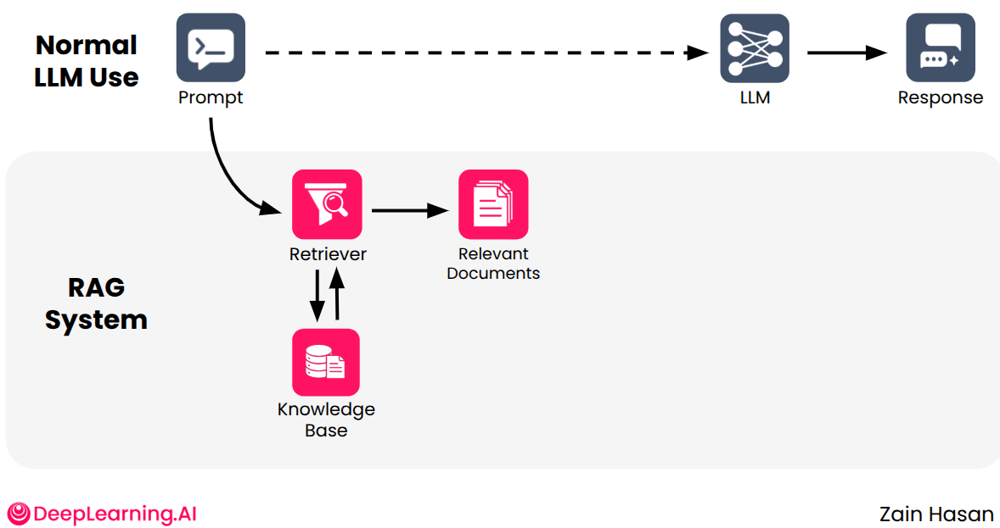
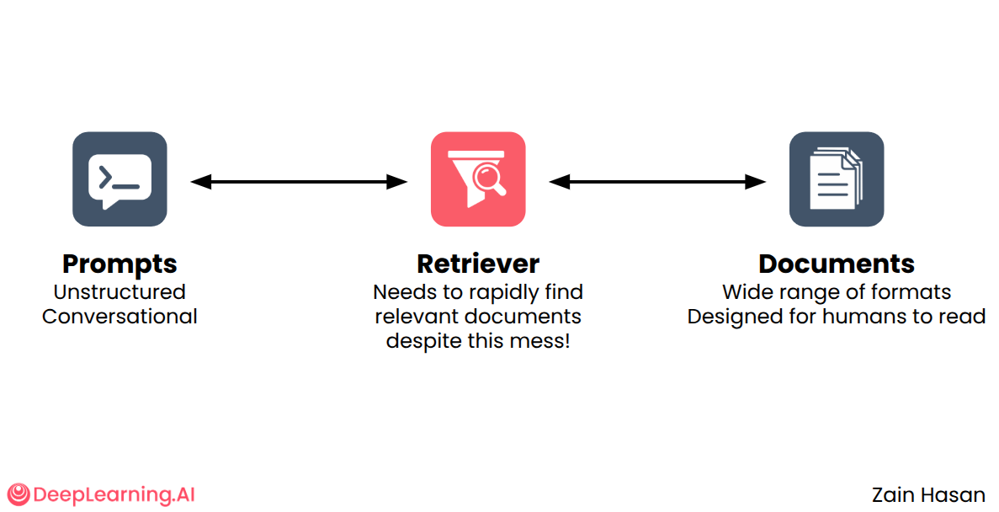
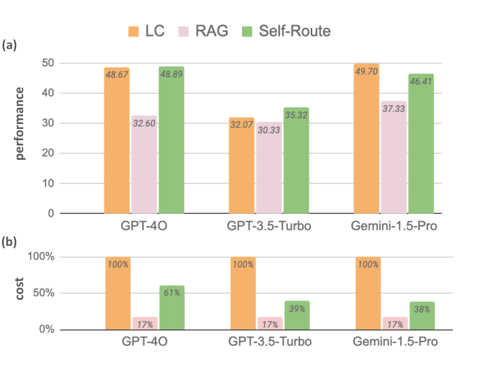

# 2 — Why RAG, and the augmented prompt

Ask a chat model for Tallybook's refund window and it will give you one. It sounds right, because refund windows are usually 14 or 30 days, and the model has seen plenty of them. It has never seen this company's policy, so the number is a guess in the voice of a fact. Retraining won't fix that, since the policy is private and changes whenever finance changes it. The fix is older and simpler: look it up first, then answer from what you found.

> RAG is "put the missing facts in the prompt, automatically": a retriever picks documents from a knowledge base, the prompt template splices them in, and the LLM answers from them. This note covers why that works and what the smallest version looks like in code.

---

## Where this sits

Notes 02–07 condense Zain Hasan's *Retrieval Augmented Generation* course (DeepLearning.AI, on Coursera), one note per module. Note [01](01-rag-pipeline.md) is the house overview of the whole pipeline. These six notes are the course's worked version of it, with the lab code.

| Note | Course module | Main question |
|---|---|---|
| **02 (this note)** | M1 RAG overview | Why retrieve at all? |
| [03](03-keyword-semantic-and-hybrid-search.md) | M2 Information retrieval | How does the retriever rank? |
| [04](04-vector-databases-and-ann.md) | M3 part 1 | How does it rank fast, at scale? |
| [05](05-chunking-query-parsing-and-reranking.md) | M3 part 2 | What goes in, what query goes out, what comes back? |
| [06](06-generation-for-rag.md) | M4 LLMs and text generation | How does the LLM use what came back? |
| [07](07-rag-in-production.md) | M5 RAG in production | How do you evaluate, trace and run it? |

---

## The knowledge gap

An LLM knows what was in its training data, compressed. It does not know three kinds of thing:

| Gap | Example | Why training can't fix it |
|---|---|---|
| **Private data** | Your company's refund policy, a customer's order history | Never in a public crawl |
| **Real-time data** | Today's news, current stock, this week's prices | Training has a cutoff |
| **Hard-to-access data** | Niche manuals, paywalled specs, internal wikis | Too rare to be learned reliably |

The course's one-line definition: if you had to answer a question about something you didn't know, you would look it up first. RAG does that for the model. *"Just put it in the prompt."*


*Image Source: Hasan, DeepLearning.AI RAG course, Module 1*

---

## The two components

| Component | Job | What it holds |
|---|---|---|
| **Retriever** | Given the prompt, find the most relevant documents | An index over the **knowledge base** |
| **LLM** | Given prompt + documents, write the answer | Only its weights. It sees the docs because they are in the context window |

The split, and the name, come from Lewis et al. ([arXiv:2005.11401](https://arxiv.org/abs/2005.11401), NeurIPS 2020). They paired a dense retriever over 21M 100-word Wikipedia chunks with a 400M-parameter BART generator, and fine-tuned the query encoder and generator together. The document encoder and index stayed frozen, which is why the index could be swapped out to update what the model knows. They tested this on 82 world leaders. With the 2016 Wikipedia index the model named 2016 leaders correctly 70% of the time, and with the 2018 index it named 2018 leaders correctly 68% of the time. With the wrong year's index it fell to 4–12%, and no retraining was involved. The course's version keeps the split and drops the joint training: an off-the-shelf retriever feeds a frozen LLM through the prompt.

The retrieve-then-read pattern is older than the name. Huyen traces it to Chen et al. (2017), who paired a Wikipedia retriever with a "document reader" for open-domain QA (*AI Engineering*, ch. 6). Raieli and Iuculano sort the ways the two halves can be trained (*Building AI Agents*, ch. 6):

| Paradigm | What is trained | Example |
|---|---|---|
| Training-free | Nothing; off-the-shelf retriever and LLM | The course, most production RAG |
| Independent | Each half on its own objective | A fine-tuned embedder plus a separately fine-tuned LLM |
| Sequential, retriever first | Retriever fixed, then the LLM learns to use what it returns | — |
| Sequential, LLM first | LLM fixed, then the retriever learns from the LLM's signal | Izacard & Grave: the reader's attention scores supervise the retriever |
| Joint | Both, end to end | Lewis et al. above |

Huyen notes that fine-tuning the retriever and generator together improves results. The price is that the pair now has to be retrained together, which is one reason most systems stay training-free.

The retriever's job is hard because the two sides look nothing alike: prompts are short, unstructured questions, and the knowledge base is anything from PDFs to tables to HTML.


*Image Source: Hasan, DeepLearning.AI RAG course, Module 1*

### What RAG buys you

| Advantage | Mechanism |
|---|---|
| Injects missing knowledge | Facts arrive in the context, not the weights |
| Fewer hallucinations | The model has text to copy from instead of guessing a probable continuation. In knowledge-grounded dialogue (BART-Large on Wizard of Wikipedia, unseen topics, human-rated), retrieval cut hallucinated responses from 68.2% to 8–21% depending on the architecture ([arXiv:2104.07567](https://arxiv.org/abs/2104.07567), Shuster et al., 2021-04) |
| Stays up to date | Update the knowledge base, not the model |
| Citations | Each retrieved doc has a source the answer can point to |
| LLM does what it is good at | Writing and reasoning; the retriever does lookup |

The cost: **latency**. Every request now pays for a retrieval step before generation starts.

### Why not put everything in the prompt?

Two limits, both still true with million-token windows:

1. **Compute cost.** Attention cost grows with context length; every extra token is paid on every call.
2. **Context window.** It is finite, and models attend less well to the middle of a long context (see [ai-engineering 02 — retrieval](../../../ai-engineering/02-context-engineering/notes/04-retrieval.md)).

How the two trade off against quality has moved with the models:

- **2023, 70B open models.** A 4K window plus top-5 retrieval matched a 16K long-context model at a fraction of the compute (Llama2-70B, average over seven long-document QA and summarisation sets: 36.02 vs 36.78). Adding retrieval to the 32K model still raised its average from 37.36 to 39.60. Llama2-7B gained nothing from it ([arXiv:2310.03025](https://arxiv.org/abs/2310.03025), Xu et al., 2023-10).
- **2024, frontier models.** Reading the whole document beat top-5 RAG on the seven LongBench sets by 7.6 points on average for Gemini-1.5-Pro and 13.1 for GPT-4o, while RAG used about 17% of the tokens. The two answers were identical on 63% of queries, so the authors route instead of choosing. RAG answers first, prompted to say "unanswerable" when the chunks don't cover the question, and only those queries go to the full context. Averaged over all nine sets (adding two from ∞Bench), this *Self-Route* matched long context for GPT-4o (48.89 vs 48.67) at 61% of the tokens and came within 3.3 points for Gemini at 38%. RAG still won where the input outgrew the window: GPT-3.5-Turbo (16K) on ∞Bench's ~147K-word documents ([arXiv:2407.16833](https://arxiv.org/abs/2407.16833), Li et al., 2024-07).
- **More retrieved context is not the fix either.** With chunks kept in document order rather than score order, Llama3.1-70B on ∞Bench En.QA peaked at 48K tokens of retrieved context (47.25 F1) and declined past it. That beat the same model reading the whole ~117K-token input (34.26). Document order alone was worth 6 F1 at 16K (44.43 vs 38.40) ([arXiv:2409.01666](https://arxiv.org/abs/2409.01666), Yu et al., 2024-09). This is two datasets, and the best context size was picked on the test set.


*Image Source: Li et al., [Retrieval Augmented Generation or Long-Context LLMs? A Comprehensive Study and Hybrid Approach](https://arxiv.org/abs/2407.16833) (2024), Fig. 1*

The books add three practical points:

- **The threshold.** Anthropic's guidance, as Huyen reports it: a knowledge base under about 200K tokens (roughly 500 pages) can go whole in the prompt, with prompt caching to keep the cost down (*AI Engineering*, ch. 6). Huyen still expects RAG to outlast long context, because data grows faster than windows and models use long context less well than short.
- **The costs.** Long-context models hallucinate more on long inputs and cost more per call. Also, "1M tokens isn't a lot" next to an organisation's documents (*Building AI Agents*, ch. 6). The same chapter says embedders max out around 32K tokens; that was true at the time of writing and is moving.
- **Where the two meet.** Raieli and Iuculano expect RAG to change shape rather than disappear. Small-to-big retrieval grows into "retrieve the whole document". A router chooses between whole document and chunks, which is Self-Route above. Retrieval moves into the model's KV cache.

When the corpus fits the window of a frontier model, the case for RAG is cost and latency, with quality at parity only if you route. When it doesn't fit, retrieval is the only option. Either way, the retriever has a trade-off of its own: return enough to cover the answer, but not so much that the relevant passage drowns. Notes 03–05 are about striking it.

---

## LLM basics the course relies on

| Idea | One line |
|---|---|
| Tokens | The model reads and writes sub-word pieces, not words |
| Autoregressive | It generates one token at a time, each conditioned on everything before |
| Probable ≠ truthful | It picks likely continuations. If the fact isn't in context or weights, a fluent wrong answer is still likely |
| Training data = knowledge | Anything else must arrive through the prompt |

Note [06](06-generation-for-rag.md) returns to the generation side in detail.

---

## The smallest RAG: an f-string

Module 1's ungraded lab has no retriever at all. It shows that augmentation is just string formatting:

```python
# Facts the model can't know: a private listing (lab data trimmed to 2 rows)
house_info = [
    {"address": "123 Maple Street", "city": "Springfield", "price": 250000, "bedrooms": 3},
    {"address": "456 Elm Avenue",   "city": "Shelbyville", "price": 300000, "bedrooms": 4},
]

def house_info_layout(houses):
    # Turn structured records into a text block the LLM can read
    return "\n".join(
        f"House located at {h['address']}, {h['city']}, priced at ${h['price']}, "
        f"{h['bedrooms']} bedrooms." for h in houses
    )

def generate_prompt(query, houses):
    # The whole "augmentation" step: retrieved text + the question, one template
    return f"""
Use the following houses information to answer users queries.
{house_info_layout(houses)}
Query: {query}
"""

query = "What is the most expensive house? And the bigger one?"
print(generate_prompt(query, house_info))
```

```text

Use the following houses information to answer users queries.
House located at 123 Maple Street, Springfield, priced at $250000, 3 bedrooms.
House located at 456 Elm Avenue, Shelbyville, priced at $300000, 4 bedrooms.
Query: What is the most expensive house? And the bigger one?
```

The lab then sends the bare question and the augmented prompt to the same model and compares the answers:

```python
# illustrative: needs an API key; the wrapper is defined in the course's utilities
generate_with_single_input(prompt=query, role="user")            # guesses
generate_with_single_input(prompt=generate_prompt(query, house_info),
                           role="assistant")                     # reads it off
```

`generate_with_single_input` is the course's thin wrapper over an OpenAI-compatible chat call (Together.ai, default `meta-llama/Llama-3.2-3B-Instruct-Turbo`).

---

## Assignment 1: news retrieval end to end

The graded assignment adds a real retriever over the Kaggle *News Headlines 2024* dataset (BBC News). The structure is the one every later lab keeps:

```python
# illustrative: needs the course's retrieve() and query_news() and its news dataset
def get_relevant_data(query: str, top_k: int = 5) -> list[dict]:
    # retrieve() returns indices of the top_k most relevant articles;
    # query_news() looks those indices up in the dataset
    relevant_indices = retrieve(query, top_k)
    return query_news(relevant_indices)

def format_relevant_data(docs: list[dict]) -> str:
    # One readable block per article. Keep the URL: it becomes the citation
    return "\n".join(
        f"Title: {d['title']}, Description: {d['description']}, "
        f"Published at: {d['published_at']}\nURL: {d['url']}"
        for d in docs
    )

def generate_final_prompt(query, top_k=5, use_rag=True, prompt=None):
    if not use_rag:
        return query                                  # baseline: bare question
    docs = format_relevant_data(get_relevant_data(query, top_k))
    if prompt is None:
        prompt = (
            "Answer the user query below. There will be provided additional "
            "information for you to compose your answer. The relevant information "
            "provided is from 2024 and it should be added as your overall knowledge "
            "to answer the query, you should not rely only on this information to "
            "answer the query, but add it to your overall knowledge.\n"
            "Query: {query}\n2024 News: {documents}"
        )
    return prompt.format(query=query, documents=docs)
```

Three things the lab is teaching:

| Point | Where it shows |
|---|---|
| Retrieval and generation are separable | `use_rag=False` gives a baseline with the same model |
| The template is a design decision | `prompt=None` lets you swap instructions ("use only these docs" vs "add to your knowledge") |
| `top_k` is the main retrieval knob | Too low misses the answer, too high dilutes it. Going from 5 to 25 retrieved documents raised human-rated hallucination in Shuster et al.'s dialogue models (FiD-RAG 7.9% → 19.8%) |

`llm_call(query, use_rag=...)` prints both answers side by side. The suggested queries ("How is global warming progressing in 2024?", "Tell me about the most recent advances in AI.") make the gap obvious: the baseline hedges about its cutoff, the RAG answer quotes 2024 headlines.

## The same structure over Tallybook

Here is that structure over the running example, so it runs with no key and no dataset. `reader` is a stand-in for an LLM that only returns the context sentence sharing the most words with the question, and says it doesn't know when there's no context. A stand-in is enough here because this block exercises the plumbing around the model: where the documents come from, how the prompt is built, and what the baseline looks like.

```python
import re
from ragkit import DOC_BY_ID, Retriever, tokenize

retriever = Retriever()

def get_relevant_data(query, top_k=3):
    return [DOC_BY_ID[i] for i in retriever.dense(query, k=top_k)]

def format_relevant_data(docs):
    # Keep the id: it becomes the citation.
    return "\n".join(f"[{d.id}] {d.title}: {d.text}" for d in docs)

def generate_final_prompt(query, top_k=3, use_rag=True):
    if not use_rag:
        return query                                 # baseline: bare question
    return (f"Answer only from the documents and cite the id in brackets.\n"
            f"Documents:\n{format_relevant_data(get_relevant_data(query, top_k))}\n"
            f"Question: {query}")

def reader(prompt, query):                           # stand-in for an LLM
    best, best_overlap = "I don't know.", 0
    for doc_id, body in re.findall(r"^\[(kb-\d+)\] (.+)$", prompt, re.M):
        for sentence in re.split(r"(?<=[.])\s+", body):
            overlap = len(set(tokenize(sentence)) & set(tokenize(query)))
            if overlap > best_overlap:
                best, best_overlap = f"{sentence} [{doc_id}]", overlap
    return best

query = "How long do refunds take to reach the card?"
print("no RAG:", reader(generate_final_prompt(query, use_rag=False), query))
print("RAG:   ", reader(generate_final_prompt(query), query))
```

```text
no RAG: I don't know.
RAG:    Refunds reach the original card in 5 to 10 working days. [kb-04]
```

A real model would phrase this better, and it would also answer the no-RAG line with a confident guess. That is worse than the honest "I don't know" the stand-in gives, and it is why you build the baseline: you need to see what the model says when it has nothing.

`top_k` is the first knob you get. Raising it buys recall and costs context. Here is that trade-off measured on the 20 labelled questions, counting words as a rough proxy for tokens:

```python
from ragkit import DOC_BY_ID, QUERIES, Retriever, recall_at_k

retriever = Retriever()
for k in [1, 2, 3, 5, 10]:
    runs = [(retriever.hybrid(q, k=k, pool=18), rel) for q, rel, _ in QUERIES]
    recall = sum(recall_at_k(r, rel, k) for r, rel in runs) / len(runs)
    words = sum(len(DOC_BY_ID[i].full.split()) for r, _ in runs for i in r) / len(runs)
    print(f"top_k={k:<2}  recall@k={recall:.2f}  context words per query={words:.0f}")
```

```text
top_k=1   recall@k=0.55  context words per query=43
top_k=2   recall@k=0.85  context words per query=86
top_k=3   recall@k=0.95  context words per query=128
top_k=5   recall@k=0.95  context words per query=211
top_k=10  recall@k=1.00  context words per query=393
```

Past the point where recall flattens, each extra document pays for words the model has to read past, with no new answer in them. Shuster et al.'s dialogue result in the table above is the same shape measured on human-rated hallucination.

---

## Where RAG is used

| Application | Knowledge base |
|---|---|
| Code generation | The repo, its docs, its issues |
| Enterprise / customer-service chatbots | Policies, product catalogue, past tickets |
| Healthcare and legal | Guidelines, case law, kept current |
| AI-assisted web search | The live web (see [07 — internet search agent](../../07-agentic-applications/notes/01-internet-search-agent.md)) |
| Personal assistants | Your email, calendar, notes |

---

## Rules of thumb

| Rule | Why |
|---|---|
| Build the no-RAG baseline first | You can't show retrieval helped without it |
| Keep source metadata through formatting | Citations need it, and so does debugging |
| Treat the prompt template as code | It decides whether the model trusts, ignores or mixes the docs |
| Treat context construction as feature engineering | Huyen's framing: what you retrieve and how you format it is to an LLM app what features are to a classical model (*AI Engineering*, ch. 6) |
| Start with `top_k` around 5 | Then tune with the metrics in note 03 |

---

## Labs

| Lab | Label |
|---|---|
| M1 ungraded lab (house prompt) and Assignment 1 (news RAG) ([upstream](https://github.com/MohammadWasiq0786/Deeplearning.ai-RAG)) | needs an API key (Together.ai, via the Coursera proxy); not copied |

---

## Pitfalls

- **No baseline.** Symptom: everyone agrees the RAG answers look good, and no one can say what retrieval added. Keep a `use_rag=False` path and compare.
- **Dropping source metadata while formatting.** Symptom: answers can't cite anything, and debugging a wrong answer means guessing which document caused it. Carry the id through every stage.
- **A template that invites the model's own knowledge.** Symptom: answers mix your documents with outdated training data. The course's assignment deliberately says "add it to your overall knowledge". For factual support use, say "only from the documents".
- **Stuffing the corpus because the window allows it.** Symptom: the bill grows and quality does not. Whole-document reading can win on frontier models (Li et al. above), and it still costs several times the tokens. Route between the two if you have both.
- **Treating `top_k` as a constant.** Symptom: recall is fine on simple questions and multi-part ones miss half their answer. Tune it against labelled data, per query type if needed.

---

## Try it

1. Run the Tallybook block with `query = "How do I close my account?"`. Which sentence does the reader pick, and is it the best one?
2. Change `retriever.dense` to `retriever.sparse` in `get_relevant_data` and rerun with "can I get my money back". What happens, and what does it say about a pipeline where only the retriever changed?
3. Your corpus is 150K tokens and rarely changes. Long context or RAG? Give your reasoning and name what you would measure.

<details>
<summary>Answers</summary>

1. Dense search finds `kb-06`, and the reader takes the sentence with the most shared words. It can only reward word overlap, so it may pick a sentence that shares words and misses the action. A real model reads meaning, which is why this is a plumbing test and not a quality test.
2. BM25 returns only `kb-03`, which contains "Back off", so the reader answers with an irrelevant sentence or "I don't know". The prompt and the reader didn't change, so the failure is pure retrieval. This is why you measure retrieval on its own.
3. Under Anthropic's rough threshold as Huyen reports it (about 200K tokens), whole-corpus plus prompt caching is a reasonable first build. Measure accuracy on your own questions, and cost and latency per call, against a RAG baseline. Li et al.'s Self-Route suggests trying both behind a router if volume is high.

</details>

---

## Interview checklist

| Question | Answer |
|---|---|
| What problem does RAG solve? | The model lacks private, real-time and hard-to-access facts. Retrieval supplies them in the prompt at inference time, with no retraining. |
| Why is updating an index better than retraining? | Lewis et al. swapped a 2016 Wikipedia index for 2018 and the model named 2018 world leaders correctly 68% of the time. With the wrong year's index it fell to 4–12%, and no retraining was involved. |
| What does RAG cost you? | A retrieval step of added latency, an index to keep in sync, and a new failure surface. |
| Does RAG reduce hallucination? | In Shuster et al.'s dialogue setup, hallucinated responses dropped from 68.2% to 8–21%. More documents can push it back up: 7.9% to 19.8% going from 5 to 25 with FiD-RAG. |
| Long context or RAG? | Long context can beat top-5 RAG on quality with frontier models, at much higher token cost. Li et al.'s Self-Route answers with RAG and falls back to full context only for "unanswerable" outputs. When the corpus doesn't fit the window, retrieval is the only option. |
| How much retrieved context is optimal? | It depends on the model and data. Yu et al. saw Llama3.1-70B peak at 48K tokens on one benchmark, and document order alone added 6 F1 at 16K. |
| Name the training paradigms for retriever and generator. | Training-free, independent, sequential in either order, and joint. Most production systems stay training-free because joint training ties the pair together. |
| What is the smallest possible RAG? | Fetch text and format it into the prompt template. The augmentation step is an f-string. |

---

## Next

[03 — Keyword, semantic and hybrid search](03-keyword-semantic-and-hybrid-search.md): what `retrieve()` actually does, with BM25, embeddings, hybrid fusion and how to measure a retriever.
