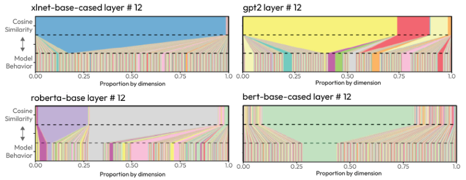

# 3 — Keyword, semantic and hybrid search

A Tallybook customer pastes `X-Tally-Signature` into the help widget, and an embedding search can answer with pages that merely feel related, because an identifier carries little meaning for a model to embed. Another asks "can I get my money back?" and keyword search returns nothing useful, because the refund page never says "money" or "back". Each method fails where the other is strong. If you pick one, you get a retriever that looks fine on your favourite test queries and fails on a whole class of real ones. This chapter builds both, fuses them and measures the result, so you can see the blind spots instead of arguing about them.

> A retriever ranks documents. Keyword search (TF-IDF, BM25) ranks by shared words, semantic search ranks by embedding distance, metadata filters cut the set without ranking, and hybrid search fuses the rankings with RRF. Precision, recall, MAP and MRR tell you which one is working.

---

## The retriever's three tools

| Technique | Matches on | Good at | Bad at |
|---|---|---|---|
| **Keyword search** | Exact terms | Product codes, names, jargon, rare words | Synonyms, paraphrase |
| **Semantic search** | Meaning (embedding similarity) | Paraphrase, "something like X" | Exact identifiers, negation |
| **Metadata filtering** | Structured fields | Hard constraints: region, tier, date | Anything fuzzy — it is not search |

Production retrievers run all three. Note [01 § hybrid retrieval](01-rag-pipeline.md#hybrid-retrieval) places them in the pipeline. The theory lives in [ai-engineering 02 — retrieval](../../../ai-engineering/02-context-engineering/notes/04-retrieval.md). This note keeps the course's numbers and lab code.

---

## Keyword search

### Bag of words to TF-IDF

Each document becomes a **sparse vector**: one slot per vocabulary word, mostly zeros. The prompt becomes one too, and documents are scored by overlap.

| Score | Formula | Fixes |
|---|---|---|
| Term frequency (TF) | count of word in doc | — |
| Normalised TF | count / doc length | Long docs winning by size |
| **TF-IDF** | TF × log(N / df) | Common words ("the", "pizza" in a pizza corpus) dominating |

N is the number of documents; df is how many contain the word. A word in every document gets log(1) = 0.

On Tallybook, IDF does most of the work. A word on many pages barely counts, and an error code that appears on one page counts for a lot:

```python
import math
from collections import Counter
from ragkit import DOCS, tokenize

df = Counter(term for d in DOCS for term in set(tokenize(d.full)))
for term in ["invoice", "settings", "refund", "credit", "BANK-112"]:
    print(f"{term:9} df={df[term]:2}  idf={math.log(len(DOCS) / df[term]):.2f}")
```

```text
invoice   df= 4  idf=1.50
settings  df= 5  idf=1.28
refund    df= 4  idf=1.50
credit    df= 1  idf=2.89
BANK-112  df= 1  idf=2.89
```

### BM25

BM25 is TF-IDF with two tunable fixes, and it is still the default keyword scorer.

| Parameter | Typical | Effect |
|---|---|---|
| **k1** term saturation | 1.2–2.0 | Diminishing returns on repeats. The course's slide says a doc with "pizza" 20 times scores about 1.3× one with it 10 times, not 2×. The formula below gives less than that: about 1.07× at k1=1.5 for documents of average length |
| **b** length normalisation | 0–1 (0.75 common) | How much to penalise long docs. b = 0 ignores length |

Raieli and Iuculano give the same defaults: b = 0.75 and k between 1.2 and 2 (*Building AI Agents*, ch. 5). Their edge case makes saturation clear: at k = 0 the term-frequency factor collapses to 1, so BM25 scores only whether each query term is present.

Why keyword search survives: it is cheap, interpretable, needs no model, and nails exact matches that embeddings blur. Huyen's example is an error code. A user searching for `EADDRNOTAVAIL (99)` wants documents containing exactly that string, and an embedding retriever may return generic networking pages instead. She also quotes Perplexity's CEO saying BM25 remains a hard baseline to beat (*AI Engineering*, ch. 6).

Notes from the same chapter:

- **The inverted index** maps each term to the documents containing it. Lookup cost depends on how many documents contain the query terms, not on corpus size.
- **Variants.** BM25+ fixes long documents being scored below short ones that don't contain the term at all. BM25F scores fields (title, body) with separate weights.
- **n-grams.** Tokenising "hot dog" as two words matches pages about hot weather and dogs. Indexing bigrams keeps the phrase.
- **Framing.** Huyen splits retrievers into *term-based* and *embedding-based* rather than sparse and dense, because learned sparse models such as SPLADE are sparse but embedding-based.

### BM25 from scratch

The sparse half fits in about 40 lines of standard-library Python. For query term *t* in document *d*:

```
score(t, d) = IDF(t) · tf · (k1 + 1) / (tf + k1 · (1 − b + b · |d| / avgdl))
IDF(t)      = ln((N − df + 0.5) / (df + 0.5) + 1)
```

- **`k1` saturates term frequency.** The 20th mention adds far less than the 2nd, so a long document can't win by repetition. Typical values are 1.2–2.0.
- **`b` normalises for length.** `b=0` ignores length; `b=1` normalises fully. The usual default is 0.75.
- **The `+ 1` inside the log** is the Lucene variant. It keeps IDF positive for terms that appear in more than half the documents. Li's worked example uses the classic form without it, so his numbers come out slightly lower.

```python
import math, re
from collections import Counter

STOP = {"the", "is", "a", "an", "of", "to", "in", "and", "for", "on", "how", "what"}

def tokenize(text):
    # Keep codes like HTTP-403 whole; lowercase ordinary words; drop stop words.
    tokens = re.findall(r"[A-Za-z0-9]+(?:[-_][A-Za-z0-9]+)*", text)
    return [t if any(c.isdigit() for c in t) else t.lower()
            for t in tokens if t.lower() not in STOP]

class BM25:
    def __init__(self, docs, k1=1.5, b=0.75):
        self.k1, self.b = k1, b
        self.tf = [Counter(tokenize(d)) for d in docs]         # term counts per doc
        self.len = [sum(c.values()) for c in self.tf]          # |d|
        self.avgdl = sum(self.len) / len(docs)
        self.df = Counter(t for c in self.tf for t in c)       # docs containing t
        self.N = len(docs)

    def idf(self, t):
        # Lucene variant: the +1 keeps IDF positive for very common terms.
        df = self.df[t]
        return math.log((self.N - df + 0.5) / (df + 0.5) + 1)

    def term_score(self, t, i):
        tf = self.tf[i][t]
        if tf == 0:
            return 0.0
        norm = 1 - self.b + self.b * self.len[i] / self.avgdl   # length normalisation
        return self.idf(t) * tf * (self.k1 + 1) / (tf + self.k1 * norm)  # saturates in tf

    def search(self, query, k=3):
        q = tokenize(query)
        scores = [(sum(self.term_score(t, i) for t in q), i) for i in range(self.N)]
        return sorted((s for s in scores if s[0] > 0), reverse=True)[:k]

docs = [
    "Model distillation trains a small student model from a large teacher model.",
    "The model returned HTTP-403 when the API key had expired.",
    "A model card describes the model, its data and the model's limits.",
    "Forbidden errors usually mean the credentials lack permission.",
]
bm25 = BM25(docs)
for q in ["model distillation", "HTTP-403", "forbidden error"]:
    print(f"{q!r:22} ->", [(i, round(s, 2)) for s, i in bm25.search(q)])
```

```text
'model distillation'   -> [(0, 1.68), (2, 0.59), (1, 0.37)]
'HTTP-403'             -> [(1, 1.24)]
'forbidden error'      -> [(3, 1.31)]
```

Three things to read off the output:

- **Rare beats frequent.** Doc 2 says "model" four times but ranks well below doc 0. "model" is in three of the four documents, so its IDF is low, and `k1` caps what repetition can add. "distillation" is in one document and carries the score.
- **Codes survive tokenisation.** `HTTP-403` stays one token and hits doc 1 exactly, which is what dense search tends to blur.
- **The blind spot.** "forbidden error" never reaches doc 1, the actual 403 incident, and it matches doc 3 on "forbidden" alone: "error" ≠ "errors", with no stemming and no synonyms. That gap is what the dense half and the reranker fill.

To build intuition, sweep `k1 ∈ {0.5, 1.2, 2.0}` and `b ∈ {0, 0.75, 1}` on a corpus with one very long document and watch its rank move. To see the sparse half of [contextual retrieval](../../../ai-engineering/02-context-engineering/notes/04-retrieval.md#contextual-retrieval), prefix a chunk with "ACME Corp 2025 Q2 financial report:" and query "ACME revenue". The fuller engine, with an inverted index, debug logging and tests, is upstream: Li, *AI Agents in Depth*, [Experiment 3-5 sparse-embedding](https://github.com/bojieli/ai-agent-book/tree/main/chapter3/sparse-embedding) (Apache-2.0).

Saturation is easy to check against the slide's claim. Holding length at the average, the term-frequency factor is `tf * (k1 + 1) / (tf + k1)`:

```python
def tf_factor(tf, k1):
    return tf * (k1 + 1) / (tf + k1)

for k1 in [0.5, 1.2, 1.5, 2.0, 8.6]:
    print(f"k1={k1:<4} tf=1: {tf_factor(1, k1):.2f}  tf=10: {tf_factor(10, k1):.2f}  "
          f"tf=20: {tf_factor(20, k1):.2f}  ratio 20/10: {tf_factor(20, k1) / tf_factor(10, k1):.2f}")
```

```text
k1=0.5  tf=1: 1.00  tf=10: 1.43  tf=20: 1.46  ratio 20/10: 1.02
k1=1.2  tf=1: 1.00  tf=10: 1.96  tf=20: 2.08  ratio 20/10: 1.06
k1=1.5  tf=1: 1.00  tf=10: 2.17  tf=20: 2.33  ratio 20/10: 1.07
k1=2.0  tf=1: 1.00  tf=10: 2.50  tf=20: 2.73  ratio 20/10: 1.09
k1=8.6  tf=1: 1.00  tf=10: 5.16  tf=20: 6.71  ratio 20/10: 1.30
```

The slide's 1.3× needs a k1 near 8.6, far outside the usual range. At normal settings the 20th mention adds almost nothing, which is the point of the parameter.

### A library version

Use a library once you are past the idea. The course uses `bm25s`, which tokenises for you, so the corpus goes in as strings:

```python
import bm25s
from ragkit import DOCS

corpus = [d.full for d in DOCS]

# Index once: tokenise the corpus, build the inverted index
BM25_RETRIEVER = bm25s.BM25(corpus=corpus)
BM25_RETRIEVER.index(bm25s.tokenize(corpus, show_progress=False), show_progress=False)

def bm25_retrieve(query: str, top_k: int = 5) -> list[int]:
    # Tokenise the query the same way as the corpus
    tokens = bm25s.tokenize(query, show_progress=False)
    results, scores = BM25_RETRIEVER.retrieve(tokens, k=top_k, show_progress=False)
    # bm25s returns the documents themselves (batch of 1); map back to indices
    return [corpus.index(str(doc)) for doc in results[0]]

for query in ["what does BANK-112 mean", "reverse a sent invoice"]:
    print(query, "->", [DOCS[i].id for i in bm25_retrieve(query, top_k=3)])
```

```text
what does BANK-112 mean -> ['kb-13', 'kb-17', 'kb-06']
reverse a sent invoice -> ['kb-09', 'kb-08', 'kb-17']
```

---

## Semantic search

An **embedding model** maps text to a dense vector so that similar meanings land close together. It learns this by **contrastive training**: pull positive pairs (question, its answer) together and push negative pairs apart, over millions of examples.

### Distance measures

| Measure | Uses | Note |
|---|---|---|
| **Cosine similarity** | Angle only | The default for text. Length-invariant |
| Euclidean distance | Straight-line distance | Sensitive to vector length |
| Dot product | Angle × length | Equals cosine when vectors are normalised |

The figure below has the same two vectors as this code. Cosine ignores their length. The other two measures do not, until you normalise:

```python
import numpy as np

a, b = np.array([10.0, 10.0]), np.array([100.0, 100.0])
cosine = a @ b / (np.linalg.norm(a) * np.linalg.norm(b))
print(f"raw        cosine={cosine:.3f}  euclidean={np.linalg.norm(a - b):.1f}  dot={a @ b:.0f}")
a, b = a / np.linalg.norm(a), b / np.linalg.norm(b)
print(f"normalised cosine={a @ b:.3f}  euclidean={np.linalg.norm(a - b):.1f}  dot={a @ b:.3f}")
```

```text
raw        cosine=1.000  euclidean=127.3  dot=2000
normalised cosine=1.000  euclidean=0.0  dot=1.000
```

![Two vectors [10,10] and [100,100] on the same direction: cosine similarity 1 despite very different lengths, angle θ between direction lines](../sources/images/hasan-dlai-rag-cosine.png)
*Image Source: Hasan, DeepLearning.AI RAG course, Module 2*

A correction to one book: the *LLM Engineer's Handbook* (ch. 4) says cosine distance ranges from −1 to 1. That is the range of cosine *similarity*. Cosine distance, 1 − similarity, ranges from 0 to 2. *Prompt Engineering for GenAI* (ch. 5) makes the same slip, calling cosine similarity "a measure of distance": higher similarity means *closer*. Check which one a library returns before setting a threshold. A FAISS `IndexFlatL2`, for instance, returns squared L2 distances ([04](04-vector-databases-and-ann.md)).

Rule: **only compare vectors from the same model**. Two models' spaces are unrelated, even at the same dimension.

The course's version loads a corpus it ships pre-embedded:

```python
# illustrative: needs the course's embeddings.joblib; sentence-transformers downloads the model
from sentence_transformers import SentenceTransformer
import joblib, numpy as np

model = SentenceTransformer("BAAI/bge-base-en-v1.5")
EMBEDDINGS = joblib.load("embeddings.joblib")  # the course ships the corpus pre-embedded

def cosine_similarity(v1, array_of_vectors):
    # The course writes its own: dot product over the product of norms
    v1 = np.asarray(v1); arr = np.atleast_2d(array_of_vectors)
    return arr @ v1 / (np.linalg.norm(arr, axis=1) * np.linalg.norm(v1))

def semantic_search_retrieve(query: str, top_k: int = 5) -> list[int]:
    query_embedding = model.encode(query)                  # same model as the corpus
    similarity_scores = cosine_similarity(query_embedding, EMBEDDINGS)
    return np.argsort(-similarity_scores)[:top_k].tolist() # highest similarity first
```

A trap the assignment surfaces: **bge-base-en-v1.5 truncates at 512 tokens**. Embedding a full article and embedding its first 3000 characters give the same vector, because everything past the limit is dropped. This is the first argument for chunking (note [05](05-chunking-query-parsing-and-reranking.md)).

### A real embedder on the same questions

The toy embedder in `ragkit` is hand-built. It's fair to ask what a real model does on the same 20 questions. This block downloads `BAAI/bge-small-en-v1.5` (384 dimensions, about 64 MB) through `fastembed` on first run, and then needs no network or API key:

```python
import numpy as np
from fastembed import TextEmbedding
from ragkit import DOCS, QUERIES, Retriever, evaluate, rrf, top_k

model = TextEmbedding("BAAI/bge-small-en-v1.5")
ids = [d.id for d in DOCS]
vectors = np.array(list(model.embed([d.full for d in DOCS])))

def real_dense(query, k=5):
    return top_k(vectors @ np.array(list(model.embed([query])))[0], ids, k)

toy = Retriever()
def real_hybrid(query, k=5):
    return rrf([toy.sparse(query, 10), real_dense(query, 10)])[:k]

print("vectors:", vectors.shape)
for name, search in [("bm25", toy.sparse), ("toy dense", toy.dense), ("bge-small", real_dense),
                     ("bm25+bge rrf", real_hybrid)]:
    by_kind = {kind: evaluate(search, [q for q in QUERIES if q[2] == kind])["recall@3"]
               for kind in ["code", "keyword", "paraphrase"]}
    print(f"{name:13}", {m: round(v, 2) for m, v in evaluate(search).items()}, by_kind)
```

```text
vectors: (18, 384)
bm25          {'recall@3': 0.6, 'mrr': 0.56, 'ndcg@3': 0.56} {'code': 1.0, 'keyword': 1.0, 'paraphrase': 0.2}
toy dense     {'recall@3': 0.9, 'mrr': 0.88, 'ndcg@3': 0.88} {'code': 0.6, 'keyword': 1.0, 'paraphrase': 1.0}
bge-small     {'recall@3': 0.95, 'mrr': 0.91, 'ndcg@3': 0.91} {'code': 1.0, 'keyword': 1.0, 'paraphrase': 0.9}
bm25+bge rrf  {'recall@3': 0.95, 'mrr': 0.84, 'ndcg@3': 0.86} {'code': 1.0, 'keyword': 1.0, 'paraphrase': 0.9}
```

Three things to notice, and one to distrust.

- BM25 aces the codes and keywords and falls to 0.2 on paraphrase. That is its documented blind spot, reproduced.
- The real model is far stronger than the expectation "embeddings blur codes". It found every code here. Eighteen pages is an easy haystack: nothing else on the corpus looks like `BANK-112`. In a corpus with thousands of near-identical error pages, that advantage shrinks, which is Huyen's `EADDRNOTAVAIL` point above.
- RRF did not raise recall@3 over bge-small alone, and it lowered MRR, because the BM25 list pushes weak candidates up for paraphrase questions. Hybrid is an insurance policy against the failure you have not seen yet. It isn't a free win at every corpus size, so measure on your own labelled set.
- Distrust the toy row. Its lexicon was written by the same author as the questions, so its 1.0 on paraphrase is rigged, and it exists only so the rest of this course can run offline.

### How embedders are trained, and where cosine misleads

Raieli and Iuculano cover the training side (*Building AI Agents*, ch. 5):

- **Two ways to score.** A *cross-encoder* reads `[CLS] query [SEP] document` and scores the pair. It is accurate, but the query and document together must fit BERT's 512 tokens, and every pair is a forward pass. A *bi-encoder* embeds each side once, so document vectors can be precomputed.
- **Training data and losses.** Bi-encoders are trained on labelled pairs; MultiNLI (433K sentence pairs) is the classic source. A cosine-similarity loss regresses on graded labels. *Multiple negatives ranking loss* (InfoNCE) uses only positive pairs and treats the other answers in the batch as negatives. Random negatives are too easy. *Hard negatives*, passages that look relevant but aren't, teach the boundary.
- **Rogue dimensions.** In many transformer embeddings one to five dimensions have very large magnitude and dominate cosine similarity, so two texts look similar because of a few dimensions that track little meaning. Standardising each dimension (z-score over the corpus) before comparing reduces the effect.


*Image Source: Raieli & Iuculano, *Building AI Agents with LLMs, RAG, and Knowledge Graphs* (Packt, 2025), Fig. 5.6 (from Timkey & van Schijndel, EMNLP 2021)*

**Choosing an embedder.** Start from the MTEB leaderboard, which ranks retrieval by NDCG, but don't stop there. Scores are self-reported, and some models may have trained on the benchmark data. Test two or three candidates on your own queries (*Building AI Agents*, ch. 5). Huyen points to BEIR (14 retrieval benchmarks) for the same comparison (*AI Engineering*, ch. 6).

---

## Metadata filtering

Filters are SQL-style constraints on fields (`region == "EU"`, `tier >= "pro"`, `date > 2024-01-01`). They are rigid: a document either passes or not, and there is no ranking. Use them for access control, subscription tiers and freshness. Never as a substitute for search.

Here the filter settles something search cannot. The current refund page and its archive are near-duplicates and both match, so ranking alone can surface the wrong one. A date filter removes the archive before scoring, and the audience filter removes the internal runbook:

```python
from ragkit import DOCS, Retriever

def search(query, **filters):
    allowed = [d for d in DOCS
               if d.audience == filters.get("audience", d.audience)
               and d.updated >= filters.get("updated_after", "")]
    return Retriever(allowed).sparse(query, k=3)

query = "refund policy for annual plans"
print("no filter:      ", search(query))
print("public, current:", search(query, audience="public", updated_after="2025-01-01"))
```

```text
no filter:       ['kb-04', 'kb-05', 'kb-18']
public, current: ['kb-04', 'kb-07', 'kb-06']
```

---

## Hybrid search and reciprocal rank fusion

The hybrid pipeline:

1. Keyword search returns its top 20–50.
2. Semantic search returns its top 20–50.
3. Metadata filters remove ineligible docs from both lists.
4. **RRF** fuses the two rankings into one.

RRF ignores raw scores (which are on different scales) and uses only ranks:

```
RRF(d) = Σ over lists  1 / (k + rank(d))
```

| k | 1st vs 10th place | Behaviour |
|---|---|---|
| 0 | 1/1 vs 1/10 = 10× | Top ranks dominate |
| 50 | 1/51 vs 1/60 ≈ 1.2× | Ranks matter less; agreement across lists matters more |
| 60 | common default | — |

A **beta** weight can tilt the fusion, e.g. 0.7 semantic / 0.3 keyword.

**Check which way alpha points.** Raieli and Iuculano define hybrid weight α so that α = 0 is pure vector search and α = 1 is pure keyword, with typical values of 0.4–0.5 (some recommend 0.3) (*Building AI Agents*, ch. 6). Weaviate's `hybrid(alpha=…)`, used in note [04](04-vector-databases-and-ann.md#4-query), runs the other way: α = 1 is pure vector. The same "0.3" means mostly keyword in one convention and mostly vector in the other. Read the library's definition before copying a number.

```python
from ragkit import Retriever

def reciprocal_rank_fusion(list1, list2, top_k=5, K=60):
    rrf_scores = {}
    for lst in [list1, list2]:
        for rank, item in enumerate(lst, start=1):   # ranks start at 1
            rrf_scores.setdefault(item, 0)
            rrf_scores[item] += 1 / (rank + K)       # agreement across lists adds up
    sorted_items = sorted(rrf_scores, key=rrf_scores.get, reverse=True)
    return sorted_items[:top_k]                      # the course casts ids to int here

retriever = Retriever()
query = "Scale plan limit"
sparse, dense = retriever.sparse(query, 10), retriever.dense(query, 10)
print("bm25 ", sparse[:5])
print("dense", dense[:5])
for K in [0, 60]:
    print(f"rrf K={K:<2}", reciprocal_rank_fusion(sparse, dense, K=K))
```

```text
bm25  ['kb-03', 'kb-16', 'kb-07', 'kb-06']
dense ['kb-03', 'kb-07', 'kb-06', 'kb-04', 'kb-05']
rrf K=0  ['kb-03', 'kb-07', 'kb-16', 'kb-06', 'kb-04']
rrf K=60 ['kb-03', 'kb-07', 'kb-06', 'kb-16', 'kb-04']
```

Pages found by both lists rise to the top. The K setting matters at the margin: K=0 lets `kb-16`, ranked second by BM25, climb above `kb-06`, which sits higher in the dense list and lower in the BM25 one. The assignment's output shows fusion at work on its news corpus:

| Retriever | Top 5 indices |
|---|---|
| Semantic | 743, 673, 626, 752, 326 |
| BM25 | 752, 673, 289, 626, 43 |
| **RRF** | **673, 752, 626, 743, 289** |

673, 752 and 626 appear in both lists, so they rise to the top. Each retriever's unique pick (743, 289) survives in lower places.

---

## Evaluating a retriever

You need a labelled set: for each query, which documents are relevant.

| Metric | Formula | Question it answers |
|---|---|---|
| **Precision** | relevant retrieved / retrieved | How much of what I returned is useful? |
| **Recall** | relevant retrieved / total relevant | How much of what exists did I find? |
| P@k, R@k | Same, on the top k only | Comparable across systems |
| **MAP** | Mean over queries of average precision at each relevant hit | Are relevant docs ranked high? |
| **MRR** | Mean of 1 / rank of first relevant doc | How soon is the first good one? |

### Worked numbers from the course

| Case | Numbers |
|---|---|
| Return 12, 8 relevant; 10 relevant exist | P = 8/12 = 66%, R = 8/10 = 80% |
| Return 15, 9 relevant | P = 9/15 = 60%, R = 9/10 = 90% — recall up, precision down |
| P@5 = 2/5, P@10 = 6/10, 8 relevant exist | R@10 = 6/8 |
| Relevant at ranks 1, 4, 5 (of 3 relevant) | AP = (1/1 + 2/4 + 3/5) / 3 = (1 + 0.5 + 0.6) / 3 = 0.7 |
| First relevant at ranks 1, 3, 6, 2 over 4 queries | MRR = (1 + 0.33 + 0.17 + 0.5) / 4 = 0.5 |
| Relevance list [1, 0, 1, 0, 1] (*Building AI Agents*, ch. 5) | AP = (1/1 + 2/3 + 3/5) / 3 = (1 + 0.67 + 0.6) / 3 ≈ 0.76 |

Two naming notes from Huyen (*AI Engineering*, ch. 6). *Context precision* is sometimes called *context relevance*. *Context recall* needs every relevant document in the corpus labelled for each query, so it is expensive to measure.

These metrics are short enough to write out and check against the table above. Average precision for relevance at ranks 1, 4 and 5 should come to 0.7, and the four-query MRR to 0.5:

```python
from ragkit import Retriever, evaluate, QUERIES

def average_precision(flags):                 # flags: relevance by rank, e.g. [1, 0, 0, 1, 1]
    hits, total = 0, 0.0
    for rank, flag in enumerate(flags, start=1):
        if flag:
            hits += 1
            total += hits / rank
    return total / hits

print("AP, relevant at 1, 4, 5:", round(average_precision([1, 0, 0, 1, 1]), 2))
print("AP, [1, 0, 1, 0, 1]:    ", round(average_precision([1, 0, 1, 0, 1]), 2))
print("MRR, first hits 1,3,6,2:", round(sum(1 / r for r in [1, 3, 6, 2]) / 4, 2))

r = Retriever()
for name, search in [("bm25", r.sparse), ("dense", r.dense), ("hybrid", r.hybrid)]:
    print(f"{name:7}", {m: round(v, 3) for m, v in evaluate(search).items()})
```

```text
AP, relevant at 1, 4, 5: 0.7
AP, [1, 0, 1, 0, 1]:     0.76
MRR, first hits 1,3,6,2: 0.5
bm25    {'recall@3': 0.6, 'mrr': 0.562, 'ndcg@3': 0.563}
dense   {'recall@3': 0.9, 'mrr': 0.877, 'ndcg@3': 0.875}
hybrid  {'recall@3': 0.95, 'mrr': 0.742, 'ndcg@3': 0.789}
```

**Recall@k is the most cited** for RAG: the LLM can ignore a bad document, but it can't use one you never retrieved. Note [01 § measure each stage](01-rag-pipeline.md#measure-each-stage) puts these in the pipeline context.

**Relevance to a person is not usefulness to the model.** Salemi and Zamani test how well retrieval metrics predict a RAG system's final score ([arXiv:2404.13781](https://arxiv.org/abs/2404.13781), SIGIR 2024). With T5-small using Fusion-in-Decoder over 50 BM25 documents on Natural Questions, MRR against the KILT benchmark's human provenance labels correlates with downstream exact match at only Kendall's tau 0.177. LLM-judged relevance (Mistral 7B) does worse, at 0.060. Their method, eRAG, runs the system's own LLM on each retrieved document alone, scores each output against the task's ground truth, and feeds those scores to the same metric as relevance labels. Its MRR reaches tau 0.503 on the same setup, and across datasets the gain over the best baseline is 0.168 to 0.494. It also used far less GPU memory than end-to-end evaluation in their runs (1.5 GB per document against 75 GB on NQ). Two limits: this was a small model and the correlations fell as more documents were retrieved, since the metric judges each document alone while the LLM reads them together. The takeaway is practical. Keep Recall@k for debugging, and check it still predicts your final answer quality before you optimise it for long.

---

## Rules of thumb

| Rule | Why |
|---|---|
| Default to hybrid (BM25 + dense + RRF) | Each covers the other's blind spot; cost is small |
| Retrieve 20–50 per retriever before fusion | RRF needs depth to find agreement |
| Check your embedder's token limit | Past it, text is silently ignored |
| Filters for constraints, search for relevance | Mixing them up hides docs or leaks them |
| Track Recall@k first | Generation can't fix a missing doc |

---

## Labs

| Lab | Label |
|---|---|
| M2 ungraded labs (TF-IDF, BM25, embeddings) and Assignment 2 (hybrid retriever) ([upstream](https://github.com/MohammadWasiq0786/Deeplearning.ai-RAG)) | needs `bm25s`, `sentence-transformers`; course data; not copied |

---

## Pitfalls

- **Tokeniser mismatch.** Symptom: an exact code returns nothing or the wrong page. A tokeniser that splits `HTTP-403` into `HTTP` and `403` matches every HTTP page. Test identifiers explicitly, and use the same tokeniser for the corpus and the query.
- **Mixing embedding models.** Symptom: similarity scores look like noise after a model upgrade. Two models' spaces are unrelated, so re-embed the whole corpus.
- **Text past the token limit.** Symptom: two long articles with different endings get identical vectors. `bge-base-en-v1.5` truncates at 512 tokens, silently.
- **A hybrid weight copied from elsewhere.** Symptom: a "0.3" setting behaves like the opposite of what the post promised. Alpha conventions differ. Read the library's definition.
- **Filtering after fusion.** Symptom: fewer than k results for filtered users, or forbidden documents in a trace. Apply filters to both lists, ideally inside the query.
- **Trusting a small corpus.** Symptom: dense search looks perfect in the demo and misses exact codes in production. Rare identifiers get harder to separate as near-duplicate pages multiply, so test at realistic size.

---

## Try it

1. Tokenise `HTTP-403` with `re.findall(r"\w+", ...)` instead of `ragkit.tokenize` and rerun `BM25` on "HTTP-403 when calling the API". What changes?
2. Add a 19th page, `Doc("kb-19", "Release notes", " ".join(["API changes shipped this release for developers and integrators."] * 30), "api", "2026-10-10")`. How do `b=0` and `b=0.75` treat it for "API rate limits"?
3. Compute by hand: a query's relevant pages sit at ranks 2 and 5 with two relevant pages in total. What are recall@3, MRR and AP?

<details>
<summary>Answers</summary>

1. `kb-01` stays first, because `403` alone is still rare. The damage shows with a code the corpus lacks. `HTTP-404` now matches `kb-01` and `kb-03` on `HTTP`, where the whole-token tokeniser finds nothing and honestly says so.
2. `kb-03` wins both ways, since it matches the rarer "rate" and "limits". The long page comes second. Its score falls from 3.07 at `b=0` to 2.71 at `b=0.75`, while `kb-03` rises from 6.51 to 7.16.
3. Recall@3 = 1/2, because only the rank 2 page is in the top 3. MRR = 1/2. AP = (1/2 + 2/5) / 2 = 0.45.

</details>

---

## Interview checklist

| Question | Answer |
|---|---|
| What does IDF do? | It discounts terms that appear in many documents. A term in every document contributes nothing in classic TF-IDF, while a rare code dominates. |
| What do BM25's `k1` and `b` control? | `k1` saturates term frequency, so repeats give diminishing returns. `b` sets how much long documents are penalised: 0 ignores length, 1 normalises fully. |
| When does keyword search beat embeddings? | Exact identifiers, names and jargon, especially when many documents are semantically near-identical. |
| Cosine similarity or dot product? | Cosine ignores length. They are the same on unit vectors, so normalise and use the faster one. |
| Why fuse ranks and not scores? | BM25 and cosine live on different scales. RRF needs no calibration, at the cost of discarding score magnitude. |
| What does the k in RRF do? | It flattens the reward for top ranks. At k=0 first place is worth ten times tenth place; at k=60 about 1.2 times, so agreement across lists matters more. |
| Which retrieval metric first, and why? | Recall@k. A document that was not retrieved can't be used, so low recall caps the system. |
| MRR, MAP or nDCG? | MRR when one good document is enough. MAP when you want all relevant documents ranked high with binary labels. nDCG with graded labels. |
| Do human relevance labels predict RAG quality? | Weakly in Salemi and Zamani's tests: tau around 0.18 for provenance MRR on NQ, against 0.50 for eRAG, which scores each document by what the system's LLM does with it. |
| Why do filters not replace search? | A filter is a hard yes or no with no ranking. It enforces constraints but does not order what remains by relevance. |

---

## Next

[04 — Vector databases and ANN](04-vector-databases-and-ann.md): semantic search with a linear scan doesn't scale, and ANN indexes make it fast.
