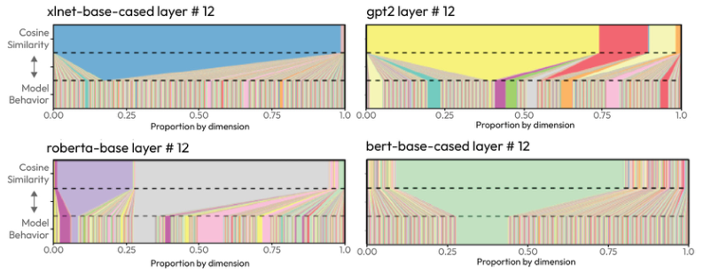

# 3 — Keyword, semantic and hybrid search

A Tallybook customer pastes `X-Tally-Signature` into the help widget, and an embedding search can answer with pages that merely feel related, because an identifier carries little meaning for a model to embed. Another asks "can I get my money back?" and keyword search returns nothing useful, because the refund page never says "money" or "back". Each method fails where the other is strong. Pick one and the retriever passes your favourite test queries and fails a whole class of real ones. This chapter builds both, fuses them and measures the blind spots.

> A retriever ranks documents. Keyword search (TF-IDF, BM25) ranks by shared words, semantic search ranks by embedding distance, metadata filters cut the set without ranking, and hybrid search fuses the rankings with RRF. Precision, recall, MAP and MRR tell you which one is working. The filters, fusion and metrics are in [03b](03b-metadata-filters-hybrid-search-and-evaluating-a-retriever.md).

---

## The retriever's three tools

| Technique | Matches on | Good at | Bad at |
|---|---|---|---|
| **Keyword search** | Exact terms | Product codes, names, jargon, rare words | Synonyms, paraphrase |
| **Semantic search** | Meaning (embedding similarity) | Paraphrase, "something like X" | Exact identifiers, negation |
| **Metadata filtering** | Structured fields | Hard constraints: region, tier, date | Anything fuzzy — it is not search |

Production retrievers run all three. Note [01 § hybrid retrieval](01-rag-pipeline.md#hybrid-retrieval) places them in the pipeline; the theory is in [ai-engineering 02 — retrieval](../../../ai-engineering/02-context-engineering/notes/04-retrieval.md).

---

## Keyword search

### Bag of words to TF-IDF

Each document becomes a **sparse vector**: one slot per vocabulary word, mostly zeros. The prompt becomes one too, and documents are scored by overlap. [Text representation](../../../data-science/03-nlp/notes/01-text-representation.md#tf-idf) in data science derives TF-IDF from scratch, and [text classification](../../../data-science/03-nlp/notes/02-text-classification.md#the-baseline-tf-idf-and-a-linear-model) uses it as the baseline to beat.

| Score | Formula | Fixes |
|---|---|---|
| Term frequency (TF) | count of word in doc | — |
| Normalised TF | count / doc length | Long docs winning by size |
| **TF-IDF** | TF × log(N / df) | Common words ("the", "pizza" in a pizza corpus) dominating |

N is the number of documents; df is how many contain the word. A word in every document gets log(1) = 0.

On Tallybook, IDF does most of the work. A word on many pages barely counts, and an error code that appears on one page counts for a lot:

```python
import math
from collections import Counter
from ragkit import DOCS, tokenize

df = Counter(term for d in DOCS for term in set(tokenize(d.full)))
for term in ["invoice", "settings", "refund", "credit", "BANK-112"]:
    print(f"{term:9} df={df[term]:2}  idf={math.log(len(DOCS) / df[term]):.2f}")
```

```text
invoice   df= 4  idf=1.50
settings  df= 5  idf=1.28
refund    df= 4  idf=1.50
credit    df= 1  idf=2.89
BANK-112  df= 1  idf=2.89
```

### BM25

BM25 is TF-IDF with two tunable fixes, and it is still the default keyword scorer. [Embeddings and similarity](../../../data-science/03-nlp/notes/04-embeddings-and-similarity.md#a-content-based-recommender-sarkar-ch-7b) in data science also builds it by hand, on a film catalogue.

| Parameter | Typical | Effect |
|---|---|---|
| **k1** term saturation | 1.2–2.0 | Diminishing returns on repeats. The course's slide says a doc with "pizza" 20 times scores about 1.3× one with it 10 times, not 2×. The formula below gives less than that: about 1.07× at k1=1.5 for documents of average length |
| **b** length normalisation | 0–1 (0.75 common) | How much to penalise long docs. b = 0 ignores length |

Raieli and Iuculano give the same defaults (*Building AI Agents*, ch. 5). The ranges come from experiment, not theory. BM25's authors say the model "provides no guidance" on k1 and b, and that 0.5 < b < 0.8 and 1.2 < k1 < 2 "are reasonably good in many circumstances", though the best values depend on the documents and queries. Both knobs have a model behind them. k1 shapes a curve, tf/(k1 + tf), fitted to the saturating weight that Harter's 2-Poisson model of "elite" terms predicts. b blends two views of a long document: it is verbose (normalise fully, b = 1), or it covers more topics (don't normalise, b = 0) ([Robertson & Zaragoza, *Foundations and Trends in IR* 2009](https://doi.org/10.1561/1500000019)). An edge case makes saturation clear: push k to 0 and the term-frequency factor collapses to 1, so BM25 scores only whether each query term is present.

Why keyword search survives: it is cheap, interpretable, needs no model, and nails exact matches that embeddings blur. Huyen's example is an error code. A user searching for `EADDRNOTAVAIL (99)` wants documents containing exactly that string, and an embedding retriever may return generic networking pages instead. She also quotes Perplexity's CEO saying BM25 remains a hard baseline to beat (*AI Engineering*, ch. 6).

Notes from the same chapter:

- **The inverted index** maps each term to the documents containing it. Lookup cost depends on how many documents contain the query terms, not on corpus size.
- **Variants.** BM25F scores fields (title, body) with separate weights. The order matters: BM25F weights and length-normalises each field's term count, sums them, and saturates once. Scoring each field with BM25 and adding the scores lets one term saturate separately in every field. Tuned field weights can be far from the defaults. On TREC 2003 web tasks the best k1 was 4.9–27.5, and the title counted 13.5–38.4 times the body (Robertson & Zaragoza, 2009). BM25+ fixes long documents being scored below short ones that don't contain the term at all.
- **n-grams.** Tokenising "hot dog" as two words matches pages about hot weather and dogs. Indexing bigrams keeps the phrase.
- **Framing.** Huyen splits retrievers into *term-based* and *embedding-based* rather than sparse and dense, because learned sparse models such as SPLADE are sparse but embedding-based.

### BM25 from scratch

The sparse half fits in about 40 lines of standard-library Python. For query term *t* in document *d*:

```
score(t, d) = IDF(t) · tf · (k1 + 1) / (tf + k1 · (1 − b + b · |d| / avgdl))
IDF(t)      = ln((N − df + 0.5) / (df + 0.5) + 1)
```

- **The `(k1 + 1)` in the numerator** is a common variant. It multiplies every term by the same constant, so it doesn't change the ranking (Robertson & Zaragoza, 2009).
- **The `+ 1` inside the log** is the Lucene variant. It keeps IDF positive for terms that appear in more than half the documents. Li's worked example uses the classic form without it, so his numbers come out slightly lower.

```python
import math, re
from collections import Counter

STOP = {"the", "is", "a", "an", "of", "to", "in", "and", "for", "on", "how", "what"}

def tokenize(text):
    # Keep codes like HTTP-403 whole; lowercase ordinary words; drop stop words.
    tokens = re.findall(r"[A-Za-z0-9]+(?:[-_][A-Za-z0-9]+)*", text)
    return [t if any(c.isdigit() for c in t) else t.lower()
            for t in tokens if t.lower() not in STOP]

class BM25:
    def __init__(self, docs, k1=1.5, b=0.75):
        self.k1, self.b = k1, b
        self.tf = [Counter(tokenize(d)) for d in docs]         # term counts per doc
        self.len = [sum(c.values()) for c in self.tf]          # |d|
        self.avgdl = sum(self.len) / len(docs)
        self.df = Counter(t for c in self.tf for t in c)       # docs containing t
        self.N = len(docs)

    def idf(self, t):
        # Lucene variant: the +1 keeps IDF positive for very common terms.
        df = self.df[t]
        return math.log((self.N - df + 0.5) / (df + 0.5) + 1)

    def term_score(self, t, i):
        tf = self.tf[i][t]
        if tf == 0:
            return 0.0
        norm = 1 - self.b + self.b * self.len[i] / self.avgdl   # length normalisation
        return self.idf(t) * tf * (self.k1 + 1) / (tf + self.k1 * norm)  # saturates in tf

    def search(self, query, k=3):
        q = tokenize(query)
        scores = [(sum(self.term_score(t, i) for t in q), i) for i in range(self.N)]
        return sorted((s for s in scores if s[0] > 0), reverse=True)[:k]

docs = [
    "Model distillation trains a small student model from a large teacher model.",
    "The model returned HTTP-403 when the API key had expired.",
    "A model card describes the model, its data and the model's limits.",
    "Forbidden errors usually mean the credentials lack permission.",
]
bm25 = BM25(docs)
for q in ["model distillation", "HTTP-403", "forbidden error"]:
    print(f"{q!r:22} ->", [(i, round(s, 2)) for s, i in bm25.search(q)])
```

```text
'model distillation'   -> [(0, 1.68), (2, 0.59), (1, 0.37)]
'HTTP-403'             -> [(1, 1.24)]
'forbidden error'      -> [(3, 1.31)]
```

Three things to read off the output:

- **Rare beats frequent.** Doc 2 says "model" four times but ranks well below doc 0. "model" is in three of the four documents, so its IDF is low, and `k1` caps what repetition can add. "distillation" is in one document and carries the score.
- **Codes survive tokenisation.** `HTTP-403` stays one token and hits doc 1 exactly, which is what dense search tends to blur.
- **The blind spot.** "forbidden error" never reaches doc 1, the actual 403 incident, and it matches doc 3 on "forbidden" alone: "error" ≠ "errors", with no stemming and no synonyms. That gap is what the dense half and the reranker fill.

Sweep `k1 ∈ {0.5, 1.2, 2.0}` and `b ∈ {0, 0.75, 1}` on a corpus with one very long document and watch its rank move. To see the sparse half of [contextual retrieval](../../../ai-engineering/02-context-engineering/notes/04-retrieval.md#contextual-retrieval), prefix a chunk with "ACME Corp 2025 Q2 financial report:" and query "ACME revenue". The fuller engine, with an inverted index, debug logging and tests, is upstream: Li, *AI Agents in Depth*, [Experiment 3-5 sparse-embedding](https://github.com/bojieli/ai-agent-book/tree/main/chapter3/sparse-embedding) (Apache-2.0).

Saturation is easy to check against the slide's claim. Holding length at the average, the term-frequency factor is `tf * (k1 + 1) / (tf + k1)`:

```python
def tf_factor(tf, k1):
    return tf * (k1 + 1) / (tf + k1)

for k1 in [0.5, 1.2, 1.5, 2.0, 8.6]:
    print(f"k1={k1:<4} tf=1: {tf_factor(1, k1):.2f}  tf=10: {tf_factor(10, k1):.2f}  "
          f"tf=20: {tf_factor(20, k1):.2f}  ratio 20/10: {tf_factor(20, k1) / tf_factor(10, k1):.2f}")
```

```text
k1=0.5  tf=1: 1.00  tf=10: 1.43  tf=20: 1.46  ratio 20/10: 1.02
k1=1.2  tf=1: 1.00  tf=10: 1.96  tf=20: 2.08  ratio 20/10: 1.06
k1=1.5  tf=1: 1.00  tf=10: 2.17  tf=20: 2.33  ratio 20/10: 1.07
k1=2.0  tf=1: 1.00  tf=10: 2.50  tf=20: 2.73  ratio 20/10: 1.09
k1=8.6  tf=1: 1.00  tf=10: 5.16  tf=20: 6.71  ratio 20/10: 1.30
```

The slide's 1.3× needs a k1 near 8.6, far outside the usual range. At normal settings the 20th mention adds almost nothing, which is the point of the parameter.

### A library version

Past the idea, use a library. The course uses `bm25s`, which tokenises for you, so the corpus goes in as strings:

```python
import bm25s
from ragkit import DOCS

corpus = [d.full for d in DOCS]

# Index once: tokenise the corpus, build the inverted index
BM25_RETRIEVER = bm25s.BM25(corpus=corpus)
BM25_RETRIEVER.index(bm25s.tokenize(corpus, show_progress=False), show_progress=False)

def bm25_retrieve(query: str, top_k: int = 5) -> list[int]:
    # Tokenise the query the same way as the corpus
    tokens = bm25s.tokenize(query, show_progress=False)
    results, scores = BM25_RETRIEVER.retrieve(tokens, k=top_k, show_progress=False)
    # bm25s returns the documents themselves (batch of 1); map back to indices
    return [corpus.index(str(doc)) for doc in results[0]]

for query in ["what does BANK-112 mean", "reverse a sent invoice"]:
    print(query, "->", [DOCS[i].id for i in bm25_retrieve(query, top_k=3)])
```

```text
what does BANK-112 mean -> ['kb-13', 'kb-17', 'kb-06']
reverse a sent invoice -> ['kb-09', 'kb-08', 'kb-17']
```

---

## Semantic search

An **embedding model** maps text to a dense vector so that similar meanings land close together. It learns by **contrastive training**: pull positive pairs (a question and its answer) together and push negatives apart. See [LLM embeddings as features](../../../data-science/03-nlp/notes/07-llm-embeddings-as-features.md#what-a-sentence-embedding-is) in data science for what a sentence embedding is.

### Distance measures

| Measure | Uses | Note |
|---|---|---|
| **Cosine similarity** | Angle only | The default for text. Length-invariant |
| Euclidean distance | Straight-line distance | Sensitive to vector length |
| Dot product | Angle × length | Equals cosine when vectors are normalised |

The figure below has the same two vectors as this code. Cosine ignores their length. The other two measures do not, until you normalise:

```python
import numpy as np

a, b = np.array([10.0, 10.0]), np.array([100.0, 100.0])
cosine = a @ b / (np.linalg.norm(a) * np.linalg.norm(b))
print(f"raw        cosine={cosine:.3f}  euclidean={np.linalg.norm(a - b):.1f}  dot={a @ b:.0f}")
a, b = a / np.linalg.norm(a), b / np.linalg.norm(b)
print(f"normalised cosine={a @ b:.3f}  euclidean={np.linalg.norm(a - b):.1f}  dot={a @ b:.3f}")
```

```text
raw        cosine=1.000  euclidean=127.3  dot=2000
normalised cosine=1.000  euclidean=0.0  dot=1.000
```

![Two vectors [10,10] and [100,100] on the same direction: cosine similarity 1 despite very different lengths, angle θ between direction lines](../sources/images/hasan-dlai-rag-cosine.png)
*Image Source: Hasan, DeepLearning.AI RAG course, Module 2*

A correction to two books: the *LLM Engineer's Handbook* (ch. 4) gives cosine distance a range of −1 to 1, which is the range of *similarity*; distance, 1 − similarity, runs from 0 to 2. *Prompt Engineering for GenAI* (ch. 5) calls similarity "a measure of distance", though higher similarity means *closer*. Check which one a library returns before setting a threshold. A FAISS `IndexFlatL2`, for instance, returns squared L2 distances ([04](04-vector-databases-and-ann.md)).

The course's version loads a corpus it ships pre-embedded:

```python
# illustrative: needs the course's embeddings.joblib; sentence-transformers downloads the model
from sentence_transformers import SentenceTransformer
import joblib, numpy as np

model = SentenceTransformer("BAAI/bge-base-en-v1.5")
EMBEDDINGS = joblib.load("embeddings.joblib")  # the course ships the corpus pre-embedded

def cosine_similarity(v1, array_of_vectors):
    # The course writes its own: dot product over the product of norms
    v1 = np.asarray(v1); arr = np.atleast_2d(array_of_vectors)
    return arr @ v1 / (np.linalg.norm(arr, axis=1) * np.linalg.norm(v1))

def semantic_search_retrieve(query: str, top_k: int = 5) -> list[int]:
    query_embedding = model.encode(query)                  # same model as the corpus
    similarity_scores = cosine_similarity(query_embedding, EMBEDDINGS)
    return np.argsort(-similarity_scores)[:top_k].tolist() # highest similarity first
```

A trap the assignment surfaces: **bge-base-en-v1.5 truncates at 512 tokens**. Embedding a full article and embedding its first 3000 characters give the same vector, because everything past the limit is dropped. This is the first argument for chunking (note [05](05-chunking-query-parsing-and-reranking.md)).

### A real embedder on the same questions

The `ragkit` embedder is hand-built, so here is a real model on the same 20 questions. This block downloads `BAAI/bge-small-en-v1.5` (384 dimensions, about 64 MB) through `fastembed` on first run, and then needs no network or API key:

```python
import numpy as np
from fastembed import TextEmbedding
from ragkit import DOCS, QUERIES, Retriever, evaluate, rrf, top_k

model = TextEmbedding("BAAI/bge-small-en-v1.5")
ids = [d.id for d in DOCS]
vectors = np.array(list(model.embed([d.full for d in DOCS])))

def real_dense(query, k=5):
    return top_k(vectors @ np.array(list(model.embed([query])))[0], ids, k)

toy = Retriever()
def real_hybrid(query, k=5):
    return rrf([toy.sparse(query, 10), real_dense(query, 10)])[:k]

print("vectors:", vectors.shape)
for name, search in [("bm25", toy.sparse), ("toy dense", toy.dense), ("bge-small", real_dense),
                     ("bm25+bge rrf", real_hybrid)]:
    by_kind = {kind: evaluate(search, [q for q in QUERIES if q[2] == kind])["recall@3"]
               for kind in ["code", "keyword", "paraphrase"]}
    print(f"{name:13}", {m: round(v, 2) for m, v in evaluate(search).items()}, by_kind)
```

```text
vectors: (18, 384)
bm25          {'recall@3': 0.6, 'mrr': 0.56, 'ndcg@3': 0.56} {'code': 1.0, 'keyword': 1.0, 'paraphrase': 0.2}
toy dense     {'recall@3': 0.9, 'mrr': 0.88, 'ndcg@3': 0.88} {'code': 0.6, 'keyword': 1.0, 'paraphrase': 1.0}
bge-small     {'recall@3': 0.95, 'mrr': 0.91, 'ndcg@3': 0.91} {'code': 1.0, 'keyword': 1.0, 'paraphrase': 0.9}
bm25+bge rrf  {'recall@3': 0.95, 'mrr': 0.84, 'ndcg@3': 0.86} {'code': 1.0, 'keyword': 1.0, 'paraphrase': 0.9}
```

- BM25 aces the codes and keywords and falls to 0.2 on paraphrase. That is its documented blind spot, reproduced.
- The real model is far stronger than the expectation "embeddings blur codes". It found every code here. Eighteen pages is an easy haystack: nothing else on the corpus looks like `BANK-112`. In a corpus with thousands of near-identical error pages, that advantage shrinks, which is Huyen's `EADDRNOTAVAIL` point above.
- RRF did not raise recall@3 over bge-small alone, and it lowered MRR, because the BM25 list pushes weak candidates up for paraphrase questions. Hybrid is an insurance policy against the failure you have not seen yet. It isn't a free win at every corpus size, so measure on your own labelled set.
- Distrust the toy row. Its lexicon was written by the same author as the questions, so its 1.0 on paraphrase is rigged, and it exists only so the rest of this course can run offline.

### How embedders are trained, and where cosine misleads

Raieli and Iuculano cover the training side (*Building AI Agents*, ch. 5):

- **Two ways to score.** A *cross-encoder* reads `[CLS] query [SEP] document` and scores the pair. It is accurate, but the query and document together must fit BERT's 512 tokens, and every pair is a forward pass. A *bi-encoder* embeds each side once, so document vectors can be precomputed.
- **Training data and losses.** Bi-encoders are trained on labelled pairs; MultiNLI (433K sentence pairs) is the classic source. A cosine-similarity loss regresses on graded labels. *Multiple negatives ranking loss* (InfoNCE) uses only positive pairs and treats the other answers in the batch as negatives. Random negatives are too easy. *Hard negatives*, passages that look relevant but aren't, teach the boundary, though [how many and how hard is a measured question](../../../data-science/05-time-series-and-recommenders/notes/05-learning-a-similarity-function.md#mining-hard-negatives).
- **Training a retriever without labelled passages.** ORQA pretrained a BERT retriever on the *inverse cloze task*. A random sentence stands in for the question, and the model must pick the passage it came from out of the other passages in the batch. The sentence is left in its passage 10% of the time. On the Natural Questions dev set, removing it always cost almost 10 exact-match points, because the model never learned that shared words are a strong signal, and never removing it performed about as well as BM25. Only the question encoder was then fine-tuned, on question–answer pairs alone, so the 13M Wikipedia blocks were encoded once with the pretrained block encoder and indexed. It beat BM25 by 6–19 exact-match points on Natural Questions, WebQuestions and CuratedTrec. It lost on TriviaQA and SQuAD, whose question writers already knew the answer, and lost badly on SQuAD's test set (20.2 vs 33.2), where they had the passage in front of them. On SQuAD dev the gap was small (26.5 vs 28.1), and the authors blame the drop partly on the dataset, whose 100k questions come from only 536 documents. The authors put the loss down to a 128-d vector, sized so the model fits on one machine, that "cannot match BM25's ability to precisely represent every word", and name a dense–sparse hybrid as future work ([arXiv:1906.00300](https://arxiv.org/abs/1906.00300), Lee et al., ACL 2019). The scores are end-to-end exact match only, with the same reader behind every retriever; no retrieval recall is reported.
- **The result that made dense retrieval the default.** DPR trained two BERT-base encoders on question–passage pairs and searched 21M 100-word Wikipedia passages by dot product. It found a passage containing the answer in the top 20 for 78.4% of Natural Questions test questions, against 59.1% for BM25, and beat BM25 by 9–19 points at top 20 on four of five QA sets. A thousand training pairs were enough to beat BM25 on the NQ dev set. The batch did most of the work: with 127 in-batch negatives top-20 accuracy reached 73.0% on the dev set, and one extra BM25 hard negative per question raised it to 78.0%. A second BM25 negative added nothing. BM25 still won on SQuAD (68.8 vs 63.2), whose annotators wrote questions while reading the passage, so the words overlap. The paper's example shows DPR missing the name "Thoros of Myr", which keyword search catches ([arXiv:2004.04906](https://arxiv.org/abs/2004.04906), Karpukhin et al., EMNLP 2020).
- **Why random negatives stall.** ANCE argues that a negative the model already ranks low gives a near-zero loss and a near-zero gradient. In-batch negatives almost never include the passages the trained model would wrongly retrieve. On TREC DL, random and in-batch negatives overlapped 0% of the model's own top-100 wrong answers, BM25 negatives 15%. ANCE retrieves its negatives from an index of the model being trained, refreshed every 10k batches. With RoBERTa-base for both, that took MS MARCO dev MRR@10 from 0.311 (BM25 plus random negatives, DPR-style) to 0.330. Started from DPR's BERT checkpoint, it raised NQ test top-20 from 78.4% to 81.9%. The cost is re-encoding the corpus at every refresh, about 10 hours for MS MARCO's documents on one V100. The argument rests on a gradient bound proved for MLPs, which the paper backs with gradient-norm plots but doesn't prove for transformers ([arXiv:2007.00808](https://arxiv.org/abs/2007.00808), Xiong et al., ICLR 2021).
- **Labels from an LLM.** Promptagator replaces human query labels with generated ones. It prompts FLAN (137B) with up to 8 query–document examples from the target task, generates 8 queries for each of up to 1M documents, and then filters them by round trip. A dual encoder trained on the unfiltered pairs must rank the query's own document first, or the pair is dropped. A 110M T5 dual encoder trained on what survives averaged 47.8 nDCG@10 on 11 BEIR datasets. That beat BM25 (41.8), GTR-XXL (44.9) and SPLADE v2 (46.6), and the biggest gains came on argument retrieval, which is least like QA. On MS MARCO, the 8 examples were worth about 50k human-labelled pairs for a simple dual encoder. The filter added 2.5 points on average, but it hurt on 3 of the 11, including the two with the fewest generated queries. Poor examples hurt too: on Climate-FEVER the few-shot version scored 16.8, below zero-shot's 21.4. The paper gives no generation cost beyond the count: 58M queries, 610M words ([arXiv:2209.11755](https://arxiv.org/abs/2209.11755), Dai et al., ICLR 2023). The prompt itself is in [Prompt engineering, applications](../../../ai-engineering/01-prompt-engineering/notes/11-applications.md#pattern-4--synthetic-queries-for-retrieval-promptagator).
- **An LLM's wrong passages are hard negatives.** Syntriever asks GPT-4o, through the API with no access to its probabilities, for passages instead of queries. For each training query it writes a positive passage, a plausible but irrelevant passage, and a chain-of-thought rewrite. A yes/no check then relabels positives that fail to answer the question as extra hard negatives. That flagged about 15% of HotpotQA's positives and a few percent elsewhere, and the relabelling lifted HotpotQA nDCG@10 from 67.4 to 70.2. A second stage has GPT-4o compare pairs from the retriever's own top 5 and trains on its preferences. On MS MARCO, fine-tuned in domain, an E5-base retriever (about 125M) reached 50.3 nDCG@10 against 42.4 for E5. On 15 BEIR datasets it was best on 8 by the paper's count (7 by a recount of its Table 2), and two of the 15, MS MARCO and NQ, are in-domain, and BM25 still beat it on FEVER, Touché and Climate-FEVER. GPT-4o also judged only 84% of the labelled positives as containing the answer, against 88% for its own (1,000 samples each, gap attributed to HotpotQA). Only 125M encoders were tested, with one seed, the API cost is not reported, and nobody checked whether GPT-4o had seen the BEIR corpora ([arXiv:2502.03824](https://arxiv.org/abs/2502.03824), Kim et al., NAACL 2025 Findings).
- **Rogue dimensions.** In many transformer embeddings one to five dimensions have very large magnitude and dominate cosine similarity, so two texts look similar because of a few dimensions that track little meaning. Standardising each dimension (z-score over the corpus) before comparing reduces the effect.
- **A 7B LLM as the encoder.** Llama2Vec continues pre-training LLaMA-2-7B without labels so that its last-token embedding predicts the sentence's own words and the next sentence's, then fine-tunes it on MS MARCO as RepLLaMA does. Zero-shot on 14 BEIR datasets it averaged **56.4 nDCG@10 against BM25's 42.9** and RepLLaMA's 53.9, and beat BM25 on 13 of 14. The exception was Touché, 34.2 against BM25's 44.2. Costs: 4,096-d vectors (768-d projections fell from 43.1 to about 41 MRR@10 on MS MARCO dev), one 7B model, English only, MS MARCO training only, and no hybrid run ([arXiv:2312.15503](https://arxiv.org/abs/2312.15503), Liu et al., 2023-12, v2 2025, preprint).
- **Retrievers treat instructions as keywords.** FollowIR re-judged TREC narratives so that a narrower instruction turns about half the relevant documents non-relevant, then measured whether the ranking moves (p-MRR, 0 = no change). Across Robust04, News21 and Core17 reranking, BM25 (-2.1), E5-base-v2 (-3.9), OpenAI v3 Large (-2.7) and E5-Mistral (-3.5) scored below zero; the clearest positive scores came from instruction-tuned LMs used as rerankers (Mistral-7B-instruct +10.1), with a few mildly positive (MonoT5-3B +2.5, Gecko +2.3). OpenAI v3 Large's MAP of 27.2 on Robust04 did not predict this. On full-collection retrieval, appending the long instruction cut Robust04 MAP by 3.1 to 10.1 points for five of seven retrievers. A 7B model tuned on about 1,800 synthetic instances reached +12.2 p-MRR. Small sets (20 to 52 queries each), news only ([arXiv:2403.15246](https://arxiv.org/abs/2403.15246), Weller et al., 2024-03, preprint). Put constraints into filters or a reranker prompt, not into the query string.


*Image Source: Raieli & Iuculano, *Building AI Agents with LLMs, RAG, and Knowledge Graphs* (Packt, 2025), Fig. 5.6 (from Timkey & van Schijndel, EMNLP 2021)*

**Choosing an embedder.** Start from the MTEB leaderboard, which ranks retrieval by NDCG, but don't stop there. Scores are self-reported, and some models may have trained on the benchmark data. Test two or three candidates on your own queries (*Building AI Agents*, ch. 5). Huyen points to BEIR (14 retrieval benchmarks) for the same comparison (*AI Engineering*, ch. 6). Read BEIR averages with the metric in mind. Contriever, trained with no labels on two random spans cropped from the same document, beat BM25 on 11 of 15 BEIR datasets at recall@100. Its average was still lower, 60.1 against 63.6, because BM25 won Trec-COVID and Touché by 30 points or more, and BM25 led nDCG@10 on 12 of the 15. After fine-tuning on MS MARCO it led the dense models of the time at 47.5 average nDCG@10 (excluding CQADupStack), and a cross-encoder reranker on top reached 51.2. Its authors judge retrievers by recall@100 because a reranker or reader consumes the top 100, while BEIR's headline metric is nDCG@10 ([arXiv:2112.09118](https://arxiv.org/abs/2112.09118), Izacard et al., TMLR 2022). A leaderboard rank can flip with the metric, so pick the one that matches what reads your results. Size buys generality more than dimensions do. GTR kept one 768-d vector and grew its T5 encoder from 110M to 4.8B parameters. Its average nDCG@10 on 18 BEIR datasets outside MS MARCO rose from 0.416, below BM25's 0.423, to 0.458. Going from 768 to 4,096 dimensions gained almost nothing, in a smaller ablation on six of the datasets. Latency rose from 17 ms to 349 ms per query at batch size 1. BM25 still won Trec-COVID, BioASQ, Signal-1M, Trec-News and Touché by 5–16 points of nDCG@10 even at the largest size. Fine-tuning on 10% of MS MARCO matched the out-of-domain score of the full set ([EMNLP 2022](https://doi.org/10.18653/v1/2022.emnlp-main.669), Ni et al.). The encoder under the embedder matters less than a leaderboard suggests. ModernBERT, a BERT-style backbone trained on 2T tokens with an 8,192-token context, ships as a masked language model, not an embedder, and its single-vector retrieval numbers come after the same contrastive fine-tune on 1.25M MS MARCO pairs applied to each backbone, its ColBERT numbers after the same 810k-pair MS MARCO distillation. Fine-tuned that way, its base model averaged 41.6 nDCG@10 over the 15 BEIR datasets against 41.4 for GTE-en-MLM-base, and lost to GTE on 9 of the 15 and tied one; TREC-COVID (72.1 against 49.7) carries the average. Where it clearly wins is code retrieval (56.4 against 44.9 on CodeSearchNet, as the only encoder in its comparison pretrained on code), long documents under ColBERT-style multi-vector scoring (80.2 against 69.3 on MLDR with no long-context fine-tuning) and throughput at 8,192 tokens, 2.65× the next encoder on one RTX 4090. It is English-only, and as a single-vector embedder it lost to GTE on long documents out of domain, 27.4 against 34.3 ([arXiv:2412.13663](https://arxiv.org/abs/2412.13663), Warner et al., ACL 2025). Biomedical, news and argument search are where an off-the-shelf embedder is most likely to need BM25 beside it. The same ordering shows up when the retriever feeds a generator rather than a benchmark: with ten Wikitext-103 passages prepended to GPT-2 (774M and 1.5B), BM25 lowered test perplexity more than off-the-shelf Contriever, DPR or BERT, and only a Contriever retrained on the language model's own likelihoods beat it ([arXiv:2301.12652](https://arxiv.org/abs/2301.12652), Shi et al., NAACL 2024).


Metadata filters, hybrid search with reciprocal rank fusion, and evaluating a retriever continue in [03b](03b-metadata-filters-hybrid-search-and-evaluating-a-retriever.md).

---

## Rules of thumb

| Rule | Why |
|---|---|
| Check your embedder's token limit | Past it, text is silently dropped |

---

## Labs

| Lab | Label |
|---|---|
| M2 ungraded labs (TF-IDF, BM25, embeddings) and Assignment 2 (hybrid retriever) ([upstream](https://github.com/MohammadWasiq0786/Deeplearning.ai-RAG)) | needs `bm25s`, `sentence-transformers`; course data; not copied |

---

## Pitfalls

- **Tokeniser mismatch.** Symptom: an exact code returns nothing or the wrong page. A tokeniser that splits `HTTP-403` into `HTTP` and `403` matches every HTTP page. Test identifiers explicitly, and use the same tokeniser for the corpus and the query.
- **Mixing embedding models.** Symptom: similarity scores look like noise after a model upgrade. Two models' spaces are unrelated, so re-embed the whole corpus.
- **Text past the token limit.** Symptom: two long articles with different endings get identical vectors. `bge-base-en-v1.5` truncates at 512 tokens, silently.
- **Trusting a small corpus.** Symptom: dense search looks perfect in the demo and misses exact codes in production. Rare identifiers get harder to separate as near-duplicate pages multiply, so test at realistic size.

---

## Try it

1. Tokenise `HTTP-403` with `re.findall(r"\w+", ...)` instead of `ragkit.tokenize` and rerun `BM25` on "HTTP-403 when calling the API". What changes?
2. Add a 19th page, `Doc("kb-19", "Release notes", " ".join(["API changes shipped this release for developers and integrators."] * 30), "api", "2026-10-10")`. How do `b=0` and `b=0.75` treat it for "API rate limits"?

<details>
<summary>Answers</summary>

1. `kb-01` stays first, because `403` alone is still rare. The damage shows with a code the corpus lacks. `HTTP-404` now matches `kb-01` and `kb-03` on `HTTP`, where the whole-token tokeniser finds nothing and honestly says so.
2. `kb-03` wins both ways, since it matches the rarer "rate" and "limits". The long page comes second. Its score falls from 3.07 at `b=0` to 2.71 at `b=0.75`, while `kb-03` rises from 6.51 to 7.16.

</details>

---

## Interview checklist

| Question | Answer |
|---|---|
| What does IDF do? | It discounts terms that appear in many documents. A term in every document contributes nothing in classic TF-IDF, while a rare code dominates. |
| What do BM25's `k1` and `b` control? | `k1` saturates term frequency, so repeats give diminishing returns. `b` sets how much long documents are penalised: 0 ignores length, 1 normalises fully. |
| When does keyword search beat embeddings? | Exact identifiers, names and jargon, especially when many documents are semantically near-identical. |
| Cosine similarity or dot product? | Cosine ignores length. They are the same on unit vectors, so normalise and use the faster one. |

---

## Next

[03b — Metadata filters, hybrid search and evaluating a retriever](03b-metadata-filters-hybrid-search-and-evaluating-a-retriever.md): cut the candidate set with filters, fuse the keyword and semantic rankings with RRF, and measure the result with Recall@k, MRR and nDCG.
