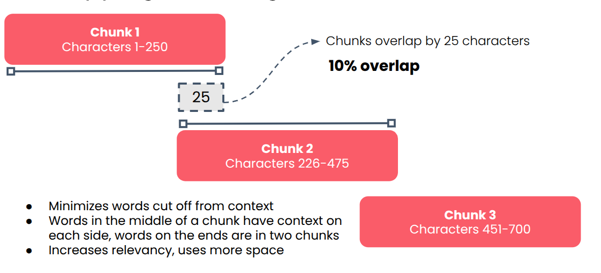
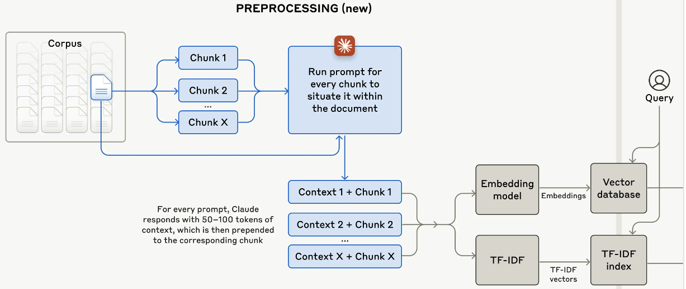
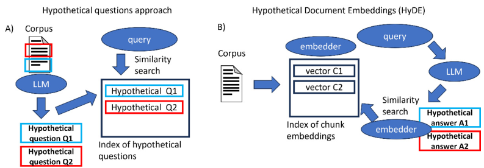

# 5 — Chunking, query parsing and reranking

A Tallybook customer asks how long a refund takes. The answer is one sentence inside a 90-line page on refunds and cancellations, and the page's vector is an average of refund windows, card rules, disputes and data deletion. The search misses it, or finds it and hands the model the entire page. Even with the right chunk indexed, the question "how long will it take?" is two turns into a chat and names no subject at all, and the best match may sit at rank 14 where the model never sees it. Three failures, three fixes: what you index, what you search for, and what you keep.

> Three production techniques around the vector database: chunking decides what one vector stands for, query parsing turns a messy prompt into a good search query, and reranking spends extra compute on the top 20–50 hits to return the best 3–10. This note covers chunking and index-time structure; [5b](05b-query-parsing-conversational-retrieval-and-reranking.md) covers query parsing, conversational retrieval, the three ways to score a pair (bi-encoder, cross-encoder, ColBERT) and reranking.

---

## Chunking

### Why chunk

| Without chunking | Effect |
|---|---|
| 1,000 books → 1,000 vectors | One vector per book |
| Whole book squeezed into one vector | Meaning is *averaged*; no chapter or page stands out |
| Retrieval returns whole books | Fills the context window at once |
| Embedder token limit (512 for bge-base) | Most of the book is never embedded (note [03](03-keyword-semantic-and-hybrid-search.md)) |

Chunk size is a balance. Too large (chapters): too many topics per vector, context fills fast. Too small (words, short sentences): each chunk loses its surrounding context and relevance drops.

Phoenix and Taylor name the "too large" effect: an embedding of a long, mixed chunk regresses toward the mean, drifting toward the centre of the vector space where it is moderately similar to everything (*Prompt Engineering for GenAI*, ch. 5). Huyen names the "too small" cost: halving the chunk size doubles the number of vectors to store and search, and a boundary can cut the meaning in two. Her example is "I left my wife a note", split so that the retrieved half reads "I left my wife" (*AI Engineering*, ch. 6). Her candidate units are characters (say 2,048), words (512), sentences (20) or paragraphs. Raieli and Iuculano report 100 or 256 tokens, or 500 characters, as common starting sizes (*Building AI Agents*, ch. 6).

### Strategies

| Strategy | How | Cost | Course verdict |
|---|---|---|---|
| **Fixed size** | Every N characters or words | Trivial | Good default |
| Fixed + **overlap** | Each chunk repeats the end of the previous one | ~10–20% more storage | Fewer ideas cut in half |
| **Recursive character splitting** | Split on structure: `\n\n`, headings, `<p>`, `def` | Trivial | Good default; respects document structure |
| **Semantic** | Walk sentence by sentence; start a new chunk when cosine distance to the running chunk crosses a threshold | One embedding per sentence | Smarter boundaries, more compute; experiment |
| **LLM-based** | Prompt an LLM to split by concept | One LLM pass per doc | Performs well, getting cheaper |
| **Context-aware** | Keep any chunking, but have an LLM prepend a line of context per chunk ("context: launch announcement") | One LLM call per chunk, at index time only | Improves any strategy. A good "first improvement" |


*Image Source: Hasan, DeepLearning.AI RAG course, Module 3*

Context-aware chunking is the same idea as Anthropic's *contextual retrieval* (2024). The house treatment, with the numbers, is in [01 § chunking](01-rag-pipeline.md#chunking) and [ai-engineering 02 — retrieval](../../../ai-engineering/02-context-engineering/notes/04-retrieval.md).

**What overlap to use is a convention, not a finding.** Huyen's own example overlaps 20 characters on 2,048-character chunks, about 1% (*AI Engineering*, ch. 6). The framework examples run much higher: 200 on 1,000 characters (20%) in *Learning LangChain* (ch. 2), 50 on 500 (10%) in the *LLM Engineer's Handbook* (ch. 4), and 20 on 100 tokens in *Prompt Engineering for GenAI* (ch. 5). None of the four measures the choice. Treat the course's 10–20% as a starting point to test, and drop it if a cheaper setting retrieves as well.

**Recursive splitting in LangChain** is `RecursiveCharacterTextSplitter`. It tries separators in order (`"\n\n"`, then `"\n"`, then `" "`) and only falls to the next one when a piece is still too long. `RecursiveCharacterTextSplitter.from_language(Language.PYTHON, ...)` swaps in code-aware separators such as `class` and `def` (*Learning LangChain*, ch. 2). The Handbook's article chunker is a cruder version: split into sentences, append sentences until the next one would pass `max_length`, and keep the chunk only if it has reached `min_length` (*LLM Engineer's Handbook*, ch. 4). Its article handler sets both to 1,000 characters. With `min_length == max_length`, a chunk is kept only if it ends within a character or so of 1,000, so most chunks, and every article's tail, are silently dropped. Set the minimum well below the maximum. The same run turns 76 documents into 2,373 chunks with the generic 500/50 splitter.

**Less common chunkers** from Raieli and Iuculano (*Building AI Agents*, ch. 6):

| Chunker | How | Catch |
|---|---|---|
| Clustering (k-means on sentence embeddings) | Group sentences by topic | Loses the original order |
| Proposition | An LLM rewrites the text as atomic, self-contained statements | One LLM pass over the corpus |
| Statistical merging | Merge neighbouring sentences while a similarity statistic stays high | A threshold to tune |

Their guidelines match the course: match the chunk to the query type, respect the embedder's input limit, and evaluate on your own data.

**Contextual retrieval, the mechanics.** Huyen describes the index-time step behind context-aware chunking: an LLM writes a short context, typically 50–100 tokens, that situates the chunk in its document, and the context is prepended to the chunk, which is then indexed by the retriever (*AI Engineering*, ch. 6). Her other augmentations: product descriptions with reviews, or the questions an article answers.


*Image Source: Huyen, *AI Engineering* (O'Reilly, 2025), Fig. 6-5, reproducing Anthropic, "Introducing Contextual Retrieval" (2024)*

**Element-based chunking** is recursive splitting taken further: a document-layout model labels each element (title, narrative text, table, list), and chunks break at element boundaries. On FinanceBench (10-K and 10-Q filings, top-10 chunks, GPT-4 generator), element-based chunking answered 53.2% of questions correctly against 48.2% for the best fixed size (512 tokens) and 35.5% for 128 tokens, on manual grading. It also indexed about half as many chunks (62,529 vs 112,155) and needed no chunk-size tuning ([arXiv:2402.05131](https://arxiv.org/abs/2402.05131), Jimeno Yepes et al., 2024-02). The setting is one domain of table-heavy, strongly structured documents, so expect less on prose.

**Semantic chunking** has the weaker evidence. A Vectara study ran fixed-size, breakpoint (the threshold method in the table) and clustering chunkers over ten retrieval sets and five evidence and answer sets, with the stella-1.5B embedder and gpt-4o-mini as generator. On the four real long-document sets, fixed-size chunks retrieved the right document best (HotpotQA F1@5 90.59 vs 87.37 for breakpoint). Evidence-retrieval F1 differed by under 2 points, and answer BERTScore by at most 0.01. Breakpoint chunking won big only on synthetic documents stitched together from unrelated short ones (NQ 63.93 vs 43.79), where topic boundaries are artificially sharp. Swapping the embedder mattered more: stella beat bge-large by 7.44% average F1 ([arXiv:2410.13070](https://arxiv.org/abs/2410.13070), Qu et al., 2024-10). The authors' own caveats: sentence embeddings without context, and no chunk-level ground truth.

**Keep the HTML structure, then prune.** HtmlRAG feeds the reader cleaned HTML instead of flattened text. Rule-based cleaning drops 94.07% of tokens (plain text conversion drops 96.71%, Markdown 90.32%). A block tree is then pruned twice, by embedding and by a fine-tuned generative pruner (Phi-3.5-mini, 2,635 training samples), taking 20 retrieved pages from 1.6M to 135K to 8K to 4K tokens. With Llama-3.1-8B, a 4K window and Bing-retrieved pages (400 questions per dataset), ASQA Hit@1 was 71.75 against 68.50 for BGE chunk-and-rerank. At 70B the lead mostly vanished (MuSiQue exact match 13.25 against 12.50; ASQA exact match 30.53 against 30.57, though ASQA Hit@1 was 68.50 against 68.00). Without pruning, HTML only tied plain text at a 128K window (ASQA Hit@1 58.75 against 59.75), and uncleaned HTML scored 44.00. Ablations on ASQA Hit@1 (full 68.50): no block tree 59.50, no embedding pruning 56.75, no generative pruning 62.00. Single runs, one retrieval source, and no ELI5 ROUGE or BLEU gain at 8B (15.51 against 15.87 ROUGE-L; at 70B the gain is small, 16.33 against 16.20) ([arXiv:2411.02959](https://arxiv.org/abs/2411.02959), Tan et al., WWW 2025).

## Chunking code

Start with the page from the opening, `LONG_DOC` in the practice kit. The course's lab has two chunkers. Its fixed-size chunker counts words and steps back to repeat a tail. Its mixed chunker splits on section markers and merges short fragments. The lab's corpus is Asciidoc, so it splits on `"\n=="`. Tallybook's page is Markdown, so the marker here is `"\n## "`:

```python
from ragkit import LONG_DOC

def get_chunks_fixed_size_with_overlap(text: str, chunk_size: int,
                                       overlap_fraction: float) -> list[str]:
    text_words = text.split()                        # word-level, not character-level
    overlap_int = int(chunk_size * overlap_fraction) # e.g. 100 words × 0.2 = 20
    chunks = []
    for i in range(0, len(text_words), chunk_size):
        # Step back overlap_int words so each chunk repeats the previous tail
        chunk_words = text_words[max(i - overlap_int, 0): i + chunk_size]
        chunks.append(" ".join(chunk_words))
    return chunks

def mixed_chunking(source_text: str, marker: str = "\n## ") -> list[str]:
    # Variable-size: split on section markers (the lab's Asciidoc uses "\n==")...
    chunks = source_text.split(marker)
    new_chunks, chunk_buffer, min_length = [], "", 25
    for chunk in chunks:
        new_buffer = chunk_buffer + chunk
        if len(new_buffer.split(" ")) < min_length:  # ...but merge fragments under 25 words
            chunk_buffer = new_buffer                # carry over to the next section
        else:
            new_chunks.append(new_buffer)
            chunk_buffer = ""
    if chunk_buffer:
        new_chunks.append(chunk_buffer)              # don't drop the tail
    return new_chunks

answer = "5 to 10 working days"
for name, chunks in [("fixed 28, no overlap", get_chunks_fixed_size_with_overlap(LONG_DOC, 28, 0.0)),
                     ("fixed 28, 20% overlap", get_chunks_fixed_size_with_overlap(LONG_DOC, 28, 0.2)),
                     ("by section", mixed_chunking(LONG_DOC))]:
    whole = sum(answer in c for c in chunks)
    print(f"{name:<22} chunks={len(chunks)}  longest={max(len(c.split()) for c in chunks):>2} words  "
          f"holds the whole answer: {whole}")
    if name == "by section":
        print("section chunk starts:", [c[:18] for c in chunks])
```

```text
fixed 28, no overlap   chunks=7  longest=28 words  holds the whole answer: 0
fixed 28, 20% overlap  chunks=7  longest=33 words  holds the whole answer: 1
by section             chunks=4  longest=49 words  holds the whole answer: 1
section chunk starts: ['# Refunds and canc', 'How refunds are pa', 'Cancelling a works', 'Disputed charges\nI']
```

At 28 words with no overlap, a chunk boundary lands inside "5 to 10 working days", so no chunk holds the answer whole. Overlap repairs that, at the cost of longer chunks. Splitting by section needs no repair, because the page's author already grouped each idea, and that is why structure is the better default when a document has it. Chunk size 28 is picked to show the failure, since any given boundary only cuts one sentence in many.

Each chunk is stored with metadata (`chapter_title`, `filename`, `chunk_index`, `chunking_strategy`) so one Weaviate collection can hold all strategies and a filter picks one.

Fixed-size with overlap is a few lines over token ids. The stride is `size - overlap`, so a sentence cut at one boundary appears whole in the next chunk:

```python
import tiktoken
from ragkit import LONG_DOC

def text_to_chunks(text, size=512, overlap=64, enc=tiktoken.get_encoding("cl100k_base")):
    ids = enc.encode(text)
    chunks = []
    for start in range(0, len(ids), size - overlap):   # stride = size - overlap
        window = ids[start:start + size]
        if window:
            chunks.append(enc.decode(window))
    return chunks

chunks = text_to_chunks(LONG_DOC, size=40, overlap=8)
print(len(chunks), "chunks. Chunk 2 starts:", repr(chunks[1][:44]))
```

```text
7 chunks. Chunk 2 starts: ' the unused months minus a 10 percent fee. M'
```

Adapted from the DAIR prompt-engineering course's `04_rag_recipes.py`, which defaults to 1,000 tokens with 200 overlap and to `gpt-3.5-turbo` and `text-embedding-ada-002`. **Both models are legacy**; swap in a current embedding model.

Token windows ignore structure. The Handbook's version splits on paragraphs first, then caps each piece at the embedder's own input limit, using the embedder's tokenizer (*LLM Engineer's Handbook*, ch. 4):

```python
from langchain_text_splitters import (RecursiveCharacterTextSplitter,
                                      SentenceTransformersTokenTextSplitter)
from ragkit import LONG_DOC

def chunk_text(text, model_id, max_tokens, chunk_overlap=50):
    paragraphs = RecursiveCharacterTextSplitter(separators=["\n\n"], chunk_size=500,
                                                chunk_overlap=0).split_text(text)
    by_tokens = SentenceTransformersTokenTextSplitter(       # the embedder's tokenizer,
        model_name=model_id, tokens_per_chunk=max_tokens,    # so no chunk is truncated
        chunk_overlap=chunk_overlap)
    return [c for p in paragraphs for c in by_tokens.split_text(p)]

chunks = chunk_text(LONG_DOC, "sentence-transformers/all-MiniLM-L6-v2", max_tokens=64, chunk_overlap=8)
print(len(chunks), "chunks; longest is", max(len(c.split()) for c in chunks), "words")
```

```text
4 chunks; longest is 54 words
```

Counting in the embedder's tokens has a cost: switch embedders and the chunks must be rebuilt, not just re-embedded (*AI Engineering*, ch. 6). Per-chunk sizes and overlaps from the books are compared in [§ strategies](#strategies).

## Index small, return large

Three ways to separate what you match on from what you hand the LLM. The general pattern, and LangChain's `MultiVectorRetriever`, are in [01 § embed one thing, return another](01b-index-structures-and-agentic-rag.md#embed-one-thing-return-another). Raieli and Iuculano list the variants (*Building AI Agents*, ch. 6):

| Variant | Index | Return |
|---|---|---|
| **Hypothetical questions** | Questions an LLM generates for each chunk, at index time | The chunk |
| **Sentence window** | Single sentences | The sentence plus its neighbours |
| **Parent document** | Small child chunks | The parent, when more than n of the top-k children come from it |

Weaviate's *Advanced RAG Techniques* ebook describes the same sentence-window move. It also names a fix this note does not cover: instead of a fixed top-k, "Autocut" cuts the result list where the distance scores jump between groups. The ebook is a vendor overview with no measurements, so treat it as a checklist rather than evidence that the technique helps.

Hypothetical questions are HyDE turned around. HyDE generates a fake answer at query time and matches it against chunks. Hypothetical questions are generated once at index time and matched against the user's question, so they add no query latency.


*Image Source: Raieli & Iuculano, *Building AI Agents with LLMs, RAG, and Knowledge Graphs* (Packt, 2025), Fig. 6.4*

The sentence-window variant takes a few lines. Match on single sentences, then hand back the sentence with its neighbours:

```python
import re
import numpy as np
from ragkit import LONG_DOC, embed

sentences = [s for line in LONG_DOC.splitlines() if line and not line.startswith("#")
             for s in re.split(r"(?<=[.])\s+", line)]
vectors = embed(sentences)

def sentence_window(query, window=1):
    best = int(np.argmax(vectors @ embed([query])[0]))
    return sentences[best], " ".join(sentences[max(best - window, 0): best + window + 1])

matched, returned = sentence_window("how long until the refund reaches the customer")
print("matched: ", matched)
print("returned:", returned)
```

```text
matched:  Refunds go back to the original card.
returned: Monthly plans are not refunded. Refunds go back to the original card. They reach the customer in 5 to 10 working days.
```

The search landed one sentence away from the answer. Returned alone, that sentence would tell the model nothing about timing. The window carries the neighbouring sentence with the answer in it, along with the pronoun's referent ("They" only makes sense after "Refunds go back"). The search needs the small unit for precision, and the model needs the larger one to know what it is reading.

## The experiment: Pro Git, four strategies

The lab chunks chapters of the *Pro Git* book four ways (20% overlap on the fixed ones) and runs the same queries against each, filtered by `chunking_strategy`:

| Strategy | Chunks per query sent to the LLM | "history of git" (broad) | "how to add the url of a remote repository" (specific) |
|---|---|---|---|
| `fixed_size_25` | 8 | Matches, but too little context to explain anything | **Best**: pinpoints `git remote add <shortname> <url>` |
| `fixed_size_100` | 2 | Good | Answer present, buried in more text |
| `para_chunks` | 8 | Mixed | Mixed |
| `para_chunks_min_25` | 2 | **Best**: whole coherent paragraphs | Answer present, more to read |

Lesson: the right size depends on the query. Broad questions want long chunks; specific lookups want short ones. Retrieve more short chunks and fewer long ones to keep the context budget level (8 vs 2 above).

---

## Query parsing, conversational retrieval and reranking

Moved to [5b — Query parsing, conversational retrieval and reranking](05b-query-parsing-conversational-retrieval-and-reranking.md): query rewriting, NER, HyDE and multi-query, self-query filters, rewriting chat turns, the three ways to score a (query, document) pair, and reranking, with the compression step after it.

---

## Rules of thumb

| Rule | Why |
|---|---|
| Start with fixed-size or recursive chunks; test 10–20% overlap against less | Good defaults; measure before getting clever. The overlap figure is a convention: book examples range from 1% to 20%, unmeasured. |
| Try context-aware chunking first when recall is low | Index-time cost only; no query latency |
| Size `top_k` to chunk size | Many small or few large, same token budget |

---

## Labs

| Lab | Label |
|---|---|
| M3 ungraded lab "Chunking" ([upstream](https://github.com/MohammadWasiq0786/Deeplearning.ai-RAG)) | needs embedded Weaviate + local inference server, and a Together API key for the generation step; not copied |

---

## Pitfalls

- **Chunking without checking what got dropped.** Symptom: tails of documents never come back. Count input and output words, and use a minimum length well below the maximum (the Handbook's 1,000/1,000 trap above).
- **Choosing a chunker from a blog post.** Symptom: weeks on semantic chunking, little movement. In Qu et al. it did not beat fixed-size on real documents, and a better embedder moved results more. Evaluate first.
- **Chunks with no metadata.** Symptom: citations can't name a section, and you can't compare two chunkers in one index. Store source, position and strategy on each chunk.
- **Pronouns in chunks.** Symptom: "They reach the customer" matches and the model can't tell what "they" means. Return a window, or prepend context at index time.

---

## Try it

1. In the first chunking block, set overlap to `0.5`. How many chunks does the fixed chunker make, and is that the same as without overlap? Why does the code behave that way?

<details>
<summary>Answers</summary>

1. The same number of chunks. The loop's stride is `chunk_size`, and overlap only reaches backward from each start, so overlap adds length and not chunks. `text_to_chunks` does the opposite: its stride is `size - overlap`, so more overlap means more chunks of the same size.

</details>

---

## Interview checklist

| Question | Answer |
|---|---|
| Why chunk at all? | A whole document's vector averages its meaning, retrieval returns too much text, and embedders silently truncate past their limit. |
| What goes wrong at each extreme of chunk size? | Too large: the vector drifts toward the mean of the space. Too small: more vectors to store and a boundary can cut the meaning in two. |
| What overlap should you use? | Start at 10–20% and test it, because it is a convention. Book examples range from 1% to 20% and none measures it. |
| Does semantic chunking beat fixed-size? | Not on real long documents in Qu et al.: HotpotQA F1@5 was 90.59 fixed vs 87.37 breakpoint. Its big win came only on synthetic stitched documents, and the embedder mattered more. |
| When does element-based chunking pay? | On structured, table-heavy documents. Jimeno Yepes et al. got 53.2% vs 48.2% on FinanceBench with about half the chunks. |
| What is contextual retrieval? | An index-time LLM writes a 50–100 token context for each chunk, prepended before the chunk is indexed. It adds no query latency. |
| HyDE vs hypothetical questions? | HyDE generates a fake answer at query time. Hypothetical questions are generated at index time and matched against the user's question, so they add no query latency. |

---

## Next

[5b — Query parsing, conversational retrieval and reranking](05b-query-parsing-conversational-retrieval-and-reranking.md): what to search for and what to keep. Then [06 — Generation for RAG](06-generation-for-rag.md): the retriever's half is done. Now the LLM: sampling, model choice, prompts for grounded answers, citations and hallucination checks.
