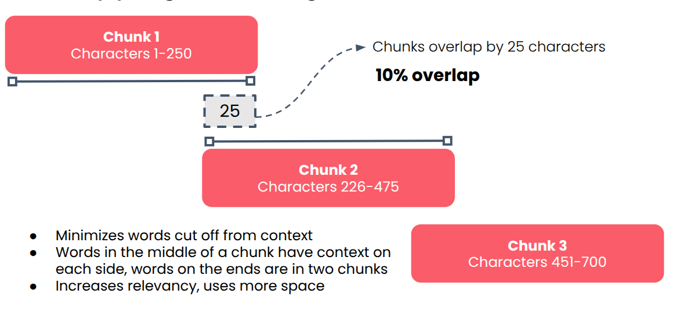
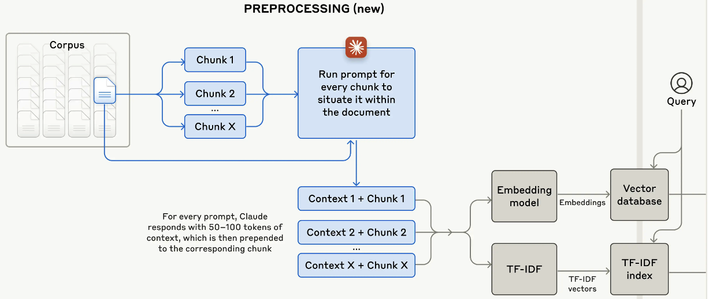
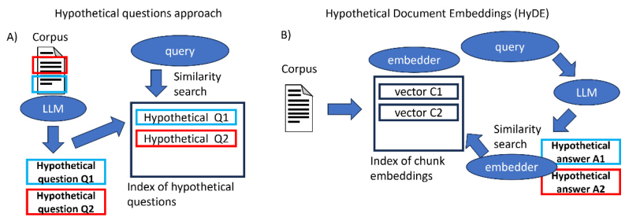
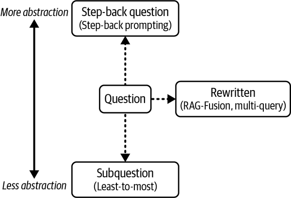

# 5 — Chunking, query parsing and reranking

> Three production techniques around the vector database: chunking decides what one vector stands for, query parsing turns a messy prompt into a good search query, and reranking spends extra compute on the top 20–50 hits to return the best 3–10. Bi-encoders, cross-encoders and ColBERT are the three ways to score a (query, document) pair.

---

## Chunking

### Why chunk

| Without chunking | Effect |
|---|---|
| 1,000 books → 1,000 vectors | One vector per book |
| Whole book squeezed into one vector | Meaning is *averaged*; no chapter or page stands out |
| Retrieval returns whole books | Fills the context window at once |
| Embedder token limit (512 for bge-base) | Most of the book is never embedded (note [03](03-keyword-semantic-and-hybrid-search.md)) |

Chunk size is a balance. Too large (chapters): too many topics per vector, context fills fast. Too small (words, short sentences): each chunk loses its surrounding context and relevance drops.

Phoenix and Taylor name the "too large" effect: an embedding of a long, mixed chunk regresses toward the mean, drifting toward the centre of the vector space where it is moderately similar to everything (*Prompt Engineering for GenAI*, ch. 5). Huyen names the "too small" cost: halving the chunk size doubles the number of vectors to store and search, and a boundary can cut the meaning in two. Her example is "I left my wife a note", split so that the retrieved half reads "I left my wife" (*AI Engineering*, ch. 6). Her candidate units are characters (say 2,048), words (512), sentences (20) or paragraphs. Raieli and Iuculano report 100 or 256 tokens, or 500 characters, as common starting sizes (*Building AI Agents*, ch. 6).

### Strategies

| Strategy | How | Cost | Course verdict |
|---|---|---|---|
| **Fixed size** | Every N characters or words | Trivial | Good default |
| Fixed + **overlap** | Each chunk repeats the end of the previous one | ~10–20% more storage | Fewer ideas cut in half |
| **Recursive character splitting** | Split on structure: `\n\n`, headings, `<p>`, `def` | Trivial | Good default; respects document structure |
| **Semantic** | Walk sentence by sentence; start a new chunk when cosine distance to the running chunk crosses a threshold | One embedding per sentence | Smarter boundaries, more compute; experiment |
| **LLM-based** | Prompt an LLM to split by concept | One LLM pass per doc | Performs well, getting cheaper |
| **Context-aware** | Keep any chunking, but have an LLM prepend a line of context per chunk ("context: launch announcement") | One LLM call per chunk, at index time only | Improves any strategy. A good "first improvement" |


*Image Source: Hasan, DeepLearning.AI RAG course, Module 3*

Context-aware chunking is the same idea as Anthropic's *contextual retrieval* (2024). The house treatment, with the numbers, is in [01 § chunking](01-rag-pipeline.md#chunking) and [ai-engineering 02 — retrieval](../../../ai-engineering/02-context-engineering/notes/04-retrieval.md).

**What overlap to use is a convention, not a finding.** Huyen's own example overlaps 20 characters on 2,048-character chunks, about 1% (*AI Engineering*, ch. 6). The framework examples run much higher: 200 on 1,000 characters (20%) in *Learning LangChain* (ch. 2), 50 on 500 (10%) in the *LLM Engineer's Handbook* (ch. 4), and 20 on 100 tokens in *Prompt Engineering for GenAI* (ch. 5). None of the four measures the choice. Treat the course's 10–20% as a starting point to test, and drop it if a cheaper setting retrieves as well.

**Recursive splitting in LangChain** is `RecursiveCharacterTextSplitter`. It tries separators in order (`"\n\n"`, then `"\n"`, then `" "`) and only falls to the next one when a piece is still too long. `RecursiveCharacterTextSplitter.from_language(Language.PYTHON, ...)` swaps in code-aware separators such as `class` and `def` (*Learning LangChain*, ch. 2). The Handbook's article chunker is a cruder version: split into sentences, append sentences until the next one would pass `max_length`, and keep the chunk only if it has reached `min_length` (*LLM Engineer's Handbook*, ch. 4). Its article handler sets both to 1,000 characters. With `min_length == max_length`, a chunk is kept only if it ends within a character or so of 1,000, so most chunks, and every article's tail, are silently dropped. Set the minimum well below the maximum. The same run turns 76 documents into 2,373 chunks with the generic 500/50 splitter.

**Less common chunkers** from Raieli and Iuculano (*Building AI Agents*, ch. 6):

| Chunker | How | Catch |
|---|---|---|
| Clustering (k-means on sentence embeddings) | Group sentences by topic | Loses the original order |
| Proposition | An LLM rewrites the text as atomic, self-contained statements | One LLM pass over the corpus |
| Statistical merging | Merge neighbouring sentences while a similarity statistic stays high | A threshold to tune |

Their guidelines match the course: match the chunk to the query type, respect the embedder's input limit, and evaluate on your own data.

**Contextual retrieval, the mechanics.** Huyen describes the index-time step behind context-aware chunking: an LLM writes a short context, typically 50–100 tokens, that situates the chunk in its document, and the context is prepended before embedding and BM25 indexing (*AI Engineering*, ch. 6). Her other augmentations: product descriptions with reviews, or the questions an article answers.


*Image Source: Huyen, *AI Engineering* (O'Reilly, 2025), Fig. 6-5*

**Element-based chunking** is recursive splitting taken further: a document-layout model labels each element (title, narrative text, table, list), and chunks break at element boundaries. On FinanceBench (10-K and 10-Q filings, top-10 chunks, GPT-4 generator), element-based chunking answered 53.2% of questions correctly against 48.2% for the best fixed size (512 tokens) and 35.5% for 128 tokens, on manual grading. It also indexed about half as many chunks (62,529 vs 112,155) and needed no chunk-size tuning ([arXiv:2402.05131](https://arxiv.org/abs/2402.05131), Jimeno Yepes et al., 2024-02). The setting is one domain of table-heavy, strongly structured documents, so expect less on prose.

**Semantic chunking** has the weaker evidence. A Vectara study ran fixed-size, breakpoint (the threshold method in the table) and clustering chunkers over ten retrieval sets and five evidence and answer sets, with the stella-1.5B embedder and gpt-4o-mini as generator. On the four real long-document sets, fixed-size chunks retrieved the right document best (HotpotQA F1@5 90.59 vs 87.37 for breakpoint). Evidence-retrieval F1 differed by under 2 points, and answer BERTScore by at most 0.01. Breakpoint chunking won big only on synthetic documents stitched together from unrelated short ones (NQ 63.93 vs 43.79), where topic boundaries are artificially sharp. Swapping the embedder mattered more: stella beat bge-large by 7.44% average F1 ([arXiv:2410.13070](https://arxiv.org/abs/2410.13070), Qu et al., 2024-10). The authors' own caveats: sentence embeddings without context, and no chunk-level ground truth.

### Code from the chunking lab

```python
def get_chunks_fixed_size_with_overlap(text: str, chunk_size: int,
                                       overlap_fraction: float) -> list[str]:
    text_words = text.split()                        # word-level, not character-level
    overlap_int = int(chunk_size * overlap_fraction) # e.g. 100 words × 0.2 = 20
    chunks = []
    for i in range(0, len(text_words), chunk_size):
        # Step back overlap_int words so each chunk repeats the previous tail
        chunk_words = text_words[max(i - overlap_int, 0): i + chunk_size]
        chunks.append(" ".join(chunk_words))
    return chunks

def mixed_chunking(source_text: str) -> list[str]:
    # Variable-size: split on Asciidoc section markers...
    chunks = source_text.split("\n==")
    new_chunks, chunk_buffer, min_length = [], "", 25
    for chunk in chunks:
        new_buffer = chunk_buffer + chunk
        if len(new_buffer.split(" ")) < min_length:  # ...but merge fragments under 25 words
            chunk_buffer = new_buffer                # carry over to the next section
        else:
            new_chunks.append(new_buffer)
            chunk_buffer = ""
    if chunk_buffer:
        new_chunks.append(chunk_buffer)              # don't drop the tail
    return new_chunks
```

Each chunk is stored with metadata (`chapter_title`, `filename`, `chunk_index`, `chunking_strategy`) so one Weaviate collection can hold all strategies and a filter picks one.

### Index small, return large

Three ways to separate what you match on from what you hand the LLM. The general pattern, and LangChain's `MultiVectorRetriever`, are in [01 § embed one thing, return another](01-rag-pipeline.md#embed-one-thing-return-another). Raieli and Iuculano list the variants (*Building AI Agents*, ch. 6):

| Variant | Index | Return |
|---|---|---|
| **Hypothetical questions** | Questions an LLM generates for each chunk, at index time | The chunk |
| **Sentence window** | Single sentences | The sentence plus its neighbours |
| **Parent document** | Small child chunks | The parent, when more than n of the top-k children come from it |

Hypothetical questions are HyDE turned around. HyDE generates a fake answer at query time and matches it against chunks. Hypothetical questions are generated once at index time and matched against the user's question, so they add no query latency.


*Image Source: Raieli & Iuculano, *Building AI Agents with LLMs, RAG, and Knowledge Graphs* (Packt, 2025), Fig. 6.4*

### The experiment: Pro Git, four strategies

The lab chunks chapters of the *Pro Git* book four ways (20% overlap on the fixed ones) and runs the same queries against each, filtered by `chunking_strategy`:

| Strategy | Chunks per query sent to the LLM | "history of git" (broad) | "how to add the url of a remote repository" (specific) |
|---|---|---|---|
| `fixed_size_25` | 8 | Matches, but too little context to explain anything | **Best**: pinpoints `git remote add <shortname> <url>` |
| `fixed_size_100` | 2 | Good | Answer present, buried in more text |
| `para_chunks` | 8 | Mixed | Mixed |
| `para_chunks_min_25` | 2 | **Best**: whole coherent paragraphs | Answer present, more to read |

Lesson: the right size depends on the query. Broad questions want long chunks; specific lookups want short ones. Retrieve more short chunks and fewer long ones to keep the context budget level (8 vs 2 above).

---

## Query parsing

The prompt a user types is rarely the best search query.

| Technique | What it does | Cost |
|---|---|---|
| **LLM query rewriting** | An LLM rewrites the prompt into a clean query | One small LLM call; "benefits easily justify costs" |
| **Named entity recognition** | Tag people, places, dates, titles (GLiNER) to drive filters and targeted search | One small model call |
| **HyDE** | An LLM writes a *hypothetical answer document*; embed that instead of the prompt | One LLM call + latency |

The course's rewriting prompt for a medical knowledge base:

```text
The following prompt was submitted by a user in order to query a database of
medical articles. Rewrite it to make it better suited for querying the database
by doing the following:
- Clarify ambiguous phrases
- Use medical terminology where applicable
- Add synonyms that increase odds of finding matching documents
- Remove unnecessary or distracting information.
{user prompt}
```

| Before | After |
|---|---|
| "I was out walking my dog, a beautiful black lab named Poppy, when she raced away from me and yanked on her leash hard while I was holding it. Three days later my shoulder is still numb and my fingers are all pins and needles. What's going on?" | "Experienced a sudden, forceful pull on the shoulder, resulting in persistent shoulder numbness and finger numbness for three days. What are the potential causes or diagnoses, such as neuropathy or nerve impingement?" |

HyDE changes what is being matched: normally prompt-to-document, with HyDE document-to-document, where one side is the "perfect" document generated from the prompt.

GLiNER example: *"I read The Great Gatsby by F. Scott Fitzgerald last summer while visiting New York…"* → BOOK, PERSON, DATE, LOCATION. The DATE and LOCATION can become metadata filters.

Raieli and Iuculano's HyDE variant generates several answers, five in their example, and averages their embeddings, so one odd generation doesn't steer the search (*Building AI Agents*, ch. 6).

### Query transformations

Oshin and Campos group the rewrites by how far they move from the user's words (*Learning LangChain*, ch. 3).


*Image Source: Oshin & Campos, *Learning LangChain* (O'Reilly, 2025), Fig. 3-5*

| Transformation | What it does | Cost |
|---|---|---|
| **Rewrite-Retrieve-Read** (Ma et al., 2023) | An LLM rewrites the question, then retrieval and answering run as usual | Two LLM calls in sequence |
| **Multi-query** | An LLM writes several versions of the question (five, from different perspectives); retrieve for each, deduplicate the union | One extra call; k × versions retrievals |
| **RAG-Fusion** | Multi-query, then merge the result lists with reciprocal rank fusion instead of a plain union | As multi-query |
| **Step-back** | Generate a more general question; retrieve for it and for the original, and give both contexts to the LLM (*Building AI Agents*, ch. 6) | One extra call |

```python
def reciprocal_rank_fusion(results: list[list], k=60):
    fused = {}
    for docs in results:                       # one ranked list per query version
        for rank, doc in enumerate(docs):
            fused[doc] = fused.get(doc, 0) + 1 / (rank + k)
    return sorted(fused, key=fused.get, reverse=True)
```

The same RRF is used for hybrid search ([03](03-keyword-semantic-and-hybrid-search.md#hybrid-search-and-reciprocal-rank-fusion)). The book's examples use `gpt-3.5-turbo` and `retriever.get_relevant_documents`; current LangChain spells the call `retriever.invoke`. Query expansion pulls in more marginal chunks, so pair it with a post-filter or a reranker (*Building AI Agents*, ch. 6).

Two rewrites from Huyen matter in chat (*AI Engineering*, ch. 6). Identity resolution: after "Who is John Doe?", "How about his wife?" needs rewriting to name John Doe's wife before retrieval. And when the rewrite can't be resolved, the rewriter should say so rather than guess. Multi-turn rewriting is covered in [01 § conversational multi-turn RAG](01-rag-pipeline.md#conversational-multi-turn-rag).

### Self-query: letting the LLM write the filter

A self-query retriever has an LLM split the question into a semantic query and a metadata filter. LangChain's `SelfQueryRetriever` takes a list of `AttributeInfo(name, description, type)` describing the filterable fields, and `enable_limit=True` lets it read "Return 2 Fantasy books" as a genre filter plus a limit of 2 (*Learning LangChain*, ch. 3; *Prompt Engineering for GenAI*, ch. 5). The descriptions are part of the prompt, so they need care. Phoenix and Taylor's example indexes books but keeps the content description "Brief summary of a movie". Nothing errors; the LLM just gets a wrong description of the corpus, which is how these slips go unnoticed. The Handbook does a narrower version by hand: an LLM extracts the author's name from the query, and the search filters on it (*LLM Engineer's Handbook*, ch. 9).

---

## Three ways to score a query against a document

| | Bi-encoder | Cross-encoder | ColBERT |
|---|---|---|---|
| Input | Query and doc embedded **separately** | Query + doc **concatenated** | Each **token** embedded separately |
| Output | One vector each; cosine | A relevance score 0–1 | Many vectors each; MaxSim |
| Doc vectors precomputable | Yes | **No**; every pair is a forward pass | Yes |
| Quality | Good | Best | Nearly cross-encoder |
| Speed | Great (ANN) | Extremely slow at scale | Decent, near real-time |
| Storage | Minimal | Minimal | **Heavy**: one vector per token |
| Role | Default first-stage retrieval | Reranker only | First stage or reranker; growing DB support |

**ColBERT scoring (MaxSim):** for each query-token vector, find the most similar document-token vector, then sum those maxima. The course example ("Great places to eat in New York" against a NYC cuisine passage) sums to 3.6. Each query word finds its best partner, which captures interactions a single vector loses.

---

## Reranking

Retrieval is fast and imprecise; reranking is slow and precise. Run them in sequence:

1. **Over-retrieve** 20–50 candidates with hybrid search.
2. **Rerank** each (query, candidate) pair with a cross-encoder or an LLM scorer.
3. **Return** the best 3–10 to the LLM.

The context budget is the same as without reranking; what changes is how relevant those 5–10 documents are. A banking-QA study at JPMorgan shows why recall alone is the wrong target. With the gold passage present, answer quality fell as the list grew (top-3 > top-5 > top-20), and less so when the gold passage sat near the top. Placing the gold passage first beat placing it last. The authors conclude that retrieval can't be optimised for recall alone, so "investing in a re-ranking system ... is still necessary" ([Zhao et al., NAACL 2024 Industry](https://aclanthology.org/2024.naacl-industry.23/), 2024-06). Most of their numbers are in figures only, and they assume each answer lives in one passage. The course's toy case: "What is the capital of Canada?" retrieves "Toronto is in Canada" and "Canada is the maple syrup capital of the world" alongside "Ottawa is the capital of Canada". A bi-encoder scores them close together; the cross-encoder puts Ottawa first.

| Reranker | Quality | Cost |
|---|---|---|
| Cross-encoder | High | Minor added latency on 20–50 pairs |
| LLM scoring (fine-tuned, outputs e.g. 0.95) | Highest | Costly; reranking only, never first stage |

Raieli and Iuculano's fuller list (*Building AI Agents*, ch. 5–6):

| Family | Examples | Trade-off |
|---|---|---|
| Cross-encoder | BGE reranker | The default |
| Multi-vector (late interaction) | jina-colbert, ColBERTv2 | Cheapest; doc vectors precomputed |
| LLM pointwise, pairwise or listwise | Prompt an LLM to score one doc, compare two, or order a list | Best quality, highest cost |
| Fine-tuned seq2seq | RankT5 | Between the two |

ColBERTv2 runs as a reranker in a few lines through RAGatouille: `RAGPretrainedModel.from_pretrained("colbert-ir/colbertv2.0")`, then `.rerank(query, documents, k)`.

Why rerank at all, from the Handbook: the first stage optimises for speed over a whole corpus, a reranker sees query and document together, and fewer, better chunks cut prompt cost and noise (*LLM Engineer's Handbook*, ch. 4). Oshin and Campos add that a low k is not a false economy: more documents make the app slower, and irrelevant ones push the LLM toward hallucination (*Learning LangChain*, ch. 3). Huyen notes two differences from web search. Rank position matters less, because the LLM reads all k chunks; and time is a legitimate reranking signal, for news or changing docs (*AI Engineering*, ch. 6).

Cheaper post-retrieval steps (*Building AI Agents*, ch. 6):

- Drop chunks below a score threshold, or without a required keyword, metadata value or date.
- Expand a hit with its neighbouring chunks, so a fragment arrives with its context.

Raieli and Iuculano cite Wang et al.'s pipeline sweep as recommending query classification, HyDE, reranking, repacking and summarization together, and they stress that reranking was the one stage whose removal hurt clearly. Wang's own Table 11 shows the HyDE step's price (see the rules of thumb below), so take the full combination as an upper bound on quality, not a default.

```python
from weaviate.classes.query import Rerank

def semantic_search_with_reranking(query, rerank_property, collection,
                                   rerank_query=None, top_k=5):
    if rerank_query is None:
        rerank_query = query                  # default: rerank on the same question
    reranker = Rerank(query=rerank_query,     # can differ from the retrieval query
                      prop=rerank_property)   # which property the cross-encoder reads
    response = collection.query.near_text(query=query, limit=top_k, rerank=reranker)
    return [x.properties for x in response.objects]

# Assignment 3 (BBC news chunks): "Tell me about the conflicts in Latin America"
semantic_search_with_reranking("Tell me about the conflicts in Latin America",
                               rerank_property="chunk", collection=collection, top_k=2)
# → "Spain-Argentina row over drug-use accusation",
#   "Protests across Venezuela as election dispute goes on"
```

Assignment 3 rebuilds Assignment 1's news RAG on Weaviate: `filter_by_metadata`, `semantic_search_retrieve`, `bm25_retrieve`, `hybrid_retrieve`, `semantic_search_with_reranking`, then a `generate_final_prompt(query, top_k, retrieve_function, rerank_query, rerank_property, use_rerank, use_rag)` that takes any of them as a parameter.

The house version of the reranking stage, with production numbers, is note [08 — PRINCE](08-agentic-rag-prince.md) and [11 — retrieval improvements](11-retrieval-improvements.md).

---

## Rules of thumb

| Rule | Why |
|---|---|
| Start with fixed-size or recursive chunks; test 10–20% overlap against less | Good defaults; measure before getting clever. The overlap figure is a convention: book examples range from 1% to 20%, unmeasured. Semantic chunking did not beat fixed-size on real documents in Qu et al.; a better embedder moved results more |
| Try context-aware chunking first when recall is low | Index-time cost only; no query latency |
| Size `top_k` to chunk size | Many small or few large, same token budget |
| Rewrite queries with a small LLM | Cheap, large gains on conversational prompts |
| Over-retrieve 20–50, rerank to 3–10 | Cross-encoders are affordable on a short list |
| Treat HyDE as an experiment | Helps on some corpora; always adds latency. In one full-pipeline sweep, adding HyDE to hybrid search moved the average score 0.477 → 0.478, raised open-domain QA EM 0.347 → 0.393, dropped medical QA 0.750 → 0.460, and took latency from 1.5 s to 11.7 s per query ([arXiv:2407.01219](https://arxiv.org/abs/2407.01219), Wang et al., 2024-07, Table 11) |

---

## Labs

| Lab | Label |
|---|---|
| M3 ungraded lab "Chunking" ([upstream](https://github.com/MohammadWasiq0786/Deeplearning.ai-RAG)) | needs embedded Weaviate + local inference server, and a Together API key for the generation step; not copied |
| M3 Assignment 3 (Weaviate news RAG) | same; not copied |

→ Next: [06-generation-for-rag.md](06-generation-for-rag.md) — the retriever's half is done; now the LLM: sampling, model choice, prompts for grounded answers, citations and hallucination checks.
