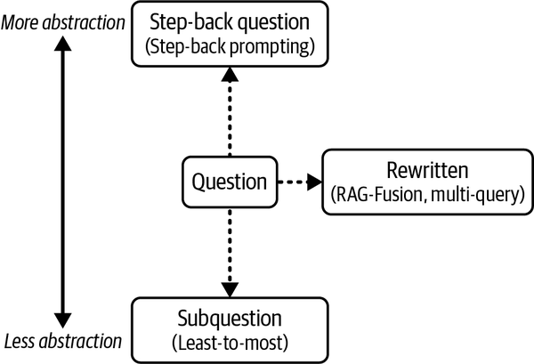
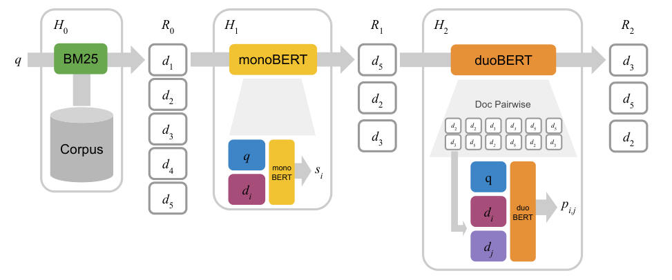

# 5b — Query parsing, conversational retrieval and reranking

A Tallybook customer asks "how long will it take?" two turns into a chat. The question names no subject, so a search on it returns nothing useful, and even a good search can leave the right chunk at rank 14 where the model never sees it. Chunking, in [05](05-chunking-query-parsing-and-reranking.md), decided what one vector stands for. This half is about what you search for and what you keep.

> The second half of [05](05-chunking-query-parsing-and-reranking.md). Query parsing turns a messy prompt into a good search query, conversational retrieval makes a chat turn searchable, and reranking spends extra compute on the top 20–50 hits to return the best 3–10. Bi-encoders, cross-encoders and ColBERT are the three ways to score a (query, document) pair.

---

## Query parsing

The prompt a user types is rarely the best search query.

| Technique | What it does | Cost |
|---|---|---|
| **LLM query rewriting** | An LLM rewrites the prompt into a clean query | One small LLM call; "benefits easily justify costs" |
| **Named entity recognition** | Tag people, places, dates, titles (GLiNER) to drive filters and targeted search | One small model call |
| **HyDE** | An LLM writes a *hypothetical answer document*; embed that instead of the prompt | One or more LLM calls (the paper averages several samples) + latency |

The course's rewriting prompt for a medical knowledge base:

```text
The following prompt was submitted by a user in order to query a database of
medical articles. Rewrite it to make it better suited for querying the database
by doing the following:
- Clarify ambiguous phrases
- Use medical terminology where applicable
- Add synonyms that increase odds of finding matching documents
- Remove unnecessary or distracting information.
{user prompt}
```

| Before | After |
|---|---|
| "I was out walking my dog, a beautiful black lab named Poppy, when she raced away from me and yanked on her leash hard while I was holding it. Three days later my shoulder is still numb and my fingers are all pins and needles. What's going on?" | "Experienced a sudden, forceful pull on the shoulder, resulting in persistent shoulder numbness and finger numbness for three days. What are the potential causes or diagnoses, such as neuropathy or nerve impingement?" |

HyDE changes what is being matched: normally prompt-to-document, with HyDE document-to-document, where one side is the "perfect" document generated from the prompt.

GLiNER example: *"I read The Great Gatsby by F. Scott Fitzgerald last summer while visiting New York…"* → BOOK, PERSON, DATE, LOCATION. The DATE and LOCATION can become metadata filters.

The HyDE paper itself averages the embeddings of several sampled answers, optionally with the query's own ([arXiv:2212.10496](https://arxiv.org/abs/2212.10496), Gao et al., ACL 2023). Averaging also means one odd generation doesn't steer the search. Raieli and Iuculano's example uses five (*Building AI Agents*, ch. 6).

### Query transformations

Oshin and Campos group the rewrites by how far they move from the user's words (*Learning LangChain*, ch. 3).


*Image Source: Oshin & Campos, *Learning LangChain* (O'Reilly, 2025), Fig. 3-5*

| Transformation | What it does | Cost |
|---|---|---|
| **Rewrite-Retrieve-Read** (Ma et al., 2023) | An LLM rewrites the question, then retrieval and answering run as usual | Two LLM calls in sequence |
| **Multi-query** | An LLM writes several versions of the question (five, from different perspectives); retrieve for each, deduplicate the union | One extra call; k × versions retrievals |
| **RAG-Fusion** | Multi-query, then merge the result lists with reciprocal rank fusion instead of a plain union | As multi-query |
| **Step-back** | Generate a more general question; retrieve for it and for the original, and give both contexts to the LLM (*Building AI Agents*, ch. 6) | One extra call |

```python
def reciprocal_rank_fusion(results: list[list], k=60):
    fused = {}
    for docs in results:                       # one ranked list per query version
        for rank, doc in enumerate(docs):
            fused[doc] = fused.get(doc, 0) + 1 / (rank + k)
    return sorted(fused, key=fused.get, reverse=True)
```

`rrf` in the practice kit is the same function. Here is why anyone pays for the extra call. BM25 on "can I get my money back" finds nothing about refunds, because no help article uses those words. The two rewrites below are written by hand and stand in for what an LLM would produce, and the same goes for the hypothetical answer in the HyDE line:

```python
from ragkit import Retriever, rrf

retriever = Retriever()
question = "can I get my money back"
versions = [question, "refund policy", "how do I get a refund for a payment"]
hypothetical = ("Refunds are available for a set number of days after payment "
                "and are returned to the original card.")

print("original:   ", retriever.sparse(question, k=3))
print("multi-query:", rrf([retriever.sparse(q, k=5) for q in versions])[:3])
print("HyDE:       ", retriever.sparse(hypothetical, k=3))
```

```text
original:    ['kb-03']
multi-query: ['kb-04', 'kb-18', 'kb-05']
HyDE:        ['kb-04', 'kb-05', 'kb-11']
```

The right documents here are `kb-04` and its stale twin `kb-05`. Either rewrite gets there, and neither knows `kb-05` is out of date, so the stale copy still needs a filter ([03b](03b-metadata-filters-hybrid-search-and-evaluating-a-retriever.md#metadata-filtering)). The block also shows HyDE's hidden gamble: the hypothetical document works because it used the word "refund". An LLM that guesses the wrong vocabulary steers the search away from the answer.

The same RRF is used for hybrid search ([03](03b-metadata-filters-hybrid-search-and-evaluating-a-retriever.md#hybrid-search-and-reciprocal-rank-fusion)). The book's examples use `gpt-3.5-turbo` and `retriever.get_relevant_documents`; current LangChain spells the call `retriever.invoke`. Query expansion pulls in more marginal chunks, so pair it with a post-filter or a reranker (*Building AI Agents*, ch. 6).

Two rewrites from Huyen matter in chat (*AI Engineering*, ch. 6). Identity resolution: after "Who is John Doe?", "How about his wife?" needs rewriting to name John Doe's wife before retrieval. And when the rewrite can't be resolved, the rewriter should say so rather than guess. Multi-turn rewriting is covered in [§ conversational retrieval](#conversational-retrieval).

### Self-query: letting the LLM write the filter

A self-query retriever has an LLM split the question into a semantic query and a metadata filter. LangChain's `SelfQueryRetriever` takes a list of `AttributeInfo(name, description, type)` describing the filterable fields, and `enable_limit=True` lets it read "Return 2 Fantasy books" as a genre filter plus a limit of 2 (*Learning LangChain*, ch. 3; *Prompt Engineering for GenAI*, ch. 5). The descriptions are part of the prompt, so they need care. Phoenix and Taylor's example indexes books but keeps the content description "Brief summary of a movie". Nothing errors; the LLM just gets a wrong description of the corpus, which is how these slips go unnoticed. The Handbook does a narrower version by hand: an LLM extracts the author's name from the query, and the search filters on it (*LLM Engineer's Handbook*, ch. 9).

---

## Conversational retrieval

In a chat, the current message often can't be searched as written: "how long will it take?" has no subject. Three families of fixes run from cheapest to most capable, and the benchmarks below measure the turns where they differ.

### Query rewriting

Turn the context-dependent utterance into a standalone query that drives retrieval reliably. **CONQRR** trains the rewriter with reinforcement learning against a retrieval reward, so rewriting is optimised for what the retriever returns, and it works with any off-the-shelf retriever. **CANARD** and **QReCC** are the standard rewrite datasets. The limitation, emphasised since 2023–2024: a single rewritten question loses context in long dialogues, which is why systems move toward summaries and structured memory objects.

NVIDIA's [RAG blueprint](https://docs.nvidia.com/rag/latest/multiturn.html) offers two modes: **query rewriting**, recommended for accuracy, and **history concatenation** (paste the last few turns into the query), which is cheap and low-latency but drags irrelevant history into retrieval as conversations grow. That it still ships the simple mode shows how common it is.

The trade-off shows up in a three-turn chat. The rewrite is written by hand, standing in for the small LLM:

```python
from ragkit import Retriever

retriever = Retriever()
history = ["How do I rotate my API keys?", "What happens to the old key?"]
turn = "how long do I have to ask for my money back"

print("this turn only:", retriever.sparse(turn, k=3))
print("concatenated:  ", retriever.sparse(" ".join(history + [turn]), k=3))
print("rewritten:     ", retriever.sparse("refund window in days", k=3))
```

```text
this turn only: ['kb-03', 'kb-12']
concatenated:   ['kb-02', 'kb-01', 'kb-03']
rewritten:      ['kb-18', 'kb-04', 'kb-05']
```

The turn alone misses too, since "money back" isn't Tallybook's vocabulary. Concatenation returned the key articles from the earlier turns, because the topic had changed and the concatenated query hadn't. The rewrite found the refund pages.

### History-aware retrieval

Use the chat history plus the current turn to build a retrieval *plan*. Two lines of work:

- **IR pipeline** (CAsT, ORConvQA, CORAL, mtRAG). ORConvQA shows that modelling history across *all* components (retriever, reranker, reader) improves open-retrieval conversational QA: history is a retrieval and ranking signal, not just a prompt trick.
- **Agentic retrieval** (industrial). In [Azure AI Search agentic retrieval](https://learn.microsoft.com/en-us/azure/search/agentic-retrieval-overview), an LLM reads the whole thread, decomposes it into focused subqueries (which can include chat history), runs them in parallel with semantic reranking, and returns grounding data plus a query plan the downstream agent can use.

### Dual retrieval data flow

1. The query reaches the orchestration layer.
2. **Dual retrieval**: the retrieval module (static knowledge) and the memory module (history, user context) are queried together.
3. A reasoning step merges the two into one context.
4. Generation is guided by both documents and memory.
5. **Memory update**: the session summary, feedback and new facts are written back.
6. The answer goes to the user.

The memory loop diagram and the production memory designs are in [02-context 06](../../../ai-engineering/02-context-engineering/notes/06-memory.md#the-memory-loop).

### Benchmarks

Evaluation shifts from single-turn QA to later-turn performance, non-standalone questions, topic switching, unanswerable queries and clarification.

- **CAsT** (TREC Conversational Assistance Track): conversational query understanding and retrieval/reranking. Reports large headroom between automatic systems and manually resolved "oracle" rewrites, which quantifies how much context resolution matters.
- **QReCC**: open-domain conversational QA over a large web corpus; supports training and evaluating rewriting, retrieval and reading separately.
- **TopiOCQA**: open-domain conversational QA with topic switching.
- **CORAL**: conversational RAG with passage retrieval, response generation and citation labelling under topic shifts.
- **mtRAG**: human-generated multi-turn RAG across domains, weighted toward later turns, non-standalone and unanswerable questions.
- **InSCIt, OR-ShARC**: mixed-initiative; test the decision to ask a clarifying question instead of answering.

---

## Three ways to score a query against a document

| | Bi-encoder | Cross-encoder | ColBERT |
|---|---|---|---|
| Input | Query and doc embedded **separately** | Query + doc **concatenated** | Each **token** embedded separately |
| Output | One vector each; cosine | A relevance score 0–1 | Many vectors each; MaxSim |
| Doc vectors precomputable | Yes | **No**; every pair is a forward pass | Yes |
| Quality | Good | Best | Nearly cross-encoder |
| Speed | Great (ANN) | Extremely slow at scale | Decent, near real-time |
| Storage | Minimal | Minimal | **Heavy**: one vector per token |
| Role | Default first-stage retrieval | Reranker only | First stage or reranker; growing DB support |

**ColBERT scoring (MaxSim):** for each query-token vector, find the most similar document-token vector, then sum those maxima. The course example ("Great places to eat in New York" against a NYC cuisine passage) sums to 3.6. Each query word finds its best partner, which captures interactions a single vector loses.

MaxSim is four lines of NumPy once a model gives you token vectors. This runs a small real ColBERT model on the course's Canada example, and the first run downloads it:

```python
import numpy as np
from fastembed import LateInteractionTextEmbedding

docs = ["Toronto is in Canada.",
        "Canada is the maple syrup capital of the world.",
        "Ottawa is the capital of Canada."]
model = LateInteractionTextEmbedding("answerdotai/answerai-colbert-small-v1")
query = next(iter(model.query_embed(["What is the capital of Canada?"])))
doc_vectors = list(model.embed(docs))

def maxsim(q, d):
    return float((q @ d.T).max(axis=1).sum())        # best doc token per query token, summed

print("query shape:", query.shape)
for doc, d in sorted(zip(docs, doc_vectors), key=lambda x: -maxsim(query, x[1])):
    print(f"{maxsim(query, d):6.2f}  {d.shape}  {doc}")
```

```text
query shape: (32, 96)
 31.41  (9, 96)  Ottawa is the capital of Canada.
 31.31  (12, 96)  Canada is the maple syrup capital of the world.
 30.96  (7, 96)  Toronto is in Canada.
```

The ranking is right, and the query is padded to 32 tokens here, so the sums sit on a different scale from the course's 3.6. The shapes are the storage cost: a matrix per document in place of a single vector.

---

## Reranking

Retrieval is fast and imprecise; reranking is slow and precise. Run them in sequence:

1. **Over-retrieve** 20–50 candidates with hybrid search.
2. **Rerank** each (query, candidate) pair with a cross-encoder or an LLM scorer.
3. **Return** the best 3–10 to the LLM.

The context budget stays the same; the 5–10 documents in it get more relevant. A banking-QA study at JPMorgan shows why recall alone is the wrong target. With the gold passage present, answer quality fell as the list grew (top-3 > top-5 > top-20), and less so when the gold passage sat near the top. Placing the gold passage first beat placing it last. The authors conclude that retrieval can't be optimised for recall alone, so "investing in a re-ranking system ... is still necessary" ([Zhao et al., NAACL 2024 Industry](https://aclanthology.org/2024.naacl-industry.23/), 2024-06). Most of their numbers are in figures only, and they assume each answer lives in one passage. The course's toy case: "What is the capital of Canada?" retrieves "Toronto is in Canada" and "Canada is the maple syrup capital of the world" alongside "Ottawa is the capital of Canada". A bi-encoder scores them close together; the cross-encoder puts Ottawa first.

Both can be checked with small real models. The block below scores the three sentences each way, then adds the cross-encoder to the Tallybook retriever and scores the 20 labelled questions. The first run downloads about 150 MB:

```python
import numpy as np
from fastembed import TextEmbedding
from fastembed.rerank.cross_encoder import TextCrossEncoder
from ragkit import DOC_BY_ID, Retriever, evaluate

query = "What is the capital of Canada?"
docs = ["Toronto is in Canada.",
        "Canada is the maple syrup capital of the world.",
        "Ottawa is the capital of Canada."]

bi_encoder = TextEmbedding("BAAI/bge-small-en-v1.5")
cross_encoder = TextCrossEncoder("Xenova/ms-marco-MiniLM-L-6-v2")
doc_vectors = np.array(list(bi_encoder.embed(docs)))
query_vector = next(iter(bi_encoder.embed([query])))

print("bi-encoder cosine:   ", (doc_vectors @ query_vector).round(2))
print("cross-encoder score: ", np.round(list(cross_encoder.rerank(query, docs)), 2))

retriever = Retriever()

def rerank(q, k=3, pool=10):
    ids = retriever.hybrid(q, k=pool, pool=18)
    scores = list(cross_encoder.rerank(q, [DOC_BY_ID[i].full for i in ids]))
    return [ids[i] for i in np.argsort(scores)[::-1]][:k]

for name, search in [("hybrid", lambda q, k=3: retriever.hybrid(q, k=k)), ("hybrid+rerank", rerank)]:
    print(name, {m: round(v, 3) for m, v in evaluate(search).items()})
```

```text
bi-encoder cosine:    [0.74 0.79 0.84]
cross-encoder score:  [-2.87  5.29  8.1 ]
hybrid {'recall@3': 0.95, 'mrr': 0.742, 'ndcg@3': 0.789}
hybrid+rerank {'recall@3': 0.9, 'mrr': 0.84, 'ndcg@3': 0.845}
```

The bi-encoder's three scores are close and the cross-encoder pulls them apart. On the labelled questions the reranker improves rank order, and in this run it pushes one correct document out of the top 3: a general web-search model hasn't seen Tallybook's error codes. That says little about reranking in general and a lot about measuring on your own questions. Toy-embedder caveats from [03](03-keyword-semantic-and-hybrid-search.md) apply to the first stage.

| Reranker | Quality | Cost |
|---|---|---|
| Cross-encoder | High | Minor added latency on 20–50 pairs |
| LLM scoring (fine-tuned, outputs e.g. 0.95) | Highest | Costly; reranking only, never first stage |

Raieli and Iuculano's fuller list (*Building AI Agents*, ch. 5–6):

| Family | Examples | Trade-off |
|---|---|---|
| Cross-encoder | BGE reranker | The default |
| Multi-vector (late interaction) | jina-colbert, ColBERTv2 | Cheapest; doc vectors precomputed |
| LLM pointwise, pairwise or listwise | Prompt an LLM to score one doc, compare two, or order a list | Best quality, highest cost |
| Fine-tuned seq2seq | RankT5 | Between the two |

The cross-encoder row has an origin worth knowing, because it set the shape of the pipeline. Nogueira et al. put BERT into a three-stage cascade: BM25 retrieves 1,000 candidates, monoBERT scores each (query, passage) pair pointwise as a relevance classifier, and duoBERT then compares passages in pairs, scoring p(i beats j) for the top 50 and aggregating by sum or by counting wins above 0.5. On MS MARCO passage dev (6,980 queries, 100k fine-tuning steps at batch 128), BM25 plus monoBERT lifted dev MRR@10 from 18.7 to 37.2 (19.0 to 36.5 on the held-out eval set, the paper's 17.5-point gain); on TREC CAR (2,254 test queries, automatic annotations) MAP went from 15.3 to 34.8. duoBERT added little: 0.5 MRR@10 on the held-out MS MARCO eval set (36.5 to 37.0) and 2.1 MAP on CAR (36.9), and it costs k1(k1-1) pair inferences, 2,450 extra per query at k1=50. The cost curves are the useful part. More than half of monoBERT's gain came from about a fifth of the candidates, and a duoBERT depth of 20 gave near-maximum quality for about 40% more inferences than monoBERT alone, where 50 more than doubled them. The authors also argue the first stage should be tuned for recall, since later stages can discard non-relevant passages and can find relevant ones with few matching terms. Limits: single runs without significance tests, BERT size and BM25 parameters not stated, latency counted as inferences per query rather than milliseconds, and a 512-token cap that leaves long documents untested ([arXiv:1910.14424](https://arxiv.org/abs/1910.14424), Nogueira et al., 2019-10, preprint).


*Image Source: Nogueira et al., [Multi-Stage Document Ranking with BERT](https://arxiv.org/abs/1910.14424) (2019), Fig. 1*

Two papers show what the LLM row buys. Pairwise Ranking Prompting asks an open FLAN-UL2 (20B) "which of these two passages is more relevant?" and sorts with a sliding window. Reranking BM25's top 100 on TREC-DL, unsupervised, it reached NDCG@10 of 72.65 (2019) and 70.46 (2020), against 75.59 and 70.56 for RankGPT on GPT-4, and 71.83 (2019) for the supervised monoT5-3B. It was far less sensitive to input order: with the BM25 order inverted, GPT-3.5 listwise reranking fell from 65.80 to 32.77 NDCG@10 while the exhaustive pairwise variant moved from 72.42 to 72.40. The price is calls: all-pairs is O(N²), and the paper reports no latency or cost. Only BM25 first stages and 43 and 54 queries ([arXiv:2306.17563](https://arxiv.org/abs/2306.17563), Qin et al., 2023, preprint). RankRAG goes the other way and makes the generator the reranker: one Llama3-8B tuned on about 50k ranking examples scored passages by the probability of "True" and beat dedicated rerankers on recall (NQ R@5 80.3 vs 78.0 for BGE-Rerank-v2-m3 and 77.8 for RankLLaMA-8B, reranking Dragon's top 100), and dropping the rerank step cost about 2.8 average points over nine QA sets (52.6 to 49.8). A generator tuned without ranking data did worse than the retriever it was meant to improve (NQ R@5 68.2 vs 74.9). Wikipedia and one medical corpus, private training blend, no code or model in the text; the reported extra time for N = 20 to 100 was 0.9x to 6.0x, not N-fold ([arXiv:2407.02485](https://arxiv.org/abs/2407.02485), Yu et al., 2024-07, preprint).

ColBERTv2 runs as a reranker in a few lines through RAGatouille: `RAGPretrainedModel.from_pretrained("colbert-ir/colbertv2.0")`, then `.rerank(query, documents, k)`.

Why rerank at all, from the Handbook: the first stage optimises for speed over a whole corpus, a reranker sees query and document together, and fewer, better chunks cut prompt cost and noise (*LLM Engineer's Handbook*, ch. 4). Oshin and Campos add that a low k is not a false economy: more documents make the app slower, and irrelevant ones push the LLM toward hallucination (*Learning LangChain*, ch. 3). Huyen notes two differences from web search. Rank position matters less, because the LLM reads all k chunks; and time is a legitimate reranking signal, for news or changing docs (*AI Engineering*, ch. 6).

Cheaper post-retrieval steps (*Building AI Agents*, ch. 6):

- Drop chunks below a score threshold, or without a required keyword, metadata value or date.
- Expand a hit with its neighbouring chunks, so a fragment arrives with its context.

Raieli and Iuculano cite Wang et al.'s pipeline sweep as recommending query classification, HyDE, reranking, repacking and summarization together, and they stress that reranking was the one stage whose removal hurt clearly. Wang's Table 11 prices the HyDE step (rules of thumb below), so treat the full combination as an upper bound on quality, not a default.

```python
# illustrative: needs a Weaviate collection with a reranker module, as in the lab
from weaviate.classes.query import Rerank

def semantic_search_with_reranking(query, rerank_property, collection,
                                   rerank_query=None, top_k=5):
    if rerank_query is None:
        rerank_query = query                  # default: rerank on the same question
    reranker = Rerank(query=rerank_query,     # can differ from the retrieval query
                      prop=rerank_property)   # which property the cross-encoder reads
    response = collection.query.near_text(query=query, limit=top_k, rerank=reranker)
    return [x.properties for x in response.objects]

# Assignment 3 (BBC news chunks): "Tell me about the conflicts in Latin America"
semantic_search_with_reranking("Tell me about the conflicts in Latin America",
                               rerank_property="chunk", collection=collection, top_k=2)
# → "Spain-Argentina row over drug-use accusation",
#   "Protests across Venezuela as election dispute goes on"
```

Assignment 3 rebuilds Assignment 1's news RAG on Weaviate: `filter_by_metadata`, `semantic_search_retrieve`, `bm25_retrieve`, `hybrid_retrieve`, `semantic_search_with_reranking`, then a `generate_final_prompt(query, top_k, retrieve_function, rerank_query, rerank_property, use_rerank, use_rag)` that takes any of them as a parameter.

The house version of the reranking stage, with production numbers, is note [08 — PRINCE](08-agentic-rag-prince.md) and [11 — retrieval improvements](11-retrieval-improvements.md).

**Compress after reranking, and let the compressor return nothing.** RECOMP trains a small compressor to turn the retrieved documents into the few tokens the reader needs. With Flan-UL2 20B, a Contriever top 5 of 100-word passages and a 5-shot prompt, a trained abstractive compressor (T5-large, 775M) cut the context to about 5% of the tokens for a 2 EM loss on Natural Questions (37.04 at 36 tokens against 39.39 at 660) and 3.7 on TriviaQA (58.68 against 62.37). It learns to output an empty summary when retrieval would not beat no retrieval, and on language modelling it prepended a summary to only 33% of examples. On multi-hop HotpotQA an extractive compressor did better: 11% of the tokens for 2.4 EM (30.40 against 32.80). A 110M sentence ranker trained on the reader's own likelihood reached 36.57 EM on NQ with one sentence, against 34.32 for off-the-shelf DPR and 30.06 for Contriever. More text is not always better: on WikiText-103 with GPT-2, the top-1 document gave [perplexity](../../01-llm-fundamentals/notes/06-pretraining-data-and-objectives.md#entropy-cross-entropy-kl-and-perplexity) 32.90 and the top 5 gave 35.53. Limits: each compressor is trained per dataset and reader, transfer to LLaMA-13B was partial (NQ EM 34.38 extractive and 36.32 abstractive, against 37.04 for the full top 5), and the authors' check of 30 summaries per dataset found 40% useful on HotpotQA against 50% for the teacher's. These are 2023 short-context readers ([arXiv:2310.04408](https://arxiv.org/abs/2310.04408), Xu et al., 2023-10, preprint).

---

## Rules of thumb

| Rule | Why |
|---|---|
| Rewrite queries with a small LLM | Cheap, large gains on conversational prompts |
| Over-retrieve 20–50, rerank to 3–10 | Cross-encoders are affordable on a short list |
| Treat HyDE as an experiment | Helps on some corpora; always adds latency. In one full-pipeline sweep, adding HyDE to hybrid search moved the average score 0.477 → 0.478, raised open-domain QA EM 0.347 → 0.393, dropped medical QA 0.750 → 0.460, and took latency from 1.5 s to 11.7 s per query ([arXiv:2407.01219](https://arxiv.org/abs/2407.01219), Wang et al., 2024-07, Table 11) |

---

## Labs

| Lab | Label |
|---|---|
| M3 Assignment 3 (Weaviate news RAG) | same; not copied |

---

## Pitfalls

- **Concatenating chat history forever.** Symptom: answers follow the previous topic as the conversation grows. Use a rewrite and let it say "can't resolve".
- **Assuming HyDE helps.** Symptom: latency jumps and quality is flat or worse, as in Wang et al.'s sweep (rules above).
- **Reranking with a model trained on a different domain.** Symptom: rank order improves on some queries and correct documents fall out of the top k. Over-retrieve, measure recall after the rerank, and consider a domain-tuned model.

---

## Try it

1. Add `"how do I get a refund"` to the conversational block's rewrites and compare with `"refund window in days"`. Which would you prefer for this question, and how would you decide in production?
2. Your cross-encoder lifts MRR and lowers recall@3. Ship it or not? What would change your decision?

<details>
<summary>Answers</summary>

1. Try it and look at where `kb-04` lands. A single query can't settle it. Decide on a labelled set of real conversations, using later turns and non-standalone questions in particular.
2. Check the top-k the generator actually reads. If the lost documents are ones the model needs, raise k or the pool, or retune the reranker. If k is 3 and recall drops on a question type you care about, don't ship it. If rank matters more (one answer shown, or citations by position) and answer-level eval improves, ship it.

</details>

---

## Interview checklist

| Question | Answer |
|---|---|
| Multi-query vs RAG-Fusion? | Both search with several versions of the question. Multi-query unions the results and RAG-Fusion merges them with RRF. |
| How do you make a chat turn searchable? | Rewrite it into a standalone query with a small LLM. Concatenating history is cheap, and it drags old topics into retrieval. |
| Bi-encoder vs cross-encoder vs ColBERT? | Bi-encoder: one vector per text, precomputable and fast. Cross-encoder: scores each pair jointly, best and slowest, so reranking only. ColBERT: per-token vectors with MaxSim, near cross-encoder quality and heavy storage. |
| Why rerank if recall is fine? | Zhao et al. found answer quality falls as the list grows even when the gold passage is present, and gold first beats gold last. Fewer and better chunks also cut cost. |
| What is the standard reranking recipe? | Over-retrieve 20–50 with hybrid search, rerank the pairs, return the best 3–10. |

---

## Next

[06 — Generation for RAG](06-generation-for-rag.md): the retriever's half is done. Now the LLM: sampling, model choice, prompts for grounded answers, citations and hallucination checks.
