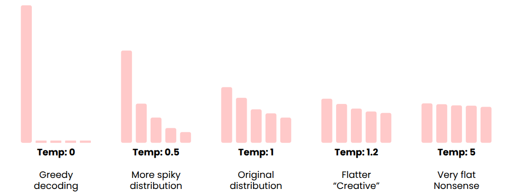
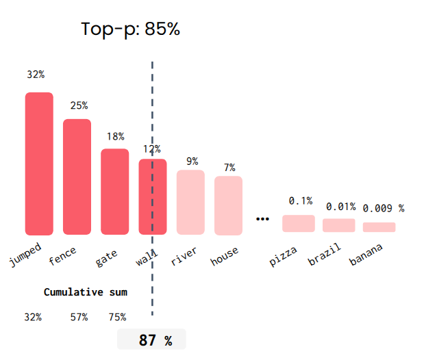

# 6 — Generation for RAG

Tallybook's retriever now returns the refund page, and the bot still tells a customer they have 45 days. The document says 30. Nothing in the retrieval metrics moved, because retrieval worked, and the mistake happened in the last step: a model given the right text can ignore it, blend it with what it remembers, or cite a page it never used. This chapter is about that last step, the settings and prompts that keep an answer tied to its evidence and the checks that catch it when it comes loose.

> The LLM half of RAG: how a decoder-only transformer turns the augmented prompt into tokens, which sampling knobs control that, how to choose a model, how to write prompts that keep answers grounded and cited, how to measure faithfulness with RAGAS, and when to split one LLM call into an agentic workflow. RAG adds knowledge; fine-tuning changes behaviour.

---

## Why RAG works: attention

An LLM is a decoder-only transformer. For each new token it runs the whole context through 8–64 layers, each with many attention heads (8 to 100+) and a feed-forward block, then samples one token and repeats until an end-of-sequence token.

| Part | What it contributes |
|---|---|
| Token + **position** vectors | What each token is and where it sits |
| **Attention** heads | Each token looks at every other token and pulls in what is relevant |
| Feed-forward layers | Per-token processing of what attention gathered |
| Token loop | One token at a time, conditioned on all before |

RAG works because attention lets every generated token look at the retrieved documents. Three consequences:

- The model **may still ignore the context** if its weights pull harder. Prompting (below) and evaluation (RAGAS) are how you catch that.
- **What else is in the context matters.** On NQ-open with small open models (Llama2-7B, Falcon-7B, MPT-7B and Phi-2 at 2.7B, all 4-bit), retrieved passages that score high but lack the answer pulled accuracy down more than unrelated passages did. Adding a single such distractor to the gold passage cost up to 25%, and picking distractors with a retriever trained on hard negatives made it worse, not better. Adding *random* documents sometimes raised accuracy: +35% relative for Llama2-7B with four retrieved passages (about 0.19 → 0.25). Placing the gold passage next to the question also helped ([arXiv:2401.14887](https://arxiv.org/abs/2401.14887), Cuconasu et al., 2024-01). For the random-document effect the authors offer only a tentative lead (attention entropy rose about 3× with noise added) and say they can't explain it yet, so don't pad prompts with noise. The two findings to use: near-miss distractors are the real threat, and the best evidence goes closest to the question.
- **Most of the cost is in the transformer.** Longer contexts mean more compute per token. This is the latency argument in note [07](07-rag-in-production.md).

---

## Sampling

The model outputs a probability for every vocabulary token. Sampling decides which one to emit.

| Knob | What it does | Lab observation |
|---|---|---|
| **Greedy** | Always the most likely token | Deterministic, can loop and repeat |
| **Temperature** | Rescales the distribution: p' ∝ exp(log p / T). < 1 sharpens, > 1 flattens | T = 0.3 and 1.5 start alike; T = 3 is nonsense |
| **top-k** | Sample only from the k most likely tokens | `top_k=0` behaves like greedy; `top_k=10` varies |
| **top-p** (nucleus) | Sample from the smallest set whose cumulative probability ≥ p | `top_p=0` gives identical outputs; `0.8` varies |
| Repetition penalty | Lowers probability of tokens already used | Stops loops in long answers |
| Logit bias | Push specific tokens up or down | Ban or force words, force a label vocabulary |


*Image Source: Hasan, DeepLearning.AI RAG course, Module 4*

top-p adapts to the model's confidence, which top-k does not. When the model is sure, the nucleus is one or two tokens; when unsure, it widens.


*Image Source: Hasan, DeepLearning.AI RAG course, Module 4*

Temperature changes the **shape** of the distribution; top-p and top-k change **which tokens are eligible**. Setting `temperature=1` does not make output deterministic.

Both are small enough to compute by hand. Say the prompt ends "Annual plans can be refunded within", and the model's logits favour "30":

```python
import numpy as np

tokens = np.array(["30", "14", "60", "90", "soon"])
logits = np.array([3.0, 2.2, 1.0, 0.5, -1.0])

def probs(logits, temperature=1.0):
    scaled = logits / temperature
    return np.exp(scaled) / np.exp(scaled).sum()

def nucleus(p, top_p):
    order = np.argsort(-p)
    cut = np.searchsorted(np.cumsum(p[order]), top_p) + 1   # first total >= top_p
    return order[:cut]

for T in [0.3, 1.0, 3.0]:
    print(f"T={T:<4}", dict(zip(tokens.tolist(), probs(logits, T).round(3).tolist())))

p = probs(logits)
print("top_p=0.85 keeps:", tokens[nucleus(p, 0.85)].tolist())
confident = probs(np.array([6.0, 2.2, 1.0, 0.5, -1.0]))
print("same top_p, confident model keeps:", tokens[nucleus(confident, 0.85)].tolist())

rng = np.random.default_rng(0)
print("T=1 samples:", rng.choice(tokens, size=8, p=p).tolist())
```

```text
T=0.3  {'30': 0.934, '14': 0.065, '60': 0.001, '90': 0.0, 'soon': 0.0}
T=1.0  {'30': 0.593, '14': 0.267, '60': 0.08, '90': 0.049, 'soon': 0.011}
T=3.0  {'30': 0.336, '14': 0.257, '60': 0.172, '90': 0.146, 'soon': 0.089}
top_p=0.85 keeps: ['30', '14']
same top_p, confident model keeps: ['30']
T=1 samples: ['14', '30', '30', '30', '14', '60', '14', '14']
```

At T=1 the wrong "14" gets sampled regularly, which is how a correct context can still produce a wrong number if the model is unsure. Lower temperature concentrates on the favoured token, whichever token that is. The nucleus shrinks as the model gets confident, which is the adaptation top-k can't do. These logits are invented for illustration.

### Parameters by task

Lab 4.2 routes each query to a parameter set:

```python
# illustrative: needs the course's generate_params_dict, generate_with_single_input and a Together API key
def answer_query(query):
    label = decide_if_technical_or_creative(query).lower()   # one cheap LLM call
    if label == "technical":     # documentation, procedures: be precise
        kwargs = generate_params_dict(query, temperature=0,   top_p=0.1)
    elif label == "creative":    # "suggest three places to visit": allow variety
        kwargs = generate_params_dict(query, temperature=1.1, top_p=0.4)
    else:                        # classifier failed: neutral fallback
        kwargs = generate_params_dict(query, temperature=0.5, top_p=0.5)
    return generate_with_single_input(**kwargs)["content"]
```

The course's warning: keep temperature below about 1.3, and if you go near it, lower top_p to compensate.

---

## Choosing an LLM

| Factor | Question |
|---|---|
| Size | Bigger knows more and reasons better; costs more |
| Cost | Per input and output token, at your volume |
| Context window | Fits your top_k chunks plus history? |
| Latency | Time to first token and tokens per second |
| Knowledge cutoff | Matters less with RAG, but not zero |

| Benchmark type | Example | Watch out for |
|---|---|---|
| Automated | MMLU (57 subjects, multiple choice) | **Saturation** (everyone scores 90%+) and **contamination** (test set in training data) |
| Human preference | LMArena, Elo ratings | Measures preference, not correctness |
| LLM-as-judge | One model grades another | Judges favour their own model family |

Use public benchmarks to shortlist; decide on your own eval set.

---

## Prompting for RAG

### The messages format

Chat models take a list of `{role, content}` messages (`system`, `user`, `assistant`). Under the hood each model family wraps them in special tokens (Llama uses `<|begin_of_text|>`, `<|start_header_id|>system<|end_header_id|>` and so on). The API hides this; know it exists when a raw-completion endpoint misbehaves.

### A RAG prompt template

| Section | Contents |
|---|---|
| **System** | Use only the retrieved documents. Judge whether each is relevant. Cite sources. Say so if the answer is not there |
| **History** | Prior turns, pruned to the last N messages |
| **Retrieved** | `[DOC 1] … (source: …)`, `[DOC 2] …` |
| **Query** | The user's current question |

| Technique | Use in RAG |
|---|---|
| In-context learning | Retrieve *examples* of good past answers, not just facts |
| Chain of thought / scratchpad | Let the model reason over conflicting documents before answering |
| Reasoning models | Few-shot examples tend to *hurt*; drop prior reasoning tokens from history |
| Context pruning | Keep the last N messages; summarise or drop older ones |

The first row has been measured in one form. RAG+ pairs each knowledge item in the corpus, offline, with a worked example of that item in use, and retrieves the pair, with no change to the retriever or the model. With BGE-M3 and top-3 chunks, Qwen2.5-72B rose from 76.5 to 83.0 on 200 Chinese sentencing questions (one statute, three answer intervals) and from 77.5 to 87.5 with a reranker. On a 430-question numerical-analysis set it rose from 70.47 to 73.72. **Gains were mostly a few points and not uniform:** Qwen2.5-7B fell from 59.2 to 57.6 on 500 MedQA questions. Examples alone, without the knowledge, helped less (65.0 against 76.5 for the 7B on the legal set). The sets are small and built by the authors, the examples were written by the same model family that is evaluated, and there is no comparison with more knowledge chunks at the same token budget ([arXiv:2506.11555](https://arxiv.org/abs/2506.11555), Wang et al., 2025-06, v4 2025-09, preprint). Note [08](08-agentic-rag-prince.md#retrieved-few-shot-examples) keys its examples to the query instead, which is the cheaper thing to try first.

Here is the template over Tallybook. The system message, the numbered documents and the id they carry are the parts that later checks depend on:

```python
from ragkit import DOC_BY_ID, Retriever

SYSTEM = ("Answer only from the documents below. Judge whether each is relevant. "
          "Cite documents as [DOC n] after each claim. If the answer is not in them, "
          "say the documents do not contain it.")

def build_messages(query, doc_ids, history=(), keep_turns=4):
    numbered = "\n".join(f"[DOC {n}] {DOC_BY_ID[i].full} (source: {i})"
                         for n, i in enumerate(doc_ids, 1))
    return ([{"role": "system", "content": SYSTEM}]
            + list(history)[-keep_turns:]
            + [{"role": "user", "content": f"{numbered}\n\nQuestion: {query}"}])

query = "How long do refunds take to arrive?"
doc_ids = Retriever().hybrid(query, k=2)
for message in build_messages(query, doc_ids):
    print(message["role"].upper(), "|", message["content"][:150])
```

```text
SYSTEM | Answer only from the documents below. Judge whether each is relevant. Cite documents as [DOC n] after each claim. If the answer is not in them, say th
USER | [DOC 1] Refund policy. Annual plans can be refunded in full within 30 days of payment. After 30 days we refund the unused months minus a 10 percent fe
```

### Order and size of the context

Liu et al.'s lost-in-the-middle result (models use information at the start and end of a long context better than in the middle) gives a cheap reordering trick. Raieli and Iuculano describe an alternating pattern: chunks at even ranks go to the front of the list and odd ranks to the back, so the strongest chunks sit at both edges. It matters most with a wide top-k (*Building AI Agents*, ch. 6).

```python
def edges_first(ranked):
    # Rank 1 at the front, rank 2 at the back, working in toward the middle.
    front = ranked[0::2]           # ranks 1, 3, 5...
    back = ranked[1::2][::-1]      # ranks 6, 4, 2...
    return front + back

print(edges_first([f"rank{i}" for i in range(1, 8)]))
```

```text
['rank1', 'rank3', 'rank5', 'rank7', 'rank6', 'rank4', 'rank2']
```

How many passages to pass depends on whether the reader can combine them. Fusion-in-Decoder (FiD) encodes each retrieved passage separately, with the question prepended, and lets the decoder attend over all of them at once, so encoder cost grows linearly with the number of passages. With a fine-tuned T5-base reader, trained and tested at each passage count on DPR-retrieved passages, going from 10 to 100 passages raised exact match by about 3.5 on Natural Questions and 6 on TriviaQA (validation sets; the paper writes these as %). The authors cite earlier work in which extractive readers peaked at 10–20 passages. FiD-large (770M) reached 51.4 EM on the NQ test set with DPR and 100 passages, against 44.5 for RAG and 36.6 for closed-book T5 at 11B. Even with BM25 retrieval it scored 44.1 ([arXiv:2007.01282](https://arxiv.org/abs/2007.01282), Izacard & Grave, EACL 2021). The result holds for a reader trained to fuse, on short factoid answers. The paper never tests passage order and never measures how cost scales with passage count (it reports only 147 against 425 training GPU-hours for two schedules), so it says nothing about how a prompted LLM handles 100 chunks.

Long answers need more evidence than short ones, and a short context runs out first. ELI5 asks for explanations averaging 130 words. Its support document is the 15 passages most TF-IDF-similar to the question, taken from the top 100 Common Crawl pages and averaging 858 words. On 500 sampled training questions it contained the answer 65% of the time. An extractive oracle picking the best sentences from it reached 27.4 ROUGE-1, against 54.8 from all 100 pages. When the authors rebuilt the document from 500 passages for 1,000 questions, under 9% of the oracle's sentences came from the 20 top-ranked ones. The evidence a long answer needs is spread deep in the ranking. The abstractive model wrote more relevant answers than the extractive one (84% vs 68%), but only 19% of its answers were fully accurate against the support document, against 40% (100 answers rated by the authors) ([arXiv:1907.09190](https://arxiv.org/abs/1907.09190), Fan et al., ACL 2019). These are 2019 models trained from scratch and scored with ROUGE, which the authors concede can't compare extractive and abstractive systems.

A reader that only concatenates behaves the opposite way to FiD: extra text costs it quality even when the right sentence is there. On Wizard of Wikipedia the retrieved knowledge averaged 61 sentences and 1,626 tokens per turn, more than GPT-2's 1,024-token window, and plain truncation cut the gold sentence in 53% of test examples. With the gold sentence forced in, growing GPT-2's input limit from 128 to 1,024 tokens took unigram F1 from 30.9 to 19.7 (seen topics), as the gold sentence's share of the input fell from 62% to 4%. Letting the model's selector keep two or three sentences instead of one also lowered F1 while it improved perplexity ([what perplexity measures](../../01-llm-fundamentals/notes/06-pretraining-data-and-objectives.md#entropy-cross-entropy-kl-and-perplexity)). A BERT selector that passed GPT-2 just one sentence, trained without knowledge labels, scored 22.0 F1 against 18.7 for truncation ([EMNLP 2020](https://doi.org/10.18653/v1/2020.emnlp-main.272), Zhao et al., KnowledGPT). This is a 117M GPT-2 scored by word overlap against one human reply, and the forced-gold sweep is an oracle no real system has. Still, the pattern matches the noise results above: pass less, better-selected text.

When the retrieved text is too long, compress it before generation (*Building AI Agents*, ch. 6):

| Method | How |
|---|---|
| Selective context | Score each token or sentence by self-information under a small LM; keep the top percentile |
| LLMLingua | A small LM (Alpaca-7B) first drops whole low-perplexity demonstrations, then drops low-perplexity tokens segment by segment under a per-section budget. On an 8-shot GSM8K chain-of-thought prompt for GPT-3.5-Turbo, 20× compression (2,366 → 117 tokens) cost 1.5 EM points (77.3 vs 78.9), where Selective Context scored 44.2 at 15×. On BBH, 7× cost 13.2 points, and every method collapsed at 25–30× on GSM8K. End-to-end latency fell from 8.6 s to 2.3 s at 5× on one V100. Tested on reasoning prompts, conversations and arXiv summaries, not retrieved passages ([arXiv:2310.05736](https://arxiv.org/abs/2310.05736), Jiang et al., EMNLP 2023) |
| LongLLMLingua | Question-aware version: compresses and reorders documents using both context and query |
| AutoCompressors | Fine-tune the model to summarise long text into summary vectors used as soft prompts |

The last row has grown into its own line of work: compress each retrieved chunk into a few vectors once, offline, and have a trained reader consume those vectors in place of the chunk's tokens. AutoCompressors (Chevalier et al., EMNLP 2023) and CEPE (Yen et al., ACL 2024) came first. REFRAG encodes each 16-token chunk with RoBERTa-large and feeds one projected vector per chunk to LLaMA-2-7B. A small RL policy picks the few chunks to keep as raw tokens. At 16x compression and a 16,384-token context, time to first token fell **16.53x with the chunk embeddings precomputed and 8.59x without**, against 2.01x and 1.04x for CEPE, on one A100 at batch size 1. Per-token decoding sped up only about 3x. On 16 RAG tasks with 400M passages it matched the fine-tuned LLaMA at 10 passages with a 5.26x faster first token, and at equal latency (8 passages against 1) gained 1.22% on average. Perplexity came close to full context only at 8x (at or below it in some of its tables, not stated as a finding), and getting there took 20B tokens of continued pretraining, then fine-tuning and the RL policy ([arXiv:2509.01092](https://arxiv.org/abs/2509.01092), Lin et al. (Meta), 2025-09, preprint). CLaRa trains the reranker through the same compressed vectors with a straight-through top-k, so the generator's next-token loss is the only relevance label. With Mistral-7B, BGE's top 20 cut to 5, and Wikipedia QA, 16x compression averaged 40.30 F1 against 41.96 for DRO, a jointly trained raw-text system whose numbers are copied from its paper, so comparable, not better. Decoding took about 40% of the raw-text time on one H100, with compression done offline and not counted ([arXiv:2511.18659](https://arxiv.org/abs/2511.18659), He et al. (Apple), 2025-11, v3 2026-02, preprint). Both need open weights and a training run, so neither applies to a hosted model. Both store vectors whose size is not reported and must be recomputed when the compressor changes. What carries over is the measurement. Most of a RAG prompt is passages that barely attend to one another, so first-token latency is where context compression pays.

And when one call over all chunks is the wrong shape, a response synthesizer makes several (*Building AI Agents*, ch. 6):

- **Refine:** answer from the first chunk, then send the answer plus the next chunk to improve it, one chunk at a time.
- **Concatenate:** answer from each chunk separately, then join the answers, or summarise them into one.
- **Hierarchical:** summarise groups of answers, then summarise the summaries.

### Classification and structured output

Two pieces of Lab 4.2 that the assignment reuses:

```python
# illustrative: needs the course's generate_with_single_input and generate_with_multiple_input,
# a Together API key, and `query` and `transcript` from the lab
# 1. LLM as a classifier: precise instructions, labelled examples (incl. edge cases),
#    and max_tokens 1–2 so it can only emit the label
prompt = f"""Label the following instruction as an FAQ-related query or a product-related query.
Examples:
    Is there a refund for incorrectly bought clothes? Label: FAQ
    Do you have blue T-shirts under 100 dollars? Label: Product
Return only one of the two labels: FAQ or Product.
Instruction: {query}"""
label = generate_with_single_input(prompt, temperature=0, max_tokens=1)["content"].strip()
label = label if label in ("FAQ", "Product") else None    # always validate the label

# 2. Structured output: pass a JSON schema instead of begging for JSON in the prompt
from pydantic import BaseModel, Field

class VoiceNote(BaseModel):
    title: str = Field(description="A title for the voice note")
    summary: str = Field(description="A short one sentence summary of the voice note.")
    actionItems: list[str] = Field(description="A list of action items from the voice note")

result = generate_with_multiple_input(
    messages=[{"role": "system", "content": "The following is a voice message transcript. Only answer in JSON."},
              {"role": "user", "content": transcript}],
    response_format={"type": "json_schema", "schema": VoiceNote.model_json_schema()},
)
```

The schema also gives you a validator on your side of the call, and that is what the code path after the model depends on. These two strings stand in for model responses. The second has the wrong shape:

```python
from pydantic import BaseModel, Field, ValidationError

class CitedAnswer(BaseModel):
    answer: str
    citations: list[str] = Field(min_length=1)

good = '{"answer": "Refunds take 5 to 10 working days.", "citations": ["kb-04"]}'
bad = '{"answer": "Refunds take 5 to 10 working days.", "citations": []}'

for raw in [good, bad]:
    try:
        print("ok:", CitedAnswer.model_validate_json(raw).citations)
    except ValidationError as err:
        print("rejected:", err.errors()[0]["msg"])
```

```text
ok: ['kb-04']
rejected: List should have at least 1 item after validation, not 0
```

A schema guarantees shape only. A hallucinated citation like `["kb-99"]` passes, and the checks in the next section are what catch it.

The "old-fashioned way" in the lab (a smart-home prompt listing every device ID with JSON examples, `{{ }}` escaped inside the f-string) works but is long and fragile; the schema parameter guarantees parseable output.

---

## Hallucinations and citations

The course's example: a support bot asked "Do you offer student discounts?" invents one, because a discount is the probable answer.

| Defence | How | Cost / limit |
|---|---|---|
| Self-consistency | Sample several answers; distrust disagreement | Multiplies cost |
| Grounding via system prompt | "Answer only from the documents; say if you don't know" | Cheap; not a guarantee |
| **Citations** | Number documents, require `[1]`, `[2]` after claims | Citations themselves can be hallucinated |
| ContextCite | Attributes each statement to the context spans that caused it | Research tool; extra compute |
| ALCE benchmark | Scores citation quality, correctness and fluency; an NLI model (T5-11B) checks that each sentence's cited passages entail it | Mainly for evaluating systems. Its own best-of-4 rerank used the scorer at generation time and raised ChatGPT's ASQA citation recall from 73.6 to 84.8 (one seed). Human raters saw a smaller gain, 74.7 to 79.3, because the scorer was grading its own pick. Cost: 4 generations plus the NLI pass |

The grounding prompt is weakest exactly when retrieval misses. In a banking-QA study (GPT-4, GPT-3.5 and Llama-2, two document sets, 800 queries each), the models kept answering when the gold passage was absent, with loosely related context or with invention. The authors call this *pseudo-helpfulness*. Nine prompt variants (verbose, quote-first, citation-required) made no salient difference to answer quality ([Zhao et al., NAACL 2024 Industry](https://aclanthology.org/2024.naacl-industry.23/), 2024-06). Catch missing evidence upstream, in the retriever and in evaluation, rather than with more prompt wording.

**Copied numbers are reliable; inferences from them are not.** In DataGemma, a fine-tuned Gemma 2 (9B or 27B) writes Data Commons queries, and the retrieved tables go to Gemini 1.5 Pro. On the authors' synthetic query set those tables averaged 38K tokens per prompt. Statistical claims copied from the tables were 98.6–98.9% accurate. Claims *inferred* from them were right only 71.9–76.4% of the time, wrong 6–20% of the time (a country missing from a top 5) and unsubstantiated 4–22% of the time ("a median age of 35 indicates many young families"). The base model without retrieval made statistical claims on 9% of 101 queries, and only 39% of them were accurate. Two other caveats apply. Data Commons had an answer for only 24–29% of queries, and the authors' own team graded most of the 101 hand-written queries ([arXiv:2409.13741](https://arxiv.org/abs/2409.13741) (Radhakrishnan et al., 2024-09)). So check derived claims (rankings, comparisons, interpretations) separately from quoted ones. A citation to the table doesn't make the conclusion drawn from it correct.
Joren et al. call this *sufficient context*: whether the context can answer the question, labelled by an autorater without the gold answer. At 6,000 tokens only 44.6% (Musique) to 77.4% (FreshQA) of contexts were sufficient. Models hallucinated even with sufficient context (3.2% Claude 3.5 Sonnet to 25.4% Gemma 27B) yet were right 35 to 62% of the time without it. Abstaining on low sufficiency plus confidence raised accuracy on answered questions 2 to 10%; QA only ([arXiv:2411.06037](https://arxiv.org/abs/2411.06037), Joren et al., ICLR 2025).

**Context against the model's prior.** A second failure runs the other way: the evidence is there and the model overrides it. Raieli and Iuculano summarise Wu et al. ([arXiv:2404.10198](https://arxiv.org/abs/2404.10198)) with a dosage example. The model learned 20 µg as a drug's maximum dose. Given a context that says 30, it answers 30; given one that says 100, it falls back to 20. The further the context departs from the prior, the more the model trusts itself (*Building AI Agents*, ch. 6). The book adds that larger models do so more than smaller ones, but the paper itself reports no such size effect; its measured numbers are in [02](02-why-rag-and-the-augmented-prompt.md#what-rag-buys-you). Prompt strength shifts the balance. In the paper's comparison of a standard, a loose and a strict prompt, the strict one, which tells the model to rely on the context, pushes the model toward the context and the loose one toward its prior. Whether you want that depends on how far you trust your corpus over the model. The same chapter names *negative rejection* as the matching retrieval failure: when nothing relevant is found, the model answers anyway. Its other causes of hallucination are training that rewards long outputs, which makes models verbose, and high sampling temperature (*Building AI Agents*, ch. 5).

Training can install the same failure. Cao et al. trained a two-module pipeline (query generator, then a Qwen2.5-3B reader over a fixed term-matching retriever) end to end with REINFORCE on final-answer reward only. On 176 HotpotQA yes/no questions, accuracy rose while the share of answers that followed a swapped-in passage fell **from 0.86 to 0.54, close to the 0.506 of a reader that ignores passages**. Given an unrelated passage, the trained reader still answered 0.19 correctly from memory, against 0.03 for one trained with their Role Anchor penalty, which holds the module's role-prompt preference near its pre-training value. The anchor cost 0.067 accuracy (0.447 against 0.380). This is one small study (models of 0.5–7B, 3 seeds, no real corpus update), and the anchor needs log-probabilities and trainable weights, so it does not apply to an API model ([arXiv:2607.21627](https://arxiv.org/abs/2607.21627), Cao et al., 2026-07, preprint). The test carries over without the training, though: swap in a passage that implies the opposite answer and check that the answer flips.

Mitigations come in layers. A survey of over thirty techniques sorts them by when they act: before generation (retrieval, clarifying questions), during it (sentence-level verification, since one hallucinated sentence raises the odds of the next), after it (post-editing against retrieved evidence, as RARR does), and in training (refusal-aware tuning such as R-Tuning). It names Context-Aware Decoding, which contrasts output probabilities with and without the context, as a training-free counter to the prior-overrides-context failure above. The survey runs no experiments of its own and reports almost no numbers, so read it as a map and take any figure from the method's own paper, and it stops at late 2023 ([arXiv:2401.01313](https://arxiv.org/abs/2401.01313), Tonmoy et al., 2024-01, preprint).

**Citations are only as honest as their plumbing.** Rothman's research agent builds citations the robust way, with a weak spot (*Context Engineering for MAS*, ch. 7):

1. Every chunk is upserted with `"source": doc_name` in its metadata, so each retrieved chunk knows its file.
2. After generation, the agent appends a `**Sources:**` list programmatically from the retrieved chunks' metadata, instead of trusting the LLM to name them.

The weak spot is in the book's own trace. Asked about the Juno mission, the answer cites `[1]` and lists both `juno_mission_overview.txt` and `perseverance_rover_tools.txt`. The Perseverance file was retrieved but contributed nothing. Appending every retrieved source records what the model saw, not what it used. Citation is not attribution. ALCE measured the gap: ChatGPT answering closed-book and attaching citations afterwards scored 26.7 citation recall on ASQA, against 73.6 when it wrote from the retrieved passages. Its answers were about as correct (38.3 vs 40.4 exact-match recall) but rarely matched any passage. Even then, about half of ChatGPT's and GPT-4's ELI5 answers were not fully supported by what they cited ([arXiv:2305.14627](https://arxiv.org/abs/2305.14627), Gao et al., EMNLP 2023; 2023 models, top-5 passages). For attribution you need per-claim matching, such as ContextCite above or the fuzzy citation matching Raieli and Iuculano describe, which matches the response against the chunks with n-gram TF-IDF (*Building AI Agents*, ch. 6).

The gap is measured in production-style products too. Human annotators audited four commercial generative search engines (Bing Chat, NeevaAI, perplexity.ai, YouChat; 1,450 queries each, early 2023). Averaged over the four, only **51.5% of sentences were fully supported by their citations (recall) and 74.5% of citations supported their sentence (precision)**. Recall ranged from 68.7 (perplexity.ai) to 11.1 (YouChat), and precision correlated with perceived utility at r = -0.96, across only four systems, so treat that as a hint: the authors suspect systems that copy their cited page earn precision but answer less. Verifiability is not factuality; a supported sentence can still be false ([arXiv:2304.09848](https://arxiv.org/abs/2304.09848), Liu et al., Findings of EMNLP 2023).

Granularity and the single pass matter too. LongCite asked models to answer and cite in one pass over a long context (LongBench-Cite, GPT-4o as judge). GPT-4o's citations averaged 220 tokens, about six sentences, and proprietary models reached citation F1 of only about 0.5 on two datasets. In-context citing cut answer correctness to 88% of the no-citation level for GPT-4o. The paper's CoF pipeline (post-hoc: answer first, then retrieve and extract sentence-level citations), run with GLM-4, kept correctness at 100% with F1 65.8; simpler post-hoc variants scored 57 to 63. Fine-tuning Llama-3.1-8B and GLM-4-9B on 44.6k such examples gave F1 72.0 and 69.2 at citation lengths of 85 and 91 tokens, and correctness rose to 107% and 109%. Synthetic data, a GPT-4o judge and 128k-token contexts, not retrieval ([arXiv:2409.02897](https://arxiv.org/abs/2409.02897), Zhang et al., 2024-09, preprint).

Three of these checks cost no model call, so run them on every answer. Does each `[DOC n]` exist? Does each claim have one? Does every number in the answer appear in the cited text? The answers below stand in for model output, and the third has the error from this chapter's opening:

```python
import re
from ragkit import DOC_BY_ID

docs = [DOC_BY_ID["kb-04"], DOC_BY_ID["kb-06"]]         # [DOC 1], [DOC 2]

def check_answer(answer, docs):
    problems = []
    for sentence in re.split(r"(?<=[.\]])\s+(?!\[)", answer.strip()):
        cited = [int(n) for n in re.findall(r"\[DOC (\d+)\]", sentence)]
        if not cited:
            problems.append(f"no citation: {sentence!r}")
        for n in cited:
            if n > len(docs):
                problems.append(f"no such document: [DOC {n}]")
        text = " ".join(docs[n - 1].full for n in cited if n <= len(docs))
        for number in re.findall(r"\d+", re.sub(r"\[DOC \d+\]", "", sentence)):
            if cited and number not in text:
                problems.append(f"number {number} not in cited text")
    return problems or ["ok"]

print(check_answer("Annual plans are refundable within 30 days. [DOC 1]", docs))
print(check_answer("Annual plans are refundable within 30 days. [DOC 7]", docs))
print(check_answer("Annual plans are refundable within 45 days. [DOC 1]", docs))
print(check_answer("Refunds are usually quick.", docs))
```

```text
['ok']
['no such document: [DOC 7]', 'number 30 not in cited text']
['number 45 not in cited text']
["no citation: 'Refunds are usually quick.'"]
```

Each check covers one failure and misses others. It can't tell that a sentence reasons badly from a correct number, which is DataGemma's inferred-claim problem, so an LLM judge still has a job to do.

To get closer to attribution without another LLM call, match each answer sentence to the chunk it most resembles. This is a small version of the fuzzy matching Raieli and Iuculano describe, with character n-gram TF-IDF. Two documents were retrieved and the answer used one:

```python
from sklearn.feature_extraction.text import TfidfVectorizer
from sklearn.metrics.pairwise import cosine_similarity
from ragkit import DOC_BY_ID

retrieved = ["kb-04", "kb-02"]
answer = ["Annual plans can be refunded within 30 days of payment.",
          "The money reaches the original card in 5 to 10 working days."]

vectorizer = TfidfVectorizer(analyzer="char_wb", ngram_range=(3, 5))
matrix = vectorizer.fit_transform([DOC_BY_ID[i].full for i in retrieved] + answer)
scores = cosine_similarity(matrix[len(retrieved):], matrix[:len(retrieved)])

for sentence, row in zip(answer, scores):
    print(f"{retrieved[row.argmax()]}  {row.max():.2f}  {sentence}")
print("appended by a naive Sources list:", retrieved)
print("actually matched:", sorted({retrieved[row.argmax()] for row in scores}))
```

```text
kb-04  0.57  Annual plans can be refunded within 30 days of payment.
kb-04  0.37  The money reaches the original card in 5 to 10 working days.
appended by a naive Sources list: ['kb-04', 'kb-02']
actually matched: ['kb-04']
```

Rothman's negative-result test is worth copying. With only Juno and Perseverance documents loaded, ask for a story about the Apollo 11 landing. A grounded system replies that the provided documents do not contain this information, rather than writing the story from the model's memory. Keep a few such out-of-corpus questions in every regression set.

---

## Evaluating the generator: RAGAS

| Metric | How it is computed | What it misses |
|---|---|---|
| **Response relevancy** | An evaluator LLM writes several prompts that *could* have produced the response; embed them and the real prompt; average cosine | Does not check facts |
| **Faithfulness** | An LLM extracts every factual claim in the response, then checks each against the retrieved docs; share supported | Depends on judge quality |
| Others | Noise sensitivity, citation metrics, context precision/recall | All lean on LLM-as-judge |

Raieli and Iuculano add a few metrics in the same family (*Building AI Agents*, ch. 5). **Context entities recall** is the share of entities in the ground-truth answer that appear in the retrieved context; it suits fact-heavy domains. **Summarization score** asks whether the answer keeps the context's important information. **Fluency** scores individual sentences and **coherence** the response as a whole.

Long answers can also be scored without an LLM judge. ASQA's questions are ambiguous ("who ruled France in 1830?"), and a good answer covers every reading. Its DR score runs a SQuAD v2-trained RoBERTa reader over the answer to see which disambiguated questions it can answer (Disambig-F1), then takes the geometric mean with ROUGE-L, so pasting a long passage or writing fluent filler can't max it alone. On 45 dev questions DR tracked the authors' own pairwise judgments at 95.0 Pearson, against 86.4 for ROUGE-L alone and 92.9 for Disambig-F1 alone (not a significant difference). A T5-large reader on 5 JPR passages scored 32.1 DR, against 40.6 for humans who searched Wikipedia themselves and 61.8 for humans handed the disambiguations (the paper's upper bound). Its Disambig-F1 also fell further behind the passages it read as K grew, so the generator lost information it had been given ([arXiv:2204.06092](https://arxiv.org/abs/2204.06092), Stelmakh et al., EMNLP 2022). Its Disambig-F1 half measures recall only: an answer that adds a hallucinated reading keeps its Disambig-F1 and is penalised only indirectly, through ROUGE-L and a confused reader. The correlation rests on six systems.

ALCE's fluency column is MAUVE, which scores a whole set of outputs, not one answer. It embeds the model's texts and human texts with GPT-2 large, clusters them together with k-means, and measures how far apart the two cluster histograms are. On open-ended web-text continuation by eight GPT-2 settings, it rank-correlated 0.952 with crowdworkers' judgments of which text was more human-like, against 0.810 for generation perplexity ([arXiv:2102.01454](https://arxiv.org/abs/2102.01454), Pillutla et al., NeurIPS 2021). Only the ranking is stable. The absolute value moves with the number of clusters, the embedding model and the sample size, and small samples inflate it. It never checks facts. ALCE's own shortcut test shows the gap: answering with the first two sentences of the top retrieved passage scored 67.2 MAUVE on ASQA (and 98.7 citation recall), against 66.6 for ChatGPT reading five passages, at 18.9 exact-match recall instead of 40.4 ([arXiv:2305.14627](https://arxiv.org/abs/2305.14627), Gao et al., EMNLP 2023, Table 11). ALCE's authors use MAUVE mainly as a sanity check, because it is sensitive to output length and style.

Measure indirectly too: thumbs up/down and A/B tests that change only the LLM, so you capture its effect alone. The RAGAS paper is in `sources/` (arXiv 2309.15217); see [references](../references.md).

---

## Agentic RAG

One LLM call can be split into several specialised ones. The course's support-bot flowchart:

| Step | Model | Job |
|---|---|---|
| Router | Small | Does this prompt need retrieval at all? |
| Retriever | — | Fetch candidates |
| Evaluator | Small | Are these documents relevant? |
| Generator | Large | Write the answer from the augmented prompt |
| Citation | Specialised | Attach sources |

| Workflow shape | Pattern |
|---|---|
| Sequential | parser → rewriter → retriever → generator → citation |
| Conditional | Router picks one branch |
| Iterative | Writer and evaluator loop N times |
| Parallel | Orchestrator fans out; synthesiser merges |

Build simple ones by hand; reach for a framework as they grow. These are Anthropic's *Building Effective Agents* shapes; the house treatment is [ai-engineering 05 — graph vs loop](../../../ai-engineering/05-graph-engineering/notes/01-graph-vs-loop.md) and [01 § agentic vs single-pass](01-rag-pipeline.md#agentic-vs-single-pass-li-experiment-3-9).

Assignment 4 builds exactly this for a clothing store ("Fashion Forward Hub"):

```python
# illustrative: needs the assignment's helpers, a Together API key and embedded Weaviate
def answer_query(query: str) -> dict:
    label = check_if_faq_or_product(query)          # router, max_tokens=1, temperature=0
    if label not in ("FAQ", "Product"):             # router failed: answer from history
        return {"role": "assistant",
                "prompt": f"User provided a question that does not fit FAQ or Product "
                          f"related questions. Answer it based on the context you already "
                          f"have so far. Query provided by the user: {query}"}
    if label == "FAQ":
        return query_on_faq(query)                  # FAQ pairs in the prompt
    try:
        # decide_task_nature → get_params_for_task (technical 0.3/0.7, creative 1.0/0.9)
        # → LLM extracts metadata (gender, articleType, baseColour, season, usage, price)
        # → Weaviate filters on it → product prompt
        return query_on_products(query)
    except Exception:
        return {"role": "assistant", "prompt": "…Instruct them to rephrase it…"}
```

The metadata step is query parsing (note [05](05-chunking-query-parsing-and-reranking.md)) done with structured output: the LLM sees the allowed values for each field and returns JSON that becomes a Weaviate filter.

The control flow matters more than the model, and it runs without one. Here is a router for Tallybook that sends questions to the retriever or to smalltalk and treats a bad label as an event, with a stand-in for the small classifier:

```python
from ragkit import Retriever

retriever = Retriever()
ALLOWED = {"HELP", "SMALLTALK"}

def classify(query):                     # stand-in for a one-token LLM call
    if "weather" in query:
        return "Sure! I think"           # what a small model can really return
    return "SMALLTALK" if query.lower().startswith(("hi", "thanks")) else "HELP"

def answer_query(query):
    label = classify(query).strip()
    if label not in ALLOWED:             # never let a bad label pick a branch
        return {"route": "fallback", "docs": []}
    if label == "SMALLTALK":
        return {"route": "smalltalk", "docs": []}
    return {"route": "retrieval", "docs": retriever.hybrid(query, k=2)}

for q in ["thanks, that fixed it", "how do I rotate an API key", "what's the weather"]:
    print(f"{q:<30}", answer_query(q))
```

```text
thanks, that fixed it          {'route': 'smalltalk', 'docs': []}
how do I rotate an API key     {'route': 'retrieval', 'docs': ['kb-01', 'kb-02']}
what's the weather             {'route': 'fallback', 'docs': []}
```

---

## RAG vs fine-tuning

| | RAG | Fine-tuning |
|---|---|---|
| Changes | The prompt | The weights |
| Good for | **Knowledge**: facts, private data, freshness | **Behaviour**: domain style, format, tone, task skill |
| Update cost | Re-index documents | Retrain |
| Citations | Natural | None |

Fine-tuning changes how the model talks, not reliably what it knows. Microsoft's agriculture study is the measured version. On 273 expert-curated Washington-state farming questions, graded by GPT-4 against a rubric, LoRA fine-tuning GPT-4 on generated Q&A raised accuracy from 75% to 81%, and RAG added 5 points on top (86%). But fine-tuning Llama2-13B base dropped it below the off-the-shelf chat model (68% vs 76%), and RAG did more for fully correct answers than fine-tuning did (GPT-4: 36% → 60% with RAG, 45% fine-tuned) ([arXiv:2401.08406](https://arxiv.org/abs/2401.08406), Balaguer et al., 2024-01). Use RAG for knowledge, fine-tuning for domain adaptation, and both when you need both. "Both" can also mean fine-tuning with the retrieved documents in the prompt and masked from the loss, so the model learns to reason over them. RARE did this with reasoning traces distilled from QwQ-32B. Llama-3.1-8B reached 84.1% on MedQA, against 83.0% for the same model fine-tuned and then given RAG at inference, and 73.5% with RAG alone ([arXiv:2503.23513](https://arxiv.org/abs/2503.23513), Wang et al., KDD 2026).

The recipe both build on is RAFT's. It trains with one golden document among four distractors and a chain-of-thought answer that quotes the golden one. That took LLaMA2-7B to 74.0 on HuggingFace APIBench, where the same model fine-tuned without documents fell from 61.1 to 42.6 once documents were added at test time ([arXiv:2403.10131](https://arxiv.org/abs/2403.10131), Zhang et al., 2024-03, preprint). HIRAG asks which reading skill the training data teaches. It trains on three tasks in order, each with its own thought format: filtering (quote and cite the passage that answers), combining (relate several passages) and reasoning (chain facts across them, with the model's own knowledge where documents fall short). With total data held constant on Llama3-8B, the filtering-only mix scored 48.0 on RGB's information-integration test. Adding combination data raised it to 58.0, and the chosen 1:2:2 mix reached 66.0, while noise robustness stayed at 94–97 throughout. **Distractor training teaches the model to ignore noise, and only combination and reasoning data teach it to merge sources.** The tuned 8B scored 66.6 on PopQA against 67.2 for Llama3-70B-Instruct, but stayed behind GPT-4o-mini on MuSiQue (27.8 against 37.7). About 120K examples were synthesised by GPT-4-class models, and training took about 32 hours on 8 A100s. The authors fixed errors in RGB and share the corrected set only on request, every number is a single run, and the cited quotes are never scored for accuracy. They also concede the model does worse when documents help without containing the answer ([arXiv:2507.05714](https://arxiv.org/abs/2507.05714), Jiao et al. (AntGroup), 2025-07, v3 2025-09, preprint).

Model size decides how much the tuning adds. The Turing Institute's t0 models follow the s1 recipe (Muennighoff et al., 2025): fine-tune on about 2,000 DeepSeek-R1 reasoning traces written over the top 5 retrieved documents. On 1,000 synthetic NHS symptom queries over 989 condition pages, Qwen2.5-32B-Instruct named the right condition 0.38 of the time without retrieval and 0.54 with it. The tuned 32B reached 0.56, level with GPT-4o and DeepSeek-R1, so at 32B **retrieval supplied almost all of the gain and the tuning about 2 points**, around two standard deviations. Smaller tuned models held the level (0.53 at 1.5B, 0.56 at 3B). The authors credit the reasoning training for most of that, but the untuned small models with retrieval appear only in a figure. Retrieval set the ceiling: with 5 documents, the right page was in the context for only 76% of queries. Indexing LLM-written summaries instead of full pages raised precision@5 from 0.68 to 0.76 and cut training examples from 74,641 to 7,544 tokens. The queries were written by GPT-4o, and only some were reviewed by a clinician. Hallucination and faithfulness are never measured ([arXiv:2508.11386](https://arxiv.org/abs/2508.11386), Chan et al. (Alan Turing Institute), 2025-08, preprint).

Raieli and Iuculano's examples by task (*Building AI Agents*, ch. 5). Specialised summarization depends on understanding the domain, so fine-tune. Question answering needs transparency and low hallucination more than customisation, so use RAG. Code generation needs both a changing codebase and close task adaptation, so use both. "Both" can also mean fine-tuning the embedder rather than the LLM. That is far cheaper than training an embedder, and when labelled pairs are scarce, an LLM can generate synthetic (query, positive, negative) data for it ([03 § how embedders are trained](03-keyword-semantic-and-hybrid-search.md#how-embedders-are-trained-and-where-cosine-misleads)). Fine-tuning in depth: [01-llm-fundamentals](../../01-llm-fundamentals/README.md) (training and adapting) and [05-RL](../../05-RL/README.md) (preference tuning).

---

## Rules of thumb

| Rule | Why |
|---|---|
| Temperature ≈ 0, low top_p for factual RAG answers | Faithfulness over variety |
| Classifier calls: `max_tokens` 1–2, validate the label | Can't ramble, failures are explicit |
| Use the schema parameter for JSON | Parsing never fails |
| Tell the model to cite and to say "not in the documents" | Cheapest hallucination defence |
| Measure faithfulness, not only relevancy | A relevant answer can still be invented |
| Small models for routers and evaluators | They run on every request |

---

## Labs

| Lab | Label |
|---|---|
| M4 Lab 4.1 (sampling parameters), Lab 4.2 (classification, params by task, structured output) ([upstream](https://github.com/MohammadWasiq0786/Deeplearning.ai-RAG)) | needs an API key (Together.ai); not copied |
| M4 Assignment 4 (Fashion Forward Hub chatbot) | needs Together API key + embedded Weaviate; not copied |

---

## Pitfalls

- **Assuming a grounding prompt handles missing evidence.** Symptom: confident answers to questions the corpus can't answer. Zhao et al.'s nine prompt variants made no salient difference, so test with out-of-corpus questions and handle them upstream.
- **Treating citations as attribution.** Symptom: every answer lists sources, and some contributed nothing (Rothman's Juno trace). Match claims to chunks if you need to know what was used.
- **Trusting a number because it has a citation.** Symptom: rankings and comparisons are wrong while quotes are right. DataGemma's inferred claims ran 71.9–76.4% against 98.6–98.9% for copied ones. Check derived claims separately.
- **High temperature on factual answers.** Symptom: the same question gets a different number on reruns. Use near-zero temperature and a low top-p.
- **Unvalidated router output.** Symptom: a stray label sends a query down the wrong branch silently. Validate against an allowed set and have an explicit fallback.
- **Fine-tuning to teach facts.** Symptom: costly retraining and stale answers. Fine-tune for behaviour and use RAG for knowledge. Balaguer et al. saw fine-tuning Llama2-13B land below the off-the-shelf chat model.
- **Padding the prompt because one paper saw noise help.** Cuconasu et al.'s random-document effect has no agreed explanation. Use the safe findings: near-miss distractors hurt, and best evidence goes next to the question.

---

## Try it

1. In the sampling block, set the logits to `[1.2, 1.0, 1.0, 0.9, 0.8]`. How many tokens does `top_p=0.85` keep, and what does that mean about asking this model a factual question?
2. Add `"Annual plans are refundable within 30 days, which is the longest in the industry. [DOC 1]"` to `check_answer`. What does it report, and is that right?
3. A hallucination appears in 3% of answers, and your faithfulness score says 0.97. List two cheaper checks you'd run before adding a second LLM judge.

<details>
<summary>Answers</summary>

1. All five, since the distribution is nearly flat and the cumulative total is still 0.834 at the fourth token. The model has no firm belief. Sampling settings can make it consistent and can't make it right, so the fix is better context.
2. It reports `['ok']`, and that's wrong. "Longest in the industry" is an unsupported claim attached to a correct number and a real citation. Regex checks catch mechanical failures only, which is why claim-level judging exists.
3. Citation existence and number containment, as in the block above, plus a regression set of out-of-corpus questions that must return "not in the documents". They catch whole classes of failure on every request at almost no cost.

</details>

---

## Interview checklist

| Question | Answer |
|---|---|
| Temperature vs top-p? | Temperature reshapes the distribution. top-p restricts which tokens are eligible, keeping the smallest set whose cumulative probability reaches p, so it adapts to the model's confidence. |
| Settings for factual RAG? | Temperature near 0 and a low top-p, with an "only from the documents, cite, say if absent" prompt. |
| Why can a model still ignore good context? | Its weights can pull harder than the context. Wu et al. show that the further a context departs from the model's prior, the more it trusts itself. |
| What is pseudo-helpfulness? | Zhao et al.'s term for models answering when the gold passage is absent, using loosely related context or invention. Nine prompt variants made no salient difference. |
| Which retrieved passages hurt most? | High-scoring ones that lack the answer. Cuconasu et al. saw up to a 25% drop from a single such distractor added to the gold passage. |
| How would you order the context? | Put the strongest chunks at the edges (lost in the middle), or nearest the question (Cuconasu et al.). It matters most with a wide top-k. |
| Are citations proof of attribution? | No. Appending all retrieved sources records what the model saw. Per-claim matching such as ContextCite records what it used. |
| What do RAGAS relevancy and faithfulness measure? | Relevancy: generate prompts that could have produced the answer and compare with the real prompt. Faithfulness: the share of extracted claims supported by the documents. Both lean on an LLM judge. |
| Why use a JSON schema over a prompt request? | The schema makes output parseable and gives you a validator. It doesn't make the content true. |
| RAG or fine-tuning? | RAG for knowledge and freshness, fine-tuning for behaviour and format. Balaguer et al.: GPT-4 went 75% → 81% fine-tuned and 86% with RAG on top. RARE trains with retrieved documents in the prompt to get both. |
| When do you split one call into a workflow? | When small steps such as routing and relevance checks can run on a cheap model, or the task needs branches or loops. Start simple and validate each output. |

---

## Next

[07 — RAG in production](07-rag-in-production.md): the system works on a laptop. Now evaluate it with traces, cut its cost and latency, secure it, and extend it to images and PDFs.
