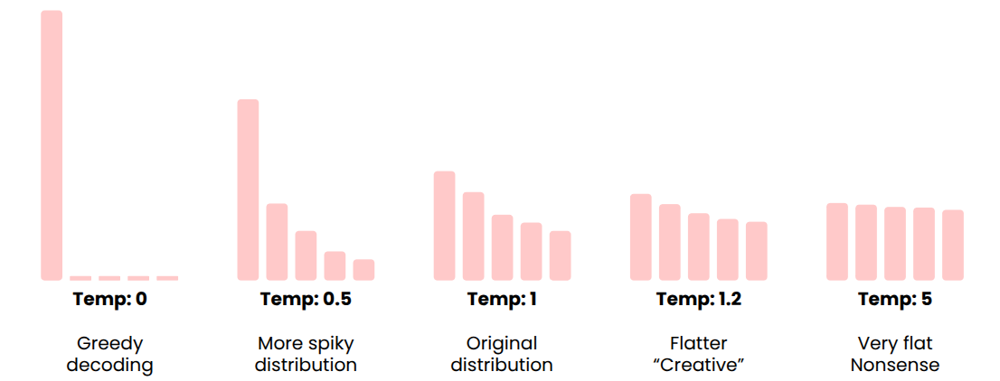
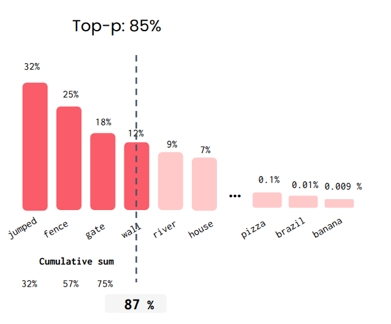

# 6 — Generation for RAG

> The LLM half of RAG: how a decoder-only transformer turns the augmented prompt into tokens, which sampling knobs control that, how to choose a model, how to write prompts that keep answers grounded and cited, how to measure faithfulness with RAGAS, and when to split one LLM call into an agentic workflow. RAG adds knowledge; fine-tuning changes behaviour.

---

## Why RAG works: attention

An LLM is a decoder-only transformer. For each new token it runs the whole context through 8–64 layers, each with many attention heads (8 to 100+) and a feed-forward block, then samples one token and repeats until an end-of-sequence token.

| Part | What it contributes |
|---|---|
| Token + **position** vectors | What each token is and where it sits |
| **Attention** heads | Each token looks at every other token and pulls in what is relevant |
| Feed-forward layers | Per-token processing of what attention gathered |
| Token loop | One token at a time, conditioned on all before |

RAG works because attention lets every generated token look at the retrieved documents. Two consequences:

- The model **may still ignore the context** if its weights pull harder. Prompting (below) and evaluation (RAGAS) are how you catch that.
- **What else is in the context matters.** On NQ-open with small open models (Llama2-7B, Falcon-7B, MPT-7B and Phi-2 at 2.7B, all 4-bit), retrieved passages that score high but lack the answer pulled accuracy down more than unrelated passages did. Adding a single such distractor to the gold passage cost up to 25%, and picking distractors with a retriever trained on hard negatives made it worse, not better. Adding *random* documents sometimes raised accuracy: +35% relative for Llama2-7B with four retrieved passages (about 0.19 → 0.25). Placing the gold passage next to the question also helped ([arXiv:2401.14887](https://arxiv.org/abs/2401.14887), Cuconasu et al., 2024-01). For the random-document effect the authors offer only a tentative lead (attention entropy rose about 3× with noise added) and say they can't explain it yet, so don't pad prompts with noise. The two findings to use: near-miss distractors are the real threat, and the best evidence goes closest to the question.
- **Most of the cost is in the transformer.** Longer contexts mean more compute per token. This is the latency argument in note [07](07-rag-in-production.md).

---

## Sampling

The model outputs a probability for every vocabulary token. Sampling decides which one to emit.

| Knob | What it does | Lab observation |
|---|---|---|
| **Greedy** | Always the most likely token | Deterministic, can loop and repeat |
| **Temperature** | Rescales the distribution: p' ∝ exp(log p / T). < 1 sharpens, > 1 flattens | T = 0.3 and 1.5 start alike; T = 3 is nonsense |
| **top-k** | Sample only from the k most likely tokens | `top_k=0` behaves like greedy; `top_k=10` varies |
| **top-p** (nucleus) | Sample from the smallest set whose cumulative probability ≥ p | `top_p=0` gives identical outputs; `0.8` varies |
| Repetition penalty | Lowers probability of tokens already used | Stops loops in long answers |
| Logit bias | Push specific tokens up or down | Ban or force words, force a label vocabulary |


*Image Source: Hasan, DeepLearning.AI RAG course, Module 4*

top-p adapts to the model's confidence, which top-k does not. When the model is sure, the nucleus is one or two tokens; when unsure, it widens.


*Image Source: Hasan, DeepLearning.AI RAG course, Module 4*

Temperature changes the **shape** of the distribution; top-p and top-k change **which tokens are eligible**. Setting `temperature=1` does not make output deterministic.

### Parameters by task

Lab 4.2 routes each query to a parameter set:

```python
def answer_query(query):
    label = decide_if_technical_or_creative(query).lower()   # one cheap LLM call
    if label == "technical":     # documentation, procedures: be precise
        kwargs = generate_params_dict(query, temperature=0,   top_p=0.1)
    elif label == "creative":    # "suggest three places to visit": allow variety
        kwargs = generate_params_dict(query, temperature=1.1, top_p=0.4)
    else:                        # classifier failed: neutral fallback
        kwargs = generate_params_dict(query, temperature=0.5, top_p=0.5)
    return generate_with_single_input(**kwargs)["content"]
```

The course's warning: keep temperature below about 1.3, and if you go near it, lower top_p to compensate.

---

## Choosing an LLM

| Factor | Question |
|---|---|
| Size | Bigger knows more and reasons better; costs more |
| Cost | Per input and output token, at your volume |
| Context window | Fits your top_k chunks plus history? |
| Latency | Time to first token and tokens per second |
| Knowledge cutoff | Matters less with RAG, but not zero |

| Benchmark type | Example | Watch out for |
|---|---|---|
| Automated | MMLU (57 subjects, multiple choice) | **Saturation** (everyone scores 90%+) and **contamination** (test set in training data) |
| Human preference | LMArena, Elo ratings | Measures preference, not correctness |
| LLM-as-judge | One model grades another | Judges favour their own model family |

Use public benchmarks to shortlist; decide on your own eval set.

---

## Prompting for RAG

### The messages format

Chat models take a list of `{role, content}` messages (`system`, `user`, `assistant`). Under the hood each model family wraps them in special tokens (Llama uses `<|begin_of_text|>`, `<|start_header_id|>system<|end_header_id|>` and so on). The API hides this; know it exists when a raw-completion endpoint misbehaves.

### A RAG prompt template

| Section | Contents |
|---|---|
| **System** | Use only the retrieved documents. Judge whether each is relevant. Cite sources. Say so if the answer is not there |
| **History** | Prior turns, pruned to the last N messages |
| **Retrieved** | `[DOC 1] … (source: …)`, `[DOC 2] …` |
| **Query** | The user's current question |

| Technique | Use in RAG |
|---|---|
| In-context learning | Retrieve *examples* of good past answers, not just facts |
| Chain of thought / scratchpad | Let the model reason over conflicting documents before answering |
| Reasoning models | Few-shot examples tend to *hurt*; drop prior reasoning tokens from history |
| Context pruning | Keep the last N messages; summarise or drop older ones |

### Order and size of the context

Liu et al.'s lost-in-the-middle result (models use information at the start and end of a long context better than in the middle) gives a cheap reordering trick. Raieli and Iuculano describe an alternating pattern: chunks at even ranks go to the front of the list and odd ranks to the back, so the strongest chunks sit at both edges. It matters most with a wide top-k (*Building AI Agents*, ch. 6).

When the retrieved text is too long, compress it before generation (*Building AI Agents*, ch. 6):

| Method | How |
|---|---|
| Selective context | Score each token or sentence by self-information under a small LM; keep the top percentile |
| LongLLMLingua | Question-aware version: compresses and reorders documents using both context and query |
| AutoCompressors | Fine-tune the model to summarise long text into summary vectors used as soft prompts |

And when one call over all chunks is the wrong shape, a response synthesizer makes several (*Building AI Agents*, ch. 6):

- **Refine:** answer from the first chunk, then send the answer plus the next chunk to improve it, one chunk at a time.
- **Concatenate:** answer from each chunk separately, then join the answers, or summarise them into one.
- **Hierarchical:** summarise groups of answers, then summarise the summaries.

### Classification and structured output

Two pieces of Lab 4.2 that the assignment reuses:

```python
# 1. LLM as a classifier: precise instructions, labelled examples (incl. edge cases),
#    and max_tokens 1–2 so it can only emit the label
prompt = f"""Label the following instruction as an FAQ-related query or a product-related query.
Examples:
    Is there a refund for incorrectly bought clothes? Label: FAQ
    Do you have blue T-shirts under 100 dollars? Label: Product
Return only one of the two labels: FAQ or Product.
Instruction: {query}"""
label = generate_with_single_input(prompt, temperature=0, max_tokens=1)["content"].strip()
label = label if label in ("FAQ", "Product") else None    # always validate the label

# 2. Structured output: pass a JSON schema instead of begging for JSON in the prompt
from pydantic import BaseModel, Field

class VoiceNote(BaseModel):
    title: str = Field(description="A title for the voice note")
    summary: str = Field(description="A short one sentence summary of the voice note.")
    actionItems: list[str] = Field(description="A list of action items from the voice note")

result = generate_with_multiple_input(
    messages=[{"role": "system", "content": "The following is a voice message transcript. Only answer in JSON."},
              {"role": "user", "content": transcript}],
    response_format={"type": "json_schema", "schema": VoiceNote.model_json_schema()},
)
```

The "old-fashioned way" in the lab (a smart-home prompt listing every device ID with JSON examples, `{{ }}` escaped inside the f-string) works but is long and fragile; the schema parameter guarantees parseable output.

---

## Hallucinations and citations

The course's example: a support bot asked "Do you offer student discounts?" invents one, because a discount is the probable answer.

| Defence | How | Cost / limit |
|---|---|---|
| Self-consistency | Sample several answers; distrust disagreement | Multiplies cost |
| Grounding via system prompt | "Answer only from the documents; say if you don't know" | Cheap; not a guarantee |
| **Citations** | Number documents, require `[1]`, `[2]` after claims | Citations themselves can be hallucinated |
| ContextCite | Attributes each statement to the context spans that caused it | Research tool; extra compute |
| ALCE benchmark | Scores citation quality, correctness and fluency | For evaluating systems, not runtime |

The grounding prompt is weakest exactly when retrieval misses. In a banking-QA study (GPT-4, GPT-3.5 and Llama-2, two document sets, 800 queries each), the models kept answering when the gold passage was absent, with loosely related context or with invention. The authors call this *pseudo-helpfulness*. Nine prompt variants (verbose, quote-first, citation-required) made no salient difference to answer quality ([Zhao et al., NAACL 2024 Industry](https://aclanthology.org/2024.naacl-industry.23/), 2024-06). Catch missing evidence upstream, in the retriever and in evaluation, rather than with more prompt wording.

**Context against the model's prior.** A second failure runs the other way: the evidence is there and the model overrides it. Raieli and Iuculano summarise Wu et al. ([arXiv:2404.10198](https://arxiv.org/abs/2404.10198)) with a dosage example. The model learned 20 µg as a drug's maximum dose. Given a context that says 30, it answers 30; given one that says 100, it falls back to 20. The further the context departs from the prior, the more the model trusts itself, and larger models do so more than smaller ones (*Building AI Agents*, ch. 6). Prompt strength shifts the balance. In the paper's comparison of a standard, a loose and a strict prompt, the strict one, which tells the model to rely on the context, pushes the model toward the context and the loose one toward its prior. Whether you want that depends on how far you trust your corpus over the model. The same chapter names *negative rejection* as the matching retrieval failure: when nothing relevant is found, the model answers anyway. Its other causes of hallucination are training that rewards long outputs, which makes models verbose, and high sampling temperature (*Building AI Agents*, ch. 5).

**Citations are only as honest as their plumbing.** Rothman's research agent builds citations the robust way, with a weak spot (*Context Engineering for MAS*, ch. 7):

1. Every chunk is upserted with `"source": doc_name` in its metadata, so each retrieved chunk knows its file.
2. After generation, the agent appends a `**Sources:**` list programmatically from the retrieved chunks' metadata, instead of trusting the LLM to name them.

The weak spot is in the book's own trace. Asked about the Juno mission, the answer cites `[1]` and lists both `juno_mission_overview.txt` and `perseverance_rover_tools.txt`. The Perseverance file was retrieved but contributed nothing. Appending every retrieved source records what the model saw, not what it used. Citation is not attribution: for that you need per-claim matching, such as ContextCite above or the fuzzy citation matching Raieli and Iuculano describe, which matches the response against the chunks with n-gram TF-IDF (*Building AI Agents*, ch. 6).

Rothman's negative-result test is worth copying. With only Juno and Perseverance documents loaded, ask for a story about the Apollo 11 landing. A grounded system replies that the provided documents do not contain this information, rather than writing the story from the model's memory. Keep a few such out-of-corpus questions in every regression set.

---

## Evaluating the generator: RAGAS

| Metric | How it is computed | What it misses |
|---|---|---|
| **Response relevancy** | An evaluator LLM writes several prompts that *could* have produced the response; embed them and the real prompt; average cosine | Does not check facts |
| **Faithfulness** | An LLM extracts every factual claim in the response, then checks each against the retrieved docs; share supported | Depends on judge quality |
| Others | Noise sensitivity, citation metrics, context precision/recall | All lean on LLM-as-judge |

Raieli and Iuculano add a few metrics in the same family (*Building AI Agents*, ch. 5). **Context entities recall** is the share of entities in the ground-truth answer that appear in the retrieved context; it suits fact-heavy domains. **Summarization score** asks whether the answer keeps the context's important information. **Fluency** scores individual sentences and **coherence** the response as a whole.

Measure indirectly too: thumbs up/down and A/B tests that change only the LLM, so you capture its effect alone. The RAGAS paper is in `sources/` (arXiv 2309.15217); see [references](../references.md).

---

## Agentic RAG

One LLM call can be split into several specialised ones. The course's support-bot flowchart:

| Step | Model | Job |
|---|---|---|
| Router | Small | Does this prompt need retrieval at all? |
| Retriever | — | Fetch candidates |
| Evaluator | Small | Are these documents relevant? |
| Generator | Large | Write the answer from the augmented prompt |
| Citation | Specialised | Attach sources |

| Workflow shape | Pattern |
|---|---|
| Sequential | parser → rewriter → retriever → generator → citation |
| Conditional | Router picks one branch |
| Iterative | Writer and evaluator loop N times |
| Parallel | Orchestrator fans out; synthesiser merges |

Build simple ones by hand; reach for a framework as they grow. These are Anthropic's *Building Effective Agents* shapes; the house treatment is [ai-engineering 05 — graph vs loop](../../../ai-engineering/05-graph-engineering/notes/01-graph-vs-loop.md) and [01 § agentic vs single-pass](01-rag-pipeline.md#agentic-vs-single-pass-li-experiment-3-9).

Assignment 4 builds exactly this for a clothing store ("Fashion Forward Hub"):

```python
def answer_query(query: str) -> dict:
    label = check_if_faq_or_product(query)          # router, max_tokens=1, temperature=0
    if label not in ("FAQ", "Product"):             # router failed: answer from history
        return {"role": "assistant",
                "prompt": f"User provided a question that does not fit FAQ or Product "
                          f"related questions. Answer it based on the context you already "
                          f"have so far. Query provided by the user: {query}"}
    if label == "FAQ":
        return query_on_faq(query)                  # FAQ pairs in the prompt
    try:
        # decide_task_nature → get_params_for_task (technical 0.3/0.7, creative 1.0/0.9)
        # → LLM extracts metadata (gender, articleType, baseColour, season, usage, price)
        # → Weaviate filters on it → product prompt
        return query_on_products(query)
    except Exception:
        return {"role": "assistant", "prompt": "…Instruct them to rephrase it…"}
```

The metadata step is query parsing (note [05](05-chunking-query-parsing-and-reranking.md)) done with structured output: the LLM sees the allowed values for each field and returns JSON that becomes a Weaviate filter.

---

## RAG vs fine-tuning

| | RAG | Fine-tuning |
|---|---|---|
| Changes | The prompt | The weights |
| Good for | **Knowledge**: facts, private data, freshness | **Behaviour**: domain style, format, tone, task skill |
| Update cost | Re-index documents | Retrain |
| Citations | Natural | None |

Fine-tuning changes how the model talks, not reliably what it knows. Microsoft's agriculture study is the measured version. On 273 expert-curated Washington-state farming questions, graded by GPT-4 against a rubric, LoRA fine-tuning GPT-4 on generated Q&A raised accuracy from 75% to 81%, and RAG added 5 points on top (86%). But fine-tuning Llama2-13B base dropped it below the off-the-shelf chat model (68% vs 76%), and RAG did more for fully correct answers than fine-tuning did (GPT-4: 36% → 60% with RAG, 45% fine-tuned) ([arXiv:2401.08406](https://arxiv.org/abs/2401.08406), Balaguer et al., 2024-01). Use RAG for knowledge, fine-tuning for domain adaptation, and both when you need both.

Raieli and Iuculano's examples by task (*Building AI Agents*, ch. 5). Specialised summarization depends on understanding the domain, so fine-tune. Question answering needs transparency and low hallucination more than customisation, so use RAG. Code generation needs both a changing codebase and close task adaptation, so use both. "Both" can also mean fine-tuning the embedder rather than the LLM. That is far cheaper than training an embedder, and when labelled pairs are scarce, an LLM can generate synthetic (query, positive, negative) data for it ([03 § how embedders are trained](03-keyword-semantic-and-hybrid-search.md#how-embedders-are-trained-and-where-cosine-misleads)). Fine-tuning in depth: [01-llm-fundamentals](../../01-llm-fundamentals/README.md) (training and adapting) and [05-RL](../../05-RL/README.md) (preference tuning).

---

## Rules of thumb

| Rule | Why |
|---|---|
| Temperature ≈ 0, low top_p for factual RAG answers | Faithfulness over variety |
| Classifier calls: `max_tokens` 1–2, validate the label | Can't ramble, failures are explicit |
| Use the schema parameter for JSON | Parsing never fails |
| Tell the model to cite and to say "not in the documents" | Cheapest hallucination defence |
| Measure faithfulness, not only relevancy | A relevant answer can still be invented |
| Small models for routers and evaluators | They run on every request |

---

## Labs

| Lab | Label |
|---|---|
| M4 Lab 4.1 (sampling parameters), Lab 4.2 (classification, params by task, structured output) ([upstream](https://github.com/MohammadWasiq0786/Deeplearning.ai-RAG)) | needs an API key (Together.ai); not copied |
| M4 Assignment 4 (Fashion Forward Hub chatbot) | needs Together API key + embedded Weaviate; not copied |

→ Next: [07-rag-in-production.md](07-rag-in-production.md) — the system works on a laptop; now evaluate it with traces, cut its cost and latency, secure it, and extend it to images and PDFs.
