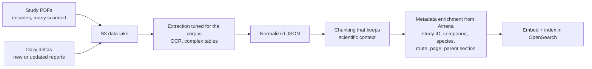
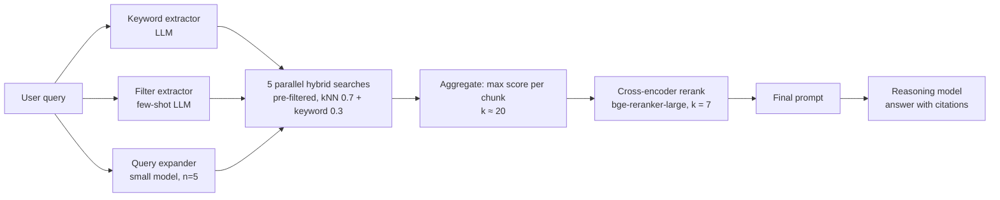
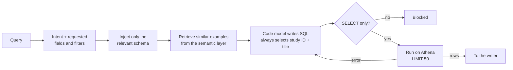
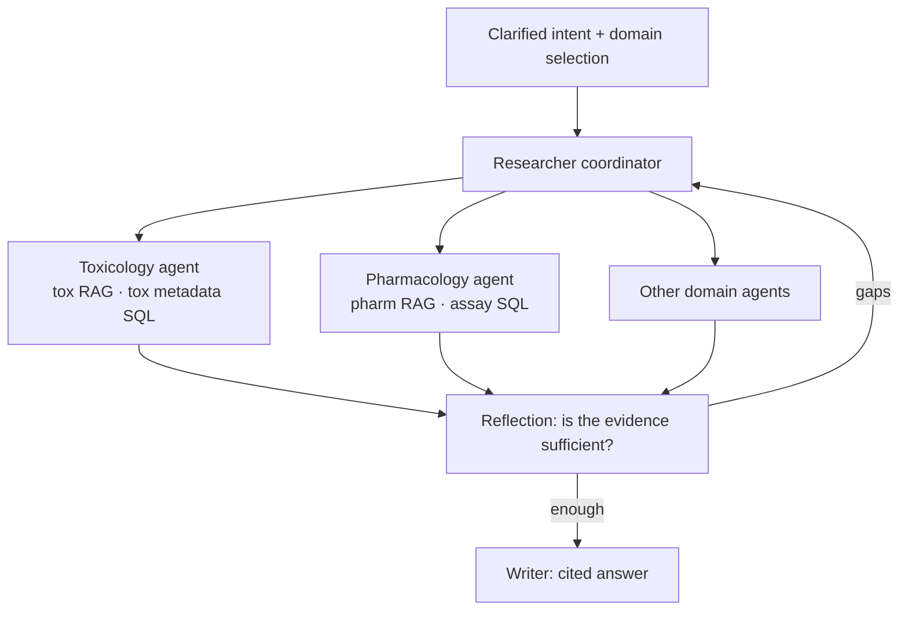

# 8 — Agentic RAG in production: the PRINCE retrieval stack

> Retrieval inside an agent is two pipelines. Unstructured documents go through RAG. Structured records go through Text-to-SQL. A coordinator routes between them.

A Tallybook customer asks the support bot, "how many invoices are overdue this month?" The hybrid retriever from [note 03](03-keyword-semantic-and-hybrid-search.md) does its job and returns the help article on payment reminders. The model reads it and writes a confident paragraph about reminder schedules, with a citation, and no number. Nothing failed: retrieval found the closest text. The closest text does not hold the answer, because the answer lives in a table, and similarity search cannot count.

The same bot fails differently on "my client never got it". There is too little in that sentence for one search: the hybrid retriever ranks the email-delivery article second, behind an internal runbook on refund overrides that has nothing to do with the problem. And it fails a third way when the question is "it doesn't work": any retrieval run on those words is wasted, because nobody knows what "it" is.

A production system deals with all three before it writes a sentence. It asks when the question is too vague. It sends counting questions to SQL. It widens narrow questions into several searches and pools the results. This note walks through one published system that does all of that.

This note started in the harness-engineering module
([ai-engineering/03-harness-engineering](../../../ai-engineering/03-harness-engineering/README.md)), which
used Bayer's PRINCE platform (built with Thoughtworks, written up on martinfowler.com by Sarang Sanjay Kulkarni,
2026) as its production case study. The harness parts stayed there: three kinds of reflection, retries,
state persistence, fallbacks and evaluation. The retrieval mechanics moved here: ingestion, the query-time
RAG pipeline, Text-to-SQL, NER metadata enrichment and the domain sub-agent hierarchy.

PRINCE answers preclinical scientists' questions over decades of study reports (mostly PDFs, many
scanned) and structured study metadata in Amazon Athena. It runs in three phases: **Search** (find
studies), **Ask** (question them) and **Do** (draft regulatory documents for expert review).

Each section below gives PRINCE's decision and then rebuilds the small version over Tallybook in plain Python, so you can change a number and watch what moves. The stand-ins for language models are labelled in the code. They show the plumbing and say nothing about model quality.

---

## The stack

| Layer | PRINCE choice |
|---|---|
| UI | React, which shows intermediate steps and citations |
| Orchestration | LangGraph workflow; Postgres checkpointer stores agent state per node |
| API | FastAPI |
| Unstructured store | Amazon OpenSearch Service (vectors + keyword + metadata) |
| Structured store | Amazon Athena (study metadata, assay results) |
| App state | DynamoDB (logs, intermediate steps, citations) |
| Models | One OpenAI-compatible endpoint fronting several providers; fallback to another provider |
| Observability | Langfuse traces and datasets; RAGAS-style metrics; daily live-traffic eval |

---

## Clarify intent before retrieval

The first node checks whether the query names enough to act on. A vague query triggers a clarifying
question instead of a retrieval run (fail fast). When the user has selected no data source, or several
with no clear focus, the model suggests the most relevant sources from the query's intent. The user can
accept, adjust or override it. A domain selector in the UI lets users pre-filter the valid tools up front.

This is the first context-assembly decision: it fixes which tools, domains and data sources are in scope
before any retrieval starts, so later agents get a focused problem.

You can sketch the gate without a model. A query with no content words left after stop-word removal has nothing to search on, and a query whose best match is weak should not be answered as though it matched. Real systems use an LLM for this node; these two rules catch the cheapest failures first.

```python
import numpy as np
from ragkit import DOCS, embed, tokenize

doc_vecs = embed([d.full for d in DOCS])
FILLER = {"doesn", "work", "working", "help", "please", "broken", "t", "issue"}
FLOOR = 0.25   # chosen by reading the scores below, not a universal number


def gate(query: str) -> str:
    content = [t for t in tokenize(query) if t not in FILLER]
    if not content:
        return "ask: nothing to search on"
    best = float((doc_vecs @ embed([query])[0]).max())
    return f"retrieve (best cosine {best:.2f})" if best >= FLOOR else f"ask: weak match ({best:.2f})"


for q in ["it doesn't work", "please help", "my pet parrot sings opera",
          "can I get my money back", "the bank link stopped updating"]:
    print(f"{q:32s} {gate(q)}")
```

```text
it doesn't work                  ask: nothing to search on
please help                      ask: nothing to search on
my pet parrot sings opera        ask: weak match (0.24)
can I get my money back          retrieve (best cosine 0.81)
the bank link stopped updating   retrieve (best cosine 0.84)
```

The floor is a corpus-specific number. Set it by reading scores on your labelled queries, and expect to move it when the embedder changes, because cosine scores from different models are not comparable.

---

## Ingestion


*Image Source: diagram based on Kulkarni (2026)*

The metadata attached at ingestion is what makes the query-time filter work. Without study ID and section
on every chunk, the pre-filter below has nothing to filter on.

---

## The query-time RAG pipeline

Running example: *"Were any of the following clinical findings observed in study T123456-2: piloerection,
ataxia, eyes partially closed, and loose faeces?"*


*Image Source: diagram based on Kulkarni (2026)*

1. **Keyword extraction.** An LLM pulls search terms: "piloerection", "ataxia", "eyes partially closed",
   "loose faeces".
2. **Metadata filter generation.** In parallel, an LLM writes a filter such as `eq(study_id, T123456-2)`.
   Few-shot examples cover many permutations of filter requests.
3. **Query expansion.** A smaller, faster model writes **n = 5** paraphrases ("goosebumps, lack of
   coordination, semi-closed eyelids, diarrhea…") to cover terminology drift.
4. **Hybrid retrieval.**
   - The metadata filter is applied *inside* the vector query, which shrinks the search space from
     millions of vectors to tens or hundreds.
   - Each of the 5 queries runs one hybrid search in parallel: semantic kNN plus keyword.
   - Within each search, semantic results are weighted **0.7** and keyword results **0.3** (found by
     experiment on this corpus).
   - Results are pooled; each unique chunk keeps its **highest** score across the 5 searches. Top
     **k ≈ 20** go forward.
5. **Rerank.** A cross-encoder (`bge-reranker-large`) scores each chunk against the original question and
   keeps the top **k = 7**.
6. **Generate with citations.** The 7 chunks and the question form the final prompt. A reasoning model
   answers and cites the chunks it used. Users hover a sentence to see the page number and exact quote.
7. **Monitor.** Langfuse traces the whole path.

### The max-score pool over Tallybook

Why keep the maximum and not the sum? A sum rewards a chunk for being found often, and paraphrases of one question are not independent votes, so a chunk that matches a common phrase climbs. The maximum asks a different question: did any phrasing find this chunk strongly? That is what expansion is for. The [multi-query demo in note 05](05-chunking-query-parsing-and-reranking.md) fused rankings with RRF, which looks only at positions. PRINCE's choice needs comparable scores, which it gets by running the same weighted search each time.

The code below follows steps 2 to 4 with PRINCE's weights. The filter and the expansions are written by hand where the LLMs would be.

```python
import numpy as np
from ragkit import BM25, DOCS, embed

QUERY = "my client never got it"
EXPANSIONS = [QUERY,                                 # expansion model's output, by hand
              "customer did not receive the invoice email",
              "invoice email bounced",
              "invoice delivery failed"]


def unit(x: np.ndarray) -> np.ndarray:
    span = x.max() - x.min()
    return (x - x.min()) / span if span else np.zeros_like(x)


def funnel(queries: list[str], area: str | None, k: int = 3) -> list[tuple[str, float]]:
    pool = [d for d in DOCS if area is None or d.area == area]   # the pre-filter
    bm25 = BM25([d.full for d in pool])
    vecs = embed([d.full for d in pool])
    runs = np.array([0.7 * unit(vecs @ embed([q])[0]) + 0.3 * unit(bm25.scores(q))
                     for q in queries])
    best = runs.max(axis=0)                          # each chunk keeps its highest score
    return [(pool[i].id, round(float(best[i]), 3)) for i in np.argsort(-best)[:k]]


print("one query, no filter:  ", funnel([QUERY], None))
print("expanded, no filter:   ", funnel(EXPANSIONS, None))
print("one query, filtered:   ", funnel([QUERY], "invoicing"))   # filter extractor, by hand
print("expanded, filtered:    ", funnel(EXPANSIONS, "invoicing"))
```

```text
one query, no filter:   [('kb-18', 0.782), ('kb-10', 0.7), ('kb-12', 0.687)]
expanded, no filter:    [('kb-12', 1.0), ('kb-18', 0.782), ('kb-10', 0.7)]
one query, filtered:    [('kb-12', 0.714), ('kb-10', 0.7), ('kb-09', 0.359)]
expanded, filtered:     [('kb-12', 1.0), ('kb-10', 0.7), ('kb-08', 0.51)]
```

Read the four lines as two independent repairs. On its own, the bare question ranks the internal runbook kb-18 first. Either expansion or the filter puts the right article, kb-12, on top, and each does it for a different reason: expansion adds words that match, and the filter removes the document that should not compete. Both together give the widest margin over second place.

Order matters here, and the filter runs first. It shrinks the candidate set before any similarity is computed, which is how PRINCE gets from millions of vectors to tens or hundreds. It also fails hard: if the extractor writes the wrong study ID, no amount of expansion recovers the right chunk. That is why PRINCE puts many few-shot examples behind the filter extractor.

---

## The same funnel at small scale: the LLM Twin

The Handbook's retrieval module is PRINCE's shape, built over a Qdrant collection of one person's articles, posts and code (*LLM Engineer's Handbook*, ch. 9):


*Image Source: Iusztin & Labonne, *LLM Engineer's Handbook* (Packt, 2024), Fig. 9.1*

1. **Self-query.** An LLM pulls the author's name out of the question; it becomes a metadata filter (`FieldCondition(key="author_id", match=MatchValue(value=...))`).
2. **Query expansion.** `gpt-4o-mini` at temperature 0 writes N=3 variants, separated by a `#next-question#` token so the output splits cleanly.
3. **Filtered vector search** per variant and per collection, in a thread pool.
4. **Merge and dedupe** the N×K results with a set.
5. **Rerank** with a small cross-encoder (`ms-marco-MiniLM-L-4-v2`) against the *original* query and keep the top K.

```python
from concurrent.futures import ThreadPoolExecutor

import numpy as np
from ragkit import BM25, DOCS, embed

COLLECTIONS = {"guides": [d for d in DOCS if d.area in ("invoicing", "banking")],
               "billing": [d for d in DOCS if d.area == "billing" and d.audience == "public"],
               "developer": [d for d in DOCS if d.area == "api"]}
VECS = {name: embed([d.full for d in docs]) for name, docs in COLLECTIONS.items()}


def expand(query: str, n: int) -> list[str]:          # stand-in for the expansion LLM
    return [query, f"{query} error", f"{query} problem"][:n]


def vector_search(query: str, name: str, k: int) -> list:
    scores = VECS[name] @ embed([query])[0]
    return [COLLECTIONS[name][i] for i in np.argsort(-scores)[:k]]


def rerank(query: str, docs: list, keep: int) -> list:   # stand-in for the cross-encoder
    scores = BM25([d.full for d in docs]).scores(query)
    return [docs[i] for i in np.argsort(-scores)[:keep]]


def search(query: str, k: int = 3, expand_to_n: int = 3) -> list:
    assert k >= 3
    per_collection = k // 3                           # the book's split
    queries = expand(query, n=expand_to_n)            # includes the original
    jobs = [(q, name) for q in queries for name in COLLECTIONS]
    with ThreadPoolExecutor() as pool:                # searches are I/O-bound in production
        hits = pool.map(lambda job: vector_search(job[0], job[1], per_collection), jobs)
    unique = list({d.id: d for batch in hits for d in batch}.values())   # dedupe
    return rerank(query, unique, keep=k)              # score against the ORIGINAL query


query = "webhook signature rejected and API token denied"
for k in (3, 9):
    print(f"k={k}: {[d.id for d in search(query, k=k)]}")
```

```text
k=3: ['kb-01', 'kb-07', 'kb-12']
k=9: ['kb-17', 'kb-01', 'kb-07', 'kb-02', 'kb-12', 'kb-13', 'kb-08', 'kb-04', 'kb-05']
```

Two details are worth copying, and one is a trap. The rerank target is the original question, the same rule PRINCE follows. Every chunk keeps its source link in metadata, so the answer can cite it. The trap: the book splits `k` across its three collections as `k // 3` and asserts `k >= 3`. With the default k=3, that is one chunk per collection, whatever the question needs. The question above is entirely about the developer collection. At k=3 the funnel returns one developer chunk (kb-01) and spends the other two slots on collections with nothing to offer, and the webhook article kb-17 never reaches the reranker. At k=9 it ranks first. Raising k is the blunt fix; the router in the improvement list below is the real one. The self-query filter is left out of the runnable version because Tallybook has no authors, and the toy embedder and BM25 stand in for the Qdrant search and the cross-encoder.

The chapter's improvement list:

- Add chat memory: the last K messages, or a running summary plus the last K.
- Put a router in front of the collections, so most questions search one or two of the three.
- Add BM25 for hybrid search.
- Use a multi-index library (Superlinked) to weight several embeddings per item.

Chat memory is in [note 05](05-chunking-query-parsing-and-reranking.md#conversational-retrieval), BM25 in [note 03](03-keyword-semantic-and-hybrid-search.md), and the router [below](#routing).

---

## Text-to-SQL

RAG handles narrative reports. Questions that filter, aggregate or compare ("Give me 50 example studies
done on RAT", numeric assay results by dose group) go to Text-to-SQL against Athena.


*Image Source: diagram based on Kulkarni (2026)*

- **Schema subsetting.** For a large schema, only the tables and columns relevant to this query go into
  the prompt.
- **Dynamic few-shot from a "semantic layer".** Hand-picked question→Athena-SQL pairs live in their own
  vector collection. The closest ones are retrieved per query. New examples are added whenever a query
  pattern fails, so the tool improves over time.
- **Mandatory columns.** Study ID and study title are always selected so the writer can cite rows.
- **Mechanical validation.** Only `SELECT` is allowed; `DELETE`, `INSERT` and `UPDATE` are blocked.
  An earlier LLM SQL reviewer was **removed**: it flagged valid queries as wrong and cost more than it
  caught.
- **Result cap.** At most **50** rows per call, to avoid flooding the context.
- **Error loop.** On a failed run, the database error, the query and the original context go back to the
  same model, up to **3** attempts, then the tool reports failure.

PRINCE uses different Text-to-SQL engines per domain (Snowflake Cortex Analyst for pharmacology, custom
methods for toxicology), but the recipe above is the same.

### Text-to-SQL is a retrieval strategy

Vector search over chunks is the wrong tool for questions that need precise filtering, aggregation or comparison: "give me 50 studies done on rat", or any numerical rollup. Embedding similarity doesn't count, sum or compare. PRINCE routes these to a Text-to-SQL tool, and the decisions inside it mirror the RAG path:

- **Schema subsetting.** Only the schema components relevant to the query are injected, not the full schema: pre-filtering applied to the prompt instead of the corpus.
- **Dynamic few-shot from a semantic layer.** Hand-picked (natural language → SQL) pairs live in their own vector collection. The user's query retrieves the most similar examples, which go into the prompt as in-context examples. This is retrieval used to *condition generation* rather than to supply answer content. New examples get added as failure patterns surface, and quality improves without retraining or prompt rewrites.
- **Validation over review.** Generated SQL is checked mechanically (SELECT-only; DELETE/INSERT/UPDATE blocked). An earlier LLM-review step was *removed*: it flagged valid queries as broken often enough to cost more than it saved. Deterministic validation beat model judgment on a task with a checkable answer.

Two more pieces from the books:

- **Show the model the schema and a few rows.** For each table, put its `CREATE TABLE` statement and three sample rows in the prompt; Rajkumar et al. (2022) found that format worked best (*Learning LangChain*, ch. 3). The rows show what values actually look like, such as `'NY'` vs `'New York'`.
- **Pick the table before writing SQL.** With many tables, Huyen adds a step in which the model chooses which tables are relevant. Only their schemas go into the Text-to-SQL prompt, and the query result goes to the generator alongside the question (*AI Engineering*, ch. 6).


*Image Source: Huyen, *AI Engineering* (O'Reilly, 2025), Fig. 6-7*

**Lock the database down as well as validating the SQL** (*Learning LangChain*, ch. 3). Connect as a read-only user, expose only the tables the app needs, and set a query timeout so a generated cross-join can't stall the database. A SELECT-only check stops writes, but it doesn't stop a SELECT that reads a salary table or runs for an hour.

### A guarded query tool over Tallybook

Here is the opening question run properly. The table is synthetic, the writer is a stand-in that returns canned SQL, and everything around it is real: two layers of guard, a row cap, and an error loop that gives up after three attempts as PRINCE's does.

```python
import re
import sqlite3

db = sqlite3.connect(":memory:")
db.executescript("""
CREATE TABLE invoices (id INTEGER PRIMARY KEY, customer TEXT, status TEXT, due TEXT, total REAL);
CREATE TABLE salaries (name TEXT, pay REAL);
""")
db.executemany("INSERT INTO invoices (customer, status, due, total) VALUES (?, ?, ?, ?)",
               [(f"cust-{i % 7}", ["paid", "sent", "overdue"][i % 3], f"2026-{1 + i % 12:02d}-15", 100.0 + i)
                for i in range(240)])
db.execute("PRAGMA query_only = ON")                     # the connection itself cannot write
db.set_authorizer(lambda action, table, *_:              # and it can only see this table
                  sqlite3.SQLITE_DENY if table == "salaries" else sqlite3.SQLITE_OK)

ROW_CAP = 50
SELECT_ONLY = re.compile(r"^\s*select\b[^;]*;?\s*$", re.I)


def run_sql(sql: str) -> list[tuple]:
    if not SELECT_ONLY.match(sql):
        raise ValueError("blocked: only one SELECT statement is allowed")
    return db.execute(sql).fetchmany(ROW_CAP)


# Stand-in for the code model: a wrong first try, then the fix after seeing the error.
attempts = iter(["SELECT COUNT(*) FROM invoice WHERE status = 'overdue'",
                 "SELECT COUNT(*) FROM invoices WHERE status = 'overdue'"])
for attempt in range(1, 4):
    sql = next(attempts)                                 # real code sends sql, error, context
    try:
        print(f"try {attempt}: {run_sql(sql)}")
        break
    except (ValueError, sqlite3.Error) as err:
        print(f"try {attempt}: {err}")

for sql in ["DELETE FROM invoices", "SELECT 1; DROP TABLE invoices",
            "SELECT * FROM salaries", "SELECT id FROM invoices"]:
    try:
        print(f"{sql:32s} {len(run_sql(sql))} rows")
    except (ValueError, sqlite3.Error) as err:
        print(f"{sql:32s} {err}")
```

```text
try 1: no such table: invoice
try 2: [(80,)]
DELETE FROM invoices             blocked: only one SELECT statement is allowed
SELECT 1; DROP TABLE invoices    blocked: only one SELECT statement is allowed
SELECT * FROM salaries           access to salaries.name is prohibited
SELECT id FROM invoices          50 rows
```

The three failures come from three layers, which is the point of the book's advice. The regex stopped the `DELETE` and the stacked statement before the database saw them. It let `SELECT * FROM salaries` through, because that is a valid SELECT, and the authorizer stopped it. The last line is the row cap: 240 rows match and the tool returns 50. A regex is a blunt first layer, so treat it as one; the guarantee comes from the database permissions, which here means the `query_only` setting and the authorizer, and in Athena or Postgres means a read-only role scoped to named tables, plus a query timeout.

### Retrieved few-shot examples

The semantic-layer idea fits in a dozen lines. Keep question and SQL pairs in their own small index, embed the incoming question, and put only the nearest pairs in the prompt.

```python
import numpy as np
from ragkit import embed

LAYER = [("how many invoices are unpaid", "SELECT COUNT(*) FROM invoices WHERE status != 'paid'"),
         ("which client owes the most", "SELECT customer, SUM(total) FROM invoices WHERE status != 'paid' GROUP BY customer ORDER BY 2 DESC LIMIT 1"),
         ("total billed per month", "SELECT substr(due, 1, 7), SUM(total) FROM invoices GROUP BY 1"),
         ("list members of my team", "SELECT name FROM members"),
         ("how much tax did we charge", "SELECT SUM(tax) FROM invoices")]
vecs = embed([question for question, _ in LAYER])


def examples_for(query: str, k: int = 2) -> str:
    top = np.argsort(-(vecs @ embed([query])[0]))[:k]
    return "\n".join(f"Q: {LAYER[i][0]}\nSQL: {LAYER[i][1]}" for i in top)


print(examples_for("how many invoices are overdue"))
print("---")
print(examples_for("which customer has paid the least tax"))
```

```text
Q: how many invoices are unpaid
SQL: SELECT COUNT(*) FROM invoices WHERE status != 'paid'
Q: total billed per month
SQL: SELECT substr(due, 1, 7), SUM(total) FROM invoices GROUP BY 1
---
Q: how much tax did we charge
SQL: SELECT SUM(tax) FROM invoices
Q: which client owes the most
SQL: SELECT customer, SUM(total) FROM invoices WHERE status != 'paid' GROUP BY customer ORDER BY 2 DESC LIMIT 1
```

When a query pattern fails in production, you add one pair to the layer and the next similar question picks it up. No prompt rewrite and no retraining: that is why the PRINCE tool improves over time. This is retrieval that conditions generation; the examples never appear in the answer.

The same move works without SQL. The DAIR `pe-rag` notebook retrieves similar paper titles and uses them as style examples for generating new ones:

```python
import chromadb
from chromadb.utils import embedding_functions

ef = embedding_functions.SentenceTransformerEmbeddingFunction("all-MiniLM-L6-v2")
titles = chromadb.EphemeralClient().get_or_create_collection(
    "ml_titles", embedding_function=ef)

# Synthetic stand-in for the DAIR list; the notebook used ML Papers of the Week.
papers = [{"Title": t, "PaperURL": f"https://example.org/{n}", "Abstract": ""} for n, t in enumerate([
    "Retrieval-Augmented Generation for Knowledge-Intensive Tasks",
    "Lifting the Fog on Hybrid Search for Long Documents",
    "Attention Is Not Enough: Sparse Features in Vision",
    "Dense Passage Retrieval at Web Scale",
    "A Survey of Diffusion Models for Audio"])]
user_topic = "searching long documents with embeddings"

# Index in batches; keep the URL and abstract as metadata for citing later.
for i in range(0, len(papers), 50):                 # papers: [{"Title", "PaperURL", "Abstract"}]
    batch = papers[i:i + 50]
    titles.upsert(
        ids=[str(i + j) for j in range(len(batch))],  # stable ids, so re-runs update, not duplicate
        documents=[p["Title"] or "No Title" for p in batch],
        metadatas=[{"url": p["PaperURL"], "abstract": p["Abstract"]} for p in batch])

hits = titles.query(query_texts=[user_topic], n_results=3)["documents"][0]
prompt = f"""Generate 5 titles for a paper on: {user_topic}
Mimic the style of these titles. Do not copy any of them.
<examples>
{chr(10).join(hits)}
</examples>"""
print(prompt)
```

```text
Generate 5 titles for a paper on: searching long documents with embeddings
Mimic the style of these titles. Do not copy any of them.
<examples>
Lifting the Fog on Hybrid Search for Long Documents
Dense Passage Retrieval at Web Scale
Retrieval-Augmented Generation for Knowledge-Intensive Tasks
</examples>
```

The examples are chosen per request, so the prompt stays short and on-topic. The notebook ran on Fireworks-hosted Llama 2 7B and Mistral 7B Instruct with Mistral's `[INST]` template. **Those models are legacy**; any current chat model works with the plain prompt above. The corpus was DAIR's ML Papers of the Week list. The original builds ids from a random hash of the title, so re-running it adds duplicates; the stable ids above fix that. Runnable original: DAIR [Prompt-Engineering-Guide `notebooks/pe-rag.ipynb`](https://github.com/dair-ai/Prompt-Engineering-Guide/blob/main/notebooks/pe-rag.ipynb).

PRINCE adds three more decisions to the tool:

- **Mandatory columns.** Study ID and study title are always selected so the writer can cite rows.
- **Result cap.** At most **50** rows per call, to avoid flooding the context.
- **Error loop.** On a failed run, the database error, the query and the original context go back to the
  same model, up to **3** attempts, then the tool reports failure.

PRINCE uses different Text-to-SQL engines per domain (Snowflake Cortex Analyst for pharmacology, custom
methods for toxicology), but the recipe above is the same.

---

## Routing

The general shape: a retrieval layer that spans structured and unstructured data needs a **router**, not a single index. Choosing *which* retrieval mechanism to use is a decision made before any retrieval happens.

Raieli and Iuculano list five kinds of router (*Building AI Agents*, ch. 6):

| Router | Decides by | Trade-off |
|---|---|---|
| Logical | Hand-written rules on the query or user | Predictable; brittle as queries vary |
| Keyword | Matching terms to sources | Cheap; misses paraphrase |
| Zero-shot classifier | A classifier over source labels | No training data; fixed label set |
| Function calling | The LLM picks a tool or source | Flexible; one LLM call per query |
| Semantic | Cosine similarity between the query and a description of each route | Fast after setup; needs good route descriptions |

Their banking and insurance example shows routing doing a second job. Sending a customer's question only to the indexes that customer may see is an access-control decision as well as a relevance one.

LangChain implements the last two (*Learning LangChain*, ch. 3). The *logical* version uses structured output: the model must return one of a `Literal["python_docs", "js_docs"]` set, and code maps that label to a retriever. The *semantic* version embeds one prompt template per route and picks the template closest to the query:

```python
import numpy as np
from ragkit import embed

ROUTES = {"sql": "how many count total sum average invoices overdue paid amount per month customer",
          "docs": "how do I change settings reset password export error problem cancel refund policy",
          "ask": "it does not work help hello thanks"}
names = list(ROUTES)
route_vecs = embed([ROUTES[n] for n in names])       # once, at startup


def route(query: str) -> tuple[str, float]:
    scores = route_vecs @ embed([query])[0]           # argmax similarity
    return names[int(scores.argmax())], float(scores.max())


for q in ["how many invoices are overdue", "total billed per customer",
          "reset my password", "can I get my money back", "my client says the bill never arrived"]:
    print(f"{q:42s} %s %.2f" % route(q))
```

```text
how many invoices are overdue              sql 0.69
total billed per customer                  sql 0.60
reset my password                          docs 0.32
can I get my money back                    docs 0.37
my client says the bill never arrived      sql 0.46
```

The book's logical router matches the returned label by lowercase substring (`"python_docs" in result.datasource.lower()`). That's fine for two labels; validate against the exact set once routes multiply. The book's code imports `langchain_core.pydantic_v1`, a shim deprecated since LangChain 0.3; use plain Pydantic v2 models.

Look at the last line. "My client says the bill never arrived" is a support question, and it went to SQL because the description of the SQL route contains "customer" and "invoices". A route description is a document in a very small index, and it fails the way documents do. Before you trust it, score it on labelled queries the way [note 03](03-keyword-semantic-and-hybrid-search.md) scores retrieval: a wrong route is a recall of zero, and nothing downstream can repair it. PRINCE's domain sub-agents below are what routing becomes once the routes outnumber what one prompt can hold.

---

## From one researcher to domain sub-agents

PRINCE began with two tools: one RAG retriever, one Text-to-SQL. As domains were onboarded, the tool list
grew and tools began to overlap: many operate on "studies", "findings" or "assays" but point at different
datasets, schemas and regulatory meanings. "The study" can mean a repeat-dose toxicology study, a
cardiovascular safety-pharmacology package or one assay in an aggregated table.

Two fixes, in order:

1. **A Think & Plan step** before tool calls. Reasoning explicitly about which tool matches the intent gave
   a large jump in tool-selection accuracy. (The harness view of this step is process reflection; see
   [03-harness-engineering note 05](../../../ai-engineering/03-harness-engineering/notes/05-verification-loops.md).)
2. **A hierarchy of domain sub-agents** (in progress). The top-level Researcher becomes a coordinator. It
   routes on the clarified intent and the UI's domain selection. Each domain agent owns its toolset (for
   example tox RAG + tox metadata SQL, or pharmacology RAG + assay-level SQL). It also has prompts that say
   which tables or indices are authoritative and how to read key terms. The aim is coherent
   responsibilities, no cross-domain leakage and per-domain retrieval tests.


*Image Source: diagram based on Kulkarni (2026)*

---

## Context discipline across the agents

Each agent gets the context for its job and nothing else:

| Agent | Receives | Not |
|---|---|---|
| Think & Plan | Planning context: the goal, progress, available tools | (not specified) |
| Researcher / Text-to-SQL | Only the schema slice relevant to this query | The full schema |
| Reflection | Original question + collected evidence | The full workflow history |
| Writer | Curated chunks with citation constraints | Raw retrieval output |

Splitting the monolithic agent this way also made each part testable and debuggable on its own.

---

## NER to repair the metadata

Text-to-SQL is only as good as the Athena metadata. Decades of migrations and differing lab practices left
fields incomplete, missing or wrong. PRINCE adds an NER utility:

1. Read study PDFs and extract entities: study IDs, compounds, species, routes of administration, dosage,
   clinical findings.
2. Turn the entities and their relations into structured annotations.
3. Score each extracted field for confidence. **High-confidence fields update Athena automatically. Low
   confidence goes to a quarantine queue for human review.**

It has been evaluated against curated datasets with promising results and is being wired into the data
pipelines. Better metadata improves both Text-to-SQL and the chunk-level filters in RAG.

The confidence gate is the part worth copying, and it needs no model to demonstrate. Here a regular expression stands in for the extractor, and agreement between pages stands in for its confidence score.

```python
import re
from collections import Counter

REPORT_PAGES = ["Study T123456-2. Species: rat. Route: oral gavage.",
                "Dosing in the rat cohort, study T123456-2, route: oral gavage.",
                "Appendix: rat and mouse reference ranges. Route: intravenous."]
PATTERNS = {"study_id": r"\bT\d{6}-\d\b", "species": r"\b(rat|mouse|dog)\b",
            "route": r"[Rr]oute: ([a-z ]+)\."}
AUTO_UPDATE = 0.9
athena, quarantine = {}, []

for field, pattern in PATTERNS.items():
    found = Counter(v for page in REPORT_PAGES for v in re.findall(pattern, page))
    value, count = found.most_common(1)[0]
    confidence = count / sum(found.values())
    target = athena if confidence >= AUTO_UPDATE else quarantine
    if target is athena:
        athena[field] = value
    else:
        quarantine.append((field, dict(found)))
    print(f"{field:9s} {value:12s} confidence {confidence:.2f}")

print("auto-updated:", athena)
print("for review:  ", quarantine)
```

```text
study_id  T123456-2    confidence 1.00
species   rat          confidence 0.75
route     oral gavage  confidence 0.67
auto-updated: {'study_id': 'T123456-2'}
for review:   [('species', {'rat': 3, 'mouse': 1}), ('route', {'oral gavage': 2, 'intravenous': 1})]
```

The study ID is unanimous and goes straight in. The species and the route disagree across pages, and a person sees them with the competing values. The cost of that lane is reviewer time, and the benefit is that a wrong value never reaches the filter, where it would silently hide every chunk of the study.

---

## Evaluating the retrieval stack

- **Dataset evals** run on every significant change to the workflow, prompts or models. They use reference
  answers written by subject-matter experts and stored in Langfuse. Metrics: faithfulness, answer
  relevancy, context relevancy, answer accuracy, and semantic similarity to the reference.
- **Live-traffic evals** run daily as a batch on real queries without references, covering faithfulness
  and answer relevancy. They catch hallucinations in production.
- **Per-stage metrics**, like a testing pyramid: retrieval quality is measured separately from the final
  answer.

The per-stage idea is easy to state and easy to skip, so here it is on the running example. One labelled set scores each stage's output, and the stage where the number drops is where the work goes. The code scores the hybrid retriever alone, then the same retriever behind a filter extractor that is wrong on every second query.

```python
from ragkit import DOC_BY_ID, QUERIES, Retriever, evaluate

r = Retriever()


def filter_wrong_half_the_time(query: str, k: int = 3) -> list[str]:
    # Keeps the labelled document's area on even positions, every other area on odd ones.
    labelled = next(ids for q, ids, _ in QUERIES if q == query)
    position = [q for q, _, _ in QUERIES].index(query)
    area = DOC_BY_ID[next(iter(labelled))].area
    return [d for d in r.hybrid(query, k=18, pool=18)
            if (DOC_BY_ID[d].area == area) == (position % 2 == 0)][:k]


print("retriever alone:", evaluate(r.hybrid))
print("with bad filter:", evaluate(filter_wrong_half_the_time))
```

```text
retriever alone: {'recall@3': 0.95, 'mrr': 0.7416666666666666, 'ndcg@3': 0.7892789260714373}
with bad filter: {'recall@3': 0.5, 'mrr': 0.45, 'ndcg@3': 0.4630929753571458}
```

Recall falls from 0.95 to 0.50 because half the queries now cannot succeed. An answer-level score would say only that the bot got worse. Measured stage by stage, the drop sits at the filter. PRINCE's split between retrieval metrics and answer metrics exists to shorten that hunt.

---

## When agentic RAG pays

| Use agentic RAG when | Avoid it when |
|---|---|
| Questions need multi-step reasoning | One-shot retrieval works fine |
| Several sources must be compared | Latency is critical |
| Accuracy matters more than speed | You can't afford complex operations |
| Provenance is non-negotiable | Your data quality is poor |
| Human-level analysis is expected | |

**Before shipping**, check: multiple retrieval strategies are implemented; the planner is separate from the generator; a validation step exists; every claim has traceable evidence; tool use is rate-limited; human override paths exist; metrics go beyond answer quality. Skip one and pause.

**What to measure** beyond answer quality: retrieval precision, evidence coverage per answer, self-correction rate, human override frequency, and *time-to-trust* (how quickly reviewers approve). These predict real-world reliability.

The direction of travel is multi-agent collaboration, better self-verification, and personalisation with guardrails. The catch: agentic RAG doesn't make a system smarter; it makes good systems better and bad ones dangerous. *Retrieval without judgment is noise; judgment without evidence is hallucination.*

---

## Takeaways

- Put metadata on every chunk at ingestion. The query-time pre-filter depends on it.
- Expand the query, search in parallel, keep the max score, then rerank down to a small k.
- For structured data, inject only the relevant schema and retrieve SQL examples dynamically. Validate
  SQL mechanically, cap the rows and loop on database errors.
- As tools multiply, add an explicit planning step, then split by domain.
- Fix upstream data quality with confidence-gated automation and a human quarantine lane.

Related: the context-engineering pillar covers the retrieval pipeline as context assembly
([ai-engineering/02-context-engineering](../../../ai-engineering/02-context-engineering/README.md)).

---

## Pitfalls

- **Vector search for a counting question.** Symptom: a well-cited paragraph where a number should be. Route aggregation to SQL.
- **A wrong filter hides the right chunk.** Symptom: confident "no information found" for a document you can see in the store. Log the extracted filter and evaluate it as its own stage.
- **Reranking against an expansion.** Symptom: the top chunks answer a paraphrase and not the question. Always rerank against the original query.
- **Summing scores across expansions.** Symptom: chunks with common phrases crowd out the one strong match. Keep the maximum, or fuse by rank with RRF.
- **Trusting a SELECT-only check.** Symptom: a generated query reads a salary table or runs for an hour. Use a read-only role, an explicit table list and a timeout as well.
- **An LLM reviewing what a check can decide.** Symptom: valid queries flagged and retried, with cost rising. PRINCE removed its reviewer for this reason.
- **Dropping the citation columns.** Symptom: the writer has numbers with no row to cite. Make ID and title mandatory in every generated SELECT.
- **Tool lists that overlap.** Symptom: tool-selection accuracy falls as domains are added. Add a planning step, then split by domain.
- **Splitting k evenly across collections.** Symptom: a developer question gets one developer chunk and two irrelevant ones. Route first.

---

## Try it

1. In the max-score block, run `funnel(EXPANSIONS, "billing")`. What comes back, and which stage would you blame in a trace?
2. In the max-score block, replace `runs.max(axis=0)` with `runs.sum(axis=0)` and rerun the no-filter expanded line. What changes? Explain when a sum would mislead.
3. In the guarded query block, what does `SELECT * FROM invoices; ` return (note the trailing semicolon and space), and is the row cap applied?
4. Add the query `"how many refunds did we pay last year"` to the router block. Which route does it take, given that "refund" appears only in the description of the docs route?

<details>
<summary>Answers</summary>

1. `[('kb-18', 1.0), ('kb-05', 0.7), ('kb-06', 0.7)]`. The right article is not in the pool, so nothing downstream can find it, and the internal runbook now ranks first. Blame the filter extractor; the retriever did what it was told. Log the filter in the trace, or the failure looks like a search problem.
2. kb-12 stays first and second place moves from kb-18 to kb-14, a document none of the phrasings ranked first. Here the sum is harmless at the top, but it rewards a document for being mildly close to everything, and with more paraphrases that can bury a chunk that only one phrasing found strongly.
3. It passes the regex, because the pattern allows one optional semicolon and trailing space. It matches 240 rows and returns 50, so the cap holds.
4. `sql`, at 0.54 against 0.12 for `docs`. "How many" and "pay" are in the SQL description, and that outweighs "refund". That is the right call for this question, but the numbers come from the toy embedder. Test your own router on labelled queries.

</details>

---

## Interview checklist

| Question | Answer |
|---|---|
| Why two pipelines inside one agent? | Similarity search finds passages. It cannot filter, count or compare, so structured questions go to Text-to-SQL. |
| What does the clarify step buy? | It fixes tools and scope before retrieval, and it fails fast on queries that name nothing to search for. |
| Walk through PRINCE's query-time funnel. | Keywords, a metadata filter and 5 expansions; 5 pre-filtered hybrid searches at 0.7 kNN and 0.3 keyword; the max score per chunk to k about 20; `bge-reranker-large` to k = 7; the answer with citations. |
| Why pre-filter inside the vector query? | It shrinks millions of vectors to tens or hundreds before similarity runs, so results are all valid and k does not get used up on the wrong study. |
| Why the max across expansions, not the sum? | Paraphrases are not independent votes. The max asks whether any phrasing found the chunk strongly. |
| What is the rerank target? | The original question, never an expansion. PRINCE and the LLM Twin both follow this. |
| How does dynamic few-shot work? | Question and SQL pairs live in their own vector collection; the nearest pairs go into the prompt; new pairs are added when a pattern fails. |
| Why did PRINCE remove the LLM SQL reviewer? | It flagged valid queries as broken and cost more than it caught. Mechanical checks won on a task with a checkable answer. |
| What is SELECT-only validation missing? | It allows reads of sensitive tables and long-running queries. Add a read-only role, an allowed table list and a timeout. |
| Name five kinds of router. | Logical, keyword, zero-shot classifier, function calling, semantic. |
| What happens as tools multiply? | They overlap and selection accuracy falls. PRINCE added Think & Plan, then domain sub-agents with their own tools and prompts. |
| How does PRINCE repair metadata safely? | NER with a per-field confidence score: high confidence updates Athena, low confidence goes to a human quarantine queue. |
| What runs daily without references? | Live-traffic evals for faithfulness and answer relevancy. Reference-based dataset evals run on every significant change. |
| When should you avoid agentic RAG? | When one-shot retrieval works, latency is critical, operations are thin, or data quality is poor. |

---

## Next

[09 — Vector database comparison](09-vector-database-comparison.md): the vector stores behind both pipelines, and how to choose one.
