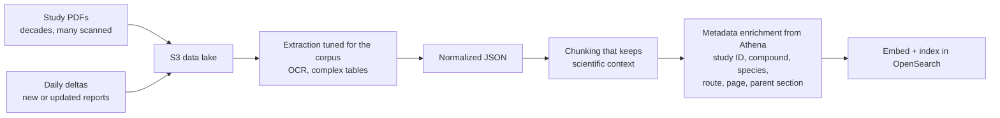
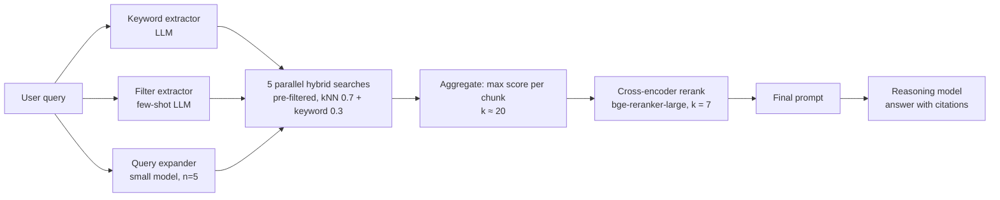
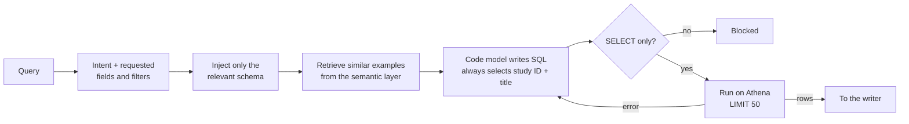
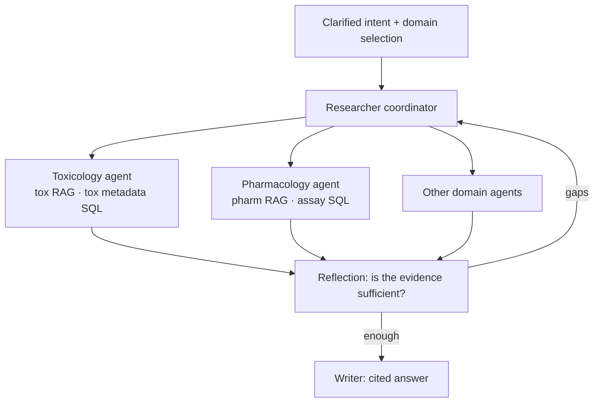

# 8 — Agentic RAG in production: the PRINCE retrieval stack

> Retrieval inside an agent is two pipelines. Unstructured documents go through RAG. Structured records go through Text-to-SQL. A coordinator routes between them.

This note started in the harness-engineering module
([ai-engineering/03-harness-engineering](../../../ai-engineering/03-harness-engineering/README.md)), which
used Bayer's PRINCE platform (built with Thoughtworks, written up on martinfowler.com by Sarang Sanjay Kulkarni,
2026) as its production case study. The harness parts stayed there: three kinds of reflection, retries,
state persistence, fallbacks and evaluation. The retrieval mechanics moved here: ingestion, the query-time
RAG pipeline, Text-to-SQL, NER metadata enrichment and the domain sub-agent hierarchy.

PRINCE answers preclinical scientists' questions over decades of study reports (mostly PDFs, many
scanned) and structured study metadata in Amazon Athena. It runs in three phases: **Search** (find
studies), **Ask** (question them) and **Do** (draft regulatory documents for expert review).

---

## The stack

| Layer | PRINCE choice |
|---|---|
| UI | React, which shows intermediate steps and citations |
| Orchestration | LangGraph workflow; Postgres checkpointer stores agent state per node |
| API | FastAPI |
| Unstructured store | Amazon OpenSearch Service (vectors + keyword + metadata) |
| Structured store | Amazon Athena (study metadata, assay results) |
| App state | DynamoDB (logs, intermediate steps, citations) |
| Models | One OpenAI-compatible endpoint fronting several providers; fallback to another provider |
| Observability | Langfuse traces and datasets; RAGAS-style metrics; daily live-traffic eval |

---

## Clarify intent before retrieval

The first node checks whether the query names enough to act on. A vague query triggers a clarifying
question instead of a retrieval run (fail fast). When the user has selected no data source, or several
with no clear focus, the model suggests the most relevant sources from the query's intent. The user can
accept, adjust or override it. A domain selector in the UI lets users pre-filter the valid tools up front.

This is the first context-assembly decision: it fixes which tools, domains and data sources are in scope
before any retrieval starts, so later agents get a focused problem.

---

## Ingestion

*Image Source: diagram based on Kulkarni (2026)*

The metadata attached at ingestion is what makes the query-time filter work. Without study ID and section
on every chunk, the pre-filter below has nothing to filter on.

---

## The query-time RAG pipeline

Running example: *"Were any of the following clinical findings observed in study T123456-2: piloerection,
ataxia, eyes partially closed, and loose faeces?"*

*Image Source: diagram based on Kulkarni (2026)*

1. **Keyword extraction.** An LLM pulls search terms: "piloerection", "ataxia", "eyes partially closed",
   "loose faeces".
2. **Metadata filter generation.** In parallel, an LLM writes a filter such as `eq(study_id, T123456-2)`.
   Few-shot examples cover many permutations of filter requests.
3. **Query expansion.** A smaller, faster model writes **n = 5** paraphrases ("goosebumps, lack of
   coordination, semi-closed eyelids, diarrhea…") to cover terminology drift.
4. **Hybrid retrieval.**
   - The metadata filter is applied *inside* the vector query, which shrinks the search space from
     millions of vectors to tens or hundreds.
   - Each of the 5 queries runs one hybrid search in parallel: semantic kNN plus keyword.
   - Within each search, semantic results are weighted **0.7** and keyword results **0.3** (found by
     experiment on this corpus).
   - Results are pooled; each unique chunk keeps its **highest** score across the 5 searches. Top
     **k ≈ 20** go forward.
5. **Rerank.** A cross-encoder (`bge-reranker-large`) scores each chunk against the original question and
   keeps the top **k = 7**.
6. **Generate with citations.** The 7 chunks and the question form the final prompt. A reasoning model
   answers and cites the chunks it used. Users hover a sentence to see the page number and exact quote.
7. **Monitor.** Langfuse traces the whole path.

---

## Text-to-SQL for structured data

RAG handles narrative reports. Questions that filter, aggregate or compare ("Give me 50 example studies
done on RAT", numeric assay results by dose group) go to Text-to-SQL against Athena.

*Image Source: diagram based on Kulkarni (2026)*

- **Schema subsetting.** For a large schema, only the tables and columns relevant to this query go into
  the prompt.
- **Dynamic few-shot from a "semantic layer".** Hand-picked question→Athena-SQL pairs live in their own
  vector collection. The closest ones are retrieved per query. New examples are added whenever a query
  pattern fails, so the tool improves over time.
- **Mandatory columns.** Study ID and study title are always selected so the writer can cite rows.
- **Mechanical validation.** Only `SELECT` is allowed; `DELETE`, `INSERT` and `UPDATE` are blocked.
  An earlier LLM SQL reviewer was **removed**: it flagged valid queries as wrong and cost more than it
  caught.
- **Result cap.** At most **50** rows per call, to avoid flooding the context.
- **Error loop.** On a failed run, the database error, the query and the original context go back to the
  same model, up to **3** attempts, then the tool reports failure.

PRINCE uses different Text-to-SQL engines per domain (Snowflake Cortex Analyst for pharmacology, custom
methods for toxicology), but the recipe above is the same.

---

## From one researcher to domain sub-agents

PRINCE began with two tools: one RAG retriever, one Text-to-SQL. As domains were onboarded, the tool list
grew and tools began to overlap: many operate on "studies", "findings" or "assays" but point at different
datasets, schemas and regulatory meanings. "The study" can mean a repeat-dose toxicology study, a
cardiovascular safety-pharmacology package or one assay in an aggregated table.

Two fixes, in order:

1. **A Think & Plan step** before tool calls. Reasoning explicitly about which tool matches the intent gave
   a large jump in tool-selection accuracy. (The harness view of this step is process reflection; see
   [03-harness-engineering note 05](../../../ai-engineering/03-harness-engineering/notes/05-verification-loops.md).)
2. **A hierarchy of domain sub-agents** (in progress). The top-level Researcher becomes a coordinator. It
   routes on the clarified intent and the UI's domain selection. Each domain agent owns its toolset (for
   example tox RAG + tox metadata SQL, or pharmacology RAG + assay-level SQL). It also has prompts that say
   which tables or indices are authoritative and how to read key terms. The aim is coherent
   responsibilities, no cross-domain leakage and per-domain retrieval tests.

*Image Source: diagram based on Kulkarni (2026)*

---

## Context discipline across the agents

Each agent gets the context for its job and nothing else:

| Agent | Receives | Not |
|---|---|---|
| Think & Plan | Planning context: the goal, progress, available tools | (not specified) |
| Researcher / Text-to-SQL | Only the schema slice relevant to this query | The full schema |
| Reflection | Original question + collected evidence | The full workflow history |
| Writer | Curated chunks with citation constraints | Raw retrieval output |

Splitting the monolithic agent this way also made each part testable and debuggable on its own.

---

## NER to repair the metadata

Text-to-SQL is only as good as the Athena metadata. Decades of migrations and differing lab practices left
fields incomplete, missing or wrong. PRINCE adds an NER utility:

1. Read study PDFs and extract entities: study IDs, compounds, species, routes of administration, dosage,
   clinical findings.
2. Turn the entities and their relations into structured annotations.
3. Score each extracted field for confidence. **High-confidence fields update Athena automatically. Low
   confidence goes to a quarantine queue for human review.**

It has been evaluated against curated datasets with promising results and is being wired into the data
pipelines. Better metadata improves both Text-to-SQL and the chunk-level filters in RAG.

---

## Evaluating the retrieval stack

- **Dataset evals** run on every significant change to the workflow, prompts or models. They use reference
  answers written by subject-matter experts and stored in Langfuse. Metrics: faithfulness, answer
  relevancy, context relevancy, answer accuracy, and semantic similarity to the reference.
- **Live-traffic evals** run daily as a batch on real queries without references, covering faithfulness
  and answer relevancy. They catch hallucinations in production.
- **Per-stage metrics**, like a testing pyramid: retrieval quality is measured separately from the final
  answer.

---

## Takeaways

- Put metadata on every chunk at ingestion. The query-time pre-filter depends on it.
- Expand the query, search in parallel, keep the max score, then rerank down to a small k.
- For structured data, inject only the relevant schema and retrieve SQL examples dynamically. Validate
  SQL mechanically, cap the rows and loop on database errors.
- As tools multiply, add an explicit planning step, then split by domain.
- Fix upstream data quality with confidence-gated automation and a human quarantine lane.

Related: the context-engineering pillar covers the retrieval pipeline as context assembly
([ai-engineering/02-context-engineering](../../../ai-engineering/02-context-engineering/README.md)).

---

→ Next: [09-vector-database-comparison.md](09-vector-database-comparison.md) — the vector stores behind both pipelines, and how to choose one.
